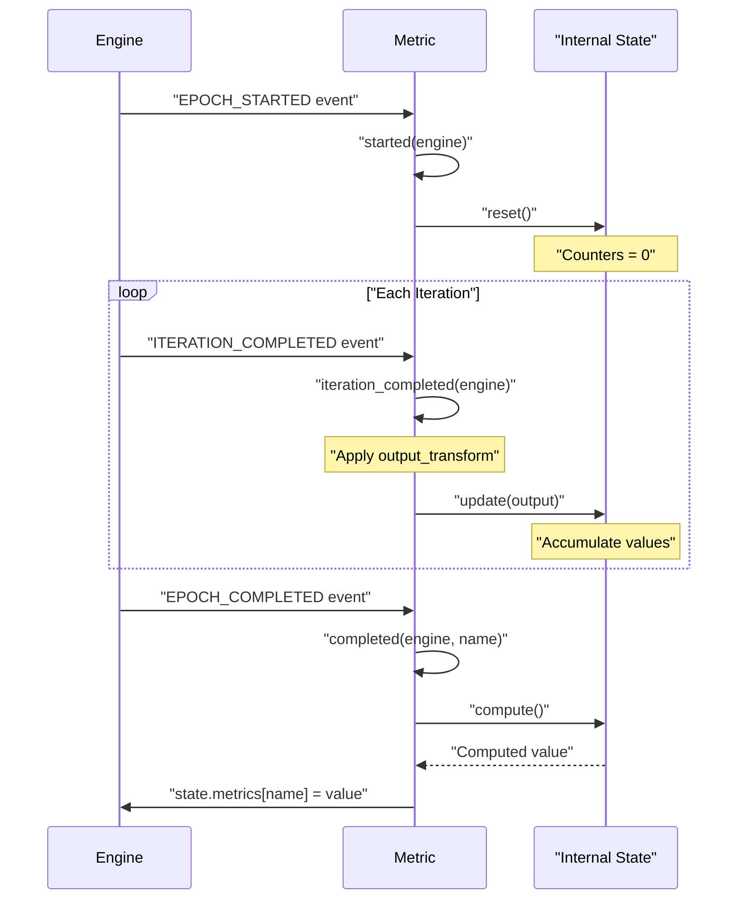
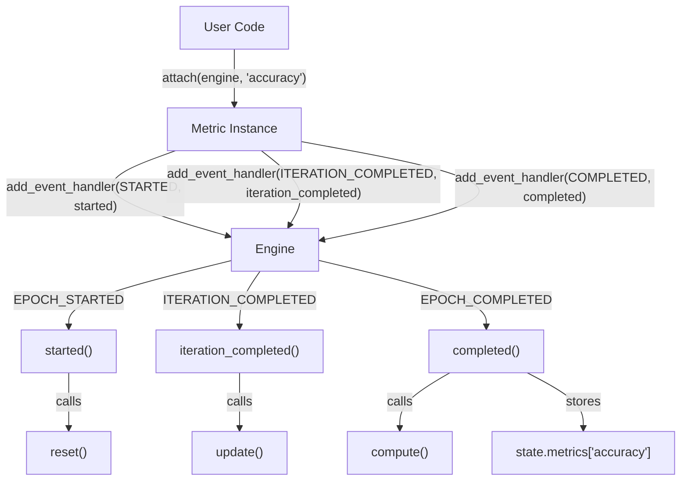
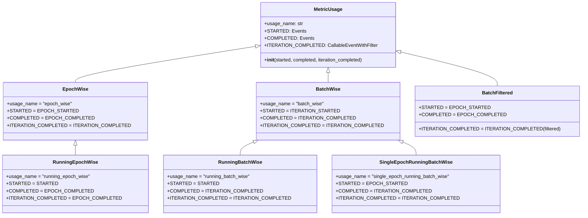

<!-- source: DeepWiki mcp.deepwiki.com · repo pytorch/ignite · page 3.1 Metric Base Class and Lifecycle · fetched 2026-10-21 -->

# Metric Base Class and Lifecycle

<details>
<summary>Relevant source files</summary>

The following files were used as context for generating this wiki page:

- [docs/source/metrics.rst](docs/source/metrics.rst)
- [ignite/contrib/metrics/regression/_base.py](ignite/contrib/metrics/regression/_base.py)
- [ignite/metrics/__init__.py](ignite/metrics/__init__.py)
- [ignite/metrics/accumulation.py](ignite/metrics/accumulation.py)
- [ignite/metrics/confusion_matrix.py](ignite/metrics/confusion_matrix.py)
- [ignite/metrics/epoch_metric.py](ignite/metrics/epoch_metric.py)
- [ignite/metrics/metric.py](ignite/metrics/metric.py)
- [requirements-dev.txt](requirements-dev.txt)
- [tests/ignite/metrics/test_accumulation.py](tests/ignite/metrics/test_accumulation.py)
- [tests/ignite/metrics/test_confusion_matrix.py](tests/ignite/metrics/test_confusion_matrix.py)
- [tests/ignite/metrics/test_epoch_metric.py](tests/ignite/metrics/test_epoch_metric.py)
- [tests/ignite/metrics/test_metric.py](tests/ignite/metrics/test_metric.py)

</details>


This page documents the `Metric` base class, which provides the core abstraction for computing performance metrics in PyTorch Ignite. It covers the metric lifecycle (`reset`/`update`/`compute`), attachment to engines, usage patterns, and output transformation. For information about specific built-in metrics like Accuracy or Precision, see [Classification and Regression Metrics](#3.2). For metric composition patterns, see [Metric Composition with MetricsLambda](#3.3). For distributed computation details, see [Distributed Metrics Computation](#3.4).

Sources: [docs/source/metrics.rst:1-15](), [ignite/metrics/metric.py:223-351]()

## Overview

Metrics in Ignite compute quantities of interest in an online fashion, accumulating state incrementally across batches without storing the entire output history. All metrics inherit from the abstract `Metric` base class and implement three core methods: `reset()`, `update()`, and `compute()`. Metrics automatically integrate with the Engine's event system when attached, triggering these methods at appropriate lifecycle points.

Sources: [docs/source/metrics.rst:1-15](), [ignite/metrics/metric.py:223-351]()

## The Metric Base Class

### Class Definition and Interface

The `Metric` class is an abstract base class (ABC) with a metaclass of `ABCMeta`. It also inherits from `Serializable` to support state serialization. All concrete metrics must implement three abstract methods: `reset()`, `update()`, and `compute()`.

```python
class Metric(Serializable, metaclass=ABCMeta):
    @abstractmethod
    def reset(self) -> None
    
    @abstractmethod
    def update(self, output: Any) -> None
    
    @abstractmethod
    def compute(self) -> Any
```

Sources: [ignite/metrics/metric.py:223-419]()

### Constructor Parameters

The `Metric` constructor accepts parameters including `output_transform`, `device`, and `skip_unrolling`. The constructor validates that `output_transform` is callable and raises `TypeError` if not. It also checks device constraints.

Sources: [ignite/metrics/metric.py:358-381]()

### Required Output Keys

The `required_output_keys` class attribute defines which keys must be present when the engine's output is a dictionary. By default, it is `("y_pred", "y")`. Setting `required_output_keys = None` indicates the metric expects a tuple/list output directly.

Sources: [ignite/metrics/metric.py:290-356](), [docs/source/metrics.rst:296-345](), [tests/ignite/metrics/test_metric.py:1023-1066]()

## Metric Lifecycle

### The Three Core Methods

Every metric follows a three-stage lifecycle:
1. **`reset()`** - Resets internal accumulators and counters to their initial state.
2. **`update(output)`** - Updates internal state using the current batch output.
3. **`compute()`** - Computes and returns the final metric value from accumulated state.

Title: Metric Lifecycle Sequence Diagram


Sources: [docs/source/metrics.rst:12-19](), [ignite/metrics/metric.py:383-419]()

### Lifecycle Timing

By default (using `EpochWise` usage), `reset()` is called at `EPOCH_STARTED`, `update()` at `ITERATION_COMPLETED`, and `compute()` at `EPOCH_COMPLETED`. The `update()` method is decorated with `@torch.no_grad()` to prevent gradient computation during evaluation.

Sources: [docs/source/metrics.rst:280-285](), [ignite/metrics/metric.py:421-478]()

### Helper Methods for Engine Integration

The `Metric` class provides helper methods (`started`, `iteration_completed`, `completed`) that integrate with the `Engine` event system, handling dictionary outputs, tuple/list unpacking, and optional tensor unrolling.

Sources: [ignite/metrics/metric.py:421-511]()

## Attaching Metrics to Engines

### The attach() Method

Metrics are connected to engines via the `attach()` method, registering event handlers that trigger lifecycle methods at appropriate points.

Title: Metric Attachment Architecture


Sources: [ignite/metrics/metric.py:529-569](), [docs/source/metrics.rst:21-35]()

### Usage Parameter and Detaching

The `usage` parameter controls event bindings. Metrics can also be detached via `detach()` and checked via `is_attached()`.

Sources: [ignite/metrics/metric.py:513-624](), [tests/ignite/metrics/test_metric.py:329-361]()

## MetricUsage Patterns

### Usage Classes Hierarchy

Title: MetricUsage Class Hierarchy


Sources: [ignite/metrics/metric.py:31-221]()

## Output Transform

### Purpose and Lambda Pitfall

The `output_transform` parameter adapts process function outputs. When using lambda functions in loops for multiple metrics, capture variables properly (e.g., using `functools.partial`) to avoid closure reference bugs.

Sources: [docs/source/metrics.rst:38-83](), [ignite/metrics/metric.py:227-238,448-478]()

## State Serialization

Metrics support serialization via `state_dict()` and `load_state_dict()` for checkpointing, utilizing distributed gathering across ranks when world size > 1.

Sources: [ignite/metrics/metric.py:626-715](), [tests/ignite/metrics/test_metric.py:1140-1419]()

## Metric Arithmetic and Composition

Dunder methods (`__add__`, `__mul__`, etc.) and `MetricsLambda` allow arithmetic composition of metrics.

Sources: [ignite/metrics/metric.py:717-795](), [docs/source/metrics.rst:152-184](), [tests/ignite/metrics/test_metric.py:135-280]()

## Example: Custom Metric Implementation

Custom metrics inherit from `Metric`, implementing `reset()`, `update()`, and `compute()`, with decorators like `@reinit__is_reduced` and `@sync_all_reduce`.

Sources: [docs/source/metrics.rst:186-276]()

---

