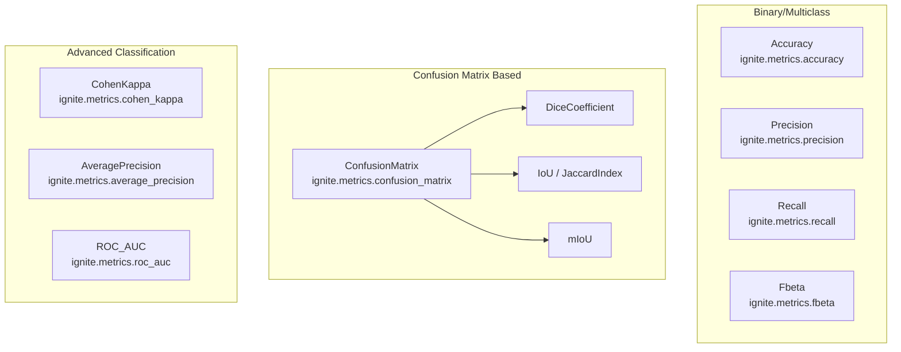
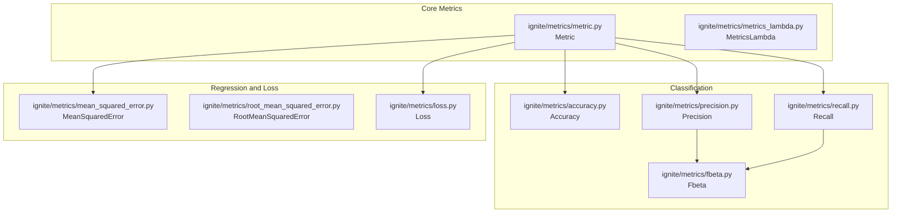

<!-- source: DeepWiki mcp.deepwiki.com · repo pytorch/ignite · page 3.2 Classification and Regression Metrics · fetched 2026-10-21 -->

# Classification and Regression Metrics

<details>
<summary>Relevant source files</summary>

The following files were used as context for generating this wiki page:

- [ignite/metrics/accuracy.py](ignite/metrics/accuracy.py)
- [ignite/metrics/average_precision.py](ignite/metrics/average_precision.py)
- [ignite/metrics/cohen_kappa.py](ignite/metrics/cohen_kappa.py)
- [ignite/metrics/fbeta.py](ignite/metrics/fbeta.py)
- [ignite/metrics/loss.py](ignite/metrics/loss.py)
- [ignite/metrics/mean_absolute_error.py](ignite/metrics/mean_absolute_error.py)
- [ignite/metrics/mean_pairwise_distance.py](ignite/metrics/mean_pairwise_distance.py)
- [ignite/metrics/mean_squared_error.py](ignite/metrics/mean_squared_error.py)
- [ignite/metrics/precision.py](ignite/metrics/precision.py)
- [ignite/metrics/recall.py](ignite/metrics/recall.py)
- [ignite/metrics/regression/mean_error.py](ignite/metrics/regression/mean_error.py)
- [ignite/metrics/regression/mean_normalized_bias.py](ignite/metrics/regression/mean_normalized_bias.py)
- [ignite/metrics/regression/median_absolute_error.py](ignite/metrics/regression/median_absolute_error.py)
- [ignite/metrics/regression/median_absolute_percentage_error.py](ignite/metrics/regression/median_absolute_percentage_error.py)
- [ignite/metrics/regression/median_relative_absolute_error.py](ignite/metrics/regression/median_relative_absolute_error.py)
- [ignite/metrics/regression/pearson_correlation.py](ignite/metrics/regression/pearson_correlation.py)
- [ignite/metrics/regression/r2_score.py](ignite/metrics/regression/r2_score.py)
- [ignite/metrics/regression/wave_hedges_distance.py](ignite/metrics/regression/wave_hedges_distance.py)
- [ignite/metrics/roc_auc.py](ignite/metrics/roc_auc.py)
- [ignite/metrics/root_mean_squared_error.py](ignite/metrics/root_mean_squared_error.py)
- [ignite/metrics/top_k_categorical_accuracy.py](ignite/metrics/top_k_categorical_accuracy.py)
- [tests/ignite/metrics/regression/test_median_absolute_error.py](tests/ignite/metrics/regression/test_median_absolute_error.py)
- [tests/ignite/metrics/regression/test_median_absolute_percentage_error.py](tests/ignite/metrics/regression/test_median_absolute_percentage_error.py)
- [tests/ignite/metrics/regression/test_median_relative_absolute_error.py](tests/ignite/metrics/regression/test_median_relative_absolute_error.py)
- [tests/ignite/metrics/test_accuracy.py](tests/ignite/metrics/test_accuracy.py)
- [tests/ignite/metrics/test_average_precision.py](tests/ignite/metrics/test_average_precision.py)
- [tests/ignite/metrics/test_cohen_kappa.py](tests/ignite/metrics/test_cohen_kappa.py)
- [tests/ignite/metrics/test_fbeta.py](tests/ignite/metrics/test_fbeta.py)
- [tests/ignite/metrics/test_loss.py](tests/ignite/metrics/test_loss.py)
- [tests/ignite/metrics/test_matthews_corrcoef.py](tests/ignite/metrics/test_matthews_corrcoef.py)
- [tests/ignite/metrics/test_precision.py](tests/ignite/metrics/test_precision.py)
- [tests/ignite/metrics/test_recall.py](tests/ignite/metrics/test_recall.py)
- [tests/ignite/metrics/test_roc_auc.py](tests/ignite/metrics/test_roc_auc.py)
- [tests/ignite/metrics/test_roc_curve.py](tests/ignite/metrics/test_roc_curve.py)

</details>


## Purpose and Scope

This page documents the built-in classification and regression metrics provided by PyTorch Ignite. These metrics enable evaluation of model performance across various task types including binary classification, multi-class classification, multi-label classification, regression, and specialized domains like object detection and segmentation.

For information about the base `Metric` class architecture and lifecycle (reset/update/compute), see [Metric Base Class and Lifecycle](#3.1). For information about composing metrics using arithmetic operations, see [Metric Composition with MetricsLambda](#3.3). For information about distributed metric computation, see [Distributed Metrics Computation](#3.4).

Sources: [ignite/metrics/accuracy.py:12-28](), [ignite/metrics/precision.py:16-51]()

---

## Classification Metrics Overview

Classification metrics evaluate model performance on categorical prediction tasks. All classification metrics inherit from the `Metric` base class and follow the standard reset/update/compute lifecycle.

### Classification Metrics Taxonomy



Sources: [ignite/metrics/accuracy.py:152-168](), [ignite/metrics/precision.py:16-51](), [ignite/metrics/recall.py:11-17]()

---

## Core Classification Metrics

### Accuracy

`Accuracy` computes the fraction of predictions that match the true labels for binary, multiclass, and multilabel data [ignite/metrics/accuracy.py:153]().

**Location**: [ignite/metrics/accuracy.py]()

**Key Parameters**:
- `output_transform`: Callable to transform engine output to `(y_pred, y)` format [ignite/metrics/accuracy.py:14-16]()
- `is_multilabel`: Boolean for multilabel classification (default: `False`) [ignite/metrics/accuracy.py:16]()
- `device`: Device for accumulation (default: `"cpu"`) [ignite/metrics/accuracy.py:17]()

**Usage Example**:
```python
from ignite.metrics import Accuracy
from ignite.engine import create_supervised_evaluator

# Binary or multiclass classification
accuracy = Accuracy()
metrics = {'accuracy': accuracy}
evaluator = create_supervised_evaluator(model, metrics=metrics, device=device)

state = evaluator.run(val_loader)
print(f"Accuracy: {state.metrics['accuracy']}")
```

Sources: [ignite/metrics/accuracy.py:152-168](), [tests/ignite/metrics/test_accuracy.py:67-87]()

### Precision and Recall

`Precision` and `Recall` compute the proportion of true positives among predicted positives and actual positives respectively, supporting multiple averaging strategies (`macro`, `micro`, `weighted`, `samples`, `None`, and `False`) [ignite/metrics/precision.py:37-41](), [ignite/metrics/recall.py:11-92]().

**Locations**: [ignite/metrics/precision.py](), [ignite/metrics/recall.py]()

**Key Parameters**:
- `average`: Averaging strategy (`macro`, `micro`, `weighted`, `samples`, `None`, `False`, or `True`) [ignite/metrics/precision.py:37-46]()
- `is_multilabel`: Boolean for multilabel classification [ignite/metrics/precision.py:23]()
- `device`: Device for accumulation [ignite/metrics/precision.py:24]()
- `class_names`: List of class name strings used to label per-class outputs when `average=False` [ignite/metrics/precision.py:26-35]()

**Usage Example**:
```python
from ignite.metrics import Precision, Recall

precision = Precision(average='macro')
recall = Recall(average='macro')

precision.attach(evaluator, 'precision')
recall.attach(evaluator, 'recall')
```

Sources: [ignite/metrics/precision.py:16-51](), [ignite/metrics/recall.py:11-104](), [tests/ignite/metrics/test_precision.py:104-134]()

### Fbeta Score

`Fbeta` computes the weighted harmonic mean of precision and recall [ignite/metrics/fbeta.py:22-26]().

**Location**: [ignite/metrics/fbeta.py]()

**Key Parameters**:
- `beta`: Weight of precision in harmonic mean [ignite/metrics/fbeta.py:14]()
- `average`: If `True`, computes unweighted average across classes; if `False`, returns per-class tensor [ignite/metrics/fbeta.py:15]()
- `precision`: Optional pre-computed `Precision` metric with `average=False` [ignite/metrics/fbeta.py:16]()
- `recall`: Optional pre-computed `Recall` metric with `average=False` [ignite/metrics/fbeta.py:17]()

**Usage Example**:
```python
from ignite.metrics import Fbeta, Precision, Recall

P = Precision(average=False)
R = Recall(average=False)
metric = Fbeta(beta=1.0, precision=P, recall=R)
metric.attach(evaluator, "f-beta")
```

Sources: [ignite/metrics/fbeta.py:13-49](), [tests/ignite/metrics/test_fbeta.py:88-138]()

---

## Regression Metrics Overview

Regression metrics evaluate continuous prediction tasks.

### Core Regression Metrics

### MeanAbsoluteError (MAE) and MeanSquaredError (MSE)

`MeanAbsoluteError` and `MeanSquaredError` compute absolute and squared errors across batches.

**Locations**: `ignite/metrics/mean_absolute_error.py`, [ignite/metrics/mean_squared_error.py]()

**Usage Example**:
```python
from ignite.metrics import MeanSquaredError, RootMeanSquaredError

mse = MeanSquaredError()
rmse = RootMeanSquaredError()

mse.attach(evaluator, 'mse')
rmse.attach(evaluator, 'rmse')
```

Sources: [ignite/metrics/mean_squared_error.py:11-86](), [ignite/metrics/root_mean_squared_error.py:10-69]()

---

## Loss Metric

The `Loss` metric wraps any PyTorch loss function to track its average value over an evaluation run [ignite/metrics/loss.py:11-18]().

**Location**: [ignite/metrics/loss.py]()

**Key Parameters**:
- `loss_fn`: Callable taking `(y_pred, y)` or `(y_pred, y, kwargs)` and returning average loss [ignite/metrics/loss.py:16-18]()
- `output_transform`: Callable to map engine output to expected format [ignite/metrics/loss.py:19-26]()
- `batch_size`: Callable returning batch size given target tensor [ignite/metrics/loss.py:27-28]()

**Usage Example**:
```python
import torch.nn as nn
from ignite.metrics import Loss

loss_metric = Loss(nn.CrossEntropyLoss())
loss_metric.attach(evaluator, 'loss')
```

Sources: [ignite/metrics/loss.py:11-112](), [tests/ignite/metrics/test_loss.py:80-92]()

---

## Code Organization



Sources: [ignite/metrics/accuracy.py:12](), [ignite/metrics/precision.py:16](), [ignite/metrics/loss.py:11]()

---

