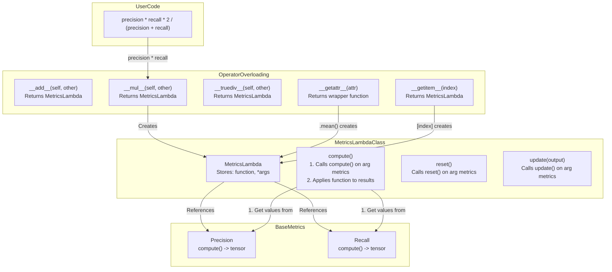

<!-- source: DeepWiki mcp.deepwiki.com · repo pytorch/ignite · page 3.3 Metric Composition with MetricsLambda · fetched 2026-10-21 -->

# Metric Composition with MetricsLambda

<details>
<summary>Relevant source files</summary>

The following files were used as context for generating this wiki page:

- [ignite/metrics/classification_report.py](ignite/metrics/classification_report.py)
- [ignite/metrics/mean_average_precision.py](ignite/metrics/mean_average_precision.py)
- [ignite/metrics/metric_group.py](ignite/metrics/metric_group.py)
- [ignite/metrics/metrics_lambda.py](ignite/metrics/metrics_lambda.py)
- [ignite/metrics/vision/__init__.py](ignite/metrics/vision/__init__.py)
- [ignite/metrics/vision/object_detection_average_precision_recall.py](ignite/metrics/vision/object_detection_average_precision_recall.py)
- [tests/ignite/metrics/test_classification_report.py](tests/ignite/metrics/test_classification_report.py)
- [tests/ignite/metrics/test_metrics_lambda.py](tests/ignite/metrics/test_metrics_lambda.py)
- [tests/ignite/metrics/vision/__init__.py](tests/ignite/metrics/vision/__init__.py)
- [tests/ignite/metrics/vision/test_object_detection_map.py](tests/ignite/metrics/vision/test_object_detection_map.py)

</details>


## Purpose and Scope

This document details how to compose complex metrics from simpler ones using arithmetic operations, PyTorch tensor methods, indexing, custom lambda functions, metric groups, and specialized classification reports in PyTorch Ignite. This functionality is primarily implemented through the `MetricsLambda` class [ignite/metrics/metrics_lambda.py:13-103](), `MetricGroup` class [ignite/metrics/metric_group.py:9-65](), and utility wrappers like `ClassificationReport` [ignite/metrics/classification_report.py:15-165]().

For information about the base `Metric` class and its lifecycle methods (`reset`, `update`, `compute`), see [Metric Base Class and Lifecycle](#3.1). For details on distributed metrics computation, see [Distributed Metrics Computation](#3.4).

## Overview

`MetricsLambda` enables the creation of derived metrics by composing existing metrics using:
- **Arithmetic operators** (`+`, `-`, `*`, `/`, `//`, `%`, `**`)
- **PyTorch tensor operations** (`.mean()`, `.sum()`, `.norm()`, etc.)
- **Indexing operations** (`metric[index]`)
- **Custom lambda functions** (arbitrary transformations)

The key benefit is that composed metrics participate in the same lifecycle as base metrics—they automatically call `compute()` on their constituent metrics and apply the transformation to the results [ignite/metrics/metrics_lambda.py:13-38]().

**Sources:** [ignite/metrics/metrics_lambda.py:13-103](), [ignite/metrics/metric.py:717-794]()

## Architecture: How Metric Composition Works



**Diagram: Metric Composition Architecture**

This diagram illustrates how operator overloading in the `Metric` base class creates `MetricsLambda` instances [ignite/metrics/metric.py:717-794](). When `compute()` is invoked on a `MetricsLambda`, it evaluates all dependency metrics and passes their CPU-materialized values to the underlying callable [ignite/metrics/metrics_lambda.py:143-146]().

**Sources:** [ignite/metrics/metrics_lambda.py:143-146](), [ignite/metrics/metric.py:717-794]()

## MetricsLambda Implementation and Arguments

The `MetricsLambda` class inherits from `Metric` and accepts a function `f`, positional metric arguments `*args`, keyword arguments `**kwargs`, and configuration parameters added in version 0.5.4 [ignite/metrics/metrics_lambda.py:13-114]():

```python
class MetricsLambda(Metric):
    def __init__(
        self,
        f: Callable,
        *args: Any,
        skip_unrolling: bool = False,
        metrics_result_mode: Literal["flatten", "named", "both"] = "both",
        **kwargs: Any,
    ) -> None:
        ...
```

### Key Parameters

- **`skip_unrolling`**: Specifies whether output should be unrolled before being fed to the update method. Useful for multi-output models [ignite/metrics/metrics_lambda.py:28-30]().
- **`metrics_result_mode`**: Controls how computed mapping results are placed into `engine.state.metrics`:
  - `"flatten"`: Keys and values of the mapping are placed directly into `state.metrics` [ignite/metrics/metrics_lambda.py:33]().
  - `"named"`: The entire mapping is stored under the metric name [ignite/metrics/metrics_lambda.py:34]().
  - `"both"`: Combines both behaviors [ignite/metrics/metrics_lambda.py:35]().

**Sources:** [ignite/metrics/metrics_lambda.py:13-120]()

## Arithmetic and Tensor Operators

### Supported Arithmetic Operators
The `Metric` class overloads arithmetic operators like `__add__`, `__sub__`, `__mul__`, `__truediv__`, `__pow__`, and their reverse counterparts (`__radd__`, etc.) to return `MetricsLambda` instances [ignite/metrics/metric.py:717-776]().

```python
from ignite.metrics import Precision, Recall

precision = Precision(average=False)
recall = Recall(average=False)

# Compose F1 using arithmetic operators and tensor methods
F1 = (precision * recall * 2 / (precision + recall)).mean()
F1.attach(evaluator, "f1")
```

**Sources:** [ignite/metrics/metric.py:717-776](), [tests/ignite/metrics/test_metrics_lambda.py:102-138]()

## Grouping Metrics with MetricGroup

When managing multiple distinct metrics simultaneously without combining them via arithmetic expressions, `MetricGroup` allows you to group metrics under a dictionary name [ignite/metrics/metric_group.py:9-12]().

```python
from ignite.metrics import MetricGroup, Accuracy, Precision, Loss
import torch.nn as nn

metric_group = MetricGroup({
    'acc': Accuracy(),
    'precision': Precision(),
    'loss': Loss(nn.NLLLoss())
})
metric_group.attach(default_evaluator, "eval_metrics")
```

`MetricGroup` delegates `reset()`, `update()`, and `compute()` across all registered child metrics, returning a dictionary of results [ignite/metrics/metric_group.py:56-65]().

**Sources:** [ignite/metrics/metric_group.py:9-65]()

## Classification Reports via Metric Composition

`ClassificationReport` is a prominent real-world example of `MetricsLambda` composition [ignite/metrics/classification_report.py:15-165](). It aggregates precision, recall, and `Fbeta` metrics across classes into a structured dictionary or string report comparable to scikit-learn [ignite/metrics/classification_report.py:24-27]().

```mermaid
graph TB
    subgraph "ClassificationReport Composition"
        Prec[Precision average=False]
        Rec[Recall average=False]
        FBeta[Fbeta beta=beta]
        APrec[precision.mean()]
        ARec[recall.mean()]
        AFBeta[fbeta.mean()]
        
        Wrapper["_wrapper(re, pr, f, a_re, a_pr, a_f)"]
        Lambda["MetricsLambda(_wrapper, recall, precision, fbeta, ...)"]
        
        Prec --> FBeta
        Rec --> FBeta
        
        Prec --> Lambda
        Rec --> Lambda
        FBeta --> Lambda
        APrec --> Lambda
        ARec --> Lambda
        AFBeta --> Lambda
    end
```

**Diagram: ClassificationReport Architecture**

**Sources:** [ignite/metrics/classification_report.py:121-165]()

## Testing and Validation

Unit tests in `tests/ignite/metrics/test_metrics_lambda.py` and `tests/ignite/metrics/test_classification_report.py` validate correctness under single-process and distributed contexts, verifying reset propagation, update guards, and state serialization [tests/ignite/metrics/test_metrics_lambda.py:74-138](), [tests/ignite/metrics/test_classification_report.py:14-84]().

**Sources:** [tests/ignite/metrics/test_metrics_lambda.py:1-232](), [tests/ignite/metrics/test_classification_report.py:1-177]()

---

