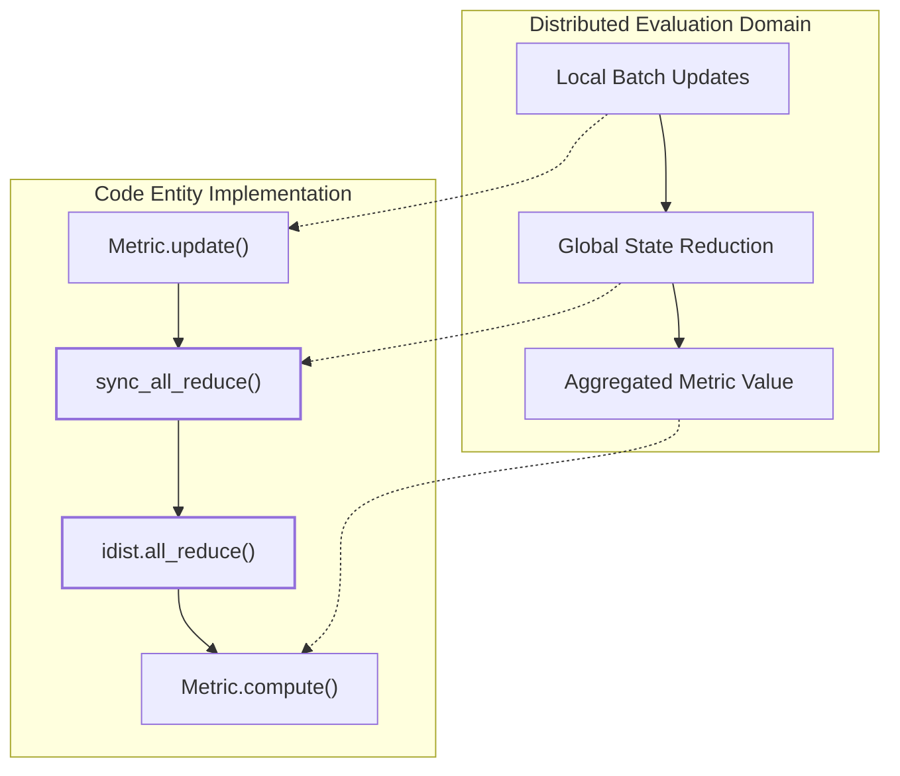
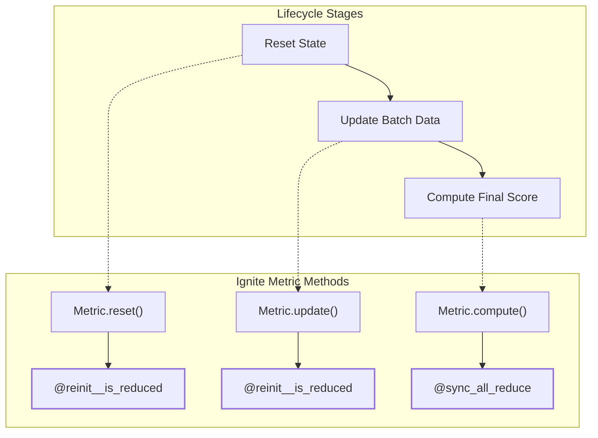
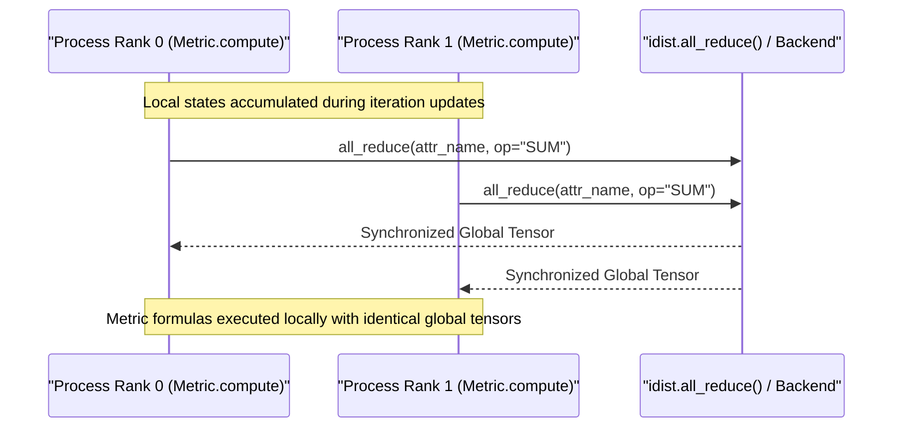

<!-- source: DeepWiki mcp.deepwiki.com · repo pytorch/ignite · page 3.4 Distributed Metrics Computation · fetched 2026-10-21 -->

# Distributed Metrics Computation

<details>
<summary>Relevant source files</summary>

The following files were used as context for generating this wiki page:

- [docs/source/metrics.rst](docs/source/metrics.rst)
- [ignite/distributed/comp_models/base.py](ignite/distributed/comp_models/base.py)
- [ignite/distributed/comp_models/horovod.py](ignite/distributed/comp_models/horovod.py)
- [ignite/distributed/comp_models/native.py](ignite/distributed/comp_models/native.py)
- [ignite/distributed/comp_models/xla.py](ignite/distributed/comp_models/xla.py)
- [ignite/distributed/launcher.py](ignite/distributed/launcher.py)
- [ignite/distributed/utils.py](ignite/distributed/utils.py)
- [ignite/metrics/__init__.py](ignite/metrics/__init__.py)
- [ignite/metrics/metric.py](ignite/metrics/metric.py)
- [requirements-dev.txt](requirements-dev.txt)
- [tests/ignite/distributed/utils/__init__.py](tests/ignite/distributed/utils/__init__.py)
- [tests/ignite/distributed/utils/test_horovod.py](tests/ignite/distributed/utils/test_horovod.py)
- [tests/ignite/distributed/utils/test_native.py](tests/ignite/distributed/utils/test_native.py)
- [tests/ignite/distributed/utils/test_serial.py](tests/ignite/distributed/utils/test_serial.py)
- [tests/ignite/distributed/utils/test_xla.py](tests/ignite/distributed/utils/test_xla.py)
- [tests/ignite/metrics/test_metric.py](tests/ignite/metrics/test_metric.py)

</details>


This page explains how PyTorch Ignite handles metrics computation in distributed training environments. It covers cross-process synchronization, the `@sync_all_reduce` decorator, reduction operations (`SUM`, `MAX`, `MIN`), and metric state management via `state_dict` and `load_state_dict` in multi-GPU/multi-node setups.

Sources: [docs/source/metrics.rst:87-104](), [ignite/metrics/metric.py](), [ignite/distributed/utils.py:329-349]()

## Overview

In distributed training, metric accumulators (such as counts, sums, or confusion matrices) are computed locally across different processes or devices (`idist.get_world_size() > 1`). To produce globally correct validation or test scores, PyTorch Ignite automatically synchronizes internal state variables across participating ranks before invoking `compute()`.



Sources: [docs/source/metrics.rst:87-104](), [ignite/metrics/metric.py](), [ignite/distributed/utils.py:39-41]()

## Distributed Architecture & Decorators

PyTorch Ignite relies on two primary decorators defined in `ignite/metrics/metric.py` to manage distributed states:
1. `@reinit__is_reduced`: Applied to `reset()` and `update()` methods to clear or update local buffers and flag that synchronization has not yet occurred for the current evaluation cycle.
2. `@sync_all_reduce`: Applied to the `compute()` method. It automatically performs collective reduction operations on specified attribute names across all active processes.



Sources: [ignite/metrics/metric.py](), [tests/ignite/metrics/test_metric.py:15-25]()

## Reduction Operations (`SUM`, `MAX`, `MIN`, `PRODUCT`)

When `@sync_all_reduce` is invoked on metric attributes, it passes reduction operation specifiers down to the distributed utility layer (`ignite.distributed.utils.all_reduce`). Supported reduction operations include:
- `SUM`: Adds tensor values across all ranks (default for sums and sample counts).
- `MAX`: Computes element-wise maximum across ranks.
- `MIN`: Computes element-wise minimum across ranks.
- `PRODUCT`: Computes element-wise product across ranks.

Syntax can specify per-variable operators or default to `SUM`. For instance, collective backend implementations handle these via PyTorch distributed (`torch.distributed.all_reduce`), Horovod (`horovod.torch`), or XLA (`torch_xla.core.xla_model.all_reduce`).

Sources: [ignite/distributed/utils.py:39-41](), [tests/ignite/distributed/utils/__init__.py:76-110](), [ignite/distributed/comp_models/xla.py:135-149]()

## Cross-Process Synchronization Flow

During `compute()`, the `@sync_all_reduce` decorator ensures that every rank participates in the collective reduction step before evaluating final metric formulas.



Sources: [docs/source/metrics.rst:304-308](), [ignite/distributed/utils.py:39-41](), [ignite/distributed/comp_models/native.py:11-15]()

## Metric State Serialization (`state_dict`) in Distributed Settings

Metrics in PyTorch Ignite inherit from `Serializable` (`ignite.base.mixins.Serializable`), enabling state preservation via `state_dict()` and `load_state_dict()`. 

In distributed settings:
- Each process holds its local accumulator states inside the metric instance.
- When saving checkpoints via handlers like `Checkpoint`, rank 0 or all ranks can serialize state dictionaries. Because metrics synchronize their accumulators during `compute()`, checkpoints saved post-evaluation contain consistent metrics state.
- Note that metrics cannot always be pickled directly if they capture arbitrary lambda expressions; using libraries like `dill` is recommended for advanced serialization needs.

Sources: [docs/source/metrics.rst:110-112](), [ignite/metrics/metric.py:11-13]()

## Practical Usage & Custom Distributed Metrics

Using built-in or custom metrics in distributed configurations requires no explicit MPI or `dist` calls within the evaluation loop. The `idist` abstraction and `@sync_all_reduce` handle tensor exchange transparently.

```python
from ignite.metrics import Metric
from ignite.exceptions import NotComputableError
from ignite.metrics.metric import reinit__is_reduced, sync_all_reduce
import torch

class CustomDistributedMetric(Metric):
    @reinit__is_reduced
    def reset(self):
        self._sum = torch.tensor(0.0, device=self._device)
        self._num_examples = 0

    @reinit__is_reduced
    def update(self, output):
        y_pred, y = output
        self._sum += torch.sum(y_pred).to(self._device)
        self._num_examples += y_pred.shape[0]

    @sync_all_reduce("_sum", "_num_examples")
    def compute(self):
        if self._num_examples == 0:
            raise NotComputableError("No examples accumulated.")
        return self._sum.item() / self._num_examples
```

Sources: [docs/source/metrics.rst:87-112](), [ignite/metrics/metric.py](), [tests/ignite/metrics/test_metric.py:15-43]()

---

