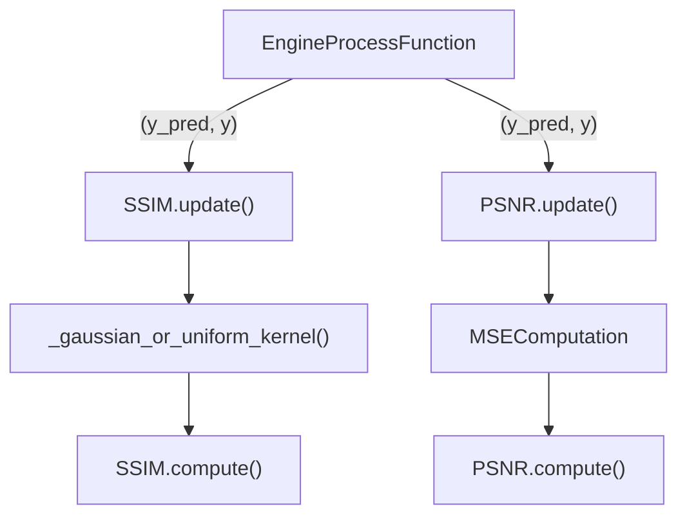
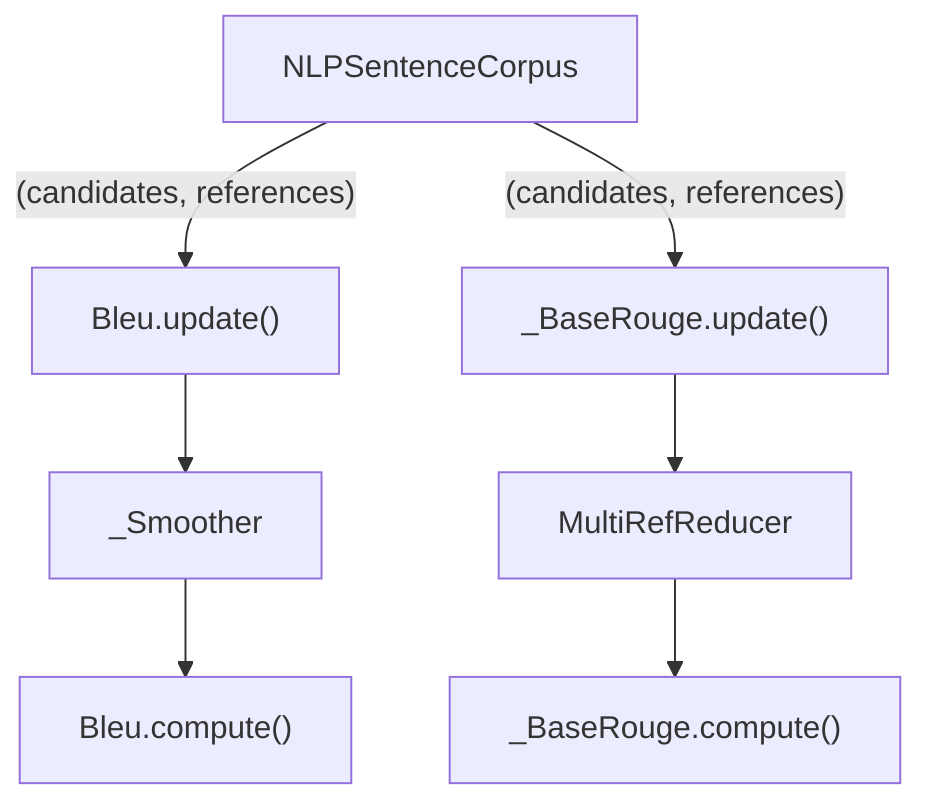
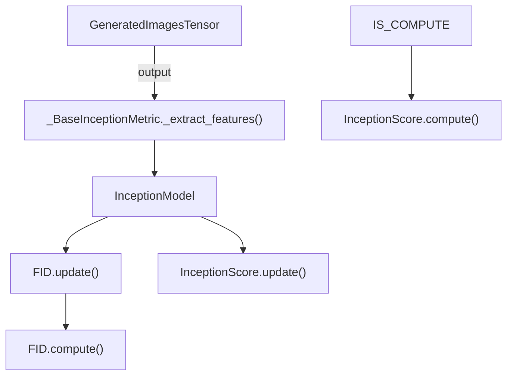
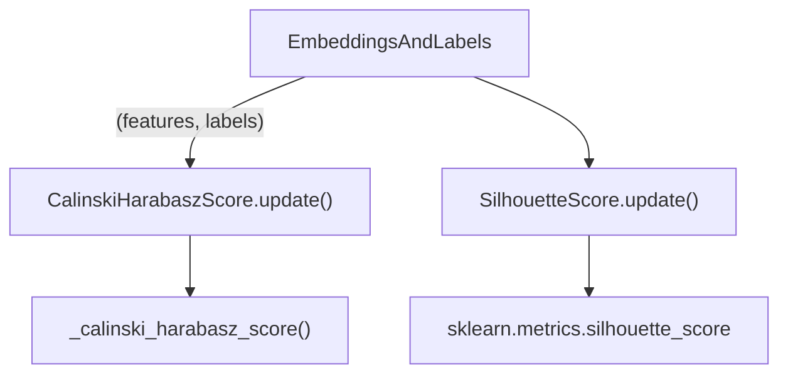
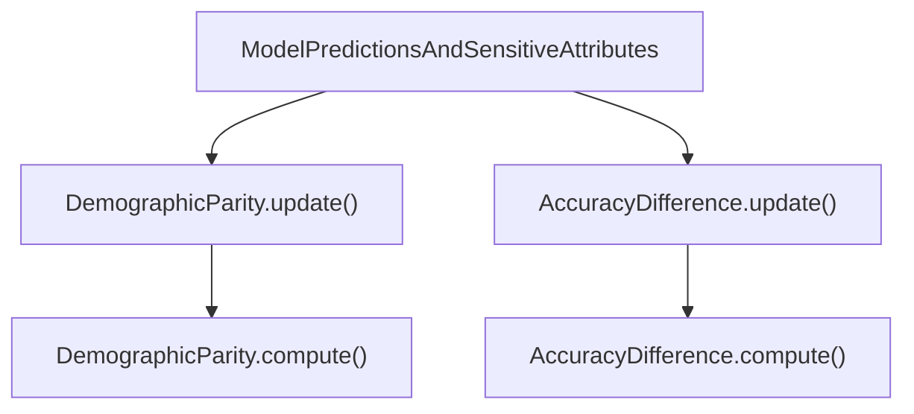

<!-- source: DeepWiki mcp.deepwiki.com · repo pytorch/ignite · page 3.5 Domain-Specific Metrics (Vision, NLP, GAN, Clustering, Fairness) · fetched 2026-10-21 -->

# Domain-Specific Metrics (Vision, NLP, GAN, Clustering, Fairness)

Relevant source files

The following files were used as context for generating this wiki page:

- [docs/source/defaults.rst](docs/source/defaults.rst)
- [ignite/handlers/logger_utils.py](ignite/handlers/logger_utils.py)
- [ignite/metrics/clustering/__init__.py](ignite/metrics/clustering/__init__.py)
- [ignite/metrics/clustering/_base.py](ignite/metrics/clustering/_base.py)
- [ignite/metrics/clustering/calinski_harabasz_score.py](ignite/metrics/clustering/calinski_harabasz_score.py)
- [ignite/metrics/clustering/davies_bouldin_score.py](ignite/metrics/clustering/davies_bouldin_score.py)
- [ignite/metrics/clustering/silhouette_score.py](ignite/metrics/clustering/silhouette_score.py)
- [ignite/metrics/fairness/__init__.py](ignite/metrics/fairness/__init__.py)
- [ignite/metrics/fairness/accuracy_difference.py](ignite/metrics/fairness/accuracy_difference.py)
- [ignite/metrics/fairness/base.py](ignite/metrics/fairness/base.py)
- [ignite/metrics/fairness/demographic_parity.py](ignite/metrics/fairness/demographic_parity.py)
- [ignite/metrics/gan/__init__.py](ignite/metrics/gan/__init__.py)
- [ignite/metrics/gan/fid.py](ignite/metrics/gan/fid.py)
- [ignite/metrics/gan/inception_score.py](ignite/metrics/gan/inception_score.py)
- [ignite/metrics/gan/utils.py](ignite/metrics/gan/utils.py)
- [ignite/metrics/js_divergence.py](ignite/metrics/js_divergence.py)
- [ignite/metrics/kl_divergence.py](ignite/metrics/kl_divergence.py)
- [ignite/metrics/maximum_mean_discrepancy.py](ignite/metrics/maximum_mean_discrepancy.py)
- [ignite/metrics/multilabel_confusion_matrix.py](ignite/metrics/multilabel_confusion_matrix.py)
- [ignite/metrics/nlp/__init__.py](ignite/metrics/nlp/__init__.py)
- [ignite/metrics/nlp/bleu.py](ignite/metrics/nlp/bleu.py)
- [ignite/metrics/nlp/character_error_rate.py](ignite/metrics/nlp/character_error_rate.py)
- [ignite/metrics/nlp/perplexity.py](ignite/metrics/nlp/perplexity.py)
- [ignite/metrics/nlp/rouge.py](ignite/metrics/nlp/rouge.py)
- [ignite/metrics/nlp/utils.py](ignite/metrics/nlp/utils.py)
- [ignite/metrics/psnr.py](ignite/metrics/psnr.py)
- [ignite/metrics/rec_sys/__init__.py](ignite/metrics/rec_sys/__init__.py)
- [ignite/metrics/rec_sys/hitrate.py](ignite/metrics/rec_sys/hitrate.py)
- [ignite/metrics/rec_sys/ndcg.py](ignite/metrics/rec_sys/ndcg.py)
- [ignite/metrics/running_average.py](ignite/metrics/running_average.py)
- [ignite/metrics/ssim.py](ignite/metrics/ssim.py)
- [tests/ignite/__init__.py](tests/ignite/__init__.py)
- [tests/ignite/contrib/handlers/test_logger_utils.py](tests/ignite/contrib/handlers/test_logger_utils.py)
- [tests/ignite/metrics/clustering/__init__.py](tests/ignite/metrics/clustering/__init__.py)
- [tests/ignite/metrics/clustering/test_calinski_harabasz_score.py](tests/ignite/metrics/clustering/test_calinski_harabasz_score.py)
- [tests/ignite/metrics/clustering/test_davies_bouldin_score.py](tests/ignite/metrics/clustering/test_davies_bouldin_score.py)
- [tests/ignite/metrics/clustering/test_silhouette_score.py](tests/ignite/metrics/clustering/test_silhouette_score.py)
- [tests/ignite/metrics/conftest.py](tests/ignite/metrics/conftest.py)
- [tests/ignite/metrics/fairness/test_accuracy_difference.py](tests/ignite/metrics/fairness/test_accuracy_difference.py)
- [tests/ignite/metrics/fairness/test_demographic_parity.py](tests/ignite/metrics/fairness/test_demographic_parity.py)
- [tests/ignite/metrics/gan/test_fid.py](tests/ignite/metrics/gan/test_fid.py)
- [tests/ignite/metrics/gan/test_inception_score.py](tests/ignite/metrics/gan/test_inception_score.py)
- [tests/ignite/metrics/gan/test_utils.py](tests/ignite/metrics/gan/test_utils.py)
- [tests/ignite/metrics/nlp/__init__.py](tests/ignite/metrics/nlp/__init__.py)
- [tests/ignite/metrics/nlp/_pyrouge.py](tests/ignite/metrics/nlp/_pyrouge.py)
- [tests/ignite/metrics/nlp/test_bleu.py](tests/ignite/metrics/nlp/test_bleu.py)
- [tests/ignite/metrics/nlp/test_character_error_rate.py](tests/ignite/metrics/nlp/test_character_error_rate.py)
- [tests/ignite/metrics/nlp/test_perplexity.py](tests/ignite/metrics/nlp/test_perplexity.py)
- [tests/ignite/metrics/nlp/test_rouge.py](tests/ignite/metrics/nlp/test_rouge.py)
- [tests/ignite/metrics/nlp/test_utils.py](tests/ignite/metrics/nlp/test_utils.py)
- [tests/ignite/metrics/rec_sys/__init__.py](tests/ignite/metrics/rec_sys/__init__.py)
- [tests/ignite/metrics/rec_sys/test_hitrate_metric.py](tests/ignite/metrics/rec_sys/test_hitrate_metric.py)
- [tests/ignite/metrics/rec_sys/test_ndcg.py](tests/ignite/metrics/rec_sys/test_ndcg.py)
- [tests/ignite/metrics/test_js_divergence.py](tests/ignite/metrics/test_js_divergence.py)
- [tests/ignite/metrics/test_kl_divergence.py](tests/ignite/metrics/test_kl_divergence.py)
- [tests/ignite/metrics/test_maximum_mean_discrepancy.py](tests/ignite/metrics/test_maximum_mean_discrepancy.py)
- [tests/ignite/metrics/test_psnr.py](tests/ignite/metrics/test_psnr.py)
- [tests/ignite/metrics/test_running_average.py](tests/ignite/metrics/test_running_average.py)
- [tests/ignite/metrics/test_ssim.py](tests/ignite/metrics/test_ssim.py)

This page provides full technical documentation for specialized domain-specific metric families in PyTorch Ignite. These include Computer Vision metrics (`SSIM`, `PSNR`), Natural Language Processing metrics (`Bleu`, `Rouge`, `Perplexity`, `CER`), Generative Adversarial Network metrics (`FID`, `InceptionScore`), Clustering scores (`CalinskiHarabaszScore`, `SilhouetteScore`, `DaviesBouldinScore`), and Fairness/Recommender metrics. 

---

## 3.5.1 Computer Vision Metrics (SSIM and PSNR)

Computer vision evaluation requires pixel-level comparison metrics that correlate with human visual perception, such as Structural Similarity Index Measure (`SSIM`) and Peak Signal-to-Noise Ratio (`PSNR`).

### Implementation and Data Flow
Both metrics inherit from the base `Metric` class [ignite/metrics/ssim.py:13](), [ignite/metrics/psnr.py:11](). They expect `(y_pred, y)` tensor pairs in their `.update()` methods, checking shape and type consistency before accumulating batch-wise metrics.

- **SSIM (`SSIM`)**: Computes structural similarity using either a Gaussian or uniform kernel across 2D or 3D image tensors [ignite/metrics/ssim.py:78-138]. It calculates luminance, contrast, and structural terms over local windows.
- **PSNR (`PSNR`)**: Computes the peak signal-to-noise ratio based on Mean Squared Error (MSE) over the specified `data_range` [ignite/metrics/psnr.py:11-130].

*Sources: [ignite/metrics/ssim.py:78-138](), [ignite/metrics/psnr.py:11-135](), [tests/ignite/metrics/test_ssim.py:106-124](), [tests/ignite/metrics/test_psnr.py:51-68]()*

---

## 3.5.2 Natural Language Processing Metrics (Bleu, Rouge, Perplexity, CER)

Text generation and translation tasks rely on token- or character-level sequence matching algorithms.

### Key Classes and Functions
- **`Bleu`**: Computes the BLEU score with optional n-gram weights and smoothing functions (`_Smoother`) [ignite/metrics/nlp/bleu.py:21-158]. Supports both micro and macro averaging modes [ignite/metrics/nlp/bleu.py:148-156].
- **`RougeN` & `RougeL`**: Inherit from `_BaseRouge` [ignite/metrics/nlp/rouge.py:120] to compute precision, recall, and F-measure based on n-gram co-occurrences (`compute_ngram_scores`) or longest common subsequences (`compute_lcs_scores`) [ignite/metrics/nlp/rouge.py:38-87]. Includes multi-reference reduction strategies (`MultiRefAverageReducer`, `MultiRefBestReducer`) [ignite/metrics/nlp/rouge.py:99-118].
- **Character Error Rate (`CER`)** and **Perplexity**: Evaluate token prediction accuracy and sequence probabilities.

*Sources: [ignite/metrics/nlp/bleu.py:21-174](), [ignite/metrics/nlp/rouge.py:38-181]() *

---

## 3.5.3 Generative Adversarial Network (GAN) Metrics (FID and Inception Score)

Evaluating generative models requires distribution-level comparison features extracted via pre-trained networks (typically Inception-V3).

### Implementation Details
- **`_BaseInceptionMetric`**: Base class handling feature extraction via `InceptionModel` or custom `torch.nn.Module` extractors [ignite/metrics/gan/utils.py:9-101].
- **`FID` (Frechet Inception Distance)**: Computes the Fréchet distance between multivariate normal distributions fitted to feature representations of real and generated images [ignite/metrics/gan/fid.py:21-167]. Requires `scipy` for matrix square root calculations (`scipy.linalg.sqrtm`) [ignite/metrics/gan/fid.py:30-40].
- **`InceptionScore`**: Calculates the KL divergence between conditional and marginal label distributions predicted by the Inception network [ignite/metrics/gan/inception_score.py:14-137].

*Sources: [ignite/metrics/gan/fid.py:21-167](), [ignite/metrics/gan/inception_score.py:14-137](), [ignite/metrics/gan/utils.py:9-101]()*

---

## 3.5.4 Clustering Scores

Clustering metrics assess unsupervised data groupings using latent embeddings and cluster assignments.

### Implementation Details
Clustering metrics inherit from `_ClusteringMetricBase` [ignite/metrics/clustering/_base.py] and wrap `scikit-learn` scoring functions:
- **`CalinskiHarabaszScore`**: Evaluates between-cluster dispersion relative to within-cluster dispersion [ignite/metrics/clustering/calinski_harabasz_score.py:12-23].
- **`SilhouetteScore`**: Measures how similar an object is to its own cluster compared to other clusters.
- **`DaviesBouldinScore`**: Computes the average similarity between each cluster and its most similar counterpart.

*Sources: [ignite/metrics/clustering/calinski_harabasz_score.py:12-115]() *

---

## 3.5.5 Recommender Systems and Fairness Metrics

PyTorch Ignite also supplies metrics for recommendation systems and algorithmic fairness.

### Key Classes
- **Recommender Systems**: `HitRate` [ignite/metrics/rec_sys/hitrate.py] and `NDCG` [ignite/metrics/rec_sys/ndcg.py] evaluate top-K item retrieval quality.
- **Fairness Metrics**: `DemographicParity` [ignite/metrics/fairness/demographic_parity.py] and `AccuracyDifference` [ignite/metrics/fairness/accuracy_difference.py] compute disparate impact and demographic parity across sensitive attribute groups, inheriting from `FairnessMetricBase` [ignite/metrics/fairness/base.py].

*Sources: [ignite/metrics/fairness/base.py](), [ignite/metrics/fairness/demographic_parity.py](), [ignite/metrics/rec_sys/hitrate.py](), [ignite/metrics/rec_sys/ndcg.py]()*

---

