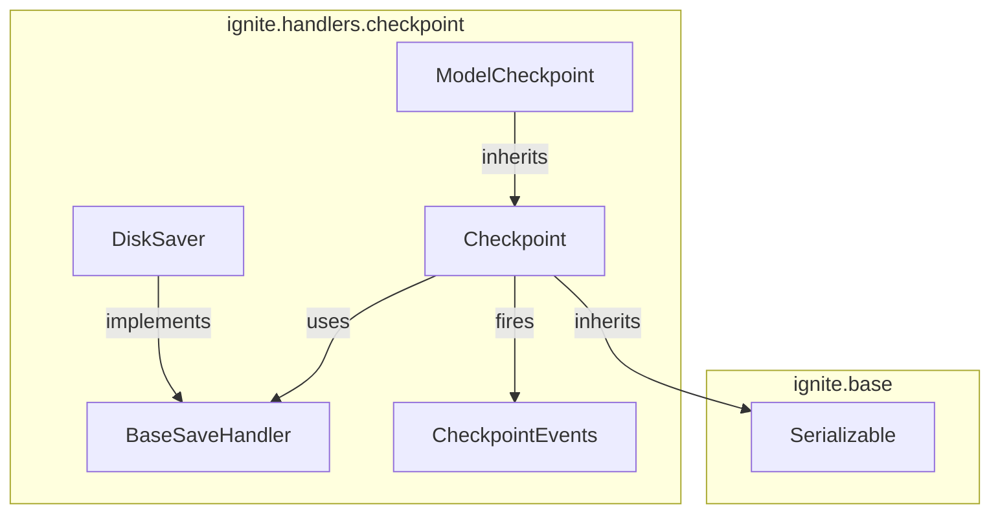
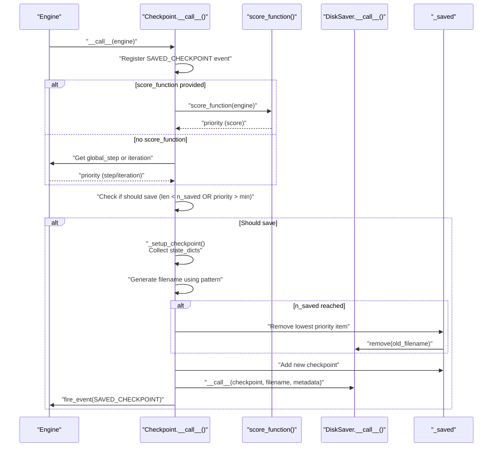
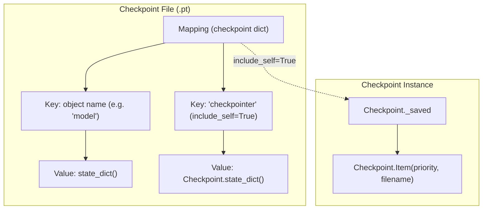

<!-- source: DeepWiki mcp.deepwiki.com · repo pytorch/ignite · page 4.1 Checkpoint and Model Saving · fetched 2026-10-21 -->

# Checkpoint and Model Saving

<details>
<summary>Relevant source files</summary>

The following files were used as context for generating this wiki page:

- [docs/source/handlers.rst](docs/source/handlers.rst)
- [ignite/handlers/__init__.py](ignite/handlers/__init__.py)
- [ignite/handlers/checkpoint.py](ignite/handlers/checkpoint.py)
- [tests/ignite/handlers/test_checkpoint.py](tests/ignite/handlers/test_checkpoint.py)

</details>


## Purpose and Scope

This page documents PyTorch Ignite's checkpoint and model saving system (`ignite.handlers.checkpoint`), which provides handlers for periodically saving training state to disk or other storage backends [ignite/handlers/checkpoint.py:85-89](). The system supports saving models, optimizers, learning rate schedulers, and other objects with `state_dict`/`load_state_dict` methods [ignite/handlers/checkpoint.py:86-87](). It includes features for keeping only the best $N$ checkpoints based on scores, automatic filename generation, and distributed training support [ignite/handlers/checkpoint.py:104-125]().

For information about other handlers (early stopping, learning rate scheduling, etc.), see [Training Control Handlers](#4.2). For logging and experiment tracking, see [Logging and Experiment Tracking](#4.3).

**Sources:** [ignite/handlers/checkpoint.py:85-315]()

## Architecture Overview



**Description:** The checkpoint system has three main components: `Checkpoint` is the primary handler that orchestrates saving, `BaseSaveHandler` defines the interface for storage backends, and `DiskSaver` implements disk-based storage [ignite/handlers/checkpoint.py:41-105](). `ModelCheckpoint` is a convenience wrapper around `Checkpoint` + `DiskSaver` for the common case of saving to disk [ignite/handlers/checkpoint.py:910-915]().

**Sources:** [ignite/handlers/checkpoint.py:85-1054](), [ignite/handlers/__init__.py:3]()

## Class Hierarchy and Responsibilities

| Class | Purpose | Key Methods |
|-------|---------|-------------|
| `Checkpoint` | Main checkpoint handler, manages priority queue of saved checkpoints | `__call__()`, `state_dict()`, `load_state_dict()`, `load_objects()` [ignite/handlers/checkpoint.py:85-768]() |
| `ModelCheckpoint` | Simplified API for disk-only checkpointing | Inherits from `Checkpoint`, uses `DiskSaver` internally [ignite/handlers/checkpoint.py:910-915]() |
| `BaseSaveHandler` | Abstract base for storage backends | `__call__()`, `remove()` [ignite/handlers/checkpoint.py:41-83]() |
| `DiskSaver` | Disk-based save handler with atomic writes | `__call__()`, `remove()` [ignite/handlers/checkpoint.py:816-908]() |
| `CheckpointEvents` | Event enumeration | `SAVED_CHECKPOINT` [ignite/handlers/checkpoint.py:30-39]() |

**Sources:** [ignite/handlers/checkpoint.py:27-1054]()

## Checkpoint Class

The `Checkpoint` class is the core handler for periodic state saving. It maintains a priority queue of saved checkpoints and automatically removes older ones based on the `n_saved` parameter [ignite/handlers/checkpoint.py:86-111]().

### Constructor Parameters

```python
Checkpoint(
    to_save: Mapping,
    save_handler: Union[str, Path, Callable, BaseSaveHandler],
    filename_prefix: str = "",
    score_function: Optional[Callable] = None,
    score_name: Optional[str] = None,
    n_saved: Union[int, None] = 1,
    global_step_transform: Optional[Callable] = None,
    filename_pattern: Optional[str] = None,
    include_self: bool = False,
    greater_or_equal: bool = False,
    save_on_rank: int = 0,
)
```

**Key Parameters:**

| Parameter | Type | Description |
|-----------|------|-------------|
| `to_save` | `Mapping` | Dictionary mapping names to objects with `state_dict()` method [ignite/handlers/checkpoint.py:92-95]() |
| `save_handler` | `str/Path/Callable/BaseSaveHandler` | Where to save checkpoints; string/Path creates `DiskSaver` [ignite/handlers/checkpoint.py:96-102]() |
| `filename_prefix` | `str` | Prefix for checkpoint filenames [ignite/handlers/checkpoint.py:103-103]() |
| `score_function` | `Callable` | Function taking `Engine` and returning score; highest scores retained [ignite/handlers/checkpoint.py:104-106]() |
| `score_name` | `str` | Name for score metric; if no `score_function`, auto-creates one from `engine.state.metrics[score_name]` [ignite/handlers/checkpoint.py:107-110]() |
| `n_saved` | `int/None` | Number of checkpoints to keep; `None` keeps all [ignite/handlers/checkpoint.py:111-112]() |
| `global_step_transform` | `Callable` | Function `(engine, event_name) -> int` for custom global step [ignite/handlers/checkpoint.py:113-115]() |
| `include_self` | `bool` | Whether to include checkpoint handler's own `state_dict` [ignite/handlers/checkpoint.py:119-120]() |
| `save_on_rank` | `int` | Which rank saves in distributed training [ignite/handlers/checkpoint.py:123-125]() |

**Sources:** [ignite/handlers/checkpoint.py:321-379]()

### Checkpoint Lifecycle



**Description:** When called by the engine, `Checkpoint` computes a priority (from score function or global step), determines if this checkpoint should be saved (either space available or priority higher than lowest saved), collects state dictionaries from all objects in `to_save`, generates the filename, removes old checkpoints if needed, and saves the new checkpoint [ignite/handlers/checkpoint.py:441-511]().

**Sources:** [ignite/handlers/checkpoint.py:441-511]()

### Handling DataParallel and DistributedDataParallel

The `_setup_checkpoint` method automatically unwraps models wrapped in `torch.nn.DataParallel` or `torch.nn.parallel.DistributedDataParallel` to save only the inner model's state [ignite/handlers/checkpoint.py:513-526]().

For `ZeroRedundancyOptimizer`, it consolidates the distributed optimizer state to a single rank [ignite/handlers/checkpoint.py:518-521]().

**Sources:** [ignite/handlers/checkpoint.py:513-526]()

### Static Helper Methods

#### `load_objects`

Static method to load state dictionaries into objects [ignite/handlers/checkpoint.py:587-669]():
- Accepts checkpoint as file path, string filepath, or dictionary [ignite/handlers/checkpoint.py:591-594]()
- Automatically handles `DataParallel`/`DistributedDataParallel` unwrapping [ignite/handlers/checkpoint.py:612-618]()
- Supports `strict=False` for partial loading (useful for transfer learning) [ignite/handlers/checkpoint.py:596-598]()

**Sources:** [ignite/handlers/checkpoint.py:587-669]()

#### `get_default_score_fn`

Static factory for creating score functions from metric names [ignite/handlers/checkpoint.py:770-813]():
- Creates function that retrieves `engine.state.metrics[metric_name]` [ignite/handlers/checkpoint.py:795-802]()
- `score_sign=-1.0` for error-like metrics (lower is better) [ignite/handlers/checkpoint.py:785-792]()

**Sources:** [ignite/handlers/checkpoint.py:770-813]()

## Filename Pattern System

Checkpoint filenames follow a pattern that incorporates prefix, name, global step, and score [ignite/handlers/checkpoint.py:130-157]().

### Default Filename Pattern Structure

```
{filename_prefix}_{name}_{suffix}.{ext}
```

Where `suffix` depends on what's provided [ignite/handlers/checkpoint.py:137-145]().

**Sources:** [ignite/handlers/checkpoint.py:130-157]()

### Custom Filename Patterns

Users can provide custom `filename_pattern` with template variables such as `{filename_prefix}`, `{name}`, `{score}`, `{score_name}`, `{global_step}`, and `{ext}` [ignite/handlers/checkpoint.py:165-175]().

**Sources:** [ignite/handlers/checkpoint.py:165-175]()

### Filename Pattern Generation

```mermaid
graph TB
    Start["Checkpoint.__call__()"]
    HasPattern{filename_pattern<br/>provided?}
    UseCustom["Custom pattern"]
    GenerateDefault["Checkpoint.setup_filename_pattern()"]
    
    Start --> HasPattern
    HasPattern -->|Yes| UseCustom
    HasPattern -->|No| GenerateDefault
    
    GenerateDefault --> CheckPrefix{with_prefix?}
    CheckPrefix -->|Yes| AddPrefix["Add {filename_prefix}"]
    CheckPrefix -->|No| NoPrefix["Start with {name}"]
    
    AddPrefix --> CheckStep{with_global_step?}
    NoPrefix --> CheckStep
    
    CheckStep -->|Yes| AddStep["Add {global_step}"]
    CheckStep -->|No| NoStep[""]
    
    AddStep --> CheckScoreName{with_score_name<br/>AND with_score?}
    NoStep --> CheckScore{with_score?}
    
    CheckScoreName -->|Yes| AddScoreName["Add {score_name}={score}"]
    CheckScoreName -->|No| CheckScore
    
    CheckScore -->|Yes| AddScore["Add {score}"]
    CheckScore -->|No| NoScore[""]
    
    AddScoreName --> AddExt["Add {ext}"]
    AddScore --> AddExt
    NoScore --> AddExt
    
    AddExt --> FormatProtocol["Format string"]
    UseCustom --> FormatProtocol
    
    FormatProtocol --> Result["filename"]
```

**Description:** The filename pattern is either user-provided or generated based on which components are available. The `setup_filename_pattern()` static method constructs the default pattern [ignite/handlers/checkpoint.py:381-391](), [ignite/handlers/checkpoint.py:528-577]().

**Sources:** [ignite/handlers/checkpoint.py:381-391](), [ignite/handlers/checkpoint.py:528-577]()

## DiskSaver

`DiskSaver` is the built-in save handler for disk-based storage [ignite/handlers/checkpoint.py:816-853](). It supports atomic writes and distributed configurations [ignite/handlers/checkpoint.py:835-865]().

### Atomic Save Mechanism

When `atomic=True`, `DiskSaver` writes the checkpoint to a temporary file in the same directory and then replaces the target file atomically using `os.replace()` [ignite/handlers/checkpoint.py:885-903](). This prevents checkpoint corruption if the process crashes during a save operation [ignite/handlers/checkpoint.py:838-842]().

**Sources:** [ignite/handlers/checkpoint.py:816-908]()

### TPU/XLA Support

`DiskSaver` automatically detects TPU environments and uses `torch_xla.core.xla_model.save()` instead of `torch.save()` [ignite/handlers/checkpoint.py:874-883](). All TPU processes must call the save function to avoid hanging [ignite/handlers/checkpoint.py:50-54]().

**Sources:** [ignite/handlers/checkpoint.py:874-883]()

## ModelCheckpoint

`ModelCheckpoint` is a simplified API that combines `Checkpoint` + `DiskSaver` for the common disk-only use case [ignite/handlers/checkpoint.py:910-915](). It inherits from `Checkpoint` and internally creates a `DiskSaver` [ignite/handlers/checkpoint.py:910-915]().

**Sources:** [ignite/handlers/checkpoint.py:910-1054]()

## Common Usage Patterns

- **Saving every N iterations or epochs**: Attach a `Checkpoint` handler to `Events.ITERATION_COMPLETED(every=N)` or `Events.EPOCH_COMPLETED` [ignite/handlers/checkpoint.py:223-236]()
- **Saving best models based on validation score**: Provide `score_function` or `score_name` [ignite/handlers/checkpoint.py:244-268]()
- **Full resumability with `include_self=True`**: Includes the checkpointer's own state dict in the checkpoint file to preserve saved items history [ignite/handlers/checkpoint.py:340-347]()
- **Responding to checkpoint events**: Listen to `Checkpoint.SAVED_CHECKPOINT` (`CheckpointEvents.SAVED_CHECKPOINT`) [ignite/handlers/checkpoint.py:278-295]()

**Sources:** [ignite/handlers/checkpoint.py:223-295]()

## Distributed Training Considerations

In distributed configurations, `save_on_rank` specifies which process executes the save operation (default is rank 0) [ignite/handlers/checkpoint.py:123-125](). However, all processes must instantiate and attach the checkpoint handler to participate in engine event loops and avoid deadlocks [ignite/handlers/checkpoint.py:187-206]().

For `ZeroRedundancyOptimizer`, `consolidate_state_dict()` is automatically called to gather optimizer states onto the designated saving rank [ignite/handlers/checkpoint.py:518-521]().

**Sources:** [ignite/handlers/checkpoint.py:187-206](), [ignite/handlers/checkpoint.py:518-521]()

## Checkpoint Data Structure



**Description:** A checkpoint file contains a dictionary mapping object names to their state dictionaries [ignite/handlers/checkpoint.py:462-468](). When `include_self=True`, the handler's internal saved items list is embedded under the `"checkpointer"` key [ignite/handlers/checkpoint.py:504-506]().

**Sources:** [ignite/handlers/checkpoint.py:462-506](), [ignite/handlers/checkpoint.py:754-768]()

---

