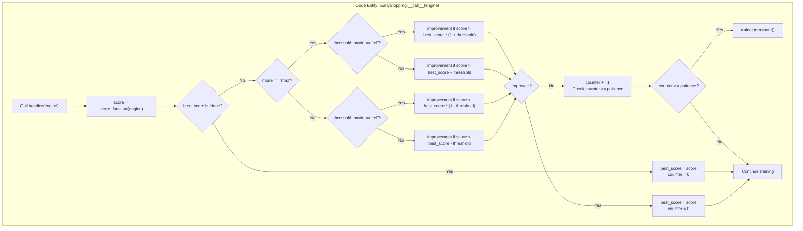
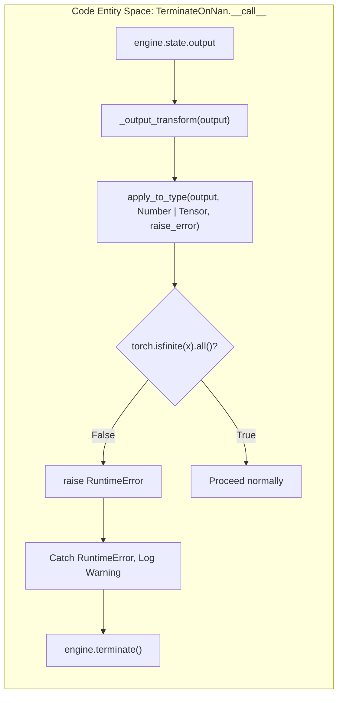
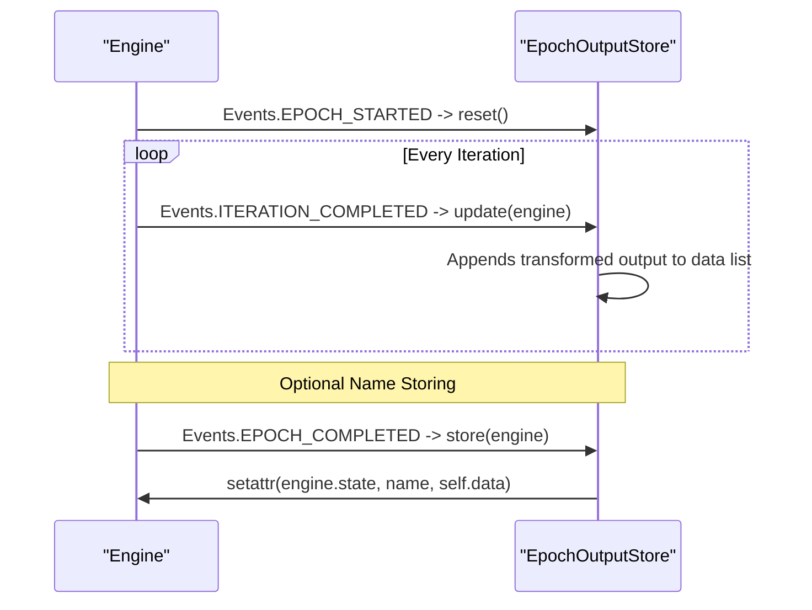

<!-- source: DeepWiki mcp.deepwiki.com · repo pytorch/ignite · page 4.2 Training Control Handlers · fetched 2026-10-21 -->

# Training Control Handlers

<details>
<summary>Relevant source files</summary>

The following files were used as context for generating this wiki page:

- [examples/siamese_network/README.md](examples/siamese_network/README.md)
- [examples/siamese_network/requirements.txt](examples/siamese_network/requirements.txt)
- [examples/siamese_network/siamese_network.py](examples/siamese_network/siamese_network.py)
- [ignite/handlers/early_stopping.py](ignite/handlers/early_stopping.py)
- [ignite/handlers/stores.py](ignite/handlers/stores.py)
- [ignite/handlers/terminate_on_nan.py](ignite/handlers/terminate_on_nan.py)
- [ignite/handlers/time_limit.py](ignite/handlers/time_limit.py)
- [ignite/handlers/timing.py](ignite/handlers/timing.py)
- [ignite/handlers/utils.py](ignite/handlers/utils.py)
- [tests/ignite/handlers/test_early_stopping.py](tests/ignite/handlers/test_early_stopping.py)
- [tests/ignite/handlers/test_handlers.py](tests/ignite/handlers/test_handlers.py)
- [tests/ignite/handlers/test_terminate_on_nan.py](tests/ignite/handlers/test_terminate_on_nan.py)
- [tests/ignite/handlers/test_time_limit.py](tests/ignite/handlers/test_time_limit.py)
- [tests/ignite/handlers/test_timing.py](tests/ignite/handlers/test_timing.py)
- [tests/run_multinode_tests_in_docker.sh](tests/run_multinode_tests_in_docker.sh)

</details>


Training control handlers modify the execution flow of the training loop based on runtime conditions, performance metrics, hardware constraints, or timing thresholds. PyTorch Ignite provides several robust handlers (`EarlyStopping`, `TerminateOnNan`, `TimeLimit`, `Timer`, and `EpochOutputStore`) that integrate cleanly with the `Engine` event system.

Sources: [ignite/handlers/early_stopping.py:13-74](), [ignite/handlers/terminate_on_nan.py:13-32](), [ignite/handlers/time_limit.py:10-28](), [ignite/handlers/timing.py:9-90](), [ignite/handlers/stores.py:7-42]().

---

## 1. Overview of Training Control Handlers

Training control handlers attach to engine events to monitor training dynamics and enforce safety or optimization constraints. 

| Handler Class | Target File | Core Purpose | Typical Attachment Event |
|--------------|------------|--------------|--------------------------|
| `EarlyStopping` | `ignite/handlers/early_stopping.py` | Terminate training when validation score plateaus | `Events.COMPLETED` (on evaluator) |
| `TerminateOnNan` | `ignite/handlers/terminate_on_nan.py` | Stop training immediately upon encountering NaN/Inf values | `Events.ITERATION_COMPLETED` (on trainer) |
| `TimeLimit` | `ignite/handlers/time_limit.py` | Enforce wall-clock time limits for constrained compute environments | `Events.ITERATION_COMPLETED` or `Events.ITERATION_STARTED` |
| `Timer` | `ignite/handlers/timing.py` | Profile execution time per batch, epoch, or run | Custom via `.attach()` or lifecycle events |
| `EpochOutputStore` | `ignite/handlers/stores.py` | Aggregate epoch predictions and targets for visualization | `Events.EPOCH_STARTED`, `Events.ITERATION_COMPLETED` |

Sources: [ignite/handlers/early_stopping.py:13-64](), [ignite/handlers/terminate_on_nan.py:13-30](), [ignite/handlers/time_limit.py:10-25](), [ignite/handlers/timing.py:9-89](), [ignite/handlers/stores.py:7-72]().

---

## 2. EarlyStopping

The `EarlyStopping` class [ignite/handlers/early_stopping.py:13]() monitors validation scores and signals the trainer engine to terminate if no improvement occurs within a specified `patience` window.

### Implementation and Logic

`EarlyStopping` inherits from `Serializable` and `ResettableHandler` [ignite/handlers/early_stopping.py:13](). It evaluates a user-defined `score_function(engine)` [ignite/handlers/early_stopping.py:18]() against the best recorded score using absolute (`'abs'`) or relative (`'rel'`) thresholding modes [ignite/handlers/early_stopping.py:30-43]() for either maximization (`'max'`) or minimization (`'min'`) [ignite/handlers/early_stopping.py:44]().



Sources: [ignite/handlers/early_stopping.py:13-151](), [tests/ignite/handlers/test_early_stopping.py:37-54]().

### Usage Example

```python
from ignite.engine import Engine, Events
from ignite.handlers import EarlyStopping

def score_function(engine):
    val_loss = engine.state.metrics["nll"]
    return -val_loss

handler = EarlyStopping(
    patience=10,
    score_function=score_function,
    trainer=trainer,
    mode="max"
)

evaluator.add_event_handler(Events.COMPLETED, handler)
```

Sources: [ignite/handlers/early_stopping.py:47-64]().

---

## 3. TerminateOnNan

The `TerminateOnNan` handler [ignite/handlers/terminate_on_nan.py:13]() inspects the output of an engine's `process_function` for `NaN`, `inf`, or invalid numerical values in numbers or `torch.Tensor` structures, gracefully terminating training when detected [ignite/handlers/terminate_on_nan.py:14-18]().

### Mechanism

When invoked on an event like `Events.ITERATION_COMPLETED`, `TerminateOnNan` applies an optional `output_transform` [ignite/handlers/terminate_on_nan.py:34]() and recursively checks all numerical and tensor components using `torch.isfinite` [ignite/handlers/terminate_on_nan.py:46](). If any non-finite value is found, a `RuntimeError` is caught, a warning is logged, and `engine.terminate()` is executed [ignite/handlers/terminate_on_nan.py:51-53]().



Sources: [ignite/handlers/terminate_on_nan.py:13-53](), [tests/ignite/handlers/test_terminate_on_nan.py:25-40]().

---

## 4. TimeLimit

The `TimeLimit` handler [ignite/handlers/time_limit.py:10]() manages training execution in environments with rigid session length limits (e.g., Kaggle or preemptible cloud nodes). It measures elapsed wall-clock time from its initialization and calls `engine.terminate()` when `limit_sec` is exceeded [ignite/handlers/time_limit.py:11-13, 40-44]().

### Parameters and Usage

- `limit_sec`: Maximum duration in seconds before termination (defaults to `28800` seconds / 8 hours) [ignite/handlers/time_limit.py:16, 30]().

```python
from ignite.engine import Events
from ignite.handlers import TimeLimit

# Terminate after 4 hours
handler = TimeLimit(limit_sec=14400)
trainer.add_event_handler(Events.ITERATION_COMPLETED, handler)
```

Sources: [ignite/handlers/time_limit.py:10-26]().

---

## 5. Timer

The `Timer` class [ignite/handlers/timing.py:9]() records wall-clock execution time between arbitrary engine events using `time.perf_counter()` [ignite/handlers/timing.py:1, 131]().

### Key Attributes and Methods

- `total`: Total active time elapsed in seconds [ignite/handlers/timing.py:17].
- `step_count`: Internal counter incremented via `.step()` to compute average times per iteration/batch [ignite/handlers/timing.py:18, 163-165].
- `attach(engine, start, pause, resume, step)`: Automatically registers event handlers to manage timer state (`reset`, `pause`, `resume`, `step`) [ignite/handlers/timing.py:97-127]().

```python
from ignite.engine import Engine, Events
from ignite.handlers import Timer

trainer = Engine(training_update_function)
timer = Timer(average=True)
timer.attach(
    trainer,
    start=Events.STARTED,
    resume=Events.ITERATION_STARTED,
    pause=Events.ITERATION_COMPLETED,
    step=Events.ITERATION_COMPLETED
)
```

Sources: [ignite/handlers/timing.py:9-127](), [tests/ignite/handlers/test_timing.py:13-35]().

---

## 6. EpochOutputStore

The `EpochOutputStore` handler [ignite/handlers/stores.py:7]() aggregates model predictions and targets across all iterations within an epoch. This is particularly useful for custom plotting or epoch-level evaluation summaries.

### Data Flow and Attachment



Sources: [ignite/handlers/stores.py:7-72]().

---

## Summary of Cited Sources

- `ignite/handlers/early_stopping.py`: [ignite/handlers/early_stopping.py:1-176]()
- `ignite/handlers/terminate_on_nan.py`: [ignite/handlers/terminate_on_nan.py:1-53]()
- `ignite/handlers/time_limit.py`: [ignite/handlers/time_limit.py:1-44]()
- `ignite/handlers/timing.py`: [ignite/handlers/timing.py:1-168]()
- `ignite/handlers/stores.py`: [ignite/handlers/stores.py:1-72]()
- `ignite/handlers/utils.py`: [ignite/handlers/utils.py:1-40]()

---

