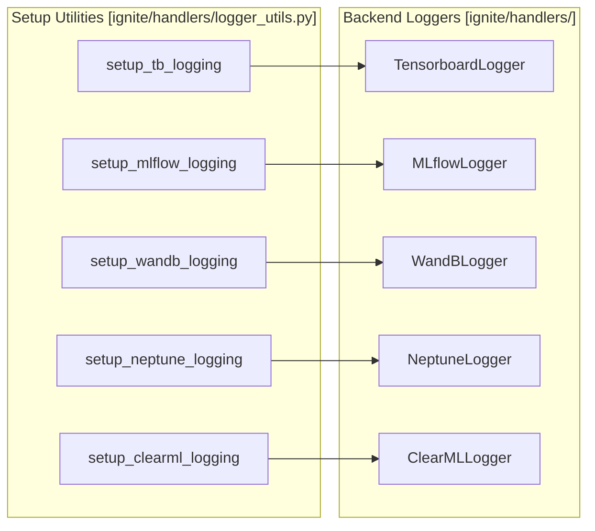

<!-- source: DeepWiki mcp.deepwiki.com · repo pytorch/ignite · page 4.3 Logging and Experiment Tracking · fetched 2026-10-21 -->

# Logging and Experiment Tracking

<details>
<summary>Relevant source files</summary>

The following files were used as context for generating this wiki page:

- [docs/Makefile](docs/Makefile)
- [examples/mnist/mnist_with_clearml_logger.py](examples/mnist/mnist_with_clearml_logger.py)
- [examples/mnist/mnist_with_neptune_logger.py](examples/mnist/mnist_with_neptune_logger.py)
- [examples/mnist/mnist_with_tensorboard_logger.py](examples/mnist/mnist_with_tensorboard_logger.py)
- [examples/mnist/mnist_with_tqdm_logger.py](examples/mnist/mnist_with_tqdm_logger.py)
- [examples/mnist/mnist_with_visdom_logger.py](examples/mnist/mnist_with_visdom_logger.py)
- [examples/mnist/mnist_with_wandb_logger.py](examples/mnist/mnist_with_wandb_logger.py)
- [ignite/handlers/base_logger.py](ignite/handlers/base_logger.py)
- [ignite/handlers/clearml_logger.py](ignite/handlers/clearml_logger.py)
- [ignite/handlers/fbresearch_logger.py](ignite/handlers/fbresearch_logger.py)
- [ignite/handlers/logger_utils.py](ignite/handlers/logger_utils.py)
- [ignite/handlers/mlflow_logger.py](ignite/handlers/mlflow_logger.py)
- [ignite/handlers/neptune_logger.py](ignite/handlers/neptune_logger.py)
- [ignite/handlers/polyaxon_logger.py](ignite/handlers/polyaxon_logger.py)
- [ignite/handlers/tensorboard_logger.py](ignite/handlers/tensorboard_logger.py)
- [ignite/handlers/visdom_logger.py](ignite/handlers/visdom_logger.py)
- [ignite/handlers/wandb_logger.py](ignite/handlers/wandb_logger.py)
- [ignite/metrics/rec_sys/__init__.py](ignite/metrics/rec_sys/__init__.py)
- [ignite/metrics/rec_sys/hitrate.py](ignite/metrics/rec_sys/hitrate.py)
- [ignite/metrics/rec_sys/ndcg.py](ignite/metrics/rec_sys/ndcg.py)
- [tests/ignite/contrib/handlers/test_logger_utils.py](tests/ignite/contrib/handlers/test_logger_utils.py)
- [tests/ignite/handlers/test_fbresearch_logger.py](tests/ignite/handlers/test_fbresearch_logger.py)
- [tests/ignite/handlers/test_wandb_logger.py](tests/ignite/handlers/test_wandb_logger.py)
- [tests/ignite/metrics/rec_sys/__init__.py](tests/ignite/metrics/rec_sys/__init__.py)
- [tests/ignite/metrics/rec_sys/test_hitrate_metric.py](tests/ignite/metrics/rec_sys/test_hitrate_metric.py)
- [tests/ignite/metrics/rec_sys/test_ndcg.py](tests/ignite/metrics/rec_sys/test_ndcg.py)

</details>


This page documents PyTorch Ignite's logging and experiment tracking ecosystem, covering platform-specific integrations (TensorBoard, MLflow, Neptune, WandB, ClearML, Visdom, Polyaxon), research-oriented loggers (`FBResearchLogger`), progress tracking (`ProgressBar`), and base logging handler classes (`BaseLogger`, `BaseOutputHandler`, `BaseOptimizerParamsHandler`).

## 1. Logger Architecture and Base Classes

All experiment tracking and logging handlers in Ignite inherit from `BaseLogger` and utilize specialized handler classes defined in `ignite/handlers/base_logger.py`.

```mermaid
graph TB
    subgraph "Base Classes [ignite/handlers/base_logger.py]"
        BASE[BaseLogger]
        BASE_OUT[BaseOutputHandler]
        BASE_OPT[BaseOptimizerParamsHandler]
        BASE_WEIGHTS[BaseWeightsHandler]
    end
    
    subgraph "Concrete Loggers [ignite/handlers/]"
        TB[TensorboardLogger]
        MLF[MLflowLogger]
        WDB[WandBLogger]
        NPT[NeptuneLogger]
        CML[ClearMLLogger]
        VIS[VisdomLogger]
        PLX[PolyaxonLogger]
    end
    
    BASE --> TB
    BASE --> MLF
    BASE --> WDB
    BASE --> NPT
    BASE --> CML
    BASE --> VIS
    BASE --> PLX
    
    BASE_OUT --> "Attaches via" TB
    BASE_OPT --> "Attaches via" TB
```

**Diagram: Logger and Handler Hierarchy**
Sources: `[ignite/handlers/base_logger.py:1-73]`, `[ignite/handlers/tensorboard_logger.py:30-31]()`

### BaseOutputHandler and Data Flattening
`BaseOutputHandler` processes engine outputs, metrics, and state attributes into flat key-value pairs suitable for backend loggers `[ignite/handlers/base_logger.py:73-111]()`. It uses `_flatten_dict` to recursively unpack nested dictionaries, lists, and tuples, converting PyTorch scalar tensors and numbers while validating types `[ignite/handlers/base_logger.py:112-180]()`.

Sources: `[ignite/handlers/base_logger.py:73-180]()`

## 2. Experiment Tracking Integrations

Ignite provides native wrappers and setup utilities for major experiment tracking frameworks under `ignite/handlers/` and `ignite/handlers/logger_utils.py`.



**Diagram: Experiment Tracking Setup Flow**
Sources: `[ignite/handlers/logger_utils.py:22-152]()`

### TensorBoard (`TensorboardLogger`)
`TensorboardLogger` supports `tensorboardX` or PyTorch's native `SummaryWriter` `[ignite/handlers/tensorboard_logger.py:30-44]()`. It logs scalar metrics, optimizer parameters, weights, and gradients (both histograms and scalar norms) using specialized handlers like `WeightsHistHandler` and `GradsScalarHandler` `[ignite/handlers/tensorboard_logger.py:18-27]()`.

Sources: `[ignite/handlers/tensorboard_logger.py:1-183]`, `[ignite/handlers/logger_utils.py:90-152]()`

### MLflow (`MLflowLogger`)
`MLflowLogger` wraps MLflow tracking client operations, managing active runs automatically (`mlflow.start_run()`) and supporting parameter logging via `log_params` and metric logging via `OutputHandler` `[ignite/handlers/mlflow_logger.py:17-161]()`.

Sources: `[ignite/handlers/mlflow_logger.py:1-178]()`

### Weights & Biases (`WandBLogger`)
`WandBLogger` acts as a wrapper around the `wandb` module `[ignite/handlers/wandb_logger.py:16-29]()`. It initializes runs with `wandb.init`, supports model graph watching via `wandb_logger.watch()`, and integrates with checkpointing by utilizing `wandb_logger.run.dir` `[ignite/handlers/wandb_logger.py:93-122]()`.

Sources: `[ignite/handlers/wandb_logger.py:1-172]()`

### Neptune (`NeptuneLogger`)
`NeptuneLogger` logs metrics, parameters, and gradients to Neptune.ai `[ignite/handlers/neptune_logger.py:36-40]()`. It also provides `NeptuneSaver` to save model checkpoints directly to Neptune storage `[ignite/handlers/neptune_logger.py:25-30]()`.

Sources: `[ignite/handlers/neptune_logger.py:1-181]()`

### ClearML (`ClearMLLogger`)
`ClearMLLogger` integrates with ClearML tasks, supporting metric, text, and weight/gradient histogram logging `[ignite/handlers/clearml_logger.py:39-44]()`. It features offline bypass mode via `ClearMLLogger.set_bypass_mode()` for local testing `[ignite/handlers/clearml_logger.py:168-180]()`.

Sources: `[ignite/handlers/clearml_logger.py:1-181]()`

### Visdom and Polyaxon
- **VisdomLogger**: Connects to Visdom servers for real-time visualization with asynchronous worker support `[ignite/handlers/visdom_logger.py:31-64]()`.
- **PolyaxonLogger**: Wraps Polyaxon v1 (`Run`) and v0 (`Experiment`) tracking APIs for Kubernetes-native environments `[ignite/handlers/polyaxon_logger.py:15-134]()`.

Sources: `[ignite/handlers/visdom_logger.py:1-180]`, `[ignite/handlers/polyaxon_logger.py:1-150]()`

## 3. Specialized and Console Loggers

### FBResearchLogger
`FBResearchLogger` logs training and validation metrics for research pipelines, reporting iteration times, data preparation times, learning rates, and GPU memory usage `[ignite/handlers/fbresearch_logger.py:18-29]()`. It attaches to `Engine` events across epochs and iterations `[ignite/handlers/fbresearch_logger.py:101-136]()`.

Sources: `[ignite/handlers/fbresearch_logger.py:1-140]()`

### ProgressBar (`tqdm`)
`ProgressBar` provides visual iteration and epoch progress bars backed by `tqdm`, supporting custom metric formatting and persistence.

Sources: `[ignite/handlers/tqdm_logger.py]()`

## 4. Custom Logging Handlers and Utilities

### Global Step Transformation (`global_step_from_engine`)
`global_step_from_engine` allows evaluators or auxiliary engines to reference the trainer's step counter when logging metrics, ensuring synchronized x-axes across training and validation curves `[ignite/handlers/utils.py]()`.

Sources: `[ignite/handlers/utils.py]`, `[ignite/handlers/base_logger.py:83-105]()`

---

