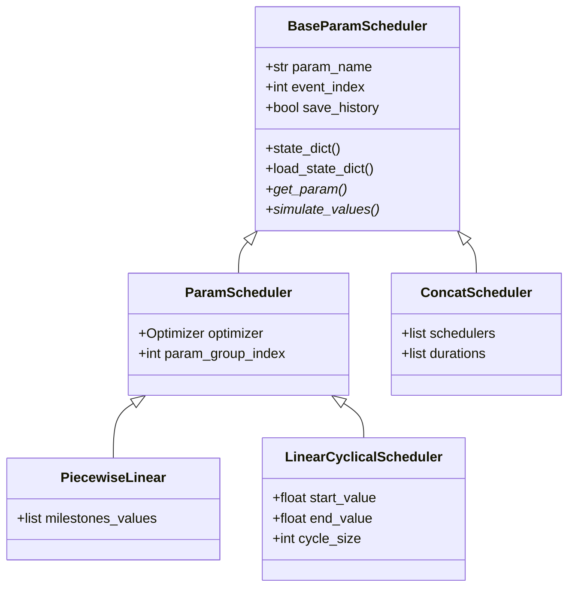
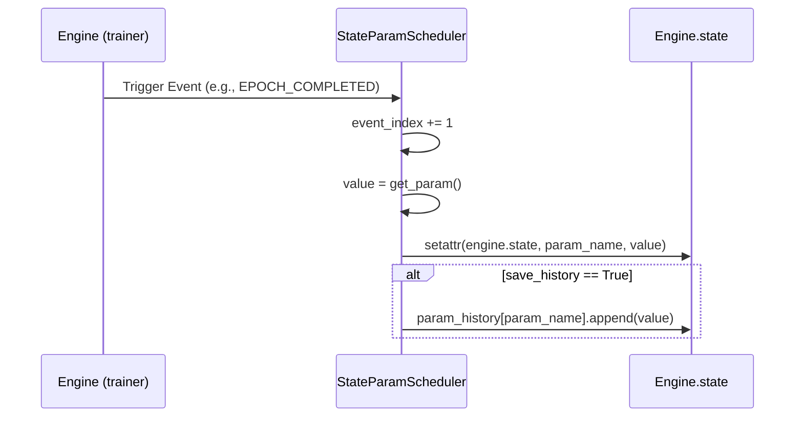
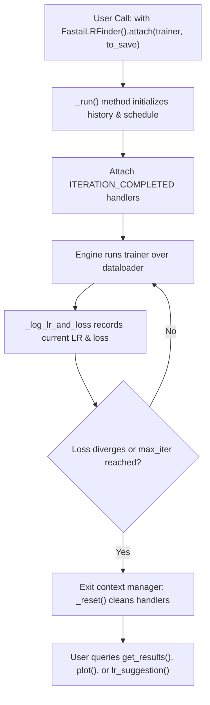

<!-- source: DeepWiki mcp.deepwiki.com · repo pytorch/ignite · page 4.4 Parameter Schedulers and LR Finder · fetched 2026-10-21 -->

# Parameter Schedulers and LR Finder

Relevant source files

The following files were used as context for generating this wiki page:

- [ignite/contrib/handlers/time_profilers.py](ignite/contrib/handlers/time_profilers.py)
- [ignite/handlers/ema_handler.py](ignite/handlers/ema_handler.py)
- [ignite/handlers/lr_finder.py](ignite/handlers/lr_finder.py)
- [ignite/handlers/param_scheduler.py](ignite/handlers/param_scheduler.py)
- [ignite/handlers/state_param_scheduler.py](ignite/handlers/state_param_scheduler.py)
- [ignite/handlers/time_profilers.py](ignite/handlers/time_profilers.py)
- [ignite/handlers/tqdm_logger.py](ignite/handlers/tqdm_logger.py)
- [tests/ignite/handlers/conftest.py](tests/ignite/handlers/conftest.py)
- [tests/ignite/handlers/test_base_logger.py](tests/ignite/handlers/test_base_logger.py)
- [tests/ignite/handlers/test_clearml_logger.py](tests/ignite/handlers/test_clearml_logger.py)
- [tests/ignite/handlers/test_ema_handler.py](tests/ignite/handlers/test_ema_handler.py)
- [tests/ignite/handlers/test_lr_finder.py](tests/ignite/handlers/test_lr_finder.py)
- [tests/ignite/handlers/test_param_scheduler.py](tests/ignite/handlers/test_param_scheduler.py)
- [tests/ignite/handlers/test_state_param_scheduler.py](tests/ignite/handlers/test_state_param_scheduler.py)
- [tests/ignite/handlers/test_tqdm_logger.py](tests/ignite/handlers/test_tqdm_logger.py)
- [tests/ignite/handlers/test_visdom_logger.py](tests/ignite/handlers/test_visdom_logger.py)
- [tests/ignite/metrics/test_dill.py](tests/ignite/metrics/test_dill.py)

## Purpose and Scope

This document provides technical documentation for PyTorch Ignite's parameter scheduling and profiling subsystem. The scope covers the hyperparameter scheduling family (`ignite/handlers/param_scheduler.py`) for optimizers, state parameter schedulers (`ignite/handlers/state_param_scheduler.py`) for engine state variables, the automated learning rate range test utility (`FastaiLRFinder` in `ignite/handlers/lr_finder.py`), and performance diagnostic tools (`BasicTimeProfiler` in `ignite/handlers/time_profilers.py`).

---

## 1. Parameter Scheduler Family

The parameter scheduler family manages the evolution of optimizer hyperparameters (such as learning rate, momentum, or weight decay) across training epochs or iterations. The architecture is built around an abstract base class `BaseParamScheduler` [ignite/handlers/param_scheduler.py:28-156] which provides state serialization (`state_dict` and `load_state_dict`), simulation utilities (`simulate_values`), and plotting capabilities.

Subclassing `BaseParamScheduler`, `ParamScheduler` [ignite/handlers/param_scheduler.py:157-194] interacts directly with PyTorch optimizers (`torch.optim.Optimizer`) or objects possessing a `param_groups` sequence. Concrete implementations include cyclical schedulers (`LinearCyclicalScheduler`, `CosineAnnealingScheduler`), piecewise linear functions (`PiecewiseLinear`), wrapper schedulers (`ParamGroupScheduler`, `LRScheduler`), and composite schedulers (`ConcatScheduler`).

*Figure 1: Class hierarchy of the parameter scheduler ecosystem in Ignite, mapping natural language scheduling concepts to concrete Python classes.*

Sources: `ignite/handlers/param_scheduler.py:28-194`, `tests/ignite/handlers/test_param_scheduler.py:10-21`

---

## 2. State Parameter Schedulers

While `ParamScheduler` targets optimizer parameter groups, `StateParamScheduler` (`ignite/handlers/state_param_scheduler.py`) provides an abstract base for updating dynamic attributes stored within an `Engine`'s state (`engine.state`). 

### Core Mechanics
When a `StateParamScheduler` is attached to an engine via its `attach()` method [ignite/handlers/state_param_scheduler.py:33-68], it:
1. Validates whether `param_name` already exists on `engine.state`.
2. Initializes `engine.state.param_history` if `save_history=True`.
3. Registers itself as an event handler on the engine for the specified event (defaulting to `Events.ITERATION_COMPLETED`).

When invoked [ignite/handlers/state_param_scheduler.py:69-75], the scheduler increments its internal `event_index`, calculates the new parameter value via `get_param()`, assigns it to `setattr(engine.state, self.param_name, value)`, and appends it to the history log if requested.

*Diagram 2: Execution flow of a `StateParamScheduler` updating an `Engine.state` attribute during an event hook.*

Sources: `ignite/handlers/state_param_scheduler.py:11-75`, `tests/ignite/handlers/test_state_param_scheduler.py:11-17`

---

## 3. Learning Rate Finder (`FastaiLRFinder`)

The `FastaiLRFinder` class (`ignite/handlers/lr_finder.py`) implements the learning rate range test popularized by fastai. It systematically sweeps learning rates between boundaries during a short training phase to diagnose network responsiveness and suggest optimal learning rates.

### Implementation and Data Flow
`FastaiLRFinder` manages its lifecycle via a context manager pattern. Upon attachment (`attach()`), it injects internal handlers into the trainer engine to:
1. Terminate the run after a specified number of iterations (`_reached_num_iterations`) [ignite/handlers/lr_finder.py:115-116].
2. Log learning rates and smoothed training losses (`_log_lr_and_loss`) [ignite/handlers/lr_finder.py:119-122].
3. Dynamically apply an exponential or linear learning rate schedule (`_lr_schedule`) [ignite/handlers/lr_finder.py:148-149].

*Figure 3: Data flow and lifecycle of `FastaiLRFinder` within a supervised training engine.*

Sources: `ignite/handlers/lr_finder.py:21-178`, `tests/ignite/handlers/test_lr_finder.py:17-214`

---

## 4. Time Profilers

The `BasicTimeProfiler` class (`ignite/handlers/time_profilers.py`) monitors training performance by instrumenting engine events to capture data loading latency, forward/backward processing times, and individual event handler overheads.

### Architecture and Profiling Metrics
`BasicTimeProfiler` intercepts engine hooks by inspecting and modifying `engine._event_handlers` during the `Events.STARTED` lifecycle stage [ignite/handlers/time_profilers.py:98-131]. It maintains distinct `Timer` instances (`_dataflow_timer`, `_processing_timer`, `_event_handlers_timer`) [ignite/handlers/time_profilers.py:48-50] to record:
- **Dataflow times**: Time spent fetching batches via data loaders (`GET_BATCH_STARTED` to `GET_BATCH_COMPLETED`).
- **Processing times**: Time consumed by step functions between iteration starts and completions.
- **Event handler execution times**: Granular breakdown of individual callback durations for each `EventEnum` category.

Sources: `ignite/handlers/time_profilers.py:12-184`, `ignite/contrib/handlers/time_profilers.py:1-25`

---

