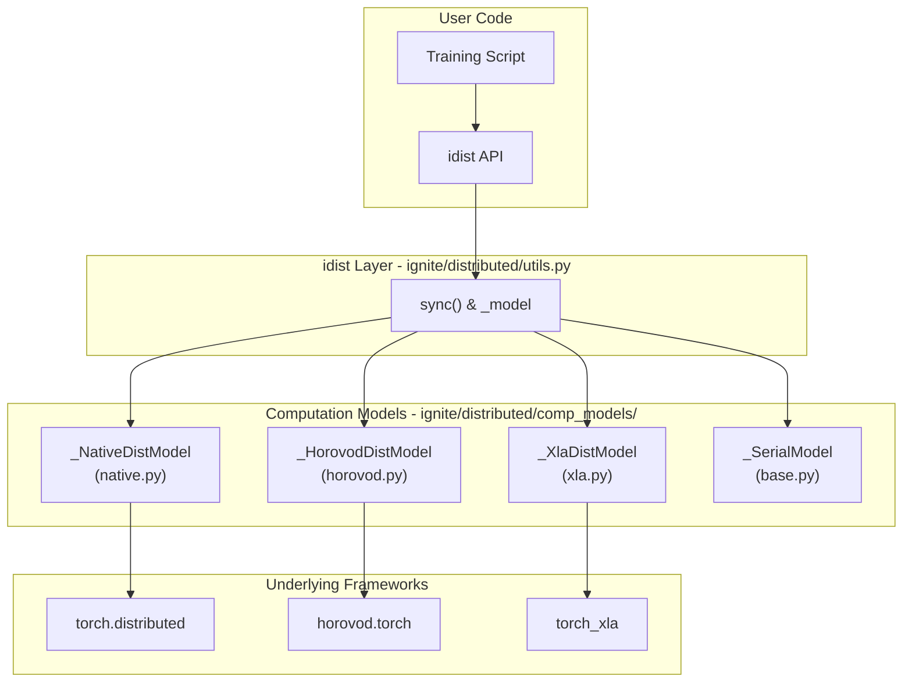

<!-- source: DeepWiki mcp.deepwiki.com · repo pytorch/ignite · page 5 Distributed Training · fetched 2026-10-21 -->

# Distributed Training

Relevant source files

The following files were used as context for generating this wiki page:

- [docs/source/distributed.rst](docs/source/distributed.rst)
- [docs/source/exceptions.rst](docs/source/exceptions.rst)
- [docs/source/utils.rst](docs/source/utils.rst)
- [ignite/distributed/comp_models/base.py](ignite/distributed/comp_models/base.py)
- [ignite/distributed/comp_models/horovod.py](ignite/distributed/comp_models/horovod.py)
- [ignite/distributed/comp_models/native.py](ignite/distributed/comp_models/native.py)
- [ignite/distributed/comp_models/xla.py](ignite/distributed/comp_models/xla.py)
- [ignite/distributed/launcher.py](ignite/distributed/launcher.py)
- [ignite/distributed/utils.py](ignite/distributed/utils.py)
- [tests/ignite/distributed/utils/__init__.py](tests/ignite/distributed/utils/__init__.py)
- [tests/ignite/distributed/utils/test_horovod.py](tests/ignite/distributed/utils/test_horovod.py)
- [tests/ignite/distributed/utils/test_native.py](tests/ignite/distributed/utils/test_native.py)
- [tests/ignite/distributed/utils/test_serial.py](tests/ignite/distributed/utils/test_serial.py)
- [tests/ignite/distributed/utils/test_xla.py](tests/ignite/distributed/utils/test_xla.py)

This page serves as a high-level overview of PyTorch Ignite's distributed abstraction layer (`ignite.distributed` or `idist`), designed to unify multi-GPU, multi-node, and multi-backend training under a consistent API. For deeper technical details, refer to the child pages:
- [idist API and Backend Abstraction](#5.1)
- [Collective Operations](#5.2)
- [SLURM and Auto-Configuration](#5.3)

---

## Overview of Distributed Abstraction (`idist`)

Ignite provides a backend-agnostic plugin architecture via `ignite.distributed` (`idist`) [ignite/distributed/utils.py:1-52](). It abstracts away the differences between PyTorch native distributed processes (`nccl`, `gloo`, `mpi`) [ignite/distributed/comp_models/native.py:25-40](), Horovod (`horovod`) [ignite/distributed/comp_models/horovod.py:38-41](), and Google XLA TPUs (`xla-tpu`) [ignite/distributed/comp_models/xla.py:23-34]().

**Distributed Abstraction Model**

Sources: [ignite/distributed/utils.py:13-79](), [ignite/distributed/comp_models/base.py:15-18]()

---

## 5.1 idist API and Backend Abstraction

The `idist` module exposes initialization functions (`initialize` and `spawn`), the launcher context manager (`Parallel`), and runtime inspection functions like `get_rank()`, `get_world_size()`, and `device()`.

- **Initialization & Spawn:** Allows starting worker processes programmatically via `idist.spawn()` [ignite/distributed/utils.py:204-211]() or latching onto an already-initialized context via `idist.initialize()`.
- **Parallel Launcher:** The `Parallel` context manager simplifies multi-backend configuration, supporting `torchrun`, `horovodrun`, or standalone Python execution [ignite/distributed/launcher.py:14-54]().
- **ComputationModel:** A unified internal abstraction ensuring identical method signatures for rank queries, device binding, and cleanup across distinct backends [ignite/distributed/comp_models/base.py:15-90]().

For detailed code examples, backend parameters, and `Parallel` configurations, see [idist API and Backend Abstraction](#5.1).

Sources: [ignite/distributed/utils.py:28-36](), [ignite/distributed/launcher.py:14-54](), [ignite/distributed/comp_models/base.py:15-90]()

---

## 5.2 Collective Operations

Distributed training requires data synchronization across ranks. Ignite wraps communication routines behind standard functions:

- **Reductions:** `all_reduce()` supports arithmetic operations (`SUM`, `PRODUCT`, `MIN`, `MAX`, `AND`, `OR`) across tensors or scalars [tests/ignite/distributed/utils/__init__.py:76-110]().
- **Gathering & Broadcasting:** `all_gather()` and `broadcast()` handle tensor and object distribution across nodes [tests/ignite/distributed/utils/__init__.py:164-185]().
- **Process Groups & Barriers:** `new_group()` isolates collective operations to subsets of workers, while `barrier()` halts execution until all participating ranks synchronize [tests/ignite/distributed/utils/__init__.py:123-162]().

For in-depth explanations of process groups, reduction types, and safe-mode broadcasting, see [Collective Operations](#5.2).

Sources: [tests/ignite/distributed/utils/__init__.py:76-185]()

---

## 5.3 SLURM and Auto-Configuration

Setting up multi-node environments can be cumbersome. Ignite provides automatic helper utilities to streamline scaling:

- **SLURM Integration:** Automatically parses environment variables like `SLURM_PROCID`, `SLURM_LOCALID`, `SLURM_NTASKS`, and `SLURM_JOB_NODELIST` to configure DDP parameters, master address, and ports without manual intervention [ignite/distributed/comp_models/native.py:563-648]().
- **Auto Helpers:** 
  - `auto_dataloader()` automatically wraps data loaders with `DistributedSampler` and scales batch sizes and worker counts [docs/source/distributed.rst:31-33]().
  - `auto_model()` wraps models in `DistributedDataParallel` (DDP) or DataParallel where appropriate [docs/source/distributed.rst:34-36]().
  - `auto_optim()` configures optimizers with backend-specific steps (such as `xm.optimizer_step` for XLA) [docs/source/distributed.rst:37-41]().

For multi-node deployment patterns and automated configuration specifics, see [SLURM and Auto-Configuration](#5.3).

Sources: [docs/source/distributed.rst:13-43](), [ignite/distributed/comp_models/native.py:563-648]()

---

