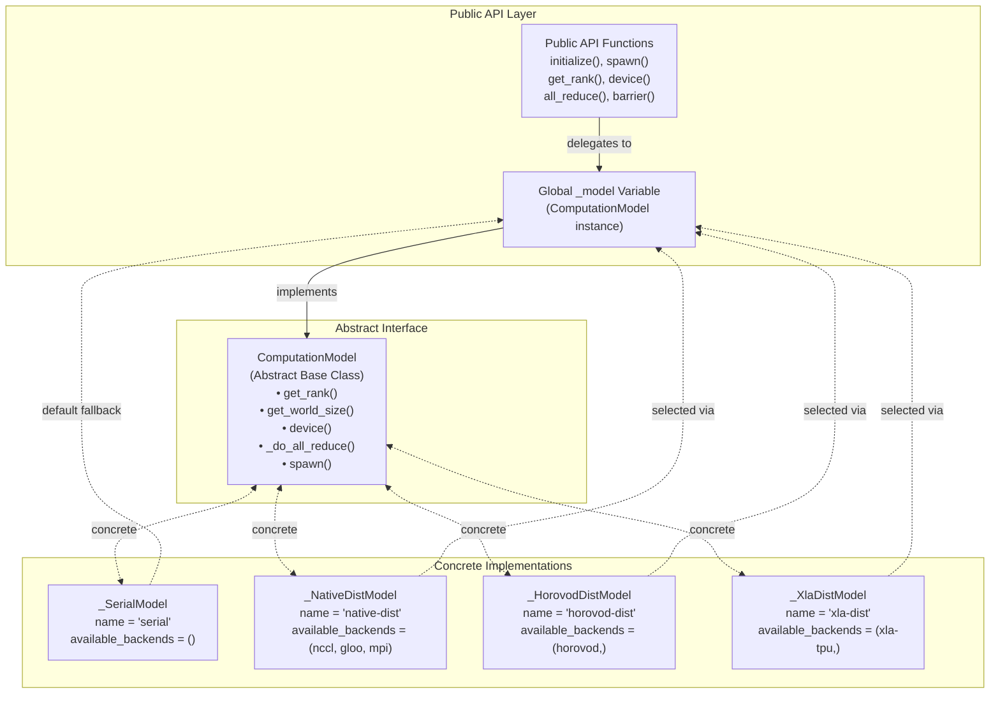

<!-- source: DeepWiki mcp.deepwiki.com · repo pytorch/ignite · page 5.1 idist API and Backend Abstraction · fetched 2026-10-21 -->

# idist API and Backend Abstraction

<details>
<summary>Relevant source files</summary>

The following files were used as context for generating this wiki page:

- [ignite/distributed/comp_models/__init__.py](ignite/distributed/comp_models/__init__.py)
- [ignite/distributed/comp_models/base.py](ignite/distributed/comp_models/base.py)
- [ignite/distributed/comp_models/horovod.py](ignite/distributed/comp_models/horovod.py)
- [ignite/distributed/comp_models/native.py](ignite/distributed/comp_models/native.py)
- [ignite/distributed/comp_models/xla.py](ignite/distributed/comp_models/xla.py)
- [ignite/distributed/launcher.py](ignite/distributed/launcher.py)
- [ignite/distributed/utils.py](ignite/distributed/utils.py)
- [tests/ignite/distributed/utils/__init__.py](tests/ignite/distributed/utils/__init__.py)
- [tests/ignite/distributed/utils/test_horovod.py](tests/ignite/distributed/utils/test_horovod.py)
- [tests/ignite/distributed/utils/test_native.py](tests/ignite/distributed/utils/test_native.py)
- [tests/ignite/distributed/utils/test_serial.py](tests/ignite/distributed/utils/test_serial.py)
- [tests/ignite/distributed/utils/test_xla.py](tests/ignite/distributed/utils/test_xla.py)

</details>


## Purpose and Scope

The `idist` API (short for "Ignite Distributed") provides a unified abstraction layer for distributed training across multiple backend frameworks. This system allows users to write backend-agnostic distributed training code that runs seamlessly on PyTorch native distributed (`nccl`/`gloo`/`mpi`), Horovod, or PyTorch XLA (`xla-tpu`) without modification.

This document covers the architecture, initialization patterns, backend implementations, and the `Parallel` launcher. For information about collective operations (`all_reduce`, `all_gather`, `broadcast`), see [Collective Operations](#5.2). For SLURM-specific configuration details, see [SLURM and Auto-Configuration](#5.3).

Sources: [ignite/distributed/utils.py:1-745](), [ignite/distributed/launcher.py:14-54]()

---

## Architecture Overview

### Strategy Pattern and Computation Models

The `idist` module implements the Strategy pattern through a global computation model that encapsulates backend-specific behavior. All public API functions delegate to methods on this global model instance defined in `ignite.distributed.utils`.



**Diagram: Computation Model Strategy Pattern Architecture**

The global `_model` variable in `ignite/distributed/utils.py` holds the current computation model instance. By default, it is initialized to `_SerialModel()`, providing non-distributed execution. When distributed training initializes, `_model` is replaced with the appropriate backend-specific subclass.

Sources: [ignite/distributed/utils.py:50-78](), [ignite/distributed/comp_models/base.py:15-91]()

---

## Initialization and Context Management

### Initialization Methods

The `idist` API provides explicit initialization (`initialize()`), automatic process spawning (`spawn()`), and context auto-detection (`sync()`).

| Initialization Method | Use Case | Process Group Setup | Example Launch Command |
|----------------------|----------|---------------------|------------------------|
| `idist.initialize(backend)` | Pre-existing process group (e.g., `torchrun`, SLURM) | User-managed | `torchrun --nproc_per_node=4 train.py` |
| `idist.spawn(backend, fn, ...)` | Single-entry script that spawns workers | Managed by idist | `python train.py` (spawns processes internally) |
| Auto-detection via `sync()` | External distributed setup | Detected automatically | Manual `dist.init_process_group()` + `idist.sync()` |

Sources: [ignite/distributed/utils.py:204-221](), [ignite/distributed/utils.py:59-78]()

### Explicit Initialization with `initialize()`

The `initialize()` function is called when the distributed process group is already established by an external launcher like `torchrun` or SLURM:

```python
import ignite.distributed as idist

idist.initialize("nccl")  # or "gloo", "horovod", "xla-tpu"
device = idist.device()    # Returns cuda:local_rank
rank = idist.get_rank()    # Returns process rank
# ... training code ...
idist.finalize()
```

Sources: [ignite/distributed/comp_models/native.py:52-76](), [ignite/distributed/comp_models/horovod.py:62-71]()

### Process Spawning with `spawn()`

The `spawn()` function launches multiple processes from a single entry point script:

```python
import ignite.distributed as idist

def training_fn(local_rank, config):
    device = idist.device()  # cuda:local_rank
    # ... training code ...

config = {"lr": 0.01, "epochs": 10}
idist.spawn("nccl", training_fn, args=(config,), nproc_per_node=4)
```

Sources: [ignite/distributed/utils.py:204-221](), [ignite/distributed/comp_models/native.py:52-76]()

### Context Auto-Detection with `sync()`

The `sync()` function detects existing distributed contexts not explicitly created via `idist` helper functions:

```python
def sync(temporary: bool = False) -> None:
    """Helper method to force this module to synchronize with current distributed context."""
```

Each computation model class implements `create_from_context()` to verify whether its underlying framework is already initialized [ignite/distributed/comp_models/native.py:46-49](), [ignite/distributed/comp_models/horovod.py:54-59](), [ignite/distributed/comp_models/xla.py:39-41]().

Sources: [ignite/distributed/utils.py:59-78](), [ignite/distributed/comp_models/native.py:46-49]()

---

## The `Parallel` Launcher

The `Parallel` class acts as a context manager to simplify distributed configuration setup across multiple backends (`nccl`, `gloo`, `mpi`, `xla-tpu`, `horovod`) [ignite/distributed/launcher.py:14-33](). 

It supports two main workflows:
1. Spawning `nproc_per_node` child processes and initializing process groups when running standalone scripts (`python main.py`) [ignite/distributed/launcher.py:25-26]().
2. Initializing process groups when launched via external launchers like `torchrun` or `horovodrun` [ignite/distributed/launcher.py:27-29]().

### Example Usage with `Parallel`

```python
import ignite.distributed as idist

def training(local_rank, config, **kwargs):
    print(idist.get_rank(), ": run with config:", config, "- backend=", idist.backend())

backend = "nccl"
config = {"key": "value"}

with idist.Parallel(backend=backend, nproc_per_node=4) as parallel:
    parallel.run(training, config, a=1, b=2)
```

Sources: [ignite/distributed/launcher.py:14-126]()

---

## Backend Implementations

### Backend Comparison Matrix

| Feature | `_SerialModel` | `_NativeDistModel` | `_HorovodDistModel` | `_XlaDistModel` |
|---------|----------------|--------------------|---------------------|-----------------|
| **Backend Names** | - | `nccl`, `gloo`, `mpi` | `horovod` | `xla-tpu` |
| **Device Support** | CPU, CUDA, MPS | CPU (`gloo`), CUDA (`nccl`), CPU (`mpi`) | CPU, CUDA | TPU |
| **Spawn Method** | Not supported | `torch.multiprocessing.spawn` | `horovod.run` | `torch_xla.distributed.xla_multiprocessing.spawn` |
| **Process Group Creation** | N/A | `dist.init_process_group()` | `hvd.init()` | `xm.rendezvous()` |
| **All-Reduce Ops** | Identity | SUM, PRODUCT, MIN, MAX, AND, OR | SUM, AVERAGE, ADASUM, MIN, MAX, PRODUCT | SUM, PRODUCT, MIN, MAX, AND, OR |

Sources: [ignite/distributed/comp_models/base.py:15-91](), [ignite/distributed/comp_models/native.py:25-44](), [ignite/distributed/comp_models/horovod.py:38-44](), [ignite/distributed/comp_models/xla.py:23-36]()

### `_SerialModel`: Non-Distributed Fallback

`_SerialModel` handles single-process execution, returning identity operations for collective calls and local device objects (CUDA, MPS, or CPU) [ignite/distributed/comp_models/base.py:15-91]().

Sources: [ignite/distributed/comp_models/base.py:15-91]()

### `_NativeDistModel`: PyTorch Native Distributed

Encapsulates PyTorch's native distributed package (`torch.distributed`). It handles environment variable setup, process group initialization with `dist.init_process_group()`, device mapping, and barriers [ignite/distributed/comp_models/native.py:25-153]().

Sources: [ignite/distributed/comp_models/native.py:25-153]()

### `_HorovodDistModel`: Horovod Framework

Encapsulates Horovod (`horovod.torch`), providing simple initialization via `hvd.init()`, local rank resolution, and process set creation [ignite/distributed/comp_models/horovod.py:38-113]().

Sources: [ignite/distributed/comp_models/horovod.py:38-113]()

### `_XlaDistModel`: PyTorch XLA for TPUs

Encapsulates PyTorch XLA (`torch_xla`), using `xm.rendezvous()` for rendezvous and managing TPU/CPU devices [ignite/distributed/comp_models/xla.py:23-98]().

Sources: [ignite/distributed/comp_models/xla.py:23-98]()

---

## Summary Table: Key Functions and Their Delegation

| Public Function | Global Variable | Computation Model Method | Purpose |
|-----------------|-----------------|--------------------------|---------|
| `idist.initialize(backend)` | Sets `_model` | `create_from_backend(backend, **kwargs)` | Initialize distributed context |
| `idist.spawn(backend, fn, ...)` | Calls model's spawn | `spawn(...)` | Launch worker processes |
| `idist.get_rank()` | Reads `_model` | `_model.get_rank()` | Get global process rank |
| `idist.get_local_rank()` | Reads `_model` | `_model.get_local_rank()` | Get local process rank |
| `idist.device()` | Reads `_model` | `_model.device()` | Get current device |
| `idist.backend()` | Reads `_model` | `_model.backend()` | Get backend name |
| `idist.sync()` | Sets `_model` | `create_from_context()` | Auto-detect distributed context |
| `idist.finalize()` | Calls model's finalize | `_model.finalize()` | Clean up resources |

Sources: [ignite/distributed/utils.py:20-52](), [ignite/distributed/comp_models/base.py:15-91]()

---

