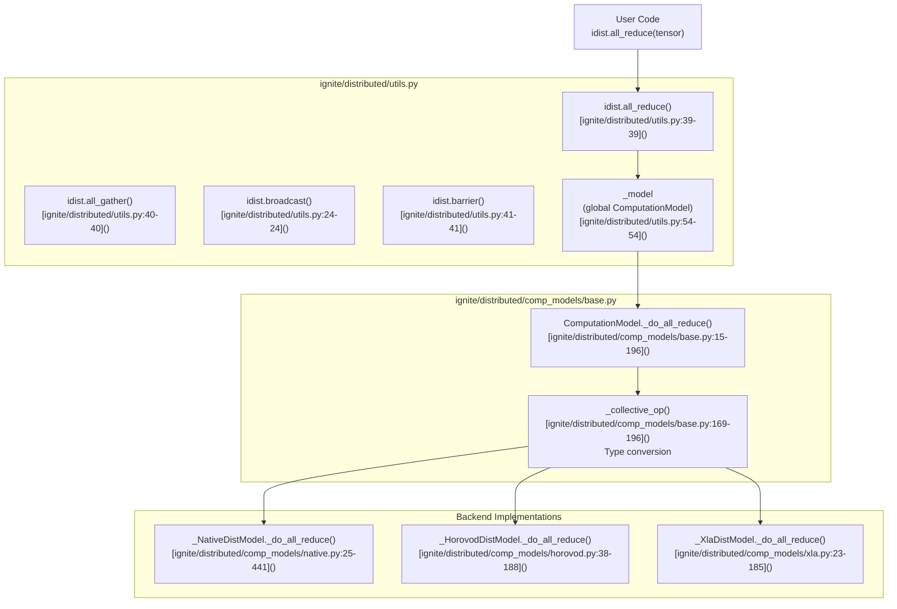
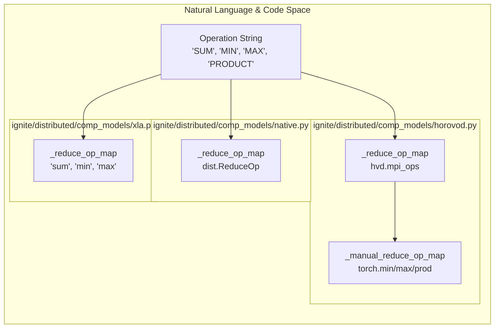
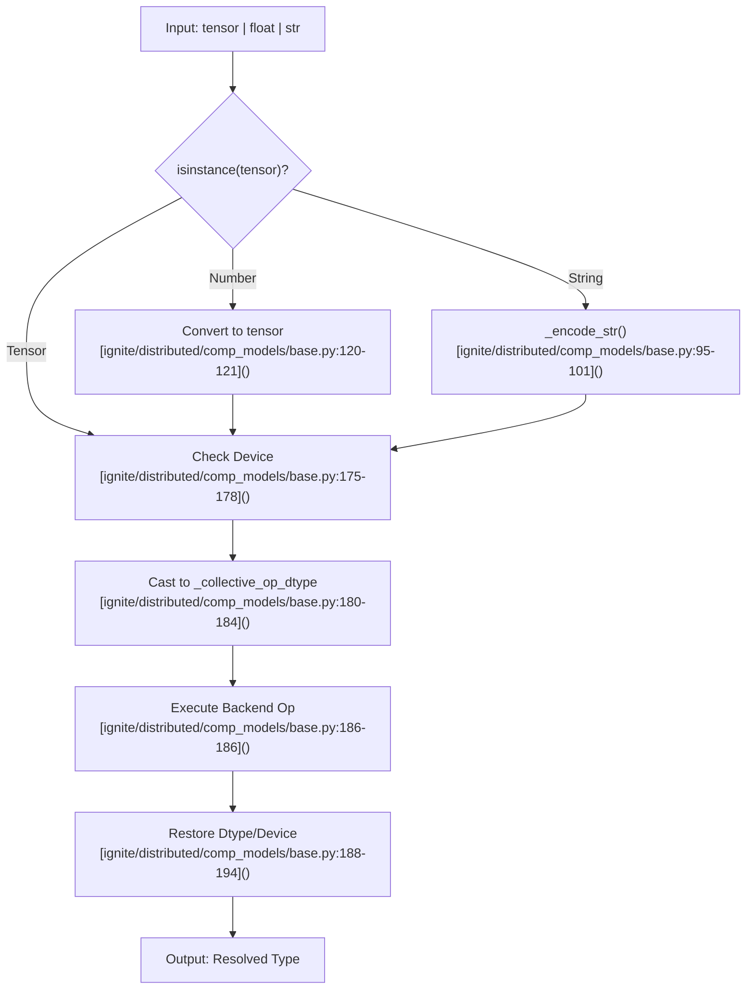

<!-- source: DeepWiki mcp.deepwiki.com · repo pytorch/ignite · page 5.2 Collective Operations · fetched 2026-10-21 -->

# Collective Operations

<details>
<summary>Relevant source files</summary>

The following files were used as context for generating this wiki page:

- [ignite/distributed/comp_models/base.py](ignite/distributed/comp_models/base.py)
- [ignite/distributed/comp_models/horovod.py](ignite/distributed/comp_models/horovod.py)
- [ignite/distributed/comp_models/native.py](ignite/distributed/comp_models/native.py)
- [ignite/distributed/comp_models/xla.py](ignite/distributed/comp_models/xla.py)
- [ignite/distributed/launcher.py](ignite/distributed/launcher.py)
- [ignite/distributed/utils.py](ignite/distributed/utils.py)
- [tests/ignite/distributed/utils/__init__.py](tests/ignite/distributed/utils/__init__.py)
- [tests/ignite/distributed/utils/test_horovod.py](tests/ignite/distributed/utils/test_horovod.py)
- [tests/ignite/distributed/utils/test_native.py](tests/ignite/distributed/utils/test_native.py)
- [tests/ignite/distributed/utils/test_serial.py](tests/ignite/distributed/utils/test_serial.py)
- [tests/ignite/distributed/utils/test_xla.py](tests/ignite/distributed/utils/test_xla.py)

</details>


## Purpose and Scope

This document describes the collective communication primitives provided by Ignite's distributed abstraction layer (`idist`). Collective operations enable synchronization and data exchange across multiple processes in distributed training. These operations include reducing values across processes (`all_reduce`), gathering data from all processes (`all_gather`), broadcasting data from one process to others (`broadcast`), and synchronizing execution (`barrier`).

For information about initializing distributed contexts and backend selection, see [idist API and Backend Abstraction](#5.1). For SLURM-specific configuration, see [SLURM and Auto-Configuration](#5.3).

---

## Architecture Overview

The collective operations system uses a strategy pattern where backend-agnostic API methods in `ignite.distributed.utils` delegate to backend-specific implementations in computation model classes (`_NativeDistModel`, `_HorovodDistModel`, `_XlaDistModel`).

### Diagram: ApiToBackendDelegationFlow


**Sources:** [ignite/distributed/utils.py:24-54](), [ignite/distributed/comp_models/base.py:15-196](), [ignite/distributed/comp_models/native.py:25-441]()

---

## Core Collective Operations

### all_reduce

The `all_reduce` operation combines values from all processes using a reduction operation (`SUM`, `MIN`, `MAX`, `PRODUCT`, etc.) and returns the result to all processes.

**API Signature:**
```python
idist.all_reduce(tensor: torch.Tensor | float, 
                 op: str = "SUM", 
                 group: Any | list[int] | None = None
                ) -> torch.Tensor | float
```

**Supported Operations:**

| Operation | Description | Native | Horovod | XLA |
|-----------|-------------|--------|---------|-----|
| `SUM` | Sum across all processes | ✓ | ✓ | ✓ |
| `PRODUCT` | Product across all processes | ✓ | ✓ (manual) | ✓ |
| `MIN` | Minimum across all processes | ✓ | ✓ (manual) | ✓ |
| `MAX` | Maximum across all processes | ✓ | ✓ (manual) | ✓ |
| `AND` | Logical AND | ✓ | ✗ | ✓ |
| `OR` | Logical OR | ✓ | ✗ | ✓ |
| `AVERAGE` | Average (Horovod only) | ✗ | ✓ | ✗ |
| `ADASUM` | Adaptive summation (Horovod only) | ✗ | ✓ | ✗ |

### Diagram: ReductionOperationMapping


**Sources:** [ignite/distributed/utils.py:39-41](), [ignite/distributed/comp_models/native.py:21-24](), [ignite/distributed/comp_models/horovod.py:181-187](), [ignite/distributed/comp_models/xla.py:135-142]()

---

### all_gather

The `all_gather` operation collects tensors or values from all processes and returns them concatenated or as a list.

**API Signature:**
```python
idist.all_gather(tensor: torch.Tensor | float | str | Any, 
                 group: Any | list[int] | None = None
                ) -> torch.Tensor | float | list[float] | list[str] | list[Any]
```

**Behavior by Input Type:**

| Input Type | Output Type | Description |
|------------|-------------|-------------|
| `torch.Tensor` | `torch.Tensor` | Concatenated along dimension 0: shape `(world_size * batch_size, ...)` |
| `float` | `torch.Tensor` | Tensor of shape `(world_size,)` |
| `str` | `list[str]` | List of strings from all processes |
| `object` | `list[Any]` | List of objects from all processes (native backend only) |

**Sources:** [ignite/distributed/utils.py:40-40](), [ignite/distributed/comp_models/base.py:109-162](), [ignite/distributed/comp_models/native.py:25-483]()

---

### all_gather_tensors_with_shapes

A specialized operation for gathering tensors of different shapes but same number of dimensions across processes [ignite/distributed/utils.py:51-51]().

**API Signature:**
```python
idist.all_gather_tensors_with_shapes(
    tensor: torch.Tensor, 
    shapes: Sequence[Sequence[int]], 
    group: Any | list[int] | None = None
) -> list[torch.Tensor]
```

**Sources:** [ignite/distributed/utils.py:51-51](), [tests/ignite/distributed/utils/__init__.py:8-8]()

---

### broadcast

The `broadcast` operation sends data from one source process to all other processes [ignite/distributed/utils.py:24-24]().

**API Signature:**
```python
idist.broadcast(tensor: torch.Tensor | float | str | None, 
                src: int = 0, 
                safe_mode: bool = False
               ) -> torch.Tensor | float | str
```

**Safe Mode:**
When `safe_mode=True`, non-source processes can pass `None` as input. The system encodes source data type and metadata via `_encode_input_data()` [ignite/distributed/comp_models/base.py:109-128](), broadcasts metadata, sets up placeholders via `_decode_as_placeholder()` [ignite/distributed/comp_models/base.py:131-148](), and performs the broadcast.

**Sources:** [ignite/distributed/utils.py:24-24](), [ignite/distributed/comp_models/base.py:109-162]()

---

### barrier

The `barrier` operation synchronizes all processes, blocking until all have reached the barrier point [ignite/distributed/utils.py:41-41]().

**API Signature:**
```python
idist.barrier() -> None
```

**Backend Implementations:**
- **Native**: `dist.barrier()` [ignite/distributed/comp_models/native.py:147-150]()
- **Horovod**: `hvd.allreduce()` wrapper [ignite/distributed/comp_models/horovod.py:38-188]()
- **XLA**: `xm.rendezvous("barrier")` [ignite/distributed/comp_models/xla.py:176-177]()

**Sources:** [ignite/distributed/utils.py:41-41](), [ignite/distributed/comp_models/native.py:147-150](), [ignite/distributed/comp_models/xla.py:176-177]()

---

## Data Type Handling

The base `ComputationModel` class provides automatic type conversion through `_collective_op()` and `_apply_op()` to enable collective operations on tensors, numbers, and strings [ignite/distributed/comp_models/base.py:169-196]().

### Diagram: TypeConversionPipeline


**Sources:** [ignite/distributed/comp_models/base.py:95-196]()

---

## Process Groups

Process groups enable collective operations on subsets of processes.

### Creating Process Groups

**API:**
```python
idist.new_group(ranks: list[int], **kwargs) -> Any
```

Creates a new process group containing the specified ranks, delegating to `dist.new_group` [ignite/distributed/comp_models/native.py:163-163](), `hvd.add_process_set` [ignite/distributed/comp_models/horovod.py:36-36](), or list formatting in XLA [ignite/distributed/comp_models/xla.py:166-167]().

**Sources:** [ignite/distributed/utils.py:49-49](), [ignite/distributed/comp_models/native.py:163-168]()

---

## Testing Infrastructure

Collective operations are thoroughly tested via shared test helper functions in `tests/ignite/distributed/utils/__init__.py` across native, horovod, and xla backends [tests/ignite/distributed/utils/__init__.py:76-185](), [tests/ignite/distributed/utils/test_native.py:1-426](), [tests/ignite/distributed/utils/test_horovod.py:1-258](), [tests/ignite/distributed/utils/test_xla.py:1-236]().

**Sources:** [tests/ignite/distributed/utils/__init__.py:76-185](), [tests/ignite/distributed/utils/test_native.py:1-426]()

---

