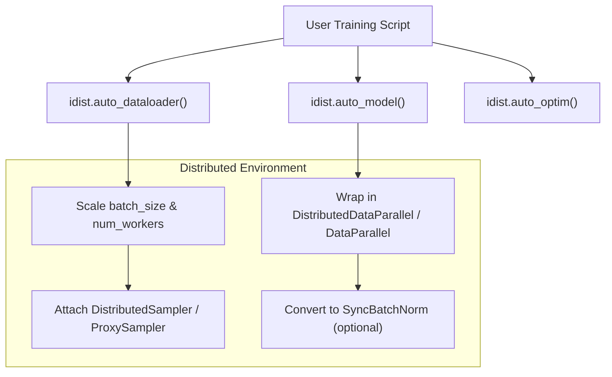
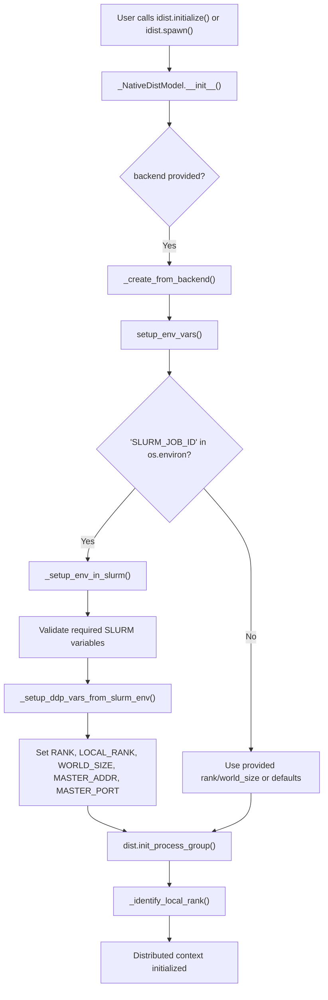
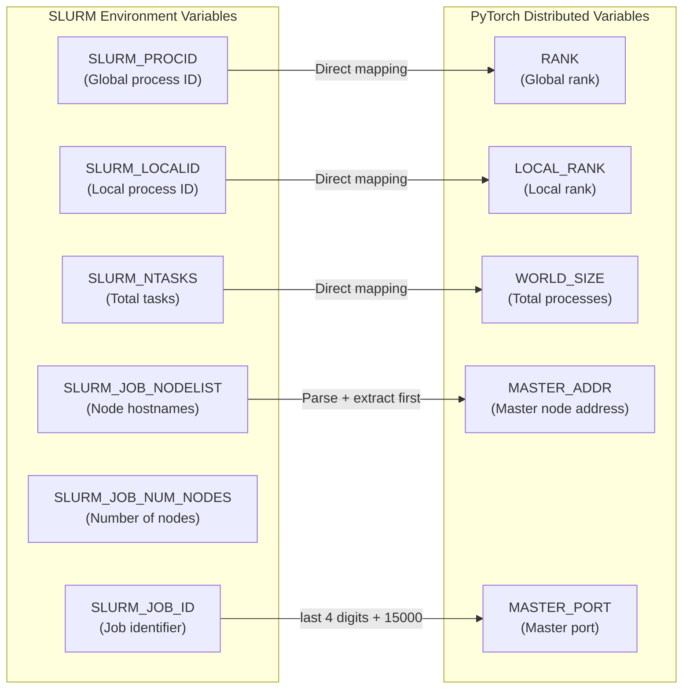
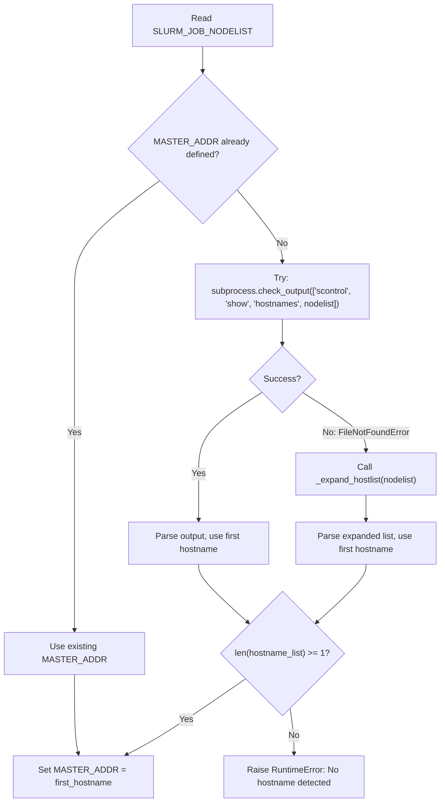

<!-- source: DeepWiki mcp.deepwiki.com · repo pytorch/ignite · page 5.3 SLURM and Auto-Configuration · fetched 2026-10-21 -->

# SLURM and Auto-Configuration

<details>
<summary>Relevant source files</summary>

The following files were used as context for generating this wiki page:

- [ignite/distributed/auto.py](ignite/distributed/auto.py)
- [ignite/distributed/comp_models/base.py](ignite/distributed/comp_models/base.py)
- [ignite/distributed/comp_models/horovod.py](ignite/distributed/comp_models/horovod.py)
- [ignite/distributed/comp_models/native.py](ignite/distributed/comp_models/native.py)
- [ignite/distributed/comp_models/xla.py](ignite/distributed/comp_models/xla.py)
- [ignite/distributed/launcher.py](ignite/distributed/launcher.py)
- [ignite/distributed/utils.py](ignite/distributed/utils.py)
- [tests/ignite/distributed/comp_models/test_base.py](tests/ignite/distributed/comp_models/test_base.py)
- [tests/ignite/distributed/test_auto.py](tests/ignite/distributed/test_auto.py)
- [tests/ignite/distributed/utils/__init__.py](tests/ignite/distributed/utils/__init__.py)
- [tests/ignite/distributed/utils/test_horovod.py](tests/ignite/distributed/utils/test_horovod.py)
- [tests/ignite/distributed/utils/test_native.py](tests/ignite/distributed/utils/test_native.py)
- [tests/ignite/distributed/utils/test_serial.py](tests/ignite/distributed/utils/test_serial.py)
- [tests/ignite/distributed/utils/test_xla.py](tests/ignite/distributed/utils/test_xla.py)

</details>


This document describes how PyTorch Ignite automatically detects and configures distributed training environments under the SLURM workload manager and provides auto-configuration helpers (`auto_dataloader`, `auto_model`, `auto_optim`) to seamlessly adapt models, optimizers, and dataloaders for multi-node and multi-GPU training. 

SLURM (Simple Linux Utility for Resource Management) auto-configuration eliminates the need for users to manually set PyTorch distributed environment variables (`RANK`, `WORLD_SIZE`, `MASTER_ADDR`, `MASTER_PORT`) by inferring them from SLURM's native environment variables.

For information about the broader distributed training abstraction layer, see [idist API and Backend Abstraction](#5.1). For details on collective operations in distributed training, see [Collective Operations](#5.2).

## Purpose and Scope

SLURM is a widely-used cluster management system. When PyTorch distributed jobs run under SLURM, the system provides job-specific environment variables that contain necessary information for distributed coordination. Ignite's `_NativeDistModel` class automatically detects a SLURM context and translates SLURM variables into the format expected by PyTorch's distributed package (`torch.distributed`). Additionally, Ignite provides high-level helper functions in `ignite.distributed.auto` to automatically wrap datasets into distributed dataloaders, wrap models in `DistributedDataParallel`, and manage synchronization.

Sources: [ignite/distributed/comp_models/native.py:75-143](), [ignite/distributed/auto.py:1-142]()

## Auto-Configuration Helpers (`auto_dataloader`, `auto_model`, `auto_optim`)

Ignite provides utility functions in `ignite.distributed.auto` to simplify the transition from single-device code to multi-device and distributed setups across any backend (`nccl`, `gloo`, `horovod`, `xla-tpu`).

### `auto_dataloader`

The `auto_dataloader` helper creates a `DataLoader` (or `MpDeviceLoader` for XLA TPUs) configured for distributed execution [ignite/distributed/auto.py:23-50]():
- **Batch Size Scaling**: Automatically scales `batch_size` by world size: `batch_size // world_size` [ignite/distributed/auto.py:76-77]().
- **Worker Scaling**: Scales `num_workers` by the number of local processes (`nprocs`) per node [ignite/distributed/auto.py:79-81]().
- **Sampler Management**: Automatically attaches a `DistributedSampler` if no sampler is provided, or wraps custom samplers with `DistributedProxySampler` [ignite/distributed/auto.py:83-106]().
- **Pinned Memory**: Automatically enables `pin_memory=True` when running on CUDA devices [ignite/distributed/auto.py:121]().

```python
import ignite.distributed as idist

train_loader = idist.auto_dataloader(
    train_dataset,
    batch_size=32,
    num_workers=4,
    shuffle=True,
    drop_last=True,
)
```

### `auto_model`

The `auto_model` helper wraps a `torch.nn.Module` for distributed training (e.g., using `nn.parallel.DistributedDataParallel` for native backends or `DataParallel` for multi-GPU single-node settings) [tests/ignite/distributed/test_auto.py:131-152]() and optionally converts standard batch normalization layers to `nn.SyncBatchNorm` for synchronized cross-process statistics [tests/ignite/distributed/test_auto.py:137-138]().

```python
model = MyModel()
model = idist.auto_model(model, sync_bn=True)
```

**Diagram: Auto-Configuration Helpers Architecture**



Sources: [ignite/distributed/auto.py:1-142](), [tests/ignite/distributed/test_auto.py:78-162]()

---

## SLURM Detection and Initialization Flow

When creating a native distributed model, Ignite checks for the presence of SLURM environment variables and automatically configures the distributed context.

**Diagram: SLURM Detection and Setup Flow**



Sources: [ignite/distributed/comp_models/native.py:75-143](), [ignite/distributed/comp_models/native.py:216-241]()

## Environment Variable Mapping

The `_setup_ddp_vars_from_slurm_env()` function maps SLURM environment variables to PyTorch distributed variables after validating that all required SLURM variables are present.

**Diagram: SLURM to PyTorch DDP Variable Mapping**



Sources: [ignite/distributed/comp_models/native.py:564-649]()

**Table: Required SLURM Environment Variables**

| SLURM Variable | PyTorch Variable | Description | Validation |
|----------------|------------------|-------------|------------|
| `SLURM_JOB_ID` | - | Unique job identifier | Must be present to trigger SLURM detection |
| `SLURM_PROCID` | `RANK` | Global process rank (0 to N-1) | Must be present |
| `SLURM_LOCALID` | `LOCAL_RANK` | Local process rank on node | Must be present |
| `SLURM_NTASKS` | `WORLD_SIZE` | Total number of tasks/processes | Must be present |
| `SLURM_JOB_NODELIST` | `MASTER_ADDR` (derived) | Compressed list of node hostnames | Must be present |
| `SLURM_JOB_NUM_NODES` | - | Number of nodes in allocation | Must be present |

Sources: [ignite/distributed/comp_models/native.py:243-254]()

## Master Address Determination

The master address is determined by extracting the first hostname from `SLURM_JOB_NODELIST`. SLURM provides node lists in compressed formats (e.g., `node[01-04]`). Ignite expands this list via `scontrol` or an internal fallback parser [ignite/distributed/comp_models/native.py:498-641]().

**Diagram: Master Address Resolution Logic**



Sources: [ignite/distributed/comp_models/native.py:626-641]()

## Master Port Determination

The master port is automatically derived from the SLURM job ID to prevent port collisions when multiple jobs run concurrently on the same cluster [ignite/distributed/comp_models/native.py:643-647]().

```python
# From SLURM_JOB_ID, extract last 4 digits and add offset
slurm_job_id = os.environ["SLURM_JOB_ID"]
last_4_digits = slurm_job_id[-4:]
master_port = int(last_4_digits) + 15000
```

Sources: [ignite/distributed/comp_models/native.py:643-647]()

## Local Rank Identification and Usage

After process group initialization, `_identify_local_rank()` determines the local rank for the current process using `SLURM_LOCALID` [ignite/distributed/comp_models/native.py:197-214]().

### Example: SLURM Job Script with Auto-Configuration

```bash
#!/bin/bash
#SBATCH --job-name=ignite_train
#SBATCH --nodes=2
#SBATCH --ntasks-per-node=4
#SBATCH --gres=gpu:4

srun python train.py
```

```python
# train.py
import ignite.distributed as idist

def training_function(local_rank):
    device = idist.device()
    train_loader = idist.auto_dataloader(dataset, batch_size=64)
    model = idist.auto_model(MyModel(), sync_bn=True)
    optimizer = idist.auto_optim(torch.optim.Adam(model.parameters()))

idist.initialize("nccl")
training_function(idist.get_local_rank())
idist.finalize()
```

Sources: [ignite/distributed/comp_models/native.py:197-260](), [ignite/distributed/auto.py:23-142]()

---

