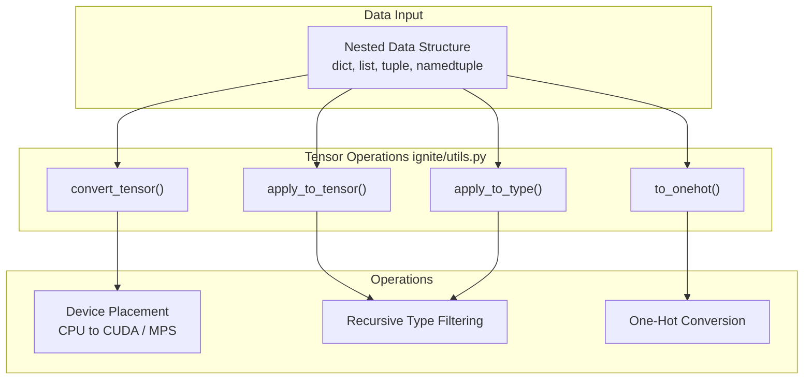
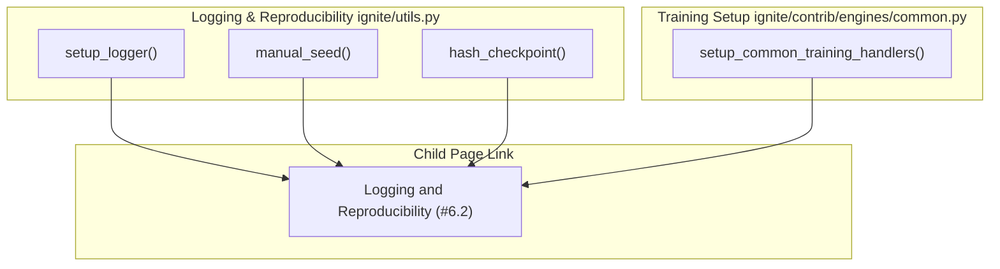

<!-- source: DeepWiki mcp.deepwiki.com · repo pytorch/ignite · page 6 Utilities · fetched 2026-10-21 -->

# Utilities

Relevant source files

The following files were used as context for generating this wiki page:

- [ignite/contrib/engines/common.py](ignite/contrib/engines/common.py)
- [ignite/utils.py](ignite/utils.py)
- [tests/ignite/contrib/engines/test_common.py](tests/ignite/contrib/engines/test_common.py)
- [tests/ignite/test_utils.py](tests/ignite/test_utils.py)

The `ignite.utils` module and related helper modules provide a collection of foundational utility functions that support core Ignite operations across tensor manipulation, distributed logging configuration, reproducibility, common engine setup, and API deprecation management. These utilities are designed to work seamlessly with PyTorch tensors, nested data structures, and multi-process training environments.

This page serves as a high-level overview of Ignite's utility systems. For deep technical details, implementation specifics, and extended examples, refer to the child pages linked below.

**Sources:** [ignite/utils.py:1-26](), [ignite/contrib/engines/common.py:51-106]()

---

## Tensor and Data Operations

PyTorch Ignite provides recursive transformation functions to handle complex nested data structures (such as dictionaries, lists, tuples, and namedtuples) commonly returned by PyTorch DataLoaders. These utilities enable bulk device placement, type application, and tensor transformations without breaking nested layouts.

Key tensor utilities include `convert_tensor` for moving data across devices, `apply_to_tensor` and `apply_to_type` for recursive mapping, and `to_onehot` for converting integer labels into one-hot encoded representations.

**Diagram: Tensor operation utilities mapping**

For details, see [Tensor and Data Operations](#6.1).

**Sources:** [ignite/utils.py:29-84](), [tests/ignite/test_utils.py:14-124]()

---

## Logging and Reproducibility

Experiment management in Ignite relies on robust logging configuration and deterministic seeding. The `setup_logger` utility manages rank-aware logging in distributed training environments, ensuring that worker processes do not flood standard error outputs. Additionally, `manual_seed` coordinates random number generator seeding across Python, PyTorch, NumPy, and XLA.

For standard training pipelines, `setup_common_training_handlers` in `ignite.contrib.engines.common` provides a unified wrapper to attach progress bars, checkpointing, gradient clipping, metrics tracking, and learning rate schedulers to an trainer `Engine`.

**Diagram: Logging and reproducibility utilities hierarchy**

For details, see [Logging and Reproducibility](#6.2).

**Sources:** [ignite/utils.py:236-393](), [ignite/contrib/engines/common.py:51-149]()

---

## Deprecated contrib APIs and Migration

To maintain backward compatibility while evolving the library structure, Ignite utilizes a deprecation framework powered by the `deprecated` decorator. Older modules and proxies located under `ignite.contrib.handlers` and `ignite.contrib.metrics` issue warnings directing users toward core components in `ignite.handlers` and `ignite.metrics`.

For details on the deprecation timeline, removal schedules (such as version 0.6.0 targets), and explicit migration paths, see [Deprecated contrib APIs and Migration](#6.3).

**Sources:** [ignite/utils.py:395-422](), [ignite/contrib/engines/common.py:35-49]()

---

