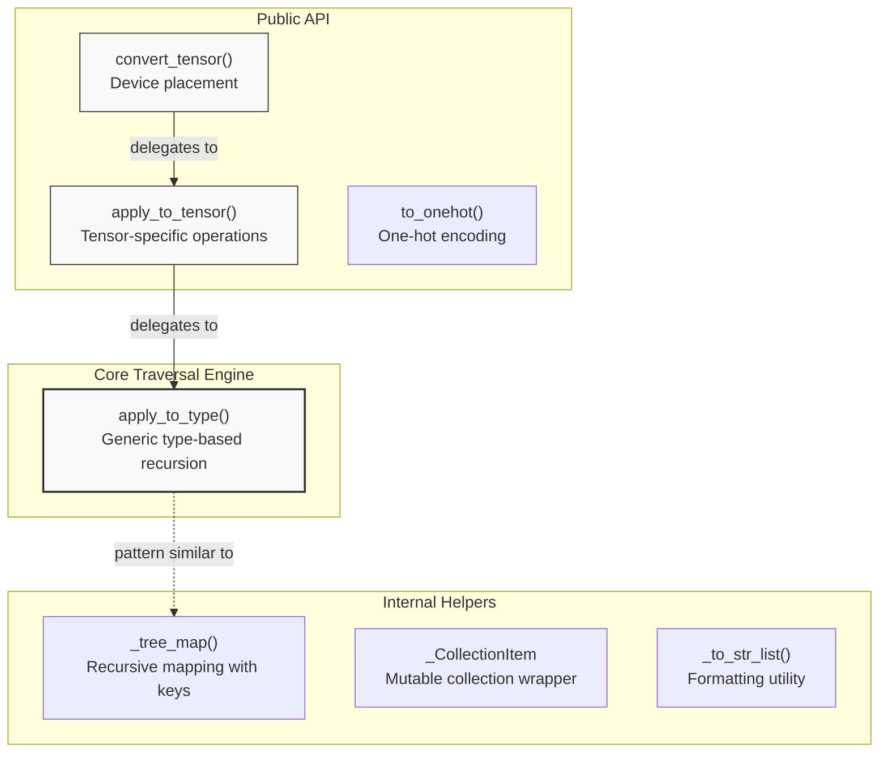
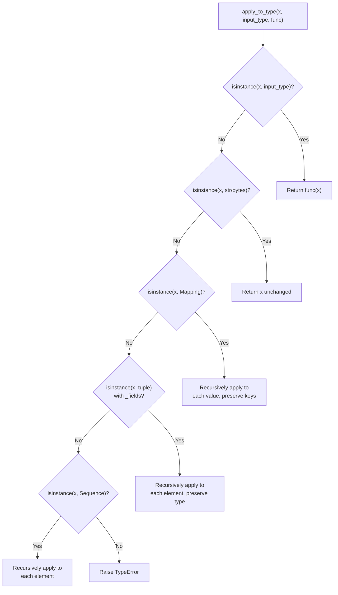
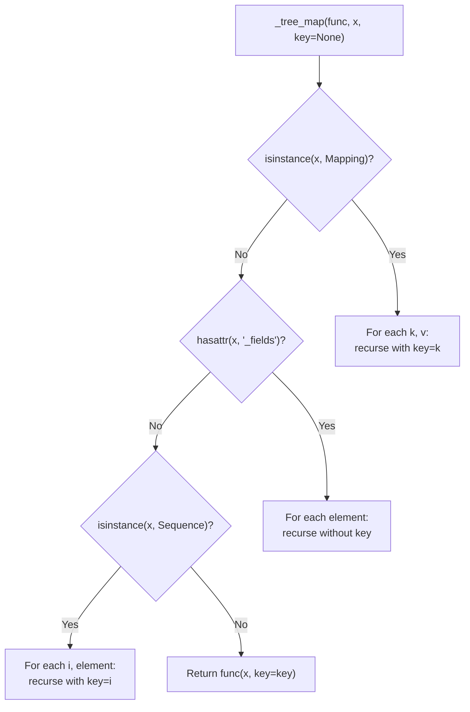
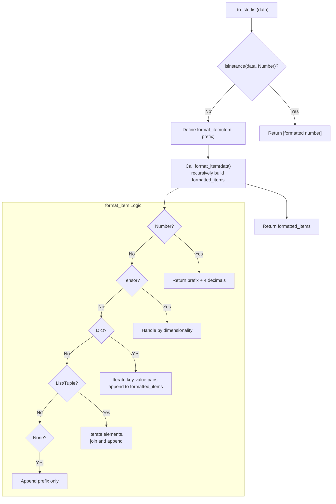
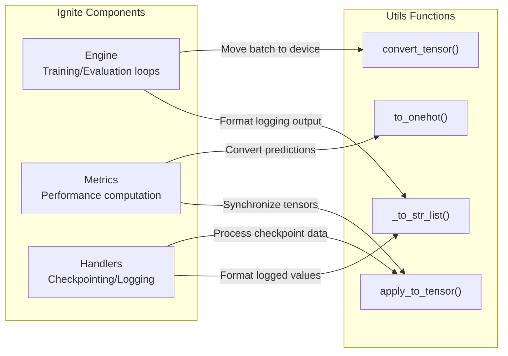

<!-- source: DeepWiki mcp.deepwiki.com · repo pytorch/ignite · page 6.1 Tensor and Data Operations · fetched 2026-10-21 -->

# Tensor and Data Operations

<details>
<summary>Relevant source files</summary>

The following files were used as context for generating this wiki page:

- [ignite/contrib/engines/common.py](ignite/contrib/engines/common.py)
- [ignite/utils.py](ignite/utils.py)
- [tests/ignite/contrib/engines/test_common.py](tests/ignite/contrib/engines/test_common.py)
- [tests/ignite/test_utils.py](tests/ignite/test_utils.py)

</details>


This document describes the tensor manipulation and data transformation utilities provided in [ignite/utils.py](). These functions handle device placement, recursive operations on nested data structures, one-hot encoding, and data formatting. This page focuses specifically on tensor and data operations; for logging and reproducibility utilities, see [Logging and Reproducibility](#6.2).

## Overview and Function Relationships

The utilities module provides a set of functions for handling PyTorch tensors within complex nested data structures (lists, tuples, dictionaries, namedtuples). The core pattern is **recursive traversal** of data structures combined with **type-specific operations**.

**Primary Functions:**

| Function | Purpose | Lines |
|----------|---------|-------|
| `convert_tensor` | Move tensors to specified device (CPU/GPU) | [ignite/utils.py:29-47]() |
| `apply_to_tensor` | Apply arbitrary function to all tensors in nested structure | [ignite/utils.py:49-58]() |
| `apply_to_type` | Generalized version for any type, not just tensors | [ignite/utils.py:61-84]() |
| `to_onehot` | Convert integer indices to one-hot encoded tensors | [ignite/utils.py:22]() |
| `_to_str_list` | Format complex data structures for human-readable logging | [ignite/utils.py:98-171]() |



**Sources:** [ignite/utils.py:17-26]()

## Device Placement: convert_tensor

The `convert_tensor` function moves tensors within nested data structures to a specified device (CPU, CUDA GPU, or other accelerators). It handles single tensors, sequences (lists, tuples, namedtuples), and mappings (dictionaries) recursively.

### Function Signature and Behavior

```python
def convert_tensor(
    x: torch.Tensor | collections.Sequence | collections.Mapping | str | bytes,
    device: str | torch.device | None = None,
    non_blocking: bool = False,
) -> torch.Tensor | collections.Sequence | collections.Mapping | str | bytes
```

**Parameters:**
- `x`: Input tensor or nested structure containing tensors
- `device`: Target device (`"cpu"`, `"cuda"`, `"cuda:0"`, etc.). If `None`, tensors remain on current device
- `non_blocking`: When moving CPU pinned memory to CUDA, perform asynchronous transfer

**Implementation Pattern:**
[ignite/utils.py:43-45]() defines an inner function `_func` that performs the actual tensor device transfer using `tensor.to()`. The function then delegates to `apply_to_tensor(x, _func)` to handle recursive traversal.

### Usage Examples

**Single Tensor:**
```python
x = torch.tensor([1.0, 2.0, 3.0])
x_gpu = convert_tensor(x, device="cuda")  # Move to GPU
```

**List of Tensors:**
```python
batch = [torch.tensor([1.0]), torch.tensor([2.0])]
batch_gpu = convert_tensor(batch, device="cuda")
# Result: [tensor([1.], device='cuda:0'), tensor([2.], device='cuda:0')]
```

**Dictionary (common in model outputs):**
```python
output = {
    "logits": torch.randn(8, 10),
    "features": torch.randn(8, 128)
}
output_cpu = convert_tensor(output, device="cpu")
```

**Namedtuple (preserves type):**
```python
from collections import namedtuple
Point = namedtuple("Point", ["x", "y"])
point = Point(torch.tensor([1.0]), torch.tensor([2.0]))
point_gpu = convert_tensor(point, device="cuda")
# Result type: Point (not regular tuple)
```

**Sources:** [ignite/utils.py:29-47](), [tests/ignite/test_utils.py:14-56]()

## Recursive Data Structure Operations

### apply_to_tensor

The `apply_to_tensor` function applies an arbitrary callable to all tensors within a nested data structure while preserving the structure's type and shape.

**Function Signature:**
```python
def apply_to_tensor(
    x: torch.Tensor | collections.Sequence | collections.Mapping | str | bytes, func: Callable
) -> torch.Tensor | collections.Sequence | collections.Mapping | str | bytes
```

**Implementation:** [ignite/utils.py:49-58]() is a thin wrapper that calls `apply_to_type(x, torch.Tensor, func)`.

**Common Use Cases:**
- Custom device placement logic
- Gradient detachment: `apply_to_tensor(data, lambda t: t.detach())`
- Type conversion: `apply_to_tensor(data, lambda t: t.float())`
- Shape transformation: `apply_to_tensor(data, lambda t: t.view(-1))`

### apply_to_type: Generic Type-Based Recursion

The `apply_to_type` function generalizes `apply_to_tensor` to work with any Python type, not just `torch.Tensor`. This is the **core recursive traversal engine** that powers the other utilities.

**Function Signature:**
```python
def apply_to_type(
    x: Any | collections.Sequence | collections.Mapping | str | bytes,
    input_type: type | tuple[type[Any], Any],
    func: Callable,
) -> Any | collections.Sequence | collections.Mapping | str | bytes
```

**Traversal Logic:**



**Implementation Details:**

1. **Base Case** [ignite/utils.py:73-74](): If `x` is an instance of `input_type`, apply `func(x)` directly and return
2. **String/Bytes** [ignite/utils.py:75-76](): Return unchanged (prevents treating strings as sequences)
3. **Mapping (dict)** [ignite/utils.py:77-78](): Recursively apply to values, reconstruct using `type(x)` constructor
4. **Namedtuple** [ignite/utils.py:79-80](): Check for `_fields` attribute, recursively apply to elements, preserve namedtuple type
5. **Sequence (list, tuple)** [ignite/utils.py:81-82](): Recursively apply to elements, reconstruct with original type
6. **Error Case** [ignite/utils.py:83](): If none match, raise `TypeError`

**Type Preservation:** The function uses `type(x)` to reconstruct containers, ensuring that `dict` remains `dict`, `list` remains `list`, and custom namedtuples retain their type.

**Sources:** [ignite/utils.py:61-84]()

### Data Structure Support Matrix

| Structure Type | Example | Supported | Preserves Type |
|----------------|---------|-----------|----------------|
| Single tensor | `torch.tensor([1, 2, 3])` | ✓ | N/A |
| List | `[tensor1, tensor2]` | ✓ | ✓ (remains list) |
| Tuple | `(tensor1, tensor2)` | ✓ | ✓ (remains tuple) |
| Dict | `{"a": tensor1, "b": tensor2}` | ✓ | ✓ (remains dict) |
| Namedtuple | `Point(x=tensor1, y=tensor2)` | ✓ | ✓ (remains Point) |
| Nested | `{"batch": [tensor1, tensor2]}` | ✓ | ✓ (all levels) |
| String | `"text data"` | ✓ | ✓ (unchanged) |
| Bytes | `b"binary data"` | ✓ | ✓ (unchanged) |
| Other types | `12345`, `CustomClass()` | ✗ | Raises TypeError |

**Sources:** [tests/ignite/test_utils.py:14-56]()

## One-Hot Encoding: to_onehot

The `to_onehot` function converts integer index tensors into one-hot encoded representations. This is commonly used in classification tasks for converting class labels to categorical format.

**Behavior:**
- **Input shape:** `(N, ...)` where `...` represents arbitrary dimensions
- **Output shape:** `(N, num_classes, ...)` with one-hot encoding along dimension 1
- **Output dtype:** `torch.uint8` (memory efficient for binary indicators)
- **Output device:** Same as input device

### Usage Examples

**1D Indices (Simple Classification):**
```python
indices = torch.tensor([0, 1, 2, 3], dtype=torch.long)
onehot = to_onehot(indices, num_classes=4)
# Result shape: (4, 4)
# Result:
# [[1, 0, 0, 0],
#  [0, 1, 0, 0],
#  [0, 0, 1, 0],
#  [0, 0, 0, 1]]
```

**2D Indices (Batched Classification):**
```python
# Shape: (batch=1000, )
y = torch.randint(0, 21, size=(1000,))
y_onehot = to_onehot(y, num_classes=21)
# Result shape: (1000, 21)
```

**4D Indices (Semantic Segmentation):**
```python
# Shape: (batch=4, height=250, width=255)
segmentation_mask = torch.randint(0, 21, size=(4, 250, 255))
segmentation_onehot = to_onehot(segmentation_mask, num_classes=21)
# Result shape: (4, 21, 250, 255)
# One-hot encoding per pixel
```

**Higher Dimensions:**
```python
# Shape: (4, 150, 155, 4, 6)
indices = torch.randint(0, 21, size=(4, 150, 155, 4, 6))
onehot = to_onehot(indices, num_classes=21)
# Result shape: (4, 21, 150, 155, 4, 6)
```

### TorchScript Compatibility

`to_onehot` is fully TorchScript-compatible, allowing it to be used in exported models and JIT-compiled code.

```python
scripted_to_onehot = torch.jit.script(to_onehot)
result = scripted_to_onehot(indices, 4)
```

**Sources:** [tests/ignite/test_utils.py:81-124]()

## Internal Tree Operations

The `utils.py` module contains internal helper functions for tree-like data structure operations.

### _tree_map

The `_tree_map` function [ignite/utils.py:86-95]() performs recursive mapping with key tracking. Unlike `apply_to_type`, it passes the key/index to the transformation function.



**Key Difference from apply_to_type:** The leaf function receives both the value and its key/index, enabling context-aware transformations.

**Sources:** [ignite/utils.py:86-95]()

### _CollectionItem: Mutable Container Wrapper

The `_CollectionItem` class [ignite/utils.py:174-175]() provides a collection reference structure used internally for item handling.

**Sources:** [ignite/utils.py:174-175]()

## Data Formatting: _to_str_list

The `_to_str_list` function [ignite/utils.py:98-171]() converts complex nested data structures into human-readable string lists for logging and debugging. It handles numbers, tensors, dictionaries, lists, tuples, and None values.

### Formatting Rules

| Type | Formatting Rule | Example |
|------|----------------|---------|
| Number | 4 decimal places | `42` → `"42.0000"` |
| Scalar tensor | 4 decimal places, no brackets | `tensor(0.1234)` → `"0.1234"` |
| 1D tensor (≤10 elements) | Full list | `tensor([1, 2, 3])` → `"[1.0000, 2.0000, 3.0000]"` |
| 1D tensor (>10 elements) | First 10 + ellipsis | `tensor(range(20))` → `"[0.0000, 1.0000, ..., 9.0000, ...]"` |
| Multi-dimensional tensor | Shape only | `tensor(5, 5)` → `"Shape[5, 5]"` |
| Dictionary | Key-value pairs | `{"a": 10}` → `"a: 10.0000"` |
| List/tuple | Flattened elements | `[1, 2.3]` → `"1.0000, 2.3567"` |
| Empty list/tuple | Empty string with key | `{"empty": []}` → `"empty: "` |
| None | Empty string with key | `{"none": None}` → `"none: "` |

### Implementation Structure



### Usage Examples

**Simple Number:**
```python
_to_str_list(42)
# Result: ["42.0000"]
```

**Dictionary with Mixed Types:**
```python
data = {"a": 10, "b": 2.33333}
_to_str_list(data)
# Result: ["a: 10.0000", "b: 2.3333"]
```

**Nested Structure:**
```python
data = {"x": torch.tensor(0.1234), "y": [1, 2.3567]}
_to_str_list(data)
# Result: ["x: 0.1234", "y: 1.0000, 2.3567"]
```

**Large Tensor (truncation):**
```python
data = {"large_vector": torch.tensor(range(20))}
_to_str_list(data)
# Result: ["large_vector: [0.0000, 1.0000, 2.0000, 3.0000, 4.0000, 5.0000, 6.0000, 7.0000, 8.0000, 9.0000, ...]"]
```

**Multi-dimensional Tensor:**
```python
data = {"matrix": torch.randn(5, 5)}
_to_str_list(data)
# Result: ["matrix: Shape[5, 5]"]
```

**Empty and None Values:**
```python
_to_str_list({"empty": [], "none": None})
# Result: ["empty: ", "none: "]
```

**Sources:** [ignite/utils.py:98-171](), [tests/ignite/test_utils.py:58-78]()

## Integration with Ignite Components

These utility functions are used throughout the Ignite codebase to handle data transformations in a consistent manner.



**Common Usage Patterns:**

1. **Device Management in Engine:** When processing batches, the engine uses `convert_tensor` to move input data to the appropriate device (CPU/GPU/TPU) [ignite/utils.py:29-47]()

2. **Metric Computation:** Classification metrics use `to_onehot` to convert class predictions to categorical format for confusion matrix calculations [tests/ignite/test_utils.py:81-100]()

3. **Distributed Training:** When synchronizing metrics across multiple processes, `apply_to_tensor` applies reduction operations to all tensors in metric state [ignite/utils.py:49-58]()

4. **Logging:** Handlers use `_to_str_list` to format complex outputs (dictionaries of metrics, losses, etc.) into readable log messages [ignite/utils.py:98-171]()

**Sources:** [ignite/utils.py:17-26]()

## Design Patterns and Best Practices

### Type Preservation Pattern

All traversal functions preserve the original container types, ensuring that transformations don't inadvertently change data structure semantics [ignite/utils.py:61-84]().

### Recursive vs Iterative

The utilities use **recursive** algorithms rather than iterative (stack-based) approaches, providing clean code structures with direct type reconstruction via `type(x)`.

### String/Bytes Special Handling

Strings and bytes are sequences in Python, but the functions explicitly check for them [ignite/utils.py:75-76]() to avoid treating them as character lists.

### Error Handling

The `apply_to_type` function raises `TypeError` [ignite/utils.py:83]() when encountering unsupported types, ensuring fail-fast behavior.

**Sources:** [ignite/utils.py:61-84](), [tests/ignite/test_utils.py:54-56]()

---

