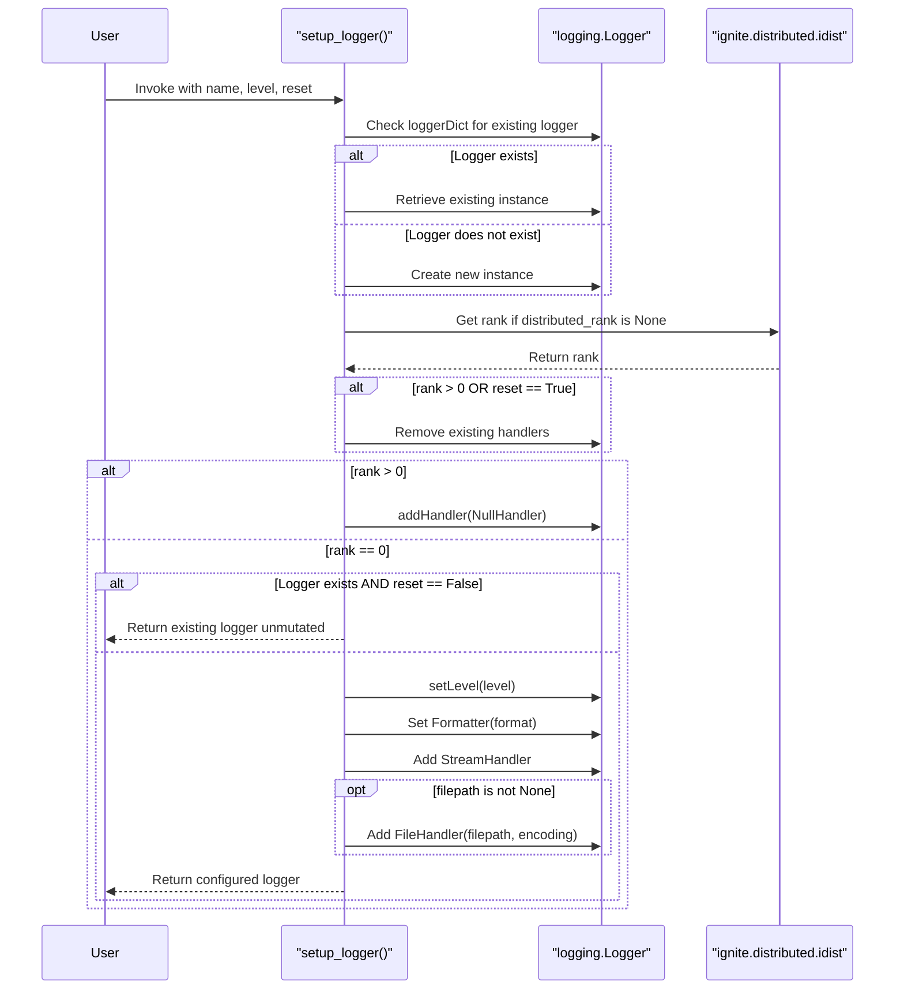

<!-- source: DeepWiki mcp.deepwiki.com · repo pytorch/ignite · page 6.2 Logging and Reproducibility · fetched 2026-10-21 -->

# Logging and Reproducibility

<details>
<summary>Relevant source files</summary>

The following files were used as context for generating this wiki page:

- [ignite/contrib/engines/__init__.py](ignite/contrib/engines/__init__.py)
- [ignite/contrib/engines/common.py](ignite/contrib/engines/common.py)
- [ignite/utils.py](ignite/utils.py)
- [tests/ignite/contrib/engines/__init__.py](tests/ignite/contrib/engines/__init__.py)
- [tests/ignite/contrib/engines/test_common.py](tests/ignite/contrib/engines/test_common.py)
- [tests/ignite/contrib/engines/test_tbptt.py](tests/ignite/contrib/engines/test_tbptt.py)
- [tests/ignite/test_utils.py](tests/ignite/test_utils.py)

</details>


This page documents the utility functions and training helpers provided by PyTorch Ignite for configuring logging, ensuring experiment reproducibility across random number generators, verifying checkpoint integrity, and bootstrapping common training handlers. 

The primary components covered are `setup_logger`, `manual_seed`, `hash_checkpoint`, and `setup_common_training_handlers`.

Sources: [ignite/utils.py:1-26](), [ignite/contrib/engines/common.py:51-106]()

---

## 1. Logger Configuration with `setup_logger`

### Function Signature and Parameters

The `setup_logger()` function creates and configures Python loggers with built-in support for distributed training environments. It returns a `logging.Logger` instance.

```python
def setup_logger(
    name: Optional[str] = "ignite",
    level: int = logging.INFO,
    stream: Optional[TextIO] = None,
    format: str = "%(asctime)s %(name)s %(levelname)s: %(message)s",
    filepath: Optional[str] = None,
    distributed_rank: Optional[int] = None,
    reset: bool = False,
    encoding: Optional[str] = "utf-8",
) -> logging.Logger
```

Sources: [ignite/utils.py:236-258]()

### Distributed Training Integration

To prevent log spam in multi-GPU or multi-node training where multiple processes write to standard error simultaneously, `setup_logger()` automatically inspects the distributed rank via `idist.get_rank()` and attaches a `logging.NullHandler` for any process where rank > 0.

Diagram: `setup_logger` Distributed Rank and Handler Routing

```mermaid
graph TB
    sub5[""setup_logger()""]
    sub4[""idist.get_rank()""]
    sub3[""logging.NullHandler""]
    sub2[""logging.StreamHandler""]
    sub1[""logging.FileHandler""]

    sub5 --> CheckRank{"distributed_rank provided?"}
    CheckRank -->|No| GetRank["Call sub4"]
    CheckRank -->|Yes| CheckPrimary["rank > 0?"]
    GetRank --> CheckPrimary
    
    CheckPrimary -->|Yes| AttachNull["Add sub3"]
    CheckPrimary -->|No| AttachHandlers["Add sub2 & Optional sub1"]
    
    AttachNull --> Return["Return logger"]
    AttachHandlers --> Return

    classDef code fill:#f9f9f9,stroke:#333,stroke-width:1px;
    class sub5,sub4,sub3,sub2,sub1 code;
```

Sources: [ignite/utils.py:321-362]()

### Handler Management and Reset Behavior



Sources: [ignite/utils.py:315-362]()

### Logging Helper: `_to_str_list`

The internal helper `_to_str_list()` flattens and formats complex data structures (dictionaries, lists, tuples, PyTorch tensors, scalars) into human-readable lists of strings for clean console or file logging.

- **Numbers / Scalar Tensors**: Formatted to 4 decimal places (`{item:.4f}`).
- **1D Tensors**: Fully listed if $\le 10$ elements; truncated with an ellipsis if $> 10$ elements.
- **Multi-dimensional Tensors**: Displayed as `Shape[d1, d2, ...]`.
- **Containers**: Recursively traversed, with dictionary keys prepended to values.

Sources: [ignite/utils.py:98-171]()

---

## 2. Random Seed Management with `manual_seed`

### Cross-Framework Seeding

The `manual_seed()` function ensures reproducible executions by simultaneously seeding Python's built-in `random` module, PyTorch (`torch.manual_seed`), and optionally NumPy (`np.random.seed`) and PyTorch XLA (`xm.set_rng_state`).

```python
def manual_seed(seed: int) -> None:
    """Setup random state from a seed for torch, random and optionally numpy."""
    random.seed(seed)
    torch.manual_seed(seed)
    
    try:
        import torch_xla.core.xla_model as xm
        xm.set_rng_state(seed)
    except ImportError:
        pass
    
    try:
        import numpy as np
        np.random.seed(seed)
    except ImportError:
        pass
```

Sources: [ignite/utils.py:365-393]()

---

## 3. Checkpoint Integrity with `hash_checkpoint`

### Purpose and Integration with `torch.hub`

The `hash_checkpoint()` function computes the SHA256 checksum of a checkpoint file, copies/moves it to an output directory, and renames it following the pattern `<filename>-<hash[:8]>.ext`. This naming convention is required when loading models via `torch.hub.load_state_dict_from_url(..., check_hash=True)`.

```python
def hash_checkpoint(
    checkpoint_path: str | Path,
    output_dir: str | Path
) -> tuple[Path, str]:
    ...
```

**Implementation Details:**
- Reads the checkpoint file in `4096`-byte blocks using `hashlib.sha256()`.
- Extracts the first 8 hex characters of the digest for the filename suffix while returning the full 64-character hash string.

Sources: [ignite/utils.py:425-465]()

---

## 4. Common Training Handlers Setup (`setup_common_training_handlers`)

### Overview

Located in `ignite.contrib.engines.common`, `setup_common_training_handlers` is a high-level helper function that injects standard boilerplate handlers and metrics into a trainer `Engine`.

Diagram: `setup_common_training_handlers` Execution Workflow

```mermaid
graph TB
    sub_fn[""setup_common_training_handlers()""]
    sub_term[""TerminateOnNan""]
    sub_chk[""Checkpoint""]
    sub_pbar[""ProgressBar""]
    sub_gpu[""GpuInfo""]
    sub_avg[""RunningAverage""]

    sub_fn --> CheckDist{"idist.get_world_size() > 1?"}
    CheckDist -->|Yes| DistBranch["Invoke _setup_common_distrib_training_handlers()"]
    CheckDist -->|No| LocalBranch["Invoke _setup_common_training_handlers()"]

    LocalBranch --> AttachNan["Attach sub_term if stop_on_nan=True"]
    LocalBranch --> AttachLR["Configure LR Scheduler handler"]
    LocalBranch --> AttachChk["Attach sub_chk if to_save is provided"]
    LocalBranch --> AttachPbar["Attach epoch/iteration sub_pbar"]
    LocalBranch --> AttachGpu["Attach sub_gpu if with_gpu_stats=True"]
    LocalBranch --> AttachAvg["Attach sub_avg on update output"]

    classDef code fill:#f9f9f9,stroke:#333,stroke-width:1px;
    class sub_fn,sub_term,sub_chk,sub_pbar,sub_gpu,sub_avg code;
```

Sources: [ignite/contrib/engines/common.py:51-168]()

### Key Handlers Attached:
1. **`TerminateOnNan`**: Aborts training immediately if loss or model parameters evaluate to `NaN` or `Inf`.
2. **Learning Rate Schedulers**: Wraps native PyTorch `_LRScheduler` or Ignite `ParamScheduler` instances.
3. **Model Checkpointing**: Configures `Checkpoint` and `DiskSaver` to periodically persist models and optimizers.
4. **Progress Bars**: Attaches `ProgressBar` instances for both epoch and iteration granularities.
5. **GPU Statistics (`GpuInfo`)**: Monitors GPU utilization and memory metrics (requires `pynvml`).
6. **Running Average (`RunningAverage`)**: Smooths training loss output across iterations.

Sources: [ignite/contrib/engines/common.py:68-106]()

---

