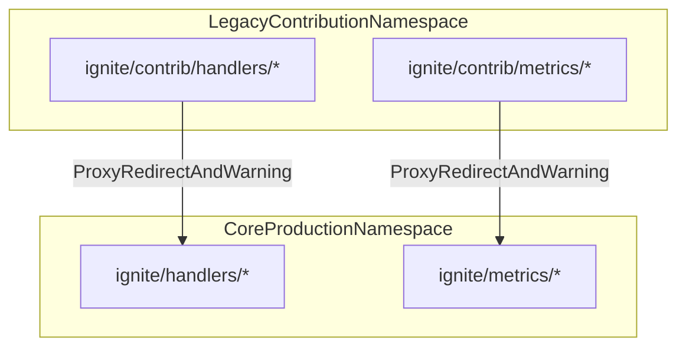
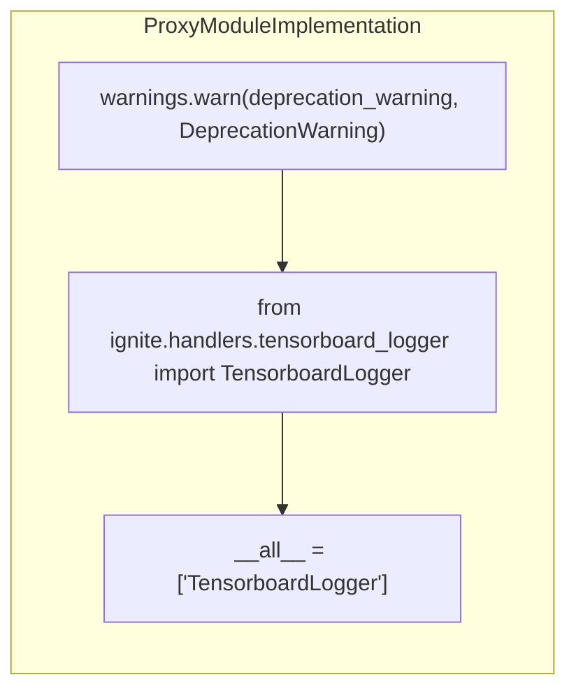

<!-- source: DeepWiki mcp.deepwiki.com · repo pytorch/ignite · page 6.3 Deprecated contrib APIs and Migration · fetched 2026-10-21 -->

# Deprecated contrib APIs and Migration

<details>
<summary>Relevant source files</summary>

The following files were used as context for generating this wiki page:

- [docs/source/contrib/engines.rst](docs/source/contrib/engines.rst)
- [docs/source/contrib/handlers.rst](docs/source/contrib/handlers.rst)
- [docs/source/contrib/metrics.rst](docs/source/contrib/metrics.rst)
- [ignite/contrib/handlers/__init__.py](ignite/contrib/handlers/__init__.py)
- [ignite/contrib/handlers/base_logger.py](ignite/contrib/handlers/base_logger.py)
- [ignite/contrib/handlers/clearml_logger.py](ignite/contrib/handlers/clearml_logger.py)
- [ignite/contrib/handlers/mlflow_logger.py](ignite/contrib/handlers/mlflow_logger.py)
- [ignite/contrib/handlers/neptune_logger.py](ignite/contrib/handlers/neptune_logger.py)
- [ignite/contrib/handlers/param_scheduler.py](ignite/contrib/handlers/param_scheduler.py)
- [ignite/contrib/handlers/polyaxon_logger.py](ignite/contrib/handlers/polyaxon_logger.py)
- [ignite/contrib/handlers/tensorboard_logger.py](ignite/contrib/handlers/tensorboard_logger.py)
- [ignite/contrib/handlers/tqdm_logger.py](ignite/contrib/handlers/tqdm_logger.py)
- [ignite/contrib/handlers/visdom_logger.py](ignite/contrib/handlers/visdom_logger.py)
- [ignite/contrib/handlers/wandb_logger.py](ignite/contrib/handlers/wandb_logger.py)
- [ignite/contrib/metrics/__init__.py](ignite/contrib/metrics/__init__.py)
- [ignite/contrib/metrics/average_precision.py](ignite/contrib/metrics/average_precision.py)
- [ignite/contrib/metrics/cohen_kappa.py](ignite/contrib/metrics/cohen_kappa.py)
- [ignite/contrib/metrics/gpu_info.py](ignite/contrib/metrics/gpu_info.py)
- [ignite/contrib/metrics/precision_recall_curve.py](ignite/contrib/metrics/precision_recall_curve.py)
- [ignite/contrib/metrics/regression/__init__.py](ignite/contrib/metrics/regression/__init__.py)
- [ignite/contrib/metrics/regression/canberra_metric.py](ignite/contrib/metrics/regression/canberra_metric.py)
- [ignite/contrib/metrics/regression/fractional_absolute_error.py](ignite/contrib/metrics/regression/fractional_absolute_error.py)
- [ignite/contrib/metrics/regression/fractional_bias.py](ignite/contrib/metrics/regression/fractional_bias.py)
- [ignite/contrib/metrics/regression/geometric_mean_absolute_error.py](ignite/contrib/metrics/regression/geometric_mean_absolute_error.py)
- [ignite/contrib/metrics/regression/geometric_mean_relative_absolute_error.py](ignite/contrib/metrics/regression/geometric_mean_relative_absolute_error.py)
- [ignite/contrib/metrics/regression/manhattan_distance.py](ignite/contrib/metrics/regression/manhattan_distance.py)
- [ignite/contrib/metrics/regression/maximum_absolute_error.py](ignite/contrib/metrics/regression/maximum_absolute_error.py)
- [ignite/contrib/metrics/regression/mean_absolute_relative_error.py](ignite/contrib/metrics/regression/mean_absolute_relative_error.py)
- [ignite/contrib/metrics/regression/mean_error.py](ignite/contrib/metrics/regression/mean_error.py)
- [ignite/contrib/metrics/regression/mean_normalized_bias.py](ignite/contrib/metrics/regression/mean_normalized_bias.py)
- [ignite/contrib/metrics/regression/median_absolute_error.py](ignite/contrib/metrics/regression/median_absolute_error.py)
- [ignite/contrib/metrics/regression/median_absolute_percentage_error.py](ignite/contrib/metrics/regression/median_absolute_percentage_error.py)
- [ignite/contrib/metrics/regression/median_relative_absolute_error.py](ignite/contrib/metrics/regression/median_relative_absolute_error.py)
- [ignite/contrib/metrics/regression/r2_score.py](ignite/contrib/metrics/regression/r2_score.py)
- [ignite/contrib/metrics/regression/wave_hedges_distance.py](ignite/contrib/metrics/regression/wave_hedges_distance.py)
- [ignite/contrib/metrics/roc_auc.py](ignite/contrib/metrics/roc_auc.py)

</details>


This document details the deprecated APIs in PyTorch Ignite under `ignite.contrib.handlers` and `ignite.contrib.metrics`, providing guidance on how to migrate your code to use their current replacements in `ignite.handlers` and `ignite.metrics`. Understanding these migrations is essential for maintaining compatibility with version 0.6.0 and later releases.

Sources: [ignite/contrib/handlers/__init__.py:1-32](), [ignite/contrib/metrics/roc_auc.py:1-21](), [docs/source/contrib/handlers.rst:1-32]()

## Overview of Deprecation Process

PyTorch Ignite follows a structured deprecation lifecycle where contribution modules and proxy files are:
1. Marked as deprecated using standard Python `warnings.warn` with `DeprecationWarning` and a specified target removal version (`removed_in = "0.6.0"`).
2. Maintained as proxy redirect modules that re-export classes from their new canonical locations.
3. Scheduled for complete removal in version 0.6.0.

Sources: [ignite/contrib/handlers/tqdm_logger.py:1-21](), [ignite/contrib/metrics/roc_auc.py:1-15]()

## Major Migration: `ignite.contrib` to Core Packages

As PyTorch Ignite matured, modular experiment trackers, parameter schedulers, loggers, and advanced metrics were promoted from the experimental `ignite.contrib` namespace to stable core packages (`ignite.handlers` and `ignite.metrics`).

### Architecture of Deprecation Proxies



Sources: [ignite/contrib/handlers/__init__.py:1-32](), [ignite/contrib/metrics/roc_auc.py:1-21]()

### Affected Modules and Class Mappings

The following table summarizes the key components migrated from `ignite.contrib` to `ignite.handlers` and `ignite.metrics`:

| Deprecated Module Path | Canonical Module Path | Key Symbols / Classes |
|------------------------|------------------------|-----------------------|
| `ignite.contrib.handlers.tqdm_logger` | `ignite.handlers.tqdm_logger` | `ProgressBar` |
| `ignite.contrib.handlers.tensorboard_logger` | `ignite.handlers.tensorboard_logger` | `TensorboardLogger`, `OutputHandler`, `OptimizerParamsHandler` |
| `ignite.contrib.handlers.neptune_logger` | `ignite.handlers.neptune_logger` | `NeptuneLogger`, `NeptuneSaver` |
| `ignite.contrib.handlers.mlflow_logger` | `ignite.handlers.mlflow_logger` | `MLflowLogger` |
| `ignite.contrib.handlers.clearml_logger` | `ignite.handlers.clearml_logger` | `ClearMLLogger`, `ClearMLSaver` |
| `ignite.contrib.handlers.wandb_logger` | `ignite.handlers.wandb_logger` | `WandBLogger` |
| `ignite.contrib.handlers.param_scheduler` | `ignite.handlers.param_scheduler` | `ParamScheduler`, `CosineAnnealingScheduler`, `ConcatScheduler` |
| `ignite.contrib.metrics.roc_auc` | `ignite.metrics.roc_auc` | `ROC_AUC`, `RocCurve` |

Sources: [ignite/contrib/handlers/tqdm_logger.py:16-21](), [ignite/contrib/handlers/tensorboard_logger.py:16-43](), [ignite/contrib/handlers/neptune_logger.py:16-41](), [ignite/contrib/handlers/param_scheduler.py:16-48](), [ignite/contrib/metrics/roc_auc.py:16-21]()

## Timeline of Deprecations

All remaining contrib proxies emit runtime deprecation warnings and are targeted for complete removal in version `0.6.0`.

| API / Subsystem | Deprecated In | Removal Version | Replacement Target |
|-----------------|---------------|-----------------|---------------------|
| `ignite.contrib.handlers.param_scheduler` | `0.4.4` | `0.6.0` | `ignite.handlers.param_scheduler` |
| `ignite.contrib.handlers.lr_finder` | `0.4.4` | `0.6.0` | `ignite.handlers.lr_finder.FastaiLRFinder` |
| `ignite.contrib.handlers.time_profilers` | `0.4.6` | `0.6.0` | `ignite.handlers.time_profilers` |
| Loggers & Savers (`tensorboard`, `mlflow`, etc.) | `0.5.0` | `0.6.0` | `ignite.handlers.*_logger` |
| `ignite.contrib.metrics` proxies (`roc_auc`, etc.) | `0.5.0` | `0.6.0` | `ignite.metrics.*` |

Sources: [docs/source/contrib/handlers.rst:1-32](), [ignite/contrib/metrics/roc_auc.py:1-15]()

## Migration Guide & Code Examples

To update your codebase, replace imports from `ignite.contrib.handlers` or `ignite.contrib.metrics` with their canonical `ignite.handlers` and `ignite.metrics` counterparts.

### Example: Migrating Loggers

```python
# Before (Deprecated Proxy)
from ignite.contrib.handlers.tensorboard_logger import TensorboardLogger, OutputHandler

# After (Canonical Path)
from ignite.handlers.tensorboard_logger import TensorboardLogger, OutputHandler
```

Sources: [ignite/contrib/handlers/tensorboard_logger.py:1-43]()

### Example: Migrating Parameter Schedulers

```python
# Before (Deprecated Proxy)
from ignite.contrib.handlers.param_scheduler import CosineAnnealingScheduler, LinearCyclicalScheduler

# After (Canonical Path)
from ignite.handlers.param_scheduler import CosineAnnealingScheduler, LinearCyclicalScheduler
```

Sources: [ignite/contrib/handlers/param_scheduler.py:1-48]()

### Example: Migrating Metrics

```python
# Before (Deprecated Proxy)
from ignite.contrib.metrics.roc_auc import ROC_AUC

# After (Canonical Path)
from ignite.metrics.roc_auc import ROC_AUC
```

Sources: [ignite/contrib/metrics/roc_auc.py:1-21]()

## Implementation Details of Deprecation Proxies

The deprecation proxy modules utilize a standard pattern. When imported, they instantiate a `DeprecationWarning` indicating the source file, destination module, and the target removal version (`removed_in = "0.6.0"`). They then import all public symbols from the canonical module and re-export them via `__all__`.



Sources: [ignite/contrib/handlers/tensorboard_logger.py:7-43](), [ignite/contrib/metrics/roc_auc.py:7-21]()

## Related Pages

- For details on the logging system, see [Logging and Experiment Tracking](#4.3)
- For parameter schedulers and learning rate finders, see [Parameter Schedulers and LR Finder](#4.4)
- For the metrics framework, see [Metrics System](#3)

---

