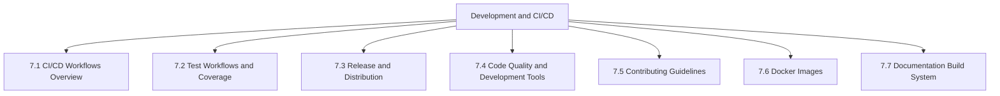

<!-- source: DeepWiki mcp.deepwiki.com · repo pytorch/ignite · page 7 Development and CI/CD · fetched 2026-10-21 -->

# Development and CI/CD

Relevant source files

The following files were used as context for generating this wiki page:

- [.devcontainer/devcontainer.json](.devcontainer/devcontainer.json)
- [.git-blame-ignore-revs](.git-blame-ignore-revs)
- [.github/workflows/binaries-nightly-release.yml](.github/workflows/binaries-nightly-release.yml)
- [.github/workflows/build_docs.sh](.github/workflows/build_docs.sh)
- [.github/workflows/docker-build.yml](.github/workflows/docker-build.yml)
- [.github/workflows/docs.yml](.github/workflows/docs.yml)
- [.github/workflows/gpu-hvd-tests.yml](.github/workflows/gpu-hvd-tests.yml)
- [.github/workflows/gpu-tests.yml](.github/workflows/gpu-tests.yml)
- [.github/workflows/hvd-tests.yml](.github/workflows/hvd-tests.yml)
- [.github/workflows/install_docs_deps.sh](.github/workflows/install_docs_deps.sh)
- [.github/workflows/mps-tests.yml](.github/workflows/mps-tests.yml)
- [.github/workflows/pytorch-version-tests.yml](.github/workflows/pytorch-version-tests.yml)
- [.github/workflows/stable-release-anaconda.yml](.github/workflows/stable-release-anaconda.yml)
- [.github/workflows/stable-release-pypi.yml](.github/workflows/stable-release-pypi.yml)
- [.github/workflows/tpu-tests.yml](.github/workflows/tpu-tests.yml)
- [.github/workflows/unit-tests.yml](.github/workflows/unit-tests.yml)
- [.pre-commit-config.yaml](.pre-commit-config.yaml)
- [CONTRIBUTING.md](CONTRIBUTING.md)
- [conda.recipe/build_and_upload.sh](conda.recipe/build_and_upload.sh)
- [conda.recipe/meta.yaml](conda.recipe/meta.yaml)
- [pyproject.toml](pyproject.toml)

This page documents PyTorch Ignite's development workflow, CI/CD infrastructure, testing framework, Docker images, documentation build system, and contribution guidelines. It serves as an umbrella overview for all development and deployment infrastructure.

For detailed explanations of specific subsystems, refer to the child pages linked below.

Sources: [.github/workflows/unit-tests.yml:1-194](), [CONTRIBUTING.md:1-120]()

## 7.1 CI/CD Workflows Overview

PyTorch Ignite automates testing, quality control, and packaging using GitHub Actions workflows. These workflows are triggered by pull requests, pushes to master, daily cron schedules, and manual dispatch [.github/workflows/unit-tests.yml:1-28](), [.github/workflows/pytorch-version-tests.yml:1-9](), [.github/workflows/docs.yml:1-14](). 

Key workflows include `unit-tests.yml`, `gpu-tests.yml`, `tpu-tests.yml`, `hvd-tests.yml`, `gpu-hvd-tests.yml`, `mps-tests.yml`, and `pytorch-version-tests.yml`. They validate code across multiple operating systems, Python versions, and PyTorch channels with built-in concurrency controls and retry policies.

For details, see [CI/CD Workflows Overview](#7.1).
Sources: [.github/workflows/unit-tests.yml:1-33](), [.github/workflows/pytorch-version-tests.yml:1-10](), [.github/workflows/docs.yml:1-14]()

## 7.2 Test Workflows and Coverage

The testing system relies on `pytest`, execution scripts (`tests/run_cpu_tests.sh`, `tests/run_gpu_tests.sh`, `tests/run_tpu_tests.sh`), and fixtures defined in `tests/ignite/conftest.py`. It supports single-node and multi-node distributed test contexts across native PyTorch (NCCL, Gloo), Horovod, and XLA/TPU backends.

Code coverage is tracked via `pytest-cov` and uploaded to Codecov with platform-specific flags (`cpu`, `gpu-2`, `tpu`, `hvd-cpu`, `mps`) [.github/workflows/unit-tests.yml:114-120](), [.github/workflows/gpu-tests.yml:135-141]().

For details, see [Test Workflows and Coverage](#7.2).
Sources: [.github/workflows/unit-tests.yml:105-120](), [.github/workflows/gpu-tests.yml:125-141](), [pyproject.toml:126-132]()

## 7.3 Release and Distribution

Releases are automated for both nightly builds and stable versions. Nightly workflows build packages daily at 00:00 UTC, appending a `.devYYYYMMDD` version suffix to `ignite/__init__.py` and `conda.recipe/meta.yaml`, then publishing to PyPI and Anaconda Cloud [.github/workflows/binaries-nightly-release.yml:1-62](). Stable releases are triggered automatically when GitHub releases are published [.github/workflows/stable-release-pypi.yml:1-33]().

For details, see [Release and Distribution](#7.3).
Sources: [.github/workflows/binaries-nightly-release.yml:1-62](), [.github/workflows/stable-release-pypi.yml:1-33]()

## 7.4 Code Quality and Development Tools

Code quality is enforced using `ruff` for linting and formatting, alongside `mypy` for static type checking configured in `pyproject.toml` [pyproject.toml:38-125](). Developers use pre-commit hooks to automate formatting checks before commits are made.

For details, see [Code Quality and Development Tools](#7.4).
Sources: [pyproject.toml:38-125](), [CONTRIBUTING.md:141-160]()

## 7.5 Contributing Guidelines

Contributing to Ignite follows a standard fork-clone-branch workflow [CONTRIBUTING.md:81-110](). Contributors set up an isolated development environment, install dependencies (`requirements-dev.txt`), run local tests using test scripts, and submit pull requests. Commit messages support CI skip tags like `[skip ci]` when appropriate.

For details, see [Contributing Guidelines](#7.5).
Sources: [CONTRIBUTING.md:1-120]()

## 7.6 Docker Images

The `docker/` directory contains multi-flavor container definitions (base, vision, nlp, apex, Horovod, MSDP). These images are versioned via `docker.cfg` and built or pushed using `build.sh` and `push_all.sh` scripts orchestrated through [.github/workflows/docker-build.yml]().

For details, see [Docker Images](#7.6).
Sources: [.github/workflows/docker-build.yml:1-281]()

## 7.7 Documentation Build System

Documentation is built using Sphinx with custom extensions like `AutolistAutosummary`, nitpick aliases, and PyTorch theme templates. The `docs.yml` workflow verifies external links, runs doctests, and deploys HTML outputs to GitHub Pages [.github/workflows/docs.yml:1-143]().

For details, see [Documentation Build System](#7.7).
Sources: [.github/workflows/docs.yml:1-143]()

---

