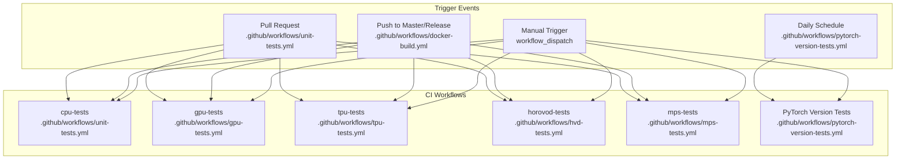
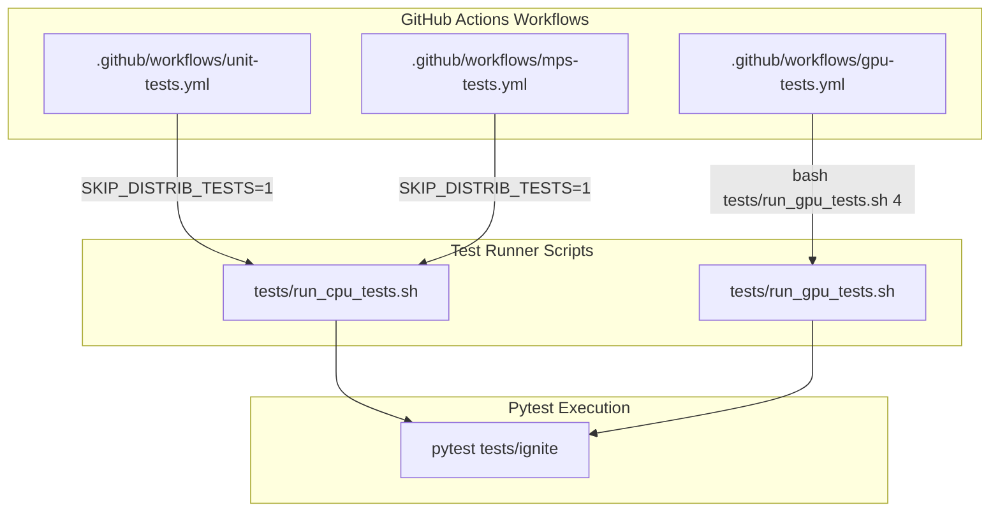
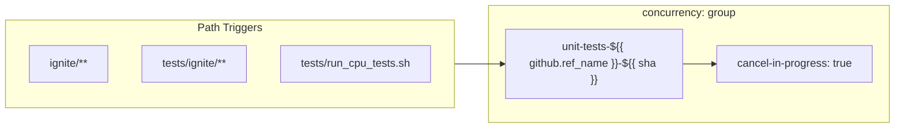

<!-- source: DeepWiki mcp.deepwiki.com · repo pytorch/ignite · page 7.1 CI/CD Workflows Overview · fetched 2026-10-21 -->

# CI/CD Workflows Overview

Relevant source files

The following files were used as context for generating this wiki page:

- [.github/FUNDING.yml](.github/FUNDING.yml)
- [.github/ISSUE_TEMPLATE/bug-report.md](.github/ISSUE_TEMPLATE/bug-report.md)
- [.github/ISSUE_TEMPLATE/documentation.md](.github/ISSUE_TEMPLATE/documentation.md)
- [.github/ISSUE_TEMPLATE/feature-request.md](.github/ISSUE_TEMPLATE/feature-request.md)
- [.github/ISSUE_TEMPLATE/questions-help-support.md](.github/ISSUE_TEMPLATE/questions-help-support.md)
- [.github/ISSUE_TEMPLATE/user-feedback.md](.github/ISSUE_TEMPLATE/user-feedback.md)
- [.github/PULL_REQUEST_TEMPLATE.md](.github/PULL_REQUEST_TEMPLATE.md)
- [.github/workflows/binaries-nightly-release.yml](.github/workflows/binaries-nightly-release.yml)
- [.github/workflows/discord_issues.yml](.github/workflows/discord_issues.yml)
- [.github/workflows/discord_pull_requests.yaml](.github/workflows/discord_pull_requests.yaml)
- [.github/workflows/docker-build.yml](.github/workflows/docker-build.yml)
- [.github/workflows/docs.yml](.github/workflows/docs.yml)
- [.github/workflows/gpu-hvd-tests.yml](.github/workflows/gpu-hvd-tests.yml)
- [.github/workflows/gpu-tests.yml](.github/workflows/gpu-tests.yml)
- [.github/workflows/hvd-tests.yml](.github/workflows/hvd-tests.yml)
- [.github/workflows/mps-tests.yml](.github/workflows/mps-tests.yml)
- [.github/workflows/pytorch-version-tests.yml](.github/workflows/pytorch-version-tests.yml)
- [.github/workflows/stable-release-anaconda.yml](.github/workflows/stable-release-anaconda.yml)
- [.github/workflows/stable-release-pypi.yml](.github/workflows/stable-release-pypi.yml)
- [.github/workflows/tpu-tests.yml](.github/workflows/tpu-tests.yml)
- [.github/workflows/triage.yml](.github/workflows/triage.yml)
- [.github/workflows/unit-tests.yml](.github/workflows/unit-tests.yml)

This document details the continuous integration and continuous delivery (CI/CD) infrastructure used in PyTorch Ignite. It explains how automated testing, code quality checks, and bot automations are implemented, covering various workflow types, their trigger patterns, execution environments, and caching/retry mechanisms.

## Overview of CI/CD Architecture

PyTorch Ignite uses GitHub Actions as its CI/CD platform, running specialized workflows to validate code across hardware platforms (CPU, GPU, TPU, Apple Silicon MPS) and multiple PyTorch versions.

Sources: [.github/workflows/unit-tests.yml:1-26](), [.github/workflows/gpu-tests.yml:1-12](), [.github/workflows/tpu-tests.yml:1-22](), [.github/workflows/hvd-tests.yml:1-18](), [.github/workflows/mps-tests.yml:1-26](), [.github/workflows/pytorch-version-tests.yml:1-8]()

## Workflow Types and Purpose

The CI/CD matrix includes specialized workflows mapped to different testing environments:

| Workflow File | Purpose | Runtime Environment | Trigger Events |
|---------------|---------|---------------------|----------------|
| `unit-tests.yml` | Core functionality verification & example tests | CPU (Ubuntu, Windows, macOS) | PRs, Pushes, Manual, Merge Group |
| `gpu-tests.yml` | CUDA-accelerated testing & distributed GPU checks | NVIDIA GPUs (`linux.g4dn.12xlarge`) | Pushes, Manual |
| `tpu-tests.yml` | XLA backend validation | Ubuntu with PyTorch-XLA nightly | PRs, Pushes, Manual |
| `hvd-tests.yml` | Distributed training with Horovod (CPU) | Ubuntu | PRs, Pushes, Manual, Merge Group |
| `gpu-hvd-tests.yml` | Horovod with CUDA NCCL GPU ops | NVIDIA GPUs (`linux.8xlarge`) | Pushes, Manual |
| `mps-tests.yml` | Apple Silicon hardware support testing | macOS 14 (M1/M2/M3 via `macos-14`) | PRs, Pushes, Manual, Merge Group |
| `pytorch-version-tests.yml` | Compatibility matrix across older/newer PyTorch releases | CPU (Ubuntu) | Daily Schedule, Manual |
| `docker-build.yml` | Build & publish Docker image flavors (base, vision, nlp, apex, hvd) | Linux (4xlarge / 12xlarge) | PRs (paths), Release, Manual |

Sources: [.github/workflows/unit-tests.yml:32-47](), [.github/workflows/gpu-tests.yml:21-31](), [.github/workflows/tpu-tests.yml:28-34](), [.github/workflows/hvd-tests.yml:26-33](), [.github/workflows/gpu-hvd-tests.yml:21-31](), [.github/workflows/mps-tests.yml:33-41](), [.github/workflows/pytorch-version-tests.yml:5-19](), [.github/workflows/docker-build.yml:3-11]()

## Unit, MPS, and GPU Test Execution Flow

Testing relies on shared shell scripts like `tests/run_cpu_tests.sh`, `tests/run_gpu_tests.sh`, and `tests/run_tpu_tests.sh`. Below is the workflow execution flow bridging workflow triggers to test execution code:

Sources: [.github/workflows/unit-tests.yml:105-113](), [.github/workflows/gpu-tests.yml:125-134](), [.github/workflows/mps-tests.yml:129-136]()

## Specialized Workflows: TPU, Horovod, and Triage/Bots

### TPU Tests (`tpu-tests.yml`)
Configured to install PyTorch XLA nightly wheels (`torch_xla-nightly`) on an Ubuntu runner, setting up environment variables `XRT_DEVICE_MAP` and `XRT_WORKERS` before running `tests/run_tpu_tests.sh` [.github/workflows/tpu-tests.yml:72-101]().

### Horovod Tests (`hvd-tests.yml` & `gpu-hvd-tests.yml`)
Horovod is built from source with CMake C++17 standard patches (`CMAKE_CXX_STANDARD 17`) to ensure compatibility with modern PyTorch headers [.github/workflows/hvd-tests.yml:62-70](). GPU HVD tests execute `tests/run_gpu_tests.sh` with `hvd` flags and check `horovodrun` multinode communication [.github/workflows/gpu-hvd-tests.yml:157-192]().

### Triage and Discord Bots
PyTorch Ignite utilizes automated workflows (`triage.yml`, `discord_issues.yml`, `discord_pull_requests.yaml`) to synchronize GitHub issue/PR events with Discord channels and manage automated label assignment.

Sources: [.github/workflows/tpu-tests.yml:70-101](), [.github/workflows/hvd-tests.yml:62-70](), [.github/workflows/gpu-hvd-tests.yml:150-192]()

## Workflow Path Triggers and Concurrency

To minimize resource consumption, workflows specify strict `paths` filters so that documentation-only or unrelated changes do not trigger expensive GPU or distributed jobs [.github/workflows/unit-tests.yml:7-15]().

Sources: [.github/workflows/unit-tests.yml:7-33](), [.github/workflows/gpu-tests.yml:3-17](), [.github/workflows/tpu-tests.yml:7-26]()

## Caching and Test Retry Strategies

### Dependency Caching
Workflows leverage `astral-sh/setup-uv` and GitHub Actions cache using dynamic cache suffixes combining year/week numbers, Python versions, OS, and hash dependencies from `requirements-dev.txt` and `pyproject.toml` [.github/workflows/unit-tests.yml:63-78]().

### Test Retry Mechanism
Flaky test protection is implemented using `nick-fields/retry`, allowing up to 5 execution attempts and falling back to `USE_LAST_FAILED=1` on subsequent retries [.github/workflows/unit-tests.yml:106-112]().

Sources: [.github/workflows/unit-tests.yml:63-112](), [.github/workflows/tpu-tests.yml:43-62]()

---

