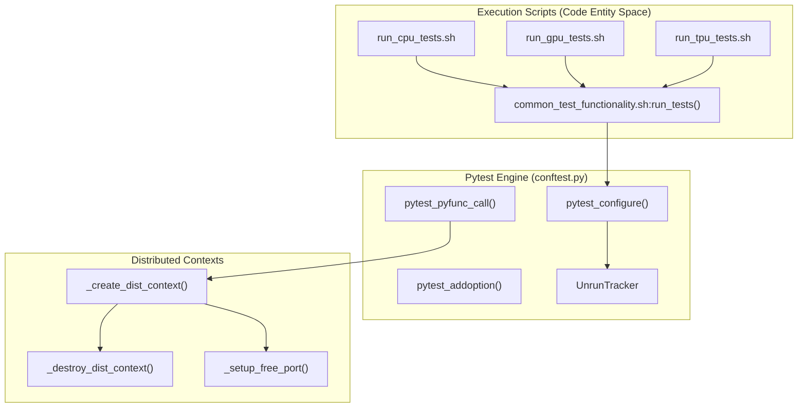
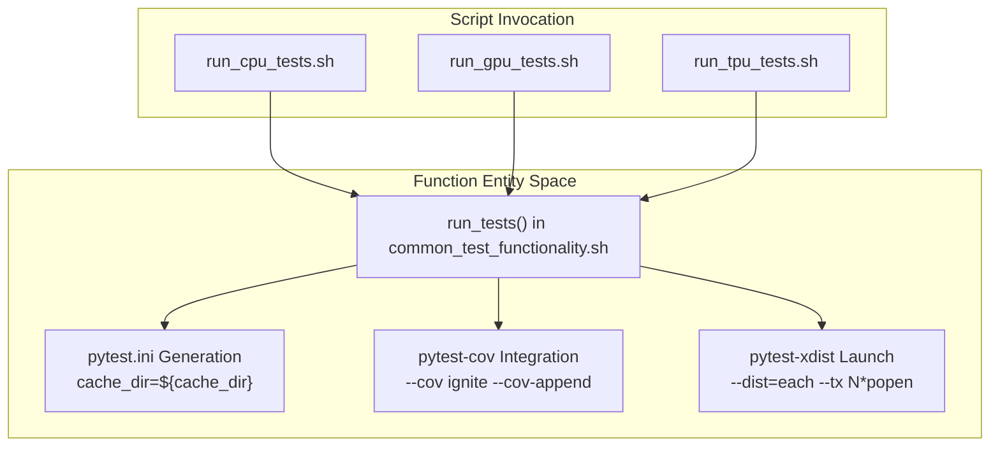
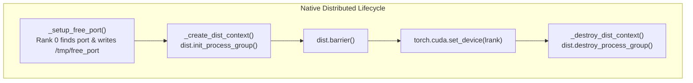

<!-- source: DeepWiki mcp.deepwiki.com · repo pytorch/ignite · page 7.2 Test Workflows and Coverage · fetched 2026-10-21 -->

# Test Workflows and Coverage

Relevant source files

The following files were used as context for generating this wiki page:

- [codecov.yml](codecov.yml)
- [tests/__init__.py](tests/__init__.py)
- [tests/common_test_functionality.sh](tests/common_test_functionality.sh)
- [tests/ignite/conftest.py](tests/ignite/conftest.py)
- [tests/ignite/distributed/check_idist_parallel.py](tests/ignite/distributed/check_idist_parallel.py)
- [tests/ignite/distributed/comp_models/test_horovod.py](tests/ignite/distributed/comp_models/test_horovod.py)
- [tests/ignite/distributed/comp_models/test_native.py](tests/ignite/distributed/comp_models/test_native.py)
- [tests/ignite/distributed/comp_models/test_xla.py](tests/ignite/distributed/comp_models/test_xla.py)
- [tests/ignite/distributed/test_launcher.py](tests/ignite/distributed/test_launcher.py)
- [tests/ignite/engine/test_memory_leaks.py](tests/ignite/engine/test_memory_leaks.py)
- [tests/ignite/handlers/__init__.py](tests/ignite/handlers/__init__.py)
- [tests/ignite/metrics/__init__.py](tests/ignite/metrics/__init__.py)
- [tests/run_cpu_tests.sh](tests/run_cpu_tests.sh)
- [tests/run_gpu_tests.sh](tests/run_gpu_tests.sh)
- [tests/run_tpu_tests.sh](tests/run_tpu_tests.sh)

This page documents the test execution workflows and coverage tracking system in PyTorch Ignite. It details test runner scripts (`run_cpu_tests.sh`, `run_gpu_tests.sh`, `run_tpu_tests.sh`), pytest fixtures and hooks in `conftest.py`, distributed test contexts across native, Horovod, and XLA backends, retry logic, and Codecov integration.

## Overview and Architecture

PyTorch Ignite employs a modular testing infrastructure designed to execute tests across multiple hardware backends (CPU, CUDA, MPS, TPU) and distributed frameworks (Native DDP, Horovod, XLA). The system relies on `pytest`, `pytest-xdist`, and custom shell wrappers.

Sources: [tests/run_cpu_tests.sh:1-36](), [tests/run_gpu_tests.sh:1-47](), [tests/run_tpu_tests.sh:1-20](), [tests/common_test_functionality.sh:8-109](), [tests/ignite/conftest.py:19-227]()

## Test Execution Scripts

Test execution is driven by platform-specific shell scripts that invoke `run_tests()` defined in `tests/common_test_functionality.sh`.

### Core Test Runner Scripts

- **`run_cpu_tests.sh`**: Configures execution for CPU environments. By default, it runs non-distributed tests using `pytest-xdist` with `4*popen` workers, then optionally executes distributed CPU tests with `WORLD_SIZE=4` and `--dist=each` [tests/run_cpu_tests.sh:9-36]().
- **`run_gpu_tests.sh`**: Handles CUDA-enabled environments. It filters tests using `-m 'not distributed'` for single-device runs, and subsequently launches distributed GPU test configurations across available GPUs [tests/run_gpu_tests.sh:11-47]().
- **`run_tpu_tests.sh`**: Targets PyTorch XLA TPU environments, executing tests marked with `-m tpu` both in single-worker and multi-worker modes (`NUM_TPU_WORKERS`) [tests/run_tpu_tests.sh:6-20]().

### Common Test Functionality

The `run_tests()` function in `tests/common_test_functionality.sh` parses command-line flags, generates a temporary `pytest.ini` with custom `cache_dir`, configures `pytest-cov`, and handles exit codes when tests are deselected [tests/common_test_functionality.sh:8-109]().

Sources: [tests/run_cpu_tests.sh:1-36](), [tests/run_gpu_tests.sh:1-47](), [tests/run_tpu_tests.sh:1-20](), [tests/common_test_functionality.sh:8-109]()

## Pytest Configuration and Fixtures (`conftest.py`)

Pytest behavior is customized in `tests/ignite/conftest.py` through hooks, command-line options, and fixtures.

### Initialization Hooks

- `pytest_addoption(parser)`: Registers custom command-line options such as `--treat-unrun-as-failed` [tests/ignite/conftest.py:19-40]().
- `pytest_configure(config)`: Registers custom markers (`distributed`, `multinode_distributed`, `tpu`) and optionally registers `UnrunTracker` [tests/ignite/conftest.py:43-55]().

### Key Fixtures

- `available_device`: Parameterized fixture supplying `cpu`, `cuda`, or `mps` depending on hardware availability [tests/ignite/conftest.py:73-84]().
- `dirname` and `get_fixed_dirname`: Provide temporary directories with multi-process worker safety (`worker_id`) [tests/ignite/conftest.py:92-120]().
- `local_rank` and `world_size`: Manage distributed environment variables (`LOCAL_RANK`, `WORLD_SIZE`) across `xdist` workers [tests/ignite/conftest.py:133-162]().

Sources: [tests/ignite/conftest.py:19-162]()

## Distributed Test Contexts and Backends

PyTorch Ignite abstracts distributed testing across Native (`_NativeDistModel`), Horovod (`_HorovodDistModel`), and XLA (`_XlaDistModel`).

### Native Distributed Contexts

Native distributed contexts are initialized via `_create_dist_context()` and destroyed via `_destroy_dist_context()` [tests/ignite/conftest.py:171-197](). Free ports are dynamically allocated using `_find_free_port()` and `_setup_free_port()` [tests/ignite/conftest.py:198-227]().

Sources: [tests/ignite/conftest.py:171-227](), [tests/ignite/distributed/comp_models/test_native.py:69-148]()

### Specialized Backends: Horovod and XLA

- **Horovod**: Tested via `test_horovod.py` and `gloo_hvd_executor` fixtures [tests/ignite/distributed/comp_models/test_horovod.py:14-140]().
- **XLA / TPU**: Tested via `test_xla.py` and `xmp_executor` fixtures utilizing `torch_xla` [tests/ignite/distributed/comp_models/test_xla.py:14-149]().

Sources: [tests/ignite/distributed/comp_models/test_horovod.py:1-140](), [tests/ignite/distributed/comp_models/test_xla.py:1-149]()

## Retry Logic, Flaky Tests, and Interrupted Sessions

To handle transient failures in CI (e.g., GPU memory allocation, network timeouts), workflows utilize the `nick-fields/retry` GitHub Action combined with pytest's `--last-failed` mechanism (`USE_LAST_FAILED=1`) [tests/run_cpu_tests.sh:6]().

Additionally, the `UnrunTracker` plugin tracks test collection and execution states, ensuring that if a session is interrupted, unrun tests are marked as failed in pytest's cache so they are re-executed during test retries [tests/ignite/conftest.py:52-54]().

Sources: [tests/run_cpu_tests.sh:1-21](), [tests/ignite/conftest.py:50-55]()

## Code Coverage and Tracking

Code coverage is measured using `pytest-cov` and tracked via Codecov (`codecov.yml`).

### Codecov Configuration (`codecov.yml`)

The project configures coverage thresholds and patch rules in `codecov.yml`:
- `coverage.range`: `"95...100"`
- `status.patch.default.target`: `90`
- `status.project.default.threshold`: `1%`
- `ignore`: Excludes the `tests/` directory from coverage reporting.

Sources: [codecov.yml:1-15]()

### Multi-Stage Coverage Collection

Because test execution is split across multiple scripts and environments (CPU, GPU, distributed), `pytest-cov` is invoked with `--cov-append` [tests/common_test_functionality.sh:95-97](). This aggregates coverage data across distinct test runs into a single XML report before uploading to Codecov.

Sources: [tests/common_test_functionality.sh:95-97](), [codecov.yml:1-15]()

---

