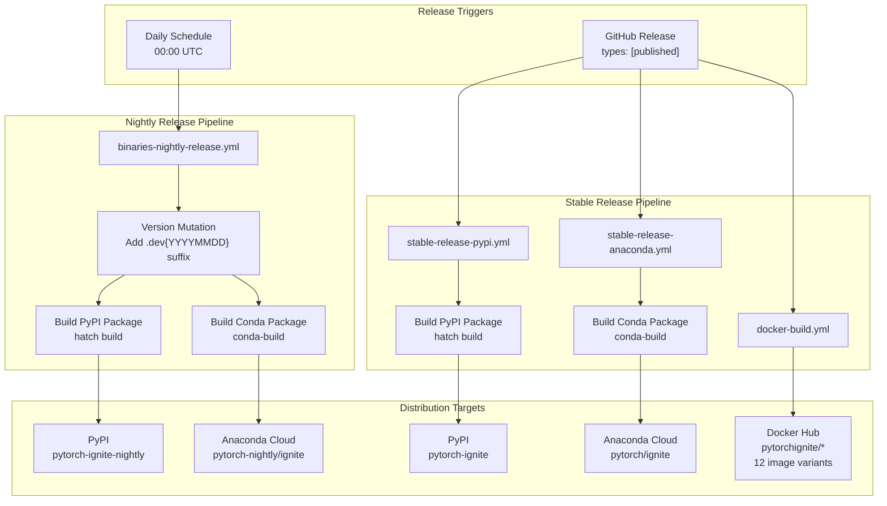
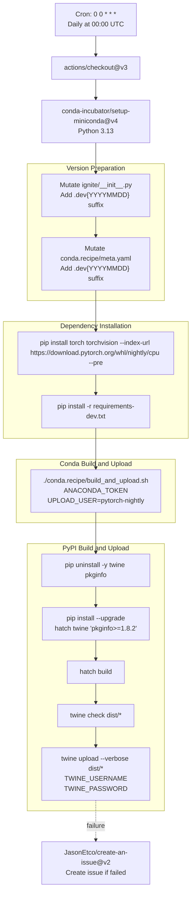
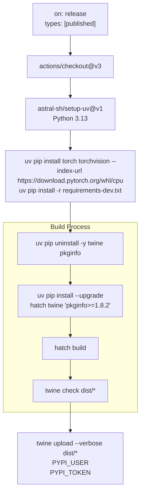

<!-- source: DeepWiki mcp.deepwiki.com · repo pytorch/ignite · page 7.3 Release and Distribution · fetched 2026-10-21 -->

# Release and Distribution

<details>
<summary>Relevant source files</summary>

The following files were used as context for generating this wiki page:

- [.devcontainer/devcontainer.json](.devcontainer/devcontainer.json)
- [.git-blame-ignore-revs](.git-blame-ignore-revs)
- [.github/workflows/binaries-nightly-release.yml](.github/workflows/binaries-nightly-release.yml)
- [.github/workflows/build_docs.sh](.github/workflows/build_docs.sh)
- [.github/workflows/docker-build.yml](.github/workflows/docker-build.yml)
- [.github/workflows/docs.yml](.github/workflows/docs.yml)
- [.github/workflows/gpu-hvd-tests.yml](.github/workflows/gpu-hvd-tests.yml)
- [.github/workflows/gpu-tests.yml](.github/workflows/gpu-tests.yml)
- [.github/workflows/hvd-tests.yml](.github/workflows/hvd-tests.yml)
- [.github/workflows/install_docs_deps.sh](.github/workflows/install_docs_deps.sh)
- [.github/workflows/mps-tests.yml](.github/workflows/mps-tests.yml)
- [.github/workflows/pytorch-version-tests.yml](.github/workflows/pytorch-version-tests.yml)
- [.github/workflows/stable-release-anaconda.yml](.github/workflows/stable-release-anaconda.yml)
- [.github/workflows/stable-release-pypi.yml](.github/workflows/stable-release-pypi.yml)
- [.github/workflows/tpu-tests.yml](.github/workflows/tpu-tests.yml)
- [.github/workflows/unit-tests.yml](.github/workflows/unit-tests.yml)
- [.pre-commit-config.yaml](.pre-commit-config.yaml)
- [CONTRIBUTING.md](CONTRIBUTING.md)
- [conda.recipe/build_and_upload.sh](conda.recipe/build_and_upload.sh)
- [conda.recipe/meta.yaml](conda.recipe/meta.yaml)
- [pyproject.toml](pyproject.toml)

</details>


## Purpose and Scope

This document describes PyTorch Ignite's automated release and distribution system. It covers the two release tracks (nightly and stable), the three distribution channels (PyPI, Anaconda, and Docker Hub), version management, and the GitHub Actions workflows that automate the build and publication process.

For information about the testing infrastructure that validates releases, see [Test Workflows and Coverage](#7.2). For general CI/CD workflow overview, see [CI/CD Workflows Overview](#7.1).

---

## Distribution Architecture

PyTorch Ignite is distributed through three primary channels, each serving different user needs and installation preferences:



**Distribution Channel Architecture**

The system implements two distinct release tracks with separate targets. Nightly releases deploy to testing channels (`pytorch-ignite-nightly` on PyPI, `pytorch-nightly/ignite` on Anaconda) while stable releases deploy to production channels (`pytorch-ignite` on PyPI, `pytorch/ignite` on Anaconda). Docker images are built only for stable releases or manual workflow dispatches.

Sources: [.github/workflows/binaries-nightly-release.yml:1-62](), [.github/workflows/stable-release-pypi.yml:1-33]()

---

## Version Management

PyTorch Ignite follows semantic versioning with automated version mutation for nightly builds:

| Release Type | Version Format | Example | Location |
|--------------|----------------|---------|----------|
| Stable | `MAJOR.MINOR.PATCH` | `0.5.0` | `ignite/__init__.py` |
| Nightly | `MAJOR.MINOR.PATCH.devYYYYMMDD` | `0.5.0.dev20240315` | Modified during build |

### Nightly Version Mutation

The nightly release workflow modifies version strings in two locations before building packages:

```mermaid
graph LR
    SourceVersion["ignite/__init__.py<br/>__version__ = '0.5.0'"]
    CondaRecipe["conda.recipe/meta.yaml<br/>version: 0.5.0"]
    
    SedInit["sed -i 's/__version__ = \"(.*)\"/__version__ = \"\\1.dev{date}\"/g'"]
    SedMeta["sed -i 's/__version__ = \"(.*)\"/__version__ = \"\\1.dev{date}\"/g'"]
    
    MutatedInit["ignite/__init__.py<br/>__version__ = '0.5.0.dev20240315'"]
    MutatedMeta["conda.recipe/meta.yaml<br/>version: 0.5.0.dev20240315"]
    
    SourceVersion --> SedInit --> MutatedInit
    CondaRecipe --> SedMeta --> MutatedMeta
    
    MutatedInit --> Build["Package Build"]
    MutatedMeta --> Build
```

**Version Mutation Process for Nightly Builds**

The mutation is performed using `sed` commands that append `.dev$(date -u +%Y%m%d)` to the existing version string. This ensures nightly builds have unique version identifiers and are recognized as pre-release versions by package managers.

Sources: [.github/workflows/binaries-nightly-release.yml:22-28]()

---

## Nightly Release Workflow

Nightly releases run automatically at 00:00 UTC every day via cron schedule, publishing development versions to dedicated nightly channels.



**Nightly Release Workflow Execution**

### Schedule Configuration

The workflow is triggered by a GitHub Actions schedule event:

```yaml
on:
  schedule:
    - cron: "0 0 * * *"
```

This ensures daily execution without manual intervention.

### Conda Package Build

The Conda build process executes `conda.recipe/build_and_upload.sh`, which:
1. Runs `conda-build` with the package recipe in `conda.recipe/meta.yaml`
2. Uploads to the `pytorch-nightly` channel on Anaconda Cloud using `ANACONDA_TOKEN` secret
3. Creates a `noarch: python` package for platform independence

### PyPI Package Build

The PyPI build process addresses a known issue ([#2373](https://github.com/pytorch/ignite/issues/2373)) by reinstalling `twine` and `pkginfo`:

1. Uninstalls existing `twine` and `pkginfo` to avoid version conflicts
2. Installs `hatch` as the build backend (configured in `pyproject.toml`)
3. Runs `hatch build` to create wheel and source distribution
4. Validates packages with `twine check dist/*`
5. Uploads to PyPI using `TWINE_USERNAME` and `TWINE_PASSWORD` secrets

### Failure Handling

If the workflow fails, it automatically creates a GitHub issue using the template at `.github/failed_schedule_issue_template.md` to alert maintainers.

Sources: [.github/workflows/binaries-nightly-release.yml:1-62]()

---

## Stable Release Workflows

Stable releases are triggered when a GitHub release is published, deploying to production channels.

### PyPI Stable Release



**PyPI Stable Release Workflow**

The workflow is nearly identical to the nightly release PyPI build, but:
- Uses the version string from `ignite/__init__.py` without modification
- Uploads to the production PyPI project `pytorch-ignite` instead of `pytorch-ignite-nightly`
- Uses different credentials (`PYPI_USER` and `PYPI_TOKEN` secrets)

Sources: [.github/workflows/stable-release-pypi.yml:1-33]()

---

## Package Build Configuration

### PyPI Build with Hatch

PyTorch Ignite uses `hatch` (Hatchling build backend) for PyPI package creation, configured in `pyproject.toml`:

```toml
[build-system]
requires = ["hatchling>=1.24.2"]
build-backend = "hatchling.build"
```

The `hatch build` command creates:
- **Wheel distribution** (`.whl`): Binary distribution for fast installation
- **Source distribution** (`.tar.gz`): Contains source code for compatibility

### Dependency Management

Both build systems reference `requirements-dev.txt` during CI, ensuring build environments have testing dependencies, code quality tools (`ruff`, `mypy`), and documentation tools.

Sources: [pyproject.toml:1-22](), [.github/workflows/stable-release-pypi.yml:20-24]()

---

