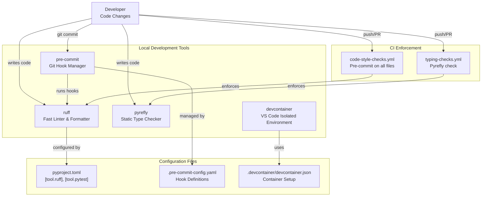
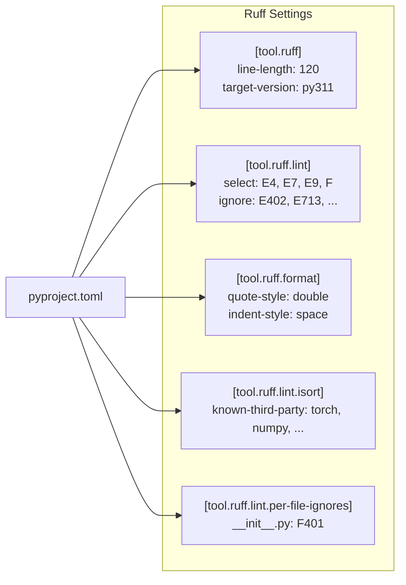
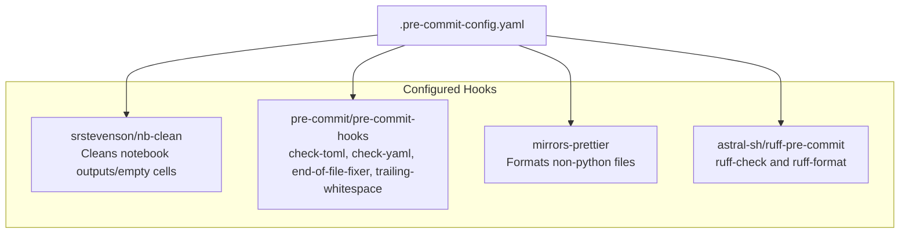
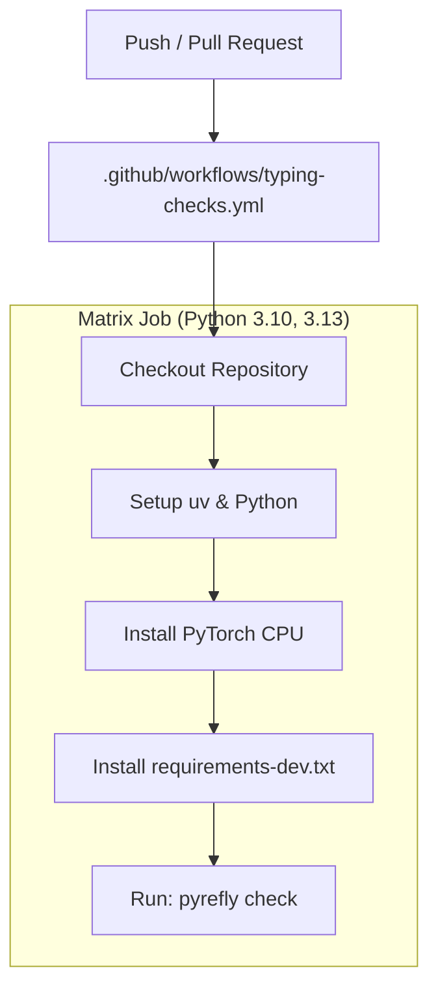
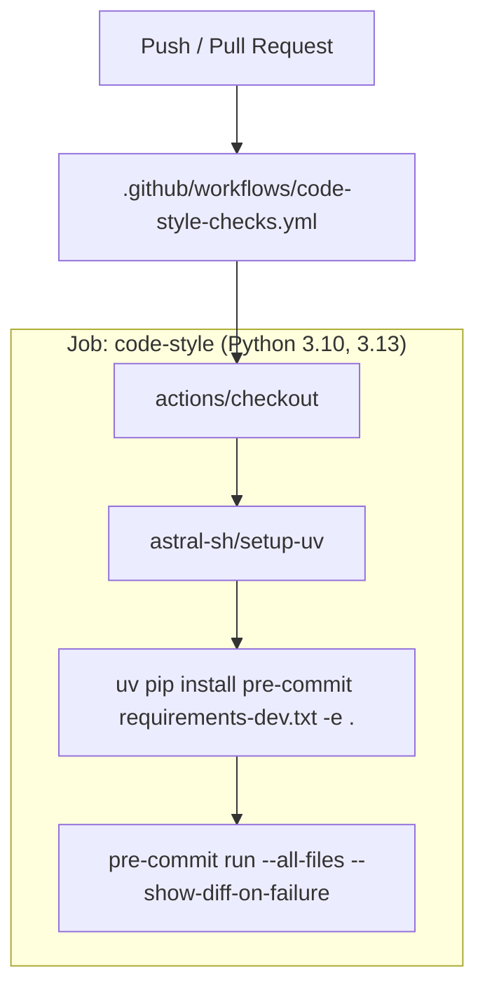

<!-- source: DeepWiki mcp.deepwiki.com · repo pytorch/ignite · page 7.4 Code Quality and Development Tools · fetched 2026-10-21 -->

# Code Quality and Development Tools

<details>
<summary>Relevant source files</summary>

The following files were used as context for generating this wiki page:

- [.devcontainer/devcontainer.json](.devcontainer/devcontainer.json)
- [.git-blame-ignore-revs](.git-blame-ignore-revs)
- [.github/workflows/build_docs.sh](.github/workflows/build_docs.sh)
- [.github/workflows/code-style-checks.yml](.github/workflows/code-style-checks.yml)
- [.github/workflows/install_docs_deps.sh](.github/workflows/install_docs_deps.sh)
- [.github/workflows/typing-checks.yml](.github/workflows/typing-checks.yml)
- [.pre-commit-config.yaml](.pre-commit-config.yaml)
- [CONTRIBUTING.md](CONTRIBUTING.md)
- [conda.recipe/build_and_upload.sh](conda.recipe/build_and_upload.sh)
- [conda.recipe/meta.yaml](conda.recipe/meta.yaml)
- [ignite/py.typed](ignite/py.typed)
- [pyproject.toml](pyproject.toml)

</details>


This page documents the code quality tools, linters, formatters, type checkers, and development environments used in PyTorch Ignite. These tools ensure consistent code style, catch potential errors, maintain type safety, and provide a standardized developer workflow across the codebase.

For information about CI/CD workflows that enforce these quality checks, see [CI/CD Workflows Overview](#7.1). For details about test infrastructure, see [Test Workflows and Coverage](#7.2). For contribution instructions, see [Contributing Guidelines](#7.5).

---

## Code Quality Tool Stack

PyTorch Ignite employs a modern Python toolchain centered around automated code quality enforcement using Ruff, pre-commit hooks, Pyrefly type checking, and devcontainer support.



**Tool Responsibilities:**

| Tool | Purpose | Configuration | Execution Context |
|------|---------|---------------|-------------------|
| **ruff** | Fast Python linter & code formatter | [pyproject.toml:38-124]() | Pre-commit, CI, Manual |
| **pyrefly** | Static type checking workflow | `.github/workflows/typing-checks.yml` | CI workflow, Manual |
| **pre-commit** | Git hook automation framework | [.pre-commit-config.yaml:1-33]() | Local commits, CI |
| **devcontainer** | Standardized container development environment | [.devcontainer/devcontainer.json:1-18]() | VS Code / Docker |
| **nb-clean** | Jupyter notebook output cleaner | [.pre-commit-config.yaml:4-12]() | Pre-commit hook |

Sources: [pyproject.toml:38-124](), [.pre-commit-config.yaml:1-33](), [.github/workflows/code-style-checks.yml:1-74](), [.github/workflows/typing-checks.yml:1-67]()

---

## Ruff Configuration and Usage

Ruff serves as the primary linting and formatting tool in PyTorch Ignite, replacing legacy tools like flake8 and black.

### Ruff Configuration in pyproject.toml



**Key Configuration Details:**

| Setting | Value | Purpose |
|---------|-------|---------|
| `src` | `["ignite", "examples", "tests"]` | Directories scanned by Ruff [pyproject.toml:39]() |
| `line-length` | `120` | Maximum line length limit [pyproject.toml:73]() |
| `target-version` | `"py311"` | Target Python version for syntax parsing [pyproject.toml:77]() |
| `select` | `["E4", "E7", "E9", "F"]` | Enabled rule categories (Pyflakes + pycodestyle errors) [pyproject.toml:83]() |
| `ignore` | `["E402", "E713", "E721", "E722", "E203", "E231", "F403", "F841"]` | Explicitly disabled rule codes [pyproject.toml:84]() |

Sources: [pyproject.toml:38-124]()

### Running Ruff Locally

Developers can run Ruff directly from the command line for checking and formatting:

```bash
# Lint all source, example, and test files
ruff check ignite/ examples/ tests/

# Automatically fix fixable lint errors
ruff check --fix ignite/ examples/ tests/

# Format code using ruff format
ruff format ignite/ examples/ tests/
```

Sources: [CONTRIBUTING.md:143-158]()

---

## Pre-commit Hook System

Pre-commit automates code quality checks before commits are finalized, guaranteeing that code adheres to formatting and linting rules prior to code review.

### Pre-commit Configuration

The `.pre-commit-config.yaml` file defines the hooks active in the repository:



**Hook Details:**
- **nb-clean**: Preserves cell outputs optionally or removes empty cells for Jupyter notebooks [.pre-commit-config.yaml:4-12]().
- **pre-commit-hooks**: Verifies TOML and YAML syntax, ensures files end with a newline, and trims trailing whitespace [.pre-commit-config.yaml:13-20]().
- **prettier**: Formats markdown, JSON, and other documentation assets [.pre-commit-config.yaml:21-26]().
- **ruff-pre-commit**: Runs `ruff-check` and `ruff-format` on staged Python and Jupyter files [.pre-commit-config.yaml:27-33]().

Sources: [.pre-commit-config.yaml:1-33]()

### Installing and Running Pre-commit

To set up pre-commit hooks locally:

```bash
# Install pre-commit tool
pip install pre-commit

# Install git hooks into .git/hooks/
pre-commit install

# Run checks manually on all files
pre-commit run --all-files
```

Sources: [CONTRIBUTING.md:147-157](), [.github/workflows/code-style-checks.yml:69-74]()

---

## Type Checking with Pyrefly

PyTorch Ignite utilizes **Pyrefly** for static type checking across the codebase.

### Typing Workflow in CI

Type checking is executed in CI via GitHub Actions workflow [.github/workflows/typing-checks.yml:1-67]():



**Running Type Checks Locally:**
```bash
# Run pyrefly type checking
pyrefly check
```

Sources: [.github/workflows/typing-checks.yml:33-67]()

---

## Devcontainer Environment

PyTorch Ignite provides a standardized development container configuration via `.devcontainer/devcontainer.json` [.devcontainer/devcontainer.json:1-18]() to ensure reproducible development setups.

### Devcontainer Configuration

- **Base Image**: `mcr.microsoft.com/devcontainers/python:3.11` [.devcontainer/devcontainer.json:3]()
- **Post-Create Command**: Installs editable package, development requirements, and sets up pre-commit hooks [.devcontainer/devcontainer.json:4]():
  ```bash
  pip install -e . && pip install -r requirements-dev.txt && pre-commit install
  ```
- **VS Code Customizations**: Configures extensions (`ms-python.python`, `charliermarsh.ruff`) and editor settings to format on save using Ruff [.devcontainer/devcontainer.json:5-17]().

Sources: [.devcontainer/devcontainer.json:1-18]()

---

## CI Code Style Enforcement

The `.github/workflows/code-style-checks.yml` workflow enforces code style on every pull request and push to protected branches [.github/workflows/code-style-checks.yml:1-74]().



Sources: [.github/workflows/code-style-checks.yml:1-74]()

---

## Summary

PyTorch Ignite maintains strict code quality standards through:
1. **Ruff**: Fast linting and formatting configured in `pyproject.toml` [pyproject.toml:38-124]().
2. **Pre-commit Hooks**: Automated checks on every commit [.pre-commit-config.yaml:1-33]().
3. **Pyrefly Type Checking**: Continuous verification of type annotations in CI [.github/workflows/typing-checks.yml:1-67]().
4. **Devcontainer**: Standardized containerized development environments [.devcontainer/devcontainer.json:1-18]().

---

