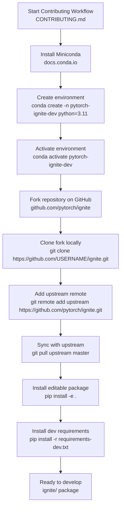
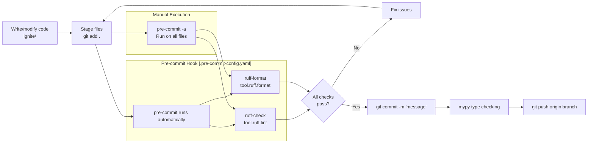

<!-- source: DeepWiki mcp.deepwiki.com · repo pytorch/ignite · page 7.5 Contributing Guidelines · fetched 2026-10-21 -->

# Contributing Guidelines

<details>
<summary>Relevant source files</summary>

The following files were used as context for generating this wiki page:

- [.devcontainer/devcontainer.json](.devcontainer/devcontainer.json)
- [.git-blame-ignore-revs](.git-blame-ignore-revs)
- [.github/workflows/build_docs.sh](.github/workflows/build_docs.sh)
- [.github/workflows/install_docs_deps.sh](.github/workflows/install_docs_deps.sh)
- [.pre-commit-config.yaml](.pre-commit-config.yaml)
- [CODE_OF_CONDUCT.md](CODE_OF_CONDUCT.md)
- [CONTRIBUTING.md](CONTRIBUTING.md)
- [conda.recipe/build_and_upload.sh](conda.recipe/build_and_upload.sh)
- [conda.recipe/meta.yaml](conda.recipe/meta.yaml)
- [pyproject.toml](pyproject.toml)

</details>


This page provides a comprehensive guide for contributors to the PyTorch Ignite project. It covers setting up a development environment, understanding the codebase structure, running tests, enforcing code quality standards, and submitting pull requests. For information about the CI/CD infrastructure and release processes, see [CI/CD Workflows Overview](#7.1) and [Release and Distribution](#7.3). For details about the testing infrastructure architecture, see [Test Workflows and Coverage](#7.2).

Sources: [CONTRIBUTING.md:1-28]()

---

## Ways to Contribute

PyTorch Ignite welcomes contributions in multiple forms:

| Contribution Type | Description | How to Help |
|------------------|-------------|-------------|
| **Issue Reporting** | Report bugs, propose features, give feedback | Create GitHub issues with detailed descriptions [CONTRIBUTING.md:10-10]() |
| **Issue Triage** | Review and comment on existing issues | Give :+1: on relevant issues, help investigate bugs [CONTRIBUTING.md:11-15]() |
| **Code Review** | Review pull requests from other developers | Comment on PRs, test changes locally [CONTRIBUTING.md:14-15]() |
| **Documentation** | Improve docs, fix typos, add examples | Submit PRs for documentation changes [CONTRIBUTING.md:17-19]() |
| **Feature Implementation** | Implement new features or fix bugs | Pick issues labeled ["help wanted"](https://github.com/pytorch/ignite/issues?q=is%3Aissue+is%3Aopen+label%3A%22help+wanted%22) or ["good first issue"](https://github.com/pytorch/ignite/labels/good%20first%20issue) [CONTRIBUTING.md:25-27]() |

Sources: [CONTRIBUTING.md:1-28]()

---

## Development Environment Setup

### Initial Setup Workflow

The following diagram bridges natural language initialization steps to code entities, configuration files, and environment commands used during development setup.



Sources: [CONTRIBUTING.md:54-110]()

### Repository Configuration

After cloning, your repository should have two remotes configured:

```bash
$ git remote -v
origin    https://github.com/YOUR_USERNAME/ignite.git (fetch)
origin    https://github.com/YOUR_USERNAME/ignite.git (push)
upstream  https://github.com/pytorch/ignite (fetch)
upstream  https://github.com/pytorch/ignite (push)
```

The `origin` remote points to your fork (where you push changes), while `upstream` points to the main PyTorch Ignite repository (where you sync updates from) [CONTRIBUTING.md:86-102]().

Sources: [CONTRIBUTING.md:86-102]()

---

## Codebase Structure

### Directory Organization

The directory layout maps logical namespaces to physical packages within the `ignite` repository root structure.

```mermaid
graph TB
    ROOT["ignite/ (root)"]
    
    subgraph "Core Library Namespace [ignite/]"
        ENGINE["ignite/engine/<br/>Engine, Events, State, DeterministicEngine"]
        HANDLERS["ignite/handlers/<br/>Checkpoint, EarlyStopping, ParamScheduler, ModelCheckpoint"]
        METRICS["ignite/metrics/<br/>Metric, Accuracy, Precision, Loss"]
        CONTRIB["ignite/contrib/<br/>ignite/contrib/handlers, ignite/contrib/metrics"]
        DISTRIBUTED["ignite/distributed/<br/>idist, Parallel, ComputationModel"]
    end
    
    subgraph "Development Infrastructure Namespace"
        TESTS["tests/<br/>test_*.py unit tests, conftest.py"]
        EXAMPLES["examples/<br/>notebooks/, references/"]
        DOCS["docs/<br/>Sphinx conf.py, source files"]
    end
    
    subgraph "Configuration Files Namespace"
        PYPROJECT["pyproject.toml<br/>tool.ruff, tool.pytest.ini_options"]
        REQUIREMENTS["requirements-dev.txt<br/>Development dependencies"]
        PRECOMMIT[".pre-commit-config.yaml<br/>pre-commit hooks: ruff-check, ruff-format"]
    end
    
    ROOT --> ENGINE
    ROOT --> HANDLERS
    ROOT --> METRICS
    ROOT --> CONTRIB
    ROOT --> DISTRIBUTED
    ROOT --> TESTS
    ROOT --> EXAMPLES
    ROOT --> DOCS
    ROOT --> PYPROJECT
    ROOT --> REQUIREMENTS
    ROOT --> PRECOMMIT
```



Sources: [CONTRIBUTING.md:114-124](), [pyproject.toml:38-132](), [.pre-commit-config.yaml:1-33]()

### Test Organization Patterns

Test files follow specific naming conventions and pytest markers:

- **Test Files**: `test_*.py` (e.g., `test_precision.py`) [CONTRIBUTING.md:129-129]()
- **Test Functions**: `def test_*` (e.g., `def test_precision_on_random_data()`) [CONTRIBUTING.md:130-130]()
- **GPU Tests**: Must include `cuda` in function name (e.g., `def test_something_on_cuda()`) [CONTRIBUTING.md:131-131]()
- **Distributed Tests**: Marked with `@pytest.mark.distributed` decorator [CONTRIBUTING.md:134-134](), [pyproject.toml:128-128]()
- **Multi-node Tests**: Marked with `@pytest.mark.multinode_distributed` decorator [pyproject.toml:129-129]()
- **TPU Tests**: Marked with `@pytest.mark.tpu` decorator [pyproject.toml:130-130]()

Sources: [CONTRIBUTING.md:126-136](), [pyproject.toml:127-131]()

---

## Code Quality Tools

### Code Style Enforcement Workflow

The following diagram links natural language code quality assurance steps to specific configuration tools (`ruff`, `pyproject.toml`, `.pre-commit-config.yaml`).



Sources: [CONTRIBUTING.md:142-186](), [pyproject.toml:38-125](), [.pre-commit-config.yaml:1-33]()

### Tool Configuration Details

| Tool | Purpose | Configuration File | Key Settings |
|------|---------|-------------------|--------------|
| **ruff** | Linting and formatting | `pyproject.toml` [tool.ruff] | Line length: 120, Python 3.11 target [pyproject.toml:38-77]() |
| **pre-commit** | Git hook manager | `.pre-commit-config.yaml` | Runs ruff-check and ruff-format on commit [.pre-commit-config.yaml:27-33]() |
| **pytest** | Test runner | `pyproject.toml` [tool.pytest.ini_options] | Test markers for distributed/TPU [pyproject.toml:126-132]() |

Sources: [pyproject.toml:38-132](), [.pre-commit-config.yaml:1-33]()

### Installing Pre-commit Hooks

To enable automatic code quality checks on every commit:

```bash
pip install pre-commit
pre-commit install
```

After installation, hooks run automatically upon committing [CONTRIBUTING.md:160-186]().

Sources: [CONTRIBUTING.md:160-186]()

---

## Testing

### Running Tests

#### Basic Test Execution

To run a specific test function:

```bash
pytest tests/ignite/engine/test_engine.py -vvv -k test_terminate
```

To run all CPU tests:

```bash
bash tests/run_cpu_tests.sh
```

Sources: [CONTRIBUTING.md:190-206]()

#### Distributed Tests on CPU

To run distributed tests without GPU:

```bash
export WORLD_SIZE=2
CUDA_VISIBLE_DEVICES="" pytest --dist=each --tx $WORLD_SIZE*popen//python=python tests/ -m distributed -vvv
```

Sources: [CONTRIBUTING.md:208-215]()

#### Type Checking

To verify static type annotations:

```bash
mypy
```

Sources: [CONTRIBUTING.md:217-224]()

---

## Pull Request Workflow

### PR Submission Process

```mermaid
sequenceDiagram
    participant Dev as "Developer"
    participant Fork as "Forked Repository"
    participant Upstream as "pytorch/ignite"
    participant CI as "GitHub Actions CI"
    
    Dev->>Fork: 1. Create feature branch:<br/>git checkout -b feature-name
    Dev->>Dev: 2. Make code modifications
    Dev->>Dev: 3. Run tests locally:<br/>bash tests/run_cpu_tests.sh
    Dev->>Dev: 4. Run pre-commit:<br/>pre-commit -a
    Dev->>Fork: 5. Commit and push:<br/>git push origin feature-name
    Dev->>Upstream: 6. Create Pull Request
    Upstream->>CI: 7. Trigger CI workflows
    
    alt CI runs normally
        CI->>CI: unit-tests, gpu-tests, tpu-tests
        CI-->>Upstream: Report test status
    else CI skip requested
        Note over Dev,Upstream: PR title contains:<br/>[skip ci], [skip actions], or [skip netlify]
    end
    
    Upstream->>Dev: 8. Reviewer feedback
    Dev->>Fork: 9. Address comments, push updates
    Fork->>Upstream: 10. PR updates automatically
    Upstream->>Upstream: 11. Merge after approval
```



Sources: [CONTRIBUTING.md:227-252]()

### CI Skip Directives

When submitting PRs, you can skip unnecessary CI runs to save resources:

| Skip Directive | Effect | Use Case |
|---------------|--------|----------|
| `[skip ci]` | Skip all CI systems | Documentation-only changes (README.md, CONTRIBUTING.md) |
| `[skip actions]` | Skip GitHub Actions only | Changes that don't affect code execution |
| `[skip netlify]` | Skip Netlify docs preview | Changes that don't affect documentation |

Sources: [CONTRIBUTING.md:237-252]()

### Syncing with Upstream

Before creating a PR, sync your fork with upstream:

```bash
git fetch upstream
git checkout master
git merge upstream/master
git push origin master
```

Sources: [CONTRIBUTING.md:254-277]()

---

## Documentation

### Docstring Style Guide

PyTorch Ignite uses Google style docstrings with Python 3 type annotations and Sphinx directives (`.. versionadded::`, `.. versionchanged::`) [CONTRIBUTING.md:279-294]().

### Building Documentation Locally

```bash
cd docs
pip install -r requirements.txt
make html
```

To view locally:

```bash
cd docs/build
python -m http.server 1234
```

Sources: [CONTRIBUTING.md:296-336]()

---

## Summary

This page covered the complete contributor workflow for PyTorch Ignite: environment setup, codebase navigation, code quality tools, testing execution, PR submission workflows, and documentation generation.

Sources: [CONTRIBUTING.md:1-369]()

---
Sources: [CONTRIBUTING.md:1-369](), [pyproject.toml:1-132](), [.pre-commit-config.yaml:1-33]()

---

