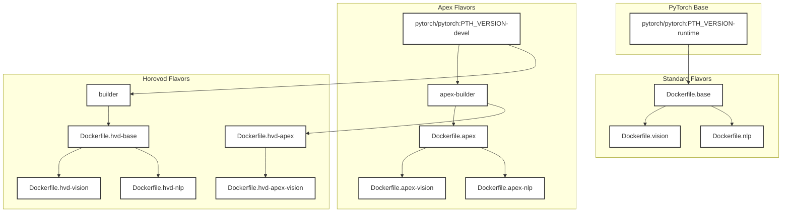
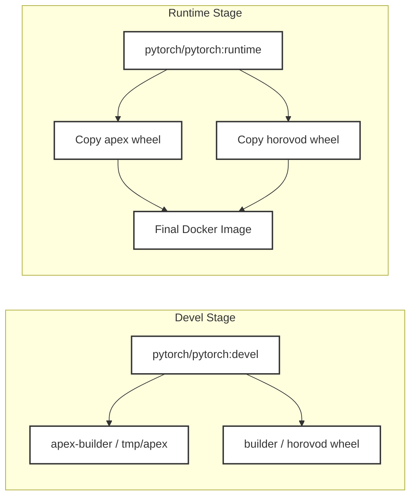
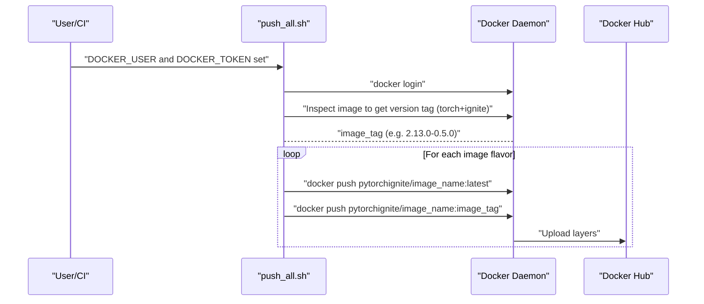

<!-- source: DeepWiki mcp.deepwiki.com · repo pytorch/ignite · page 7.6 Docker Images · fetched 2026-10-21 -->

# Docker Images

<details>
<summary>Relevant source files</summary>

The following files were used as context for generating this wiki page:

- [docker/build.sh](docker/build.sh)
- [docker/docker.cfg](docker/docker.cfg)
- [docker/hvd/Dockerfile.hvd-apex](docker/hvd/Dockerfile.hvd-apex)
- [docker/hvd/Dockerfile.hvd-apex-nlp](docker/hvd/Dockerfile.hvd-apex-nlp)
- [docker/hvd/Dockerfile.hvd-apex-vision](docker/hvd/Dockerfile.hvd-apex-vision)
- [docker/hvd/Dockerfile.hvd-base](docker/hvd/Dockerfile.hvd-base)
- [docker/hvd/Dockerfile.hvd-nlp](docker/hvd/Dockerfile.hvd-nlp)
- [docker/hvd/Dockerfile.hvd-vision](docker/hvd/Dockerfile.hvd-vision)
- [docker/main/Dockerfile.apex](docker/main/Dockerfile.apex)
- [docker/main/Dockerfile.apex-nlp](docker/main/Dockerfile.apex-nlp)
- [docker/main/Dockerfile.apex-vision](docker/main/Dockerfile.apex-vision)
- [docker/main/Dockerfile.base](docker/main/Dockerfile.base)
- [docker/main/Dockerfile.nlp](docker/main/Dockerfile.nlp)
- [docker/main/Dockerfile.vision](docker/main/Dockerfile.vision)
- [docker/msdp/Dockerfile.msdp-apex](docker/msdp/Dockerfile.msdp-apex)
- [docker/msdp/Dockerfile.msdp-apex-nlp](docker/msdp/Dockerfile.msdp-apex-nlp)
- [docker/msdp/Dockerfile.msdp-apex-vision](docker/msdp/Dockerfile.msdp-apex-vision)
- [docker/push_all.sh](docker/push_all.sh)
- [docker/test_image.py](docker/test_image.py)

</details>


## Purpose and Scope

The `docker/` directory contains Dockerfiles, configuration files, and automation scripts used to build, tag, push, and test containerized environments for PyTorch Ignite. These images provide pre-configured runtimes containing PyTorch, PyTorch Ignite, optimized dependencies (such as `pillow-simd`), and distributed training frameworks like Horovod and Microsoft DeepSpeed (MSDP), alongside domain-specific packages for Computer Vision and Natural Language Processing.

---

## 7.6.1 Docker Image Flavors and Architecture

PyTorch Ignite provides a modular set of Docker images built on top of official PyTorch base images (`pytorch/pytorch`). The images are categorized into standard flavors, Horovod-enabled flavors, and MSDeepSpeed-enabled flavors. Each flavor can be extended with domain-specific dependencies:

- **Base (`Dockerfile.base`)**: Contains the core `pytorch-ignite`, `tensorboard`, `tqdm`, `fire`, and `pillow-simd` replacing standard PIL `[docker/main/Dockerfile.base:1-43]()`.
- **Vision**: Adds computer vision packages like `albumentations`, `opencv-python-headless`, and `clearml` (`[docker/hvd/Dockerfile.hvd-vision:1-10](), [docker/msdp/Dockerfile.msdp-apex-vision:1-10]()`).
- **NLP**: Adds natural language processing dependencies (e.g., `transformers`).
- **Apex (`Dockerfile.apex`)**: Multi-stage build that compiles NVIDIA Apex from source with C++ and CUDA extensions enabled `[docker/main/Dockerfile.apex:1-71]()`.


*Diagram 1: Docker Image Hierarchy and Inheritance*

**Sources:** `[docker/main/Dockerfile.base:1-43]()`, `[docker/main/Dockerfile.apex:1-71]()`, `[docker/hvd/Dockerfile.hvd-base:1-90]()`, `[docker/hvd/Dockerfile.hvd-vision:1-10](), [docker/msdp/Dockerfile.msdp-apex-vision:1-10]()`

---

## 7.6.2 Distributed Training Environments: Horovod and MSDeepSpeed

Building images with compiled extensions (such as NVIDIA Apex, Horovod, and DeepSpeed) relies heavily on multi-stage builds. The builder stages utilize `-devel` images equipped with CUDA toolkit headers and compilers, while final runtime images use smaller `-runtime` base images.

### Horovod Integration
`Dockerfile.hvd-base` and `Dockerfile.hvd-apex` configure Horovod from source (`[docker/hvd/Dockerfile.hvd-base:1-90](), [docker/hvd/Dockerfile.hvd-apex:1-109]()`). They configure NCCL paths, build Horovod wheels with `HOROVOD_GPU_OPERATIONS=NCCL`, and install Ignite along with sparse-checked-out example repositories (`[docker/hvd/Dockerfile.hvd-base:74-83]()`).

### MSDeepSpeed Integration
`Dockerfile.msdp-apex` builds Microsoft DeepSpeed (`MSDP`) alongside NVIDIA Apex inside a devel container before packaging them into the final image `[docker/msdp/Dockerfile.msdp-apex:1-87]()`.


*Diagram 2: Multi-Stage Build Data Flow for Distributed Runtimes*

**Sources:** `[docker/hvd/Dockerfile.hvd-base:1-90]()`, `[docker/hvd/Dockerfile.hvd-apex:1-109](), [docker/msdp/Dockerfile.msdp-apex:1-87]()`

---

## 7.6.3 Version Configuration via `docker.cfg`

Global versions for PyTorch, Horovod, and MSDeepSpeed are centrally managed via `docker/docker.cfg` `[docker/docker.cfg:1-4]()`.

```ini
[DEFAULT]
build_docker_image_pytorch_version = 2.13.0-cuda13.2-cudnn9
build_docker_image_hvd_version = v0.28.1
build_docker_image_msdp_version = v0.14.0
```

**Sources:** `[docker/docker.cfg:1-4]()`

---

## 7.6.4 Build and Push Automation (`build.sh` and `push_all.sh`)

Automation scripts handle parameter expansion and registry pushing. `push_all.sh` verifies environment variables (`DOCKER_USER`, `DOCKER_TOKEN`), authenticates with Docker Hub, computes dynamic image tags based on PyTorch and Ignite versions, and pushes both `latest` and versioned tags (`[docker/push_all.sh:1-73]()`).


*Diagram 3: Push Automation Workflow (`push_all.sh`)*

**Sources:** `[docker/push_all.sh:1-73]()`

---

## 7.6.5 Image Testing and Validation (`test_image.py`)

To ensure correctness across all built images, `docker/test_image.py` runs validation checks inside the container environment (`[docker/test_image.py:1-65]()`). 

The script dynamically imports packages and validates versions against expected targets:
- Checks `torch` and `ignite` match expected version strings `[docker/test_image.py:43-44]()`.
- Conditionally validates `horovod` if `hvd` is in the image name `[docker/test_image.py:46-50]()`.
- Conditionally validates `deepspeed` if `msdp` is in the image name `[docker/test_image.py:52-56]()`.
- Validates `cv2` for vision images (`[docker/test_image.py:58-59]()`), `transformers` for NLP images (`[docker/test_image.py:61-62]()`), and `apex` for Apex images (`[docker/test_image.py:64-65]()`).

**Sources:** `[docker/test_image.py:1-65]()`

---

