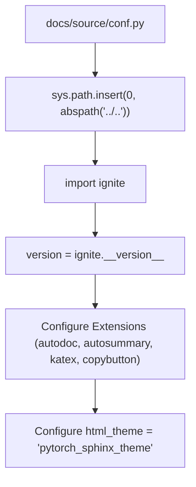
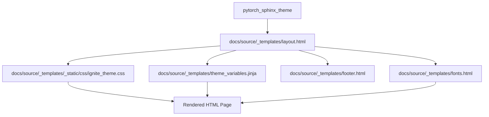
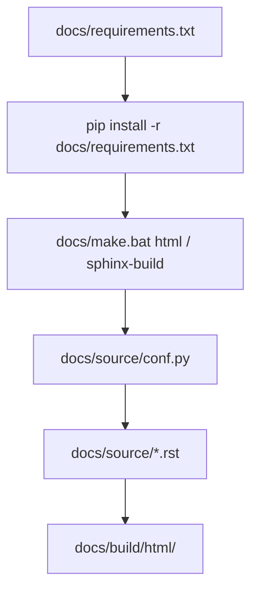

<!-- source: DeepWiki mcp.deepwiki.com · repo pytorch/ignite · page 7.7 Documentation Build System · fetched 2026-10-21 -->

# Documentation Build System

<details>
<summary>Relevant source files</summary>

The following files were used as context for generating this wiki page:

- [docs/make.bat](docs/make.bat)
- [docs/requirements.txt](docs/requirements.txt)
- [docs/source/_templates/_static/css/ignite_theme.css](docs/source/_templates/_static/css/ignite_theme.css)
- [docs/source/_templates/_static/img/netlify-light.svg](docs/source/_templates/_static/img/netlify-light.svg)
- [docs/source/_templates/fonts.html](docs/source/_templates/fonts.html)
- [docs/source/_templates/footer.html](docs/source/_templates/footer.html)
- [docs/source/_templates/layout.html](docs/source/_templates/layout.html)
- [docs/source/_templates/theme_variables.jinja](docs/source/_templates/theme_variables.jinja)
- [docs/source/conf.py](docs/source/conf.py)
- [docs/source/distributed.rst](docs/source/distributed.rst)
- [docs/source/exceptions.rst](docs/source/exceptions.rst)
- [docs/source/index.rst](docs/source/index.rst)
- [docs/source/utils.rst](docs/source/utils.rst)

</details>


## Purpose and Scope

This page details the documentation build system for PyTorch-Ignite, built upon Sphinx, PyTorch Sphinx Theme templates, custom CSS overrides, and structured reStructuredText (`.rst`) markup. The documentation architecture supports automated API documentation generation via `sphinx.ext.autodoc` and `sphinx.ext.autosummary`, mathematical rendering via `sphinxcontrib.katex`, and custom theme configurations tailored for PyTorch-Ignite.

Sources: [docs/source/conf.py:1-216](), [docs/requirements.txt:1-7]()

---

## 1. Sphinx Configuration (`conf.py`)

The Sphinx configuration file `docs/source/conf.py` establishes project metadata, paths, active extensions, and HTML theme options.

### Path and Project Setup
The documentation build script injects the repository root into `sys.path` to allow Sphinx to discover and import the `ignite` package for introspection:
- `sys.path.insert(0, os.path.abspath("../.."))` [docs/source/conf.py:21-21]()
- Resolves the current package version dynamically from `os.environ["code_version"]` or falls back to `ignite.__version__` [docs/source/conf.py:34-42]().

### Extensions and General Options
The `extensions` list incorporates standard and third-party Sphinx extensions to handle docstrings, copy buttons, dropdowns, and math [docs/source/conf.py:53-67]():
- `sphinx.ext.autodoc`: Automatically extracts docstrings from Python modules.
- `sphinx.ext.autosummary`: Generates summary tables for modules, classes, and functions.
- `sphinxcontrib.katex`: Renders LaTeX math equations with client-side KaTeX pre-rendering (`katex_prerender = True`) [docs/source/conf.py:82-82]().
- `sphinx_copybutton`, `sphinx_togglebutton`, `sphinx_design`: Enhances UI interactivity for code blocks and admonitions.


*Figure 1: Sphinx configuration initialization data flow.*

Sources: [docs/source/conf.py:9-83]()

---

## 2. Themes, Templates, and Styling

PyTorch-Ignite inherits and overrides elements from `pytorch_sphinx_theme` using a custom template structure located in `docs/source/_templates/`.

### Layout and Header Template (`layout.html`)
The custom `layout.html` template injects custom meta tags, Google Analytics scripts (`gtag.js`), open-graph properties, and a specialized header layout containing navigation links to `pytorch-ignite.ai` [docs/source/_templates/layout.html:17-120]().

### Theme Variables (`theme_variables.jinja`)
External URLs and routing targets (such as GitHub issues, contributing guidelines, tutorials, and concept guides) are centralized in `theme_variables.jinja` [docs/source/_templates/theme_variables.jinja:1-15]():

| Variable Key | Target URL / Path |
| :--- | :--- |
| `github` | `https://github.com/pytorch/ignite` [docs/source/_templates/theme_variables.jinja:2-2]() |
| `github_issues` | `https://github.com/pytorch/ignite/issues` [docs/source/_templates/theme_variables.jinja:3-3]() |
| `contributing` | `https://github.com/pytorch/ignite/blob/master/CONTRIBUTING.md` [docs/source/_templates/theme_variables.jinja:4-4]() |
| `home` | `https://pytorch-ignite.ai` [docs/source/_templates/theme_variables.jinja:7-7]() |
| `quickstart` | `tutorials/beginner/01-getting-started/` [docs/source/_templates/theme_variables.jinja:10-10]() |

### Custom Styling (`ignite_theme.css`)
Custom CSS overrides in `docs/source/_templates/_static/css/ignite_theme.css` adjust layout sizing, sidebar versions dropdown styling (`.rst-versions`), table formatting, and font rendering rules [docs/source/_templates/_static/css/ignite_theme.css:1-276]().


*Figure 2: Theme and template inheritance hierarchy.*

Sources: [docs/source/_templates/layout.html:1-120](), [docs/source/_templates/theme_variables.jinja:1-15](), [docs/source/_templates/_static/css/ignite_theme.css:1-57]()

---

## 3. Custom Directives and Autosummary

API reference pages rely on Sphinx `autosummary` combined with the `:autolist:` flag to dynamically construct tables of functions, classes, and exceptions without explicitly listing every symbol [docs/source/distributed.rst:104-106](), [docs/source/exceptions.rst:6-9](), [docs/source/utils.rst:8-11]().

For instance, `ignite.distributed.utils` utilizes `autosummary` with `:autolist:` to populate members directly from the module docstring [docs/source/distributed.rst:104-106]():
```rst
.. currentmodule:: ignite.distributed.utils

.. autosummary::
    :nosignatures:
    :autolist:

.. automodule:: ignite.distributed.utils
    :members:
```
[docs/source/distributed.rst:102-110]()

Sources: [docs/source/distributed.rst:102-110](), [docs/source/exceptions.rst:4-10](), [docs/source/utils.rst:6-13]()

---

## 4. Build Targets and Execution

Documentation is generated using Sphinx build wrappers configured in `docs/make.bat` for Windows and standard `Makefile` setups.

### Dependencies (`docs/requirements.txt`)
The build environment installs precise package versions to ensure consistent rendering:
- `sphinx==7` [docs/requirements.txt:1-1]()
- `pytorch_sphinx_theme` (fetched from GitHub) [docs/requirements.txt:2-2]()
- `sphinxcontrib-katex`, `sphinx-copybutton==0.4.0`, `docutils==0.19`, `sphinx_togglebutton`, `sphinx_design` [docs/requirements.txt:3-7]()

### Build Invocation via `make.bat`
The Windows execution script `docs/make.bat` defines environment variables (`SOURCEDIR=source`, `BUILDDIR=build`) and invokes `sphinx-build`:
```bat
if "%SPHINXBUILD%" == "" (
	set SPHINXBUILD=sphinx-build
)
set SOURCEDIR=source
set BUILDDIR=build
set SPHINXPROJ=ignite
...
%SPHINXBUILD% -M %1 %SOURCEDIR% %BUILDDIR% %SPHINXOPTS%
```
[docs/make.bat:7-29]()


*Figure 3: Documentation build execution pipeline.*

Sources: [docs/requirements.txt:1-7](), [docs/make.bat:7-29]()

---

