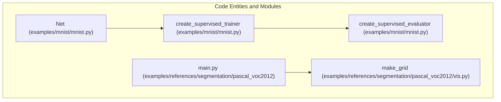
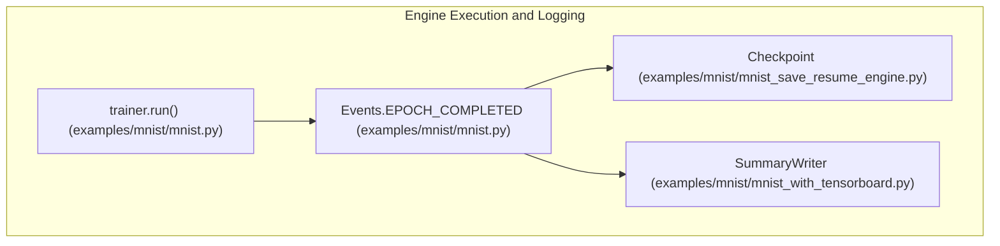

<!-- source: DeepWiki mcp.deepwiki.com · repo pytorch/ignite · page 8 Examples and Reference Implementations · fetched 2026-10-21 -->

# Examples and Reference Implementations

Relevant source files

The following files were used as context for generating this wiki page:

- [examples/mnist/README.md](examples/mnist/README.md)
- [examples/mnist/mnist.py](examples/mnist/mnist.py)
- [examples/mnist/mnist_save_resume_engine.py](examples/mnist/mnist_save_resume_engine.py)
- [examples/mnist/mnist_with_tensorboard.py](examples/mnist/mnist_with_tensorboard.py)
- [examples/mnist/mnist_with_tensorboard_on_tpu.py](examples/mnist/mnist_with_tensorboard_on_tpu.py)
- [examples/mnist/mnist_with_visdom.py](examples/mnist/mnist_with_visdom.py)
- [examples/references/README.md](examples/references/README.md)
- [examples/references/classification/imagenet/.gitignore](examples/references/classification/imagenet/.gitignore)
- [examples/references/classification/imagenet/README.md](examples/references/classification/imagenet/README.md)
- [examples/references/segmentation/pascal_voc2012/README.md](examples/references/segmentation/pascal_voc2012/README.md)
- [examples/references/segmentation/pascal_voc2012/vis.py](examples/references/segmentation/pascal_voc2012/vis.py)

The `examples/` directory contains runnable scripts, Jupyter notebooks, and production-grade reference training pipelines designed to demonstrate how to use PyTorch Ignite components (`Engine`, `Events`, `Metrics`, `idist`) in real-world machine learning scenarios. 

Sources: `examples/mnist/mnist.py:17-65`(), `examples/references/segmentation/pascal_voc2012/vis.py:47-100`()

Sources: `examples/mnist/mnist.py:1-121]`, `examples/references/segmentation/pascal_voc2012/README.md:1-50`()

---

## 8.1 Basic Examples (MNIST, CIFAR10, GAN, RL)

The introductory examples cover fundamental computer vision, generative, and reinforcement learning tasks. Using standard datasets like MNIST and CIFAR10, these scripts illustrate basic `Engine` setup, supervised trainer/evaluator factories, metric attachment (`Accuracy`, `Loss`), and experiment logging via `tqdm`, TensorBoard, Visdom, and ClearML [examples/mnist/README.md:1-153](), [examples/mnist/mnist.py:49-102]().

Advanced scenarios within this tier include training save/resume workflows utilizing `Checkpoint` and `DiskSaver`, as well as deterministic training configurations via `DeterministicEngine` to guarantee bitwise reproducibility across restarts [examples/mnist/README.md:78-153](), [examples/mnist/mnist_save_resume_engine.py:15-170]().

For detailed script walkthroughs and usage instructions, see [Basic Examples (MNIST, CIFAR10, GAN, RL)](#8.1).

Sources: `examples/mnist/mnist.py:97-101]`, `examples/mnist/mnist_save_resume_engine.py:172-175]`, `examples/mnist/mnist_with_tensorboard.py:101-111`()

Sources: `examples/mnist/README.md:1-154]`, `examples/mnist/mnist.py:1-121]()`

---

## 8.2 Reference Training Pipelines

The `examples/references/` directory houses production-grade training pipelines inspired by `torchvision/references` [examples/references/README.md:1-4](). These configurations provide reproducible baselines for large-scale tasks such as ImageNet classification and PASCAL VOC2012 semantic segmentation [examples/references/README.md:6-11](), [examples/references/segmentation/pascal_voc2012/README.md:1-15]().

Key capabilities demonstrated in reference pipelines include:
- Distributed data-parallel training via PyTorch native tools (`torchrun`) and Horovod [examples/references/segmentation/pascal_voc2012/README.md:8-10](), [examples/references/segmentation/pascal_voc2012/README.md:38-42]()
- Native Automatic Mixed Precision (AMP) integration [examples/references/segmentation/pascal_voc2012/README.md:8]()
- Declarative configuration files (`configs/`) controlling optimizers, schedulers, and transforms [examples/references/segmentation/pascal_voc2012/README.md:13-14]()
- Custom logging handlers and tensor-to-image grid visualizers (`make_grid`, `predictions_gt_images_handler`) for segmentation masks [examples/references/segmentation/pascal_voc2012/vis.py:47-131]()

For complete pipeline architectures and configuration options, see [Reference Training Pipelines](#8.2).

Sources: `examples/references/README.md:1-12]`, `examples/references/segmentation/pascal_voc2012/README.md:1-130]`, `examples/references/segmentation/pascal_voc2012/vis.py:47-132`()

---

## 8.3 Jupyter Notebook Tutorials

Interactive Jupyter notebooks located under `examples/notebooks/` provide step-by-step guides for exploratory workflows and specialized hardware backends. These tutorials cover FashionMNIST classification, learning rate finders (`FastaiLRFinder`), TPU integration via PyTorch XLA, AMP/apex CycleGAN training, Variational Autoencoders (VAE), and Natural Language Processing with text transformers.

For notebook listings and environment setup instructions, see [Jupyter Notebook Tutorials](#8.3).

Sources: `examples/mnist/README.md:1-10]`, `examples/mnist/mnist_with_tensorboard_on_tpu.py:1-38`()

---

