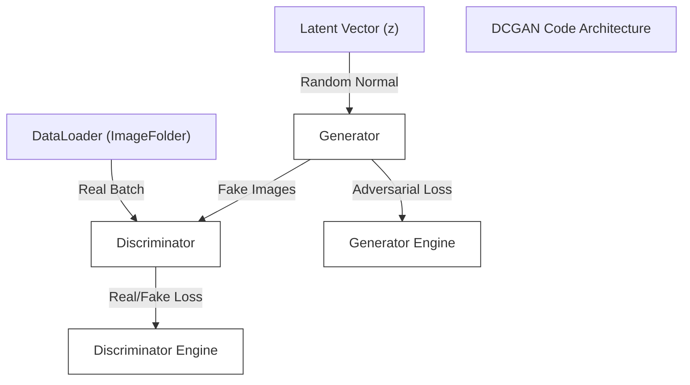
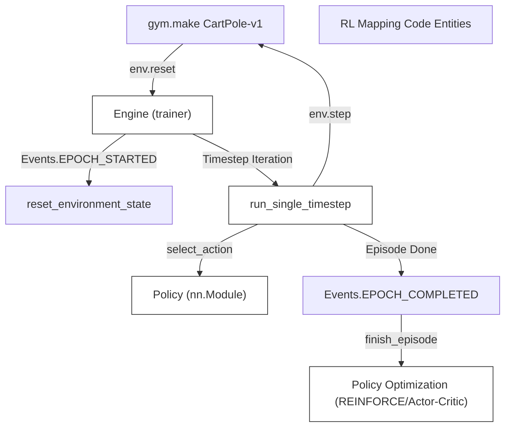

<!-- source: DeepWiki mcp.deepwiki.com · repo pytorch/ignite · page 8.1 Basic Examples (MNIST, CIFAR10, GAN, RL) · fetched 2026-10-21 -->

# Basic Examples (MNIST, CIFAR10, GAN, RL)

<details>
<summary>Relevant source files</summary>

The following files were used as context for generating this wiki page:

- [.github/pr-labeler-config.yml](.github/pr-labeler-config.yml)
- [examples/cifar10/.gitignore](examples/cifar10/.gitignore)
- [examples/cifar10/README.md](examples/cifar10/README.md)
- [examples/fast_neural_style/README.md](examples/fast_neural_style/README.md)
- [examples/fast_neural_style/images/content_images/amber.jpg](examples/fast_neural_style/images/content_images/amber.jpg)
- [examples/fast_neural_style/images/output_images/mosaic_amber.jpg](examples/fast_neural_style/images/output_images/mosaic_amber.jpg)
- [examples/fast_neural_style/images/style_images/mosaic.jpg](examples/fast_neural_style/images/style_images/mosaic.jpg)
- [examples/fast_neural_style/neural_style.py](examples/fast_neural_style/neural_style.py)
- [examples/fast_neural_style/utils.py](examples/fast_neural_style/utils.py)
- [examples/gan/README.md](examples/gan/README.md)
- [examples/gan/dcgan.py](examples/gan/dcgan.py)
- [examples/mnist/mnist.py](examples/mnist/mnist.py)
- [examples/mnist/mnist_save_resume_engine.py](examples/mnist/mnist_save_resume_engine.py)
- [examples/mnist/mnist_with_tensorboard.py](examples/mnist/mnist_with_tensorboard.py)
- [examples/mnist/mnist_with_tensorboard_on_tpu.py](examples/mnist/mnist_with_tensorboard_on_tpu.py)
- [examples/mnist/mnist_with_visdom.py](examples/mnist/mnist_with_visdom.py)
- [examples/reinforcement_learning/README.md](examples/reinforcement_learning/README.md)
- [examples/reinforcement_learning/actor_critic.py](examples/reinforcement_learning/actor_critic.py)
- [examples/reinforcement_learning/reinforce.py](examples/reinforcement_learning/reinforce.py)
- [examples/siamese_network/README.md](examples/siamese_network/README.md)
- [examples/siamese_network/requirements.txt](examples/siamese_network/requirements.txt)
- [examples/siamese_network/siamese_network.py](examples/siamese_network/siamese_network.py)
- [examples/super_resolution/README.md](examples/super_resolution/README.md)
- [examples/super_resolution/images/bicubic_image_cifar.png](examples/super_resolution/images/bicubic_image_cifar.png)
- [examples/super_resolution/images/input_cifar.png](examples/super_resolution/images/input_cifar.png)
- [examples/super_resolution/images/out_cifar.png](examples/super_resolution/images/out_cifar.png)
- [examples/super_resolution/main.py](examples/super_resolution/main.py)
- [examples/super_resolution/model.py](examples/super_resolution/model.py)
- [examples/super_resolution/super_resolve.py](examples/super_resolution/super_resolve.py)
- [examples/transformers/README.md](examples/transformers/README.md)
- [ignite/handlers/utils.py](ignite/handlers/utils.py)
- [tests/ignite/handlers/test_handlers.py](tests/ignite/handlers/test_handlers.py)

</details>


This page provides a comprehensive technical walkthrough of introductory and intermediate reference examples provided in the PyTorch Ignite codebase (`examples/`). It covers supervised image classification variants on MNIST with various tracking backends, distributed CIFAR10 concepts, Deep Convolutional GANs (DCGAN), Reinforcement Learning (REINFORCE and Actor-Critic), Super-Resolution, and Siamese Networks. Each section details the system architecture, code flow, and integration with Ignite's event-driven paradigm.

---

## 1. MNIST Variants: Supervised Training, Experiment Logging, and Checkpointing

The MNIST examples demonstrate standard supervised classification using Ignite's built-in factory functions (`create_supervised_trainer` and `create_supervised_evaluator`) alongside loggers like TensorBoard, Visdom, and XLA for TPUs, as well as state saving and checkpointing.

### Architecture and Data Flow

The training pipeline instantiates a convolutional neural network `Net`, sets up standard data loaders for MNIST via `torchvision.datasets.MNIST`, creates an SGD optimizer, and attaches metrics (`Accuracy` and `Loss`) to an evaluation engine.

```mermaid
graph TD
    A["MNIST Dataset"] -->|get_data_loaders| B["DataLoader"]
    B -->|Batch (x, y)| C["create_supervised_trainer"]
    C -->|Model Forward & Loss| D["Net (nn.Module)"]
    C -->|Optimizer Step| E["SGD Optimizer"]
    C -->|Events.ITERATION_COMPLETED| F["ProgressBar / TensorBoard"]
    C -->|Events.EPOCH_COMPLETED| G["create_supervised_evaluator"]
    G -->|Compute Metrics| H["Accuracy & NLL Loss"]

    sub-class["Code Entities"]
    style A fill:#fff,stroke:#333,stroke-width:1px
    style C fill:#fff,stroke:#333,stroke-width:1px
    style D fill:#fff,stroke:#333,stroke-width:1px
    style G fill:#fff,stroke:#333,stroke-width:1px
    style H fill:#fff,stroke:#333,stroke-width:1px
```
*Sources: `examples/mnist/mnist.py:17-66`*, `examples/mnist/mnist_with_tensorboard.py:44-92`

### Implementation Details

- **Model Definition**: The network `Net` uses two convolutional layers with max pooling and dropout, followed by two fully connected linear layers ending in `log_softmax` [examples/mnist/mnist.py:17-34]().
- **Engine Setup**: `create_supervised_trainer` wraps the training step, computing the negative log-likelihood loss (`nn.NLLLoss`) [examples/mnist/mnist.py:59-60](). `create_supervised_evaluator` computes validation metrics including `Accuracy` and `Loss` [examples/mnist/mnist.py:63-64]().
- **Experiment Tracking**: TensorBoard integration uses `SummaryWriter` to record scalar tracking metrics such as training loss, running loss, and validation accuracy at specific event intervals (`Events.ITERATION_COMPLETED` and `Events.EPOCH_COMPLETED`) [examples/mnist/mnist_with_tensorboard.py:79-124]().
- **State Save and Resume**: Checkpointing engines use `Checkpoint` and `DiskSaver` handlers to serialize optimizer and model states mid-training [examples/mnist/mnist_save_resume_engine.py:14-15]().

Sources: `examples/mnist/mnist.py:1-121]`, `examples/mnist/mnist_with_tensorboard.py:1-150]`, `examples/mnist/mnist_save_resume_engine.py:1-199`

---

## 2. Generative Adversarial Networks (DCGAN)

The DCGAN example demonstrates adversarial training using Ignite's core `Engine` class to manage two distinct optimizers and loss computations (for the Generator and Discriminator) within a unified training loop.

### Architecture and Execution Flow


*Sources: `examples/gan/dcgan.py:59-134`*

### Implementation Details

- **Network Classes**: Both `Generator` and `Discriminator` inherit from a base `Net` class that provides weight initialization schemes (normal distribution initialization for convolutions and batch normalization layers) [examples/gan/dcgan.py:38-134]().
- **Dataset Handler**: `check_dataset` configures data pipelines for multiple vision datasets including CIFAR10, MNIST, LSUN, and ImageFolder [examples/gan/dcgan.py:146-189]().
- **Engine & Running Average**: Training tracks running statistics using `RunningAverage` attached to custom training steps [examples/gan/dcgan.py:15-16]().

Sources: `examples/gan/dcgan.py:1-216`

---

## 3. Reinforcement Learning (REINFORCE and Actor-Critic)

Reinforcement learning examples adapt Ignite's epoch/iteration engine abstraction to execute episodic reinforcement learning environments (e.g., Gymnasium's `CartPole-v1`).

### Episode Mapping Architecture

In RL scripts, an epoch maps directly to an **Episode**, and an iteration maps to a **Timestep**. 


*Sources: `examples/reinforcement_learning/actor_critic.py:24-163`*, `examples/reinforcement_learning/reinforce.py:22-102`

### Implementation Details

- **Policy Networks**: 
  - The `Policy` model for REINFORCE uses dropout and affine transformations to output categorical action probabilities [examples/reinforcement_learning/reinforce.py:22-38]().
  - The Actor-Critic `Policy` uses a shared affine layer splitting into an action head (actor) and a value head (critic) [examples/reinforcement_learning/actor_critic.py:24-60]().
- **Custom Event Aliasing**: Episode boundaries are aliased to Ignite epoch events:
  ```python
  EPISODE_STARTED = Events.EPOCH_STARTED
  EPISODE_COMPLETED = Events.EPOCH_COMPLETED
  ```
  [examples/reinforcement_learning/actor_critic.py:120-121](), [examples/reinforcement_learning/reinforce.py:68-69]()
- **Step Execution**: `run_single_timestep` queries the policy, steps through the Gymnasium environment, appends rewards, and triggers `engine.terminate_epoch()` upon task completion [examples/reinforcement_learning/actor_critic.py:129-145](), [examples/reinforcement_learning/reinforce.py:77-88]().

Sources: `examples/reinforcement_learning/actor_critic.py:1-206]`, `examples/reinforcement_learning/reinforce.py:1-144`

---

## 4. Vision and Metric-Driven Examples (Super-Resolution and Siamese Networks)

Specialized vision examples demonstrate custom metric attachments, non-standard dataset wrappers, and distance-based loss optimization.

### Super-Resolution Pipeline

The Super-Resolution example trains an efficient sub-pixel convolutional neural network on Caltech101 [examples/super_resolution/README.md:1-5]().

- **Dataset Wrapper**: `SRDataset` converts images to YCbCr color spaces, crops high-resolution patches, and downscales them using an `upscale_factor` to generate low-resolution inputs [examples/super_resolution/main.py:52-73]().
- **Metric Evaluation**: Evaluator engines use the `PSNR` (Peak Signal-to-Noise Ratio) metric attached via `psnr.attach(evaluator, "psnr")` [examples/super_resolution/main.py:118-119]().
- **Profiling**: Training performance is profiled using `BasicTimeProfiler` [examples/super_resolution/main.py:145-146]().

### Siamese Network Pipeline

The Siamese network example performs image similarity estimation and metric learning on CIFAR10 using triplet loss [examples/siamese_network/siamese_network.py:20-32]().

- **Grouping Dataset**: `MatcherDataset` subclasses `Dataset`, downloads CIFAR10, and groups sample indices by class labels (`group_examples`) to efficiently fetch anchor, positive, and negative image triplets during `__getitem__` [examples/siamese_network/siamese_network.py:82-166]().
- **Backbone Extractor**: Utilizes a modified `ResNet-34` model with its fully-connected layer replaced by an `nn.Identity()` mapping combined with custom sequential projection layers [examples/siamese_network/siamese_network.py:37-49]().

Sources: `examples/super_resolution/main.py:1-156]`, `examples/siamese_network/siamese_network.py:1-183`

---

