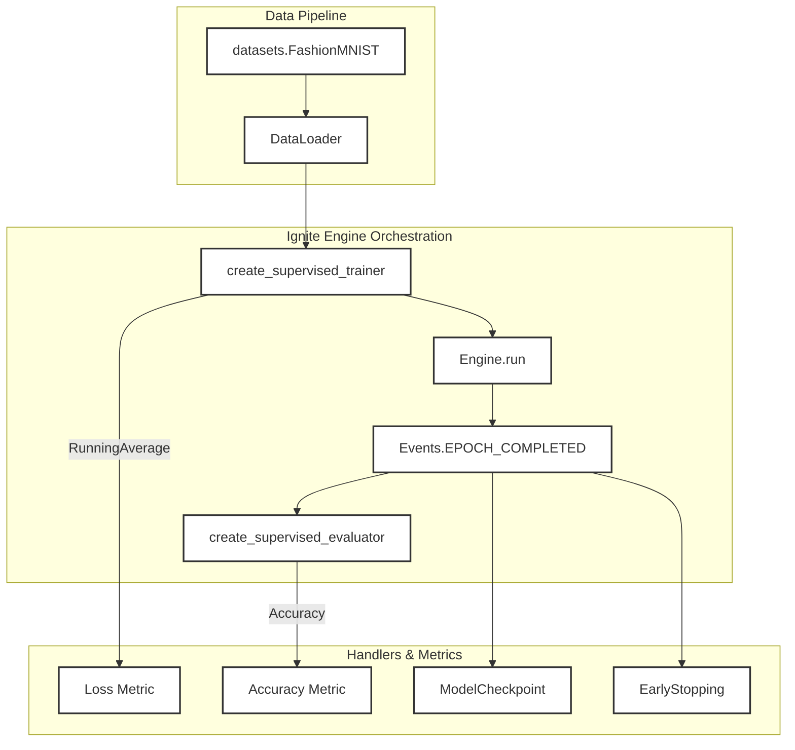
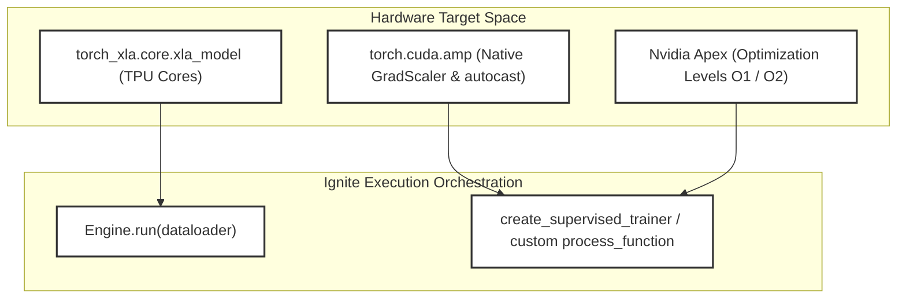

<!-- source: DeepWiki mcp.deepwiki.com · repo pytorch/ignite · page 8.3 Jupyter Notebook Tutorials · fetched 2026-10-21 -->

# Jupyter Notebook Tutorials

Relevant source files

The following files were used as context for generating this wiki page:

- [examples/notebooks/Cifar100_bench_amp.ipynb](examples/notebooks/Cifar100_bench_amp.ipynb)
- [examples/notebooks/Cifar10_Ax_hyperparam_tuning.ipynb](examples/notebooks/Cifar10_Ax_hyperparam_tuning.ipynb)
- [examples/notebooks/CycleGAN_with_nvidia_apex.ipynb](examples/notebooks/CycleGAN_with_nvidia_apex.ipynb)
- [examples/notebooks/CycleGAN_with_torch_cuda_amp.ipynb](examples/notebooks/CycleGAN_with_torch_cuda_amp.ipynb)
- [examples/notebooks/EfficientNet_Cifar100_finetuning.ipynb](examples/notebooks/EfficientNet_Cifar100_finetuning.ipynb)
- [examples/notebooks/FashionMNIST.ipynb](examples/notebooks/FashionMNIST.ipynb)
- [examples/notebooks/FastaiLRFinder_MNIST.ipynb](examples/notebooks/FastaiLRFinder_MNIST.ipynb)
- [examples/notebooks/HandlersTimeProfiler_MNIST.ipynb](examples/notebooks/HandlersTimeProfiler_MNIST.ipynb)
- [examples/notebooks/MNIST_on_TPU.ipynb](examples/notebooks/MNIST_on_TPU.ipynb)
- [examples/notebooks/TextTransformers.ipynb](examples/notebooks/TextTransformers.ipynb)
- [examples/notebooks/VAE.ipynb](examples/notebooks/VAE.ipynb)
- [examples/notebooks/assets/ax_hparams.png](examples/notebooks/assets/ax_hparams.png)
- [examples/notebooks/assets/fastresnet_v2.svg](examples/notebooks/assets/fastresnet_v2.svg)
- [ignite/contrib/handlers/lr_finder.py](ignite/contrib/handlers/lr_finder.py)

This page catalogs the technical tutorials provided in the `examples/notebooks/` directory of PyTorch Ignite. These notebooks demonstrate how Ignite's core abstractions (`Engine`, `Events`, `Metric`, `Handler`) integrate with external libraries (Hugging Face `transformers`/`datasets`, Ax, Nvidia Apex, PyTorch XLA/TPU) to build robust, production-ready training, validation, and benchmarking pipelines.

---

## 1. Computer Vision: FashionMNIST and EfficientNet Fine-Tuning

The computer vision tutorials illustrate standard supervised classification pipelines, model checkpointing, early stopping, and advanced convolutional architecture integration (such as Mobile Inverted Bottleneck convolutions and Ghost Batch Normalization).

### FashionMNIST Classification Pipeline
`FashionMNIST.ipynb` sets up a Convolutional Neural Network (`CNN`) classifying 28x28 grayscale clothing images. It showcases helper factories and metric attachments:
- **Trainer/Evaluator Initialization**: Uses `create_supervised_trainer` and `create_supervised_evaluator` from `ignite.engine` [examples/notebooks/FashionMNIST.ipynb:103-103]().
- **Metrics**: Attaches `Accuracy`, `Loss` (with `nn.NLLLoss`), and `RunningAverage` for training loss tracking [examples/notebooks/FashionMNIST.ipynb:104-104]().
- **Callbacks**: Integrates `ModelCheckpoint` and `EarlyStopping` handlers from `ignite.handlers` [examples/notebooks/FashionMNIST.ipynb:105-105]().

### EfficientNet-B0 and FastResNet with Ghost Batch Normalization
`EfficientNet_Cifar100_finetuning.ipynb` and `Cifar10_Ax_hyperparam_tuning.ipynb` demonstrate fine-tuning state-of-the-art vision models on CIFAR-100 and CIFAR-10:
- **Custom Modules**: Implements custom layers like `Swish` (`x * torch.sigmoid(x)`), `Flatten`, `SqueezeExcitation`, and `GhostBatchNorm` [examples/notebooks/EfficientNet_Cifar100_finetuning.ipynb:150-158] [examples/notebooks/Cifar10_Ax_hyperparam_tuning.ipynb:101-158]().
- **Hyperparameter Optimization**: Integrates the `Ax` platform (`ax-platform`) for Bayesian optimization of learning rates, weight decays, and architectures [examples/notebooks/Cifar10_Ax_hyperparam_tuning.ipynb:7-44]().

*Figure 1: Architectural data flow for `FashionMNIST.ipynb` connecting PyTorch data loaders, Ignite supervised engines, evaluation callbacks, and checkpointing handlers.*

Sources: `[examples/notebooks/FashionMNIST.ipynb:1-583]()`, `[examples/notebooks/EfficientNet_Cifar100_finetuning.ipynb:1-1412]`, `[examples/notebooks/Cifar10_Ax_hyperparam_tuning.ipynb:1-904]()`

---

## 2. Learning Rate Exploration and Performance Profiling

PyTorch Ignite provides specialized diagnostic handlers to inspect training dynamics and execution bottlenecks without modifying core loop code.

### Learning Rate Finder (`FastaiLRFinder`)
`FastaiLRFinder_MNIST.ipynb` demonstrates automated learning rate range tests following the fastai methodology [examples/notebooks/FastaiLRFinder_MNIST.ipynb:9-142]:
- **Context Manager Attach**: The `FastaiLRFinder` wraps the training loop via a context manager `with lr_finder.attach(trainer, to_save, diverge_th=1.5) as trainer_with_lr_finder:` [examples/notebooks/FastaiLRFinder_MNIST.ipynb:172-175]().
- **State Restoration**: Automatically saves model and optimizer state dictionaries (`to_save = {"model": model, "optimizer": optimizer}`) upon attachment and restores initial parameters once the range test completes [examples/notebooks/FastaiLRFinder_MNIST.ipynb:173-203]().
- **Suggestion**: Exposes `.lr_suggestion()` and `.plot()` to extract optimal learning rates [examples/notebooks/FastaiLRFinder_MNIST.ipynb:193-196](). Note that `ignite.contrib.handlers.lr_finder` proxies to `ignite.handlers.lr_finder` [ignite/contrib/handlers/lr_finder.py:1-22]().

### Handlers Time Profiling (`HandlersTimeProfiler`)
`HandlersTimeProfiler_MNIST.ipynb` benchmarks the execution overhead of attached event handlers:
- **Profiler Attachment**: `profiler = HandlersTimeProfiler(); profiler.attach(trainer)` measures exact execution durations for every registered handler callback across epochs and iterations [examples/notebooks/HandlersTimeProfiler_MNIST.ipynb:165-166]().
- **Export and Summary**: Generates summary tables via `profiler.print_results(profiler.get_results())` and exports raw timings to CSV via `profiler.write_results("./results.csv")` [examples/notebooks/HandlersTimeProfiler_MNIST.ipynb:203-219]().

Sources: `[examples/notebooks/FastaiLRFinder_MNIST.ipynb:1-312]()`, `[examples/notebooks/HandlersTimeProfiler_MNIST.ipynb:1-274]()`, `[ignite/contrib/handlers/lr_finder.py:1-22]()`

---

## 3. Hardware Acceleration and Mixed Precision Benchmarking

Ignite abstracts underlying execution devices—whether specialized Cloud TPUs or high-performance GPUs utilizing mixed precision.

### Cloud TPU Training (`MNIST_on_TPU.ipynb`)
`MNIST_on_TPU.ipynb` adapts standard training pipelines for Google Colab Cloud TPUs using PyTorch/XLA [examples/notebooks/MNIST_on_TPU.ipynb:7-14]:
- **XLA Device Binding**: Imports `torch_xla` and `torch_xla.core.xla_model as xm` to instantiate TPU core devices [examples/notebooks/MNIST_on_TPU.ipynb:103-106]().
- **Optimizer Step Integration**: Works seamlessly with `create_supervised_trainer` where tensor operations are dispatched to TPU graph compilation executors.

### Mixed Precision: `torch.cuda.amp` vs. Nvidia Apex (`Cifar100_bench_amp.ipynb`, `CycleGAN_with_torch_cuda_amp.ipynb`, `CycleGAN_with_nvidia_apex.ipynb`)
The CycleGAN and CIFAR-100 benchmarking notebooks compare automatic mixed precision strategies:
- **Native AMP (`torch.cuda.amp`)**: Utilizes `torch.amp.autocast()` and `GradScaler` to accelerate training and reduce VRAM overhead [examples/notebooks/CycleGAN_with_torch_cuda_amp.ipynb:7-11]().
- **Nvidia Apex**: Evaluates optimization levels `"O1"` (automatic casting around PyTorch functions) and `"O2"` (fp16 training with fp32 batch norm and master weights) [examples/notebooks/Cifar100_bench_amp.ipynb:7-174]().

*Figure 2: Mapping hardware backends and mixed-precision frameworks (TPU, native AMP, Nvidia Apex) to Ignite's `Engine` and trainer abstractions.*

Sources: `[examples/notebooks/MNIST_on_TPU.ipynb:1-352]()`, `[examples/notebooks/Cifar100_bench_amp.ipynb:1-201]`, `[examples/notebooks/CycleGAN_with_torch_cuda_amp.ipynb:1-1443]`, `[examples/notebooks/CycleGAN_with_nvidia_apex.ipynb:1-1470]()`

---

## 4. Generative Models and Natural Language Text Transformers

Advanced reference implementations demonstrate how Ignite handles complex multi-model, multi-loss architectures and transformer pipelines.

### Variational Autoencoders (`VAE.ipynb`)
`VAE.ipynb` replicates Kingma and Welling's Auto-Encoding Variational Bayes on MNIST [examples/notebooks/VAE.ipynb:7-16]:
- **Custom Engine Loop**: Manages custom training steps computing reconstruction loss and Kullback-Leibler (KL) divergence across latent spaces.
- **Image Grid Logging**: Uses `torchvision.utils.make_grid` and `save_image` attached to `Events.EPOCH_COMPLETED` to periodically persist reconstructed digit grids.

### Text Transformers (`TextTransformers.ipynb`)
`TextTransformers.ipynb` fine-tunes Hugging Face's DistilBERT model for binary text classification on IMDB movie reviews [examples/notebooks/TextTransformers.ipynb:8-17]:
- **Dynamic Padding**: Leverages `DataCollatorWithPadding` to batch tokenized text sequences efficiently without static maximum-length padding overhead [examples/notebooks/TextTransformers.ipynb:75-115]().
- **Hugging Face Integration**: Unpacks dictionary batches directly into the model (`model(**batch)`), where Hugging Face transformer modules internally compute cross-entropy losses when `labels` are provided [examples/notebooks/TextTransformers.ipynb:148-163]().
- **Robust Training Handlers**: Combines `GradScaler` [examples/notebooks/TextTransformers.ipynb:50-50](), `EarlyStopping`, and `Checkpoint` with `DiskSaver` [examples/notebooks/TextTransformers.ipynb:57-57]() for production-grade experiment management.

Sources: `[examples/notebooks/VAE.ipynb:1-667]()`, `[examples/notebooks/TextTransformers.ipynb:1-372]()`

---

