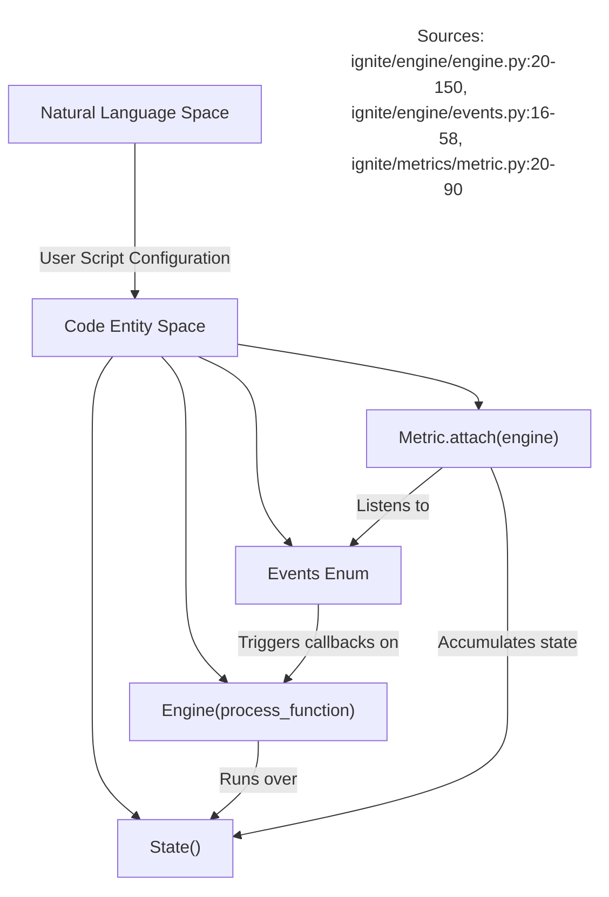
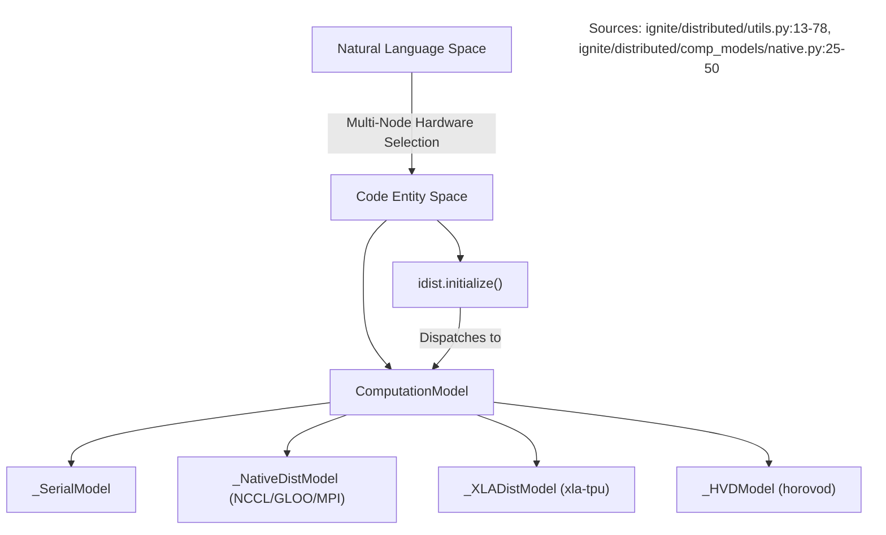

<!-- source: DeepWiki mcp.deepwiki.com · repo pytorch/ignite · page 9 Glossary · fetched 2026-10-21 -->

# Glossary

Relevant source files

The following files were used as context for generating this wiki page:

- [docs/source/handlers.rst](docs/source/handlers.rst)
- [docs/source/metrics.rst](docs/source/metrics.rst)
- [ignite/_utils.py](ignite/_utils.py)
- [ignite/distributed/comp_models/base.py](ignite/distributed/comp_models/base.py)
- [ignite/distributed/comp_models/horovod.py](ignite/distributed/comp_models/horovod.py)
- [ignite/distributed/comp_models/native.py](ignite/distributed/comp_models/native.py)
- [ignite/distributed/comp_models/xla.py](ignite/distributed/comp_models/xla.py)
- [ignite/distributed/launcher.py](ignite/distributed/launcher.py)
- [ignite/distributed/utils.py](ignite/distributed/utils.py)
- [ignite/engine/deterministic.py](ignite/engine/deterministic.py)
- [ignite/engine/engine.py](ignite/engine/engine.py)
- [ignite/engine/events.py](ignite/engine/events.py)
- [ignite/engine/utils.py](ignite/engine/utils.py)
- [ignite/handlers/__init__.py](ignite/handlers/__init__.py)
- [ignite/handlers/checkpoint.py](ignite/handlers/checkpoint.py)
- [ignite/metrics/__init__.py](ignite/metrics/__init__.py)
- [ignite/metrics/metric.py](ignite/metrics/metric.py)
- [requirements-dev.txt](requirements-dev.txt)
- [tests/ignite/distributed/utils/__init__.py](tests/ignite/distributed/utils/__init__.py)
- [tests/ignite/distributed/utils/test_horovod.py](tests/ignite/distributed/utils/test_horovod.py)
- [tests/ignite/distributed/utils/test_native.py](tests/ignite/distributed/utils/test_native.py)
- [tests/ignite/distributed/utils/test_serial.py](tests/ignite/distributed/utils/test_serial.py)
- [tests/ignite/distributed/utils/test_xla.py](tests/ignite/distributed/utils/test_xla.py)
- [tests/ignite/engine/__init__.py](tests/ignite/engine/__init__.py)
- [tests/ignite/engine/test_custom_events.py](tests/ignite/engine/test_custom_events.py)
- [tests/ignite/engine/test_deterministic.py](tests/ignite/engine/test_deterministic.py)
- [tests/ignite/engine/test_engine.py](tests/ignite/engine/test_engine.py)
- [tests/ignite/engine/test_event_handlers.py](tests/ignite/engine/test_event_handlers.py)
- [tests/ignite/handlers/test_checkpoint.py](tests/ignite/handlers/test_checkpoint.py)
- [tests/ignite/metrics/test_metric.py](tests/ignite/metrics/test_metric.py)

## Purpose and Scope
This page defines codebase-specific terms, architectural abstractions, design patterns, and abbreviations used throughout PyTorch Ignite (such as `Engine`, `Event`, `Handler`, `State`, `idist`, `MetricUsage`, `sync_all_reduce`, `DeterministicEngine`, `AMP`, `ZeRO`, `save_handler`, `global_step_transform`, `EpochWise`, `ProgressBar`, `contrib`, `hvd`, `XLA`, `MPS`, etc.). Each term includes precise technical definitions, implementation details, and direct code pointers to facilitate navigation through the codebase.

---

## Core Abstractions and Engine System

### Engine
* **Definition**: The central orchestrator class in PyTorch Ignite (`[ignite/engine/engine.py:20-130]()`) responsible for running a given `process_function` over each batch of a dataset, managing the training/evaluation lifecycle stages, and emitting events.
* **Role**: Decouples the training loop boilerplate from algorithm logic. It maintains state in `engine.state` and fires lifecycle events (`STARTED`, `EPOCH_STARTED`, `ITERATION_STARTED`, `ITERATION_COMPLETED`, `EPOCH_COMPLETED`, `COMPLETED`).

### State
* **Definition**: A container object (`[ignite/engine/events.py:16]()`) that holds internal and user-defined runtime variables passed between event handlers during an engine run.
* **Key Attributes**: `epoch`, `iteration`, `max_epochs`, `max_iters`, `epoch_length`, `metrics`, `output`, and `batch`. Reset automatically on every call to `engine.run()` (`[ignite/engine/engine.py:28-30]()`).

### Event / Events
* **Definition**: An enumeration (`[ignite/engine/events.py:16]()`) or callable event filter (`CallableEventWithFilter`) that triggers registered callbacks at specific points in the `Engine` lifecycle.
* **Filtering**: Events can be filtered via modifiers such as `.every(n)`, `.once(n)`, `.before(n)`, or `.after(n)` (`[ignite/engine/events.py:51-122]()`).

### Handler
* **Definition**: A user-defined or built-in callback function/callable class bound to specific engine `Events` using decorators like `@engine.on()` or method calls like `engine.add_event_handler()`. Handlers extend execution behavior (logging, checkpointing, metric evaluation).

### DeterministicEngine
* **Definition**: A subclass of `Engine` (`[ignite/engine/deterministic.py]()`) designed to enforce complete reproducibility across runs by managing random number generator (RNG) states across PyTorch, NumPy, Python `random`, and data samplers (`ReproducibleBatchSampler`).

---

## Metrics System

### Metric
* **Definition**: The base class (`[ignite/metrics/metric.py:20]()`) for all performance evaluation metrics in Ignite, following an online accumulation paradigm implemented via three core methods: `reset()`, `update(output)`, and `compute()` (`[docs/source/metrics.rst:12-19]()`).
* **Attachment**: Attached to an `Engine` instance via `metric.attach(engine, name)`, which automatically registers event hooks for lifecycle methods (`[docs/source/metrics.rst:16-19]()`).

### MetricUsage
* **Definition**: A base configuration class (`[ignite/metrics/metric.py:31-65]()`) that defines the association between engine events and a metric's lifecycle methods (`started`, `iteration_completed`, `completed`).

### EpochWise
* **Definition**: The default and most common `MetricUsage` subclass (`[ignite/metrics/metric.py:67-90]()`) where `reset` triggers on `EPOCH_STARTED`, `update` on `ITERATION_COMPLETED`, and `compute` on `EPOCH_COMPLETED`.

### sync_all_reduce
* **Definition**: A decorator (`[ignite/metrics/metric.py:24]()`) applied to metric computation functions to synchronize and reduce accumulated internal states across multiple distributed processes (GPUs/TPUs) before final metric computation (`[docs/source/metrics.rst:87-89]()`).

---

## Handlers, Checkpointing, and Utilities

### Checkpoint / save_handler
* **Definition**: A state-saving utility (`[ignite/handlers/checkpoint.py:85]()`) that periodically serializes objects implementing `state_dict()` and `load_state_dict()` (such as models, optimizers, and engine states).
* **`save_handler`**: A callable or string path (instantiating `DiskSaver`) defining how and where checkpoint dictionaries are stored (`[ignite/handlers/checkpoint.py:96-102]()`).

### global_step_transform
* **Definition**: A transformation function (`[ignite/handlers/checkpoint.py:112-114]()`) taking `(engine, event_name)` and returning an integer global step. Often used to synchronize step counts across nested trainers/evaluators via `global_step_from_engine()` (`[ignite/handlers/checkpoint.py:115]()`).

### ProgressBar
* **Definition**: A built-in progress bar logging handler utilizing `tqdm` (`[requirements-dev.txt:18]()`) to track iteration and epoch progress during engine execution.

---

## Distributed Training and Hardware Abstraction

### idist (Ignite Distributed)
* **Definition**: Ignite's distributed abstraction layer (`[ignite/distributed/utils.py]()`) providing a unified API (`idist.initialize`, `idist.spawn`, `idist.get_world_size`, `idist.device`) across disparate backend frameworks.

### ComputationModel
* **Definition**: The base class for backend-specific execution models (`[ignite/distributed/comp_models/base.py]()`) supporting serial execution (`_SerialModel`), native PyTorch distributed (`_NativeDistModel`), Horovod (`_HVDModel`), and XLA TPU (`_XLADistModel`).

### hvd (Horovod)
* **Definition**: An abbreviation for Horovod (`[ignite/distributed/comp_models/horovod.py]()`), a distributed deep learning training framework supported via `idist` with `backend="horovod"`.

### XLA / xla-tpu
* **Definition**: PyTorch XLA integration (`[ignite/distributed/comp_models/xla.py]()`) enabling high-performance training on Google Cloud TPUs (`xla:index` devices).

### MPS (Metal Performance Shaders)
* **Definition**: Apple Silicon GPU acceleration backend supported natively in PyTorch and utilized within Ignite training loops via `torch.device("mps")`.

---

## Advanced Optimization and Ecosystem Terms

### AMP (Automatic Mixed Precision)
* **Definition**: Training optimization using PyTorch's `torch.amp` or NVIDIA Apex (`apex`) to execute operations in half-precision (`torch.float16` / `bfloat16`) while maintaining critical accumulation tensors in single-precision (`torch.float32`), integrated directly into `create_supervised_trainer`.

### ZeRO (Zero Redundancy Optimizer)
* **Definition**: Memory optimization technology (`ZeroRedundancyOptimizer`, `[ignite/handlers/checkpoint.py:16-20]()`) that shards optimizer states across data-parallel processes to reduce memory footprints during distributed training.

### contrib
* **Definition**: Legacy or experimental module directory (`ignite.contrib`) housing community contributions, third-party loggers, and trial schedulers slated for migration into core namespaces (`ignite.handlers`, `ignite.metrics`) (`[docs/source/handlers.rst]()`).

---

## Architecture Diagrams

### Component Dependency and Engine-Metric Flow

Sources: `ignite/engine/engine.py:20-150`, `ignite/engine/events.py:16-58`, `ignite/metrics/metric.py:20-90`

---

### Distributed Computation Model Abstraction (`idist`)

Sources: `ignite/distributed/utils.py:13-78`, `ignite/distributed/comp_models/native.py:25-50`

---

### Sources
Sources: `ignite/handlers/checkpoint.py:1-125`, `ignite/engine/engine.py:20-150`, `ignite/engine/events.py:16-122`, `ignite/distributed/utils.py:13-117`, `ignite/distributed/comp_models/native.py:25-50`, `ignite/metrics/metric.py:20-90`, `docs/source/metrics.rst:1-89`