# Page: Overview

# Overview

<details>
<summary>Relevant source files</summary>

The following files were used as context for generating this wiki page:

- [README.md](README.md)
- [assets/ignite_vs_bare_pytorch.png](assets/ignite_vs_bare_pytorch.png)
- [assets/tldr/teaser.ipynb](assets/tldr/teaser.ipynb)
- [assets/tldr/teaser.py](assets/tldr/teaser.py)
- [docker/README.md](docker/README.md)
- [ignite/__init__.py](ignite/__init__.py)

</details>


PyTorch Ignite is a high-level library built on top of PyTorch for training and evaluating neural networks flexibly and transparently [README.md:26](). The library uses an event-driven architecture centered around the `ignite.engine.Engine` class, which manages training and evaluation loops and fires events that trigger user-defined handlers [README.md:83-88]().

Unlike restrictive training frameworks, Ignite adopts a **library approach**: it does not enforce control inversion [README.md:45](). Users instantiate `Engine` objects, attach handlers and metrics, and invoke `engine.run()` explicitly, leaving standard PyTorch code modular, transparent, and fully under user control [README.md:45]().

For detailed instructions and deep dives into specific topics, consult the child pages:
- [Installation and Setup](#1.1) — Guide users through installing Ignite via pip, conda, or Docker, including environment setup and dependency management [README.md:62-64]()
- [Core Concepts](#1.2) — Explain fundamental concepts: `Engine` as orchestrator, `Events` as hooks, `Handlers` as callbacks, and the library vs. framework philosophy [README.md:83-88]()
- [Quick Start Guide](#1.3) — Provide a minimal working example showing `Engine` creation, metric attachment, and handler usage for immediate user onboarding [README.md:92-124]()

Sources:
- [README.md:26-45]()
- [README.md:83-88]()
- [ignite/__init__.py:9]()

## Core Ecosystem Architecture

The library is structured around core module groups that handle execution loops, evaluation metrics, training orchestration, and multi-device distributed training.

Title: PyTorch Ignite Ecosystem Architecture

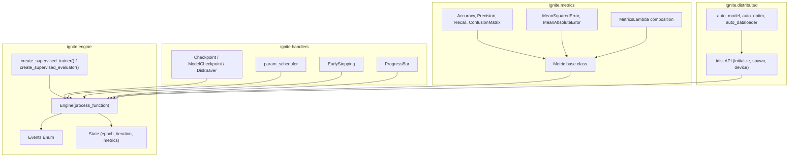

Sources:
- [ignite/__init__.py:1-9]()
- [README.md:83-88]()

## Library Philosophy and Workflow

PyTorch Ignite aims to reduce boilerplate code while granting absolute control over every iteration and parameter update [README.md:26](). Users define a batch-level step function `process_function(engine, batch)` (or utilize built-in factories like `create_supervised_trainer`), wrap it in an `Engine`, and attach handlers for logging, metric collection, and checkpointing [README.md:104-124]().

For detailed code examples and step-by-step onboarding, see [Quick Start Guide](#1.3). For comprehensive information on installation options across pip, conda, and Docker containers, see [Installation and Setup](#1.1).

Sources:
- [README.md:26-45]()
- [README.md:92-124]()
- [docker/README.md:1-40]()

---

# Page: Installation and Setup

# Installation and Setup

<details>
<summary>Relevant source files</summary>

The following files were used as context for generating this wiki page:

- [.devcontainer/devcontainer.json](.devcontainer/devcontainer.json)
- [.git-blame-ignore-revs](.git-blame-ignore-revs)
- [.github/workflows/build_docs.sh](.github/workflows/build_docs.sh)
- [.github/workflows/install_docs_deps.sh](.github/workflows/install_docs_deps.sh)
- [.pre-commit-config.yaml](.pre-commit-config.yaml)
- [CONTRIBUTING.md](CONTRIBUTING.md)
- [README.md](README.md)
- [assets/tldr/teaser.ipynb](assets/tldr/teaser.ipynb)
- [assets/tldr/teaser.py](assets/tldr/teaser.py)
- [conda.recipe/build_and_upload.sh](conda.recipe/build_and_upload.sh)
- [conda.recipe/meta.yaml](conda.recipe/meta.yaml)
- [docker/README.md](docker/README.md)
- [docker/build.sh](docker/build.sh)
- [docker/docker.cfg](docker/docker.cfg)
- [docker/hvd/Dockerfile.hvd-apex](docker/hvd/Dockerfile.hvd-apex)
- [docker/hvd/Dockerfile.hvd-base](docker/hvd/Dockerfile.hvd-base)
- [docker/main/Dockerfile.apex](docker/main/Dockerfile.apex)
- [docker/main/Dockerfile.base](docker/main/Dockerfile.base)
- [docker/msdp/Dockerfile.msdp-apex](docker/msdp/Dockerfile.msdp-apex)
- [docker/push_all.sh](docker/push_all.sh)
- [docker/test_image.py](docker/test_image.py)
- [pyproject.toml](pyproject.toml)

</details>


This page guides users through installing PyTorch Ignite via pip, conda, Docker, or from source. It covers stable and nightly releases, dependency requirements, environment setup, and installation verification. For detailed contribution workflows and development environment setup, see [Contributing Guidelines](#7.5). For Docker image build processes, see [Release and Distribution](#7.3).

---

## Installation Methods Overview

PyTorch Ignite is distributed through three primary channels, each offering stable and nightly release tracks.

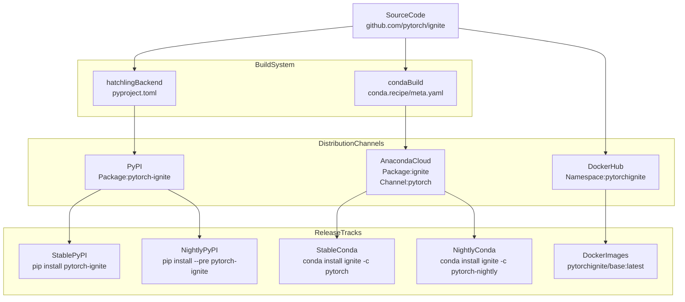

**Sources:** [README.md:1-18](), [pyproject.toml:1-37](), [conda.recipe/meta.yaml:1-43]()

---

## Stable Release Installation

### pip Installation

The primary installation method uses the PyPI package `pytorch-ignite`:

```bash
pip install pytorch-ignite
```

This installs the latest stable release. The package is built using the `hatchling` backend specified in [pyproject.toml:1-3]() and includes the core `ignite` package with all submodules.

**Sources:** [README.md:17-17](), [pyproject.toml:1-22]()

### conda Installation

For conda users, Ignite is available in the `pytorch` channel under the package name `ignite`:

```bash
conda install ignite -c pytorch
```

The conda package is configured as `noarch: python` ([conda.recipe/meta.yaml:12]()), meaning it's platform-independent and works on any operating system.

**Sources:** [README.md:17-17](), [conda.recipe/meta.yaml:10-12]()

### From Source Installation

To install the latest development version directly from the GitHub repository:

```bash
pip install git+https://github.com/pytorch/ignite
```

This clones the master branch and installs it as a regular package. For development purposes where you need editable installation, see the Development Installation section below.

**Sources:** [README.md:1-19](), [CONTRIBUTING.md:81-110]()

---

## Nightly Release Installation

Nightly releases provide access to the latest features and bug fixes before they're included in stable releases.

### pip Nightly Installation

```bash
pip install --pre pytorch-ignite
```

The `--pre` flag instructs pip to include pre-release versions. Nightly PyPI packages are published daily.

**Sources:** [README.md:18-18]()

### conda Nightly Installation

```bash
conda install ignite -c pytorch-nightly
```

Nightly conda packages are available in the `pytorch-nightly` channel and are synchronized with the nightly PyPI releases.

**Sources:** [README.md:18-18]()

---

## Docker Images

Pre-built Docker images are available for various use cases, including GPU support, Horovod integration, and domain-specific dependencies.

### Using Pre-built Images

Pull and run a Docker image with GPU support:

```bash
docker run --gpus all -it -v $PWD:/workspace/project --network=host --shm-size 16G pytorchignite/base:latest /bin/bash
```

**Docker Image Variants**

| Category | Image Tag | Description |
|----------|-----------|-------------|
| Base | `pytorchignite/base:latest` | Core Ignite with PyTorch |
| | `pytorchignite/apex:latest` | Includes NVIDIA Apex for mixed-precision training |
| | `pytorchignite/hvd-base:latest` | Horovod distributed training support |
| | `pytorchignite/hvd-apex:latest` | Horovod + Apex combination |
| | `pytorchignite/msdp-apex:latest` | Multi-scale distributed processing with Apex |
| Vision | `pytorchignite/vision:latest` | torchvision and image processing libraries |
| NLP | `pytorchignite/nlp:latest` | NLP libraries (transformers, tokenizers) |

**Sources:** [README.md:17-17](), [docker/docker.cfg:1-4](), [docker/hvd/Dockerfile.hvd-base:1-65]()

---

## Requirements and Dependencies

The dependency structure for PyTorch Ignite consists of runtime requirements and optional development tools.

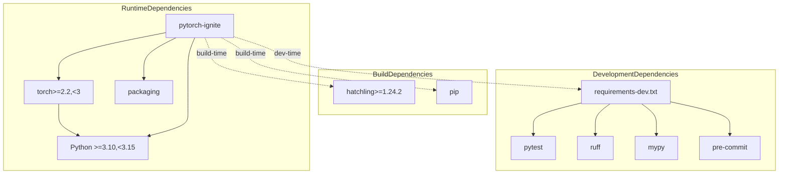

**Sources:** [pyproject.toml:1-21](), [conda.recipe/meta.yaml:16-27]()

### Python Version Support

Ignite requires **Python >=3.10,<3.15** as defined in [pyproject.toml:17](). (Conda recipe specifies Python >=3.9,<=3.13 in [conda.recipe/meta.yaml:20]()).

### PyTorch Version Support

Ignite supports **PyTorch >=2.2,<3** ([pyproject.toml:19]()), while the conda meta.yaml specifies `pytorch >=1.10,<3` ([conda.recipe/meta.yaml:21]()).

### Core Dependencies

The required runtime dependency beyond PyTorch is:
- **packaging** ([pyproject.toml:20]()): Used for version parsing.

**Sources:** [pyproject.toml:1-21](), [conda.recipe/meta.yaml:16-27]()

---

## Development Installation

For contributors and developers who need to modify Ignite code, an editable installation is required.

### Fork and Clone Workflow

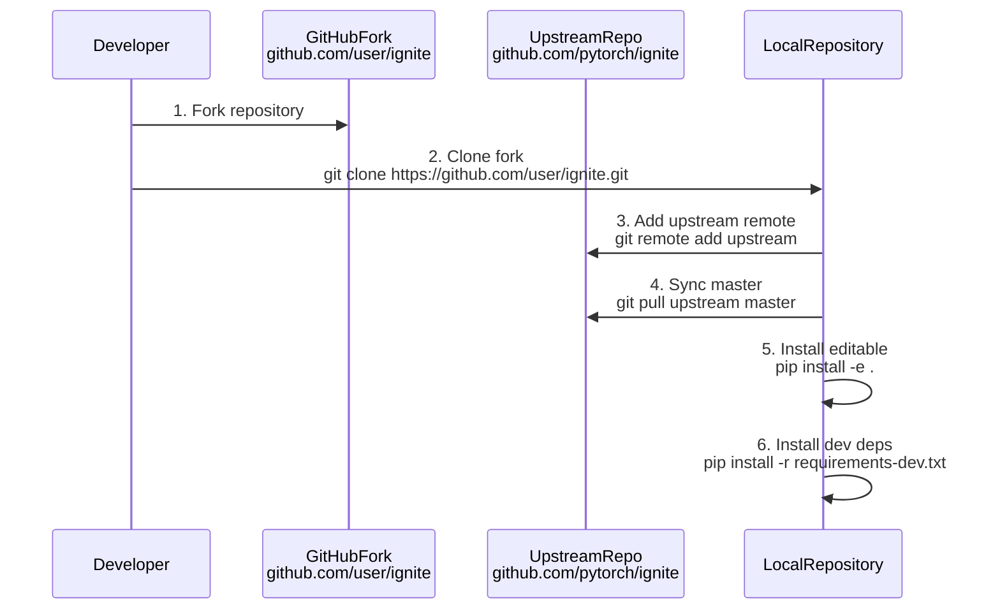

**Sources:** [CONTRIBUTING.md:81-110]()

### Step-by-Step Instructions

1. **Fork the repository** on GitHub: Navigate to https://github.com/pytorch/ignite and click "Fork".
2. **Clone your fork** (replace `happy-ignite-developer` with your username):
```bash
git clone https://github.com/happy-ignite-developer/ignite.git
cd ignite
```
3. **Add upstream remote**:
```bash
git remote add upstream https://github.com/pytorch/ignite.git
git remote -v
```
4. **Sync with upstream and install**:
```bash
git pull upstream master
pip install -e .
pip install -r requirements-dev.txt
```

**Sources:** [CONTRIBUTING.md:81-110]()

---

## Installation Verification

### Basic Import Test

Open a Python interpreter and verify core imports:

```python
import ignite
print(ignite.__version__)

from ignite.engine import Engine, Events
from ignite.metrics import Accuracy
from ignite.handlers import Checkpoint
```

The version string is defined in `ignite/__init__.py` and extracted by `pyproject.toml` using hatchling ([pyproject.toml:28-29]()).

### Package Structure Verification

Verify that all main submodules are accessible:

```python
import ignite.engine      # Core execution engine
import ignite.handlers    # Event handlers and callbacks
import ignite.metrics     # Performance metrics
import ignite.contrib     # Extended functionality
import ignite.distributed # Multi-backend distributed support
```

**Sources:** [pyproject.toml:28-36](), [conda.recipe/meta.yaml:28-35]()

---

# Page: Core Concepts

# Core Concepts

<details>
<summary>Relevant source files</summary>

The following files were used as context for generating this wiki page:

- [docs/source/_static/img/concepts/timeline_and_events.png](docs/source/_static/img/concepts/timeline_and_events.png)
- [ignite/_utils.py](ignite/_utils.py)
- [ignite/engine/deterministic.py](ignite/engine/deterministic.py)
- [ignite/engine/engine.py](ignite/engine/engine.py)
- [ignite/engine/events.py](ignite/engine/events.py)
- [ignite/engine/utils.py](ignite/engine/utils.py)
- [tests/ignite/engine/__init__.py](tests/ignite/engine/__init__.py)
- [tests/ignite/engine/test_custom_events.py](tests/ignite/engine/test_custom_events.py)
- [tests/ignite/engine/test_deterministic.py](tests/ignite/engine/test_deterministic.py)
- [tests/ignite/engine/test_engine.py](tests/ignite/engine/test_engine.py)
- [tests/ignite/engine/test_event_handlers.py](tests/ignite/engine/test_event_handlers.py)

</details>


## Purpose and Scope

This document explains the foundational concepts and architecture of PyTorch Ignite, focusing on its design as a lightweight, flexible training library rather than a rigid framework. It details how the `Engine` class [ignite/engine/engine.py:20-130]() acts as the core loop orchestrator, how `Events` [ignite/engine/events.py:16-16]() provide execution hooks, how `Handlers` function as callbacks to extend training capabilities, and how state is managed via the `State` object [ignite/engine/events.py:451-523]() and serialization APIs [ignite/engine/engine.py:663-747](). 

---

## Library vs. Framework Philosophy

PyTorch Ignite adopts a **library** philosophy rather than a **framework** philosophy:
- **Frameworks** (like high-level wrappers or monolithic trainers) dictate your training loop structure, hide boilerplate behind opaque abstractions, and make non-standard research modifications difficult.
- **Libraries** provide modular, composable building blocks that you assemble. PyTorch Ignite leaves the core PyTorch training loop explicit while abstracting away repetitive boilerplate (logging, checkpointing, metric aggregation, distributed synchronization). You retain total control over your `process_function` [ignite/engine/engine.py:24-25](), optimizer steps, and gradient computations.

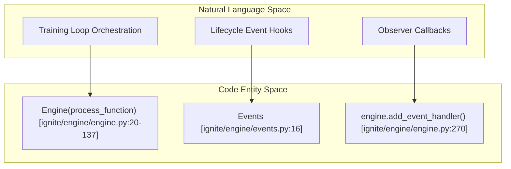
Sources: [ignite/engine/engine.py:20-137](), [ignite/engine/events.py:16-16]().

---

## Engine as Orchestrator

The `Engine` class [ignite/engine/engine.py:20-130]() is the central component of PyTorch Ignite. It coordinates the execution of training and evaluation loops over a dataset via its `run()` method [ignite/engine/engine.py:795-853](). 

Rather than writing custom `for epoch in range(...)` and `for batch in dataloader:` loops with scattered logging and validation code, you define a single `process_function` [ignite/engine/engine.py:24-25]() that executes a single iteration (batch processing step), and pass it to the `Engine`.

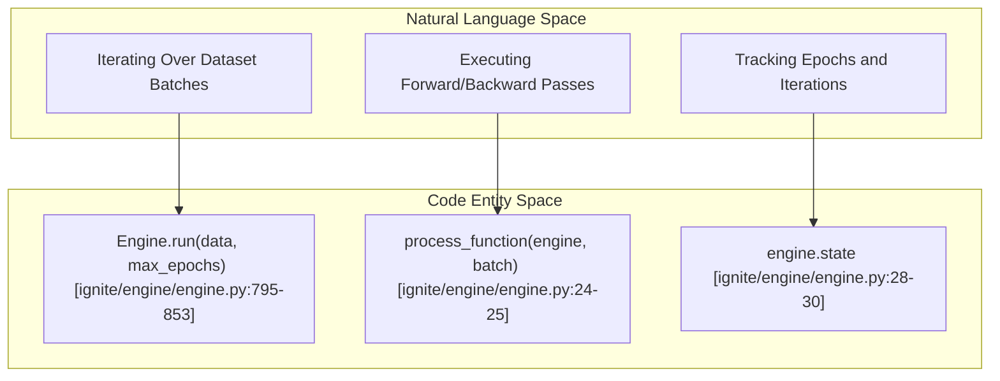
Sources: [ignite/engine/engine.py:20-130](), [ignite/engine/engine.py:795-853]().

---

## State Management

The `State` object [ignite/engine/events.py:451-523]() manages internal and user-defined runtime variables. It is instantiated automatically upon `Engine` creation [ignite/engine/engine.py:149]() and reset at the beginning of every `run()` call.

| State Attribute | Code Symbol / Type | Description |
|-----------------|--------------------|-------------|
| `iteration` | `int` [ignite/engine/events.py:451-523]() | Cumulative 1-based iteration counter across all epochs |
| `epoch` | `int` [ignite/engine/events.py:451-523]() | Cumulative 1-based epoch counter |
| `epoch_length` | `int` [ignite/engine/events.py:451-523]() | Number of iterations per epoch |
| `max_epochs` | `int` [ignite/engine/events.py:451-523]() | Total epochs configured for the run |
| `output` | `Any` [ignite/engine/events.py:451-523]() | Return value of the `process_function` for the current batch |
| `batch` | `Any` [ignite/engine/events.py:451-523]() | The raw data batch fetched for the current iteration |
| `metrics` | `dict` [ignite/engine/events.py:451-523]() | Dictionary storing computed metric values |

Sources: [ignite/engine/engine.py:28-30](), [ignite/engine/events.py:451-523]().

---

## Events System

The events system allows users to hook into specific moments during the engine's lifecycle without altering the execution loop code.

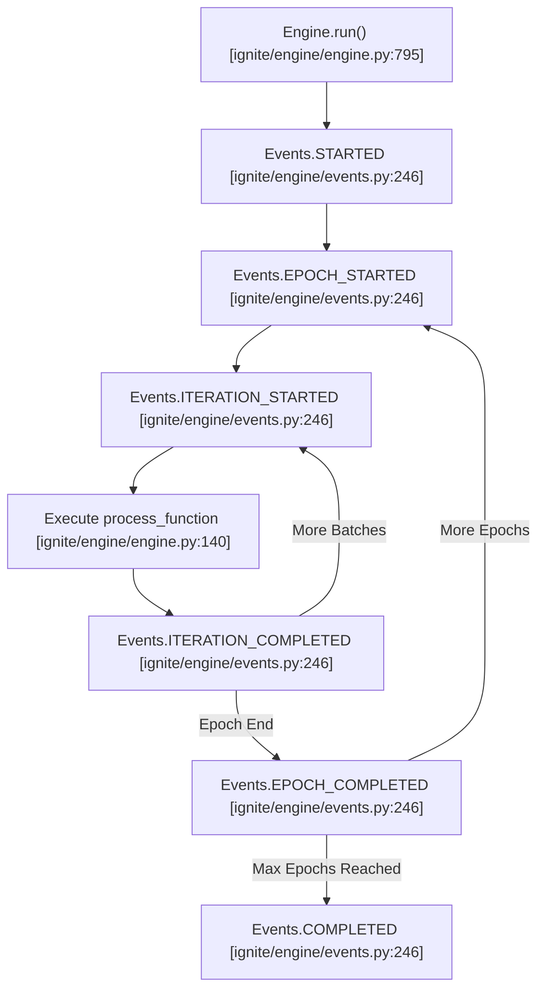
Sources: [ignite/engine/engine.py:140](), [ignite/engine/engine.py:795-853](), [ignite/engine/events.py:246-398]().

### Event Filtering

Events can be filtered using built-in qualifiers like `every`, `once`, `before`, and `after` [ignite/engine/events.py:51-73]():
- `Events.ITERATION_COMPLETED(every=100)`: Fires only on iterations that are multiples of 100 [ignite/engine/events.py:130-137]().
- `Events.EPOCH_COMPLETED(once=5)`: Fires exclusively on epoch 5 [ignite/engine/events.py:141-149]().

Sources: [ignite/engine/events.py:51-177]().

---

## Handlers and Callbacks

Handlers are Python callables (functions, methods, or classes with `__call__`) registered to listen to specific events [tests/ignite/engine/test_event_handlers.py:64-116](). When an event is fired, the engine invokes all registered handlers for that event, passing the engine instance [ignite/engine/engine.py:270-337]() (and any optional bound arguments) to them.

Handlers can be registered using either method attachment or decorators:
```python
# Using decorator syntax
@trainer.on(Events.ITERATION_COMPLETED(every=50))
def log_loss(engine):
    print(f"Iteration {engine.state.iteration}, Loss: {engine.state.output}")
```
Sources: [ignite/engine/engine.py:385-413](), [tests/ignite/engine/test_event_handlers.py:64-116]().

---

## Deterministic Training

For reproducible research, PyTorch Ignite provides `DeterministicEngine` [ignite/engine/deterministic.py:139-194](), which extends `Engine` to ensure identical dataflows across runs and re-runs. It manages random number generator states (`torch`, `numpy`, and `random`) [ignite/engine/deterministic.py:88-97]() and wraps dataloaders with `ReproducibleBatchSampler` [ignite/engine/deterministic.py:39-86]().

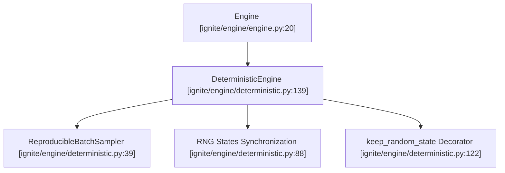
Sources: [ignite/engine/deterministic.py:39-194]().

---

## Summary

PyTorch Ignite's core architecture centers around the `Engine` orchestrator [ignite/engine/engine.py:20-130](), the `State` container [ignite/engine/events.py:451-523](), and the event-driven hook system [ignite/engine/events.py:16-16](). This design separates the core training loop execution from peripheral concerns like logging, validation, and checkpointing, adhering strictly to a flexible library philosophy.

Sources: [ignite/engine/engine.py:20-130](), [ignite/engine/events.py:16-523]().

---

# Page: Quick Start Guide

# Quick Start Guide

<details>
<summary>Relevant source files</summary>

The following files were used as context for generating this wiki page:

- [README.md](README.md)
- [assets/tldr/teaser.ipynb](assets/tldr/teaser.ipynb)
- [assets/tldr/teaser.py](assets/tldr/teaser.py)
- [docker/README.md](docker/README.md)
- [examples/mnist/mnist.py](examples/mnist/mnist.py)
- [examples/mnist/mnist_save_resume_engine.py](examples/mnist/mnist_save_resume_engine.py)
- [examples/mnist/mnist_with_tensorboard.py](examples/mnist/mnist_with_tensorboard.py)
- [examples/mnist/mnist_with_tensorboard_on_tpu.py](examples/mnist/mnist_with_tensorboard_on_tpu.py)
- [examples/mnist/mnist_with_visdom.py](examples/mnist/mnist_with_visdom.py)

</details>


**Purpose**: This guide provides minimal working examples to get started with PyTorch Ignite immediately. It demonstrates creating training and evaluation engines, attaching metrics, and using event handlers for common tasks.

**Scope**: Covers essential patterns for basic training loops. For detailed concepts, see [Core Concepts](#1.2). For installation instructions, see [Installation and Setup](#1.1). For advanced engine features, see [Engine System](#2).

---

## Basic Training Loop

The core pattern in Ignite is defining a `process_function` that processes a single batch, then wrapping it in an `Engine` to handle the training loop orchestration.

### Minimal Trainer

```python
from ignite.engine import Engine

def train_step(engine, batch):
    # Extract data
    inputs, targets = batch
    
    # Forward pass
    optimizer.zero_grad()
    outputs = model(inputs)
    loss = criterion(outputs, targets)
    
    # Backward pass
    loss.backward()
    optimizer.step()
    
    return loss.item()

# Create trainer engine
trainer = Engine(train_step)

# Run training
trainer.run(train_dataloader, max_epochs=10)
```

The `train_step` function receives two arguments:
- `engine`: The `Engine` instance (provides access to state)
- `batch`: Current batch from the dataloader

The function returns data that gets stored in `engine.state.output`.

**Key Points**:
- Engine automatically handles epoch and iteration loops
- No need to write `for epoch in range(max_epochs)` manually
- `engine.state` tracks progress (iteration, epoch counters)

Sources: [README.md:92-118]()

---

## Engine Execution Flow

### Diagram: Engine Execution Sequence
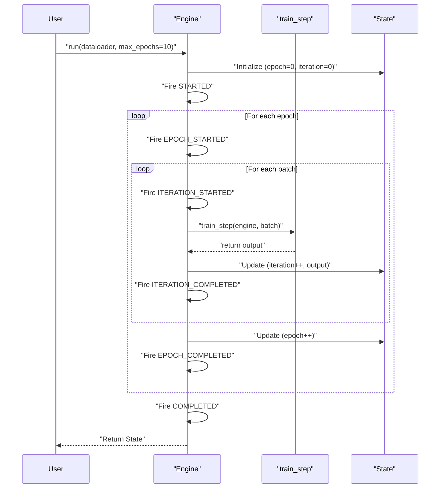

Sources: [README.md:92-124]()

---

## Adding Metrics

Metrics automatically accumulate values during training/evaluation and compute final results at epoch end.

### Attaching Metrics to Evaluator

```python
from ignite.engine import Engine
from ignite.metrics import Accuracy, Loss

def validation_step(engine, batch):
    model.eval()
    with torch.no_grad():
        x, y = batch
        y_pred = model(x)
        return y_pred, y

evaluator = Engine(validation_step)

# Attach metrics
Accuracy().attach(evaluator, "accuracy")
Loss(criterion).attach(evaluator, "loss")

# Run evaluation
state = evaluator.run(val_dataloader)
metrics = state.metrics
print(f"Accuracy: {metrics['accuracy']:.4f}, Loss: {metrics['loss']:.4f}")
```

**Metric Lifecycle**:
1. `reset()` - Called at epoch start
2. `update(output)` - Called after each iteration with `engine.state.output`
3. `compute()` - Called at epoch end to produce final value

The computed metrics are stored in `engine.state.metrics` dictionary.

Sources: [README.md:106-117](), [examples/mnist/mnist.py:63-64]()

---

## Metric Integration Pattern

### Diagram: Metric Binding Architecture
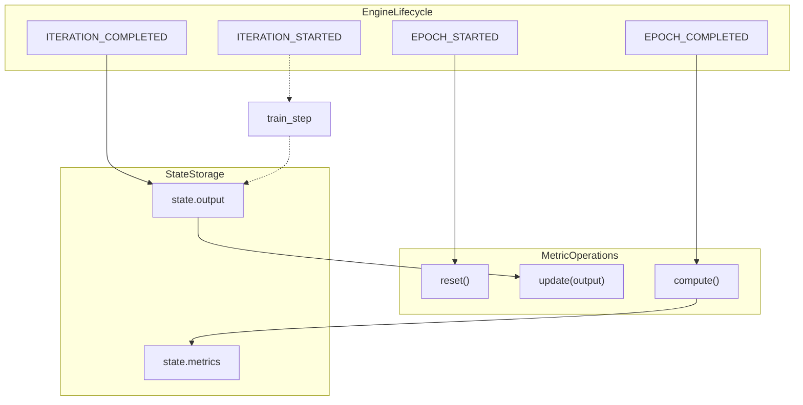

**How Metrics Work**:
- `Metric.attach(engine, name)` registers internal handlers on events
- Handler on `EPOCH_STARTED` calls `metric.reset()`
- Handler on `ITERATION_COMPLETED` calls `metric.update(engine.state.output)`
- Handler on `EPOCH_COMPLETED` calls `metric.compute()` and stores result in `state.metrics[name]`

Sources: [examples/mnist/mnist.py:63-65]()

---

## Using Event Handlers

Event handlers allow you to inject custom logic at specific points in the training loop.

### Logging Training Progress

```python
from ignite.engine import Events

@trainer.on(Events.ITERATION_COMPLETED(every=100))
def log_training_loss(engine):
    print(f"Epoch[{engine.state.epoch}] Iteration[{engine.state.iteration}] "
          f"Loss: {engine.state.output:.2f}")

@trainer.on(Events.EPOCH_COMPLETED)
def log_validation(engine):
    evaluator.run(val_dataloader)
    metrics = evaluator.state.metrics
    print(f"Validation - Accuracy: {metrics['accuracy']:.4f}")
```

**Event Filters**:
- `every=N` - Trigger every N iterations/epochs
- `once=N` - Trigger only at iteration/epoch N
- Custom filter function

### Alternative Handler Syntax

```python
# Using add_event_handler (equivalent to decorator)
def handler_function(engine):
    print("Handler called")

trainer.add_event_handler(Events.STARTED, handler_function)

# Handler without engine argument
@trainer.on(Events.COMPLETED)
def handler_no_args():
    print("Training completed")
```

Sources: [examples/mnist/mnist.py:69-93](), [README.md:120-123]()

---

## Common Event Types

| Event | When Fired | Use Case |
|-------|-----------|----------|
| `STARTED` | Beginning of `run()` | Initialize variables, setup |
| `EPOCH_STARTED` | Start of each epoch | Set learning rate, logging |
| `ITERATION_STARTED` | Before processing batch | Debugging, data inspection |
| `ITERATION_COMPLETED` | After processing batch | Log metrics, gradient clipping |
| `EPOCH_COMPLETED` | After all batches in epoch | Validation, checkpointing |
| `COMPLETED` | End of all epochs | Save final model, cleanup |

Sources: [examples/mnist/mnist.py:97-99]()

---

## Complete Training Example

This example combines all concepts: trainer, evaluator, metrics, and handlers, referencing standard setup from [examples/mnist/mnist.py]().

```python
import torch
from torch import nn
from torch.optim import SGD
from torch.utils.data import DataLoader
from ignite.engine import Engine, Events
from ignite.metrics import Accuracy, Loss

# Model setup
model = nn.Sequential(nn.Linear(10, 64), nn.ReLU(), nn.Linear(64, 2))
optimizer = SGD(model.parameters(), lr=0.01)
criterion = nn.CrossEntropyLoss()

# Define process functions
def train_step(engine, batch):
    model.train()
    optimizer.zero_grad()
    x, y = batch
    y_pred = model(x)
    loss = criterion(y_pred, y)
    loss.backward()
    optimizer.step()
    return loss.item()

def validation_step(engine, batch):
    model.eval()
    with torch.no_grad():
        x, y = batch
        y_pred = model(x)
        return y_pred, y

# Create engines
trainer = Engine(train_step)
evaluator = Engine(validation_step)

# Attach metrics to evaluator
Accuracy().attach(evaluator, "accuracy")
Loss(criterion).attach(evaluator, "loss")

# Add event handlers
@trainer.on(Events.EPOCH_COMPLETED)
def run_validation(engine):
    evaluator.run(val_loader)
    metrics = evaluator.state.metrics
    print(f"Epoch {engine.state.epoch}: "
          f"Accuracy: {metrics['accuracy']:.4f}, "
          f"Loss: {metrics['loss']:.4f}")

# Run training
trainer.run(train_loader, max_epochs=50)
```

Sources: [examples/mnist/mnist.py:36-101]()

---

## Key Classes and Methods Reference

### Diagram: Core Entity Relationships
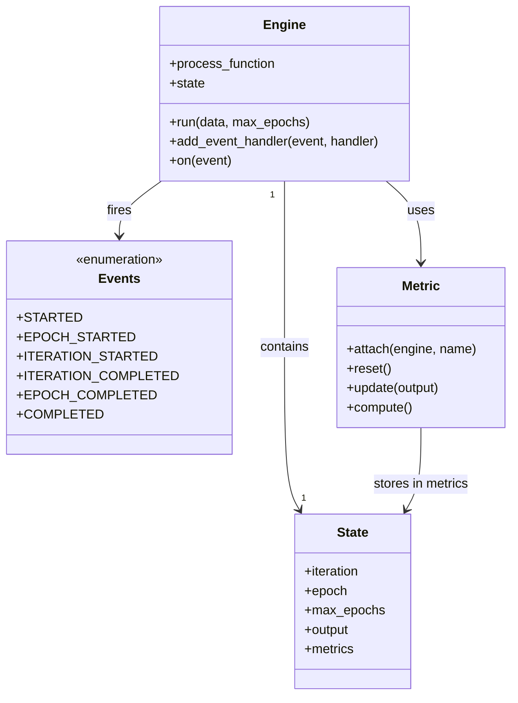

**Core Methods**:
- `Engine.run(data, max_epochs)` - Execute training/evaluation loop
- `Engine.add_event_handler(event, handler, *args, **kwargs)` - Register handler
- `Engine.on(event)` - Decorator shortcut for `add_event_handler`
- `Metric.attach(engine, name)` - Register metric to compute automatically

Sources: [README.md:92-124](), [examples/mnist/mnist.py:63-65]()

---

## Next Steps

- **Custom Metrics**: See [Metrics System](#3) for creating custom metrics and metric composition
- **State Management**: See [State Management and Serialization](#2.3) for checkpointing and resuming training
- **Advanced Handlers**: See [Handlers and Callbacks](#4) for checkpoint saving, early stopping, and logging integrations
- **Distributed Training**: See [Distributed Training](#5) for multi-GPU and multi-node setups

Sources: [README.md:67-71]()

---

# Page: Engine System

# Engine System

<details>
<summary>Relevant source files</summary>

The following files were used as context for generating this wiki page:

- [ignite/_utils.py](ignite/_utils.py)
- [ignite/engine/deterministic.py](ignite/engine/deterministic.py)
- [ignite/engine/engine.py](ignite/engine/engine.py)
- [ignite/engine/events.py](ignite/engine/events.py)
- [ignite/engine/utils.py](ignite/engine/utils.py)
- [tests/ignite/engine/__init__.py](tests/ignite/engine/__init__.py)
- [tests/ignite/engine/test_custom_events.py](tests/ignite/engine/test_custom_events.py)
- [tests/ignite/engine/test_deterministic.py](tests/ignite/engine/test_deterministic.py)
- [tests/ignite/engine/test_engine.py](tests/ignite/engine/test_engine.py)
- [tests/ignite/engine/test_event_handlers.py](tests/ignite/engine/test_event_handlers.py)

</details>


## Purpose and Scope

The Engine System is the core orchestration layer of PyTorch Ignite, responsible for executing training and evaluation loops, managing lifecycle hooks, and handling distributed coordination. An `Engine` runs a user-defined `process_function` across batches of data while emitting events that trigger attached handlers and metrics [ignite/engine/engine.py:20-136]().

This is a parent page providing a high-level architectural overview. The engine system spans several detailed sub-topics:
- [Engine Class and Lifecycle](#2.1) — Detail Engine construction, run() method, lifecycle stages, and state management
- [Events System](#2.2) — Explain Events enumeration, event filtering, EventsList composition, and custom events
- [State Management and Serialization](#2.3) — Document engine.state object, checkpointing, and resuming training
- [Deterministic Training](#2.4) — Explain DeterministicEngine, ReproducibleBatchSampler, and reproducible training runs
- [Supervised Training Helpers](#2.5) — Document trainer/evaluator factories, AMP support, and gradient accumulation

Sources: [ignite/engine/engine.py:20-136]()

---

## 2.1. Engine Class and Lifecycle

The `Engine` class ([ignite/engine/engine.py:20-136]()) serves as the central orchestrator of training and validation loops. When the `run()` method is invoked, it iterates over epochs and batches, executing the `process_function` per iteration while managing core execution flow, termination flags, and interrupts.

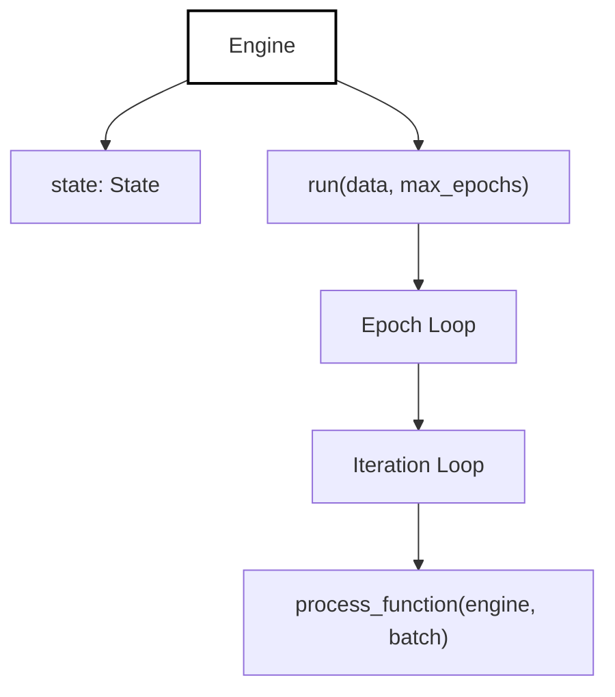

For complete details on engine construction, the execution loop, lifecycle stages, and state management, see [Engine Class and Lifecycle](#2.1).

Sources: [ignite/engine/engine.py:20-166](), [tests/ignite/engine/test_engine.py:40-112]()

---

## 2.2. Events System

The Events system allows handlers to hook into specific moments of the training lifecycle via the `Events` enumeration ([ignite/engine/events.py:247-404]()). Events support rich filtering features (`every`, `once`, `before`, `after`, or custom callables) via `CallableEventWithFilter` ([ignite/engine/events.py:19-127]()), and can be combined using `EventsList` ([ignite/engine/events.py:406-449]()). Custom event types can also be defined by subclassing `EventEnum` ([ignite/engine/events.py:206-244]()).


For deep dives into event filtering, custom event creation, and event list composition, see [Events System](#2.2).

Sources: [ignite/engine/events.py:19-244](), [ignite/engine/events.py:406-449]()

---

## 2.3. State Management and Serialization

The `State` object ([ignite/engine/events.py:452-524]()) tracks intermediate progress, counters (`iteration`, `epoch`), metrics, and user-defined variables during an engine run. Ignite provides built-in serialization support through `state_dict()` and `load_state_dict()` ([ignite/engine/engine.py:687-766]()), enabling seamless checkpointing and experiment resumption.

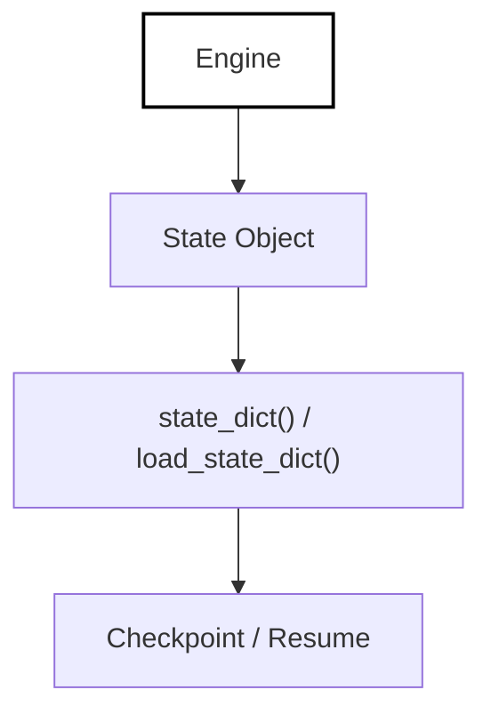

For detailed documentation on state attributes, checkpointing formats, and mid-run resumption, see [State Management and Serialization](#2.3).

Sources: [ignite/engine/engine.py:687-766](), [ignite/engine/events.py:452-524]()

---

## 2.4. Deterministic Training

To ensure reproducibility across runs—especially when resuming from checkpoints or using multi-worker data loaders—Ignite provides `DeterministicEngine` ([ignite/engine/deterministic.py:138-294]()). It automatically manages random number generator (RNG) states across PyTorch, NumPy, and Python's `random`, and wraps batch samplers using `ReproducibleBatchSampler` ([ignite/engine/deterministic.py:38-84]()).

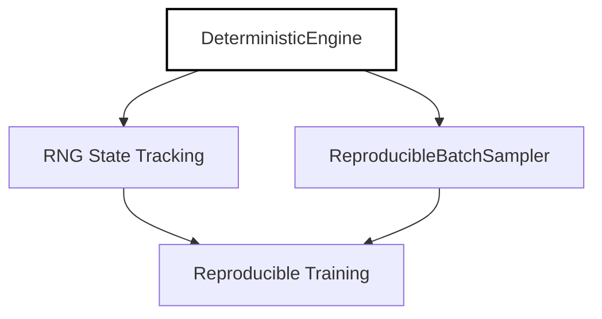

For comprehensive instructions on achieving deterministic training, random seed management, and the `keep_random_state` decorator, see [Deterministic Training](#2.4).

Sources: [ignite/engine/deterministic.py:38-135](), [ignite/engine/deterministic.py:138-294]()

---

## 2.5. Supervised Training Helpers

Ignite offers high-level factory functions like `create_supervised_trainer` and `create_supervised_evaluator` to quickly instantiate engines for standard training loops. These helpers support Automatic Mixed Precision (AMP) via PyTorch native `torch.amp` or NVIDIA Apex, gradient accumulation, and custom device placement or data transforms.

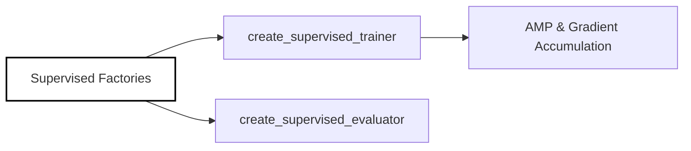

For complete usage guides on trainer/evaluator factories, AMP setups, and gradient accumulation helpers, see [Supervised Training Helpers](#2.5).

Sources: [ignite/engine/engine.py:20-70](), [ignite/engine/deterministic.py:121-135]()

---

# Page: Engine Class and Lifecycle

# Engine Class and Lifecycle

<details>
<summary>Relevant source files</summary>

The following files were used as context for generating this wiki page:

- [ignite/_utils.py](ignite/_utils.py)
- [ignite/engine/deterministic.py](ignite/engine/deterministic.py)
- [ignite/engine/engine.py](ignite/engine/engine.py)
- [ignite/engine/events.py](ignite/engine/events.py)
- [ignite/engine/utils.py](ignite/engine/utils.py)
- [tests/ignite/engine/__init__.py](tests/ignite/engine/__init__.py)
- [tests/ignite/engine/test_custom_events.py](tests/ignite/engine/test_custom_events.py)
- [tests/ignite/engine/test_deterministic.py](tests/ignite/engine/test_deterministic.py)
- [tests/ignite/engine/test_engine.py](tests/ignite/engine/test_engine.py)
- [tests/ignite/engine/test_event_handlers.py](tests/ignite/engine/test_event_handlers.py)

</details>


## Purpose and Scope

This document covers the `Engine` class, which is the core execution orchestrator in PyTorch Ignite. The Engine abstracts the training/evaluation loop by running a user-defined `process_function` over data while emitting events at key lifecycle points. This page focuses on the Engine's internal structure, state management, execution lifecycle, and serialization mechanisms.

For information about the Events system and event filtering, see [Events System](#2.2). For supervised training factory functions that create pre-configured Engines, see [Deterministic Training](#2.4). For deterministic/reproducible training, see [State Management and Serialization](#2.3).

Sources: [ignite/engine/engine.py:20-162]()

---

## Engine Class Overview

The `Engine` class is defined in [ignite/engine/engine.py:20-294](). It executes a `process_function` over batches from a data iterable, managing state and firing events throughout execution.

### Core Responsibilities

| Responsibility | Description |
|---|---|
| **Process Function Execution** | Calls user-defined function for each batch |
| **State Management** | Maintains iteration counters, epoch numbers, metrics, and user data |
| **Event Emission** | Fires events at lifecycle points (`STARTED`, `EPOCH_STARTED`, `ITERATION_COMPLETED`, etc.) |
| **Control Flow** | Supports termination (`terminate()`) and interruption (`interrupt()`) |
| **Serialization** | Provides `state_dict()` and `load_state_dict()` for checkpointing |

### Engine Constructor

```python
Engine(process_function: Callable[["Engine", Any], Any])
```

The `process_function` receives two arguments:
- `engine`: The Engine instance itself
- `batch`: Current batch from the data iterator

The function can return any data, which is stored in `engine.state.output`.

Sources: [ignite/engine/engine.py:20-162]()

---

## Engine Class Structure

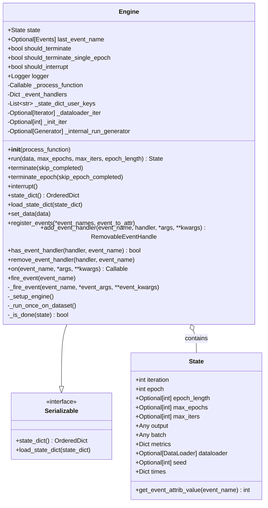

**Diagram: Engine Class Structure with Key Methods and Attributes**

Sources: [ignite/engine/engine.py:20-294](), [ignite/engine/events.py:451-524]()

---

## Engine State Object

The `State` object is created by the Engine and shared with all event handlers. It contains execution metadata and user-defined data.

### State Attributes

```mermaid
graph TB
    State["State Object"]
    
    subgraph "Core Counters (reset on run)"
        Iteration["iteration: int<br/>1-based, cumulative"]
        Epoch["epoch: int<br/>1-based, current epoch"]
        EpochLength["epoch_length: Optional[int]<br/>Iterations per epoch"]
        MaxEpochs["max_epochs: Optional[int]<br/>Total epochs to run"]
        MaxIters["max_iters: Optional[int]<br/>Alternative stopping criterion"]
    end
    
    subgraph "Data Flow"
        Batch["batch: Any<br/>Current batch from dataloader"]
        Output["output: Any<br/>Return value of process_function"]
        Dataloader["dataloader: Optional[DataLoader]<br/>Data source"]
    end
    
    subgraph "Metrics & Timing"
        Metrics["metrics: Dict[str, Any]<br/>Computed metrics"]
        Times["times: Dict[str, Optional[float]]<br/>EPOCH_COMPLETED, COMPLETED"]
    end
    
    subgraph "Reproducibility"
        Seed["seed: Optional[int]<br/>Random seed for epoch"]
    end
    
    State --> Iteration
    State --> Epoch
    State --> EpochLength
    State --> MaxEpochs
    State --> MaxIters
    State --> Batch
    State --> Output
    State --> Dataloader
    State --> Metrics
    State --> Times
    State --> Seed
```

**Diagram: State Object Attribute Structure**

### State Lifecycle

State attributes are initialized at different points:

| Attribute | When Set | Reset on New Run? |
|---|---|---|
| `iteration` | `run()` start | Yes (if engine is "done") |
| `epoch` | `run()` start | Yes (if engine is "done") |
| `max_epochs` | `run()` call | Yes (if provided) |
| `epoch_length` | `run()` call or auto-detected | Yes (if provided) |
| `batch` | Each iteration | No |
| `output` | After `process_function` | No |
| `metrics` | Handler attachment | No |
| `times` | `Events.STARTED` handler | Partially |

Sources: [ignite/engine/events.py:451-524](), [ignite/engine/engine.py:814-1020]()

---

## Execution Lifecycle

The `run()` method is the primary entry point for Engine execution.

### run() Method Signature

```python
def run(
    self,
    data: Iterable | None = None,
    max_epochs: int | None = None,
    max_iters: int | None = None,
    epoch_length: int | None = None,
) -> State
```

### Run Logic Flow

The Engine's run behavior depends on its current state:

| Condition | Behavior |
|---|---|
| First run | Create new state with provided parameters |
| State exists, not done | Continue from current iteration |
| State exists, done | Reset and create new state |
| Resuming from loaded state | Continue from saved iteration/epoch |

Sources: [ignite/engine/engine.py:814-920]()

### Engine Execution Flow

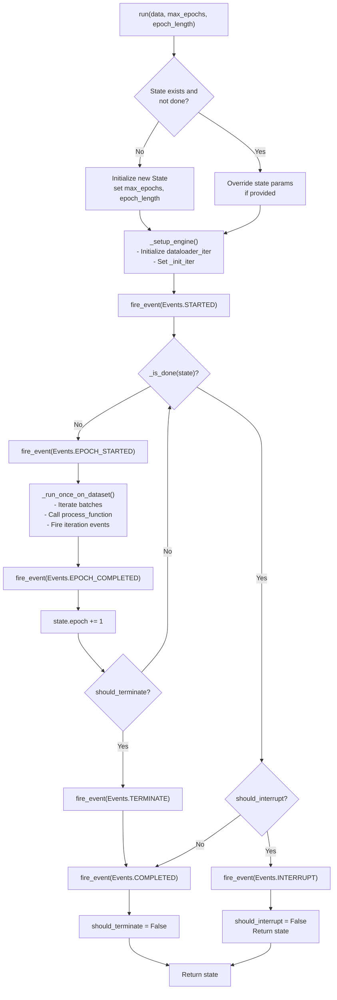

**Diagram: Engine.run() Execution Flow**

Sources: [ignite/engine/engine.py:814-1020]()

### Internal Iteration Flow (_run_once_on_dataset)

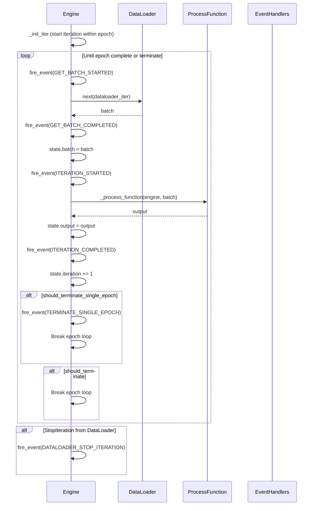

**Diagram: Single Epoch Iteration Sequence**

Sources: [ignite/engine/engine.py:1037-1179]()

---

## State Management and Serialization

The Engine implements the `Serializable` interface to support checkpointing and resuming training.

### state_dict() Method

Returns an `OrderedDict` containing:

| Key | Source | Description |
|---|---|---|
| `iteration` | `engine.state.iteration` | Current iteration count (1-based) |
| `epoch_length` | `engine.state.epoch_length` | Iterations per epoch |
| `max_epochs` | `engine.state.max_epochs` | Total epochs to run |
| User keys | `engine.state_dict_user_keys` | Custom attributes registered by user |

**Example Usage:**

```python
# Register custom state attributes
engine.state_dict_user_keys.append("alpha")
engine.state_dict_user_keys.append("beta")

@engine.on(Events.STARTED)
def init_user_values(_):
    engine.state.alpha = 0.1
    engine.state.beta = "checkpoint_v1"

# Save state
state_dict = engine.state_dict()
torch.save(state_dict, "checkpoint.pt")
```

Sources: [ignite/engine/engine.py:682-716](), [tests/ignite/engine/test_engine.py:1-50]()

### load_state_dict() Method

Restores engine state from a dictionary. Required keys:
- `epoch_length` and `max_epochs` (always required)
- **One of**: `iteration` OR `epoch` (to specify resume point)
- Any keys in `engine.state_dict_user_keys`

**State Restoration Logic:**

```mermaid
graph TB
    LoadDict["load_state_dict(state_dict)"]
    ValidateKeys["Validate required keys:<br/>- epoch_length<br/>- max_epochs<br/>- iteration OR epoch<br/>- user keys"]
    
    SetMaxEpochs["state.max_epochs = state_dict['max_epochs']"]
    SetEpochLength["state.epoch_length = state_dict['epoch_length']"]
    SetUserKeys["Set custom attributes from<br/>state_dict_user_keys"]
    
    CheckIterOrEpoch{"Has 'iteration'<br/>key?"}
    
    SetIteration["state.iteration = state_dict['iteration']<br/>state.epoch = iteration // epoch_length"]
    SetEpoch["state.epoch = state_dict['epoch']<br/>state.iteration = epoch * epoch_length"]
    
    ReadyToRun["Engine ready to resume from<br/>saved state on next run()"]
    
    LoadDict --> ValidateKeys
    ValidateKeys --> SetMaxEpochs
    SetMaxEpochs --> SetEpochLength
    SetEpochLength --> SetUserKeys
    SetUserKeys --> CheckIterOrEpoch
    
    CheckIterOrEpoch -->|Yes| SetIteration
    CheckIterOrEpoch -->|No| SetEpoch
    
    SetIteration --> ReadyToRun
    SetEpoch --> ReadyToRun
```

**Diagram: load_state_dict() Flow**

**Resume Example:**

```python
# Resume from iteration 500
state_dict = {
    "iteration": 500, 
    "max_epochs": 100, 
    "epoch_length": 1000
}
engine.load_state_dict(state_dict)
engine.run(data)  # Continues from iteration 501

# Resume from epoch 5
state_dict = {
    "epoch": 5, 
    "max_epochs": 100, 
    "epoch_length": 1000
}
engine.load_state_dict(state_dict)
engine.run(data)  # Continues from epoch 6
```

Sources: [ignite/engine/engine.py:717-766](), [tests/ignite/engine/test_engine.py:50-100]()

---

## Termination and Interruption

The Engine provides three control mechanisms to stop execution.

### terminate()

Stops the run completely after the current iteration.

```python
def terminate(self, skip_completed: bool = False) -> None
```

**Event Sequence:**
1. Current event completes
2. `Events.TERMINATE` fires
3. `Events.COMPLETED` fires (unless `skip_completed=True`)

**Example:**

```python
@engine.on(Events.ITERATION_COMPLETED(once=100))
def early_stop():
    if should_stop():
        engine.terminate()
```

Sources: [ignite/engine/engine.py:564-651](), [tests/ignite/engine/test_engine.py:43-158]()

### terminate_epoch()

Stops the current epoch after the current iteration, but continues to the next epoch.

```python
def terminate_epoch(self, skip_epoch_completed: bool = False) -> None
```

**Event Sequence:**
1. Current event completes
2. `Events.TERMINATE_SINGLE_EPOCH` fires
3. `Events.EPOCH_COMPLETED` fires (unless `skip_epoch_completed=True`)
4. `Events.EPOCH_STARTED` fires for next epoch

**Example:**

```python
@engine.on(Events.ITERATION_COMPLETED)
def early_epoch_stop():
    if loss < threshold:
        engine.terminate_epoch()
```

Sources: [ignite/engine/engine.py:652-675](), [tests/ignite/engine/test_engine.py:115-180]()

### interrupt()

Pauses execution after the current iteration. The run can be resumed by calling `run()` again, which continues from the interrupted state.

```python
def interrupt(self) -> None
```

**Requirements:**
- `Engine.interrupt_resume_enabled = True` (default since v0.4.10)

**Event Sequence:**
1. Current iteration completes
2. `Events.INTERRUPT` fires
3. `run()` returns

**Resume Behavior:**
- Data iteration continues from the interrupted point
- State counters (iteration, epoch) are preserved

**Example:**

```python
@engine.on(Events.ITERATION_COMPLETED(every=100))
def checkpoint_and_pause():
    save_checkpoint()
    engine.interrupt()

# First call - runs 100 iterations then interrupts
engine.run(data, max_epochs=10)
print(f"Interrupted at iteration {engine.state.iteration}")

# Second call - resumes from iteration 101
engine.run(data, max_epochs=10)
```

Sources: [ignite/engine/engine.py:481-563](), [tests/ignite/engine/test_engine.py:100-200]()

### Termination Comparison Table

| Method | Scope | Fires TERMINATE* | Fires COMPLETED | Resumes? |
|---|---|---|---|---|
| `terminate()` | Entire run | TERMINATE | Yes (unless skip_completed) | No, starts fresh |
| `terminate_epoch()` | Current epoch | TERMINATE_SINGLE_EPOCH | Yes (unless skip_epoch_completed) | Continues to next epoch |
| `interrupt()` | Pauses run | INTERRUPT | No | Yes, from interrupt point |

Sources: [ignite/engine/engine.py:481-675]()

---

## Event Integration

The Engine is the event emitter that drives Ignite's event-driven architecture.

### Event Firing Mechanism

```mermaid
graph TB
    FireEvent["fire_event(event_name)"]
    AssertAllowed["_assert_allowed_event()<br/>Check event is registered"]
    InternalFire["_fire_event(event_name)"]
    
    SetLastEvent["last_event_name = event_name"]
    GetHandlers["Get handlers from<br/>_event_handlers[event_name]"]
    
    LoopHandlers["For each (handler, args, kwargs)"]
    CheckFilter{"Has event filter?"}
    EvalFilter["Evaluate filter(engine, event_value)"]
    FilterPass{"Filter returns<br/>True?"}
    
    ResolveEngine["Resolve weakref to engine<br/>if handler needs it"]
    CallHandler["handler(engine, *args, **kwargs)<br/>or handler(*args, **kwargs)"]
    
    Done["All handlers executed"]
    
    FireEvent --> AssertAllowed
    AssertAllowed --> InternalFire
    InternalFire --> SetLastEvent
    SetLastEvent --> GetHandlers
    GetHandlers --> LoopHandlers
    
    LoopHandlers --> CheckFilter
    CheckFilter -->|Yes| EvalFilter
    CheckFilter -->|No| ResolveEngine
    
    EvalFilter --> FilterPass
    FilterPass -->|Yes| ResolveEngine
    FilterPass -->|No| LoopHandlers
    
    ResolveEngine --> CallHandler
    CallHandler --> LoopHandlers
    LoopHandlers --> Done
```

**Diagram: Event Firing and Handler Execution Flow**

Sources: [ignite/engine/engine.py:426-480]()

### Handler Registration Methods

The Engine provides three ways to register event handlers:

**1. add_event_handler()**

```python
handler_handle = engine.add_event_handler(
    Events.ITERATION_COMPLETED,
    handler_function,
    *args,
    **kwargs
)
```

Returns a `RemovableEventHandle` for later removal.

**2. @on() Decorator**

```python
@engine.on(Events.EPOCH_COMPLETED)
def log_epoch(engine):
    print(f"Epoch {engine.state.epoch} completed")
```

**3. Implicit for Metrics**

Metrics attach themselves to engines without needing the `engine` argument:

```python
accuracy = Accuracy()
accuracy.attach(engine, "accuracy")
```

Sources: [ignite/engine/engine.py:281-425]()

### Custom Event Registration

Users can define and register custom events:

```python
from ignite.engine import EventEnum

class CustomEvents(EventEnum):
    BACKWARD_STARTED = "backward_started"
    BACKWARD_COMPLETED = "backward_completed"

def process_function(engine, batch):
    loss = compute_loss(batch)
    engine.fire_event(CustomEvents.BACKWARD_STARTED)
    loss.backward()
    engine.fire_event(CustomEvents.BACKWARD_COMPLETED)
    return loss

engine = Engine(process_function)
engine.register_events(*CustomEvents)

@engine.on(CustomEvents.BACKWARD_COMPLETED)
def clip_gradients(engine):
    torch.nn.utils.clip_grad_norm_(model.parameters(), 1.0)
```

Sources: [ignite/engine/engine.py:166-250](), [tests/ignite/engine/test_custom_events.py:12-46]()

---

## Code Entity Reference Map

This section maps high-level concepts to specific code entities for easy code navigation.

### Primary Classes and Methods

```mermaid
graph LR
    subgraph "ignite.engine.engine"
        EngineClass["Engine"]
        EngineRun["Engine.run()"]
        EngineStateDict["Engine.state_dict()"]
        EngineLoadStateDict["Engine.load_state_dict()"]
        EngineTerminate["Engine.terminate()"]
        EngineTerminateEpoch["Engine.terminate_epoch()"]
        EngineInterrupt["Engine.interrupt()"]
        EngineFireEvent["Engine.fire_event()"]
        EngineAddHandler["Engine.add_event_handler()"]
        EngineRunOnce["Engine._run_once_on_dataset()"]
        EngineSetupEngine["Engine._setup_engine()"]
        EngineIsDone["Engine._is_done()"]
    end
    
    subgraph "ignite.engine.events"
        StateClass["State"]
        EventsEnum["Events"]
        RemovableHandle["RemovableEventHandle"]
    end
    
    subgraph "ignite.engine.deterministic"
        DeterministicEngineClass["DeterministicEngine"]
        ReproducibleSampler["ReproducibleBatchSampler"]
    end
    
    EngineClass --> EngineRun
    EngineClass --> EngineStateDict
    EngineClass --> EngineLoadStateDict
    EngineClass --> EngineTerminate
    EngineClass --> EngineTerminateEpoch
    EngineClass --> EngineInterrupt
    EngineClass --> EngineFireEvent
    EngineClass --> EngineAddHandler
    EngineRun --> EngineRunOnce
    EngineRun --> EngineSetupEngine
    EngineRun --> EngineIsDone
    
    EngineClass -.-> StateClass
    EngineAddHandler -.-> RemovableHandle
    DeterministicEngineClass -.inherits.-> EngineClass
```

**Diagram: Code Entity Relationship Map**

### File and Line Number Reference

| Concept | Implementation | Line Range |
|---|---|---|
| Engine class definition | ignite/engine/engine.py | [20-294]() |
| Engine.__init__() | ignite/engine/engine.py | [137-165]() |
| Engine.run() | ignite/engine/engine.py | [814-920]() |
| Engine._run_once_on_dataset() | ignite/engine/engine.py | [1037-1179]() |
| Engine.state_dict() | ignite/engine/engine.py | [686-716]() |
| Engine.load_state_dict() | ignite/engine/engine.py | [717-766]() |
| Engine.terminate() | ignite/engine/engine.py | [564-651]() |
| Engine.terminate_epoch() | ignite/engine/engine.py | [652-675]() |
| Engine.interrupt() | ignite/engine/engine.py | [481-563]() |
| Engine.fire_event() | ignite/engine/engine.py | [457-480]() |
| Engine._fire_event() | ignite/engine/engine.py | [426-456]() |
| Engine.add_event_handler() | ignite/engine/engine.py | [281-349]() |
| Engine.register_events() | ignite/engine/engine.py | [166-251]() |
| State class definition | ignite/engine/events.py | [451-524]() |
| DeterministicEngine | ignite/engine/deterministic.py | [138-294]() |

### Test File References

| Test Area | File |
|---|---|
| Core Engine behavior | tests/ignite/engine/test_engine.py |
| Event handlers | tests/ignite/engine/test_event_handlers.py |
| Custom events | tests/ignite/engine/test_custom_events.py |
| Deterministic engine | tests/ignite/engine/test_deterministic.py |

Sources: [ignite/engine/engine.py](), [ignite/engine/events.py](), [ignite/engine/deterministic.py](), [tests/ignite/engine/test_engine.py]()

---

# Page: Events System

# Events System

<details>
<summary>Relevant source files</summary>

The following files were used as context for generating this wiki page:

- [ignite/_utils.py](ignite/_utils.py)
- [ignite/engine/deterministic.py](ignite/engine/deterministic.py)
- [ignite/engine/engine.py](ignite/engine/engine.py)
- [ignite/engine/events.py](ignite/engine/events.py)
- [ignite/engine/utils.py](ignite/engine/utils.py)
- [tests/ignite/engine/__init__.py](tests/ignite/engine/__init__.py)
- [tests/ignite/engine/test_custom_events.py](tests/ignite/engine/test_custom_events.py)
- [tests/ignite/engine/test_deterministic.py](tests/ignite/engine/test_deterministic.py)
- [tests/ignite/engine/test_engine.py](tests/ignite/engine/test_engine.py)
- [tests/ignite/engine/test_event_handlers.py](tests/ignite/engine/test_event_handlers.py)

</details>


The Events System provides the event-driven architecture that allows users to hook into specific points during `Engine` execution. At its core are the `Events` enumeration (built-in lifecycle events), `CallableEventWithFilter` (events with filtering logic), `EventsList` (composable event collections), and `EventEnum` (base class for custom events).

For information about how the Engine uses these events, see page 2.1.

## Architecture Overview

**Class Hierarchy and Components**

```mermaid
classDiagram
    class EventEnum {
        <<enumeration>>
        +__new__(cls, value)
        +__call__(event_filter, every, once, before, after)
    }
    
    class CallableEventWithFilter {
        +value: str
        +name: str
        +filter: Callable
        +__call__(event_filter, every, once, before, after)
        +every_event_filter(every) Callable
        +once_event_filter(once) Callable
        +before_and_after_event_filter(before, after) Callable
        +every_before_and_after_event_filter(every, before, after) Callable
        +__or__(other) EventsList
    }
    
    class Events {
        <<enumeration>>
        STARTED
        EPOCH_STARTED
        EPOCH_COMPLETED
        ITERATION_STARTED
        ITERATION_COMPLETED
        GET_BATCH_STARTED
        GET_BATCH_COMPLETED
        DATALOADER_STOP_ITERATION
        EXCEPTION_RAISED
        TERMINATE
        TERMINATE_SINGLE_EPOCH
        INTERRUPT
        COMPLETED
    }
    
    class EventsList {
        -_events: List
        +_append(event)
        +__or__(other) EventsList
        +__iter__() Iterator
        +__len__() int
    }
    
    class RemovableEventHandle {
        +event_name
        +handler: weakref
        +engine: weakref
        +remove()
        +__enter__()
        +__exit__()
    }
    
    EventEnum <|-- Events
    CallableEventWithFilter <|-- EventEnum
    EventsList o-- CallableEventWithFilter
    EventsList o-- Events
    RemovableEventHandle --> Events
    RemovableEventHandle --> CallableEventWithFilter
```

Sources: [ignite/engine/events.py:19-50](), [ignite/engine/events.py:206-244](), [ignite/engine/events.py:247-404](), [ignite/engine/events.py:406-450](), [ignite/engine/events.py:527-590]()

## Events Enumeration

The `Events` class inherits from `EventEnum` and defines all built-in lifecycle events. Each event is a string value that can be used directly or with filtering [ignite/engine/events.py:247-401]().

**Built-in Events Reference**

| Event Constant | String Value | State Attribute | Typical Use Case |
|----------------|--------------|-----------------|------------------|
| `Events.STARTED` | `"started"` | `epoch` | Initialize training state |
| `Events.EPOCH_STARTED` | `"epoch_started"` | `epoch` | Reset metrics, set learning rate |
| `Events.GET_BATCH_STARTED` | `"get_batch_started"` | `iteration` | Pre-batch preprocessing |
| `Events.GET_BATCH_COMPLETED` | `"get_batch_completed"` | `iteration` | Batch augmentation |
| `Events.ITERATION_STARTED` | `"iteration_started"` | `iteration` | Dynamic batch modification |
| `Events.ITERATION_COMPLETED` | `"iteration_completed"` | `iteration` | Log metrics, update progress |
| `Events.DATALOADER_STOP_ITERATION` | `"dataloader_stop_iteration"` | `iteration` | Handle dataloader exhaustion |
| `Events.EPOCH_COMPLETED` | `"epoch_completed"` | `epoch` | Validation, checkpointing |
| `Events.COMPLETED` | `"completed"` | `epoch` | Final cleanup, save results |
| `Events.EXCEPTION_RAISED` | `"exception_raised"` | `epoch` | Custom error handling |
| `Events.TERMINATE` | `"terminate"` | varies | Clean termination actions |
| `Events.TERMINATE_SINGLE_EPOCH` | `"terminate_single_epoch"` | varies | Early epoch stopping |
| `Events.INTERRUPT` | `"interrupt"` | varies | Pause/resume handling |

The mapping of events to state attributes is defined in the `State.event_to_attr` dictionary [ignite/engine/events.py:475-484]().

Sources: [ignite/engine/events.py:247-401](), [ignite/engine/events.py:475-484]()

**Event Lifecycle Sequence**

```mermaid
sequenceDiagram
    participant U as "User Code"
    participant E as "Engine"
    participant EH as "_event_handlers dict"
    participant H as "Handler Function"
    
    U->>E: run(data, max_epochs=N)
    E->>EH: _fire_event(Events.STARTED)
    EH->>H: Execute handlers(engine)
    
    loop Each Epoch
        E->>EH: _fire_event(Events.EPOCH_STARTED)
        EH->>H: Execute handlers(engine)
        
        loop Each Iteration
            E->>EH: _fire_event(Events.GET_BATCH_STARTED)
            E->>EH: _fire_event(Events.GET_BATCH_COMPLETED)
            E->>EH: _fire_event(Events.ITERATION_STARTED)
            Note over E: process_function(engine, batch)
            E->>EH: _fire_event(Events.ITERATION_COMPLETED)
            EH->>H: Execute handlers(engine)
        end
        
        E->>EH: _fire_event(Events.DATALOADER_STOP_ITERATION)
        E->>EH: _fire_event(Events.EPOCH_COMPLETED)
        EH->>H: Execute handlers(engine)
    end
    
    E->>EH: _fire_event(Events.COMPLETED)
    EH->>H: Execute handlers(engine)
    E->>U: Return State
```

Sources: [ignite/engine/engine.py:427-457](), [tests/ignite/engine/test_engine.py:628-663]()

## CallableEventWithFilter

`CallableEventWithFilter` is the core class that enables event filtering [ignite/engine/events.py:19-50](). Every event can be called with filter parameters to create a filtered version.

**Filter Creation Flow and Code Mapping**

```mermaid
graph TB
    BaseEvent["Events.ITERATION_COMPLETED"]
    CallMethod["CallableEventWithFilter.__call__(every=10)"]
    FilterFunc["CallableEventWithFilter.every_event_filter(10)"]
    Wrapper["Engine._handler_wrapper(handler, event, filter)"]
    FilteredEvent["CallableEventWithFilter object"]
    
    BaseEvent -->|"invoke"| CallMethod
    CallMethod -->|"creates"| FilterFunc
    CallMethod -->|"returns"| FilteredEvent
    FilteredEvent -->|"used in"| Wrapper
    FilterFunc -->|"stored in"| FilteredEvent
    
    Wrapper -->|"checks filter(engine, event)"| Execute["Execute handler"]
    Wrapper -->|"checks filter(engine, event)"| Skip["Skip handler"]
```

Sources: [ignite/engine/events.py:51-128](), [ignite/engine/engine.py:264-276]()

### Filter Methods

The `CallableEventWithFilter` class provides static methods that generate filter functions [ignite/engine/events.py:130-178]():

| Method | Parameters | Returns | Filter Logic |
|--------|-----------|---------|--------------|
| `every_event_filter(every)` | `every: int` | `Callable` | `event % every == 0` [ignite/engine/events.py:130-138]() |
| `once_event_filter(once)` | `once: List[int]` | `Callable` | `event in once` [ignite/engine/events.py:140-149]() |
| `before_and_after_event_filter(before, after)` | `before: int`, `after: int` | `Callable` | `after < event < before` [ignite/engine/events.py:152-162]() |
| `every_before_and_after_event_filter(every, before, after)` | `every: int`, `before: int`, `after: int` | `Callable` | `after < event < before and (event - after - 1) % every == 0` [ignite/engine/events.py:165-178]() |

The `__call__` method validates input parameters and assigns the appropriate filter function [ignite/engine/events.py:75-127]().

Sources: [ignite/engine/events.py:51-128](), [ignite/engine/events.py:130-178]()

## Event Filtering Patterns

Event filtering controls when a handler executes based on current iteration or epoch counts.

### Every N Pattern
```python
@engine.on(Events.ITERATION_COMPLETED(every=10))
def log_training_loss(engine):
    pass
```
Sources: [ignite/engine/events.py:107-113](), [tests/ignite/engine/test_custom_events.py:342-381]()

### Once Pattern
```python
@engine.on(Events.ITERATION_COMPLETED(once=500))
def checkpoint_at_500(engine):
    pass
```
Sources: [ignite/engine/events.py:114-116](), [tests/ignite/engine/test_custom_events.py:483-517]()

### Before/After Pattern
```python
@engine.on(Events.ITERATION_COMPLETED(before=1000, after=100))
def mid_phase(engine):
    pass
```
Sources: [ignite/engine/events.py:117-122](), [tests/ignite/engine/test_custom_events.py:387-459]()

Sources: [ignite/engine/events.py:75-128]()

## Custom Events with EventEnum

User-defined events must inherit from `EventEnum` to gain filtering capabilities [ignite/engine/events.py:206-238]().

```python
from ignite.engine import EventEnum

class BackpropEvents(EventEnum):
    BACKWARD_STARTED = "backward_started"

trainer = Engine(update_fn)
trainer.register_events(*BackpropEvents)

@trainer.on(BackpropEvents.BACKWARD_STARTED)
def handle_backward(engine):
    pass
```

The `register_events` method registers custom events and optional `event_to_attr` mappings [ignite/engine/engine.py:167-252]().

Sources: [ignite/engine/events.py:206-238](), [ignite/engine/engine.py:167-252](), [tests/ignite/engine/test_custom_events.py:12-47]()

## EventsList Composition

`EventsList` allows combining multiple events using the `|` operator [ignite/engine/events.py:406-450]().

```python
events = Events.STARTED | Events.COMPLETED
@engine.on(events)
def multi_handler(engine):
    pass
```

When `add_event_handler` receives an `EventsList`, it iterates through each event and registers the handler individually [ignite/engine/engine.py:325-329](). `RemovableEventHandle` correctly unbinds the handler across all events in the list [ignite/engine/events.py:562-585]().

Sources: [ignite/engine/events.py:406-450](), [ignite/engine/engine.py:325-329](), [tests/ignite/engine/test_event_handlers.py:228-290]()

## State and Event Attribute Mapping

The `State.event_to_attr` dictionary links event types to state attributes (`iteration` or `epoch`) so that filters evaluate against the correct counter [ignite/engine/events.py:475-516]().

Sources: [ignite/engine/events.py:475-516](), [tests/ignite/engine/test_engine.py:573-599]()

## Internal Mechanics

Handlers are stored in `Engine._event_handlers` [ignite/engine/engine.py:138-139](). When `Engine._fire_event` runs, it iterates over registered handlers, evaluates filter wrappers if present, and invokes the callback [ignite/engine/engine.py:427-457]().

Sources: [ignite/engine/engine.py:138-139](), [ignite/engine/engine.py:264-276](), [ignite/engine/engine.py:427-457]()

---

# Page: State Management and Serialization

# State Management and Serialization

<details>
<summary>Relevant source files</summary>

The following files were used as context for generating this wiki page:

- [ignite/_utils.py](ignite/_utils.py)
- [ignite/base/__init__.py](ignite/base/__init__.py)
- [ignite/base/mixins.py](ignite/base/mixins.py)
- [ignite/engine/deterministic.py](ignite/engine/deterministic.py)
- [ignite/engine/engine.py](ignite/engine/engine.py)
- [ignite/engine/events.py](ignite/engine/events.py)
- [ignite/engine/utils.py](ignite/engine/utils.py)
- [tests/ignite/base/__init__.py](tests/ignite/base/__init__.py)
- [tests/ignite/base/test_mixins.py](tests/ignite/base/test_mixins.py)
- [tests/ignite/engine/__init__.py](tests/ignite/engine/__init__.py)
- [tests/ignite/engine/test_custom_events.py](tests/ignite/engine/test_custom_events.py)
- [tests/ignite/engine/test_deterministic.py](tests/ignite/engine/test_deterministic.py)
- [tests/ignite/engine/test_engine.py](tests/ignite/engine/test_engine.py)
- [tests/ignite/engine/test_engine_state_dict.py](tests/ignite/engine/test_engine_state_dict.py)
- [tests/ignite/engine/test_event_handlers.py](tests/ignite/engine/test_event_handlers.py)

</details>


## Purpose and Scope

This page documents the state management and serialization mechanisms in PyTorch Ignite's Engine system. It covers:

- The `ignite.engine.events.State` object and its attributes
- Serializing engine state with `state_dict()` for checkpointing
- Deserializing engine state with `load_state_dict()` for resuming training
- Integration with checkpoint handlers
- Extended state management in `ignite.engine.deterministic.DeterministicEngine` for reproducible training
- Custom state attributes via `state_dict_user_keys`

For information about the Engine lifecycle and event system, see [Engine Class and Lifecycle](#2.1). For checkpoint handler details, see [Checkpoint and Model Saving](#4.1). For deterministic training features, see [Deterministic Training](#2.4).

---

## The State Object

### State Class Definition

The `State` class [ignite/engine/events.py:452-532]() serves as a shared data structure that passes information between the engine and event handlers. Each `Engine` instance creates a `State` object during initialization [ignite/engine/engine.py:149]().

**Default State Attributes:**

| Attribute | Type | Description | Initial Value |
|-----------|------|-------------|---------------|
| `iteration` | int | 1-based iteration counter | 0 |
| `epoch` | int | 1-based epoch counter | 0 |
| `epoch_length` | Optional[int] | Number of iterations per epoch | None |
| `max_epochs` | Optional[int] | Maximum epochs to run | None |
| `max_iters` | Optional[int] | Maximum iterations to run | None |
| `output` | Any | Output from `process_function` | None |
| `batch` | Any | Current batch data | None |
| `metrics` | Dict[str, Any] | Computed metrics | {} |
| `dataloader` | Any | Data source | None |
| `seed` | Optional[int] | Random seed (if set) | None |
| `times` | Dict[str, float] | Timing information | {} |

```mermaid
graph TB
    subgraph "Code Entity Space: ignite.engine"
        EngineInit["Engine.__init__()<br/>ignite/engine/engine.py:137"]
        StateClass["State<br/>ignite/engine/events.py:452"]
        RunMethod["Engine.run()<br/>ignite/engine/engine.py"]
    end

    subgraph "Natural Language Space: State Lifecycle"
        Init["Engine Initialization<br/>creates State()"]
        Run["Engine.run() called"]
        Reset["State attributes reset<br/>(iteration, epoch, etc.)"]
        IterLoop["Iteration loop"]
        UpdateState["State updated each iteration<br/>(iteration++, output, batch)"]
        EpochEnd["Epoch completed<br/>(epoch++)"]
        Completed["Run completed<br/>State preserved"]
    end

    EngineInit --> StateClass
    RunMethod --> Run
    Run --> Reset
    Reset --> IterLoop
    IterLoop --> UpdateState
    UpdateState --> IterLoop
    IterLoop --> EpochEnd
    EpochEnd --> IterLoop
    IterLoop --> Completed
```

**State Lifecycle with Events**

Sources: [ignite/engine/events.py:452-532](), [ignite/engine/engine.py:149]()

### Event-to-Attribute Mapping

The `State` class maintains an `event_to_attr` mapping [ignite/engine/events.py:475-484]() that associates events with the state attribute they modify:

```python
event_to_attr = {
    Events.GET_BATCH_STARTED: "iteration",
    Events.GET_BATCH_COMPLETED: "iteration",
    Events.ITERATION_STARTED: "iteration",
    Events.ITERATION_COMPLETED: "iteration",
    Events.EPOCH_STARTED: "epoch",
    Events.EPOCH_COMPLETED: "epoch",
    Events.STARTED: "epoch",
    Events.COMPLETED: "epoch",
}
```

This mapping is used by custom events to automatically associate event counters with state attributes [ignite/engine/events.py:514-518]().

Sources: [ignite/engine/events.py:475-484](), [ignite/engine/events.py:514-518]()

---

## State Serialization (state_dict)

### Engine.state_dict() Method

The `Engine.state_dict()` method returns an `OrderedDict` containing the engine's serializable state. This dictionary includes:

**Required Keys:**
- `epoch_length` - Number of iterations per epoch
- `max_epochs` - Maximum epochs configuration
- `iteration` - Current iteration counter

**User-Defined Keys:**
- Any keys specified in `engine.state_dict_user_keys` list

```mermaid
graph LR
    subgraph "Code Entity Space"
        EngineClass["Engine<br/>ignite/engine/engine.py:20"]
        SerializableMixin["Serializable<br/>ignite/base/mixins.py:30"]
        StateDictMethod["Engine.state_dict()"]
    end

    subgraph "Natural Language Space"
        Collect["Collect state attributes"]
        OrderedDict["OrderedDict Representation"]
        Required["Required Keys:<br/>epoch_length, max_epochs, iteration"]
        UserKeys["User Keys:<br/>state_dict_user_keys"]
    end

    EngineClass -- "inherits" --> SerializableMixin
    EngineClass --> StateDictMethod
    StateDictMethod --> Collect
    Collect --> Required
    Collect --> UserKeys
    Required --> OrderedDict
    UserKeys --> OrderedDict
```

**Example Usage:**

```python
# Basic state_dict
engine = Engine(update_fn)
engine.run(data, max_epochs=10)
state_dict = engine.state_dict()
# Returns: {"epoch_length": 100, "max_epochs": 10, "iteration": 1000}
```

Sources: [ignite/base/mixins.py:30-36](), [ignite/engine/engine.py:20]()

### Custom State Attributes

Users can add custom attributes to the state dictionary using the `state_dict_user_keys` list:

```python
engine = Engine(update_fn)
engine.state_dict_user_keys.append("alpha")
engine.state_dict_user_keys.append("beta")

@engine.on(Events.STARTED)
def init_user_values(_):
    engine.state.alpha = 0.1
    engine.state.beta = 1.0

@engine.on(Events.COMPLETED)
def save_state(_):
    state_dict = engine.state_dict()
    torch.save(state_dict, "checkpoint.pt")
```

This pattern is tested in `tests/ignite/engine/test_engine_state_dict.py`.

Sources: [ignite/engine/engine.py:20](), [tests/ignite/engine/test_engine_state_dict.py:32-51]()

---

## State Deserialization (load_state_dict)

### Engine.load_state_dict() Method

The `Engine.load_state_dict()` method restores engine state from a mapping. The method validates required keys, sets configuration parameters, restores user-defined state attributes, and calculates missing progress markers (`iteration` or `epoch`).

**Required State Dict Keys:**
- `max_epochs` (or `max_iters`) - Must be present
- `epoch_length` - Must be present
- Either `iteration` OR `epoch` (not both)

**Validation Rules:**

| Condition | Behavior |
|-----------|----------|
| Missing required keys | Raises `ValueError` [ignite/base/mixins.py:41-45]() |
| Missing user keys | Raises `ValueError` |
| Both `iteration` and `epoch` | Raises `ValueError` |
| `epoch` without `epoch_length` | Raises `ValueError` |

```mermaid
flowchart TD
    LoadStateDict["Engine.load_state_dict(state_dict)<br/>ignite/base/mixins.py"]
    ValidateKeys["Validate required keys:<br/>max_epochs, epoch_length"]
    CheckUserKeys["Check user keys<br/>in state_dict_user_keys"]
    
    HasIteration{"Has 'iteration'<br/>key?"}
    SetIteration["Set state.iteration<br/>Calculate state.epoch"]
    
    HasEpoch{"Has 'epoch'<br/>key?"}
    SetEpoch["Set state.epoch<br/>Calculate state.iteration"]
    
    SetMaxEpochs["Set state.max_epochs<br/>Set state.epoch_length"]
    SetUserAttrs["Set user attributes<br/>from state_dict"]
    Done["Ready to resume"]
    
    LoadStateDict --> ValidateKeys
    ValidateKeys --> CheckUserKeys
    CheckUserKeys --> SetMaxEpochs
    SetMaxEpochs --> HasIteration
    
    HasIteration -->|Yes| SetIteration
    HasIteration -->|No| HasEpoch
    
    HasEpoch -->|Yes| SetEpoch
    HasEpoch -->|No| Error["ValueError"]
    
    SetIteration --> SetUserAttrs
    SetEpoch --> SetUserAttrs
    SetUserAttrs --> Done
```

**Example: Resume from Epoch**

```python
state_dict = {"epoch": 3, "max_epochs": 100, "epoch_length": len(data_loader)}
trainer = Engine(update_fn)
trainer.load_state_dict(state_dict)
trainer.run(data_loader)
```

Sources: [ignite/base/mixins.py:37-61](), [tests/ignite/engine/test_engine_state_dict.py:113-127]()

---

## DeterministicEngine and RNG State

### Extended State Management for Reproducibility

`DeterministicEngine` [ignite/engine/deterministic.py:139-224]() extends `Engine` to include random number generator (RNG) states in serialization, enabling fully reproducible training runs.

```mermaid
graph TB
    subgraph "Code Entity Space"
        DEngine["DeterministicEngine<br/>ignite/engine/deterministic.py:139"]
        GetRNG["_get_rng_states()<br/>ignite/engine/deterministic.py:88"]
        SetRNG["_set_rng_states()<br/>ignite/engine/deterministic.py:100"]
        ReprRNG["_repr_rng_state()<br/>ignite/engine/deterministic.py:115"]
    end

    subgraph "Natural Language Space"
        PythonRandom["random.getstate()"]
        TorchRNG["torch.get_rng_state()"]
        NumpyRNG["np.random.get_state()"]
    end

    DEngine --> GetRNG
    DEngine --> SetRNG
    GetRNG --> PythonRandom
    GetRNG --> TorchRNG
    GetRNG --> NumpyRNG
    SetRNG -.-> PythonRandom
    SetRNG -.-> TorchRNG
    SetRNG -.-> NumpyRNG
```

**RNG State Functions:**

The deterministic module provides helper functions [ignite/engine/deterministic.py:88-119]() to capture and restore states for Python's `random`, `torch`, and `numpy`.

Sources: [ignite/engine/deterministic.py:88-119](), [ignite/engine/deterministic.py:139-224]()

### DeterministicEngine.state_dict()

The `DeterministicEngine` overrides `state_dict()` [ignite/engine/deterministic.py:188-191]() to embed `rng_states`:

```python
def state_dict(self) -> OrderedDict:
    state_dict = super().state_dict()
    state_dict["rng_states"] = _get_rng_states()
    return state_dict
```

Sources: [ignite/engine/deterministic.py:188-191]()

---

## Summary

The state management system in PyTorch Ignite provides a robust framework for checkpointing and resuming training sessions:

- **`State` Object:** Shared container for runtime variables and metrics.
- **Serialization (`state_dict`)**: Flattens progress and user keys into an `OrderedDict`.
- **Deserialization (`load_state_dict`)**: Validates and restores progress indicators, supporting resume from both epochs and iterations.
- **`DeterministicEngine`**: Captures RNG states to guarantee deterministic replay across interruptions.

Sources: [ignite/engine/engine.py:20](), [ignite/engine/events.py:452](), [ignite/engine/deterministic.py:139]()

---

# Page: Deterministic Training

# Deterministic Training

<details>
<summary>Relevant source files</summary>

The following files were used as context for generating this wiki page:

- [ignite/_utils.py](ignite/_utils.py)
- [ignite/engine/deterministic.py](ignite/engine/deterministic.py)
- [ignite/engine/engine.py](ignite/engine/engine.py)
- [ignite/engine/events.py](ignite/engine/events.py)
- [ignite/engine/utils.py](ignite/engine/utils.py)
- [tests/ignite/engine/__init__.py](tests/ignite/engine/__init__.py)
- [tests/ignite/engine/test_custom_events.py](tests/ignite/engine/test_custom_events.py)
- [tests/ignite/engine/test_deterministic.py](tests/ignite/engine/test_deterministic.py)
- [tests/ignite/engine/test_engine.py](tests/ignite/engine/test_engine.py)
- [tests/ignite/engine/test_event_handlers.py](tests/ignite/engine/test_event_handlers.py)

</details>


## Purpose and Scope

This page covers the deterministic training system in PyTorch Ignite, which ensures reproducible training runs that can be resumed from any epoch or iteration with identical results. This is critical for research reproducibility, debugging, and fault-tolerant training on pre-emptible infrastructure.

For general Engine concepts and event handling, see [Engine Class and Lifecycle](#2.1). For distributed training considerations, see [Distributed Training](#5).

Sources: `[ignite/engine/deterministic.py:1-295]()`

## Overview

Deterministic training addresses the challenge of resuming training from checkpoints while maintaining exact reproducibility of data batches and random operations. The system synchronizes three sources of randomness:
1. **Data sampling order** - Using `ReproducibleBatchSampler`
2. **RNG states** - Managing `random`, `torch`, and `numpy` random states
3. **Epoch seeding** - Deterministic seed progression across epochs

The core implementation is `DeterministicEngine`, which extends `Engine` with additional handlers and state management to ensure deterministic execution.

Sources: `[ignite/engine/deterministic.py:138-177]()`

## Architecture

```mermaid
graph TB
    subgraph "Core Components"
        DeterministicEngine["DeterministicEngine"]
        ReproducibleBatchSampler["ReproducibleBatchSampler"]
        keep_random_state["keep_random_state"]
    end
    
    subgraph "RNG State Management"
        _get_rng_states["_get_rng_states"]
        _set_rng_states["_set_rng_states"]
        _repr_rng_state["_repr_rng_state"]
    end
    
    subgraph "State Dict Extensions"
        state_rng_states["state.rng_states"]
        _setup_seed["_setup_seed"]
    end
    
    subgraph "Dataflow Control"
        update_dataloader["update_dataloader"]
        _from_iteration["_from_iteration"]
        _setup_engine["_setup_engine"]
    end
    
    DeterministicEngine --> state_rng_states
    DeterministicEngine --> _setup_engine
    DeterministicEngine --> _setup_seed
    
    ReproducibleBatchSampler --> update_dataloader
    update_dataloader --> _setup_engine
    
    state_rng_states --> _get_rng_states
    state_rng_states --> _set_rng_states
    
    _setup_engine --> _from_iteration
    _from_iteration --> ReproducibleBatchSampler
    
    keep_random_state --> _get_rng_states
    keep_random_state --> _set_rng_states
```

Sources: `[ignite/engine/deterministic.py:1-295]()`

## DeterministicEngine

`DeterministicEngine` is the primary class for deterministic training. It extends `Engine` and overrides key methods to ensure reproducibility.

### Key Modifications from Engine

| Feature | Implementation | Purpose |
|---------|---------------|---------|
| RNG state tracking | `state.rng_states` attribute | Stores random states for checkpointing |
| Seed management | `_setup_seed()` called on `DATALOADER_STOP_ITERATION` | Resets seed at epoch boundaries |
| Batch sampler replacement | `ReproducibleBatchSampler` wrapping | Enables precise iteration resumption |
| CUDA determinism | `torch.use_deterministic_algorithms(True)` | Forces deterministic GPU operations |
| Initial seed | `state.seed = torch.randint(...)` | Base seed for epoch progression |

Sources: `[ignite/engine/deterministic.py:139-200]()`

### Lifecycle and Event Handlers

```mermaid
sequenceDiagram
    participant User
    participant DeterministicEngine as DeterministicEngine
    participant ReproducibleBatchSampler as ReproducibleBatchSampler
    participant RNG as _get_rng_states
    
    User->>DeterministicEngine: "__init__(process_function)"
    DeterministicEngine->>DeterministicEngine: "state_dict_user_keys.append('rng_states')"
    DeterministicEngine->>DeterministicEngine: "add_event_handler(STARTED, _init_run)"
    DeterministicEngine->>DeterministicEngine: "add_event_handler(DATALOADER_STOP_ITERATION, _setup_seed)"
    
    User->>DeterministicEngine: "run(dataloader, max_epochs)"
    DeterministicEngine->>DeterministicEngine: "fire_event(STARTED)"
    DeterministicEngine->>DeterministicEngine: "_init_run()"
    DeterministicEngine->>RNG: "Initialize state.seed = randint(0, 1e9)"
    DeterministicEngine->>DeterministicEngine: "Set torch.backends.cudnn.deterministic = True"
    
    DeterministicEngine->>DeterministicEngine: "_setup_engine()"
    DeterministicEngine->>ReproducibleBatchSampler: "Replace dataloader.batch_sampler with ReproducibleBatchSampler"
    DeterministicEngine->>DeterministicEngine: "_from_iteration(iteration)"
    DeterministicEngine->>DeterministicEngine: "_setup_seed() - Set manual_seed"
    
    loop Each Epoch
        DeterministicEngine->>ReproducibleBatchSampler: "setup_batch_indices()"
        ReproducibleBatchSampler->>ReproducibleBatchSampler: "Prefetch all batch indices"
        
        loop Each Iteration
            DeterministicEngine->>ReproducibleBatchSampler: "next(iter)"
            ReproducibleBatchSampler-->>DeterministicEngine: "batch_indices"
            DeterministicEngine->>DeterministicEngine: "process_function(batch)"
        end
        
        DeterministicEngine->>DeterministicEngine: "fire_event(DATALOADER_STOP_ITERATION)"
        DeterministicEngine->>DeterministicEngine: "_setup_seed() - Update seed for next epoch"
    end
    
    DeterministicEngine->>RNG: "state_dict() -> capture rng_states"
    RNG-->>DeterministicEngine: "[random.state, torch.state, numpy.state]"
```

Sources: `[ignite/engine/deterministic.py:139-295]()`

### State Persistence

The `state_dict()` method is overridden to capture current RNG states:

```python
def state_dict(self) -> OrderedDict:
    state_dict = super(DeterministicEngine, self).state_dict()
    state_dict["rng_states"] = _get_rng_states()
    return state_dict
```

This ensures that when training is checkpointed, all sources of randomness are saved.

Sources: `[ignite/engine/deterministic.py:187-191]()`

## ReproducibleBatchSampler

`ReproducibleBatchSampler` wraps a `BatchSampler` and prefetches all batch indices before iteration begins. This allows the sampler to be "rewound" to any iteration by slicing the prefetched indices.

### Implementation Details

```mermaid
graph LR
    subgraph "Initialization"
        BatchSampler["BatchSampler"] --> ReproducibleBatchSampler["ReproducibleBatchSampler"]
        start_iteration["start_iteration"] --> ReproducibleBatchSampler
    end
    
    subgraph "Iteration Setup"
        ReproducibleBatchSampler --> setup_batch_indices["setup_batch_indices"]
        setup_batch_indices --> PREFETCH["Iterate original sampler<br/>Store all batch_indices"]
    end
    
    subgraph "Slicing Logic"
        PREFETCH --> CHECK{start_iteration<br/>is not None?}
        CHECK -->|Yes| SLICE["batch_indices = batch_indices[start_iteration:]"]
        CHECK -->|No| FULL["Use full batch_indices"]
    end
    
    subgraph "Iteration"
        SLICE --> YIELD["Yield from batch_indices"]
        FULL --> YIELD
    end
```

Sources: `[ignite/engine/deterministic.py:39-86]()`

### Key Methods

| Method | Purpose | Behavior |
|--------|---------|----------|
| `__init__(batch_sampler, start_iteration)` | Initialize with wrapped sampler | Stores reference to original `BatchSampler` |
| `setup_batch_indices()` | Prefetch all indices | Iterates through `batch_sampler` and stores all batches |
| `__iter__()` | Provide batches | Calls `setup_batch_indices()`, then yields from stored indices |
| `__len__()` | Report length | Delegates to wrapped `batch_sampler` |

Sources: `[ignite/engine/deterministic.py:60-86]()`

### Usage with DataLoader

The `update_dataloader()` helper function replaces a DataLoader's batch sampler:

```python
def update_dataloader(dataloader: DataLoader, new_batch_sampler: BatchSampler) -> DataLoader:
    params_keys = [k for k in dataloader.__dict__.keys() if not k.startswith("_")]
    for k in ["batch_size", "sampler", "drop_last", "batch_sampler", "dataset_kind"]:
        if k in params_keys:
            params_keys.remove(k)
    params = {k: getattr(dataloader, k) for k in params_keys}
    params["batch_sampler"] = new_batch_sampler
    return type(dataloader)(**params)
```

This preserves all DataLoader parameters (`num_workers`, `pin_memory`, etc.) while swapping in the reproducible sampler.

Sources: `[ignite/engine/deterministic.py:19-37]()`

## RNG State Management

The system manages three independent sources of randomness, each with their own state:

```mermaid
graph TB
    subgraph "RNG State Capture"
        _get_rng_states["_get_rng_states"]
        R_STATE["random.getstate()"]
        T_STATE["torch.get_rng_state()"]
        N_STATE["numpy.random.get_state()"]
        
        _get_rng_states --> R_STATE
        _get_rng_states --> T_STATE
        _get_rng_states --> N_STATE
    end
    
    subgraph "RNG State Restore"
        _set_rng_states["_set_rng_states"]
        R_SET["random.setstate(rng_states[0])"]
        T_SET["torch.set_rng_state(rng_states[1])"]
        N_SET["numpy.random.set_state(rng_states[2])"]
        
        _set_rng_states --> R_SET
        _set_rng_states --> T_SET
        _set_rng_states --> N_SET
    end
    
    subgraph "State Storage Format"
        LIST["List[Any]<br/>[random_state, torch_state, numpy_state]"]
    end
    
    _get_rng_states --> LIST
    LIST --> _set_rng_states
```

Sources: `[ignite/engine/deterministic.py:88-114]()`

### State Capture

```python
def _get_rng_states() -> list[Any]:
    output: list[Any] = [random.getstate(), torch.get_rng_state()]
    try:
        import numpy as np
        output.append(np.random.get_state())
    except ImportError:
        pass
    return output
```

The function gracefully handles missing numpy by only capturing its state if available.

Sources: `[ignite/engine/deterministic.py:88-97]()`

### State Restoration

```python
def _set_rng_states(rng_states: list[Any]) -> None:
    random.setstate(rng_states[0])
    
    if "cpu" not in rng_states[1].device.type:
        rng_states[1] = rng_states[1].cpu()
    
    torch.set_rng_state(rng_states[1])
    try:
        import numpy as np
        np.random.set_state(rng_states[2])
    except ImportError:
        pass
```

Note the special handling for torch state: if the state tensor is on GPU, it's moved to CPU before restoration (required by `torch.set_rng_state`).

Sources: `[ignite/engine/deterministic.py:100-114]()`

## keep_random_state Decorator

The `keep_random_state` decorator allows event handlers to perform random operations without affecting the main training loop's deterministic dataflow. This is crucial for operations like evaluation or logging that use randomness.

### Implementation

```python
def keep_random_state(func: Callable) -> Callable:
    @wraps(func)
    def wrapper(*args: Any, **kwargs: Any) -> None:
        rng_states = _get_rng_states()
        func(*args, **kwargs)
        _set_rng_states(rng_states)
    return wrapper
```

Sources: `[ignite/engine/deterministic.py:122-136]()`

### Usage Pattern

```python
@trainer.on(Events.ITERATION_COMPLETED(every=100))
@keep_random_state
def validation_handler(engine):
    with torch.no_grad():
        evaluator.run(val_dataloader)
```

This decorator is essential for maintaining determinism when handlers perform operations that involve randomness but shouldn't affect the training trajectory.

Sources: `[ignite/engine/deterministic.py:122-136]()`, `[tests/ignite/engine/test_deterministic.py:127-164]()`

## Seed Management Strategy

`DeterministicEngine` uses a deterministic seed progression strategy across epochs:

```mermaid
graph LR
    subgraph "Initialization (STARTED event)"
        INIT_SEED["state.seed = randint(0, 1e9)"]
    end
    
    subgraph "Epoch Seed Calculation"
        _setup_seed["_setup_seed"]
        FORMULA["seed = state.seed + iteration // epoch_length"]
        ITER["iteration"]
        EPOCH_LEN["epoch_length"]
        
        ITER --> FORMULA
        EPOCH_LEN --> FORMULA
    end
    
    subgraph "Seed Application Points"
        EPOCH_START["Before each epoch<br/>(DATALOADER_STOP_ITERATION)"]
        RESUME["On resumption<br/>(_from_iteration)"]
    end
    
    INIT_SEED --> FORMULA
    FORMULA --> EPOCH_START
    FORMULA --> RESUME
```

Sources: `[ignite/engine/deterministic.py:283-295]()`

### _setup_seed Method

```python
def _setup_seed(self, _: Any = None, iter_counter: int | None = None, 
                iteration: int | None = None) -> None:
    if iter_counter is None:
        le = self._dataloader_len if self._dataloader_len is not None else 1
    elif not iter_counter > 0:
        raise ValueError("iter_counter should be positive value")
    else:
        le = iter_counter
    if iteration is None:
        iteration = self.state.iteration
    manual_seed(self.state.seed + iteration // le)
```

This ensures that:
- Epoch 0 uses `state.seed + 0`
- Epoch 1 uses `state.seed + 1`
- Epoch N uses `state.seed + N`

When resuming from an iteration, the seed is calculated as `state.seed + (iteration // epoch_length)`, ensuring the exact same seed is used regardless of when training resumed.

Sources: `[ignite/engine/deterministic.py:283-295]()`

## Resumption from Checkpoints

`DeterministicEngine` supports resumption from either epoch or iteration boundaries with different behaviors:

### Resumption from Epoch

```mermaid
sequenceDiagram
    participant User
    participant DeterministicEngine as DeterministicEngine
    participant ReproducibleBatchSampler as ReproducibleBatchSampler
    
    User->>DeterministicEngine: "load_state_dict({'epoch': 3, 'rng_states': None, ...})"
    User->>DeterministicEngine: "run(dataloader, max_epochs=10)"
    
    DeterministicEngine->>DeterministicEngine: "_setup_engine()"
    DeterministicEngine->>DeterministicEngine: "Calculate iteration = epoch * epoch_length"
    DeterministicEngine->>DeterministicEngine: "_from_iteration(iteration)"
    DeterministicEngine->>DeterministicEngine: "_setup_seed() with calculated seed"
    DeterministicEngine->>ReproducibleBatchSampler: "iteration = iteration % len(batch_sampler)"
    DeterministicEngine->>ReproducibleBatchSampler: "batch_sampler.start_iteration = iteration"
    
    DeterministicEngine->>DeterministicEngine: "Start training from epoch 3"
```

When resuming from an epoch boundary, `rng_states` can be `None` because the system reseeds at the start of each epoch anyway.

Sources: `[ignite/engine/deterministic.py:201-282]()`, `[tests/ignite/engine/test_deterministic.py:211-241]()`

### Resumption from Mid-Epoch Iteration

```mermaid
sequenceDiagram
    participant User
    participant DeterministicEngine as DeterministicEngine
    participant ReproducibleBatchSampler as ReproducibleBatchSampler
    participant _set_rng_states as _set_rng_states
    
    User->>DeterministicEngine: "state_dict() during training"
    DeterministicEngine->>_set_rng_states: "Capture current rng_states"
    _set_rng_states-->>User: "{'iteration': 247, 'rng_states': [...], ...}"
    
    User->>DeterministicEngine: "load_state_dict({'iteration': 247, 'rng_states': [...], ...})"
    User->>DeterministicEngine: "run(dataloader, max_epochs=10)"
    
    DeterministicEngine->>DeterministicEngine: "_setup_engine()"
    DeterministicEngine->>DeterministicEngine: "_from_iteration(247)"
    DeterministicEngine->>DeterministicEngine: "_setup_seed() for correct epoch"
    DeterministicEngine->>ReproducibleBatchSampler: "batch_sampler.start_iteration = 247 % epoch_length"
    
    DeterministicEngine->>_set_rng_states: "_set_rng_states(rng_states)"
    
    DeterministicEngine->>DeterministicEngine: "Continue training from iteration 247"
```

When resuming mid-epoch, the saved `rng_states` must be restored to ensure data augmentations and other random operations produce identical results.

Sources: `[ignite/engine/deterministic.py:201-282]()`, `[tests/ignite/engine/test_deterministic.py:175-210]()`

## DataLoader Patching

The engine automatically patches DataLoader instances to use `ReproducibleBatchSampler`:

```python
if isinstance(self.state.dataloader, DataLoader):
    can_patch_dataloader = True
    if hasattr(self.state.dataloader, "_dataset_kind"):
        from torch.utils.data.dataloader import _DatasetKind
        _dataloader_kind = self.state.dataloader._dataset_kind
        can_patch_dataloader = _dataloader_kind == _DatasetKind.Map
    
    if can_patch_dataloader:
        batch_sampler = self.state.dataloader.batch_sampler
        if not (batch_sampler is None or isinstance(batch_sampler, ReproducibleBatchSampler)):
            self.state.dataloader = update_dataloader(
                self.state.dataloader, 
                ReproducibleBatchSampler(batch_sampler)
            )
```

**Key behaviors:**
- Only patches map-style datasets (not `IterableDataset`)
- Checks if already using `ReproducibleBatchSampler` to avoid double-wrapping
- Preserves all other DataLoader parameters (`num_workers`, `pin_memory`, etc.)

Sources: `[ignite/engine/deterministic.py:201-231]()`

## CUDA Determinism

During initialization (`_init_run`), the engine configures PyTorch for deterministic GPU operations:

```python
if torch.cuda.is_available():
    if hasattr(torch, "use_deterministic_algorithms"):
        torch.use_deterministic_algorithms(True, warn_only=True)
    else:
        torch.backends.cudnn.deterministic = True
    torch.backends.cudnn.benchmark = False
```

This ensures:
- CUDA operations use deterministic algorithms when available
- cuDNN uses deterministic convolution algorithms
- cuDNN auto-tuner is disabled (`benchmark=False`)

Sources: `[ignite/engine/deterministic.py:192-199]()`

## Usage Examples

### Basic Deterministic Training

```python
from ignite.engine import DeterministicEngine
from ignite.utils import manual_seed

def train_step(engine, batch):
    model.train()
    optimizer.zero_grad()
    x, y = batch
    y_pred = model(x)
    loss = criterion(y_pred, y)
    loss.backward()
    optimizer.step()
    return loss.item()

manual_seed(42)
trainer = DeterministicEngine(train_step)
trainer.run(train_loader, max_epochs=10)
```

Sources: `[tests/ignite/engine/test_deterministic.py:175-645]()`

### Using keep_random_state

```python
trainer = DeterministicEngine(train_step)

@trainer.on(Events.EPOCH_COMPLETED)
@keep_random_state
def evaluate(engine):
    model.eval()
    with torch.no_grad():
        evaluator.run(val_loader)

trainer.run(train_loader, max_epochs=10)
```

Sources: `[tests/ignite/engine/test_deterministic.py:127-164]()`

## Limitations and Considerations

### IterableDataset Support

`ReproducibleBatchSampler` only works with map-style datasets. For `IterableDataset`:
- The engine falls back to manually iterating and discarding batches
- This is less efficient but maintains determinism

Sources: `[ignite/engine/deterministic.py:214-231]()`, `[ignite/engine/deterministic.py:248-282]()`

### Performance Impact

Deterministic training has performance implications:
- `torch.backends.cudnn.deterministic = True` disables some faster non-deterministic algorithms
- `torch.backends.cudnn.benchmark = False` disables auto-tuning
- `ReproducibleBatchSampler` must prefetch all indices before each epoch

Sources: `[ignite/engine/deterministic.py:192-199]()`

## Implementation Testing

The test suite verifies determinism across multiple scenarios:

| Test Scenario | Coverage |
|---------------|----------|
| Resume from epoch with various `epoch_length` values | `[tests/ignite/engine/test_deterministic.py:175-210]()` |
| Resume from iteration mid-epoch | `[tests/ignite/engine/test_deterministic.py:175-210]()` |
| DataLoader with shuffle=True and `ReproducibleBatchSampler` | `[tests/ignite/engine/test_deterministic.py:98-126]()` |
| `keep_random_state` decorator | `[tests/ignite/engine/test_deterministic.py:127-174]()` |

Sources: `[tests/ignite/engine/test_deterministic.py:1-700]()`

---

# Page: Supervised Training Helpers

# Supervised Training Helpers

<details>
<summary>Relevant source files</summary>

The following files were used as context for generating this wiki page:

- [docs/source/engine.rst](docs/source/engine.rst)
- [ignite/contrib/engines/tbptt.py](ignite/contrib/engines/tbptt.py)
- [ignite/engine/__init__.py](ignite/engine/__init__.py)
- [ignite/metrics/regression/_base.py](ignite/metrics/regression/_base.py)
- [ignite/metrics/regression/canberra_metric.py](ignite/metrics/regression/canberra_metric.py)
- [ignite/metrics/regression/fractional_absolute_error.py](ignite/metrics/regression/fractional_absolute_error.py)
- [ignite/metrics/regression/fractional_bias.py](ignite/metrics/regression/fractional_bias.py)
- [ignite/metrics/regression/geometric_mean_absolute_error.py](ignite/metrics/regression/geometric_mean_absolute_error.py)
- [ignite/metrics/regression/geometric_mean_relative_absolute_error.py](ignite/metrics/regression/geometric_mean_relative_absolute_error.py)
- [ignite/metrics/regression/manhattan_distance.py](ignite/metrics/regression/manhattan_distance.py)
- [ignite/metrics/regression/maximum_absolute_error.py](ignite/metrics/regression/maximum_absolute_error.py)
- [ignite/metrics/regression/mean_absolute_relative_error.py](ignite/metrics/regression/mean_absolute_relative_error.py)
- [tests/ignite/engine/test_create_supervised.py](tests/ignite/engine/test_create_supervised.py)

</details>


This page documents the supervised training and evaluation helper functions in PyTorch Ignite. These factory functions (`create_supervised_trainer` and `create_supervised_evaluator`) simplify the creation of training and evaluation engines for supervised learning tasks. They handle common patterns like automatic mixed precision (`torch.amp`, NVIDIA Apex), gradient accumulation, TPU/XLA acceleration, device management, and offer multiple customization points through transform functions.

For information about the underlying `Engine` class and lifecycle, see [Engine Class and Lifecycle](#2.1). For deterministic training with reproducible batch sampling, see [Deterministic Training](#2.4).

## Overview

The supervised helpers provide two main factory functions defined in `ignite.engine`:

- **`create_supervised_trainer`**: Instantiates an `Engine` for model training with support for automatic mixed precision (`amp_mode="amp"`, `amp_mode="apex"`), gradient accumulation, and TPU execution.
- **`create_supervised_evaluator`**: Instantiates an `Engine` for model evaluation and metrics computation.

These functions generate pre-configured update and evaluation step callables (`supervised_training_step`, `supervised_evaluation_step`, etc.) that handle the forward pass, loss calculation, backward pass, and optimizer steps.

Sources: [ignite/engine/__init__.py:27-44]()

## Architecture

The factory functions follow a layered architecture where they inspect arguments, select the appropriate step implementation based on device type and precision mode, and wrap it inside an `Engine` or `DeterministicEngine`.

```mermaid
graph TB
    subgraph "Factory Layer"
        CST["create_supervised_trainer()"]
        CSE["create_supervised_evaluator()"]
    end
    
    subgraph "Step Selection Logic"
        CheckArg["_check_arg()"]
        CST --> CheckArg
    end
    
    subgraph "Training Step Functions"
        StepBasic["supervised_training_step()"]
        StepAMP["supervised_training_step_amp()"]
        StepApex["supervised_training_step_apex()"]
        StepTPU["supervised_training_step_tpu()"]
    end
    
    subgraph "Evaluation Step Functions"
        EvalBasic["supervised_evaluation_step()"]
        EvalAMP["supervised_evaluation_step_amp()"]
    end
    
    subgraph "Engine Creation"
        EngineClass["Engine"]
        DeterministicEngine["DeterministicEngine"]
    end
    
    CheckArg -->|"mode=None"| StepBasic
    CheckArg -->|"mode='amp'"| StepAMP
    CheckArg -->|"mode='apex'"| StepApex
    CheckArg -->|"mode='tpu'"| StepTPU
    
    StepBasic --> EngineClass
    StepAMP --> EngineClass
    StepApex --> EngineClass
    StepTPU --> EngineClass
    
    CSE --> EvalBasic
    CSE --> EvalAMP
    
    EvalBasic --> EngineClass
    EvalAMP --> EngineClass
    
    CST -->|"deterministic=True"| DeterministicEngine
    CST -->|"deterministic=False"| EngineClass
```

Sources: [ignite/engine/__init__.py:426-622](), [ignite/engine/__init__.py:745-824]()

## create_supervised_trainer

The `create_supervised_trainer` function constructs a trainer engine:

```python
def create_supervised_trainer(
    model: torch.nn.Module,
    optimizer: torch.optim.Optimizer,
    loss_fn: Callable[[Any, Any], torch.Tensor] | torch.nn.Module,
    device: str | torch.device | None = None,
    non_blocking: bool = False,
    prepare_batch: Callable = _prepare_batch,
    model_transform: Callable[[Any], Any] = lambda output: output,
    output_transform: Callable[[Any, Any, Any, torch.Tensor], Any] = lambda x, y, y_pred, loss: loss.item(),
    deterministic: bool = False,
    amp_mode: str | None = None,
    scaler: bool | GradScaler = False,
    gradient_accumulation_steps: int = 1,
    model_fn: Callable[[torch.nn.Module, Any], Any] = lambda model, x: model(x),
) -> Engine
```

### Key Parameters

| Parameter | Type | Description |
|-----------|------|-------------|
| `model` | `torch.nn.Module` | The neural network model to train. |
| `optimizer` | `torch.optim.Optimizer` | The optimization algorithm. |
| `loss_fn` | `Callable` or `torch.nn.Module` | Loss function receiving `(y_pred, y)`. |
| `device` | `str` or `torch.device` | Device for batch data (`model` is **not** moved automatically). |
| `amp_mode` | `str` | Mixed precision backend: `"amp"` for `torch.amp`, `"apex"` for NVIDIA Apex, or `None`. |
| `scaler` | `bool` or `GradScaler` | Gradient scaler instance or boolean flag for automatic creation under `amp_mode="amp"`. |
| `gradient_accumulation_steps` | `int` | Number of iterations over which to accumulate gradients (default: `1`). |
| `deterministic` | `bool` | If `True`, wraps update function in a `DeterministicEngine`. |

### Device Handling

The `device` parameter only transfers batch inputs (`x` and `y`) to the specified target device. The model and optimizer must be manually moved to the device prior to invoking `create_supervised_trainer`:

```python
model = model.to(device)
optimizer = torch.optim.SGD(model.parameters(), lr=0.01)
trainer = create_supervised_trainer(model, optimizer, loss_fn, device=device)
```

Sources: [ignite/engine/__init__.py:426-556]()

### Mode Selection Flow

```mermaid
graph TD
    Start["create_supervised_trainer()"] --> ParseDevice["Parse device specification"]
    ParseDevice --> CheckArg["_check_arg()"]
    
    CheckArg --> ValidateMPS{"MPS with AMP?"}
    ValidateMPS -->|"Yes"| ErrorMPS["Raise ValueError"]
    ValidateMPS -->|"No"| ValidateTPU{"TPU with AMP?"}
    
    ValidateTPU -->|"Yes"| ErrorTPU["Raise ValueError"]
    ValidateTPU -->|"No"| ValidateScaler{"scaler without amp?"}
    
    ValidateScaler -->|"Yes"| ErrorScaler["Raise ValueError"]
    ValidateScaler -->|"No"| DetermineMode{"Select Mode"}
    
    DetermineMode -->|"on_tpu=True"| ModeTPU["supervised_training_step_tpu"]
    DetermineMode -->|"amp_mode='amp'"| ModeAMP["supervised_training_step_amp"]
    DetermineMode -->|"amp_mode='apex'"| ModeApex["supervised_training_step_apex"]
    DetermineMode -->|"otherwise"| ModeBasic["supervised_training_step"]
    
    ModeTPU --> CreateEngine["Engine(_update)"]
    ModeAMP --> CreateEngine
    ModeApex --> CreateEngine
    ModeBasic --> CreateEngine
```

Sources: [ignite/engine/__init__.py:395-424](), [ignite/engine/__init__.py:558-622]()

Sources for this section: [ignite/engine/__init__.py:426-622]()

## create_supervised_evaluator

The `create_supervised_evaluator` function creates an evaluation engine with optional metric attachment:

```python
def create_supervised_evaluator(
    model: torch.nn.Module,
    metrics: Mapping[str, Metric] | None = None,
    device: str | torch.device | None = None,
    non_blocking: bool = False,
    prepare_batch: Callable = _prepare_batch,
    model_transform: Callable[[Any], Any] = lambda output: output,
    output_transform: Callable[[Any, Any, Any], Any] = lambda x, y, y_pred: (y_pred, y),
    amp_mode: str | None = None,
    model_fn: Callable[[torch.nn.Module, Any], Any] = lambda model, x: model(x),
) -> Engine
```

### Key Differences from Trainer
1. **No Optimizer or Loss Function Required**: Evaluators focus purely on forward inference.
2. **Built-in Metric Integration**: Passing a `metrics` dictionary automatically attaches each metric to the evaluator engine.
3. **No Gradient Accumulation**: Evaluation executes in a single pass under `torch.no_grad()`.
4. **Default Output Format**: `output_transform` defaults to returning `(y_pred, y)` for metric updates.

Sources: [ignite/engine/__init__.py:745-824]()

Sources for this section: [ignite/engine/__init__.py:745-824]()

## Training Step Implementations

Training step functions act as the engine's `process_function`. Several specialized variants handle different execution backends.

### Basic Training Step
`supervised_training_step` performs standard forward propagation, loss calculation, gradient clearing, backward pass, and parameter optimization [ignite/engine/__init__.py:58-139]().

```mermaid
sequenceDiagram
    participant Engine
    participant Step as "supervised_training_step"
    participant Model
    participant Optimizer
    participant Loss
    
    Engine->>Step: update(engine, batch)
    
    alt (iteration - 1) % accumulation_steps == 0
        Step->>Optimizer: zero_grad()
    end
    
    Step->>Model: train()
    Step->>Step: x, y = prepare_batch(batch)
    Step->>Model: output = model_fn(model, x)
    Step->>Step: y_pred = model_transform(output)
    Step->>Loss: loss = loss_fn(y_pred, y)
    
    alt accumulation_steps > 1
        Step->>Step: loss = loss / accumulation_steps
    end
    
    Step->>Loss: loss.backward()
    
    alt iteration % accumulation_steps == 0
        Step->>Optimizer: step()
    end
    
    Step-->>Engine: return output_transform(...)
```

Sources: [ignite/engine/__init__.py:58-139]()

### AMP Training Step (`torch.amp`)
`supervised_training_step_amp` wraps the forward pass and loss evaluation inside `torch.amp.autocast` and leverages a `GradScaler` to prevent underflow with `torch.float16` types [ignite/engine/__init__.py:141-221]().

```python
with autocast(device_type, enabled=True):
    output = model_fn(model, x)
    y_pred = model_transform(output)
    loss = loss_fn(y_pred, y)

if scaler:
    scaler.scale(loss).backward()
    if engine.state.iteration % gradient_accumulation_steps == 0:
        scaler.step(optimizer)
        scaler.update()
```

Sources: [ignite/engine/__init__.py:141-221]()

### Apex Training Step
`supervised_training_step_apex` integrates with NVIDIA Apex (`amp.scale_loss`) for mixed precision training across older PyTorch distributions [ignite/engine/__init__.py:223-307]().

Sources: [ignite/engine/__init__.py:223-307]()

### TPU Training Step
`supervised_training_step_tpu` coordinates with `torch_xla` to execute `xm.optimizer_step(optimizer, barrier=True)` [ignite/engine/__init__.py:310-392]().

Sources: [ignite/engine/__init__.py:310-392]()

Sources for this section: [ignite/engine/__init__.py:58-392]()

## Gradient Accumulation

Gradient accumulation simulates large batch sizes by accumulating gradients over `gradient_accumulation_steps` before invoking `optimizer.step()` [ignite/engine/__init__.py:87]().

```mermaid
graph TD
    Start["Iteration Starts"] --> CheckZero{"(iteration - 1) %<br/>accumulation_steps == 0?"}
    CheckZero -->|"Yes"| Zero["optimizer.zero_grad()"]
    CheckZero -->|"No"| Forward["Model Forward Pass"]
    Zero --> Forward
    
    Forward --> Loss["Compute Loss"]
    Loss --> Scale{"accumulation_steps > 1?"}
    
    Scale -->|"Yes"| Div["loss = loss / accumulation_steps"]
    Scale -->|"No"| Backward["loss.backward()"]
    Div --> Backward
    
    Backward --> CheckStep{"iteration %<br/>accumulation_steps == 0?"}
    CheckStep -->|"Yes"| OptStep["optimizer.step()"]
    CheckStep -->|"No"| Return["Return output"]
    OptStep --> Return
```

Sources: [ignite/engine/__init__.py:117-137]()

Sources for this section: [ignite/engine/__init__.py:117-137]()

## Customization Points

The helper factories expose four injection points via callable parameters:

```mermaid
graph LR
    Batch["DataLoader Batch"] --> Prepare["prepare_batch()"]
    Prepare --> X["Input x"]
    Prepare --> Y["Target y"]
    
    X --> ModelFn["model_fn(model, x)"]
    ModelFn --> Raw["Raw Output"]
    
    Raw --> ModelTrans["model_transform()"]
    ModelTrans --> YPred["Prediction y_pred"]
    
    YPred --> LossFn["loss_fn(y_pred, y)"]
    LossFn --> Loss["Loss Tensor"]
    
    X --> OutputTrans["output_transform(x, y, y_pred, loss)"]
    Y --> OutputTrans
    YPred --> OutputTrans
    Loss --> OutputTrans
    
    OutputTrans --> State["engine.state.output"]
```

Sources: [ignite/engine/__init__.py:47-69]()

1. **`prepare_batch`**: Handles tensor extraction and device migration from data loader items [ignite/engine/__init__.py:47-55]().
2. **`model_fn`**: Customizes model invocation (e.g., passing extra arguments or keyword parameters) [ignite/engine/__init__.py:68]().
3. **`model_transform`**: Post-processes raw model outputs into the format expected by the loss function [ignite/engine/__init__.py:65]().
4. **`output_transform`**: Formats what is written to `engine.state.output` on each iteration [ignite/engine/__init__.py:66]().

Sources for this section: [ignite/engine/__init__.py:47-69]()

## GradScaler State Management

When `scaler=True` or a custom `GradScaler` instance is passed under `amp_mode="amp"`, Ignite attaches the scaler to `trainer.state.scaler`. This ensures that checkpoint handlers can serialize and restore the scaler state alongside model and optimizer parameters [tests/ignite/engine/test_create_supervised.py:161-182]().

Sources: [tests/ignite/engine/test_create_supervised.py:161-182]()

---

# Page: Metrics System

# Metrics System

<details>
<summary>Relevant source files</summary>

The following files were used as context for generating this wiki page:

- [docs/source/metrics.rst](docs/source/metrics.rst)
- [ignite/metrics/__init__.py](ignite/metrics/__init__.py)
- [ignite/metrics/metric.py](ignite/metrics/metric.py)
- [requirements-dev.txt](requirements-dev.txt)
- [tests/ignite/metrics/test_metric.py](tests/ignite/metrics/test_metric.py)

</details>


## Purpose and Scope

The Metrics System provides a robust framework for computing model evaluation performance in an online fashion across classification, regression, and custom tasks. Metrics accumulate statistics incrementally across batches without requiring the storage of full model output histories, minimizing memory overhead during training and validation loops.

As this is a parent page, it provides a high-level overview of the metric framework, its lifecycle integration with the engine, and its architectural components. For deep technical details, implementation specifics, and advanced usage, please refer to the designated child pages:
- [Metric Base Class and Lifecycle](#3.1)
- [Classification and Regression Metrics](#3.2)
- [Metric Composition with MetricsLambda](#3.3)
- [Distributed Metrics Computation](#3.4)
- [Domain-Specific Metrics (Vision, NLP, GAN, Clustering, Fairness)](#3.5)

**Sources:** [docs/source/metrics.rst:1-20](), [ignite/metrics/metric.py:1-45]()

---

## Architectural Overview

The metrics framework bridges model outputs and engine state updates through structured lifecycles, attachment utilities, and distributed synchronization layers.

```mermaid
graph TB
    subgraph CodeEntitySpace["Code Entity Space"]
        Engine["Engine<br/>ignite.engine.Engine"]
        MetricBase["Metric<br/>ignite.metrics.metric.Metric"]
        Usage["MetricUsage<br/>ignite.metrics.metric.EpochWise"]
        Transform["output_transform<br/>Callable"]
    end

    subgraph NaturalLanguageSpace["Natural Language Space"]
        Orchestrator["Training/Evaluation Loop Orchestrator"]
        AbstractInterface["Online Accumulator Interface"]
        ExecutionTiming["Lifecycle Event Triggers"]
        DataAdaptation["Model Output Formatter"]
    end

    NaturalLanguageSpace -.->|Implemented by| CodeEntitySpace
    Orchestrator --> Engine
    AbstractInterface --> MetricBase
    ExecutionTiming --> Usage
    DataAdaptation --> Transform
```

**Diagram: Natural Language to Code Entity Mapping for Metrics**

**Sources:** [docs/source/metrics.rst:7-36](), [ignite/metrics/metric.py:31-90]()

---

## 3.1 Metric Base Class and Lifecycle

All metrics inherit from the abstract base class `ignite.metrics.metric.Metric` [ignite/metrics/metric.py:223-351](). The core execution contract relies on three fundamental methods: `reset()`, `update()`, and `compute()` [docs/source/metrics.rst:12-19](). 

Metrics integrate directly with training or evaluation loops through the `attach()` method, which binds execution hooks to engine events using specific `MetricUsage` patterns such as `EpochWise` or `BatchWise` [ignite/metrics/metric.py:67-142](). Furthermore, `output_transform` functions map arbitrary engine process function returns into standard `(y_pred, y)` tuples [docs/source/metrics.rst:38-63]().

For detailed explanations of the interface, attachment mechanics, usage patterns, and transformation considerations, see [Metric Base Class and Lifecycle](#3.1).

**Sources:** [docs/source/metrics.rst:7-150](), [ignite/metrics/metric.py:31-221](), [ignite/metrics/metric.py:383-568]()

---

## 3.2 Classification and Regression Metrics

Ignite provides an extensive suite of built-in metrics for standard supervised tasks. Classification metrics include `Accuracy`, `Precision`, `Recall`, `Fbeta`, `ConfusionMatrix`, `ClassificationReport`, and top-k categorical measures [ignite/metrics/__init__.py:56-68](). Regression metrics cover `MeanAbsoluteError`, `MeanSquaredError`, `RootMeanSquaredError`, and related distance measures [ignite/metrics/__init__.py:61-64](). 

These metrics handle multi-class, multi-label, and binary scenarios seamlessly, providing configurable averaging strategies (micro, macro, weighted, or none).

For a complete catalog of built-in classification and regression metrics along with usage examples, see [Classification and Regression Metrics](#3.2).

**Sources:** [docs/source/metrics.rst:311-392](), [ignite/metrics/__init__.py:1-115]()

---

## 3.3 Metric Composition with MetricsLambda

Metrics can be composed algebraically to construct complex or composite performance indicators [docs/source/metrics.rst:152-158](). By overloading Python arithmetic operators (`+`, `-`, `*`, `/`, `**`, etc.) and supporting PyTorch tensor operations, users can combine individual metrics (such as unaveraged `Precision` and `Recall`) into derived evaluations like custom F-beta scores or specialized composite losses [docs/source/metrics.rst:163-172](). Indexing operations also allow extracting specific sub-components or class-wise metrics from matrix-based accumulators.

For details on operator overloading, custom lambda expressions, metric groups, and report generation, see [Metric Composition with MetricsLambda](#3.3).

**Sources:** [docs/source/metrics.rst:152-185](), [ignite/metrics/metric.py:717-795](), [tests/ignite/metrics/test_metric.py:135-280]()

---

## 3.4 Distributed Metrics Computation

```mermaid
graph TB
    subgraph CodeEntitySpace["Code Entity Space"]
        ComputeMethod["compute()<br/>Metric.compute"]
        Decorator["@sync_all_reduce<br/>ignite.metrics.metric.sync_all_reduce"]
        IdistOp["idist.all_reduce()<br/>ignite.distributed"]
    end

    subgraph NaturalLanguageSpace["Natural Language Space"]
        Finalization["Finalize Metric Calculation"]
        CrossProcessSync["Cross-Process State Synchronization"]
        ReductionOp["Reduction Operation (SUM/MAX/MIN/PRODUCT)"]
    end

    NaturalLanguageSpace -.->|Implemented by| CodeEntitySpace
    Finalization --> ComputeMethod
    CrossProcessSync --> Decorator
    ReductionOp --> IdistOp
```

**Diagram: Distributed Synchronization Architecture in Code Entities**

In distributed environments (multi-GPU, multi-node, or TPU settings), metrics automatically or via explicit decorators synchronize internal states across processes [docs/source/metrics.rst:87-90](). The `@sync_all_reduce` decorator coordinates attribute reduction (`SUM`, `MAX`, `MIN`, `PRODUCT`) across processes before executing `compute()`, ensuring globally accurate results when data samplers are partitioned [ignite/metrics/metric.py:803-859]().

For a detailed breakdown of distributed decorators, multi-process reduction workflows, and state dictionary serialization across ranks, see [Distributed Metrics Computation](#3.4).

**Sources:** [docs/source/metrics.rst:87-111](), [ignite/metrics/metric.py:803-879]()

---

## 3.5 Domain-Specific Metrics (Vision, NLP, GAN, Clustering, Fairness)

Beyond standard classification and regression, Ignite includes specialized metric families tailored to complex domains:
- **Computer Vision:** Structural Similarity (`SSIM`), Peak Signal-to-Noise Ratio (`PSNR`), Intersection over Union (`IoU`, `mIoU`), and object detection mean Average Precision (`ObjectDetectionAvgPrecisionRecall`) [ignite/metrics/__init__.py:40-53]()
- **Natural Language Processing:** `Bleu`, `Rouge`, `Perplexity`, and `CharacterErrorRate` [ignite/metrics/__init__.py:34-37]()
- **Generative Adversarial Networks:** Fréchet Inception Distance (`FID`) and Inception Score (`InceptionScore`) [ignite/metrics/__init__.py:16-17]()
- **Clustering and Recommender Systems:** Mutual information, silhouette scores, hit rate, and normalized discounted cumulative gain (`NDCG`) [ignite/metrics/__init__.py:33-43]()
- **Fairness:** Specialized evaluation tools for bias and fairness metrics [ignite/metrics/__init__.py:2]()

For complete documentation on domain-specific metric implementations, see [Domain-Specific Metrics (Vision, NLP, GAN, Clustering, Fairness)](#3.5).

**Sources:** [docs/source/metrics.rst:380-440](), [ignite/metrics/__init__.py:1-115]()

---

# Page: Metric Base Class and Lifecycle

# Metric Base Class and Lifecycle

<details>
<summary>Relevant source files</summary>

The following files were used as context for generating this wiki page:

- [docs/source/metrics.rst](docs/source/metrics.rst)
- [ignite/contrib/metrics/regression/_base.py](ignite/contrib/metrics/regression/_base.py)
- [ignite/metrics/__init__.py](ignite/metrics/__init__.py)
- [ignite/metrics/accumulation.py](ignite/metrics/accumulation.py)
- [ignite/metrics/confusion_matrix.py](ignite/metrics/confusion_matrix.py)
- [ignite/metrics/epoch_metric.py](ignite/metrics/epoch_metric.py)
- [ignite/metrics/metric.py](ignite/metrics/metric.py)
- [requirements-dev.txt](requirements-dev.txt)
- [tests/ignite/metrics/test_accumulation.py](tests/ignite/metrics/test_accumulation.py)
- [tests/ignite/metrics/test_confusion_matrix.py](tests/ignite/metrics/test_confusion_matrix.py)
- [tests/ignite/metrics/test_epoch_metric.py](tests/ignite/metrics/test_epoch_metric.py)
- [tests/ignite/metrics/test_metric.py](tests/ignite/metrics/test_metric.py)

</details>


This page documents the `Metric` base class, which provides the core abstraction for computing performance metrics in PyTorch Ignite. It covers the metric lifecycle (`reset`/`update`/`compute`), attachment to engines, usage patterns, and output transformation. For information about specific built-in metrics like Accuracy or Precision, see [Classification and Regression Metrics](#3.2). For metric composition patterns, see [Metric Composition with MetricsLambda](#3.3). For distributed computation details, see [Distributed Metrics Computation](#3.4).

Sources: [docs/source/metrics.rst:1-15](), [ignite/metrics/metric.py:223-351]()

## Overview

Metrics in Ignite compute quantities of interest in an online fashion, accumulating state incrementally across batches without storing the entire output history. All metrics inherit from the abstract `Metric` base class and implement three core methods: `reset()`, `update()`, and `compute()`. Metrics automatically integrate with the Engine's event system when attached, triggering these methods at appropriate lifecycle points.

Sources: [docs/source/metrics.rst:1-15](), [ignite/metrics/metric.py:223-351]()

## The Metric Base Class

### Class Definition and Interface

The `Metric` class is an abstract base class (ABC) with a metaclass of `ABCMeta`. It also inherits from `Serializable` to support state serialization. All concrete metrics must implement three abstract methods: `reset()`, `update()`, and `compute()`.

```python
class Metric(Serializable, metaclass=ABCMeta):
    @abstractmethod
    def reset(self) -> None
    
    @abstractmethod
    def update(self, output: Any) -> None
    
    @abstractmethod
    def compute(self) -> Any
```

Sources: [ignite/metrics/metric.py:223-419]()

### Constructor Parameters

The `Metric` constructor accepts parameters including `output_transform`, `device`, and `skip_unrolling`. The constructor validates that `output_transform` is callable and raises `TypeError` if not. It also checks device constraints.

Sources: [ignite/metrics/metric.py:358-381]()

### Required Output Keys

The `required_output_keys` class attribute defines which keys must be present when the engine's output is a dictionary. By default, it is `("y_pred", "y")`. Setting `required_output_keys = None` indicates the metric expects a tuple/list output directly.

Sources: [ignite/metrics/metric.py:290-356](), [docs/source/metrics.rst:296-345](), [tests/ignite/metrics/test_metric.py:1023-1066]()

## Metric Lifecycle

### The Three Core Methods

Every metric follows a three-stage lifecycle:
1. **`reset()`** - Resets internal accumulators and counters to their initial state.
2. **`update(output)`** - Updates internal state using the current batch output.
3. **`compute()`** - Computes and returns the final metric value from accumulated state.

Title: Metric Lifecycle Sequence Diagram
```mermaid
sequenceDiagram
    participant Engine
    participant Metric
    participant State as "Internal State"
    
    Engine->>Metric: "EPOCH_STARTED event"
    Metric->>Metric: "started(engine)"
    Metric->>State: "reset()"
    Note over State: "Counters = 0"
    
    loop "Each Iteration"
        Engine->>Metric: "ITERATION_COMPLETED event"
        Metric->>Metric: "iteration_completed(engine)"
        Note over Metric: "Apply output_transform"
        Metric->>State: "update(output)"
        Note over State: "Accumulate values"
    end
    
    Engine->>Metric: "EPOCH_COMPLETED event"
    Metric->>Metric: "completed(engine, name)"
    Metric->>State: "compute()"
    State-->>Metric: "Computed value"
    Metric->>Engine: "state.metrics[name] = value"
```

Sources: [docs/source/metrics.rst:12-19](), [ignite/metrics/metric.py:383-419]()

### Lifecycle Timing

By default (using `EpochWise` usage), `reset()` is called at `EPOCH_STARTED`, `update()` at `ITERATION_COMPLETED`, and `compute()` at `EPOCH_COMPLETED`. The `update()` method is decorated with `@torch.no_grad()` to prevent gradient computation during evaluation.

Sources: [docs/source/metrics.rst:280-285](), [ignite/metrics/metric.py:421-478]()

### Helper Methods for Engine Integration

The `Metric` class provides helper methods (`started`, `iteration_completed`, `completed`) that integrate with the `Engine` event system, handling dictionary outputs, tuple/list unpacking, and optional tensor unrolling.

Sources: [ignite/metrics/metric.py:421-511]()

## Attaching Metrics to Engines

### The attach() Method

Metrics are connected to engines via the `attach()` method, registering event handlers that trigger lifecycle methods at appropriate points.

Title: Metric Attachment Architecture
```mermaid
graph TB
    User["User Code"]
    Metric["Metric Instance"]
    Engine["Engine"]
    
    User -->|"attach(engine, 'accuracy')"| Metric
    Metric -->|"add_event_handler(STARTED, started)"| Engine
    Metric -->|"add_event_handler(ITERATION_COMPLETED, iteration_completed)"| Engine
    Metric -->|"add_event_handler(COMPLETED, completed)"| Engine
    
    Engine -->|"EPOCH_STARTED"| Started["started()"]
    Engine -->|"ITERATION_COMPLETED"| IterComp["iteration_completed()"]
    Engine -->|"EPOCH_COMPLETED"| Comp["completed()"]
    
    Started -->|"calls"| Reset["reset()"]
    IterComp -->|"calls"| Update["update()"]
    Comp -->|"calls"| Compute["compute()"]
    Comp -->|"stores"| StateMetrics["state.metrics['accuracy']"]
```

Sources: [ignite/metrics/metric.py:529-569](), [docs/source/metrics.rst:21-35]()

### Usage Parameter and Detaching

The `usage` parameter controls event bindings. Metrics can also be detached via `detach()` and checked via `is_attached()`.

Sources: [ignite/metrics/metric.py:513-624](), [tests/ignite/metrics/test_metric.py:329-361]()

## MetricUsage Patterns

### Usage Classes Hierarchy

Title: MetricUsage Class Hierarchy
```mermaid
classDiagram
    class MetricUsage {
        +usage_name: str
        +STARTED: Events
        +COMPLETED: Events
        +ITERATION_COMPLETED: CallableEventWithFilter
        +__init__(started, completed, iteration_completed)
    }
    
    class EpochWise {
        +usage_name = "epoch_wise"
        +STARTED = EPOCH_STARTED
        +COMPLETED = EPOCH_COMPLETED
        +ITERATION_COMPLETED = ITERATION_COMPLETED
    }
    
    class BatchWise {
        +usage_name = "batch_wise"
        +STARTED = ITERATION_STARTED
        +COMPLETED = ITERATION_COMPLETED
        +ITERATION_COMPLETED = ITERATION_COMPLETED
    }
    
    class RunningEpochWise {
        +usage_name = "running_epoch_wise"
        +STARTED = STARTED
        +COMPLETED = EPOCH_COMPLETED
        +ITERATION_COMPLETED = EPOCH_COMPLETED
    }
    
    class RunningBatchWise {
        +usage_name = "running_batch_wise"
        +STARTED = STARTED
        +COMPLETED = ITERATION_COMPLETED
        +ITERATION_COMPLETED = ITERATION_COMPLETED
    }
    
    class SingleEpochRunningBatchWise {
        +usage_name = "single_epoch_running_batch_wise"
        +STARTED = EPOCH_STARTED
        +COMPLETED = ITERATION_COMPLETED
        +ITERATION_COMPLETED = ITERATION_COMPLETED
    }
    
    class BatchFiltered {
        +STARTED = EPOCH_STARTED
        +COMPLETED = EPOCH_COMPLETED
        +ITERATION_COMPLETED = ITERATION_COMPLETED(filtered)
    }
    
    MetricUsage <|-- EpochWise
    MetricUsage <|-- BatchWise
    EpochWise <|-- RunningEpochWise
    BatchWise <|-- RunningBatchWise
    BatchWise <|-- SingleEpochRunningBatchWise
    MetricUsage <|-- BatchFiltered
```

Sources: [ignite/metrics/metric.py:31-221]()

## Output Transform

### Purpose and Lambda Pitfall

The `output_transform` parameter adapts process function outputs. When using lambda functions in loops for multiple metrics, capture variables properly (e.g., using `functools.partial`) to avoid closure reference bugs.

Sources: [docs/source/metrics.rst:38-83](), [ignite/metrics/metric.py:227-238,448-478]()

## State Serialization

Metrics support serialization via `state_dict()` and `load_state_dict()` for checkpointing, utilizing distributed gathering across ranks when world size > 1.

Sources: [ignite/metrics/metric.py:626-715](), [tests/ignite/metrics/test_metric.py:1140-1419]()

## Metric Arithmetic and Composition

Dunder methods (`__add__`, `__mul__`, etc.) and `MetricsLambda` allow arithmetic composition of metrics.

Sources: [ignite/metrics/metric.py:717-795](), [docs/source/metrics.rst:152-184](), [tests/ignite/metrics/test_metric.py:135-280]()

## Example: Custom Metric Implementation

Custom metrics inherit from `Metric`, implementing `reset()`, `update()`, and `compute()`, with decorators like `@reinit__is_reduced` and `@sync_all_reduce`.

Sources: [docs/source/metrics.rst:186-276]()

---

# Page: Classification and Regression Metrics

# Classification and Regression Metrics

<details>
<summary>Relevant source files</summary>

The following files were used as context for generating this wiki page:

- [ignite/metrics/accuracy.py](ignite/metrics/accuracy.py)
- [ignite/metrics/average_precision.py](ignite/metrics/average_precision.py)
- [ignite/metrics/cohen_kappa.py](ignite/metrics/cohen_kappa.py)
- [ignite/metrics/fbeta.py](ignite/metrics/fbeta.py)
- [ignite/metrics/loss.py](ignite/metrics/loss.py)
- [ignite/metrics/mean_absolute_error.py](ignite/metrics/mean_absolute_error.py)
- [ignite/metrics/mean_pairwise_distance.py](ignite/metrics/mean_pairwise_distance.py)
- [ignite/metrics/mean_squared_error.py](ignite/metrics/mean_squared_error.py)
- [ignite/metrics/precision.py](ignite/metrics/precision.py)
- [ignite/metrics/recall.py](ignite/metrics/recall.py)
- [ignite/metrics/regression/mean_error.py](ignite/metrics/regression/mean_error.py)
- [ignite/metrics/regression/mean_normalized_bias.py](ignite/metrics/regression/mean_normalized_bias.py)
- [ignite/metrics/regression/median_absolute_error.py](ignite/metrics/regression/median_absolute_error.py)
- [ignite/metrics/regression/median_absolute_percentage_error.py](ignite/metrics/regression/median_absolute_percentage_error.py)
- [ignite/metrics/regression/median_relative_absolute_error.py](ignite/metrics/regression/median_relative_absolute_error.py)
- [ignite/metrics/regression/pearson_correlation.py](ignite/metrics/regression/pearson_correlation.py)
- [ignite/metrics/regression/r2_score.py](ignite/metrics/regression/r2_score.py)
- [ignite/metrics/regression/wave_hedges_distance.py](ignite/metrics/regression/wave_hedges_distance.py)
- [ignite/metrics/roc_auc.py](ignite/metrics/roc_auc.py)
- [ignite/metrics/root_mean_squared_error.py](ignite/metrics/root_mean_squared_error.py)
- [ignite/metrics/top_k_categorical_accuracy.py](ignite/metrics/top_k_categorical_accuracy.py)
- [tests/ignite/metrics/regression/test_median_absolute_error.py](tests/ignite/metrics/regression/test_median_absolute_error.py)
- [tests/ignite/metrics/regression/test_median_absolute_percentage_error.py](tests/ignite/metrics/regression/test_median_absolute_percentage_error.py)
- [tests/ignite/metrics/regression/test_median_relative_absolute_error.py](tests/ignite/metrics/regression/test_median_relative_absolute_error.py)
- [tests/ignite/metrics/test_accuracy.py](tests/ignite/metrics/test_accuracy.py)
- [tests/ignite/metrics/test_average_precision.py](tests/ignite/metrics/test_average_precision.py)
- [tests/ignite/metrics/test_cohen_kappa.py](tests/ignite/metrics/test_cohen_kappa.py)
- [tests/ignite/metrics/test_fbeta.py](tests/ignite/metrics/test_fbeta.py)
- [tests/ignite/metrics/test_loss.py](tests/ignite/metrics/test_loss.py)
- [tests/ignite/metrics/test_matthews_corrcoef.py](tests/ignite/metrics/test_matthews_corrcoef.py)
- [tests/ignite/metrics/test_precision.py](tests/ignite/metrics/test_precision.py)
- [tests/ignite/metrics/test_recall.py](tests/ignite/metrics/test_recall.py)
- [tests/ignite/metrics/test_roc_auc.py](tests/ignite/metrics/test_roc_auc.py)
- [tests/ignite/metrics/test_roc_curve.py](tests/ignite/metrics/test_roc_curve.py)

</details>


## Purpose and Scope

This page documents the built-in classification and regression metrics provided by PyTorch Ignite. These metrics enable evaluation of model performance across various task types including binary classification, multi-class classification, multi-label classification, regression, and specialized domains like object detection and segmentation.

For information about the base `Metric` class architecture and lifecycle (reset/update/compute), see [Metric Base Class and Lifecycle](#3.1). For information about composing metrics using arithmetic operations, see [Metric Composition with MetricsLambda](#3.3). For information about distributed metric computation, see [Distributed Metrics Computation](#3.4).

Sources: [ignite/metrics/accuracy.py:12-28](), [ignite/metrics/precision.py:16-51]()

---

## Classification Metrics Overview

Classification metrics evaluate model performance on categorical prediction tasks. All classification metrics inherit from the `Metric` base class and follow the standard reset/update/compute lifecycle.

### Classification Metrics Taxonomy

```mermaid
graph TB
    subgraph "Binary/Multiclass"
        ACCURACY["Accuracy<br/>ignite.metrics.accuracy"]
        PRECISION["Precision<br/>ignite.metrics.precision"]
        RECALL["Recall<br/>ignite.metrics.recall"]
        FBETA["Fbeta<br/>ignite.metrics.fbeta"]
    end
    
    subgraph "Confusion Matrix Based"
        CM["ConfusionMatrix<br/>ignite.metrics.confusion_matrix"]
        DICE["DiceCoefficient"]
        IOU["IoU / JaccardIndex"]
        MIOU["mIoU"]
        CM --> DICE
        CM --> IOU
        CM --> MIOU
    end
    
    subgraph "Advanced Classification"
        COHEN["CohenKappa<br/>ignite.metrics.cohen_kappa"]
        AP["AveragePrecision<br/>ignite.metrics.average_precision"]
        ROCAUC["ROC_AUC<br/>ignite.metrics.roc_auc"]
    end
```

Sources: [ignite/metrics/accuracy.py:152-168](), [ignite/metrics/precision.py:16-51](), [ignite/metrics/recall.py:11-17]()

---

## Core Classification Metrics

### Accuracy

`Accuracy` computes the fraction of predictions that match the true labels for binary, multiclass, and multilabel data [ignite/metrics/accuracy.py:153]().

**Location**: [ignite/metrics/accuracy.py]()

**Key Parameters**:
- `output_transform`: Callable to transform engine output to `(y_pred, y)` format [ignite/metrics/accuracy.py:14-16]()
- `is_multilabel`: Boolean for multilabel classification (default: `False`) [ignite/metrics/accuracy.py:16]()
- `device`: Device for accumulation (default: `"cpu"`) [ignite/metrics/accuracy.py:17]()

**Usage Example**:
```python
from ignite.metrics import Accuracy
from ignite.engine import create_supervised_evaluator

# Binary or multiclass classification
accuracy = Accuracy()
metrics = {'accuracy': accuracy}
evaluator = create_supervised_evaluator(model, metrics=metrics, device=device)

state = evaluator.run(val_loader)
print(f"Accuracy: {state.metrics['accuracy']}")
```

Sources: [ignite/metrics/accuracy.py:152-168](), [tests/ignite/metrics/test_accuracy.py:67-87]()

### Precision and Recall

`Precision` and `Recall` compute the proportion of true positives among predicted positives and actual positives respectively, supporting multiple averaging strategies (`macro`, `micro`, `weighted`, `samples`, `None`, and `False`) [ignite/metrics/precision.py:37-41](), [ignite/metrics/recall.py:11-92]().

**Locations**: [ignite/metrics/precision.py](), [ignite/metrics/recall.py]()

**Key Parameters**:
- `average`: Averaging strategy (`macro`, `micro`, `weighted`, `samples`, `None`, `False`, or `True`) [ignite/metrics/precision.py:37-46]()
- `is_multilabel`: Boolean for multilabel classification [ignite/metrics/precision.py:23]()
- `device`: Device for accumulation [ignite/metrics/precision.py:24]()
- `class_names`: List of class name strings used to label per-class outputs when `average=False` [ignite/metrics/precision.py:26-35]()

**Usage Example**:
```python
from ignite.metrics import Precision, Recall

precision = Precision(average='macro')
recall = Recall(average='macro')

precision.attach(evaluator, 'precision')
recall.attach(evaluator, 'recall')
```

Sources: [ignite/metrics/precision.py:16-51](), [ignite/metrics/recall.py:11-104](), [tests/ignite/metrics/test_precision.py:104-134]()

### Fbeta Score

`Fbeta` computes the weighted harmonic mean of precision and recall [ignite/metrics/fbeta.py:22-26]().

**Location**: [ignite/metrics/fbeta.py]()

**Key Parameters**:
- `beta`: Weight of precision in harmonic mean [ignite/metrics/fbeta.py:14]()
- `average`: If `True`, computes unweighted average across classes; if `False`, returns per-class tensor [ignite/metrics/fbeta.py:15]()
- `precision`: Optional pre-computed `Precision` metric with `average=False` [ignite/metrics/fbeta.py:16]()
- `recall`: Optional pre-computed `Recall` metric with `average=False` [ignite/metrics/fbeta.py:17]()

**Usage Example**:
```python
from ignite.metrics import Fbeta, Precision, Recall

P = Precision(average=False)
R = Recall(average=False)
metric = Fbeta(beta=1.0, precision=P, recall=R)
metric.attach(evaluator, "f-beta")
```

Sources: [ignite/metrics/fbeta.py:13-49](), [tests/ignite/metrics/test_fbeta.py:88-138]()

---

## Regression Metrics Overview

Regression metrics evaluate continuous prediction tasks.

### Core Regression Metrics

### MeanAbsoluteError (MAE) and MeanSquaredError (MSE)

`MeanAbsoluteError` and `MeanSquaredError` compute absolute and squared errors across batches.

**Locations**: `ignite/metrics/mean_absolute_error.py`, [ignite/metrics/mean_squared_error.py]()

**Usage Example**:
```python
from ignite.metrics import MeanSquaredError, RootMeanSquaredError

mse = MeanSquaredError()
rmse = RootMeanSquaredError()

mse.attach(evaluator, 'mse')
rmse.attach(evaluator, 'rmse')
```

Sources: [ignite/metrics/mean_squared_error.py:11-86](), [ignite/metrics/root_mean_squared_error.py:10-69]()

---

## Loss Metric

The `Loss` metric wraps any PyTorch loss function to track its average value over an evaluation run [ignite/metrics/loss.py:11-18]().

**Location**: [ignite/metrics/loss.py]()

**Key Parameters**:
- `loss_fn`: Callable taking `(y_pred, y)` or `(y_pred, y, kwargs)` and returning average loss [ignite/metrics/loss.py:16-18]()
- `output_transform`: Callable to map engine output to expected format [ignite/metrics/loss.py:19-26]()
- `batch_size`: Callable returning batch size given target tensor [ignite/metrics/loss.py:27-28]()

**Usage Example**:
```python
import torch.nn as nn
from ignite.metrics import Loss

loss_metric = Loss(nn.CrossEntropyLoss())
loss_metric.attach(evaluator, 'loss')
```

Sources: [ignite/metrics/loss.py:11-112](), [tests/ignite/metrics/test_loss.py:80-92]()

---

## Code Organization

```mermaid
graph TB
    subgraph "Core Metrics"
        METRIC["ignite/metrics/metric.py<br/>Metric"]
        LAMBDA["ignite/metrics/metrics_lambda.py<br/>MetricsLambda"]
    end
    
    subgraph "Classification"
        ACC["ignite/metrics/accuracy.py<br/>Accuracy"]
        PREC["ignite/metrics/precision.py<br/>Precision"]
        REC["ignite/metrics/recall.py<br/>Recall"]
        FB["ignite/metrics/fbeta.py<br/>Fbeta"]
    end
    
    subgraph "Regression and Loss"
        MSE["ignite/metrics/mean_squared_error.py<br/>MeanSquaredError"]
        RMSE["ignite/metrics/root_mean_squared_error.py<br/>RootMeanSquaredError"]
        LOSS["ignite/metrics/loss.py<br/>Loss"]
    end
    
    METRIC --> ACC
    METRIC --> PREC
    METRIC --> REC
    METRIC --> MSE
    METRIC --> LOSS
    PREC --> FB
    REC --> FB
```

Sources: [ignite/metrics/accuracy.py:12](), [ignite/metrics/precision.py:16](), [ignite/metrics/loss.py:11]()

---

# Page: Metric Composition with MetricsLambda

# Metric Composition with MetricsLambda

<details>
<summary>Relevant source files</summary>

The following files were used as context for generating this wiki page:

- [ignite/metrics/classification_report.py](ignite/metrics/classification_report.py)
- [ignite/metrics/mean_average_precision.py](ignite/metrics/mean_average_precision.py)
- [ignite/metrics/metric_group.py](ignite/metrics/metric_group.py)
- [ignite/metrics/metrics_lambda.py](ignite/metrics/metrics_lambda.py)
- [ignite/metrics/vision/__init__.py](ignite/metrics/vision/__init__.py)
- [ignite/metrics/vision/object_detection_average_precision_recall.py](ignite/metrics/vision/object_detection_average_precision_recall.py)
- [tests/ignite/metrics/test_classification_report.py](tests/ignite/metrics/test_classification_report.py)
- [tests/ignite/metrics/test_metrics_lambda.py](tests/ignite/metrics/test_metrics_lambda.py)
- [tests/ignite/metrics/vision/__init__.py](tests/ignite/metrics/vision/__init__.py)
- [tests/ignite/metrics/vision/test_object_detection_map.py](tests/ignite/metrics/vision/test_object_detection_map.py)

</details>


## Purpose and Scope

This document details how to compose complex metrics from simpler ones using arithmetic operations, PyTorch tensor methods, indexing, custom lambda functions, metric groups, and specialized classification reports in PyTorch Ignite. This functionality is primarily implemented through the `MetricsLambda` class [ignite/metrics/metrics_lambda.py:13-103](), `MetricGroup` class [ignite/metrics/metric_group.py:9-65](), and utility wrappers like `ClassificationReport` [ignite/metrics/classification_report.py:15-165]().

For information about the base `Metric` class and its lifecycle methods (`reset`, `update`, `compute`), see [Metric Base Class and Lifecycle](#3.1). For details on distributed metrics computation, see [Distributed Metrics Computation](#3.4).

## Overview

`MetricsLambda` enables the creation of derived metrics by composing existing metrics using:
- **Arithmetic operators** (`+`, `-`, `*`, `/`, `//`, `%`, `**`)
- **PyTorch tensor operations** (`.mean()`, `.sum()`, `.norm()`, etc.)
- **Indexing operations** (`metric[index]`)
- **Custom lambda functions** (arbitrary transformations)

The key benefit is that composed metrics participate in the same lifecycle as base metrics—they automatically call `compute()` on their constituent metrics and apply the transformation to the results [ignite/metrics/metrics_lambda.py:13-38]().

**Sources:** [ignite/metrics/metrics_lambda.py:13-103](), [ignite/metrics/metric.py:717-794]()

## Architecture: How Metric Composition Works

```mermaid
graph TB
    subgraph "UserCode"
        UserExpr["precision * recall * 2 / (precision + recall)"]
    end
    
    subgraph "OperatorOverloading"
        Add["__add__(self, other)<br/>Returns MetricsLambda"]
        Mul["__mul__(self, other)<br/>Returns MetricsLambda"]
        Div["__truediv__(self, other)<br/>Returns MetricsLambda"]
        GetAttr["__getattr__(attr)<br/>Returns wrapper function"]
        GetItem["__getitem__(index)<br/>Returns MetricsLambda"]
    end
    
    subgraph "MetricsLambdaClass"
        Lambda["MetricsLambda<br/>Stores: function, *args"]
        Compute["compute()<br/>1. Calls compute() on arg metrics<br/>2. Applies function to results"]
        Reset["reset()<br/>Calls reset() on arg metrics"]
        Update["update(output)<br/>Calls update() on arg metrics"]
    end
    
    subgraph "BaseMetrics"
        Precision["Precision<br/>compute() -> tensor"]
        Recall["Recall<br/>compute() -> tensor"]
    end
    
    UserExpr -->|"precision * recall"| Mul
    Mul -->|"Creates"| Lambda
    Lambda -->|"References"| Precision
    Lambda -->|"References"| Recall
    
    Compute -->|"1. Get values from"| Precision
    Compute -->|"1. Get values from"| Recall
    
    GetAttr -->|".mean() creates"| Lambda
    GetItem -->|"[index] creates"| Lambda
```

**Diagram: Metric Composition Architecture**

This diagram illustrates how operator overloading in the `Metric` base class creates `MetricsLambda` instances [ignite/metrics/metric.py:717-794](). When `compute()` is invoked on a `MetricsLambda`, it evaluates all dependency metrics and passes their CPU-materialized values to the underlying callable [ignite/metrics/metrics_lambda.py:143-146]().

**Sources:** [ignite/metrics/metrics_lambda.py:143-146](), [ignite/metrics/metric.py:717-794]()

## MetricsLambda Implementation and Arguments

The `MetricsLambda` class inherits from `Metric` and accepts a function `f`, positional metric arguments `*args`, keyword arguments `**kwargs`, and configuration parameters added in version 0.5.4 [ignite/metrics/metrics_lambda.py:13-114]():

```python
class MetricsLambda(Metric):
    def __init__(
        self,
        f: Callable,
        *args: Any,
        skip_unrolling: bool = False,
        metrics_result_mode: Literal["flatten", "named", "both"] = "both",
        **kwargs: Any,
    ) -> None:
        ...
```

### Key Parameters

- **`skip_unrolling`**: Specifies whether output should be unrolled before being fed to the update method. Useful for multi-output models [ignite/metrics/metrics_lambda.py:28-30]().
- **`metrics_result_mode`**: Controls how computed mapping results are placed into `engine.state.metrics`:
  - `"flatten"`: Keys and values of the mapping are placed directly into `state.metrics` [ignite/metrics/metrics_lambda.py:33]().
  - `"named"`: The entire mapping is stored under the metric name [ignite/metrics/metrics_lambda.py:34]().
  - `"both"`: Combines both behaviors [ignite/metrics/metrics_lambda.py:35]().

**Sources:** [ignite/metrics/metrics_lambda.py:13-120]()

## Arithmetic and Tensor Operators

### Supported Arithmetic Operators
The `Metric` class overloads arithmetic operators like `__add__`, `__sub__`, `__mul__`, `__truediv__`, `__pow__`, and their reverse counterparts (`__radd__`, etc.) to return `MetricsLambda` instances [ignite/metrics/metric.py:717-776]().

```python
from ignite.metrics import Precision, Recall

precision = Precision(average=False)
recall = Recall(average=False)

# Compose F1 using arithmetic operators and tensor methods
F1 = (precision * recall * 2 / (precision + recall)).mean()
F1.attach(evaluator, "f1")
```

**Sources:** [ignite/metrics/metric.py:717-776](), [tests/ignite/metrics/test_metrics_lambda.py:102-138]()

## Grouping Metrics with MetricGroup

When managing multiple distinct metrics simultaneously without combining them via arithmetic expressions, `MetricGroup` allows you to group metrics under a dictionary name [ignite/metrics/metric_group.py:9-12]().

```python
from ignite.metrics import MetricGroup, Accuracy, Precision, Loss
import torch.nn as nn

metric_group = MetricGroup({
    'acc': Accuracy(),
    'precision': Precision(),
    'loss': Loss(nn.NLLLoss())
})
metric_group.attach(default_evaluator, "eval_metrics")
```

`MetricGroup` delegates `reset()`, `update()`, and `compute()` across all registered child metrics, returning a dictionary of results [ignite/metrics/metric_group.py:56-65]().

**Sources:** [ignite/metrics/metric_group.py:9-65]()

## Classification Reports via Metric Composition

`ClassificationReport` is a prominent real-world example of `MetricsLambda` composition [ignite/metrics/classification_report.py:15-165](). It aggregates precision, recall, and `Fbeta` metrics across classes into a structured dictionary or string report comparable to scikit-learn [ignite/metrics/classification_report.py:24-27]().

```mermaid
graph TB
    subgraph "ClassificationReport Composition"
        Prec[Precision average=False]
        Rec[Recall average=False]
        FBeta[Fbeta beta=beta]
        APrec[precision.mean()]
        ARec[recall.mean()]
        AFBeta[fbeta.mean()]
        
        Wrapper["_wrapper(re, pr, f, a_re, a_pr, a_f)"]
        Lambda["MetricsLambda(_wrapper, recall, precision, fbeta, ...)"]
        
        Prec --> FBeta
        Rec --> FBeta
        
        Prec --> Lambda
        Rec --> Lambda
        FBeta --> Lambda
        APrec --> Lambda
        ARec --> Lambda
        AFBeta --> Lambda
    end
```

**Diagram: ClassificationReport Architecture**

**Sources:** [ignite/metrics/classification_report.py:121-165]()

## Testing and Validation

Unit tests in `tests/ignite/metrics/test_metrics_lambda.py` and `tests/ignite/metrics/test_classification_report.py` validate correctness under single-process and distributed contexts, verifying reset propagation, update guards, and state serialization [tests/ignite/metrics/test_metrics_lambda.py:74-138](), [tests/ignite/metrics/test_classification_report.py:14-84]().

**Sources:** [tests/ignite/metrics/test_metrics_lambda.py:1-232](), [tests/ignite/metrics/test_classification_report.py:1-177]()

---

# Page: Distributed Metrics Computation

# Distributed Metrics Computation

<details>
<summary>Relevant source files</summary>

The following files were used as context for generating this wiki page:

- [docs/source/metrics.rst](docs/source/metrics.rst)
- [ignite/distributed/comp_models/base.py](ignite/distributed/comp_models/base.py)
- [ignite/distributed/comp_models/horovod.py](ignite/distributed/comp_models/horovod.py)
- [ignite/distributed/comp_models/native.py](ignite/distributed/comp_models/native.py)
- [ignite/distributed/comp_models/xla.py](ignite/distributed/comp_models/xla.py)
- [ignite/distributed/launcher.py](ignite/distributed/launcher.py)
- [ignite/distributed/utils.py](ignite/distributed/utils.py)
- [ignite/metrics/__init__.py](ignite/metrics/__init__.py)
- [ignite/metrics/metric.py](ignite/metrics/metric.py)
- [requirements-dev.txt](requirements-dev.txt)
- [tests/ignite/distributed/utils/__init__.py](tests/ignite/distributed/utils/__init__.py)
- [tests/ignite/distributed/utils/test_horovod.py](tests/ignite/distributed/utils/test_horovod.py)
- [tests/ignite/distributed/utils/test_native.py](tests/ignite/distributed/utils/test_native.py)
- [tests/ignite/distributed/utils/test_serial.py](tests/ignite/distributed/utils/test_serial.py)
- [tests/ignite/distributed/utils/test_xla.py](tests/ignite/distributed/utils/test_xla.py)
- [tests/ignite/metrics/test_metric.py](tests/ignite/metrics/test_metric.py)

</details>


This page explains how PyTorch Ignite handles metrics computation in distributed training environments. It covers cross-process synchronization, the `@sync_all_reduce` decorator, reduction operations (`SUM`, `MAX`, `MIN`), and metric state management via `state_dict` and `load_state_dict` in multi-GPU/multi-node setups.

Sources: [docs/source/metrics.rst:87-104](), [ignite/metrics/metric.py](), [ignite/distributed/utils.py:329-349]()

## Overview

In distributed training, metric accumulators (such as counts, sums, or confusion matrices) are computed locally across different processes or devices (`idist.get_world_size() > 1`). To produce globally correct validation or test scores, PyTorch Ignite automatically synchronizes internal state variables across participating ranks before invoking `compute()`.

```mermaid
flowchart TB
    subgraph NaturalLanguageSpace["Distributed Evaluation Domain"]
        LocalAccumulation["Local Batch Updates"] --> ProcessSync["Global State Reduction"]
        ProcessSync --> GlobalMetric["Aggregated Metric Value"]
    end

    subgraph CodeEntitySpace["Code Entity Implementation"]
        MetricUpdate["Metric.update()"] --> SyncDecorator["sync_all_reduce()"]
        SyncDecorator --> IdistAllReduce["idist.all_reduce()"]
        IdistAllReduce --> MetricCompute["Metric.compute()"]
    end

    LocalAccumulation -.-> MetricUpdate
    ProcessSync -.-> SyncDecorator
    GlobalMetric -.-> MetricCompute

    style SyncDecorator stroke-width:2px
    style IdistAllReduce stroke-width:2px
```

Sources: [docs/source/metrics.rst:87-104](), [ignite/metrics/metric.py](), [ignite/distributed/utils.py:39-41]()

## Distributed Architecture & Decorators

PyTorch Ignite relies on two primary decorators defined in `ignite/metrics/metric.py` to manage distributed states:
1. `@reinit__is_reduced`: Applied to `reset()` and `update()` methods to clear or update local buffers and flag that synchronization has not yet occurred for the current evaluation cycle.
2. `@sync_all_reduce`: Applied to the `compute()` method. It automatically performs collective reduction operations on specified attribute names across all active processes.

```mermaid
graph TD
    subgraph NaturalLanguageSpace["Lifecycle Stages"]
        ResetStage["Reset State"] --> UpdateStage["Update Batch Data"]
        UpdateStage --> ComputeStage["Compute Final Score"]
    end

    subgraph CodeEntitySpace["Ignite Metric Methods"]
        MetricReset["Metric.reset()"] --> ReinitDec1["@reinit__is_reduced"]
        MetricUpdate["Metric.update()"] --> ReinitDec2["@reinit__is_reduced"]
        MetricCompute["Metric.compute()"] --> SyncDec["@sync_all_reduce"]
    end

    ResetStage -.-> MetricReset
    UpdateStage -.-> MetricUpdate
    ComputeStage -.-> MetricCompute

    style SyncDec stroke-width:2px
    style ReinitDec1 stroke-width:2px
    style ReinitDec2 stroke-width:2px
```

Sources: [ignite/metrics/metric.py](), [tests/ignite/metrics/test_metric.py:15-25]()

## Reduction Operations (`SUM`, `MAX`, `MIN`, `PRODUCT`)

When `@sync_all_reduce` is invoked on metric attributes, it passes reduction operation specifiers down to the distributed utility layer (`ignite.distributed.utils.all_reduce`). Supported reduction operations include:
- `SUM`: Adds tensor values across all ranks (default for sums and sample counts).
- `MAX`: Computes element-wise maximum across ranks.
- `MIN`: Computes element-wise minimum across ranks.
- `PRODUCT`: Computes element-wise product across ranks.

Syntax can specify per-variable operators or default to `SUM`. For instance, collective backend implementations handle these via PyTorch distributed (`torch.distributed.all_reduce`), Horovod (`horovod.torch`), or XLA (`torch_xla.core.xla_model.all_reduce`).

Sources: [ignite/distributed/utils.py:39-41](), [tests/ignite/distributed/utils/__init__.py:76-110](), [ignite/distributed/comp_models/xla.py:135-149]()

## Cross-Process Synchronization Flow

During `compute()`, the `@sync_all_reduce` decorator ensures that every rank participates in the collective reduction step before evaluating final metric formulas.

```mermaid
sequenceDiagram
    participant Rank0 as "Process Rank 0 (Metric.compute)"
    participant Rank1 as "Process Rank 1 (Metric.compute)"
    participant Backend as "idist.all_reduce() / Backend"

    Note over Rank0,Rank1: Local states accumulated during iteration updates
    Rank0->>Backend: all_reduce(attr_name, op="SUM")
    Rank1->>Backend: all_reduce(attr_name, op="SUM")
    Backend-->>Rank0: Synchronized Global Tensor
    Backend-->>Rank1: Synchronized Global Tensor
    Note over Rank0,Rank1: Metric formulas executed locally with identical global tensors
```

Sources: [docs/source/metrics.rst:304-308](), [ignite/distributed/utils.py:39-41](), [ignite/distributed/comp_models/native.py:11-15]()

## Metric State Serialization (`state_dict`) in Distributed Settings

Metrics in PyTorch Ignite inherit from `Serializable` (`ignite.base.mixins.Serializable`), enabling state preservation via `state_dict()` and `load_state_dict()`. 

In distributed settings:
- Each process holds its local accumulator states inside the metric instance.
- When saving checkpoints via handlers like `Checkpoint`, rank 0 or all ranks can serialize state dictionaries. Because metrics synchronize their accumulators during `compute()`, checkpoints saved post-evaluation contain consistent metrics state.
- Note that metrics cannot always be pickled directly if they capture arbitrary lambda expressions; using libraries like `dill` is recommended for advanced serialization needs.

Sources: [docs/source/metrics.rst:110-112](), [ignite/metrics/metric.py:11-13]()

## Practical Usage & Custom Distributed Metrics

Using built-in or custom metrics in distributed configurations requires no explicit MPI or `dist` calls within the evaluation loop. The `idist` abstraction and `@sync_all_reduce` handle tensor exchange transparently.

```python
from ignite.metrics import Metric
from ignite.exceptions import NotComputableError
from ignite.metrics.metric import reinit__is_reduced, sync_all_reduce
import torch

class CustomDistributedMetric(Metric):
    @reinit__is_reduced
    def reset(self):
        self._sum = torch.tensor(0.0, device=self._device)
        self._num_examples = 0

    @reinit__is_reduced
    def update(self, output):
        y_pred, y = output
        self._sum += torch.sum(y_pred).to(self._device)
        self._num_examples += y_pred.shape[0]

    @sync_all_reduce("_sum", "_num_examples")
    def compute(self):
        if self._num_examples == 0:
            raise NotComputableError("No examples accumulated.")
        return self._sum.item() / self._num_examples
```

Sources: [docs/source/metrics.rst:87-112](), [ignite/metrics/metric.py](), [tests/ignite/metrics/test_metric.py:15-43]()

---

# Page: Domain-Specific Metrics (Vision, NLP, GAN, Clustering, Fairness)

# Domain-Specific Metrics (Vision, NLP, GAN, Clustering, Fairness)

<details>
<summary>Relevant source files</summary>

The following files were used as context for generating this wiki page:

- [docs/source/defaults.rst](docs/source/defaults.rst)
- [ignite/handlers/logger_utils.py](ignite/handlers/logger_utils.py)
- [ignite/metrics/clustering/__init__.py](ignite/metrics/clustering/__init__.py)
- [ignite/metrics/clustering/_base.py](ignite/metrics/clustering/_base.py)
- [ignite/metrics/clustering/calinski_harabasz_score.py](ignite/metrics/clustering/calinski_harabasz_score.py)
- [ignite/metrics/clustering/davies_bouldin_score.py](ignite/metrics/clustering/davies_bouldin_score.py)
- [ignite/metrics/clustering/silhouette_score.py](ignite/metrics/clustering/silhouette_score.py)
- [ignite/metrics/fairness/__init__.py](ignite/metrics/fairness/__init__.py)
- [ignite/metrics/fairness/accuracy_difference.py](ignite/metrics/fairness/accuracy_difference.py)
- [ignite/metrics/fairness/base.py](ignite/metrics/fairness/base.py)
- [ignite/metrics/fairness/demographic_parity.py](ignite/metrics/fairness/demographic_parity.py)
- [ignite/metrics/gan/__init__.py](ignite/metrics/gan/__init__.py)
- [ignite/metrics/gan/fid.py](ignite/metrics/gan/fid.py)
- [ignite/metrics/gan/inception_score.py](ignite/metrics/gan/inception_score.py)
- [ignite/metrics/gan/utils.py](ignite/metrics/gan/utils.py)
- [ignite/metrics/js_divergence.py](ignite/metrics/js_divergence.py)
- [ignite/metrics/kl_divergence.py](ignite/metrics/kl_divergence.py)
- [ignite/metrics/maximum_mean_discrepancy.py](ignite/metrics/maximum_mean_discrepancy.py)
- [ignite/metrics/multilabel_confusion_matrix.py](ignite/metrics/multilabel_confusion_matrix.py)
- [ignite/metrics/nlp/__init__.py](ignite/metrics/nlp/__init__.py)
- [ignite/metrics/nlp/bleu.py](ignite/metrics/nlp/bleu.py)
- [ignite/metrics/nlp/character_error_rate.py](ignite/metrics/nlp/character_error_rate.py)
- [ignite/metrics/nlp/perplexity.py](ignite/metrics/nlp/perplexity.py)
- [ignite/metrics/nlp/rouge.py](ignite/metrics/nlp/rouge.py)
- [ignite/metrics/nlp/utils.py](ignite/metrics/nlp/utils.py)
- [ignite/metrics/psnr.py](ignite/metrics/psnr.py)
- [ignite/metrics/rec_sys/__init__.py](ignite/metrics/rec_sys/__init__.py)
- [ignite/metrics/rec_sys/hitrate.py](ignite/metrics/rec_sys/hitrate.py)
- [ignite/metrics/rec_sys/ndcg.py](ignite/metrics/rec_sys/ndcg.py)
- [ignite/metrics/running_average.py](ignite/metrics/running_average.py)
- [ignite/metrics/ssim.py](ignite/metrics/ssim.py)
- [tests/ignite/__init__.py](tests/ignite/__init__.py)
- [tests/ignite/contrib/handlers/test_logger_utils.py](tests/ignite/contrib/handlers/test_logger_utils.py)
- [tests/ignite/metrics/clustering/__init__.py](tests/ignite/metrics/clustering/__init__.py)
- [tests/ignite/metrics/clustering/test_calinski_harabasz_score.py](tests/ignite/metrics/clustering/test_calinski_harabasz_score.py)
- [tests/ignite/metrics/clustering/test_davies_bouldin_score.py](tests/ignite/metrics/clustering/test_davies_bouldin_score.py)
- [tests/ignite/metrics/clustering/test_silhouette_score.py](tests/ignite/metrics/clustering/test_silhouette_score.py)
- [tests/ignite/metrics/conftest.py](tests/ignite/metrics/conftest.py)
- [tests/ignite/metrics/fairness/test_accuracy_difference.py](tests/ignite/metrics/fairness/test_accuracy_difference.py)
- [tests/ignite/metrics/fairness/test_demographic_parity.py](tests/ignite/metrics/fairness/test_demographic_parity.py)
- [tests/ignite/metrics/gan/test_fid.py](tests/ignite/metrics/gan/test_fid.py)
- [tests/ignite/metrics/gan/test_inception_score.py](tests/ignite/metrics/gan/test_inception_score.py)
- [tests/ignite/metrics/gan/test_utils.py](tests/ignite/metrics/gan/test_utils.py)
- [tests/ignite/metrics/nlp/__init__.py](tests/ignite/metrics/nlp/__init__.py)
- [tests/ignite/metrics/nlp/_pyrouge.py](tests/ignite/metrics/nlp/_pyrouge.py)
- [tests/ignite/metrics/nlp/test_bleu.py](tests/ignite/metrics/nlp/test_bleu.py)
- [tests/ignite/metrics/nlp/test_character_error_rate.py](tests/ignite/metrics/nlp/test_character_error_rate.py)
- [tests/ignite/metrics/nlp/test_perplexity.py](tests/ignite/metrics/nlp/test_perplexity.py)
- [tests/ignite/metrics/nlp/test_rouge.py](tests/ignite/metrics/nlp/test_rouge.py)
- [tests/ignite/metrics/nlp/test_utils.py](tests/ignite/metrics/nlp/test_utils.py)
- [tests/ignite/metrics/rec_sys/__init__.py](tests/ignite/metrics/rec_sys/__init__.py)
- [tests/ignite/metrics/rec_sys/test_hitrate_metric.py](tests/ignite/metrics/rec_sys/test_hitrate_metric.py)
- [tests/ignite/metrics/rec_sys/test_ndcg.py](tests/ignite/metrics/rec_sys/test_ndcg.py)
- [tests/ignite/metrics/test_js_divergence.py](tests/ignite/metrics/test_js_divergence.py)
- [tests/ignite/metrics/test_kl_divergence.py](tests/ignite/metrics/test_kl_divergence.py)
- [tests/ignite/metrics/test_maximum_mean_discrepancy.py](tests/ignite/metrics/test_maximum_mean_discrepancy.py)
- [tests/ignite/metrics/test_psnr.py](tests/ignite/metrics/test_psnr.py)
- [tests/ignite/metrics/test_running_average.py](tests/ignite/metrics/test_running_average.py)
- [tests/ignite/metrics/test_ssim.py](tests/ignite/metrics/test_ssim.py)

</details>


This page provides full technical documentation for specialized domain-specific metric families in PyTorch Ignite. These include Computer Vision metrics (`SSIM`, `PSNR`), Natural Language Processing metrics (`Bleu`, `Rouge`, `Perplexity`, `CER`), Generative Adversarial Network metrics (`FID`, `InceptionScore`), Clustering scores (`CalinskiHarabaszScore`, `SilhouetteScore`, `DaviesBouldinScore`), and Fairness/Recommender metrics. 

---

## 3.5.1 Computer Vision Metrics (SSIM and PSNR)

Computer vision evaluation requires pixel-level comparison metrics that correlate with human visual perception, such as Structural Similarity Index Measure (`SSIM`) and Peak Signal-to-Noise Ratio (`PSNR`).

### Implementation and Data Flow
Both metrics inherit from the base `Metric` class [ignite/metrics/ssim.py:13](), [ignite/metrics/psnr.py:11](). They expect `(y_pred, y)` tensor pairs in their `.update()` methods, checking shape and type consistency before accumulating batch-wise metrics.

- **SSIM (`SSIM`)**: Computes structural similarity using either a Gaussian or uniform kernel across 2D or 3D image tensors [ignite/metrics/ssim.py:78-138]. It calculates luminance, contrast, and structural terms over local windows.
- **PSNR (`PSNR`)**: Computes the peak signal-to-noise ratio based on Mean Squared Error (MSE) over the specified `data_range` [ignite/metrics/psnr.py:11-130].

```mermaid
graph TD
    A["EngineProcessFunction"] -->|"(y_pred, y)"| B["SSIM.update()"]
    A -->|"(y_pred, y)"| C["PSNR.update()"]
    B --> D["_gaussian_or_uniform_kernel()"]
    C --> E["MSEComputation"]
    D --> F["SSIM.compute()"]
    E --> G["PSNR.compute()"]
```
*Sources: [ignite/metrics/ssim.py:78-138](), [ignite/metrics/psnr.py:11-135](), [tests/ignite/metrics/test_ssim.py:106-124](), [tests/ignite/metrics/test_psnr.py:51-68]()*

---

## 3.5.2 Natural Language Processing Metrics (Bleu, Rouge, Perplexity, CER)

Text generation and translation tasks rely on token- or character-level sequence matching algorithms.

### Key Classes and Functions
- **`Bleu`**: Computes the BLEU score with optional n-gram weights and smoothing functions (`_Smoother`) [ignite/metrics/nlp/bleu.py:21-158]. Supports both micro and macro averaging modes [ignite/metrics/nlp/bleu.py:148-156].
- **`RougeN` & `RougeL`**: Inherit from `_BaseRouge` [ignite/metrics/nlp/rouge.py:120] to compute precision, recall, and F-measure based on n-gram co-occurrences (`compute_ngram_scores`) or longest common subsequences (`compute_lcs_scores`) [ignite/metrics/nlp/rouge.py:38-87]. Includes multi-reference reduction strategies (`MultiRefAverageReducer`, `MultiRefBestReducer`) [ignite/metrics/nlp/rouge.py:99-118].
- **Character Error Rate (`CER`)** and **Perplexity**: Evaluate token prediction accuracy and sequence probabilities.

```mermaid
graph TD
    NLP["NLPSentenceCorpus"] -->|"(candidates, references)"| BLEU["Bleu.update()"]
    NLP -->|"(candidates, references)"| ROUGE["_BaseRouge.update()"]
    BLEU --> SMOOTH["_Smoother"]
    ROUGE --> REDUCER["MultiRefReducer"]
    SMOOTH --> COMPUTE_B["Bleu.compute()"]
    REDUCER --> COMPUTE_R["_BaseRouge.compute()"]
```
*Sources: [ignite/metrics/nlp/bleu.py:21-174](), [ignite/metrics/nlp/rouge.py:38-181]() *

---

## 3.5.3 Generative Adversarial Network (GAN) Metrics (FID and Inception Score)

Evaluating generative models requires distribution-level comparison features extracted via pre-trained networks (typically Inception-V3).

### Implementation Details
- **`_BaseInceptionMetric`**: Base class handling feature extraction via `InceptionModel` or custom `torch.nn.Module` extractors [ignite/metrics/gan/utils.py:9-101].
- **`FID` (Frechet Inception Distance)**: Computes the Fréchet distance between multivariate normal distributions fitted to feature representations of real and generated images [ignite/metrics/gan/fid.py:21-167]. Requires `scipy` for matrix square root calculations (`scipy.linalg.sqrtm`) [ignite/metrics/gan/fid.py:30-40].
- **`InceptionScore`**: Calculates the KL divergence between conditional and marginal label distributions predicted by the Inception network [ignite/metrics/gan/inception_score.py:14-137].

```mermaid
graph TD
    GAN["GeneratedImagesTensor"] -->|output| EXTRACT["_BaseInceptionMetric._extract_features()"]
    EXTRACT --> INCEPTION["InceptionModel"]
    INCEPTION --> FID_UPDATE["FID.update()"]
    INCEPTION --> IS_UPDATE["InceptionScore.update()"]
    FID_UPDATE --> FID_COMPUTE["FID.compute()"]
    IS_COMPUTE --> IS_RUN["InceptionScore.compute()"]
```
*Sources: [ignite/metrics/gan/fid.py:21-167](), [ignite/metrics/gan/inception_score.py:14-137](), [ignite/metrics/gan/utils.py:9-101]()*

---

## 3.5.4 Clustering Scores

Clustering metrics assess unsupervised data groupings using latent embeddings and cluster assignments.

### Implementation Details
Clustering metrics inherit from `_ClusteringMetricBase` [ignite/metrics/clustering/_base.py] and wrap `scikit-learn` scoring functions:
- **`CalinskiHarabaszScore`**: Evaluates between-cluster dispersion relative to within-cluster dispersion [ignite/metrics/clustering/calinski_harabasz_score.py:12-23].
- **`SilhouetteScore`**: Measures how similar an object is to its own cluster compared to other clusters.
- **`DaviesBouldinScore`**: Computes the average similarity between each cluster and its most similar counterpart.

```mermaid
graph TD
    EMB["EmbeddingsAndLabels"] -->|"(features, labels)"| CH["CalinskiHarabaszScore.update()"]
    EMB --> SIL["SilhouetteScore.update()"]
    CH --> SK_CH["_calinski_harabasz_score()"]
    SIL --> SK_SIL["sklearn.metrics.silhouette_score"]
```
*Sources: [ignite/metrics/clustering/calinski_harabasz_score.py:12-115]() *

---

## 3.5.5 Recommender Systems and Fairness Metrics

PyTorch Ignite also supplies metrics for recommendation systems and algorithmic fairness.

### Key Classes
- **Recommender Systems**: `HitRate` [ignite/metrics/rec_sys/hitrate.py] and `NDCG` [ignite/metrics/rec_sys/ndcg.py] evaluate top-K item retrieval quality.
- **Fairness Metrics**: `DemographicParity` [ignite/metrics/fairness/demographic_parity.py] and `AccuracyDifference` [ignite/metrics/fairness/accuracy_difference.py] compute disparate impact and demographic parity across sensitive attribute groups, inheriting from `FairnessMetricBase` [ignite/metrics/fairness/base.py].

```mermaid
graph TD
    DATA["ModelPredictionsAndSensitiveAttributes"] --> DP["DemographicParity.update()"]
    DATA --> AD["AccuracyDifference.update()"]
    DP --> DP_COMPUTE["DemographicParity.compute()"]
    AD --> AD_COMPUTE["AccuracyDifference.compute()"]
```
*Sources: [ignite/metrics/fairness/base.py](), [ignite/metrics/fairness/demographic_parity.py](), [ignite/metrics/rec_sys/hitrate.py](), [ignite/metrics/rec_sys/ndcg.py]()*

---

# Page: Handlers and Callbacks

# Handlers and Callbacks

<details>
<summary>Relevant source files</summary>

The following files were used as context for generating this wiki page:

- [docs/source/handlers.rst](docs/source/handlers.rst)
- [ignite/handlers/__init__.py](ignite/handlers/__init__.py)
- [ignite/handlers/checkpoint.py](ignite/handlers/checkpoint.py)
- [tests/ignite/handlers/test_checkpoint.py](tests/ignite/handlers/test_checkpoint.py)

</details>


This page documents event handlers in PyTorch Ignite, which extend training functionality by responding to events fired by the `Engine`. Handlers are callable objects or functions that attach to an `Engine` to execute at specific points during training or evaluation. 

This is a parent page providing a high-level overview. For deep technical details, configuration options, and advanced examples, please refer to the child pages:
- [Checkpoint and Model Saving](#4.1)
- [Training Control Handlers](#4.2)
- [Logging and Experiment Tracking](#4.3)
- [Parameter Schedulers and LR Finder](#4.4)

---

## 1. Overview of Handlers

Handlers in PyTorch Ignite are event-driven components that orchestrate training by responding to lifecycle events fired by the `Engine` [ignite/engine/engine.py](). They encapsulate common training routines into modular, reusable building blocks.

**Handler Event-Driven Architecture**
```mermaid
graph TB
    Engine[""Engine""] -->|"fires"| Events[""Events.ITERATION_STARTED<br/>Events.EPOCH_COMPLETED<br/>Events.COMPLETED""]
    Events -->|"triggers"| Handlers[""Handler Functions / Objects""]
    Handlers -->|"modify"| EngineState[""engine.state<br/>(metrics, iteration, epoch)""]
    Handlers -->|"save"| Disk[""Checkpoints & Artifacts""]
    Handlers -->|"control"| TrainingFlow[""Training Flow Control<br/>(EarlyStopping, TerminateOnNan)""]
    Handlers -->|"update"| Optimizer[""optimizer.param_groups<br/>(Learning Rate, Momentum)""]
```

Handlers can be registered using `engine.add_event_handler()` or via decorators like `@engine.on(Events.EPOCH_COMPLETED)` [ignite/engine/engine.py](). They execute sequentially in the order they are attached.

Sources: [ignite/handlers/__init__.py:1-88](), [ignite/engine/engine.py]()

---

## 2. Checkpoint and Model Saving

Checkpoint handlers manage saving and loading model parameters, optimizer states, learning rate schedulers, and the engine state itself. They ensure fault tolerance, persistence, and automated best-model retention based on validation performance metrics.

For full details on `Checkpoint`, `DiskSaver`, `ModelCheckpoint`, score functions, retention policies (`n_saved`), custom filename patterns, and distributed saving configurations, see [Checkpoint and Model Saving](#4.1).

Sources: [ignite/handlers/checkpoint.py:85-139](), [tests/ignite/handlers/test_checkpoint.py:47-90]()

---

## 3. Training Control Handlers

Training control handlers monitor the training loop and dynamically alter execution flow. This includes stopping training when validation metrics plateau (`EarlyStopping`), aborting runs upon encountering numerical instabilities (`TerminateOnNan`), or bounding training duration (`TimeLimit`).

For comprehensive documentation on `EarlyStopping`, `TerminateOnNan`, `TimeLimit`, `Timer`, EMA handlers, and output stores, see [Training Control Handlers](#4.2).

Sources: [ignite/handlers/early_stopping.py:11-106](), [ignite/handlers/terminate_on_nan.py:13-53](), [ignite/handlers/__init__.py:35-40]()

---

## 4. Logging and Experiment Tracking

Logging handlers synchronize training metrics, parameters, and system stats with external experiment tracking platforms and local consoles. Ignite provides native loggers for TensorBoard, MLflow, Neptune, Weights & Biases, ClearML, Visdom, Polyaxon, and interactive console progress bars (`ProgressBar` using `tqdm`).

For full documentation of all logger integrations, setup helpers, and custom research loggers (`FBResearchLogger`), see [Logging and Experiment Tracking](#4.3).

Sources: [docs/source/handlers.rst:49-70](), [ignite/handlers/__init__.py:4-46]()

---

## 5. Parameter Schedulers and LR Finder

Parameter schedulers dynamically modify optimizer hyperparameters (such as learning rate, momentum, or weight decay) across training iterations or epochs. Ignite includes a rich family of schedulers (cyclical, cosine annealing, piecewise linear, and concatenated schedulers) alongside state parameter schedulers and the `FastaiLRFinder` utility.

For detailed explanations of the scheduler hierarchy, simulation utilities, and learning rate finders, see [Parameter Schedulers and LR Finder](#4.4).

Sources: [docs/source/handlers.rst:110-147](), [ignite/handlers/__init__.py:11-34]()

---

# Page: Checkpoint and Model Saving

# Checkpoint and Model Saving

<details>
<summary>Relevant source files</summary>

The following files were used as context for generating this wiki page:

- [docs/source/handlers.rst](docs/source/handlers.rst)
- [ignite/handlers/__init__.py](ignite/handlers/__init__.py)
- [ignite/handlers/checkpoint.py](ignite/handlers/checkpoint.py)
- [tests/ignite/handlers/test_checkpoint.py](tests/ignite/handlers/test_checkpoint.py)

</details>


## Purpose and Scope

This page documents PyTorch Ignite's checkpoint and model saving system (`ignite.handlers.checkpoint`), which provides handlers for periodically saving training state to disk or other storage backends [ignite/handlers/checkpoint.py:85-89](). The system supports saving models, optimizers, learning rate schedulers, and other objects with `state_dict`/`load_state_dict` methods [ignite/handlers/checkpoint.py:86-87](). It includes features for keeping only the best $N$ checkpoints based on scores, automatic filename generation, and distributed training support [ignite/handlers/checkpoint.py:104-125]().

For information about other handlers (early stopping, learning rate scheduling, etc.), see [Training Control Handlers](#4.2). For logging and experiment tracking, see [Logging and Experiment Tracking](#4.3).

**Sources:** [ignite/handlers/checkpoint.py:85-315]()

## Architecture Overview

```mermaid
graph TB
    subgraph "ignite.handlers.checkpoint"
    Checkpoint["Checkpoint"]
    ModelCheckpoint["ModelCheckpoint"]
    BaseSaveHandler["BaseSaveHandler"]
    DiskSaver["DiskSaver"]
    CheckpointEvents["CheckpointEvents"]
    end
    subgraph "ignite.base"
    Serializable["Serializable"]
    end
    
    ModelCheckpoint -->|inherits| Checkpoint
    Checkpoint -->|inherits| Serializable
    DiskSaver -->|implements| BaseSaveHandler
    Checkpoint -->|uses| BaseSaveHandler
    Checkpoint -->|fires| CheckpointEvents
```

**Description:** The checkpoint system has three main components: `Checkpoint` is the primary handler that orchestrates saving, `BaseSaveHandler` defines the interface for storage backends, and `DiskSaver` implements disk-based storage [ignite/handlers/checkpoint.py:41-105](). `ModelCheckpoint` is a convenience wrapper around `Checkpoint` + `DiskSaver` for the common case of saving to disk [ignite/handlers/checkpoint.py:910-915]().

**Sources:** [ignite/handlers/checkpoint.py:85-1054](), [ignite/handlers/__init__.py:3]()

## Class Hierarchy and Responsibilities

| Class | Purpose | Key Methods |
|-------|---------|-------------|
| `Checkpoint` | Main checkpoint handler, manages priority queue of saved checkpoints | `__call__()`, `state_dict()`, `load_state_dict()`, `load_objects()` [ignite/handlers/checkpoint.py:85-768]() |
| `ModelCheckpoint` | Simplified API for disk-only checkpointing | Inherits from `Checkpoint`, uses `DiskSaver` internally [ignite/handlers/checkpoint.py:910-915]() |
| `BaseSaveHandler` | Abstract base for storage backends | `__call__()`, `remove()` [ignite/handlers/checkpoint.py:41-83]() |
| `DiskSaver` | Disk-based save handler with atomic writes | `__call__()`, `remove()` [ignite/handlers/checkpoint.py:816-908]() |
| `CheckpointEvents` | Event enumeration | `SAVED_CHECKPOINT` [ignite/handlers/checkpoint.py:30-39]() |

**Sources:** [ignite/handlers/checkpoint.py:27-1054]()

## Checkpoint Class

The `Checkpoint` class is the core handler for periodic state saving. It maintains a priority queue of saved checkpoints and automatically removes older ones based on the `n_saved` parameter [ignite/handlers/checkpoint.py:86-111]().

### Constructor Parameters

```python
Checkpoint(
    to_save: Mapping,
    save_handler: Union[str, Path, Callable, BaseSaveHandler],
    filename_prefix: str = "",
    score_function: Optional[Callable] = None,
    score_name: Optional[str] = None,
    n_saved: Union[int, None] = 1,
    global_step_transform: Optional[Callable] = None,
    filename_pattern: Optional[str] = None,
    include_self: bool = False,
    greater_or_equal: bool = False,
    save_on_rank: int = 0,
)
```

**Key Parameters:**

| Parameter | Type | Description |
|-----------|------|-------------|
| `to_save` | `Mapping` | Dictionary mapping names to objects with `state_dict()` method [ignite/handlers/checkpoint.py:92-95]() |
| `save_handler` | `str/Path/Callable/BaseSaveHandler` | Where to save checkpoints; string/Path creates `DiskSaver` [ignite/handlers/checkpoint.py:96-102]() |
| `filename_prefix` | `str` | Prefix for checkpoint filenames [ignite/handlers/checkpoint.py:103-103]() |
| `score_function` | `Callable` | Function taking `Engine` and returning score; highest scores retained [ignite/handlers/checkpoint.py:104-106]() |
| `score_name` | `str` | Name for score metric; if no `score_function`, auto-creates one from `engine.state.metrics[score_name]` [ignite/handlers/checkpoint.py:107-110]() |
| `n_saved` | `int/None` | Number of checkpoints to keep; `None` keeps all [ignite/handlers/checkpoint.py:111-112]() |
| `global_step_transform` | `Callable` | Function `(engine, event_name) -> int` for custom global step [ignite/handlers/checkpoint.py:113-115]() |
| `include_self` | `bool` | Whether to include checkpoint handler's own `state_dict` [ignite/handlers/checkpoint.py:119-120]() |
| `save_on_rank` | `int` | Which rank saves in distributed training [ignite/handlers/checkpoint.py:123-125]() |

**Sources:** [ignite/handlers/checkpoint.py:321-379]()

### Checkpoint Lifecycle

```mermaid
sequenceDiagram
    participant Engine as "Engine"
    participant Checkpoint as "Checkpoint.__call__()"
    participant ScoreFunc as "score_function()"
    participant SaveHandler as "DiskSaver.__call__()"
    participant PriorityQueue as "_saved"
    
    Engine->>Checkpoint: "__call__(engine)"
    Checkpoint->>Checkpoint: "Register SAVED_CHECKPOINT event"
    
    alt score_function provided
        Checkpoint->>ScoreFunc: "score_function(engine)"
        ScoreFunc-->>Checkpoint: "priority (score)"
    else no score_function
        Checkpoint->>Engine: "Get global_step or iteration"
        Engine-->>Checkpoint: "priority (step/iteration)"
    end
    
    Checkpoint->>Checkpoint: "Check if should save (len < n_saved OR priority > min)"
    
    alt Should save
        Checkpoint->>Checkpoint: "_setup_checkpoint()<br/>Collect state_dicts"
        Checkpoint->>Checkpoint: "Generate filename using pattern"
        
        alt n_saved reached
            Checkpoint->>PriorityQueue: "Remove lowest priority item"
            PriorityQueue->>SaveHandler: "remove(old_filename)"
        end
        
        Checkpoint->>PriorityQueue: "Add new checkpoint"
        Checkpoint->>SaveHandler: "__call__(checkpoint, filename, metadata)"
        Checkpoint->>Engine: "fire_event(SAVED_CHECKPOINT)"
    end
```

**Description:** When called by the engine, `Checkpoint` computes a priority (from score function or global step), determines if this checkpoint should be saved (either space available or priority higher than lowest saved), collects state dictionaries from all objects in `to_save`, generates the filename, removes old checkpoints if needed, and saves the new checkpoint [ignite/handlers/checkpoint.py:441-511]().

**Sources:** [ignite/handlers/checkpoint.py:441-511]()

### Handling DataParallel and DistributedDataParallel

The `_setup_checkpoint` method automatically unwraps models wrapped in `torch.nn.DataParallel` or `torch.nn.parallel.DistributedDataParallel` to save only the inner model's state [ignite/handlers/checkpoint.py:513-526]().

For `ZeroRedundancyOptimizer`, it consolidates the distributed optimizer state to a single rank [ignite/handlers/checkpoint.py:518-521]().

**Sources:** [ignite/handlers/checkpoint.py:513-526]()

### Static Helper Methods

#### `load_objects`

Static method to load state dictionaries into objects [ignite/handlers/checkpoint.py:587-669]():
- Accepts checkpoint as file path, string filepath, or dictionary [ignite/handlers/checkpoint.py:591-594]()
- Automatically handles `DataParallel`/`DistributedDataParallel` unwrapping [ignite/handlers/checkpoint.py:612-618]()
- Supports `strict=False` for partial loading (useful for transfer learning) [ignite/handlers/checkpoint.py:596-598]()

**Sources:** [ignite/handlers/checkpoint.py:587-669]()

#### `get_default_score_fn`

Static factory for creating score functions from metric names [ignite/handlers/checkpoint.py:770-813]():
- Creates function that retrieves `engine.state.metrics[metric_name]` [ignite/handlers/checkpoint.py:795-802]()
- `score_sign=-1.0` for error-like metrics (lower is better) [ignite/handlers/checkpoint.py:785-792]()

**Sources:** [ignite/handlers/checkpoint.py:770-813]()

## Filename Pattern System

Checkpoint filenames follow a pattern that incorporates prefix, name, global step, and score [ignite/handlers/checkpoint.py:130-157]().

### Default Filename Pattern Structure

```
{filename_prefix}_{name}_{suffix}.{ext}
```

Where `suffix` depends on what's provided [ignite/handlers/checkpoint.py:137-145]().

**Sources:** [ignite/handlers/checkpoint.py:130-157]()

### Custom Filename Patterns

Users can provide custom `filename_pattern` with template variables such as `{filename_prefix}`, `{name}`, `{score}`, `{score_name}`, `{global_step}`, and `{ext}` [ignite/handlers/checkpoint.py:165-175]().

**Sources:** [ignite/handlers/checkpoint.py:165-175]()

### Filename Pattern Generation

```mermaid
graph TB
    Start["Checkpoint.__call__()"]
    HasPattern{filename_pattern<br/>provided?}
    UseCustom["Custom pattern"]
    GenerateDefault["Checkpoint.setup_filename_pattern()"]
    
    Start --> HasPattern
    HasPattern -->|Yes| UseCustom
    HasPattern -->|No| GenerateDefault
    
    GenerateDefault --> CheckPrefix{with_prefix?}
    CheckPrefix -->|Yes| AddPrefix["Add {filename_prefix}"]
    CheckPrefix -->|No| NoPrefix["Start with {name}"]
    
    AddPrefix --> CheckStep{with_global_step?}
    NoPrefix --> CheckStep
    
    CheckStep -->|Yes| AddStep["Add {global_step}"]
    CheckStep -->|No| NoStep[""]
    
    AddStep --> CheckScoreName{with_score_name<br/>AND with_score?}
    NoStep --> CheckScore{with_score?}
    
    CheckScoreName -->|Yes| AddScoreName["Add {score_name}={score}"]
    CheckScoreName -->|No| CheckScore
    
    CheckScore -->|Yes| AddScore["Add {score}"]
    CheckScore -->|No| NoScore[""]
    
    AddScoreName --> AddExt["Add {ext}"]
    AddScore --> AddExt
    NoScore --> AddExt
    
    AddExt --> FormatProtocol["Format string"]
    UseCustom --> FormatProtocol
    
    FormatProtocol --> Result["filename"]
```

**Description:** The filename pattern is either user-provided or generated based on which components are available. The `setup_filename_pattern()` static method constructs the default pattern [ignite/handlers/checkpoint.py:381-391](), [ignite/handlers/checkpoint.py:528-577]().

**Sources:** [ignite/handlers/checkpoint.py:381-391](), [ignite/handlers/checkpoint.py:528-577]()

## DiskSaver

`DiskSaver` is the built-in save handler for disk-based storage [ignite/handlers/checkpoint.py:816-853](). It supports atomic writes and distributed configurations [ignite/handlers/checkpoint.py:835-865]().

### Atomic Save Mechanism

When `atomic=True`, `DiskSaver` writes the checkpoint to a temporary file in the same directory and then replaces the target file atomically using `os.replace()` [ignite/handlers/checkpoint.py:885-903](). This prevents checkpoint corruption if the process crashes during a save operation [ignite/handlers/checkpoint.py:838-842]().

**Sources:** [ignite/handlers/checkpoint.py:816-908]()

### TPU/XLA Support

`DiskSaver` automatically detects TPU environments and uses `torch_xla.core.xla_model.save()` instead of `torch.save()` [ignite/handlers/checkpoint.py:874-883](). All TPU processes must call the save function to avoid hanging [ignite/handlers/checkpoint.py:50-54]().

**Sources:** [ignite/handlers/checkpoint.py:874-883]()

## ModelCheckpoint

`ModelCheckpoint` is a simplified API that combines `Checkpoint` + `DiskSaver` for the common disk-only use case [ignite/handlers/checkpoint.py:910-915](). It inherits from `Checkpoint` and internally creates a `DiskSaver` [ignite/handlers/checkpoint.py:910-915]().

**Sources:** [ignite/handlers/checkpoint.py:910-1054]()

## Common Usage Patterns

- **Saving every N iterations or epochs**: Attach a `Checkpoint` handler to `Events.ITERATION_COMPLETED(every=N)` or `Events.EPOCH_COMPLETED` [ignite/handlers/checkpoint.py:223-236]()
- **Saving best models based on validation score**: Provide `score_function` or `score_name` [ignite/handlers/checkpoint.py:244-268]()
- **Full resumability with `include_self=True`**: Includes the checkpointer's own state dict in the checkpoint file to preserve saved items history [ignite/handlers/checkpoint.py:340-347]()
- **Responding to checkpoint events**: Listen to `Checkpoint.SAVED_CHECKPOINT` (`CheckpointEvents.SAVED_CHECKPOINT`) [ignite/handlers/checkpoint.py:278-295]()

**Sources:** [ignite/handlers/checkpoint.py:223-295]()

## Distributed Training Considerations

In distributed configurations, `save_on_rank` specifies which process executes the save operation (default is rank 0) [ignite/handlers/checkpoint.py:123-125](). However, all processes must instantiate and attach the checkpoint handler to participate in engine event loops and avoid deadlocks [ignite/handlers/checkpoint.py:187-206]().

For `ZeroRedundancyOptimizer`, `consolidate_state_dict()` is automatically called to gather optimizer states onto the designated saving rank [ignite/handlers/checkpoint.py:518-521]().

**Sources:** [ignite/handlers/checkpoint.py:187-206](), [ignite/handlers/checkpoint.py:518-521]()

## Checkpoint Data Structure

```mermaid
graph TB
    subgraph "Checkpoint File (.pt)"
        CheckpointDict["Mapping (checkpoint dict)"]
        SingleKey["Key: object name (e.g. 'model')"]
        SingleValue["Value: state_dict()"]
        MultiKey3["Key: 'checkpointer'<br/>(include_self=True)"]
        MultiValue3["Value: Checkpoint.state_dict()"]
        
        CheckpointDict --> SingleKey
        SingleKey --> SingleValue
        CheckpointDict --> MultiKey3
        MultiKey3 --> MultiValue3
    end
    
    subgraph "Checkpoint Instance"
        SavedList["Checkpoint._saved"]
        Item1["Checkpoint.Item(priority, filename)"]
        
        SavedList --> Item1
    end
    
    CheckpointDict -.->|include_self=True| SavedList
```

**Description:** A checkpoint file contains a dictionary mapping object names to their state dictionaries [ignite/handlers/checkpoint.py:462-468](). When `include_self=True`, the handler's internal saved items list is embedded under the `"checkpointer"` key [ignite/handlers/checkpoint.py:504-506]().

**Sources:** [ignite/handlers/checkpoint.py:462-506](), [ignite/handlers/checkpoint.py:754-768]()

---

# Page: Training Control Handlers

# Training Control Handlers

<details>
<summary>Relevant source files</summary>

The following files were used as context for generating this wiki page:

- [examples/siamese_network/README.md](examples/siamese_network/README.md)
- [examples/siamese_network/requirements.txt](examples/siamese_network/requirements.txt)
- [examples/siamese_network/siamese_network.py](examples/siamese_network/siamese_network.py)
- [ignite/handlers/early_stopping.py](ignite/handlers/early_stopping.py)
- [ignite/handlers/stores.py](ignite/handlers/stores.py)
- [ignite/handlers/terminate_on_nan.py](ignite/handlers/terminate_on_nan.py)
- [ignite/handlers/time_limit.py](ignite/handlers/time_limit.py)
- [ignite/handlers/timing.py](ignite/handlers/timing.py)
- [ignite/handlers/utils.py](ignite/handlers/utils.py)
- [tests/ignite/handlers/test_early_stopping.py](tests/ignite/handlers/test_early_stopping.py)
- [tests/ignite/handlers/test_handlers.py](tests/ignite/handlers/test_handlers.py)
- [tests/ignite/handlers/test_terminate_on_nan.py](tests/ignite/handlers/test_terminate_on_nan.py)
- [tests/ignite/handlers/test_time_limit.py](tests/ignite/handlers/test_time_limit.py)
- [tests/ignite/handlers/test_timing.py](tests/ignite/handlers/test_timing.py)
- [tests/run_multinode_tests_in_docker.sh](tests/run_multinode_tests_in_docker.sh)

</details>


Training control handlers modify the execution flow of the training loop based on runtime conditions, performance metrics, hardware constraints, or timing thresholds. PyTorch Ignite provides several robust handlers (`EarlyStopping`, `TerminateOnNan`, `TimeLimit`, `Timer`, and `EpochOutputStore`) that integrate cleanly with the `Engine` event system.

Sources: [ignite/handlers/early_stopping.py:13-74](), [ignite/handlers/terminate_on_nan.py:13-32](), [ignite/handlers/time_limit.py:10-28](), [ignite/handlers/timing.py:9-90](), [ignite/handlers/stores.py:7-42]().

---

## 1. Overview of Training Control Handlers

Training control handlers attach to engine events to monitor training dynamics and enforce safety or optimization constraints. 

| Handler Class | Target File | Core Purpose | Typical Attachment Event |
|--------------|------------|--------------|--------------------------|
| `EarlyStopping` | `ignite/handlers/early_stopping.py` | Terminate training when validation score plateaus | `Events.COMPLETED` (on evaluator) |
| `TerminateOnNan` | `ignite/handlers/terminate_on_nan.py` | Stop training immediately upon encountering NaN/Inf values | `Events.ITERATION_COMPLETED` (on trainer) |
| `TimeLimit` | `ignite/handlers/time_limit.py` | Enforce wall-clock time limits for constrained compute environments | `Events.ITERATION_COMPLETED` or `Events.ITERATION_STARTED` |
| `Timer` | `ignite/handlers/timing.py` | Profile execution time per batch, epoch, or run | Custom via `.attach()` or lifecycle events |
| `EpochOutputStore` | `ignite/handlers/stores.py` | Aggregate epoch predictions and targets for visualization | `Events.EPOCH_STARTED`, `Events.ITERATION_COMPLETED` |

Sources: [ignite/handlers/early_stopping.py:13-64](), [ignite/handlers/terminate_on_nan.py:13-30](), [ignite/handlers/time_limit.py:10-25](), [ignite/handlers/timing.py:9-89](), [ignite/handlers/stores.py:7-72]().

---

## 2. EarlyStopping

The `EarlyStopping` class [ignite/handlers/early_stopping.py:13]() monitors validation scores and signals the trainer engine to terminate if no improvement occurs within a specified `patience` window.

### Implementation and Logic

`EarlyStopping` inherits from `Serializable` and `ResettableHandler` [ignite/handlers/early_stopping.py:13](). It evaluates a user-defined `score_function(engine)` [ignite/handlers/early_stopping.py:18]() against the best recorded score using absolute (`'abs'`) or relative (`'rel'`) thresholding modes [ignite/handlers/early_stopping.py:30-43]() for either maximization (`'max'`) or minimization (`'min'`) [ignite/handlers/early_stopping.py:44]().

```mermaid
flowchart TB
    subgraph "Code Entity: EarlyStopping.__call__(engine)"
        Start["Call handler(engine)"] --> GetScore["score = score_function(engine)"]
        GetScore --> CheckBest{"best_score is None?"}
        CheckBest -->|"Yes"| SetBest["best_score = score<br/>counter = 0"]
        CheckBest -->|"No"| CheckMode{"mode == 'max'?"}
        
        CheckMode -->|"Yes"| MaxEval{"threshold_mode == 'rel'?"}
        MaxEval -->|"Yes"| MaxRel["improvement if score > best_score * (1 + threshold)"]
        MaxEval -->|"No"| MaxAbs["improvement if score > best_score + threshold"]
        
        CheckMode -->|"No"| MinEval{"threshold_mode == 'rel'?"}
        MinEval -->|"Yes"| MinRel["improvement if score < best_score * (1 - threshold)"]
        MinEval -->|"No"| MinAbs["improvement if score < best_score - threshold"]
        
        MaxRel --> IsImproved{"Improved?"}
        MaxAbs --> IsImproved
        MinRel --> IsImproved
        MinAbs --> IsImproved
        
        IsImproved -->|"Yes"| UpdateBest["best_score = score<br/>counter = 0"]
        IsImproved -->|"No"| Incr["counter += 1<br/>Check counter >= patience"]
        
        Incr --> Terminate{"counter >= patience?"}
        Terminate -->|"Yes"| CallTerm["trainer.terminate()"]
        Terminate -->|"No"| Pass["Continue training"]
        SetBest --> Pass
        UpdateBest --> Pass
    end
```

Sources: [ignite/handlers/early_stopping.py:13-151](), [tests/ignite/handlers/test_early_stopping.py:37-54]().

### Usage Example

```python
from ignite.engine import Engine, Events
from ignite.handlers import EarlyStopping

def score_function(engine):
    val_loss = engine.state.metrics["nll"]
    return -val_loss

handler = EarlyStopping(
    patience=10,
    score_function=score_function,
    trainer=trainer,
    mode="max"
)

evaluator.add_event_handler(Events.COMPLETED, handler)
```

Sources: [ignite/handlers/early_stopping.py:47-64]().

---

## 3. TerminateOnNan

The `TerminateOnNan` handler [ignite/handlers/terminate_on_nan.py:13]() inspects the output of an engine's `process_function` for `NaN`, `inf`, or invalid numerical values in numbers or `torch.Tensor` structures, gracefully terminating training when detected [ignite/handlers/terminate_on_nan.py:14-18]().

### Mechanism

When invoked on an event like `Events.ITERATION_COMPLETED`, `TerminateOnNan` applies an optional `output_transform` [ignite/handlers/terminate_on_nan.py:34]() and recursively checks all numerical and tensor components using `torch.isfinite` [ignite/handlers/terminate_on_nan.py:46](). If any non-finite value is found, a `RuntimeError` is caught, a warning is logged, and `engine.terminate()` is executed [ignite/handlers/terminate_on_nan.py:51-53]().

```mermaid
flowchart LR
    subgraph "Code Entity Space: TerminateOnNan.__call__"
        EngineOutput["engine.state.output"] --> Transform["_output_transform(output)"]
        Transform --> ApplyType["apply_to_type(output, Number | Tensor, raise_error)"]
        ApplyType --> CheckFinite{"torch.isfinite(x).all()?"}
        CheckFinite -->|"False"| RaiseErr["raise RuntimeError"]
        RaiseErr --> Catch["Catch RuntimeError, Log Warning"]
        Catch --> Terminate["engine.terminate()"]
        CheckFinite -->|"True"| Continue["Proceed normally"]
    end
```

Sources: [ignite/handlers/terminate_on_nan.py:13-53](), [tests/ignite/handlers/test_terminate_on_nan.py:25-40]().

---

## 4. TimeLimit

The `TimeLimit` handler [ignite/handlers/time_limit.py:10]() manages training execution in environments with rigid session length limits (e.g., Kaggle or preemptible cloud nodes). It measures elapsed wall-clock time from its initialization and calls `engine.terminate()` when `limit_sec` is exceeded [ignite/handlers/time_limit.py:11-13, 40-44]().

### Parameters and Usage

- `limit_sec`: Maximum duration in seconds before termination (defaults to `28800` seconds / 8 hours) [ignite/handlers/time_limit.py:16, 30]().

```python
from ignite.engine import Events
from ignite.handlers import TimeLimit

# Terminate after 4 hours
handler = TimeLimit(limit_sec=14400)
trainer.add_event_handler(Events.ITERATION_COMPLETED, handler)
```

Sources: [ignite/handlers/time_limit.py:10-26]().

---

## 5. Timer

The `Timer` class [ignite/handlers/timing.py:9]() records wall-clock execution time between arbitrary engine events using `time.perf_counter()` [ignite/handlers/timing.py:1, 131]().

### Key Attributes and Methods

- `total`: Total active time elapsed in seconds [ignite/handlers/timing.py:17].
- `step_count`: Internal counter incremented via `.step()` to compute average times per iteration/batch [ignite/handlers/timing.py:18, 163-165].
- `attach(engine, start, pause, resume, step)`: Automatically registers event handlers to manage timer state (`reset`, `pause`, `resume`, `step`) [ignite/handlers/timing.py:97-127]().

```python
from ignite.engine import Engine, Events
from ignite.handlers import Timer

trainer = Engine(training_update_function)
timer = Timer(average=True)
timer.attach(
    trainer,
    start=Events.STARTED,
    resume=Events.ITERATION_STARTED,
    pause=Events.ITERATION_COMPLETED,
    step=Events.ITERATION_COMPLETED
)
```

Sources: [ignite/handlers/timing.py:9-127](), [tests/ignite/handlers/test_timing.py:13-35]().

---

## 6. EpochOutputStore

The `EpochOutputStore` handler [ignite/handlers/stores.py:7]() aggregates model predictions and targets across all iterations within an epoch. This is particularly useful for custom plotting or epoch-level evaluation summaries.

### Data Flow and Attachment

```mermaid
sequenceDiagram
    participant Engine as "Engine"
    participant EOS as "EpochOutputStore"
    
    Engine->>EOS: Events.EPOCH_STARTED -> reset()
    loop Every Iteration
        Engine->>EOS: Events.ITERATION_COMPLETED -> update(engine)
        EOS->>EOS: Appends transformed output to data list
    end
    Note over EOS,Engine: Optional Name Storing
    Engine->>EOS: Events.EPOCH_COMPLETED -> store(engine)
    EOS->>Engine: setattr(engine.state, name, self.data)
```

Sources: [ignite/handlers/stores.py:7-72]().

---

## Summary of Cited Sources

- `ignite/handlers/early_stopping.py`: [ignite/handlers/early_stopping.py:1-176]()
- `ignite/handlers/terminate_on_nan.py`: [ignite/handlers/terminate_on_nan.py:1-53]()
- `ignite/handlers/time_limit.py`: [ignite/handlers/time_limit.py:1-44]()
- `ignite/handlers/timing.py`: [ignite/handlers/timing.py:1-168]()
- `ignite/handlers/stores.py`: [ignite/handlers/stores.py:1-72]()
- `ignite/handlers/utils.py`: [ignite/handlers/utils.py:1-40]()

---

# Page: Logging and Experiment Tracking

# Logging and Experiment Tracking

<details>
<summary>Relevant source files</summary>

The following files were used as context for generating this wiki page:

- [docs/Makefile](docs/Makefile)
- [examples/mnist/mnist_with_clearml_logger.py](examples/mnist/mnist_with_clearml_logger.py)
- [examples/mnist/mnist_with_neptune_logger.py](examples/mnist/mnist_with_neptune_logger.py)
- [examples/mnist/mnist_with_tensorboard_logger.py](examples/mnist/mnist_with_tensorboard_logger.py)
- [examples/mnist/mnist_with_tqdm_logger.py](examples/mnist/mnist_with_tqdm_logger.py)
- [examples/mnist/mnist_with_visdom_logger.py](examples/mnist/mnist_with_visdom_logger.py)
- [examples/mnist/mnist_with_wandb_logger.py](examples/mnist/mnist_with_wandb_logger.py)
- [ignite/handlers/base_logger.py](ignite/handlers/base_logger.py)
- [ignite/handlers/clearml_logger.py](ignite/handlers/clearml_logger.py)
- [ignite/handlers/fbresearch_logger.py](ignite/handlers/fbresearch_logger.py)
- [ignite/handlers/logger_utils.py](ignite/handlers/logger_utils.py)
- [ignite/handlers/mlflow_logger.py](ignite/handlers/mlflow_logger.py)
- [ignite/handlers/neptune_logger.py](ignite/handlers/neptune_logger.py)
- [ignite/handlers/polyaxon_logger.py](ignite/handlers/polyaxon_logger.py)
- [ignite/handlers/tensorboard_logger.py](ignite/handlers/tensorboard_logger.py)
- [ignite/handlers/visdom_logger.py](ignite/handlers/visdom_logger.py)
- [ignite/handlers/wandb_logger.py](ignite/handlers/wandb_logger.py)
- [ignite/metrics/rec_sys/__init__.py](ignite/metrics/rec_sys/__init__.py)
- [ignite/metrics/rec_sys/hitrate.py](ignite/metrics/rec_sys/hitrate.py)
- [ignite/metrics/rec_sys/ndcg.py](ignite/metrics/rec_sys/ndcg.py)
- [tests/ignite/contrib/handlers/test_logger_utils.py](tests/ignite/contrib/handlers/test_logger_utils.py)
- [tests/ignite/handlers/test_fbresearch_logger.py](tests/ignite/handlers/test_fbresearch_logger.py)
- [tests/ignite/handlers/test_wandb_logger.py](tests/ignite/handlers/test_wandb_logger.py)
- [tests/ignite/metrics/rec_sys/__init__.py](tests/ignite/metrics/rec_sys/__init__.py)
- [tests/ignite/metrics/rec_sys/test_hitrate_metric.py](tests/ignite/metrics/rec_sys/test_hitrate_metric.py)
- [tests/ignite/metrics/rec_sys/test_ndcg.py](tests/ignite/metrics/rec_sys/test_ndcg.py)

</details>


This page documents PyTorch Ignite's logging and experiment tracking ecosystem, covering platform-specific integrations (TensorBoard, MLflow, Neptune, WandB, ClearML, Visdom, Polyaxon), research-oriented loggers (`FBResearchLogger`), progress tracking (`ProgressBar`), and base logging handler classes (`BaseLogger`, `BaseOutputHandler`, `BaseOptimizerParamsHandler`).

## 1. Logger Architecture and Base Classes

All experiment tracking and logging handlers in Ignite inherit from `BaseLogger` and utilize specialized handler classes defined in `ignite/handlers/base_logger.py`.

```mermaid
graph TB
    subgraph "Base Classes [ignite/handlers/base_logger.py]"
        BASE[BaseLogger]
        BASE_OUT[BaseOutputHandler]
        BASE_OPT[BaseOptimizerParamsHandler]
        BASE_WEIGHTS[BaseWeightsHandler]
    end
    
    subgraph "Concrete Loggers [ignite/handlers/]"
        TB[TensorboardLogger]
        MLF[MLflowLogger]
        WDB[WandBLogger]
        NPT[NeptuneLogger]
        CML[ClearMLLogger]
        VIS[VisdomLogger]
        PLX[PolyaxonLogger]
    end
    
    BASE --> TB
    BASE --> MLF
    BASE --> WDB
    BASE --> NPT
    BASE --> CML
    BASE --> VIS
    BASE --> PLX
    
    BASE_OUT --> "Attaches via" TB
    BASE_OPT --> "Attaches via" TB
```

**Diagram: Logger and Handler Hierarchy**
Sources: `[ignite/handlers/base_logger.py:1-73]`, `[ignite/handlers/tensorboard_logger.py:30-31]()`

### BaseOutputHandler and Data Flattening
`BaseOutputHandler` processes engine outputs, metrics, and state attributes into flat key-value pairs suitable for backend loggers `[ignite/handlers/base_logger.py:73-111]()`. It uses `_flatten_dict` to recursively unpack nested dictionaries, lists, and tuples, converting PyTorch scalar tensors and numbers while validating types `[ignite/handlers/base_logger.py:112-180]()`.

Sources: `[ignite/handlers/base_logger.py:73-180]()`

## 2. Experiment Tracking Integrations

Ignite provides native wrappers and setup utilities for major experiment tracking frameworks under `ignite/handlers/` and `ignite/handlers/logger_utils.py`.

```mermaid
graph LR
    subgraph "Setup Utilities [ignite/handlers/logger_utils.py]"
        SETUP_TB[setup_tb_logging]
        SETUP_MLF[setup_mlflow_logging]
        SETUP_WDB[setup_wandb_logging]
        SETUP_NPT[setup_neptune_logging]
        SETUP_CML[setup_clearml_logging]
    end
    
    subgraph "Backend Loggers [ignite/handlers/]"
        TBL[TensorboardLogger]
        MLL[MLflowLogger]
        WBL[WandBLogger]
        NPL[NeptuneLogger]
        CLL[ClearMLLogger]
    end
    
    SETUP_TB --> TBL
    SETUP_MLF --> MLL
    SETUP_WDB --> WBL
    SETUP_NPT --> NPL
    SETUP_CML --> CLL
```

**Diagram: Experiment Tracking Setup Flow**
Sources: `[ignite/handlers/logger_utils.py:22-152]()`

### TensorBoard (`TensorboardLogger`)
`TensorboardLogger` supports `tensorboardX` or PyTorch's native `SummaryWriter` `[ignite/handlers/tensorboard_logger.py:30-44]()`. It logs scalar metrics, optimizer parameters, weights, and gradients (both histograms and scalar norms) using specialized handlers like `WeightsHistHandler` and `GradsScalarHandler` `[ignite/handlers/tensorboard_logger.py:18-27]()`.

Sources: `[ignite/handlers/tensorboard_logger.py:1-183]`, `[ignite/handlers/logger_utils.py:90-152]()`

### MLflow (`MLflowLogger`)
`MLflowLogger` wraps MLflow tracking client operations, managing active runs automatically (`mlflow.start_run()`) and supporting parameter logging via `log_params` and metric logging via `OutputHandler` `[ignite/handlers/mlflow_logger.py:17-161]()`.

Sources: `[ignite/handlers/mlflow_logger.py:1-178]()`

### Weights & Biases (`WandBLogger`)
`WandBLogger` acts as a wrapper around the `wandb` module `[ignite/handlers/wandb_logger.py:16-29]()`. It initializes runs with `wandb.init`, supports model graph watching via `wandb_logger.watch()`, and integrates with checkpointing by utilizing `wandb_logger.run.dir` `[ignite/handlers/wandb_logger.py:93-122]()`.

Sources: `[ignite/handlers/wandb_logger.py:1-172]()`

### Neptune (`NeptuneLogger`)
`NeptuneLogger` logs metrics, parameters, and gradients to Neptune.ai `[ignite/handlers/neptune_logger.py:36-40]()`. It also provides `NeptuneSaver` to save model checkpoints directly to Neptune storage `[ignite/handlers/neptune_logger.py:25-30]()`.

Sources: `[ignite/handlers/neptune_logger.py:1-181]()`

### ClearML (`ClearMLLogger`)
`ClearMLLogger` integrates with ClearML tasks, supporting metric, text, and weight/gradient histogram logging `[ignite/handlers/clearml_logger.py:39-44]()`. It features offline bypass mode via `ClearMLLogger.set_bypass_mode()` for local testing `[ignite/handlers/clearml_logger.py:168-180]()`.

Sources: `[ignite/handlers/clearml_logger.py:1-181]()`

### Visdom and Polyaxon
- **VisdomLogger**: Connects to Visdom servers for real-time visualization with asynchronous worker support `[ignite/handlers/visdom_logger.py:31-64]()`.
- **PolyaxonLogger**: Wraps Polyaxon v1 (`Run`) and v0 (`Experiment`) tracking APIs for Kubernetes-native environments `[ignite/handlers/polyaxon_logger.py:15-134]()`.

Sources: `[ignite/handlers/visdom_logger.py:1-180]`, `[ignite/handlers/polyaxon_logger.py:1-150]()`

## 3. Specialized and Console Loggers

### FBResearchLogger
`FBResearchLogger` logs training and validation metrics for research pipelines, reporting iteration times, data preparation times, learning rates, and GPU memory usage `[ignite/handlers/fbresearch_logger.py:18-29]()`. It attaches to `Engine` events across epochs and iterations `[ignite/handlers/fbresearch_logger.py:101-136]()`.

Sources: `[ignite/handlers/fbresearch_logger.py:1-140]()`

### ProgressBar (`tqdm`)
`ProgressBar` provides visual iteration and epoch progress bars backed by `tqdm`, supporting custom metric formatting and persistence.

Sources: `[ignite/handlers/tqdm_logger.py]()`

## 4. Custom Logging Handlers and Utilities

### Global Step Transformation (`global_step_from_engine`)
`global_step_from_engine` allows evaluators or auxiliary engines to reference the trainer's step counter when logging metrics, ensuring synchronized x-axes across training and validation curves `[ignite/handlers/utils.py]()`.

Sources: `[ignite/handlers/utils.py]`, `[ignite/handlers/base_logger.py:83-105]()`

---

# Page: Parameter Schedulers and LR Finder

# Parameter Schedulers and LR Finder

<details>
<summary>Relevant source files</summary>

The following files were used as context for generating this wiki page:

- [ignite/contrib/handlers/time_profilers.py](ignite/contrib/handlers/time_profilers.py)
- [ignite/handlers/ema_handler.py](ignite/handlers/ema_handler.py)
- [ignite/handlers/lr_finder.py](ignite/handlers/lr_finder.py)
- [ignite/handlers/param_scheduler.py](ignite/handlers/param_scheduler.py)
- [ignite/handlers/state_param_scheduler.py](ignite/handlers/state_param_scheduler.py)
- [ignite/handlers/time_profilers.py](ignite/handlers/time_profilers.py)
- [ignite/handlers/tqdm_logger.py](ignite/handlers/tqdm_logger.py)
- [tests/ignite/handlers/conftest.py](tests/ignite/handlers/conftest.py)
- [tests/ignite/handlers/test_base_logger.py](tests/ignite/handlers/test_base_logger.py)
- [tests/ignite/handlers/test_clearml_logger.py](tests/ignite/handlers/test_clearml_logger.py)
- [tests/ignite/handlers/test_ema_handler.py](tests/ignite/handlers/test_ema_handler.py)
- [tests/ignite/handlers/test_lr_finder.py](tests/ignite/handlers/test_lr_finder.py)
- [tests/ignite/handlers/test_param_scheduler.py](tests/ignite/handlers/test_param_scheduler.py)
- [tests/ignite/handlers/test_state_param_scheduler.py](tests/ignite/handlers/test_state_param_scheduler.py)
- [tests/ignite/handlers/test_tqdm_logger.py](tests/ignite/handlers/test_tqdm_logger.py)
- [tests/ignite/handlers/test_visdom_logger.py](tests/ignite/handlers/test_visdom_logger.py)
- [tests/ignite/metrics/test_dill.py](tests/ignite/metrics/test_dill.py)

</details>


## Purpose and Scope

This document provides technical documentation for PyTorch Ignite's parameter scheduling and profiling subsystem. The scope covers the hyperparameter scheduling family (`ignite/handlers/param_scheduler.py`) for optimizers, state parameter schedulers (`ignite/handlers/state_param_scheduler.py`) for engine state variables, the automated learning rate range test utility (`FastaiLRFinder` in `ignite/handlers/lr_finder.py`), and performance diagnostic tools (`BasicTimeProfiler` in `ignite/handlers/time_profilers.py`).

---

## 1. Parameter Scheduler Family

The parameter scheduler family manages the evolution of optimizer hyperparameters (such as learning rate, momentum, or weight decay) across training epochs or iterations. The architecture is built around an abstract base class `BaseParamScheduler` [ignite/handlers/param_scheduler.py:28-156] which provides state serialization (`state_dict` and `load_state_dict`), simulation utilities (`simulate_values`), and plotting capabilities.

Subclassing `BaseParamScheduler`, `ParamScheduler` [ignite/handlers/param_scheduler.py:157-194] interacts directly with PyTorch optimizers (`torch.optim.Optimizer`) or objects possessing a `param_groups` sequence. Concrete implementations include cyclical schedulers (`LinearCyclicalScheduler`, `CosineAnnealingScheduler`), piecewise linear functions (`PiecewiseLinear`), wrapper schedulers (`ParamGroupScheduler`, `LRScheduler`), and composite schedulers (`ConcatScheduler`).

```mermaid
classDiagram
    class BaseParamScheduler {
        +str param_name
        +int event_index
        +bool save_history
        +state_dict()
        +load_state_dict()
        +get_param()*
        +simulate_values()*
    }
    class ParamScheduler {
        +Optimizer optimizer
        +int param_group_index
    }
    class PiecewiseLinear {
        +list milestones_values
    }
    class LinearCyclicalScheduler {
        +float start_value
        +float end_value
        +int cycle_size
    }
    class ConcatScheduler {
        +list schedulers
        +list durations
    }
    BaseParamScheduler <|-- ParamScheduler
    ParamScheduler <|-- PiecewiseLinear
    ParamScheduler <|-- LinearCyclicalScheduler
    BaseParamScheduler <|-- ConcatScheduler
```
*Figure 1: Class hierarchy of the parameter scheduler ecosystem in Ignite, mapping natural language scheduling concepts to concrete Python classes.*

Sources: `ignite/handlers/param_scheduler.py:28-194`, `tests/ignite/handlers/test_param_scheduler.py:10-21`

---

## 2. State Parameter Schedulers

While `ParamScheduler` targets optimizer parameter groups, `StateParamScheduler` (`ignite/handlers/state_param_scheduler.py`) provides an abstract base for updating dynamic attributes stored within an `Engine`'s state (`engine.state`). 

### Core Mechanics
When a `StateParamScheduler` is attached to an engine via its `attach()` method [ignite/handlers/state_param_scheduler.py:33-68], it:
1. Validates whether `param_name` already exists on `engine.state`.
2. Initializes `engine.state.param_history` if `save_history=True`.
3. Registers itself as an event handler on the engine for the specified event (defaulting to `Events.ITERATION_COMPLETED`).

When invoked [ignite/handlers/state_param_scheduler.py:69-75], the scheduler increments its internal `event_index`, calculates the new parameter value via `get_param()`, assigns it to `setattr(engine.state, self.param_name, value)`, and appends it to the history log if requested.

```mermaid
sequenceDiagram
    participant Engine as Engine (trainer)
    participant StateScheduler as StateParamScheduler
    participant State as Engine.state

    Engine->>StateScheduler: Trigger Event (e.g., EPOCH_COMPLETED)
    StateScheduler->>StateScheduler: event_index += 1
    StateScheduler->>StateScheduler: value = get_param()
    StateScheduler->>State: setattr(engine.state, param_name, value)
    alt save_history == True
        StateScheduler->>State: param_history[param_name].append(value)
    end
```
*Diagram 2: Execution flow of a `StateParamScheduler` updating an `Engine.state` attribute during an event hook.*

Sources: `ignite/handlers/state_param_scheduler.py:11-75`, `tests/ignite/handlers/test_state_param_scheduler.py:11-17`

---

## 3. Learning Rate Finder (`FastaiLRFinder`)

The `FastaiLRFinder` class (`ignite/handlers/lr_finder.py`) implements the learning rate range test popularized by fastai. It systematically sweeps learning rates between boundaries during a short training phase to diagnose network responsiveness and suggest optimal learning rates.

### Implementation and Data Flow
`FastaiLRFinder` manages its lifecycle via a context manager pattern. Upon attachment (`attach()`), it injects internal handlers into the trainer engine to:
1. Terminate the run after a specified number of iterations (`_reached_num_iterations`) [ignite/handlers/lr_finder.py:115-116].
2. Log learning rates and smoothed training losses (`_log_lr_and_loss`) [ignite/handlers/lr_finder.py:119-122].
3. Dynamically apply an exponential or linear learning rate schedule (`_lr_schedule`) [ignite/handlers/lr_finder.py:148-149].

```mermaid
flowchart TD
    A["User Call: with FastaiLRFinder().attach(trainer, to_save)"] --> B["_run() method initializes history & schedule"]
    B --> C["Attach ITERATION_COMPLETED handlers"]
    C --> D["Engine runs trainer over dataloader"]
    D --> E["_log_lr_and_loss records current LR & loss"]
    E --> F{"Loss diverges or max_iter reached?"}
    F -- No --> D
    F -- Yes --> G["Exit context manager: _reset() cleans handlers"]
    G --> H["User queries get_results(), plot(), or lr_suggestion()"]
```
*Figure 3: Data flow and lifecycle of `FastaiLRFinder` within a supervised training engine.*

Sources: `ignite/handlers/lr_finder.py:21-178`, `tests/ignite/handlers/test_lr_finder.py:17-214`

---

## 4. Time Profilers

The `BasicTimeProfiler` class (`ignite/handlers/time_profilers.py`) monitors training performance by instrumenting engine events to capture data loading latency, forward/backward processing times, and individual event handler overheads.

### Architecture and Profiling Metrics
`BasicTimeProfiler` intercepts engine hooks by inspecting and modifying `engine._event_handlers` during the `Events.STARTED` lifecycle stage [ignite/handlers/time_profilers.py:98-131]. It maintains distinct `Timer` instances (`_dataflow_timer`, `_processing_timer`, `_event_handlers_timer`) [ignite/handlers/time_profilers.py:48-50] to record:
- **Dataflow times**: Time spent fetching batches via data loaders (`GET_BATCH_STARTED` to `GET_BATCH_COMPLETED`).
- **Processing times**: Time consumed by step functions between iteration starts and completions.
- **Event handler execution times**: Granular breakdown of individual callback durations for each `EventEnum` category.

Sources: `ignite/handlers/time_profilers.py:12-184`, `ignite/contrib/handlers/time_profilers.py:1-25`

---

# Page: Distributed Training

# Distributed Training

<details>
<summary>Relevant source files</summary>

The following files were used as context for generating this wiki page:

- [docs/source/distributed.rst](docs/source/distributed.rst)
- [docs/source/exceptions.rst](docs/source/exceptions.rst)
- [docs/source/utils.rst](docs/source/utils.rst)
- [ignite/distributed/comp_models/base.py](ignite/distributed/comp_models/base.py)
- [ignite/distributed/comp_models/horovod.py](ignite/distributed/comp_models/horovod.py)
- [ignite/distributed/comp_models/native.py](ignite/distributed/comp_models/native.py)
- [ignite/distributed/comp_models/xla.py](ignite/distributed/comp_models/xla.py)
- [ignite/distributed/launcher.py](ignite/distributed/launcher.py)
- [ignite/distributed/utils.py](ignite/distributed/utils.py)
- [tests/ignite/distributed/utils/__init__.py](tests/ignite/distributed/utils/__init__.py)
- [tests/ignite/distributed/utils/test_horovod.py](tests/ignite/distributed/utils/test_horovod.py)
- [tests/ignite/distributed/utils/test_native.py](tests/ignite/distributed/utils/test_native.py)
- [tests/ignite/distributed/utils/test_serial.py](tests/ignite/distributed/utils/test_serial.py)
- [tests/ignite/distributed/utils/test_xla.py](tests/ignite/distributed/utils/test_xla.py)

</details>


This page serves as a high-level overview of PyTorch Ignite's distributed abstraction layer (`ignite.distributed` or `idist`), designed to unify multi-GPU, multi-node, and multi-backend training under a consistent API. For deeper technical details, refer to the child pages:
- [idist API and Backend Abstraction](#5.1)
- [Collective Operations](#5.2)
- [SLURM and Auto-Configuration](#5.3)

---

## Overview of Distributed Abstraction (`idist`)

Ignite provides a backend-agnostic plugin architecture via `ignite.distributed` (`idist`) [ignite/distributed/utils.py:1-52](). It abstracts away the differences between PyTorch native distributed processes (`nccl`, `gloo`, `mpi`) [ignite/distributed/comp_models/native.py:25-40](), Horovod (`horovod`) [ignite/distributed/comp_models/horovod.py:38-41](), and Google XLA TPUs (`xla-tpu`) [ignite/distributed/comp_models/xla.py:23-34]().

**Distributed Abstraction Model**

```mermaid
graph TB
    subgraph "User Code"
        U["Training Script"] --> I["idist API"]
    end
    
    subgraph "idist Layer - ignite/distributed/utils.py"
        I --> S["sync() & _model"]
    end
    
    subgraph "Computation Models - ignite/distributed/comp_models/"
        S --> N["_NativeDistModel<br/>(native.py)"]
        S --> H["_HorovodDistModel<br/>(horovod.py)"]
        S --> X["_XlaDistModel<br/>(xla.py)"]
        S --> Z["_SerialModel<br/>(base.py)"]
    end
    
    subgraph "Underlying Frameworks"
        N --> P["torch.distributed"]
        H --> HV["horovod.torch"]
        X --> XT["torch_xla"]
    end
```
Sources: [ignite/distributed/utils.py:13-79](), [ignite/distributed/comp_models/base.py:15-18]()

---

## 5.1 idist API and Backend Abstraction

The `idist` module exposes initialization functions (`initialize` and `spawn`), the launcher context manager (`Parallel`), and runtime inspection functions like `get_rank()`, `get_world_size()`, and `device()`.

- **Initialization & Spawn:** Allows starting worker processes programmatically via `idist.spawn()` [ignite/distributed/utils.py:204-211]() or latching onto an already-initialized context via `idist.initialize()`.
- **Parallel Launcher:** The `Parallel` context manager simplifies multi-backend configuration, supporting `torchrun`, `horovodrun`, or standalone Python execution [ignite/distributed/launcher.py:14-54]().
- **ComputationModel:** A unified internal abstraction ensuring identical method signatures for rank queries, device binding, and cleanup across distinct backends [ignite/distributed/comp_models/base.py:15-90]().

For detailed code examples, backend parameters, and `Parallel` configurations, see [idist API and Backend Abstraction](#5.1).

Sources: [ignite/distributed/utils.py:28-36](), [ignite/distributed/launcher.py:14-54](), [ignite/distributed/comp_models/base.py:15-90]()

---

## 5.2 Collective Operations

Distributed training requires data synchronization across ranks. Ignite wraps communication routines behind standard functions:

- **Reductions:** `all_reduce()` supports arithmetic operations (`SUM`, `PRODUCT`, `MIN`, `MAX`, `AND`, `OR`) across tensors or scalars [tests/ignite/distributed/utils/__init__.py:76-110]().
- **Gathering & Broadcasting:** `all_gather()` and `broadcast()` handle tensor and object distribution across nodes [tests/ignite/distributed/utils/__init__.py:164-185]().
- **Process Groups & Barriers:** `new_group()` isolates collective operations to subsets of workers, while `barrier()` halts execution until all participating ranks synchronize [tests/ignite/distributed/utils/__init__.py:123-162]().

For in-depth explanations of process groups, reduction types, and safe-mode broadcasting, see [Collective Operations](#5.2).

Sources: [tests/ignite/distributed/utils/__init__.py:76-185]()

---

## 5.3 SLURM and Auto-Configuration

Setting up multi-node environments can be cumbersome. Ignite provides automatic helper utilities to streamline scaling:

- **SLURM Integration:** Automatically parses environment variables like `SLURM_PROCID`, `SLURM_LOCALID`, `SLURM_NTASKS`, and `SLURM_JOB_NODELIST` to configure DDP parameters, master address, and ports without manual intervention [ignite/distributed/comp_models/native.py:563-648]().
- **Auto Helpers:** 
  - `auto_dataloader()` automatically wraps data loaders with `DistributedSampler` and scales batch sizes and worker counts [docs/source/distributed.rst:31-33]().
  - `auto_model()` wraps models in `DistributedDataParallel` (DDP) or DataParallel where appropriate [docs/source/distributed.rst:34-36]().
  - `auto_optim()` configures optimizers with backend-specific steps (such as `xm.optimizer_step` for XLA) [docs/source/distributed.rst:37-41]().

For multi-node deployment patterns and automated configuration specifics, see [SLURM and Auto-Configuration](#5.3).

Sources: [docs/source/distributed.rst:13-43](), [ignite/distributed/comp_models/native.py:563-648]()

---

# Page: idist API and Backend Abstraction

# idist API and Backend Abstraction

<details>
<summary>Relevant source files</summary>

The following files were used as context for generating this wiki page:

- [ignite/distributed/comp_models/__init__.py](ignite/distributed/comp_models/__init__.py)
- [ignite/distributed/comp_models/base.py](ignite/distributed/comp_models/base.py)
- [ignite/distributed/comp_models/horovod.py](ignite/distributed/comp_models/horovod.py)
- [ignite/distributed/comp_models/native.py](ignite/distributed/comp_models/native.py)
- [ignite/distributed/comp_models/xla.py](ignite/distributed/comp_models/xla.py)
- [ignite/distributed/launcher.py](ignite/distributed/launcher.py)
- [ignite/distributed/utils.py](ignite/distributed/utils.py)
- [tests/ignite/distributed/utils/__init__.py](tests/ignite/distributed/utils/__init__.py)
- [tests/ignite/distributed/utils/test_horovod.py](tests/ignite/distributed/utils/test_horovod.py)
- [tests/ignite/distributed/utils/test_native.py](tests/ignite/distributed/utils/test_native.py)
- [tests/ignite/distributed/utils/test_serial.py](tests/ignite/distributed/utils/test_serial.py)
- [tests/ignite/distributed/utils/test_xla.py](tests/ignite/distributed/utils/test_xla.py)

</details>


## Purpose and Scope

The `idist` API (short for "Ignite Distributed") provides a unified abstraction layer for distributed training across multiple backend frameworks. This system allows users to write backend-agnostic distributed training code that runs seamlessly on PyTorch native distributed (`nccl`/`gloo`/`mpi`), Horovod, or PyTorch XLA (`xla-tpu`) without modification.

This document covers the architecture, initialization patterns, backend implementations, and the `Parallel` launcher. For information about collective operations (`all_reduce`, `all_gather`, `broadcast`), see [Collective Operations](#5.2). For SLURM-specific configuration details, see [SLURM and Auto-Configuration](#5.3).

Sources: [ignite/distributed/utils.py:1-745](), [ignite/distributed/launcher.py:14-54]()

---

## Architecture Overview

### Strategy Pattern and Computation Models

The `idist` module implements the Strategy pattern through a global computation model that encapsulates backend-specific behavior. All public API functions delegate to methods on this global model instance defined in `ignite.distributed.utils`.

```mermaid
graph TB
    subgraph "Public API Layer"
        PublicAPI["Public API Functions<br/>initialize(), spawn()<br/>get_rank(), device()<br/>all_reduce(), barrier()"]
        GlobalModel["Global _model Variable<br/>(ComputationModel instance)"]
    end
    
    subgraph "Abstract Interface"
        BaseModel["ComputationModel<br/>(Abstract Base Class)<br/>• get_rank()<br/>• get_world_size()<br/>• device()<br/>• _do_all_reduce()<br/>• spawn()"]
    end
    
    subgraph "Concrete Implementations"
        SerialModel["_SerialModel<br/>name = 'serial'<br/>available_backends = ()"]
        NativeModel["_NativeDistModel<br/>name = 'native-dist'<br/>available_backends = (nccl, gloo, mpi)"]
        HorovodModel["_HorovodDistModel<br/>name = 'horovod-dist'<br/>available_backends = (horovod,)"]
        XlaModel["_XlaDistModel<br/>name = 'xla-dist'<br/>available_backends = (xla-tpu,)"]
    end
    
    PublicAPI -->|delegates to| GlobalModel
    GlobalModel -->|implements| BaseModel
    
    BaseModel <-.->|concrete| SerialModel
    BaseModel <-.->|concrete| NativeModel
    BaseModel <-.->|concrete| HorovodModel
    BaseModel <-.->|concrete| XlaModel
    
    SerialModel -.->|default fallback| GlobalModel
    NativeModel -.->|selected via| GlobalModel
    HorovodModel -.->|selected via| GlobalModel
    XlaModel -.->|selected via| GlobalModel
```

**Diagram: Computation Model Strategy Pattern Architecture**

The global `_model` variable in `ignite/distributed/utils.py` holds the current computation model instance. By default, it is initialized to `_SerialModel()`, providing non-distributed execution. When distributed training initializes, `_model` is replaced with the appropriate backend-specific subclass.

Sources: [ignite/distributed/utils.py:50-78](), [ignite/distributed/comp_models/base.py:15-91]()

---

## Initialization and Context Management

### Initialization Methods

The `idist` API provides explicit initialization (`initialize()`), automatic process spawning (`spawn()`), and context auto-detection (`sync()`).

| Initialization Method | Use Case | Process Group Setup | Example Launch Command |
|----------------------|----------|---------------------|------------------------|
| `idist.initialize(backend)` | Pre-existing process group (e.g., `torchrun`, SLURM) | User-managed | `torchrun --nproc_per_node=4 train.py` |
| `idist.spawn(backend, fn, ...)` | Single-entry script that spawns workers | Managed by idist | `python train.py` (spawns processes internally) |
| Auto-detection via `sync()` | External distributed setup | Detected automatically | Manual `dist.init_process_group()` + `idist.sync()` |

Sources: [ignite/distributed/utils.py:204-221](), [ignite/distributed/utils.py:59-78]()

### Explicit Initialization with `initialize()`

The `initialize()` function is called when the distributed process group is already established by an external launcher like `torchrun` or SLURM:

```python
import ignite.distributed as idist

idist.initialize("nccl")  # or "gloo", "horovod", "xla-tpu"
device = idist.device()    # Returns cuda:local_rank
rank = idist.get_rank()    # Returns process rank
# ... training code ...
idist.finalize()
```

Sources: [ignite/distributed/comp_models/native.py:52-76](), [ignite/distributed/comp_models/horovod.py:62-71]()

### Process Spawning with `spawn()`

The `spawn()` function launches multiple processes from a single entry point script:

```python
import ignite.distributed as idist

def training_fn(local_rank, config):
    device = idist.device()  # cuda:local_rank
    # ... training code ...

config = {"lr": 0.01, "epochs": 10}
idist.spawn("nccl", training_fn, args=(config,), nproc_per_node=4)
```

Sources: [ignite/distributed/utils.py:204-221](), [ignite/distributed/comp_models/native.py:52-76]()

### Context Auto-Detection with `sync()`

The `sync()` function detects existing distributed contexts not explicitly created via `idist` helper functions:

```python
def sync(temporary: bool = False) -> None:
    """Helper method to force this module to synchronize with current distributed context."""
```

Each computation model class implements `create_from_context()` to verify whether its underlying framework is already initialized [ignite/distributed/comp_models/native.py:46-49](), [ignite/distributed/comp_models/horovod.py:54-59](), [ignite/distributed/comp_models/xla.py:39-41]().

Sources: [ignite/distributed/utils.py:59-78](), [ignite/distributed/comp_models/native.py:46-49]()

---

## The `Parallel` Launcher

The `Parallel` class acts as a context manager to simplify distributed configuration setup across multiple backends (`nccl`, `gloo`, `mpi`, `xla-tpu`, `horovod`) [ignite/distributed/launcher.py:14-33](). 

It supports two main workflows:
1. Spawning `nproc_per_node` child processes and initializing process groups when running standalone scripts (`python main.py`) [ignite/distributed/launcher.py:25-26]().
2. Initializing process groups when launched via external launchers like `torchrun` or `horovodrun` [ignite/distributed/launcher.py:27-29]().

### Example Usage with `Parallel`

```python
import ignite.distributed as idist

def training(local_rank, config, **kwargs):
    print(idist.get_rank(), ": run with config:", config, "- backend=", idist.backend())

backend = "nccl"
config = {"key": "value"}

with idist.Parallel(backend=backend, nproc_per_node=4) as parallel:
    parallel.run(training, config, a=1, b=2)
```

Sources: [ignite/distributed/launcher.py:14-126]()

---

## Backend Implementations

### Backend Comparison Matrix

| Feature | `_SerialModel` | `_NativeDistModel` | `_HorovodDistModel` | `_XlaDistModel` |
|---------|----------------|--------------------|---------------------|-----------------|
| **Backend Names** | - | `nccl`, `gloo`, `mpi` | `horovod` | `xla-tpu` |
| **Device Support** | CPU, CUDA, MPS | CPU (`gloo`), CUDA (`nccl`), CPU (`mpi`) | CPU, CUDA | TPU |
| **Spawn Method** | Not supported | `torch.multiprocessing.spawn` | `horovod.run` | `torch_xla.distributed.xla_multiprocessing.spawn` |
| **Process Group Creation** | N/A | `dist.init_process_group()` | `hvd.init()` | `xm.rendezvous()` |
| **All-Reduce Ops** | Identity | SUM, PRODUCT, MIN, MAX, AND, OR | SUM, AVERAGE, ADASUM, MIN, MAX, PRODUCT | SUM, PRODUCT, MIN, MAX, AND, OR |

Sources: [ignite/distributed/comp_models/base.py:15-91](), [ignite/distributed/comp_models/native.py:25-44](), [ignite/distributed/comp_models/horovod.py:38-44](), [ignite/distributed/comp_models/xla.py:23-36]()

### `_SerialModel`: Non-Distributed Fallback

`_SerialModel` handles single-process execution, returning identity operations for collective calls and local device objects (CUDA, MPS, or CPU) [ignite/distributed/comp_models/base.py:15-91]().

Sources: [ignite/distributed/comp_models/base.py:15-91]()

### `_NativeDistModel`: PyTorch Native Distributed

Encapsulates PyTorch's native distributed package (`torch.distributed`). It handles environment variable setup, process group initialization with `dist.init_process_group()`, device mapping, and barriers [ignite/distributed/comp_models/native.py:25-153]().

Sources: [ignite/distributed/comp_models/native.py:25-153]()

### `_HorovodDistModel`: Horovod Framework

Encapsulates Horovod (`horovod.torch`), providing simple initialization via `hvd.init()`, local rank resolution, and process set creation [ignite/distributed/comp_models/horovod.py:38-113]().

Sources: [ignite/distributed/comp_models/horovod.py:38-113]()

### `_XlaDistModel`: PyTorch XLA for TPUs

Encapsulates PyTorch XLA (`torch_xla`), using `xm.rendezvous()` for rendezvous and managing TPU/CPU devices [ignite/distributed/comp_models/xla.py:23-98]().

Sources: [ignite/distributed/comp_models/xla.py:23-98]()

---

## Summary Table: Key Functions and Their Delegation

| Public Function | Global Variable | Computation Model Method | Purpose |
|-----------------|-----------------|--------------------------|---------|
| `idist.initialize(backend)` | Sets `_model` | `create_from_backend(backend, **kwargs)` | Initialize distributed context |
| `idist.spawn(backend, fn, ...)` | Calls model's spawn | `spawn(...)` | Launch worker processes |
| `idist.get_rank()` | Reads `_model` | `_model.get_rank()` | Get global process rank |
| `idist.get_local_rank()` | Reads `_model` | `_model.get_local_rank()` | Get local process rank |
| `idist.device()` | Reads `_model` | `_model.device()` | Get current device |
| `idist.backend()` | Reads `_model` | `_model.backend()` | Get backend name |
| `idist.sync()` | Sets `_model` | `create_from_context()` | Auto-detect distributed context |
| `idist.finalize()` | Calls model's finalize | `_model.finalize()` | Clean up resources |

Sources: [ignite/distributed/utils.py:20-52](), [ignite/distributed/comp_models/base.py:15-91]()

---

# Page: Collective Operations

# Collective Operations

<details>
<summary>Relevant source files</summary>

The following files were used as context for generating this wiki page:

- [ignite/distributed/comp_models/base.py](ignite/distributed/comp_models/base.py)
- [ignite/distributed/comp_models/horovod.py](ignite/distributed/comp_models/horovod.py)
- [ignite/distributed/comp_models/native.py](ignite/distributed/comp_models/native.py)
- [ignite/distributed/comp_models/xla.py](ignite/distributed/comp_models/xla.py)
- [ignite/distributed/launcher.py](ignite/distributed/launcher.py)
- [ignite/distributed/utils.py](ignite/distributed/utils.py)
- [tests/ignite/distributed/utils/__init__.py](tests/ignite/distributed/utils/__init__.py)
- [tests/ignite/distributed/utils/test_horovod.py](tests/ignite/distributed/utils/test_horovod.py)
- [tests/ignite/distributed/utils/test_native.py](tests/ignite/distributed/utils/test_native.py)
- [tests/ignite/distributed/utils/test_serial.py](tests/ignite/distributed/utils/test_serial.py)
- [tests/ignite/distributed/utils/test_xla.py](tests/ignite/distributed/utils/test_xla.py)

</details>


## Purpose and Scope

This document describes the collective communication primitives provided by Ignite's distributed abstraction layer (`idist`). Collective operations enable synchronization and data exchange across multiple processes in distributed training. These operations include reducing values across processes (`all_reduce`), gathering data from all processes (`all_gather`), broadcasting data from one process to others (`broadcast`), and synchronizing execution (`barrier`).

For information about initializing distributed contexts and backend selection, see [idist API and Backend Abstraction](#5.1). For SLURM-specific configuration, see [SLURM and Auto-Configuration](#5.3).

---

## Architecture Overview

The collective operations system uses a strategy pattern where backend-agnostic API methods in `ignite.distributed.utils` delegate to backend-specific implementations in computation model classes (`_NativeDistModel`, `_HorovodDistModel`, `_XlaDistModel`).

### Diagram: ApiToBackendDelegationFlow
```mermaid
graph TB
    UserCode["User Code<br/>idist.all_reduce(tensor)"]
    
    subgraph "ignite/distributed/utils.py"
        AllReduceAPI["idist.all_reduce()<br/>[ignite/distributed/utils.py:39-39]()"]
        AllGatherAPI["idist.all_gather()<br/>[ignite/distributed/utils.py:40-40]()"]
        BroadcastAPI["idist.broadcast()<br/>[ignite/distributed/utils.py:24-24]()"]
        BarrierAPI["idist.barrier()<br/>[ignite/distributed/utils.py:41-41]()"]
        Model["_model<br/>(global ComputationModel)<br/>[ignite/distributed/utils.py:54-54]()"]
    end
    
    subgraph "ignite/distributed/comp_models/base.py"
        BaseAllReduce["ComputationModel._do_all_reduce()<br/>[ignite/distributed/comp_models/base.py:15-196]()"]
        CollectiveOp["_collective_op()<br/>[ignite/distributed/comp_models/base.py:169-196]()<br/>Type conversion"]
    end
    
    subgraph "Backend Implementations"
        NativeReduce["_NativeDistModel._do_all_reduce()<br/>[ignite/distributed/comp_models/native.py:25-441]()"]
        HvdReduce["_HorovodDistModel._do_all_reduce()<br/>[ignite/distributed/comp_models/horovod.py:38-188]()"]
        XlaReduce["_XlaDistModel._do_all_reduce()<br/>[ignite/distributed/comp_models/xla.py:23-185]()"]
    end
    
    UserCode --> AllReduceAPI
    AllReduceAPI --> Model
    Model --> BaseAllReduce
    BaseAllReduce --> CollectiveOp
    CollectiveOp --> NativeReduce
    CollectiveOp --> HvdReduce
    CollectiveOp --> XlaReduce
```

**Sources:** [ignite/distributed/utils.py:24-54](), [ignite/distributed/comp_models/base.py:15-196](), [ignite/distributed/comp_models/native.py:25-441]()

---

## Core Collective Operations

### all_reduce

The `all_reduce` operation combines values from all processes using a reduction operation (`SUM`, `MIN`, `MAX`, `PRODUCT`, etc.) and returns the result to all processes.

**API Signature:**
```python
idist.all_reduce(tensor: torch.Tensor | float, 
                 op: str = "SUM", 
                 group: Any | list[int] | None = None
                ) -> torch.Tensor | float
```

**Supported Operations:**

| Operation | Description | Native | Horovod | XLA |
|-----------|-------------|--------|---------|-----|
| `SUM` | Sum across all processes | ✓ | ✓ | ✓ |
| `PRODUCT` | Product across all processes | ✓ | ✓ (manual) | ✓ |
| `MIN` | Minimum across all processes | ✓ | ✓ (manual) | ✓ |
| `MAX` | Maximum across all processes | ✓ | ✓ (manual) | ✓ |
| `AND` | Logical AND | ✓ | ✗ | ✓ |
| `OR` | Logical OR | ✓ | ✗ | ✓ |
| `AVERAGE` | Average (Horovod only) | ✗ | ✓ | ✗ |
| `ADASUM` | Adaptive summation (Horovod only) | ✗ | ✓ | ✗ |

### Diagram: ReductionOperationMapping
```mermaid
graph LR
    subgraph "Natural Language & Code Space"
        OpString["Operation String<br/>'SUM', 'MIN', 'MAX', 'PRODUCT'"]
        
        subgraph "ignite/distributed/comp_models/native.py"
            NativeMap["_reduce_op_map<br/>dist.ReduceOp"]
        end
        
        subgraph "ignite/distributed/comp_models/horovod.py"
            HvdMap["_reduce_op_map<br/>hvd.mpi_ops"]
            HvdManual["_manual_reduce_op_map<br/>torch.min/max/prod"]
        end
        
        subgraph "ignite/distributed/comp_models/xla.py"
            XlaMap["_reduce_op_map<br/>'sum', 'min', 'max'"]
        end
    end
    
    OpString --> NativeMap
    OpString --> HvdMap
    OpString --> XlaMap
    HvdMap --> HvdManual
```

**Sources:** [ignite/distributed/utils.py:39-41](), [ignite/distributed/comp_models/native.py:21-24](), [ignite/distributed/comp_models/horovod.py:181-187](), [ignite/distributed/comp_models/xla.py:135-142]()

---

### all_gather

The `all_gather` operation collects tensors or values from all processes and returns them concatenated or as a list.

**API Signature:**
```python
idist.all_gather(tensor: torch.Tensor | float | str | Any, 
                 group: Any | list[int] | None = None
                ) -> torch.Tensor | float | list[float] | list[str] | list[Any]
```

**Behavior by Input Type:**

| Input Type | Output Type | Description |
|------------|-------------|-------------|
| `torch.Tensor` | `torch.Tensor` | Concatenated along dimension 0: shape `(world_size * batch_size, ...)` |
| `float` | `torch.Tensor` | Tensor of shape `(world_size,)` |
| `str` | `list[str]` | List of strings from all processes |
| `object` | `list[Any]` | List of objects from all processes (native backend only) |

**Sources:** [ignite/distributed/utils.py:40-40](), [ignite/distributed/comp_models/base.py:109-162](), [ignite/distributed/comp_models/native.py:25-483]()

---

### all_gather_tensors_with_shapes

A specialized operation for gathering tensors of different shapes but same number of dimensions across processes [ignite/distributed/utils.py:51-51]().

**API Signature:**
```python
idist.all_gather_tensors_with_shapes(
    tensor: torch.Tensor, 
    shapes: Sequence[Sequence[int]], 
    group: Any | list[int] | None = None
) -> list[torch.Tensor]
```

**Sources:** [ignite/distributed/utils.py:51-51](), [tests/ignite/distributed/utils/__init__.py:8-8]()

---

### broadcast

The `broadcast` operation sends data from one source process to all other processes [ignite/distributed/utils.py:24-24]().

**API Signature:**
```python
idist.broadcast(tensor: torch.Tensor | float | str | None, 
                src: int = 0, 
                safe_mode: bool = False
               ) -> torch.Tensor | float | str
```

**Safe Mode:**
When `safe_mode=True`, non-source processes can pass `None` as input. The system encodes source data type and metadata via `_encode_input_data()` [ignite/distributed/comp_models/base.py:109-128](), broadcasts metadata, sets up placeholders via `_decode_as_placeholder()` [ignite/distributed/comp_models/base.py:131-148](), and performs the broadcast.

**Sources:** [ignite/distributed/utils.py:24-24](), [ignite/distributed/comp_models/base.py:109-162]()

---

### barrier

The `barrier` operation synchronizes all processes, blocking until all have reached the barrier point [ignite/distributed/utils.py:41-41]().

**API Signature:**
```python
idist.barrier() -> None
```

**Backend Implementations:**
- **Native**: `dist.barrier()` [ignite/distributed/comp_models/native.py:147-150]()
- **Horovod**: `hvd.allreduce()` wrapper [ignite/distributed/comp_models/horovod.py:38-188]()
- **XLA**: `xm.rendezvous("barrier")` [ignite/distributed/comp_models/xla.py:176-177]()

**Sources:** [ignite/distributed/utils.py:41-41](), [ignite/distributed/comp_models/native.py:147-150](), [ignite/distributed/comp_models/xla.py:176-177]()

---

## Data Type Handling

The base `ComputationModel` class provides automatic type conversion through `_collective_op()` and `_apply_op()` to enable collective operations on tensors, numbers, and strings [ignite/distributed/comp_models/base.py:169-196]().

### Diagram: TypeConversionPipeline
```mermaid
graph TB
    Input["Input: tensor | float | str"] --> CheckType{"isinstance(tensor)?"}
    CheckType -->|Tensor| DeviceCheck["Check Device<br/>[ignite/distributed/comp_models/base.py:175-178]()"]
    CheckType -->|Number| FloatConv["Convert to tensor<br/>[ignite/distributed/comp_models/base.py:120-121]()"]
    CheckType -->|String| StrEncode["_encode_str()<br/>[ignite/distributed/comp_models/base.py:95-101]()"]
    
    DeviceCheck --> DtypeCast["Cast to _collective_op_dtype<br/>[ignite/distributed/comp_models/base.py:180-184]()"]
    FloatConv --> DeviceCheck
    StrEncode --> DeviceCheck
    
    DtypeCast --> BackendOp["Execute Backend Op<br/>[ignite/distributed/comp_models/base.py:186-186]()"]
    BackendOp --> Restore["Restore Dtype/Device<br/>[ignite/distributed/comp_models/base.py:188-194]()"]
    Restore --> Output["Output: Resolved Type"]
```

**Sources:** [ignite/distributed/comp_models/base.py:95-196]()

---

## Process Groups

Process groups enable collective operations on subsets of processes.

### Creating Process Groups

**API:**
```python
idist.new_group(ranks: list[int], **kwargs) -> Any
```

Creates a new process group containing the specified ranks, delegating to `dist.new_group` [ignite/distributed/comp_models/native.py:163-163](), `hvd.add_process_set` [ignite/distributed/comp_models/horovod.py:36-36](), or list formatting in XLA [ignite/distributed/comp_models/xla.py:166-167]().

**Sources:** [ignite/distributed/utils.py:49-49](), [ignite/distributed/comp_models/native.py:163-168]()

---

## Testing Infrastructure

Collective operations are thoroughly tested via shared test helper functions in `tests/ignite/distributed/utils/__init__.py` across native, horovod, and xla backends [tests/ignite/distributed/utils/__init__.py:76-185](), [tests/ignite/distributed/utils/test_native.py:1-426](), [tests/ignite/distributed/utils/test_horovod.py:1-258](), [tests/ignite/distributed/utils/test_xla.py:1-236]().

**Sources:** [tests/ignite/distributed/utils/__init__.py:76-185](), [tests/ignite/distributed/utils/test_native.py:1-426]()

---

# Page: SLURM and Auto-Configuration

# SLURM and Auto-Configuration

<details>
<summary>Relevant source files</summary>

The following files were used as context for generating this wiki page:

- [ignite/distributed/auto.py](ignite/distributed/auto.py)
- [ignite/distributed/comp_models/base.py](ignite/distributed/comp_models/base.py)
- [ignite/distributed/comp_models/horovod.py](ignite/distributed/comp_models/horovod.py)
- [ignite/distributed/comp_models/native.py](ignite/distributed/comp_models/native.py)
- [ignite/distributed/comp_models/xla.py](ignite/distributed/comp_models/xla.py)
- [ignite/distributed/launcher.py](ignite/distributed/launcher.py)
- [ignite/distributed/utils.py](ignite/distributed/utils.py)
- [tests/ignite/distributed/comp_models/test_base.py](tests/ignite/distributed/comp_models/test_base.py)
- [tests/ignite/distributed/test_auto.py](tests/ignite/distributed/test_auto.py)
- [tests/ignite/distributed/utils/__init__.py](tests/ignite/distributed/utils/__init__.py)
- [tests/ignite/distributed/utils/test_horovod.py](tests/ignite/distributed/utils/test_horovod.py)
- [tests/ignite/distributed/utils/test_native.py](tests/ignite/distributed/utils/test_native.py)
- [tests/ignite/distributed/utils/test_serial.py](tests/ignite/distributed/utils/test_serial.py)
- [tests/ignite/distributed/utils/test_xla.py](tests/ignite/distributed/utils/test_xla.py)

</details>


This document describes how PyTorch Ignite automatically detects and configures distributed training environments under the SLURM workload manager and provides auto-configuration helpers (`auto_dataloader`, `auto_model`, `auto_optim`) to seamlessly adapt models, optimizers, and dataloaders for multi-node and multi-GPU training. 

SLURM (Simple Linux Utility for Resource Management) auto-configuration eliminates the need for users to manually set PyTorch distributed environment variables (`RANK`, `WORLD_SIZE`, `MASTER_ADDR`, `MASTER_PORT`) by inferring them from SLURM's native environment variables.

For information about the broader distributed training abstraction layer, see [idist API and Backend Abstraction](#5.1). For details on collective operations in distributed training, see [Collective Operations](#5.2).

## Purpose and Scope

SLURM is a widely-used cluster management system. When PyTorch distributed jobs run under SLURM, the system provides job-specific environment variables that contain necessary information for distributed coordination. Ignite's `_NativeDistModel` class automatically detects a SLURM context and translates SLURM variables into the format expected by PyTorch's distributed package (`torch.distributed`). Additionally, Ignite provides high-level helper functions in `ignite.distributed.auto` to automatically wrap datasets into distributed dataloaders, wrap models in `DistributedDataParallel`, and manage synchronization.

Sources: [ignite/distributed/comp_models/native.py:75-143](), [ignite/distributed/auto.py:1-142]()

## Auto-Configuration Helpers (`auto_dataloader`, `auto_model`, `auto_optim`)

Ignite provides utility functions in `ignite.distributed.auto` to simplify the transition from single-device code to multi-device and distributed setups across any backend (`nccl`, `gloo`, `horovod`, `xla-tpu`).

### `auto_dataloader`

The `auto_dataloader` helper creates a `DataLoader` (or `MpDeviceLoader` for XLA TPUs) configured for distributed execution [ignite/distributed/auto.py:23-50]():
- **Batch Size Scaling**: Automatically scales `batch_size` by world size: `batch_size // world_size` [ignite/distributed/auto.py:76-77]().
- **Worker Scaling**: Scales `num_workers` by the number of local processes (`nprocs`) per node [ignite/distributed/auto.py:79-81]().
- **Sampler Management**: Automatically attaches a `DistributedSampler` if no sampler is provided, or wraps custom samplers with `DistributedProxySampler` [ignite/distributed/auto.py:83-106]().
- **Pinned Memory**: Automatically enables `pin_memory=True` when running on CUDA devices [ignite/distributed/auto.py:121]().

```python
import ignite.distributed as idist

train_loader = idist.auto_dataloader(
    train_dataset,
    batch_size=32,
    num_workers=4,
    shuffle=True,
    drop_last=True,
)
```

### `auto_model`

The `auto_model` helper wraps a `torch.nn.Module` for distributed training (e.g., using `nn.parallel.DistributedDataParallel` for native backends or `DataParallel` for multi-GPU single-node settings) [tests/ignite/distributed/test_auto.py:131-152]() and optionally converts standard batch normalization layers to `nn.SyncBatchNorm` for synchronized cross-process statistics [tests/ignite/distributed/test_auto.py:137-138]().

```python
model = MyModel()
model = idist.auto_model(model, sync_bn=True)
```

**Diagram: Auto-Configuration Helpers Architecture**

```mermaid
flowchart TB
    UserCode["User Training Script"]
    AutoDL["idist.auto_dataloader()"]
    AutoModel["idist.auto_model()"]
    AutoOptim["idist.auto_optim()"]
    
    subgraph DDP["Distributed Environment"]
        ScaleBatch["Scale batch_size & num_workers"]
        AttachSampler["Attach DistributedSampler / ProxySampler"]
        WrapDDP["Wrap in DistributedDataParallel / DataParallel"]
        SyncBN["Convert to SyncBatchNorm (optional)"]
    end
    
    UserCode --> AutoDL
    UserCode --> AutoModel
    UserCode --> AutoOptim
    
    AutoDL --> ScaleBatch --> AttachSampler
    AutoModel --> WrapDDP --> SyncBN
```

Sources: [ignite/distributed/auto.py:1-142](), [tests/ignite/distributed/test_auto.py:78-162]()

---

## SLURM Detection and Initialization Flow

When creating a native distributed model, Ignite checks for the presence of SLURM environment variables and automatically configures the distributed context.

**Diagram: SLURM Detection and Setup Flow**

```mermaid
flowchart TB
    Start["User calls idist.initialize() or idist.spawn()"]
    CreateModel["_NativeDistModel.__init__()"]
    CheckBackend{"backend provided?"}
    CreateFromBackend["_create_from_backend()"]
    SetupEnvVars["setup_env_vars()"]
    CheckSLURM{"'SLURM_JOB_ID' in os.environ?"}
    SetupSLURM["_setup_env_in_slurm()"]
    CheckVars["_setup_ddp_vars_from_slurm_env()"]
    ValidateSLURM["Validate required SLURM variables"]
    SetPyTorchVars["Set RANK, LOCAL_RANK, WORLD_SIZE, MASTER_ADDR, MASTER_PORT"]
    ManualSetup["Use provided rank/world_size or defaults"]
    InitPG["dist.init_process_group()"]
    IdentifyLocal["_identify_local_rank()"]
    Complete["Distributed context initialized"]

    Start --> CreateModel
    CreateModel --> CheckBackend
    CheckBackend -->|Yes| CreateFromBackend
    CreateFromBackend --> SetupEnvVars
    SetupEnvVars --> CheckSLURM
    CheckSLURM -->|Yes| SetupSLURM
    CheckSLURM -->|No| ManualSetup
    SetupSLURM --> ValidateSLURM
    ValidateSLURM --> CheckVars
    CheckVars --> SetPyTorchVars
    SetPyTorchVars --> InitPG
    ManualSetup --> InitPG
    InitPG --> IdentifyLocal
    IdentifyLocal --> Complete
```

Sources: [ignite/distributed/comp_models/native.py:75-143](), [ignite/distributed/comp_models/native.py:216-241]()

## Environment Variable Mapping

The `_setup_ddp_vars_from_slurm_env()` function maps SLURM environment variables to PyTorch distributed variables after validating that all required SLURM variables are present.

**Diagram: SLURM to PyTorch DDP Variable Mapping**

```mermaid
flowchart LR
    subgraph SLURM["SLURM Environment Variables"]
        SLURM_PROCID["SLURM_PROCID<br/>(Global process ID)"]
        SLURM_LOCALID["SLURM_LOCALID<br/>(Local process ID)"]
        SLURM_NTASKS["SLURM_NTASKS<br/>(Total tasks)"]
        SLURM_NODELIST["SLURM_JOB_NODELIST<br/>(Node hostnames)"]
        SLURM_NODES["SLURM_JOB_NUM_NODES<br/>(Number of nodes)"]
        SLURM_JOB_ID["SLURM_JOB_ID<br/>(Job identifier)"]
    end

    subgraph PyTorch["PyTorch Distributed Variables"]
        RANK["RANK<br/>(Global rank)"]
        LOCAL_RANK["LOCAL_RANK<br/>(Local rank)"]
        WORLD_SIZE["WORLD_SIZE<br/>(Total processes)"]
        MASTER_ADDR["MASTER_ADDR<br/>(Master node address)"]
        MASTER_PORT["MASTER_PORT<br/>(Master port)"]
    end

    SLURM_PROCID -->|"Direct mapping"| RANK
    SLURM_LOCALID -->|"Direct mapping"| LOCAL_RANK
    SLURM_NTASKS -->|"Direct mapping"| WORLD_SIZE
    SLURM_NODELIST -->|"Parse + extract first"| MASTER_ADDR
    SLURM_JOB_ID -->|"last 4 digits + 15000"| MASTER_PORT
```

Sources: [ignite/distributed/comp_models/native.py:564-649]()

**Table: Required SLURM Environment Variables**

| SLURM Variable | PyTorch Variable | Description | Validation |
|----------------|------------------|-------------|------------|
| `SLURM_JOB_ID` | - | Unique job identifier | Must be present to trigger SLURM detection |
| `SLURM_PROCID` | `RANK` | Global process rank (0 to N-1) | Must be present |
| `SLURM_LOCALID` | `LOCAL_RANK` | Local process rank on node | Must be present |
| `SLURM_NTASKS` | `WORLD_SIZE` | Total number of tasks/processes | Must be present |
| `SLURM_JOB_NODELIST` | `MASTER_ADDR` (derived) | Compressed list of node hostnames | Must be present |
| `SLURM_JOB_NUM_NODES` | - | Number of nodes in allocation | Must be present |

Sources: [ignite/distributed/comp_models/native.py:243-254]()

## Master Address Determination

The master address is determined by extracting the first hostname from `SLURM_JOB_NODELIST`. SLURM provides node lists in compressed formats (e.g., `node[01-04]`). Ignite expands this list via `scontrol` or an internal fallback parser [ignite/distributed/comp_models/native.py:498-641]().

**Diagram: Master Address Resolution Logic**

```mermaid
flowchart TB
    Start["Read SLURM_JOB_NODELIST"]
    CheckExisting{"MASTER_ADDR already defined?"}
    UseExisting["Use existing MASTER_ADDR"]
    TryScontrol["Try: subprocess.check_output(['scontrol', 'show', 'hostnames', nodelist])"]
    ScontrolSuccess{"Success?"}
    UseScontrol["Parse output, use first hostname"]
    Fallback["Call _expand_hostlist(nodelist)"]
    ParseFallback["Parse expanded list, use first hostname"]
    Validate{"len(hostname_list) >= 1?"}
    SetMasterAddr["Set MASTER_ADDR = first_hostname"]
    Error["Raise RuntimeError: No hostname detected"]

    Start --> CheckExisting
    CheckExisting -->|Yes| UseExisting
    CheckExisting -->|No| TryScontrol
    TryScontrol --> ScontrolSuccess
    ScontrolSuccess -->|Yes| UseScontrol
    ScontrolSuccess -->|No: FileNotFoundError| Fallback
    Fallback --> ParseFallback
    UseScontrol --> Validate
    ParseFallback --> Validate
    Validate -->|Yes| SetMasterAddr
    Validate -->|No| Error
    UseExisting --> SetMasterAddr
```

Sources: [ignite/distributed/comp_models/native.py:626-641]()

## Master Port Determination

The master port is automatically derived from the SLURM job ID to prevent port collisions when multiple jobs run concurrently on the same cluster [ignite/distributed/comp_models/native.py:643-647]().

```python
# From SLURM_JOB_ID, extract last 4 digits and add offset
slurm_job_id = os.environ["SLURM_JOB_ID"]
last_4_digits = slurm_job_id[-4:]
master_port = int(last_4_digits) + 15000
```

Sources: [ignite/distributed/comp_models/native.py:643-647]()

## Local Rank Identification and Usage

After process group initialization, `_identify_local_rank()` determines the local rank for the current process using `SLURM_LOCALID` [ignite/distributed/comp_models/native.py:197-214]().

### Example: SLURM Job Script with Auto-Configuration

```bash
#!/bin/bash
#SBATCH --job-name=ignite_train
#SBATCH --nodes=2
#SBATCH --ntasks-per-node=4
#SBATCH --gres=gpu:4

srun python train.py
```

```python
# train.py
import ignite.distributed as idist

def training_function(local_rank):
    device = idist.device()
    train_loader = idist.auto_dataloader(dataset, batch_size=64)
    model = idist.auto_model(MyModel(), sync_bn=True)
    optimizer = idist.auto_optim(torch.optim.Adam(model.parameters()))

idist.initialize("nccl")
training_function(idist.get_local_rank())
idist.finalize()
```

Sources: [ignite/distributed/comp_models/native.py:197-260](), [ignite/distributed/auto.py:23-142]()

---

# Page: Utilities

# Utilities

<details>
<summary>Relevant source files</summary>

The following files were used as context for generating this wiki page:

- [ignite/contrib/engines/common.py](ignite/contrib/engines/common.py)
- [ignite/utils.py](ignite/utils.py)
- [tests/ignite/contrib/engines/test_common.py](tests/ignite/contrib/engines/test_common.py)
- [tests/ignite/test_utils.py](tests/ignite/test_utils.py)

</details>


The `ignite.utils` module and related helper modules provide a collection of foundational utility functions that support core Ignite operations across tensor manipulation, distributed logging configuration, reproducibility, common engine setup, and API deprecation management. These utilities are designed to work seamlessly with PyTorch tensors, nested data structures, and multi-process training environments.

This page serves as a high-level overview of Ignite's utility systems. For deep technical details, implementation specifics, and extended examples, refer to the child pages linked below.

**Sources:** [ignite/utils.py:1-26](), [ignite/contrib/engines/common.py:51-106]()

---

## Tensor and Data Operations

PyTorch Ignite provides recursive transformation functions to handle complex nested data structures (such as dictionaries, lists, tuples, and namedtuples) commonly returned by PyTorch DataLoaders. These utilities enable bulk device placement, type application, and tensor transformations without breaking nested layouts.

Key tensor utilities include `convert_tensor` for moving data across devices, `apply_to_tensor` and `apply_to_type` for recursive mapping, and `to_onehot` for converting integer labels into one-hot encoded representations.

```mermaid
graph TB
    subgraph "Data Input"
        NestedData["Nested Data Structure<br/>dict, list, tuple, namedtuple"]
    end
    
    subgraph "Tensor Operations ignite/utils.py"
        ConvertTensor["convert_tensor()"]
        ApplyToTensor["apply_to_tensor()"]
        ApplyToType["apply_to_type()"]
        ToOnehot["to_onehot()"]
    end
    
    subgraph "Operations"
        DeviceMove["Device Placement<br/>CPU to CUDA / MPS"]
        TypeMapping["Recursive Type Filtering"]
        Encoding["One-Hot Conversion"]
    end
    
    NestedData --> ConvertTensor
    NestedData --> ApplyToTensor
    NestedData --> ApplyToType
    NestedData --> ToOnehot
    
    ConvertTensor --> DeviceMove
    ApplyToTensor --> TypeMapping
    ApplyToType --> TypeMapping
    ToOnehot --> Encoding
```

**Diagram: Tensor operation utilities mapping**

For details, see [Tensor and Data Operations](#6.1).

**Sources:** [ignite/utils.py:29-84](), [tests/ignite/test_utils.py:14-124]()

---

## Logging and Reproducibility

Experiment management in Ignite relies on robust logging configuration and deterministic seeding. The `setup_logger` utility manages rank-aware logging in distributed training environments, ensuring that worker processes do not flood standard error outputs. Additionally, `manual_seed` coordinates random number generator seeding across Python, PyTorch, NumPy, and XLA.

For standard training pipelines, `setup_common_training_handlers` in `ignite.contrib.engines.common` provides a unified wrapper to attach progress bars, checkpointing, gradient clipping, metrics tracking, and learning rate schedulers to an trainer `Engine`.

```mermaid
graph TB
    subgraph "Logging & Reproducibility ignite/utils.py"
        SetupLogger["setup_logger()"]
        ManualSeed["manual_seed()"]
        HashCheckpoint["hash_checkpoint()"]
    end
    
    subgraph "Training Setup ignite/contrib/engines/common.py"
        SetupCommon["setup_common_training_handlers()"]
    end
    
    subgraph "Child Page Link"
        ChildLogging["Logging and Reproducibility (#6.2)"]
    end
    
    SetupLogger --> ChildLogging
    ManualSeed --> ChildLogging
    HashCheckpoint --> ChildLogging
    SetupCommon --> ChildLogging
```

**Diagram: Logging and reproducibility utilities hierarchy**

For details, see [Logging and Reproducibility](#6.2).

**Sources:** [ignite/utils.py:236-393](), [ignite/contrib/engines/common.py:51-149]()

---

## Deprecated contrib APIs and Migration

To maintain backward compatibility while evolving the library structure, Ignite utilizes a deprecation framework powered by the `deprecated` decorator. Older modules and proxies located under `ignite.contrib.handlers` and `ignite.contrib.metrics` issue warnings directing users toward core components in `ignite.handlers` and `ignite.metrics`.

For details on the deprecation timeline, removal schedules (such as version 0.6.0 targets), and explicit migration paths, see [Deprecated contrib APIs and Migration](#6.3).

**Sources:** [ignite/utils.py:395-422](), [ignite/contrib/engines/common.py:35-49]()

---

# Page: Tensor and Data Operations

# Tensor and Data Operations

<details>
<summary>Relevant source files</summary>

The following files were used as context for generating this wiki page:

- [ignite/contrib/engines/common.py](ignite/contrib/engines/common.py)
- [ignite/utils.py](ignite/utils.py)
- [tests/ignite/contrib/engines/test_common.py](tests/ignite/contrib/engines/test_common.py)
- [tests/ignite/test_utils.py](tests/ignite/test_utils.py)

</details>


This document describes the tensor manipulation and data transformation utilities provided in [ignite/utils.py](). These functions handle device placement, recursive operations on nested data structures, one-hot encoding, and data formatting. This page focuses specifically on tensor and data operations; for logging and reproducibility utilities, see [Logging and Reproducibility](#6.2).

## Overview and Function Relationships

The utilities module provides a set of functions for handling PyTorch tensors within complex nested data structures (lists, tuples, dictionaries, namedtuples). The core pattern is **recursive traversal** of data structures combined with **type-specific operations**.

**Primary Functions:**

| Function | Purpose | Lines |
|----------|---------|-------|
| `convert_tensor` | Move tensors to specified device (CPU/GPU) | [ignite/utils.py:29-47]() |
| `apply_to_tensor` | Apply arbitrary function to all tensors in nested structure | [ignite/utils.py:49-58]() |
| `apply_to_type` | Generalized version for any type, not just tensors | [ignite/utils.py:61-84]() |
| `to_onehot` | Convert integer indices to one-hot encoded tensors | [ignite/utils.py:22]() |
| `_to_str_list` | Format complex data structures for human-readable logging | [ignite/utils.py:98-171]() |

```mermaid
graph TB
    subgraph "Public API"
        convert_tensor["convert_tensor()<br/>Device placement"]
        apply_to_tensor["apply_to_tensor()<br/>Tensor-specific operations"]
        to_onehot["to_onehot()<br/>One-hot encoding"]
    end
    
    subgraph "Core Traversal Engine"
        apply_to_type["apply_to_type()<br/>Generic type-based recursion"]
    end
    
    subgraph "Internal Helpers"
        _tree_map["_tree_map()<br/>Recursive mapping with keys"]
        _CollectionItem["_CollectionItem<br/>Mutable collection wrapper"]
        _to_str_list["_to_str_list()<br/>Formatting utility"]
    end
    
    convert_tensor -->|"delegates to"| apply_to_tensor
    apply_to_tensor -->|"delegates to"| apply_to_type
    
    apply_to_type -.->|"pattern similar to"| _tree_map
    
    style apply_to_type fill:#f9f9f9,stroke:#333,stroke-width:2px
    style convert_tensor fill:#f9f9f9,stroke:#333
    style apply_to_tensor fill:#f9f9f9,stroke:#333
```

**Sources:** [ignite/utils.py:17-26]()

## Device Placement: convert_tensor

The `convert_tensor` function moves tensors within nested data structures to a specified device (CPU, CUDA GPU, or other accelerators). It handles single tensors, sequences (lists, tuples, namedtuples), and mappings (dictionaries) recursively.

### Function Signature and Behavior

```python
def convert_tensor(
    x: torch.Tensor | collections.Sequence | collections.Mapping | str | bytes,
    device: str | torch.device | None = None,
    non_blocking: bool = False,
) -> torch.Tensor | collections.Sequence | collections.Mapping | str | bytes
```

**Parameters:**
- `x`: Input tensor or nested structure containing tensors
- `device`: Target device (`"cpu"`, `"cuda"`, `"cuda:0"`, etc.). If `None`, tensors remain on current device
- `non_blocking`: When moving CPU pinned memory to CUDA, perform asynchronous transfer

**Implementation Pattern:**
[ignite/utils.py:43-45]() defines an inner function `_func` that performs the actual tensor device transfer using `tensor.to()`. The function then delegates to `apply_to_tensor(x, _func)` to handle recursive traversal.

### Usage Examples

**Single Tensor:**
```python
x = torch.tensor([1.0, 2.0, 3.0])
x_gpu = convert_tensor(x, device="cuda")  # Move to GPU
```

**List of Tensors:**
```python
batch = [torch.tensor([1.0]), torch.tensor([2.0])]
batch_gpu = convert_tensor(batch, device="cuda")
# Result: [tensor([1.], device='cuda:0'), tensor([2.], device='cuda:0')]
```

**Dictionary (common in model outputs):**
```python
output = {
    "logits": torch.randn(8, 10),
    "features": torch.randn(8, 128)
}
output_cpu = convert_tensor(output, device="cpu")
```

**Namedtuple (preserves type):**
```python
from collections import namedtuple
Point = namedtuple("Point", ["x", "y"])
point = Point(torch.tensor([1.0]), torch.tensor([2.0]))
point_gpu = convert_tensor(point, device="cuda")
# Result type: Point (not regular tuple)
```

**Sources:** [ignite/utils.py:29-47](), [tests/ignite/test_utils.py:14-56]()

## Recursive Data Structure Operations

### apply_to_tensor

The `apply_to_tensor` function applies an arbitrary callable to all tensors within a nested data structure while preserving the structure's type and shape.

**Function Signature:**
```python
def apply_to_tensor(
    x: torch.Tensor | collections.Sequence | collections.Mapping | str | bytes, func: Callable
) -> torch.Tensor | collections.Sequence | collections.Mapping | str | bytes
```

**Implementation:** [ignite/utils.py:49-58]() is a thin wrapper that calls `apply_to_type(x, torch.Tensor, func)`.

**Common Use Cases:**
- Custom device placement logic
- Gradient detachment: `apply_to_tensor(data, lambda t: t.detach())`
- Type conversion: `apply_to_tensor(data, lambda t: t.float())`
- Shape transformation: `apply_to_tensor(data, lambda t: t.view(-1))`

### apply_to_type: Generic Type-Based Recursion

The `apply_to_type` function generalizes `apply_to_tensor` to work with any Python type, not just `torch.Tensor`. This is the **core recursive traversal engine** that powers the other utilities.

**Function Signature:**
```python
def apply_to_type(
    x: Any | collections.Sequence | collections.Mapping | str | bytes,
    input_type: type | tuple[type[Any], Any],
    func: Callable,
) -> Any | collections.Sequence | collections.Mapping | str | bytes
```

**Traversal Logic:**

```mermaid
graph TB
    Start["apply_to_type(x, input_type, func)"]
    CheckType{"isinstance(x, input_type)?"}
    CheckStr{"isinstance(x, str/bytes)?"}
    CheckMap{"isinstance(x, Mapping)?"}
    CheckNamedTuple{"isinstance(x, tuple)<br/>with _fields?"}
    CheckSeq{"isinstance(x, Sequence)?"}
    
    ApplyFunc["Return func(x)"]
    ReturnStr["Return x unchanged"]
    RecurseMap["Recursively apply to<br/>each value, preserve keys"]
    RecurseNamedTuple["Recursively apply to<br/>each element, preserve type"]
    RecurseSeq["Recursively apply to<br/>each element"]
    Error["Raise TypeError"]
    
    Start --> CheckType
    CheckType -->|"Yes"| ApplyFunc
    CheckType -->|"No"| CheckStr
    CheckStr -->|"Yes"| ReturnStr
    CheckStr -->|"No"| CheckMap
    CheckMap -->|"Yes"| RecurseMap
    CheckMap -->|"No"| CheckNamedTuple
    CheckNamedTuple -->|"Yes"| RecurseNamedTuple
    CheckNamedTuple -->|"No"| CheckSeq
    CheckSeq -->|"Yes"| RecurseSeq
    CheckSeq -->|"No"| Error
```

**Implementation Details:**

1. **Base Case** [ignite/utils.py:73-74](): If `x` is an instance of `input_type`, apply `func(x)` directly and return
2. **String/Bytes** [ignite/utils.py:75-76](): Return unchanged (prevents treating strings as sequences)
3. **Mapping (dict)** [ignite/utils.py:77-78](): Recursively apply to values, reconstruct using `type(x)` constructor
4. **Namedtuple** [ignite/utils.py:79-80](): Check for `_fields` attribute, recursively apply to elements, preserve namedtuple type
5. **Sequence (list, tuple)** [ignite/utils.py:81-82](): Recursively apply to elements, reconstruct with original type
6. **Error Case** [ignite/utils.py:83](): If none match, raise `TypeError`

**Type Preservation:** The function uses `type(x)` to reconstruct containers, ensuring that `dict` remains `dict`, `list` remains `list`, and custom namedtuples retain their type.

**Sources:** [ignite/utils.py:61-84]()

### Data Structure Support Matrix

| Structure Type | Example | Supported | Preserves Type |
|----------------|---------|-----------|----------------|
| Single tensor | `torch.tensor([1, 2, 3])` | ✓ | N/A |
| List | `[tensor1, tensor2]` | ✓ | ✓ (remains list) |
| Tuple | `(tensor1, tensor2)` | ✓ | ✓ (remains tuple) |
| Dict | `{"a": tensor1, "b": tensor2}` | ✓ | ✓ (remains dict) |
| Namedtuple | `Point(x=tensor1, y=tensor2)` | ✓ | ✓ (remains Point) |
| Nested | `{"batch": [tensor1, tensor2]}` | ✓ | ✓ (all levels) |
| String | `"text data"` | ✓ | ✓ (unchanged) |
| Bytes | `b"binary data"` | ✓ | ✓ (unchanged) |
| Other types | `12345`, `CustomClass()` | ✗ | Raises TypeError |

**Sources:** [tests/ignite/test_utils.py:14-56]()

## One-Hot Encoding: to_onehot

The `to_onehot` function converts integer index tensors into one-hot encoded representations. This is commonly used in classification tasks for converting class labels to categorical format.

**Behavior:**
- **Input shape:** `(N, ...)` where `...` represents arbitrary dimensions
- **Output shape:** `(N, num_classes, ...)` with one-hot encoding along dimension 1
- **Output dtype:** `torch.uint8` (memory efficient for binary indicators)
- **Output device:** Same as input device

### Usage Examples

**1D Indices (Simple Classification):**
```python
indices = torch.tensor([0, 1, 2, 3], dtype=torch.long)
onehot = to_onehot(indices, num_classes=4)
# Result shape: (4, 4)
# Result:
# [[1, 0, 0, 0],
#  [0, 1, 0, 0],
#  [0, 0, 1, 0],
#  [0, 0, 0, 1]]
```

**2D Indices (Batched Classification):**
```python
# Shape: (batch=1000, )
y = torch.randint(0, 21, size=(1000,))
y_onehot = to_onehot(y, num_classes=21)
# Result shape: (1000, 21)
```

**4D Indices (Semantic Segmentation):**
```python
# Shape: (batch=4, height=250, width=255)
segmentation_mask = torch.randint(0, 21, size=(4, 250, 255))
segmentation_onehot = to_onehot(segmentation_mask, num_classes=21)
# Result shape: (4, 21, 250, 255)
# One-hot encoding per pixel
```

**Higher Dimensions:**
```python
# Shape: (4, 150, 155, 4, 6)
indices = torch.randint(0, 21, size=(4, 150, 155, 4, 6))
onehot = to_onehot(indices, num_classes=21)
# Result shape: (4, 21, 150, 155, 4, 6)
```

### TorchScript Compatibility

`to_onehot` is fully TorchScript-compatible, allowing it to be used in exported models and JIT-compiled code.

```python
scripted_to_onehot = torch.jit.script(to_onehot)
result = scripted_to_onehot(indices, 4)
```

**Sources:** [tests/ignite/test_utils.py:81-124]()

## Internal Tree Operations

The `utils.py` module contains internal helper functions for tree-like data structure operations.

### _tree_map

The `_tree_map` function [ignite/utils.py:86-95]() performs recursive mapping with key tracking. Unlike `apply_to_type`, it passes the key/index to the transformation function.

```mermaid
graph TB
    Input["_tree_map(func, x, key=None)"]
    CheckMapping{"isinstance(x, Mapping)?"}
    CheckNamedTuple{"hasattr(x, '_fields')?"}
    CheckSequence{"isinstance(x, Sequence)?"}
    
    MapValues["For each k, v:<br/>recurse with key=k"]
    MapNamedTuple["For each element:<br/>recurse without key"]
    MapSequence["For each i, element:<br/>recurse with key=i"]
    ApplyFunc["Return func(x, key=key)"]
    
    Input --> CheckMapping
    CheckMapping -->|"Yes"| MapValues
    CheckMapping -->|"No"| CheckNamedTuple
    CheckNamedTuple -->|"Yes"| MapNamedTuple
    CheckNamedTuple -->|"No"| CheckSequence
    CheckSequence -->|"Yes"| MapSequence
    CheckSequence -->|"No"| ApplyFunc
```

**Key Difference from apply_to_type:** The leaf function receives both the value and its key/index, enabling context-aware transformations.

**Sources:** [ignite/utils.py:86-95]()

### _CollectionItem: Mutable Container Wrapper

The `_CollectionItem` class [ignite/utils.py:174-175]() provides a collection reference structure used internally for item handling.

**Sources:** [ignite/utils.py:174-175]()

## Data Formatting: _to_str_list

The `_to_str_list` function [ignite/utils.py:98-171]() converts complex nested data structures into human-readable string lists for logging and debugging. It handles numbers, tensors, dictionaries, lists, tuples, and None values.

### Formatting Rules

| Type | Formatting Rule | Example |
|------|----------------|---------|
| Number | 4 decimal places | `42` → `"42.0000"` |
| Scalar tensor | 4 decimal places, no brackets | `tensor(0.1234)` → `"0.1234"` |
| 1D tensor (≤10 elements) | Full list | `tensor([1, 2, 3])` → `"[1.0000, 2.0000, 3.0000]"` |
| 1D tensor (>10 elements) | First 10 + ellipsis | `tensor(range(20))` → `"[0.0000, 1.0000, ..., 9.0000, ...]"` |
| Multi-dimensional tensor | Shape only | `tensor(5, 5)` → `"Shape[5, 5]"` |
| Dictionary | Key-value pairs | `{"a": 10}` → `"a: 10.0000"` |
| List/tuple | Flattened elements | `[1, 2.3]` → `"1.0000, 2.3567"` |
| Empty list/tuple | Empty string with key | `{"empty": []}` → `"empty: "` |
| None | Empty string with key | `{"none": None}` → `"none: "` |

### Implementation Structure

```mermaid
graph TB
    Start["_to_str_list(data)"]
    SingleNum{"isinstance(data, Number)?"}
    DefineFormat["Define format_item(item, prefix)"]
    
    ReturnSingle["Return [formatted number]"]
    FormatTree["Call format_item(data)<br/>recursively build formatted_items"]
    Return["Return formatted_items"]
    
    subgraph "format_item Logic"
        CheckNumber{"Number?"}
        CheckTensor{"Tensor?"}
        CheckDict{"Dict?"}
        CheckList{"List/Tuple?"}
        CheckNone{"None?"}
        
        FormatNumber["Return prefix + 4 decimals"]
        HandleTensor["Handle by dimensionality"]
        RecurseDict["Iterate key-value pairs,<br/>append to formatted_items"]
        RecurseList["Iterate elements,<br/>join and append"]
        AppendPrefix["Append prefix only"]
    end
    
    Start --> SingleNum
    SingleNum -->|"Yes"| ReturnSingle
    SingleNum -->|"No"| DefineFormat
    DefineFormat --> FormatTree
    FormatTree --> Return
    
    FormatTree -.-> CheckNumber
    CheckNumber -->|"Yes"| FormatNumber
    CheckNumber -->|"No"| CheckTensor
    CheckTensor -->|"Yes"| HandleTensor
    CheckTensor -->|"No"| CheckDict
    CheckDict -->|"Yes"| RecurseDict
    CheckDict -->|"No"| CheckList
    CheckList -->|"Yes"| RecurseList
    CheckList -->|"No"| CheckNone
    CheckNone -->|"Yes"| AppendPrefix
```

### Usage Examples

**Simple Number:**
```python
_to_str_list(42)
# Result: ["42.0000"]
```

**Dictionary with Mixed Types:**
```python
data = {"a": 10, "b": 2.33333}
_to_str_list(data)
# Result: ["a: 10.0000", "b: 2.3333"]
```

**Nested Structure:**
```python
data = {"x": torch.tensor(0.1234), "y": [1, 2.3567]}
_to_str_list(data)
# Result: ["x: 0.1234", "y: 1.0000, 2.3567"]
```

**Large Tensor (truncation):**
```python
data = {"large_vector": torch.tensor(range(20))}
_to_str_list(data)
# Result: ["large_vector: [0.0000, 1.0000, 2.0000, 3.0000, 4.0000, 5.0000, 6.0000, 7.0000, 8.0000, 9.0000, ...]"]
```

**Multi-dimensional Tensor:**
```python
data = {"matrix": torch.randn(5, 5)}
_to_str_list(data)
# Result: ["matrix: Shape[5, 5]"]
```

**Empty and None Values:**
```python
_to_str_list({"empty": [], "none": None})
# Result: ["empty: ", "none: "]
```

**Sources:** [ignite/utils.py:98-171](), [tests/ignite/test_utils.py:58-78]()

## Integration with Ignite Components

These utility functions are used throughout the Ignite codebase to handle data transformations in a consistent manner.

```mermaid
graph LR
    subgraph "Ignite Components"
        Engine["Engine<br/>Training/Evaluation loops"]
        Metrics["Metrics<br/>Performance computation"]
        Handlers["Handlers<br/>Checkpointing/Logging"]
    end
    
    subgraph "Utils Functions"
        convert_tensor["convert_tensor()"]
        apply_to_tensor["apply_to_tensor()"]
        to_onehot["to_onehot()"]
        _to_str_list["_to_str_list()"]
    end
    
    Engine -->|"Move batch to device"| convert_tensor
    Engine -->|"Format logging output"| _to_str_list
    
    Metrics -->|"Convert predictions"| to_onehot
    Metrics -->|"Synchronize tensors"| apply_to_tensor
    
    Handlers -->|"Process checkpoint data"| apply_to_tensor
    Handlers -->|"Format logged values"| _to_str_list
```

**Common Usage Patterns:**

1. **Device Management in Engine:** When processing batches, the engine uses `convert_tensor` to move input data to the appropriate device (CPU/GPU/TPU) [ignite/utils.py:29-47]()

2. **Metric Computation:** Classification metrics use `to_onehot` to convert class predictions to categorical format for confusion matrix calculations [tests/ignite/test_utils.py:81-100]()

3. **Distributed Training:** When synchronizing metrics across multiple processes, `apply_to_tensor` applies reduction operations to all tensors in metric state [ignite/utils.py:49-58]()

4. **Logging:** Handlers use `_to_str_list` to format complex outputs (dictionaries of metrics, losses, etc.) into readable log messages [ignite/utils.py:98-171]()

**Sources:** [ignite/utils.py:17-26]()

## Design Patterns and Best Practices

### Type Preservation Pattern

All traversal functions preserve the original container types, ensuring that transformations don't inadvertently change data structure semantics [ignite/utils.py:61-84]().

### Recursive vs Iterative

The utilities use **recursive** algorithms rather than iterative (stack-based) approaches, providing clean code structures with direct type reconstruction via `type(x)`.

### String/Bytes Special Handling

Strings and bytes are sequences in Python, but the functions explicitly check for them [ignite/utils.py:75-76]() to avoid treating them as character lists.

### Error Handling

The `apply_to_type` function raises `TypeError` [ignite/utils.py:83]() when encountering unsupported types, ensuring fail-fast behavior.

**Sources:** [ignite/utils.py:61-84](), [tests/ignite/test_utils.py:54-56]()

---

# Page: Logging and Reproducibility

# Logging and Reproducibility

<details>
<summary>Relevant source files</summary>

The following files were used as context for generating this wiki page:

- [ignite/contrib/engines/__init__.py](ignite/contrib/engines/__init__.py)
- [ignite/contrib/engines/common.py](ignite/contrib/engines/common.py)
- [ignite/utils.py](ignite/utils.py)
- [tests/ignite/contrib/engines/__init__.py](tests/ignite/contrib/engines/__init__.py)
- [tests/ignite/contrib/engines/test_common.py](tests/ignite/contrib/engines/test_common.py)
- [tests/ignite/contrib/engines/test_tbptt.py](tests/ignite/contrib/engines/test_tbptt.py)
- [tests/ignite/test_utils.py](tests/ignite/test_utils.py)

</details>


This page documents the utility functions and training helpers provided by PyTorch Ignite for configuring logging, ensuring experiment reproducibility across random number generators, verifying checkpoint integrity, and bootstrapping common training handlers. 

The primary components covered are `setup_logger`, `manual_seed`, `hash_checkpoint`, and `setup_common_training_handlers`.

Sources: [ignite/utils.py:1-26](), [ignite/contrib/engines/common.py:51-106]()

---

## 1. Logger Configuration with `setup_logger`

### Function Signature and Parameters

The `setup_logger()` function creates and configures Python loggers with built-in support for distributed training environments. It returns a `logging.Logger` instance.

```python
def setup_logger(
    name: Optional[str] = "ignite",
    level: int = logging.INFO,
    stream: Optional[TextIO] = None,
    format: str = "%(asctime)s %(name)s %(levelname)s: %(message)s",
    filepath: Optional[str] = None,
    distributed_rank: Optional[int] = None,
    reset: bool = False,
    encoding: Optional[str] = "utf-8",
) -> logging.Logger
```

Sources: [ignite/utils.py:236-258]()

### Distributed Training Integration

To prevent log spam in multi-GPU or multi-node training where multiple processes write to standard error simultaneously, `setup_logger()` automatically inspects the distributed rank via `idist.get_rank()` and attaches a `logging.NullHandler` for any process where rank > 0.

Diagram: `setup_logger` Distributed Rank and Handler Routing

```mermaid
graph TB
    sub5[""setup_logger()""]
    sub4[""idist.get_rank()""]
    sub3[""logging.NullHandler""]
    sub2[""logging.StreamHandler""]
    sub1[""logging.FileHandler""]

    sub5 --> CheckRank{"distributed_rank provided?"}
    CheckRank -->|No| GetRank["Call sub4"]
    CheckRank -->|Yes| CheckPrimary["rank > 0?"]
    GetRank --> CheckPrimary
    
    CheckPrimary -->|Yes| AttachNull["Add sub3"]
    CheckPrimary -->|No| AttachHandlers["Add sub2 & Optional sub1"]
    
    AttachNull --> Return["Return logger"]
    AttachHandlers --> Return

    classDef code fill:#f9f9f9,stroke:#333,stroke-width:1px;
    class sub5,sub4,sub3,sub2,sub1 code;
```

Sources: [ignite/utils.py:321-362]()

### Handler Management and Reset Behavior

```mermaid
sequenceDiagram
    participant User
    participant setup_logger as "setup_logger()"
    participant Logger as "logging.Logger"
    participant idist as "ignite.distributed.idist"

    User->>setup_logger: Invoke with name, level, reset
    setup_logger->>Logger: Check loggerDict for existing logger
    alt Logger exists
        setup_logger->>Logger: Retrieve existing instance
    else Logger does not exist
        setup_logger->>Logger: Create new instance
    end
    
    setup_logger->>idist: Get rank if distributed_rank is None
    idist-->>setup_logger: Return rank
    
    alt rank > 0 OR reset == True
        setup_logger->>Logger: Remove existing handlers
    end

    alt rank > 0
        setup_logger->>Logger: addHandler(NullHandler)
    else rank == 0
        alt Logger exists AND reset == False
            setup_logger-->>User: Return existing logger unmutated
        else
            setup_logger->>Logger: setLevel(level)
            setup_logger->>Logger: Set Formatter(format)
            setup_logger->>Logger: Add StreamHandler
            opt filepath is not None
                setup_logger->>Logger: Add FileHandler(filepath, encoding)
            end
            setup_logger-->>User: Return configured logger
        end
    end
```

Sources: [ignite/utils.py:315-362]()

### Logging Helper: `_to_str_list`

The internal helper `_to_str_list()` flattens and formats complex data structures (dictionaries, lists, tuples, PyTorch tensors, scalars) into human-readable lists of strings for clean console or file logging.

- **Numbers / Scalar Tensors**: Formatted to 4 decimal places (`{item:.4f}`).
- **1D Tensors**: Fully listed if $\le 10$ elements; truncated with an ellipsis if $> 10$ elements.
- **Multi-dimensional Tensors**: Displayed as `Shape[d1, d2, ...]`.
- **Containers**: Recursively traversed, with dictionary keys prepended to values.

Sources: [ignite/utils.py:98-171]()

---

## 2. Random Seed Management with `manual_seed`

### Cross-Framework Seeding

The `manual_seed()` function ensures reproducible executions by simultaneously seeding Python's built-in `random` module, PyTorch (`torch.manual_seed`), and optionally NumPy (`np.random.seed`) and PyTorch XLA (`xm.set_rng_state`).

```python
def manual_seed(seed: int) -> None:
    """Setup random state from a seed for torch, random and optionally numpy."""
    random.seed(seed)
    torch.manual_seed(seed)
    
    try:
        import torch_xla.core.xla_model as xm
        xm.set_rng_state(seed)
    except ImportError:
        pass
    
    try:
        import numpy as np
        np.random.seed(seed)
    except ImportError:
        pass
```

Sources: [ignite/utils.py:365-393]()

---

## 3. Checkpoint Integrity with `hash_checkpoint`

### Purpose and Integration with `torch.hub`

The `hash_checkpoint()` function computes the SHA256 checksum of a checkpoint file, copies/moves it to an output directory, and renames it following the pattern `<filename>-<hash[:8]>.ext`. This naming convention is required when loading models via `torch.hub.load_state_dict_from_url(..., check_hash=True)`.

```python
def hash_checkpoint(
    checkpoint_path: str | Path,
    output_dir: str | Path
) -> tuple[Path, str]:
    ...
```

**Implementation Details:**
- Reads the checkpoint file in `4096`-byte blocks using `hashlib.sha256()`.
- Extracts the first 8 hex characters of the digest for the filename suffix while returning the full 64-character hash string.

Sources: [ignite/utils.py:425-465]()

---

## 4. Common Training Handlers Setup (`setup_common_training_handlers`)

### Overview

Located in `ignite.contrib.engines.common`, `setup_common_training_handlers` is a high-level helper function that injects standard boilerplate handlers and metrics into a trainer `Engine`.

Diagram: `setup_common_training_handlers` Execution Workflow

```mermaid
graph TB
    sub_fn[""setup_common_training_handlers()""]
    sub_term[""TerminateOnNan""]
    sub_chk[""Checkpoint""]
    sub_pbar[""ProgressBar""]
    sub_gpu[""GpuInfo""]
    sub_avg[""RunningAverage""]

    sub_fn --> CheckDist{"idist.get_world_size() > 1?"}
    CheckDist -->|Yes| DistBranch["Invoke _setup_common_distrib_training_handlers()"]
    CheckDist -->|No| LocalBranch["Invoke _setup_common_training_handlers()"]

    LocalBranch --> AttachNan["Attach sub_term if stop_on_nan=True"]
    LocalBranch --> AttachLR["Configure LR Scheduler handler"]
    LocalBranch --> AttachChk["Attach sub_chk if to_save is provided"]
    LocalBranch --> AttachPbar["Attach epoch/iteration sub_pbar"]
    LocalBranch --> AttachGpu["Attach sub_gpu if with_gpu_stats=True"]
    LocalBranch --> AttachAvg["Attach sub_avg on update output"]

    classDef code fill:#f9f9f9,stroke:#333,stroke-width:1px;
    class sub_fn,sub_term,sub_chk,sub_pbar,sub_gpu,sub_avg code;
```

Sources: [ignite/contrib/engines/common.py:51-168]()

### Key Handlers Attached:
1. **`TerminateOnNan`**: Aborts training immediately if loss or model parameters evaluate to `NaN` or `Inf`.
2. **Learning Rate Schedulers**: Wraps native PyTorch `_LRScheduler` or Ignite `ParamScheduler` instances.
3. **Model Checkpointing**: Configures `Checkpoint` and `DiskSaver` to periodically persist models and optimizers.
4. **Progress Bars**: Attaches `ProgressBar` instances for both epoch and iteration granularities.
5. **GPU Statistics (`GpuInfo`)**: Monitors GPU utilization and memory metrics (requires `pynvml`).
6. **Running Average (`RunningAverage`)**: Smooths training loss output across iterations.

Sources: [ignite/contrib/engines/common.py:68-106]()

---

# Page: Deprecated contrib APIs and Migration

# Deprecated contrib APIs and Migration

<details>
<summary>Relevant source files</summary>

The following files were used as context for generating this wiki page:

- [docs/source/contrib/engines.rst](docs/source/contrib/engines.rst)
- [docs/source/contrib/handlers.rst](docs/source/contrib/handlers.rst)
- [docs/source/contrib/metrics.rst](docs/source/contrib/metrics.rst)
- [ignite/contrib/handlers/__init__.py](ignite/contrib/handlers/__init__.py)
- [ignite/contrib/handlers/base_logger.py](ignite/contrib/handlers/base_logger.py)
- [ignite/contrib/handlers/clearml_logger.py](ignite/contrib/handlers/clearml_logger.py)
- [ignite/contrib/handlers/mlflow_logger.py](ignite/contrib/handlers/mlflow_logger.py)
- [ignite/contrib/handlers/neptune_logger.py](ignite/contrib/handlers/neptune_logger.py)
- [ignite/contrib/handlers/param_scheduler.py](ignite/contrib/handlers/param_scheduler.py)
- [ignite/contrib/handlers/polyaxon_logger.py](ignite/contrib/handlers/polyaxon_logger.py)
- [ignite/contrib/handlers/tensorboard_logger.py](ignite/contrib/handlers/tensorboard_logger.py)
- [ignite/contrib/handlers/tqdm_logger.py](ignite/contrib/handlers/tqdm_logger.py)
- [ignite/contrib/handlers/visdom_logger.py](ignite/contrib/handlers/visdom_logger.py)
- [ignite/contrib/handlers/wandb_logger.py](ignite/contrib/handlers/wandb_logger.py)
- [ignite/contrib/metrics/__init__.py](ignite/contrib/metrics/__init__.py)
- [ignite/contrib/metrics/average_precision.py](ignite/contrib/metrics/average_precision.py)
- [ignite/contrib/metrics/cohen_kappa.py](ignite/contrib/metrics/cohen_kappa.py)
- [ignite/contrib/metrics/gpu_info.py](ignite/contrib/metrics/gpu_info.py)
- [ignite/contrib/metrics/precision_recall_curve.py](ignite/contrib/metrics/precision_recall_curve.py)
- [ignite/contrib/metrics/regression/__init__.py](ignite/contrib/metrics/regression/__init__.py)
- [ignite/contrib/metrics/regression/canberra_metric.py](ignite/contrib/metrics/regression/canberra_metric.py)
- [ignite/contrib/metrics/regression/fractional_absolute_error.py](ignite/contrib/metrics/regression/fractional_absolute_error.py)
- [ignite/contrib/metrics/regression/fractional_bias.py](ignite/contrib/metrics/regression/fractional_bias.py)
- [ignite/contrib/metrics/regression/geometric_mean_absolute_error.py](ignite/contrib/metrics/regression/geometric_mean_absolute_error.py)
- [ignite/contrib/metrics/regression/geometric_mean_relative_absolute_error.py](ignite/contrib/metrics/regression/geometric_mean_relative_absolute_error.py)
- [ignite/contrib/metrics/regression/manhattan_distance.py](ignite/contrib/metrics/regression/manhattan_distance.py)
- [ignite/contrib/metrics/regression/maximum_absolute_error.py](ignite/contrib/metrics/regression/maximum_absolute_error.py)
- [ignite/contrib/metrics/regression/mean_absolute_relative_error.py](ignite/contrib/metrics/regression/mean_absolute_relative_error.py)
- [ignite/contrib/metrics/regression/mean_error.py](ignite/contrib/metrics/regression/mean_error.py)
- [ignite/contrib/metrics/regression/mean_normalized_bias.py](ignite/contrib/metrics/regression/mean_normalized_bias.py)
- [ignite/contrib/metrics/regression/median_absolute_error.py](ignite/contrib/metrics/regression/median_absolute_error.py)
- [ignite/contrib/metrics/regression/median_absolute_percentage_error.py](ignite/contrib/metrics/regression/median_absolute_percentage_error.py)
- [ignite/contrib/metrics/regression/median_relative_absolute_error.py](ignite/contrib/metrics/regression/median_relative_absolute_error.py)
- [ignite/contrib/metrics/regression/r2_score.py](ignite/contrib/metrics/regression/r2_score.py)
- [ignite/contrib/metrics/regression/wave_hedges_distance.py](ignite/contrib/metrics/regression/wave_hedges_distance.py)
- [ignite/contrib/metrics/roc_auc.py](ignite/contrib/metrics/roc_auc.py)

</details>


This document details the deprecated APIs in PyTorch Ignite under `ignite.contrib.handlers` and `ignite.contrib.metrics`, providing guidance on how to migrate your code to use their current replacements in `ignite.handlers` and `ignite.metrics`. Understanding these migrations is essential for maintaining compatibility with version 0.6.0 and later releases.

Sources: [ignite/contrib/handlers/__init__.py:1-32](), [ignite/contrib/metrics/roc_auc.py:1-21](), [docs/source/contrib/handlers.rst:1-32]()

## Overview of Deprecation Process

PyTorch Ignite follows a structured deprecation lifecycle where contribution modules and proxy files are:
1. Marked as deprecated using standard Python `warnings.warn` with `DeprecationWarning` and a specified target removal version (`removed_in = "0.6.0"`).
2. Maintained as proxy redirect modules that re-export classes from their new canonical locations.
3. Scheduled for complete removal in version 0.6.0.

Sources: [ignite/contrib/handlers/tqdm_logger.py:1-21](), [ignite/contrib/metrics/roc_auc.py:1-15]()

## Major Migration: `ignite.contrib` to Core Packages

As PyTorch Ignite matured, modular experiment trackers, parameter schedulers, loggers, and advanced metrics were promoted from the experimental `ignite.contrib` namespace to stable core packages (`ignite.handlers` and `ignite.metrics`).

### Architecture of Deprecation Proxies

```mermaid
graph TB
    subgraph "LegacyContributionNamespace"
        contribHandlers["ignite/contrib/handlers/*"]
        contribMetrics["ignite/contrib/metrics/*"]
    end
    
    subgraph "CoreProductionNamespace"
        coreHandlers["ignite/handlers/*"]
        coreMetrics["ignite/metrics/*"]
    end
    
    contribHandlers -->|"ProxyRedirectAndWarning"| coreHandlers
    contribMetrics -->|"ProxyRedirectAndWarning"| coreMetrics
```

Sources: [ignite/contrib/handlers/__init__.py:1-32](), [ignite/contrib/metrics/roc_auc.py:1-21]()

### Affected Modules and Class Mappings

The following table summarizes the key components migrated from `ignite.contrib` to `ignite.handlers` and `ignite.metrics`:

| Deprecated Module Path | Canonical Module Path | Key Symbols / Classes |
|------------------------|------------------------|-----------------------|
| `ignite.contrib.handlers.tqdm_logger` | `ignite.handlers.tqdm_logger` | `ProgressBar` |
| `ignite.contrib.handlers.tensorboard_logger` | `ignite.handlers.tensorboard_logger` | `TensorboardLogger`, `OutputHandler`, `OptimizerParamsHandler` |
| `ignite.contrib.handlers.neptune_logger` | `ignite.handlers.neptune_logger` | `NeptuneLogger`, `NeptuneSaver` |
| `ignite.contrib.handlers.mlflow_logger` | `ignite.handlers.mlflow_logger` | `MLflowLogger` |
| `ignite.contrib.handlers.clearml_logger` | `ignite.handlers.clearml_logger` | `ClearMLLogger`, `ClearMLSaver` |
| `ignite.contrib.handlers.wandb_logger` | `ignite.handlers.wandb_logger` | `WandBLogger` |
| `ignite.contrib.handlers.param_scheduler` | `ignite.handlers.param_scheduler` | `ParamScheduler`, `CosineAnnealingScheduler`, `ConcatScheduler` |
| `ignite.contrib.metrics.roc_auc` | `ignite.metrics.roc_auc` | `ROC_AUC`, `RocCurve` |

Sources: [ignite/contrib/handlers/tqdm_logger.py:16-21](), [ignite/contrib/handlers/tensorboard_logger.py:16-43](), [ignite/contrib/handlers/neptune_logger.py:16-41](), [ignite/contrib/handlers/param_scheduler.py:16-48](), [ignite/contrib/metrics/roc_auc.py:16-21]()

## Timeline of Deprecations

All remaining contrib proxies emit runtime deprecation warnings and are targeted for complete removal in version `0.6.0`.

| API / Subsystem | Deprecated In | Removal Version | Replacement Target |
|-----------------|---------------|-----------------|---------------------|
| `ignite.contrib.handlers.param_scheduler` | `0.4.4` | `0.6.0` | `ignite.handlers.param_scheduler` |
| `ignite.contrib.handlers.lr_finder` | `0.4.4` | `0.6.0` | `ignite.handlers.lr_finder.FastaiLRFinder` |
| `ignite.contrib.handlers.time_profilers` | `0.4.6` | `0.6.0` | `ignite.handlers.time_profilers` |
| Loggers & Savers (`tensorboard`, `mlflow`, etc.) | `0.5.0` | `0.6.0` | `ignite.handlers.*_logger` |
| `ignite.contrib.metrics` proxies (`roc_auc`, etc.) | `0.5.0` | `0.6.0` | `ignite.metrics.*` |

Sources: [docs/source/contrib/handlers.rst:1-32](), [ignite/contrib/metrics/roc_auc.py:1-15]()

## Migration Guide & Code Examples

To update your codebase, replace imports from `ignite.contrib.handlers` or `ignite.contrib.metrics` with their canonical `ignite.handlers` and `ignite.metrics` counterparts.

### Example: Migrating Loggers

```python
# Before (Deprecated Proxy)
from ignite.contrib.handlers.tensorboard_logger import TensorboardLogger, OutputHandler

# After (Canonical Path)
from ignite.handlers.tensorboard_logger import TensorboardLogger, OutputHandler
```

Sources: [ignite/contrib/handlers/tensorboard_logger.py:1-43]()

### Example: Migrating Parameter Schedulers

```python
# Before (Deprecated Proxy)
from ignite.contrib.handlers.param_scheduler import CosineAnnealingScheduler, LinearCyclicalScheduler

# After (Canonical Path)
from ignite.handlers.param_scheduler import CosineAnnealingScheduler, LinearCyclicalScheduler
```

Sources: [ignite/contrib/handlers/param_scheduler.py:1-48]()

### Example: Migrating Metrics

```python
# Before (Deprecated Proxy)
from ignite.contrib.metrics.roc_auc import ROC_AUC

# After (Canonical Path)
from ignite.metrics.roc_auc import ROC_AUC
```

Sources: [ignite/contrib/metrics/roc_auc.py:1-21]()

## Implementation Details of Deprecation Proxies

The deprecation proxy modules utilize a standard pattern. When imported, they instantiate a `DeprecationWarning` indicating the source file, destination module, and the target removal version (`removed_in = "0.6.0"`). They then import all public symbols from the canonical module and re-export them via `__all__`.

```mermaid
graph LR
    subgraph "ProxyModuleImplementation"
        warn["warnings.warn(deprecation_warning, DeprecationWarning)"]
        importCore["from ignite.handlers.tensorboard_logger import TensorboardLogger"]
        exportAll["__all__ = ['TensorboardLogger']"]
    end
    
    warn --> importCore
    importCore --> exportAll
```

Sources: [ignite/contrib/handlers/tensorboard_logger.py:7-43](), [ignite/contrib/metrics/roc_auc.py:7-21]()

## Related Pages

- For details on the logging system, see [Logging and Experiment Tracking](#4.3)
- For parameter schedulers and learning rate finders, see [Parameter Schedulers and LR Finder](#4.4)
- For the metrics framework, see [Metrics System](#3)

---

# Page: Development and CI/CD

# Development and CI/CD

<details>
<summary>Relevant source files</summary>

The following files were used as context for generating this wiki page:

- [.devcontainer/devcontainer.json](.devcontainer/devcontainer.json)
- [.git-blame-ignore-revs](.git-blame-ignore-revs)
- [.github/workflows/binaries-nightly-release.yml](.github/workflows/binaries-nightly-release.yml)
- [.github/workflows/build_docs.sh](.github/workflows/build_docs.sh)
- [.github/workflows/docker-build.yml](.github/workflows/docker-build.yml)
- [.github/workflows/docs.yml](.github/workflows/docs.yml)
- [.github/workflows/gpu-hvd-tests.yml](.github/workflows/gpu-hvd-tests.yml)
- [.github/workflows/gpu-tests.yml](.github/workflows/gpu-tests.yml)
- [.github/workflows/hvd-tests.yml](.github/workflows/hvd-tests.yml)
- [.github/workflows/install_docs_deps.sh](.github/workflows/install_docs_deps.sh)
- [.github/workflows/mps-tests.yml](.github/workflows/mps-tests.yml)
- [.github/workflows/pytorch-version-tests.yml](.github/workflows/pytorch-version-tests.yml)
- [.github/workflows/stable-release-anaconda.yml](.github/workflows/stable-release-anaconda.yml)
- [.github/workflows/stable-release-pypi.yml](.github/workflows/stable-release-pypi.yml)
- [.github/workflows/tpu-tests.yml](.github/workflows/tpu-tests.yml)
- [.github/workflows/unit-tests.yml](.github/workflows/unit-tests.yml)
- [.pre-commit-config.yaml](.pre-commit-config.yaml)
- [CONTRIBUTING.md](CONTRIBUTING.md)
- [conda.recipe/build_and_upload.sh](conda.recipe/build_and_upload.sh)
- [conda.recipe/meta.yaml](conda.recipe/meta.yaml)
- [pyproject.toml](pyproject.toml)

</details>


This page documents PyTorch Ignite's development workflow, CI/CD infrastructure, testing framework, Docker images, documentation build system, and contribution guidelines. It serves as an umbrella overview for all development and deployment infrastructure.

For detailed explanations of specific subsystems, refer to the child pages linked below.

```mermaid
graph TB
    Dev["Development and CI/CD"]
    Dev --> W1["7.1 CI/CD Workflows Overview"]
    Dev --> W2["7.2 Test Workflows and Coverage"]
    Dev --> W3["7.3 Release and Distribution"]
    Dev --> W4["7.4 Code Quality and Development Tools"]
    Dev --> W5["7.5 Contributing Guidelines"]
    Dev --> W6["7.6 Docker Images"]
    Dev --> W7["7.7 Documentation Build System"]
```
Sources: [.github/workflows/unit-tests.yml:1-194](), [CONTRIBUTING.md:1-120]()

## 7.1 CI/CD Workflows Overview

PyTorch Ignite automates testing, quality control, and packaging using GitHub Actions workflows. These workflows are triggered by pull requests, pushes to master, daily cron schedules, and manual dispatch [.github/workflows/unit-tests.yml:1-28](), [.github/workflows/pytorch-version-tests.yml:1-9](), [.github/workflows/docs.yml:1-14](). 

Key workflows include `unit-tests.yml`, `gpu-tests.yml`, `tpu-tests.yml`, `hvd-tests.yml`, `gpu-hvd-tests.yml`, `mps-tests.yml`, and `pytorch-version-tests.yml`. They validate code across multiple operating systems, Python versions, and PyTorch channels with built-in concurrency controls and retry policies.

For details, see [CI/CD Workflows Overview](#7.1).
Sources: [.github/workflows/unit-tests.yml:1-33](), [.github/workflows/pytorch-version-tests.yml:1-10](), [.github/workflows/docs.yml:1-14]()

## 7.2 Test Workflows and Coverage

The testing system relies on `pytest`, execution scripts (`tests/run_cpu_tests.sh`, `tests/run_gpu_tests.sh`, `tests/run_tpu_tests.sh`), and fixtures defined in `tests/ignite/conftest.py`. It supports single-node and multi-node distributed test contexts across native PyTorch (NCCL, Gloo), Horovod, and XLA/TPU backends.

Code coverage is tracked via `pytest-cov` and uploaded to Codecov with platform-specific flags (`cpu`, `gpu-2`, `tpu`, `hvd-cpu`, `mps`) [.github/workflows/unit-tests.yml:114-120](), [.github/workflows/gpu-tests.yml:135-141]().

For details, see [Test Workflows and Coverage](#7.2).
Sources: [.github/workflows/unit-tests.yml:105-120](), [.github/workflows/gpu-tests.yml:125-141](), [pyproject.toml:126-132]()

## 7.3 Release and Distribution

Releases are automated for both nightly builds and stable versions. Nightly workflows build packages daily at 00:00 UTC, appending a `.devYYYYMMDD` version suffix to `ignite/__init__.py` and `conda.recipe/meta.yaml`, then publishing to PyPI and Anaconda Cloud [.github/workflows/binaries-nightly-release.yml:1-62](). Stable releases are triggered automatically when GitHub releases are published [.github/workflows/stable-release-pypi.yml:1-33]().

For details, see [Release and Distribution](#7.3).
Sources: [.github/workflows/binaries-nightly-release.yml:1-62](), [.github/workflows/stable-release-pypi.yml:1-33]()

## 7.4 Code Quality and Development Tools

Code quality is enforced using `ruff` for linting and formatting, alongside `mypy` for static type checking configured in `pyproject.toml` [pyproject.toml:38-125](). Developers use pre-commit hooks to automate formatting checks before commits are made.

For details, see [Code Quality and Development Tools](#7.4).
Sources: [pyproject.toml:38-125](), [CONTRIBUTING.md:141-160]()

## 7.5 Contributing Guidelines

Contributing to Ignite follows a standard fork-clone-branch workflow [CONTRIBUTING.md:81-110](). Contributors set up an isolated development environment, install dependencies (`requirements-dev.txt`), run local tests using test scripts, and submit pull requests. Commit messages support CI skip tags like `[skip ci]` when appropriate.

For details, see [Contributing Guidelines](#7.5).
Sources: [CONTRIBUTING.md:1-120]()

## 7.6 Docker Images

The `docker/` directory contains multi-flavor container definitions (base, vision, nlp, apex, Horovod, MSDP). These images are versioned via `docker.cfg` and built or pushed using `build.sh` and `push_all.sh` scripts orchestrated through [.github/workflows/docker-build.yml]().

For details, see [Docker Images](#7.6).
Sources: [.github/workflows/docker-build.yml:1-281]()

## 7.7 Documentation Build System

Documentation is built using Sphinx with custom extensions like `AutolistAutosummary`, nitpick aliases, and PyTorch theme templates. The `docs.yml` workflow verifies external links, runs doctests, and deploys HTML outputs to GitHub Pages [.github/workflows/docs.yml:1-143]().

For details, see [Documentation Build System](#7.7).
Sources: [.github/workflows/docs.yml:1-143]()

---

# Page: CI/CD Workflows Overview

# CI/CD Workflows Overview

<details>
<summary>Relevant source files</summary>

The following files were used as context for generating this wiki page:

- [.github/FUNDING.yml](.github/FUNDING.yml)
- [.github/ISSUE_TEMPLATE/bug-report.md](.github/ISSUE_TEMPLATE/bug-report.md)
- [.github/ISSUE_TEMPLATE/documentation.md](.github/ISSUE_TEMPLATE/documentation.md)
- [.github/ISSUE_TEMPLATE/feature-request.md](.github/ISSUE_TEMPLATE/feature-request.md)
- [.github/ISSUE_TEMPLATE/questions-help-support.md](.github/ISSUE_TEMPLATE/questions-help-support.md)
- [.github/ISSUE_TEMPLATE/user-feedback.md](.github/ISSUE_TEMPLATE/user-feedback.md)
- [.github/PULL_REQUEST_TEMPLATE.md](.github/PULL_REQUEST_TEMPLATE.md)
- [.github/workflows/binaries-nightly-release.yml](.github/workflows/binaries-nightly-release.yml)
- [.github/workflows/discord_issues.yml](.github/workflows/discord_issues.yml)
- [.github/workflows/discord_pull_requests.yaml](.github/workflows/discord_pull_requests.yaml)
- [.github/workflows/docker-build.yml](.github/workflows/docker-build.yml)
- [.github/workflows/docs.yml](.github/workflows/docs.yml)
- [.github/workflows/gpu-hvd-tests.yml](.github/workflows/gpu-hvd-tests.yml)
- [.github/workflows/gpu-tests.yml](.github/workflows/gpu-tests.yml)
- [.github/workflows/hvd-tests.yml](.github/workflows/hvd-tests.yml)
- [.github/workflows/mps-tests.yml](.github/workflows/mps-tests.yml)
- [.github/workflows/pytorch-version-tests.yml](.github/workflows/pytorch-version-tests.yml)
- [.github/workflows/stable-release-anaconda.yml](.github/workflows/stable-release-anaconda.yml)
- [.github/workflows/stable-release-pypi.yml](.github/workflows/stable-release-pypi.yml)
- [.github/workflows/tpu-tests.yml](.github/workflows/tpu-tests.yml)
- [.github/workflows/triage.yml](.github/workflows/triage.yml)
- [.github/workflows/unit-tests.yml](.github/workflows/unit-tests.yml)

</details>


This document details the continuous integration and continuous delivery (CI/CD) infrastructure used in PyTorch Ignite. It explains how automated testing, code quality checks, and bot automations are implemented, covering various workflow types, their trigger patterns, execution environments, and caching/retry mechanisms.

## Overview of CI/CD Architecture

PyTorch Ignite uses GitHub Actions as its CI/CD platform, running specialized workflows to validate code across hardware platforms (CPU, GPU, TPU, Apple Silicon MPS) and multiple PyTorch versions.

```mermaid
flowchart TD
    subgraph "Trigger Events"
        PR["Pull Request\n.github/workflows/unit-tests.yml"]
        Push["Push to Master/Release\n.github/workflows/docker-build.yml"]
        Schedule["Daily Schedule\n.github/workflows/pytorch-version-tests.yml"]
        Manual["Manual Trigger\nworkflow_dispatch"]
    end

    subgraph "CI Workflows"
        UnitTests["cpu-tests\n.github/workflows/unit-tests.yml"]
        GPUTests["gpu-tests\n.github/workflows/gpu-tests.yml"]
        TPUTests["tpu-tests\n.github/workflows/tpu-tests.yml"]
        HVDTests["horovod-tests\n.github/workflows/hvd-tests.yml"]
        MPSTests["mps-tests\n.github/workflows/mps-tests.yml"]
        PyTorchVersions["PyTorch Version Tests\n.github/workflows/pytorch-version-tests.yml"]
    end

    PR --> UnitTests
    PR --> GPUTests
    PR --> TPUTests
    PR --> HVDTests
    PR --> MPSTests
    
    Push --> UnitTests
    Push --> GPUTests
    Push --> TPUTests
    Push --> HVDTests
    Push --> MPSTests
    
    Schedule --> PyTorchVersions
    
    Manual --> UnitTests
    Manual --> GPUTests
    Manual --> TPUTests
    Manual --> HVDTests
    Manual --> MPSTests
    Manual --> PyTorchVersions
```

Sources: [.github/workflows/unit-tests.yml:1-26](), [.github/workflows/gpu-tests.yml:1-12](), [.github/workflows/tpu-tests.yml:1-22](), [.github/workflows/hvd-tests.yml:1-18](), [.github/workflows/mps-tests.yml:1-26](), [.github/workflows/pytorch-version-tests.yml:1-8]()

## Workflow Types and Purpose

The CI/CD matrix includes specialized workflows mapped to different testing environments:

| Workflow File | Purpose | Runtime Environment | Trigger Events |
|---------------|---------|---------------------|----------------|
| `unit-tests.yml` | Core functionality verification & example tests | CPU (Ubuntu, Windows, macOS) | PRs, Pushes, Manual, Merge Group |
| `gpu-tests.yml` | CUDA-accelerated testing & distributed GPU checks | NVIDIA GPUs (`linux.g4dn.12xlarge`) | Pushes, Manual |
| `tpu-tests.yml` | XLA backend validation | Ubuntu with PyTorch-XLA nightly | PRs, Pushes, Manual |
| `hvd-tests.yml` | Distributed training with Horovod (CPU) | Ubuntu | PRs, Pushes, Manual, Merge Group |
| `gpu-hvd-tests.yml` | Horovod with CUDA NCCL GPU ops | NVIDIA GPUs (`linux.8xlarge`) | Pushes, Manual |
| `mps-tests.yml` | Apple Silicon hardware support testing | macOS 14 (M1/M2/M3 via `macos-14`) | PRs, Pushes, Manual, Merge Group |
| `pytorch-version-tests.yml` | Compatibility matrix across older/newer PyTorch releases | CPU (Ubuntu) | Daily Schedule, Manual |
| `docker-build.yml` | Build & publish Docker image flavors (base, vision, nlp, apex, hvd) | Linux (4xlarge / 12xlarge) | PRs (paths), Release, Manual |

Sources: [.github/workflows/unit-tests.yml:32-47](), [.github/workflows/gpu-tests.yml:21-31](), [.github/workflows/tpu-tests.yml:28-34](), [.github/workflows/hvd-tests.yml:26-33](), [.github/workflows/gpu-hvd-tests.yml:21-31](), [.github/workflows/mps-tests.yml:33-41](), [.github/workflows/pytorch-version-tests.yml:5-19](), [.github/workflows/docker-build.yml:3-11]()

## Unit, MPS, and GPU Test Execution Flow

Testing relies on shared shell scripts like `tests/run_cpu_tests.sh`, `tests/run_gpu_tests.sh`, and `tests/run_tpu_tests.sh`. Below is the workflow execution flow bridging workflow triggers to test execution code:

```mermaid
flowchart TD
    subgraph WorkflowSpace [GitHub Actions Workflows]
        UT[".github/workflows/unit-tests.yml"]
        GT[".github/workflows/gpu-tests.yml"]
        MT[".github/workflows/mps-tests.yml"]
    end

    subgraph ScriptSpace [Test Runner Scripts]
        CPU_SH["tests/run_cpu_tests.sh"]
        GPU_SH["tests/run_gpu_tests.sh"]
    end

    subgraph PytestSpace [Pytest Execution]
        PYTEST["pytest tests/ignite"]
    end

    UT -->|"SKIP_DISTRIB_TESTS=1"| CPU_SH
    MT -->|"SKIP_DISTRIB_TESTS=1"| CPU_SH
    GT -->|"bash tests/run_gpu_tests.sh 4"| GPU_SH
    
    CPU_SH --> PYTEST
    GPU_SH --> PYTEST
```

Sources: [.github/workflows/unit-tests.yml:105-113](), [.github/workflows/gpu-tests.yml:125-134](), [.github/workflows/mps-tests.yml:129-136]()

## Specialized Workflows: TPU, Horovod, and Triage/Bots

### TPU Tests (`tpu-tests.yml`)
Configured to install PyTorch XLA nightly wheels (`torch_xla-nightly`) on an Ubuntu runner, setting up environment variables `XRT_DEVICE_MAP` and `XRT_WORKERS` before running `tests/run_tpu_tests.sh` [.github/workflows/tpu-tests.yml:72-101]().

### Horovod Tests (`hvd-tests.yml` & `gpu-hvd-tests.yml`)
Horovod is built from source with CMake C++17 standard patches (`CMAKE_CXX_STANDARD 17`) to ensure compatibility with modern PyTorch headers [.github/workflows/hvd-tests.yml:62-70](). GPU HVD tests execute `tests/run_gpu_tests.sh` with `hvd` flags and check `horovodrun` multinode communication [.github/workflows/gpu-hvd-tests.yml:157-192]().

### Triage and Discord Bots
PyTorch Ignite utilizes automated workflows (`triage.yml`, `discord_issues.yml`, `discord_pull_requests.yaml`) to synchronize GitHub issue/PR events with Discord channels and manage automated label assignment.

Sources: [.github/workflows/tpu-tests.yml:70-101](), [.github/workflows/hvd-tests.yml:62-70](), [.github/workflows/gpu-hvd-tests.yml:150-192]()

## Workflow Path Triggers and Concurrency

To minimize resource consumption, workflows specify strict `paths` filters so that documentation-only or unrelated changes do not trigger expensive GPU or distributed jobs [.github/workflows/unit-tests.yml:7-15]().

```mermaid
flowchart LR
    subgraph PathFilters [Path Triggers]
        IgniteDir["ignite/**"]
        TestsDir["tests/ignite/**"]
        Scripts["tests/run_cpu_tests.sh"]
    end

    subgraph ConcurrencyGroup ["concurrency: group"]
        Group["unit-tests-${{ github.ref_name }}-${{ sha }}"]
        Cancel["cancel-in-progress: true"]
    end

    PathFilters --> Group
    Group --> Cancel
```

Sources: [.github/workflows/unit-tests.yml:7-33](), [.github/workflows/gpu-tests.yml:3-17](), [.github/workflows/tpu-tests.yml:7-26]()

## Caching and Test Retry Strategies

### Dependency Caching
Workflows leverage `astral-sh/setup-uv` and GitHub Actions cache using dynamic cache suffixes combining year/week numbers, Python versions, OS, and hash dependencies from `requirements-dev.txt` and `pyproject.toml` [.github/workflows/unit-tests.yml:63-78]().

### Test Retry Mechanism
Flaky test protection is implemented using `nick-fields/retry`, allowing up to 5 execution attempts and falling back to `USE_LAST_FAILED=1` on subsequent retries [.github/workflows/unit-tests.yml:106-112]().

Sources: [.github/workflows/unit-tests.yml:63-112](), [.github/workflows/tpu-tests.yml:43-62]()

---

# Page: Test Workflows and Coverage

# Test Workflows and Coverage

<details>
<summary>Relevant source files</summary>

The following files were used as context for generating this wiki page:

- [codecov.yml](codecov.yml)
- [tests/__init__.py](tests/__init__.py)
- [tests/common_test_functionality.sh](tests/common_test_functionality.sh)
- [tests/ignite/conftest.py](tests/ignite/conftest.py)
- [tests/ignite/distributed/check_idist_parallel.py](tests/ignite/distributed/check_idist_parallel.py)
- [tests/ignite/distributed/comp_models/test_horovod.py](tests/ignite/distributed/comp_models/test_horovod.py)
- [tests/ignite/distributed/comp_models/test_native.py](tests/ignite/distributed/comp_models/test_native.py)
- [tests/ignite/distributed/comp_models/test_xla.py](tests/ignite/distributed/comp_models/test_xla.py)
- [tests/ignite/distributed/test_launcher.py](tests/ignite/distributed/test_launcher.py)
- [tests/ignite/engine/test_memory_leaks.py](tests/ignite/engine/test_memory_leaks.py)
- [tests/ignite/handlers/__init__.py](tests/ignite/handlers/__init__.py)
- [tests/ignite/metrics/__init__.py](tests/ignite/metrics/__init__.py)
- [tests/run_cpu_tests.sh](tests/run_cpu_tests.sh)
- [tests/run_gpu_tests.sh](tests/run_gpu_tests.sh)
- [tests/run_tpu_tests.sh](tests/run_tpu_tests.sh)

</details>


This page documents the test execution workflows and coverage tracking system in PyTorch Ignite. It details test runner scripts (`run_cpu_tests.sh`, `run_gpu_tests.sh`, `run_tpu_tests.sh`), pytest fixtures and hooks in `conftest.py`, distributed test contexts across native, Horovod, and XLA backends, retry logic, and Codecov integration.

## Overview and Architecture

PyTorch Ignite employs a modular testing infrastructure designed to execute tests across multiple hardware backends (CPU, CUDA, MPS, TPU) and distributed frameworks (Native DDP, Horovod, XLA). The system relies on `pytest`, `pytest-xdist`, and custom shell wrappers.

```mermaid
graph TB
    subgraph "Execution Scripts (Code Entity Space)"
        RC["run_cpu_tests.sh"]
        RG["run_gpu_tests.sh"]
        RT["run_tpu_tests.sh"]
        CT["common_test_functionality.sh:run_tests()"]
    end

    subgraph "Pytest Engine (conftest.py)"
        PC["pytest_configure()"]
        PA["pytest_addoption()"]
        PFC["pytest_pyfunc_call()"]
        UT["UnrunTracker"]
    end

    subgraph "Distributed Contexts"
        CDC["_create_dist_context()"]
        DDC["_destroy_dist_context()"]
        SFP["_setup_free_port()"]
    end

    RC --> CT
    RG --> CT
    RT --> CT
    CT --> PC
    PC --> UT
    PFC --> CDC
    CDC --> SFP
    CDC --> DDC
```

Sources: [tests/run_cpu_tests.sh:1-36](), [tests/run_gpu_tests.sh:1-47](), [tests/run_tpu_tests.sh:1-20](), [tests/common_test_functionality.sh:8-109](), [tests/ignite/conftest.py:19-227]()

## Test Execution Scripts

Test execution is driven by platform-specific shell scripts that invoke `run_tests()` defined in `tests/common_test_functionality.sh`.

### Core Test Runner Scripts

- **`run_cpu_tests.sh`**: Configures execution for CPU environments. By default, it runs non-distributed tests using `pytest-xdist` with `4*popen` workers, then optionally executes distributed CPU tests with `WORLD_SIZE=4` and `--dist=each` [tests/run_cpu_tests.sh:9-36]().
- **`run_gpu_tests.sh`**: Handles CUDA-enabled environments. It filters tests using `-m 'not distributed'` for single-device runs, and subsequently launches distributed GPU test configurations across available GPUs [tests/run_gpu_tests.sh:11-47]().
- **`run_tpu_tests.sh`**: Targets PyTorch XLA TPU environments, executing tests marked with `-m tpu` both in single-worker and multi-worker modes (`NUM_TPU_WORKERS`) [tests/run_tpu_tests.sh:6-20]().

### Common Test Functionality

The `run_tests()` function in `tests/common_test_functionality.sh` parses command-line flags, generates a temporary `pytest.ini` with custom `cache_dir`, configures `pytest-cov`, and handles exit codes when tests are deselected [tests/common_test_functionality.sh:8-109]().

```mermaid
graph TB
    subgraph "Script Invocation"
        CPU["run_cpu_tests.sh"]
        GPU["run_gpu_tests.sh"]
        TPU["run_tpu_tests.sh"]
    end

    subgraph "Function Entity Space"
        RT["run_tests() in common_test_functionality.sh"]
        INI["pytest.ini Generation<br/>cache_dir=${cache_dir}"]
        COV["pytest-cov Integration<br/>--cov ignite --cov-append"]
        XDIST["pytest-xdist Launch<br/>--dist=each --tx N*popen"]
    end

    CPU --> RT
    GPU --> RT
    TPU --> RT
    RT --> INI
    RT --> COV
    RT --> XDIST
```

Sources: [tests/run_cpu_tests.sh:1-36](), [tests/run_gpu_tests.sh:1-47](), [tests/run_tpu_tests.sh:1-20](), [tests/common_test_functionality.sh:8-109]()

## Pytest Configuration and Fixtures (`conftest.py`)

Pytest behavior is customized in `tests/ignite/conftest.py` through hooks, command-line options, and fixtures.

### Initialization Hooks

- `pytest_addoption(parser)`: Registers custom command-line options such as `--treat-unrun-as-failed` [tests/ignite/conftest.py:19-40]().
- `pytest_configure(config)`: Registers custom markers (`distributed`, `multinode_distributed`, `tpu`) and optionally registers `UnrunTracker` [tests/ignite/conftest.py:43-55]().

### Key Fixtures

- `available_device`: Parameterized fixture supplying `cpu`, `cuda`, or `mps` depending on hardware availability [tests/ignite/conftest.py:73-84]().
- `dirname` and `get_fixed_dirname`: Provide temporary directories with multi-process worker safety (`worker_id`) [tests/ignite/conftest.py:92-120]().
- `local_rank` and `world_size`: Manage distributed environment variables (`LOCAL_RANK`, `WORLD_SIZE`) across `xdist` workers [tests/ignite/conftest.py:133-162]().

Sources: [tests/ignite/conftest.py:19-162]()

## Distributed Test Contexts and Backends

PyTorch Ignite abstracts distributed testing across Native (`_NativeDistModel`), Horovod (`_HorovodDistModel`), and XLA (`_XlaDistModel`).

### Native Distributed Contexts

Native distributed contexts are initialized via `_create_dist_context()` and destroyed via `_destroy_dist_context()` [tests/ignite/conftest.py:171-197](). Free ports are dynamically allocated using `_find_free_port()` and `_setup_free_port()` [tests/ignite/conftest.py:198-227]().

```mermaid
graph TB
    subgraph "Native Distributed Lifecycle"
        SFP["_setup_free_port()<br/>Rank 0 finds port & writes /tmp/free_port"]
        CDC["_create_dist_context()<br/>dist.init_process_group()"]
        BAR["dist.barrier()"]
        DEV["torch.cuda.set_device(lrank)"]
        DDC["_destroy_dist_context()<br/>dist.destroy_process_group()"]
    end

    SFP --> CDC
    CDC --> BAR
    BAR --> DEV
    DEV --> DDC
```

Sources: [tests/ignite/conftest.py:171-227](), [tests/ignite/distributed/comp_models/test_native.py:69-148]()

### Specialized Backends: Horovod and XLA

- **Horovod**: Tested via `test_horovod.py` and `gloo_hvd_executor` fixtures [tests/ignite/distributed/comp_models/test_horovod.py:14-140]().
- **XLA / TPU**: Tested via `test_xla.py` and `xmp_executor` fixtures utilizing `torch_xla` [tests/ignite/distributed/comp_models/test_xla.py:14-149]().

Sources: [tests/ignite/distributed/comp_models/test_horovod.py:1-140](), [tests/ignite/distributed/comp_models/test_xla.py:1-149]()

## Retry Logic, Flaky Tests, and Interrupted Sessions

To handle transient failures in CI (e.g., GPU memory allocation, network timeouts), workflows utilize the `nick-fields/retry` GitHub Action combined with pytest's `--last-failed` mechanism (`USE_LAST_FAILED=1`) [tests/run_cpu_tests.sh:6]().

Additionally, the `UnrunTracker` plugin tracks test collection and execution states, ensuring that if a session is interrupted, unrun tests are marked as failed in pytest's cache so they are re-executed during test retries [tests/ignite/conftest.py:52-54]().

Sources: [tests/run_cpu_tests.sh:1-21](), [tests/ignite/conftest.py:50-55]()

## Code Coverage and Tracking

Code coverage is measured using `pytest-cov` and tracked via Codecov (`codecov.yml`).

### Codecov Configuration (`codecov.yml`)

The project configures coverage thresholds and patch rules in `codecov.yml`:
- `coverage.range`: `"95...100"`
- `status.patch.default.target`: `90`
- `status.project.default.threshold`: `1%`
- `ignore`: Excludes the `tests/` directory from coverage reporting.

Sources: [codecov.yml:1-15]()

### Multi-Stage Coverage Collection

Because test execution is split across multiple scripts and environments (CPU, GPU, distributed), `pytest-cov` is invoked with `--cov-append` [tests/common_test_functionality.sh:95-97](). This aggregates coverage data across distinct test runs into a single XML report before uploading to Codecov.

Sources: [tests/common_test_functionality.sh:95-97](), [codecov.yml:1-15]()

---

# Page: Release and Distribution

# Release and Distribution

<details>
<summary>Relevant source files</summary>

The following files were used as context for generating this wiki page:

- [.devcontainer/devcontainer.json](.devcontainer/devcontainer.json)
- [.git-blame-ignore-revs](.git-blame-ignore-revs)
- [.github/workflows/binaries-nightly-release.yml](.github/workflows/binaries-nightly-release.yml)
- [.github/workflows/build_docs.sh](.github/workflows/build_docs.sh)
- [.github/workflows/docker-build.yml](.github/workflows/docker-build.yml)
- [.github/workflows/docs.yml](.github/workflows/docs.yml)
- [.github/workflows/gpu-hvd-tests.yml](.github/workflows/gpu-hvd-tests.yml)
- [.github/workflows/gpu-tests.yml](.github/workflows/gpu-tests.yml)
- [.github/workflows/hvd-tests.yml](.github/workflows/hvd-tests.yml)
- [.github/workflows/install_docs_deps.sh](.github/workflows/install_docs_deps.sh)
- [.github/workflows/mps-tests.yml](.github/workflows/mps-tests.yml)
- [.github/workflows/pytorch-version-tests.yml](.github/workflows/pytorch-version-tests.yml)
- [.github/workflows/stable-release-anaconda.yml](.github/workflows/stable-release-anaconda.yml)
- [.github/workflows/stable-release-pypi.yml](.github/workflows/stable-release-pypi.yml)
- [.github/workflows/tpu-tests.yml](.github/workflows/tpu-tests.yml)
- [.github/workflows/unit-tests.yml](.github/workflows/unit-tests.yml)
- [.pre-commit-config.yaml](.pre-commit-config.yaml)
- [CONTRIBUTING.md](CONTRIBUTING.md)
- [conda.recipe/build_and_upload.sh](conda.recipe/build_and_upload.sh)
- [conda.recipe/meta.yaml](conda.recipe/meta.yaml)
- [pyproject.toml](pyproject.toml)

</details>


## Purpose and Scope

This document describes PyTorch Ignite's automated release and distribution system. It covers the two release tracks (nightly and stable), the three distribution channels (PyPI, Anaconda, and Docker Hub), version management, and the GitHub Actions workflows that automate the build and publication process.

For information about the testing infrastructure that validates releases, see [Test Workflows and Coverage](#7.2). For general CI/CD workflow overview, see [CI/CD Workflows Overview](#7.1).

---

## Distribution Architecture

PyTorch Ignite is distributed through three primary channels, each serving different user needs and installation preferences:

```mermaid
graph TB
    subgraph "Release Triggers"
        Schedule["Daily Schedule<br/>00:00 UTC"]
        ReleaseEvent["GitHub Release<br/>types: [published]"]
    end
    
    subgraph "Nightly Release Pipeline"
        NightlyWorkflow["binaries-nightly-release.yml"]
        NightlyVersion["Version Mutation<br/>Add .dev{YYYYMMDD} suffix"]
        NightlyBuildPyPI["Build PyPI Package<br/>hatch build"]
        NightlyBuildConda["Build Conda Package<br/>conda-build"]
    end
    
    subgraph "Stable Release Pipeline"
        StablePyPI["stable-release-pypi.yml"]
        StableConda["stable-release-anaconda.yml"]
        StableBuildPyPI["Build PyPI Package<br/>hatch build"]
        StableBuildConda["Build Conda Package<br/>conda-build"]
        DockerWorkflow["docker-build.yml"]
    end
    
    subgraph "Distribution Targets"
        PyPINightly["PyPI<br/>pytorch-ignite-nightly"]
        PyPIStable["PyPI<br/>pytorch-ignite"]
        CondaNightly["Anaconda Cloud<br/>pytorch-nightly/ignite"]
        CondaStable["Anaconda Cloud<br/>pytorch/ignite"]
        DockerHub["Docker Hub<br/>pytorchignite/*<br/>12 image variants"]
    end
    
    Schedule --> NightlyWorkflow
    NightlyWorkflow --> NightlyVersion
    NightlyVersion --> NightlyBuildPyPI
    NightlyVersion --> NightlyBuildConda
    NightlyBuildPyPI --> PyPINightly
    NightlyBuildConda --> CondaNightly
    
    ReleaseEvent --> StablePyPI
    ReleaseEvent --> StableConda
    ReleaseEvent --> DockerWorkflow
    StablePyPI --> StableBuildPyPI
    StableConda --> StableBuildConda
    StableBuildPyPI --> PyPIStable
    StableBuildConda --> CondaStable
    DockerWorkflow --> DockerHub
```

**Distribution Channel Architecture**

The system implements two distinct release tracks with separate targets. Nightly releases deploy to testing channels (`pytorch-ignite-nightly` on PyPI, `pytorch-nightly/ignite` on Anaconda) while stable releases deploy to production channels (`pytorch-ignite` on PyPI, `pytorch/ignite` on Anaconda). Docker images are built only for stable releases or manual workflow dispatches.

Sources: [.github/workflows/binaries-nightly-release.yml:1-62](), [.github/workflows/stable-release-pypi.yml:1-33]()

---

## Version Management

PyTorch Ignite follows semantic versioning with automated version mutation for nightly builds:

| Release Type | Version Format | Example | Location |
|--------------|----------------|---------|----------|
| Stable | `MAJOR.MINOR.PATCH` | `0.5.0` | `ignite/__init__.py` |
| Nightly | `MAJOR.MINOR.PATCH.devYYYYMMDD` | `0.5.0.dev20240315` | Modified during build |

### Nightly Version Mutation

The nightly release workflow modifies version strings in two locations before building packages:

```mermaid
graph LR
    SourceVersion["ignite/__init__.py<br/>__version__ = '0.5.0'"]
    CondaRecipe["conda.recipe/meta.yaml<br/>version: 0.5.0"]
    
    SedInit["sed -i 's/__version__ = \"(.*)\"/__version__ = \"\\1.dev{date}\"/g'"]
    SedMeta["sed -i 's/__version__ = \"(.*)\"/__version__ = \"\\1.dev{date}\"/g'"]
    
    MutatedInit["ignite/__init__.py<br/>__version__ = '0.5.0.dev20240315'"]
    MutatedMeta["conda.recipe/meta.yaml<br/>version: 0.5.0.dev20240315"]
    
    SourceVersion --> SedInit --> MutatedInit
    CondaRecipe --> SedMeta --> MutatedMeta
    
    MutatedInit --> Build["Package Build"]
    MutatedMeta --> Build
```

**Version Mutation Process for Nightly Builds**

The mutation is performed using `sed` commands that append `.dev$(date -u +%Y%m%d)` to the existing version string. This ensures nightly builds have unique version identifiers and are recognized as pre-release versions by package managers.

Sources: [.github/workflows/binaries-nightly-release.yml:22-28]()

---

## Nightly Release Workflow

Nightly releases run automatically at 00:00 UTC every day via cron schedule, publishing development versions to dedicated nightly channels.

```mermaid
graph TB
    Trigger["Cron: 0 0 * * *<br/>Daily at 00:00 UTC"]
    Checkout["actions/checkout@v3"]
    SetupConda["conda-incubator/setup-miniconda@v4<br/>Python 3.13"]
    
    subgraph "Version Preparation"
        MutateInit["Mutate ignite/__init__.py<br/>Add .dev{YYYYMMDD} suffix"]
        MutateMeta["Mutate conda.recipe/meta.yaml<br/>Add .dev{YYYYMMDD} suffix"]
    end
    
    subgraph "Dependency Installation"
        InstallPyTorch["pip install torch torchvision --index-url https://download.pytorch.org/whl/nightly/cpu --pre"]
        InstallDeps["pip install -r requirements-dev.txt"]
    end
    
    subgraph "Conda Build and Upload"
        CondaBuild["./conda.recipe/build_and_upload.sh<br/>ANACONDA_TOKEN<br/>UPLOAD_USER=pytorch-nightly"]
    end
    
    subgraph "PyPI Build and Upload"
        UninstallTwine["pip uninstall -y twine pkginfo"]
        InstallBuild["pip install --upgrade<br/>hatch twine 'pkginfo>=1.8.2'"]
        HatchBuild["hatch build"]
        TwineCheck["twine check dist/*"]
        TwineUpload["twine upload --verbose dist/*<br/>TWINE_USERNAME<br/>TWINE_PASSWORD"]
    end
    
    FailureIssue["JasonEtco/create-an-issue@v2<br/>Create issue if failed"]
    
    Trigger --> Checkout
    Checkout --> SetupConda
    SetupConda --> MutateInit
    MutateInit --> MutateMeta
    MutateMeta --> InstallPyTorch
    InstallPyTorch --> InstallDeps
    InstallDeps --> CondaBuild
    CondaBuild --> UninstallTwine
    UninstallTwine --> InstallBuild
    InstallBuild --> HatchBuild
    HatchBuild --> TwineCheck
    TwineCheck --> TwineUpload
    TwineUpload -.failure.-> FailureIssue
```

**Nightly Release Workflow Execution**

### Schedule Configuration

The workflow is triggered by a GitHub Actions schedule event:

```yaml
on:
  schedule:
    - cron: "0 0 * * *"
```

This ensures daily execution without manual intervention.

### Conda Package Build

The Conda build process executes `conda.recipe/build_and_upload.sh`, which:
1. Runs `conda-build` with the package recipe in `conda.recipe/meta.yaml`
2. Uploads to the `pytorch-nightly` channel on Anaconda Cloud using `ANACONDA_TOKEN` secret
3. Creates a `noarch: python` package for platform independence

### PyPI Package Build

The PyPI build process addresses a known issue ([#2373](https://github.com/pytorch/ignite/issues/2373)) by reinstalling `twine` and `pkginfo`:

1. Uninstalls existing `twine` and `pkginfo` to avoid version conflicts
2. Installs `hatch` as the build backend (configured in `pyproject.toml`)
3. Runs `hatch build` to create wheel and source distribution
4. Validates packages with `twine check dist/*`
5. Uploads to PyPI using `TWINE_USERNAME` and `TWINE_PASSWORD` secrets

### Failure Handling

If the workflow fails, it automatically creates a GitHub issue using the template at `.github/failed_schedule_issue_template.md` to alert maintainers.

Sources: [.github/workflows/binaries-nightly-release.yml:1-62]()

---

## Stable Release Workflows

Stable releases are triggered when a GitHub release is published, deploying to production channels.

### PyPI Stable Release

```mermaid
graph TB
    Trigger["on: release<br/>types: [published]"]
    Checkout["actions/checkout@v3"]
    SetupUv["astral-sh/setup-uv@v1<br/>Python 3.13"]
    InstallDeps["uv pip install torch torchvision --index-url https://download.pytorch.org/whl/cpu<br/>uv pip install -r requirements-dev.txt"]
    
    subgraph "Build Process"
        UninstallTools["uv pip uninstall -y twine pkginfo"]
        InstallTools["uv pip install --upgrade<br/>hatch twine 'pkginfo>=1.8.2'"]
        Build["hatch build"]
        Check["twine check dist/*"]
    end
    
    Upload["twine upload --verbose dist/*<br/>PYPI_USER<br/>PYPI_TOKEN"]
    
    Trigger --> Checkout
    Checkout --> SetupUv
    SetupUv --> InstallDeps
    InstallDeps --> UninstallTools
    UninstallTools --> InstallTools
    InstallTools --> Build
    Build --> Check
    Check --> Upload
```

**PyPI Stable Release Workflow**

The workflow is nearly identical to the nightly release PyPI build, but:
- Uses the version string from `ignite/__init__.py` without modification
- Uploads to the production PyPI project `pytorch-ignite` instead of `pytorch-ignite-nightly`
- Uses different credentials (`PYPI_USER` and `PYPI_TOKEN` secrets)

Sources: [.github/workflows/stable-release-pypi.yml:1-33]()

---

## Package Build Configuration

### PyPI Build with Hatch

PyTorch Ignite uses `hatch` (Hatchling build backend) for PyPI package creation, configured in `pyproject.toml`:

```toml
[build-system]
requires = ["hatchling>=1.24.2"]
build-backend = "hatchling.build"
```

The `hatch build` command creates:
- **Wheel distribution** (`.whl`): Binary distribution for fast installation
- **Source distribution** (`.tar.gz`): Contains source code for compatibility

### Dependency Management

Both build systems reference `requirements-dev.txt` during CI, ensuring build environments have testing dependencies, code quality tools (`ruff`, `mypy`), and documentation tools.

Sources: [pyproject.toml:1-22](), [.github/workflows/stable-release-pypi.yml:20-24]()

---

# Page: Code Quality and Development Tools

# Code Quality and Development Tools

<details>
<summary>Relevant source files</summary>

The following files were used as context for generating this wiki page:

- [.devcontainer/devcontainer.json](.devcontainer/devcontainer.json)
- [.git-blame-ignore-revs](.git-blame-ignore-revs)
- [.github/workflows/build_docs.sh](.github/workflows/build_docs.sh)
- [.github/workflows/code-style-checks.yml](.github/workflows/code-style-checks.yml)
- [.github/workflows/install_docs_deps.sh](.github/workflows/install_docs_deps.sh)
- [.github/workflows/typing-checks.yml](.github/workflows/typing-checks.yml)
- [.pre-commit-config.yaml](.pre-commit-config.yaml)
- [CONTRIBUTING.md](CONTRIBUTING.md)
- [conda.recipe/build_and_upload.sh](conda.recipe/build_and_upload.sh)
- [conda.recipe/meta.yaml](conda.recipe/meta.yaml)
- [ignite/py.typed](ignite/py.typed)
- [pyproject.toml](pyproject.toml)

</details>


This page documents the code quality tools, linters, formatters, type checkers, and development environments used in PyTorch Ignite. These tools ensure consistent code style, catch potential errors, maintain type safety, and provide a standardized developer workflow across the codebase.

For information about CI/CD workflows that enforce these quality checks, see [CI/CD Workflows Overview](#7.1). For details about test infrastructure, see [Test Workflows and Coverage](#7.2). For contribution instructions, see [Contributing Guidelines](#7.5).

---

## Code Quality Tool Stack

PyTorch Ignite employs a modern Python toolchain centered around automated code quality enforcement using Ruff, pre-commit hooks, Pyrefly type checking, and devcontainer support.

```mermaid
graph TB
    Developer["Developer<br/>Code Changes"]
    
    subgraph "Local Development Tools"
        Ruff["ruff<br/>Fast Linter & Formatter"]
        Pyrefly["pyrefly<br/>Static Type Checker"]
        PreCommit["pre-commit<br/>Git Hook Manager"]
        DevContainer["devcontainer<br/>VS Code Isolated Environment"]
    end
    
    subgraph "Configuration Files"
        PyProject["pyproject.toml<br/>[tool.ruff], [tool.pytest]"]
        PreCommitCfg[".pre-commit-config.yaml<br/>Hook Definitions"]
        DevContainerCfg[".devcontainer/devcontainer.json<br/>Container Setup"]
    end
    
    subgraph "CI Enforcement"
        StyleWorkflow["code-style-checks.yml<br/>Pre-commit on all files"]
        TypingWorkflow["typing-checks.yml<br/>Pyrefly check"]
    end
    
    Developer -->|writes code| Ruff
    Developer -->|writes code| Pyrefly
    
    Ruff -->|configured by| PyProject
    PreCommit -->|managed by| PreCommitCfg
    DevContainer -->|uses| DevContainerCfg
    
    Developer -->|git commit| PreCommit
    PreCommit -->|runs hooks| Ruff
    
    Developer -->|push/PR| StyleWorkflow
    Developer -->|push/PR| TypingWorkflow
    
    StyleWorkflow -->|enforces| Ruff
    TypingWorkflow -->|enforces| Pyrefly
```

**Tool Responsibilities:**

| Tool | Purpose | Configuration | Execution Context |
|------|---------|---------------|-------------------|
| **ruff** | Fast Python linter & code formatter | [pyproject.toml:38-124]() | Pre-commit, CI, Manual |
| **pyrefly** | Static type checking workflow | `.github/workflows/typing-checks.yml` | CI workflow, Manual |
| **pre-commit** | Git hook automation framework | [.pre-commit-config.yaml:1-33]() | Local commits, CI |
| **devcontainer** | Standardized container development environment | [.devcontainer/devcontainer.json:1-18]() | VS Code / Docker |
| **nb-clean** | Jupyter notebook output cleaner | [.pre-commit-config.yaml:4-12]() | Pre-commit hook |

Sources: [pyproject.toml:38-124](), [.pre-commit-config.yaml:1-33](), [.github/workflows/code-style-checks.yml:1-74](), [.github/workflows/typing-checks.yml:1-67]()

---

## Ruff Configuration and Usage

Ruff serves as the primary linting and formatting tool in PyTorch Ignite, replacing legacy tools like flake8 and black.

### Ruff Configuration in pyproject.toml

```mermaid
graph LR
    PyProject["pyproject.toml"]
    
    subgraph "Ruff Settings"
        General["[tool.ruff]<br/>line-length: 120<br/>target-version: py311"]
        Lint["[tool.ruff.lint]<br/>select: E4, E7, E9, F<br/>ignore: E402, E713, ..."]
        Format["[tool.ruff.format]<br/>quote-style: double<br/>indent-style: space"]
        IsortConfig["[tool.ruff.lint.isort]<br/>known-third-party: torch, numpy, ..."]
        PerFile["[tool.ruff.lint.per-file-ignores]<br/>__init__.py: F401"]
    end
    
    PyProject --> General
    PyProject --> Lint
    PyProject --> Format
    PyProject --> IsortConfig
    PyProject --> PerFile
```

**Key Configuration Details:**

| Setting | Value | Purpose |
|---------|-------|---------|
| `src` | `["ignite", "examples", "tests"]` | Directories scanned by Ruff [pyproject.toml:39]() |
| `line-length` | `120` | Maximum line length limit [pyproject.toml:73]() |
| `target-version` | `"py311"` | Target Python version for syntax parsing [pyproject.toml:77]() |
| `select` | `["E4", "E7", "E9", "F"]` | Enabled rule categories (Pyflakes + pycodestyle errors) [pyproject.toml:83]() |
| `ignore` | `["E402", "E713", "E721", "E722", "E203", "E231", "F403", "F841"]` | Explicitly disabled rule codes [pyproject.toml:84]() |

Sources: [pyproject.toml:38-124]()

### Running Ruff Locally

Developers can run Ruff directly from the command line for checking and formatting:

```bash
# Lint all source, example, and test files
ruff check ignite/ examples/ tests/

# Automatically fix fixable lint errors
ruff check --fix ignite/ examples/ tests/

# Format code using ruff format
ruff format ignite/ examples/ tests/
```

Sources: [CONTRIBUTING.md:143-158]()

---

## Pre-commit Hook System

Pre-commit automates code quality checks before commits are finalized, guaranteeing that code adheres to formatting and linting rules prior to code review.

### Pre-commit Configuration

The `.pre-commit-config.yaml` file defines the hooks active in the repository:

```mermaid
graph TB
    PreCommitFile[".pre-commit-config.yaml"]
    
    subgraph "Configured Hooks"
        NbClean["srstevenson/nb-clean<br/>Cleans notebook outputs/empty cells"]
        PreCommitHooks["pre-commit/pre-commit-hooks<br/>check-toml, check-yaml, end-of-file-fixer, trailing-whitespace"]
        Prettier["mirrors-prettier<br/>Formats non-python files"]
        RuffPreCommit["astral-sh/ruff-pre-commit<br/>ruff-check and ruff-format"]
    end
    
    PreCommitFile --> NbClean
    PreCommitFile --> PreCommitHooks
    PreCommitFile --> Prettier
    PreCommitFile --> RuffPreCommit
```

**Hook Details:**
- **nb-clean**: Preserves cell outputs optionally or removes empty cells for Jupyter notebooks [.pre-commit-config.yaml:4-12]().
- **pre-commit-hooks**: Verifies TOML and YAML syntax, ensures files end with a newline, and trims trailing whitespace [.pre-commit-config.yaml:13-20]().
- **prettier**: Formats markdown, JSON, and other documentation assets [.pre-commit-config.yaml:21-26]().
- **ruff-pre-commit**: Runs `ruff-check` and `ruff-format` on staged Python and Jupyter files [.pre-commit-config.yaml:27-33]().

Sources: [.pre-commit-config.yaml:1-33]()

### Installing and Running Pre-commit

To set up pre-commit hooks locally:

```bash
# Install pre-commit tool
pip install pre-commit

# Install git hooks into .git/hooks/
pre-commit install

# Run checks manually on all files
pre-commit run --all-files
```

Sources: [CONTRIBUTING.md:147-157](), [.github/workflows/code-style-checks.yml:69-74]()

---

## Type Checking with Pyrefly

PyTorch Ignite utilizes **Pyrefly** for static type checking across the codebase.

### Typing Workflow in CI

Type checking is executed in CI via GitHub Actions workflow [.github/workflows/typing-checks.yml:1-67]():

```mermaid
graph TB
    Trigger["Push / Pull Request"]
    
    TypingWorkflow[".github/workflows/typing-checks.yml"]
    
    subgraph "Matrix Job (Python 3.10, 3.13)"
        Checkout["Checkout Repository"]
        SetupUV["Setup uv & Python"]
        InstallTorch["Install PyTorch CPU"]
        InstallDeps["Install requirements-dev.txt"]
        RunPyrefly["Run: pyrefly check"]
    end
    
    Trigger --> TypingWorkflow
    TypingWorkflow --> Checkout
    Checkout --> SetupUV
    SetupUV --> InstallTorch
    InstallTorch --> InstallDeps
    InstallDeps --> RunPyrefly
```

**Running Type Checks Locally:**
```bash
# Run pyrefly type checking
pyrefly check
```

Sources: [.github/workflows/typing-checks.yml:33-67]()

---

## Devcontainer Environment

PyTorch Ignite provides a standardized development container configuration via `.devcontainer/devcontainer.json` [.devcontainer/devcontainer.json:1-18]() to ensure reproducible development setups.

### Devcontainer Configuration

- **Base Image**: `mcr.microsoft.com/devcontainers/python:3.11` [.devcontainer/devcontainer.json:3]()
- **Post-Create Command**: Installs editable package, development requirements, and sets up pre-commit hooks [.devcontainer/devcontainer.json:4]():
  ```bash
  pip install -e . && pip install -r requirements-dev.txt && pre-commit install
  ```
- **VS Code Customizations**: Configures extensions (`ms-python.python`, `charliermarsh.ruff`) and editor settings to format on save using Ruff [.devcontainer/devcontainer.json:5-17]().

Sources: [.devcontainer/devcontainer.json:1-18]()

---

## CI Code Style Enforcement

The `.github/workflows/code-style-checks.yml` workflow enforces code style on every pull request and push to protected branches [.github/workflows/code-style-checks.yml:1-74]().

```mermaid
graph TB
    PushPR["Push / Pull Request"]
    
    StyleWorkflow[".github/workflows/code-style-checks.yml"]
    
    subgraph "Job: code-style (Python 3.10, 3.13)"
        Checkout["actions/checkout"]
        SetupUV["astral-sh/setup-uv"]
        InstallDeps["uv pip install pre-commit requirements-dev.txt -e ."]
        RunPreCommit["pre-commit run --all-files --show-diff-on-failure"]
    end
    
    PushPR --> StyleWorkflow
    StyleWorkflow --> Checkout
    Checkout --> SetupUV
    SetupUV --> InstallDeps
    InstallDeps --> RunPreCommit
```

Sources: [.github/workflows/code-style-checks.yml:1-74]()

---

## Summary

PyTorch Ignite maintains strict code quality standards through:
1. **Ruff**: Fast linting and formatting configured in `pyproject.toml` [pyproject.toml:38-124]().
2. **Pre-commit Hooks**: Automated checks on every commit [.pre-commit-config.yaml:1-33]().
3. **Pyrefly Type Checking**: Continuous verification of type annotations in CI [.github/workflows/typing-checks.yml:1-67]().
4. **Devcontainer**: Standardized containerized development environments [.devcontainer/devcontainer.json:1-18]().

---

# Page: Contributing Guidelines

# Contributing Guidelines

<details>
<summary>Relevant source files</summary>

The following files were used as context for generating this wiki page:

- [.devcontainer/devcontainer.json](.devcontainer/devcontainer.json)
- [.git-blame-ignore-revs](.git-blame-ignore-revs)
- [.github/workflows/build_docs.sh](.github/workflows/build_docs.sh)
- [.github/workflows/install_docs_deps.sh](.github/workflows/install_docs_deps.sh)
- [.pre-commit-config.yaml](.pre-commit-config.yaml)
- [CODE_OF_CONDUCT.md](CODE_OF_CONDUCT.md)
- [CONTRIBUTING.md](CONTRIBUTING.md)
- [conda.recipe/build_and_upload.sh](conda.recipe/build_and_upload.sh)
- [conda.recipe/meta.yaml](conda.recipe/meta.yaml)
- [pyproject.toml](pyproject.toml)

</details>


This page provides a comprehensive guide for contributors to the PyTorch Ignite project. It covers setting up a development environment, understanding the codebase structure, running tests, enforcing code quality standards, and submitting pull requests. For information about the CI/CD infrastructure and release processes, see [CI/CD Workflows Overview](#7.1) and [Release and Distribution](#7.3). For details about the testing infrastructure architecture, see [Test Workflows and Coverage](#7.2).

Sources: [CONTRIBUTING.md:1-28]()

---

## Ways to Contribute

PyTorch Ignite welcomes contributions in multiple forms:

| Contribution Type | Description | How to Help |
|------------------|-------------|-------------|
| **Issue Reporting** | Report bugs, propose features, give feedback | Create GitHub issues with detailed descriptions [CONTRIBUTING.md:10-10]() |
| **Issue Triage** | Review and comment on existing issues | Give :+1: on relevant issues, help investigate bugs [CONTRIBUTING.md:11-15]() |
| **Code Review** | Review pull requests from other developers | Comment on PRs, test changes locally [CONTRIBUTING.md:14-15]() |
| **Documentation** | Improve docs, fix typos, add examples | Submit PRs for documentation changes [CONTRIBUTING.md:17-19]() |
| **Feature Implementation** | Implement new features or fix bugs | Pick issues labeled ["help wanted"](https://github.com/pytorch/ignite/issues?q=is%3Aissue+is%3Aopen+label%3A%22help+wanted%22) or ["good first issue"](https://github.com/pytorch/ignite/labels/good%20first%20issue) [CONTRIBUTING.md:25-27]() |

Sources: [CONTRIBUTING.md:1-28]()

---

## Development Environment Setup

### Initial Setup Workflow

The following diagram bridges natural language initialization steps to code entities, configuration files, and environment commands used during development setup.

```mermaid
flowchart TD
    START["Start Contributing Workflow<br/>CONTRIBUTING.md"]
    CONDA["Install Miniconda<br/>docs.conda.io"]
    ENV["Create environment<br/>conda create -n pytorch-ignite-dev python=3.11"]
    ACTIVATE["Activate environment<br/>conda activate pytorch-ignite-dev"]
    FORK["Fork repository on GitHub<br/>github.com/pytorch/ignite"]
    CLONE["Clone fork locally<br/>git clone https://github.com/USERNAME/ignite.git"]
    UPSTREAM["Add upstream remote<br/>git remote add upstream https://github.com/pytorch/ignite.git"]
    SYNC["Sync with upstream<br/>git pull upstream master"]
    INSTALL_LIB["Install editable package<br/>pip install -e ."]
    INSTALL_DEV["Install dev requirements<br/>pip install -r requirements-dev.txt"]
    READY["Ready to develop<br/>ignite/ package"]
    
    START --> CONDA
    CONDA --> ENV
    ENV --> ACTIVATE
    ACTIVATE --> FORK
    FORK --> CLONE
    CLONE --> UPSTREAM
    UPSTREAM --> SYNC
    SYNC --> INSTALL_LIB
    INSTALL_LIB --> INSTALL_DEV
    INSTALL_DEV --> READY
```

Sources: [CONTRIBUTING.md:54-110]()

### Repository Configuration

After cloning, your repository should have two remotes configured:

```bash
$ git remote -v
origin    https://github.com/YOUR_USERNAME/ignite.git (fetch)
origin    https://github.com/YOUR_USERNAME/ignite.git (push)
upstream  https://github.com/pytorch/ignite (fetch)
upstream  https://github.com/pytorch/ignite (push)
```

The `origin` remote points to your fork (where you push changes), while `upstream` points to the main PyTorch Ignite repository (where you sync updates from) [CONTRIBUTING.md:86-102]().

Sources: [CONTRIBUTING.md:86-102]()

---

## Codebase Structure

### Directory Organization

The directory layout maps logical namespaces to physical packages within the `ignite` repository root structure.

```mermaid
graph TB
    ROOT["ignite/ (root)"]
    
    subgraph "Core Library Namespace [ignite/]"
        ENGINE["ignite/engine/<br/>Engine, Events, State, DeterministicEngine"]
        HANDLERS["ignite/handlers/<br/>Checkpoint, EarlyStopping, ParamScheduler, ModelCheckpoint"]
        METRICS["ignite/metrics/<br/>Metric, Accuracy, Precision, Loss"]
        CONTRIB["ignite/contrib/<br/>ignite/contrib/handlers, ignite/contrib/metrics"]
        DISTRIBUTED["ignite/distributed/<br/>idist, Parallel, ComputationModel"]
    end
    
    subgraph "Development Infrastructure Namespace"
        TESTS["tests/<br/>test_*.py unit tests, conftest.py"]
        EXAMPLES["examples/<br/>notebooks/, references/"]
        DOCS["docs/<br/>Sphinx conf.py, source files"]
    end
    
    subgraph "Configuration Files Namespace"
        PYPROJECT["pyproject.toml<br/>tool.ruff, tool.pytest.ini_options"]
        REQUIREMENTS["requirements-dev.txt<br/>Development dependencies"]
        PRECOMMIT[".pre-commit-config.yaml<br/>pre-commit hooks: ruff-check, ruff-format"]
    end
    
    ROOT --> ENGINE
    ROOT --> HANDLERS
    ROOT --> METRICS
    ROOT --> CONTRIB
    ROOT --> DISTRIBUTED
    ROOT --> TESTS
    ROOT --> EXAMPLES
    ROOT --> DOCS
    ROOT --> PYPROJECT
    ROOT --> REQUIREMENTS
    ROOT --> PRECOMMIT
```

Sources: [CONTRIBUTING.md:114-124](), [pyproject.toml:38-132](), [.pre-commit-config.yaml:1-33]()

### Test Organization Patterns

Test files follow specific naming conventions and pytest markers:

- **Test Files**: `test_*.py` (e.g., `test_precision.py`) [CONTRIBUTING.md:129-129]()
- **Test Functions**: `def test_*` (e.g., `def test_precision_on_random_data()`) [CONTRIBUTING.md:130-130]()
- **GPU Tests**: Must include `cuda` in function name (e.g., `def test_something_on_cuda()`) [CONTRIBUTING.md:131-131]()
- **Distributed Tests**: Marked with `@pytest.mark.distributed` decorator [CONTRIBUTING.md:134-134](), [pyproject.toml:128-128]()
- **Multi-node Tests**: Marked with `@pytest.mark.multinode_distributed` decorator [pyproject.toml:129-129]()
- **TPU Tests**: Marked with `@pytest.mark.tpu` decorator [pyproject.toml:130-130]()

Sources: [CONTRIBUTING.md:126-136](), [pyproject.toml:127-131]()

---

## Code Quality Tools

### Code Style Enforcement Workflow

The following diagram links natural language code quality assurance steps to specific configuration tools (`ruff`, `pyproject.toml`, `.pre-commit-config.yaml`).

```mermaid
flowchart LR
    WRITE["Write/modify code<br/>ignite/"]
    STAGE["Stage files<br/>git add ."]
    
    subgraph "Pre-commit Hook [.pre-commit-config.yaml]"
        HOOK_RUN["pre-commit runs automatically"]
        RUFF_CHECK["ruff-check<br/>tool.ruff.lint"]
        RUFF_FORMAT["ruff-format<br/>tool.ruff.format"]
    end
    
    subgraph "Manual Execution"
        MANUAL["pre-commit -a<br/>Run on all files"]
    end
    
    CHECK_PASS{"All checks<br/>pass?"}
    FIX["Fix issues"]
    COMMIT["git commit -m 'message'"]
    MYPY["mypy type checking"]
    PUSH["git push origin branch"]
    
    WRITE --> STAGE
    STAGE --> HOOK_RUN
    STAGE --> MANUAL
    HOOK_RUN --> RUFF_CHECK
    HOOK_RUN --> RUFF_FORMAT
    MANUAL --> RUFF_CHECK
    MANUAL --> RUFF_FORMAT
    RUFF_CHECK --> CHECK_PASS
    RUFF_FORMAT --> CHECK_PASS
    CHECK_PASS -->|No| FIX
    FIX --> STAGE
    CHECK_PASS -->|Yes| COMMIT
    COMMIT --> MYPY
    MYPY --> PUSH
```

Sources: [CONTRIBUTING.md:142-186](), [pyproject.toml:38-125](), [.pre-commit-config.yaml:1-33]()

### Tool Configuration Details

| Tool | Purpose | Configuration File | Key Settings |
|------|---------|-------------------|--------------|
| **ruff** | Linting and formatting | `pyproject.toml` [tool.ruff] | Line length: 120, Python 3.11 target [pyproject.toml:38-77]() |
| **pre-commit** | Git hook manager | `.pre-commit-config.yaml` | Runs ruff-check and ruff-format on commit [.pre-commit-config.yaml:27-33]() |
| **pytest** | Test runner | `pyproject.toml` [tool.pytest.ini_options] | Test markers for distributed/TPU [pyproject.toml:126-132]() |

Sources: [pyproject.toml:38-132](), [.pre-commit-config.yaml:1-33]()

### Installing Pre-commit Hooks

To enable automatic code quality checks on every commit:

```bash
pip install pre-commit
pre-commit install
```

After installation, hooks run automatically upon committing [CONTRIBUTING.md:160-186]().

Sources: [CONTRIBUTING.md:160-186]()

---

## Testing

### Running Tests

#### Basic Test Execution

To run a specific test function:

```bash
pytest tests/ignite/engine/test_engine.py -vvv -k test_terminate
```

To run all CPU tests:

```bash
bash tests/run_cpu_tests.sh
```

Sources: [CONTRIBUTING.md:190-206]()

#### Distributed Tests on CPU

To run distributed tests without GPU:

```bash
export WORLD_SIZE=2
CUDA_VISIBLE_DEVICES="" pytest --dist=each --tx $WORLD_SIZE*popen//python=python tests/ -m distributed -vvv
```

Sources: [CONTRIBUTING.md:208-215]()

#### Type Checking

To verify static type annotations:

```bash
mypy
```

Sources: [CONTRIBUTING.md:217-224]()

---

## Pull Request Workflow

### PR Submission Process

```mermaid
sequenceDiagram
    participant Dev as "Developer"
    participant Fork as "Forked Repository"
    participant Upstream as "pytorch/ignite"
    participant CI as "GitHub Actions CI"
    
    Dev->>Fork: 1. Create feature branch:<br/>git checkout -b feature-name
    Dev->>Dev: 2. Make code modifications
    Dev->>Dev: 3. Run tests locally:<br/>bash tests/run_cpu_tests.sh
    Dev->>Dev: 4. Run pre-commit:<br/>pre-commit -a
    Dev->>Fork: 5. Commit and push:<br/>git push origin feature-name
    Dev->>Upstream: 6. Create Pull Request
    Upstream->>CI: 7. Trigger CI workflows
    
    alt CI runs normally
        CI->>CI: unit-tests, gpu-tests, tpu-tests
        CI-->>Upstream: Report test status
    else CI skip requested
        Note over Dev,Upstream: PR title contains:<br/>[skip ci], [skip actions], or [skip netlify]
    end
    
    Upstream->>Dev: 8. Reviewer feedback
    Dev->>Fork: 9. Address comments, push updates
    Fork->>Upstream: 10. PR updates automatically
    Upstream->>Upstream: 11. Merge after approval
```

Sources: [CONTRIBUTING.md:227-252]()

### CI Skip Directives

When submitting PRs, you can skip unnecessary CI runs to save resources:

| Skip Directive | Effect | Use Case |
|---------------|--------|----------|
| `[skip ci]` | Skip all CI systems | Documentation-only changes (README.md, CONTRIBUTING.md) |
| `[skip actions]` | Skip GitHub Actions only | Changes that don't affect code execution |
| `[skip netlify]` | Skip Netlify docs preview | Changes that don't affect documentation |

Sources: [CONTRIBUTING.md:237-252]()

### Syncing with Upstream

Before creating a PR, sync your fork with upstream:

```bash
git fetch upstream
git checkout master
git merge upstream/master
git push origin master
```

Sources: [CONTRIBUTING.md:254-277]()

---

## Documentation

### Docstring Style Guide

PyTorch Ignite uses Google style docstrings with Python 3 type annotations and Sphinx directives (`.. versionadded::`, `.. versionchanged::`) [CONTRIBUTING.md:279-294]().

### Building Documentation Locally

```bash
cd docs
pip install -r requirements.txt
make html
```

To view locally:

```bash
cd docs/build
python -m http.server 1234
```

Sources: [CONTRIBUTING.md:296-336]()

---

## Summary

This page covered the complete contributor workflow for PyTorch Ignite: environment setup, codebase navigation, code quality tools, testing execution, PR submission workflows, and documentation generation.

Sources: [CONTRIBUTING.md:1-369]()

---
Sources: [CONTRIBUTING.md:1-369](), [pyproject.toml:1-132](), [.pre-commit-config.yaml:1-33]()

---

# Page: Docker Images

# Docker Images

<details>
<summary>Relevant source files</summary>

The following files were used as context for generating this wiki page:

- [docker/build.sh](docker/build.sh)
- [docker/docker.cfg](docker/docker.cfg)
- [docker/hvd/Dockerfile.hvd-apex](docker/hvd/Dockerfile.hvd-apex)
- [docker/hvd/Dockerfile.hvd-apex-nlp](docker/hvd/Dockerfile.hvd-apex-nlp)
- [docker/hvd/Dockerfile.hvd-apex-vision](docker/hvd/Dockerfile.hvd-apex-vision)
- [docker/hvd/Dockerfile.hvd-base](docker/hvd/Dockerfile.hvd-base)
- [docker/hvd/Dockerfile.hvd-nlp](docker/hvd/Dockerfile.hvd-nlp)
- [docker/hvd/Dockerfile.hvd-vision](docker/hvd/Dockerfile.hvd-vision)
- [docker/main/Dockerfile.apex](docker/main/Dockerfile.apex)
- [docker/main/Dockerfile.apex-nlp](docker/main/Dockerfile.apex-nlp)
- [docker/main/Dockerfile.apex-vision](docker/main/Dockerfile.apex-vision)
- [docker/main/Dockerfile.base](docker/main/Dockerfile.base)
- [docker/main/Dockerfile.nlp](docker/main/Dockerfile.nlp)
- [docker/main/Dockerfile.vision](docker/main/Dockerfile.vision)
- [docker/msdp/Dockerfile.msdp-apex](docker/msdp/Dockerfile.msdp-apex)
- [docker/msdp/Dockerfile.msdp-apex-nlp](docker/msdp/Dockerfile.msdp-apex-nlp)
- [docker/msdp/Dockerfile.msdp-apex-vision](docker/msdp/Dockerfile.msdp-apex-vision)
- [docker/push_all.sh](docker/push_all.sh)
- [docker/test_image.py](docker/test_image.py)

</details>


## Purpose and Scope

The `docker/` directory contains Dockerfiles, configuration files, and automation scripts used to build, tag, push, and test containerized environments for PyTorch Ignite. These images provide pre-configured runtimes containing PyTorch, PyTorch Ignite, optimized dependencies (such as `pillow-simd`), and distributed training frameworks like Horovod and Microsoft DeepSpeed (MSDP), alongside domain-specific packages for Computer Vision and Natural Language Processing.

---

## 7.6.1 Docker Image Flavors and Architecture

PyTorch Ignite provides a modular set of Docker images built on top of official PyTorch base images (`pytorch/pytorch`). The images are categorized into standard flavors, Horovod-enabled flavors, and MSDeepSpeed-enabled flavors. Each flavor can be extended with domain-specific dependencies:

- **Base (`Dockerfile.base`)**: Contains the core `pytorch-ignite`, `tensorboard`, `tqdm`, `fire`, and `pillow-simd` replacing standard PIL `[docker/main/Dockerfile.base:1-43]()`.
- **Vision**: Adds computer vision packages like `albumentations`, `opencv-python-headless`, and `clearml` (`[docker/hvd/Dockerfile.hvd-vision:1-10](), [docker/msdp/Dockerfile.msdp-apex-vision:1-10]()`).
- **NLP**: Adds natural language processing dependencies (e.g., `transformers`).
- **Apex (`Dockerfile.apex`)**: Multi-stage build that compiles NVIDIA Apex from source with C++ and CUDA extensions enabled `[docker/main/Dockerfile.apex:1-71]()`.

```mermaid
graph TD
    subgraph "PyTorch Base"
        P[pytorch/pytorch:PTH_VERSION-runtime]
    end

    subgraph "Standard Flavors"
        P --> B[Dockerfile.base]
        B --> V[Dockerfile.vision]
        B --> N[Dockerfile.nlp]
    end

    subgraph "Apex Flavors"
        P_Dev[pytorch/pytorch:PTH_VERSION-devel] --> AB[apex-builder]
        AB --> A[Dockerfile.apex]
        A --> AV[Dockerfile.apex-vision]
        A --> AN[Dockerfile.apex-nlp]
    end

    subgraph "Horovod Flavors"
        P_Dev --> HB[builder]
        HB --> H[Dockerfile.hvd-base]
        H --> HV[Dockerfile.hvd-vision]
        H --> HN[Dockerfile.hvd-nlp]
        AB --> HA[Dockerfile.hvd-apex]
        HA --> HAV[Dockerfile.hvd-apex-vision]
    end

    classDef default fill:#fff,stroke:#333,stroke-width:2px;
```
*Diagram 1: Docker Image Hierarchy and Inheritance*

**Sources:** `[docker/main/Dockerfile.base:1-43]()`, `[docker/main/Dockerfile.apex:1-71]()`, `[docker/hvd/Dockerfile.hvd-base:1-90]()`, `[docker/hvd/Dockerfile.hvd-vision:1-10](), [docker/msdp/Dockerfile.msdp-apex-vision:1-10]()`

---

## 7.6.2 Distributed Training Environments: Horovod and MSDeepSpeed

Building images with compiled extensions (such as NVIDIA Apex, Horovod, and DeepSpeed) relies heavily on multi-stage builds. The builder stages utilize `-devel` images equipped with CUDA toolkit headers and compilers, while final runtime images use smaller `-runtime` base images.

### Horovod Integration
`Dockerfile.hvd-base` and `Dockerfile.hvd-apex` configure Horovod from source (`[docker/hvd/Dockerfile.hvd-base:1-90](), [docker/hvd/Dockerfile.hvd-apex:1-109]()`). They configure NCCL paths, build Horovod wheels with `HOROVOD_GPU_OPERATIONS=NCCL`, and install Ignite along with sparse-checked-out example repositories (`[docker/hvd/Dockerfile.hvd-base:74-83]()`).

### MSDeepSpeed Integration
`Dockerfile.msdp-apex` builds Microsoft DeepSpeed (`MSDP`) alongside NVIDIA Apex inside a devel container before packaging them into the final image `[docker/msdp/Dockerfile.msdp-apex:1-87]()`.

```mermaid
graph LR
    subgraph "Devel Stage"
        Dev[pytorch/pytorch:devel] --> BuildApex[apex-builder / tmp/apex]
        Dev --> BuildHvd[builder / horovod wheel]
    end

    subgraph "Runtime Stage"
        Run[pytorch/pytorch:runtime] --> CopyApex[Copy apex wheel]
        Run --> CopyHvd[Copy horovod wheel]
        CopyApex --> Final[Final Docker Image]
        CopyHvd --> Final
    end

    classDef default fill:#fff,stroke:#333,stroke-width:2px;
```
*Diagram 2: Multi-Stage Build Data Flow for Distributed Runtimes*

**Sources:** `[docker/hvd/Dockerfile.hvd-base:1-90]()`, `[docker/hvd/Dockerfile.hvd-apex:1-109](), [docker/msdp/Dockerfile.msdp-apex:1-87]()`

---

## 7.6.3 Version Configuration via `docker.cfg`

Global versions for PyTorch, Horovod, and MSDeepSpeed are centrally managed via `docker/docker.cfg` `[docker/docker.cfg:1-4]()`.

```ini
[DEFAULT]
build_docker_image_pytorch_version = 2.13.0-cuda13.2-cudnn9
build_docker_image_hvd_version = v0.28.1
build_docker_image_msdp_version = v0.14.0
```

**Sources:** `[docker/docker.cfg:1-4]()`

---

## 7.6.4 Build and Push Automation (`build.sh` and `push_all.sh`)

Automation scripts handle parameter expansion and registry pushing. `push_all.sh` verifies environment variables (`DOCKER_USER`, `DOCKER_TOKEN`), authenticates with Docker Hub, computes dynamic image tags based on PyTorch and Ignite versions, and pushes both `latest` and versioned tags (`[docker/push_all.sh:1-73]()`).

```mermaid
sequenceDiagram
    participant User as "User/CI"
    participant Script as "push_all.sh"
    participant Docker as "Docker Daemon"
    participant Registry as "Docker Hub"

    User->>Script: "DOCKER_USER and DOCKER_TOKEN set"
    Script->>Docker: "docker login"
    Script->>Docker: "Inspect image to get version tag (torch+ignite)"
    Docker-->Script: "image_tag (e.g. 2.13.0-0.5.0)"
    loop For each image flavor
        Script->>Docker: "docker push pytorchignite/image_name:latest"
        Script->>Docker: "docker push pytorchignite/image_name:image_tag"
        Docker->>Registry: "Upload layers"
    end
```
*Diagram 3: Push Automation Workflow (`push_all.sh`)*

**Sources:** `[docker/push_all.sh:1-73]()`

---

## 7.6.5 Image Testing and Validation (`test_image.py`)

To ensure correctness across all built images, `docker/test_image.py` runs validation checks inside the container environment (`[docker/test_image.py:1-65]()`). 

The script dynamically imports packages and validates versions against expected targets:
- Checks `torch` and `ignite` match expected version strings `[docker/test_image.py:43-44]()`.
- Conditionally validates `horovod` if `hvd` is in the image name `[docker/test_image.py:46-50]()`.
- Conditionally validates `deepspeed` if `msdp` is in the image name `[docker/test_image.py:52-56]()`.
- Validates `cv2` for vision images (`[docker/test_image.py:58-59]()`), `transformers` for NLP images (`[docker/test_image.py:61-62]()`), and `apex` for Apex images (`[docker/test_image.py:64-65]()`).

**Sources:** `[docker/test_image.py:1-65]()`

---

# Page: Documentation Build System

# Documentation Build System

<details>
<summary>Relevant source files</summary>

The following files were used as context for generating this wiki page:

- [docs/make.bat](docs/make.bat)
- [docs/requirements.txt](docs/requirements.txt)
- [docs/source/_templates/_static/css/ignite_theme.css](docs/source/_templates/_static/css/ignite_theme.css)
- [docs/source/_templates/_static/img/netlify-light.svg](docs/source/_templates/_static/img/netlify-light.svg)
- [docs/source/_templates/fonts.html](docs/source/_templates/fonts.html)
- [docs/source/_templates/footer.html](docs/source/_templates/footer.html)
- [docs/source/_templates/layout.html](docs/source/_templates/layout.html)
- [docs/source/_templates/theme_variables.jinja](docs/source/_templates/theme_variables.jinja)
- [docs/source/conf.py](docs/source/conf.py)
- [docs/source/distributed.rst](docs/source/distributed.rst)
- [docs/source/exceptions.rst](docs/source/exceptions.rst)
- [docs/source/index.rst](docs/source/index.rst)
- [docs/source/utils.rst](docs/source/utils.rst)

</details>


## Purpose and Scope

This page details the documentation build system for PyTorch-Ignite, built upon Sphinx, PyTorch Sphinx Theme templates, custom CSS overrides, and structured reStructuredText (`.rst`) markup. The documentation architecture supports automated API documentation generation via `sphinx.ext.autodoc` and `sphinx.ext.autosummary`, mathematical rendering via `sphinxcontrib.katex`, and custom theme configurations tailored for PyTorch-Ignite.

Sources: [docs/source/conf.py:1-216](), [docs/requirements.txt:1-7]()

---

## 1. Sphinx Configuration (`conf.py`)

The Sphinx configuration file `docs/source/conf.py` establishes project metadata, paths, active extensions, and HTML theme options.

### Path and Project Setup
The documentation build script injects the repository root into `sys.path` to allow Sphinx to discover and import the `ignite` package for introspection:
- `sys.path.insert(0, os.path.abspath("../.."))` [docs/source/conf.py:21-21]()
- Resolves the current package version dynamically from `os.environ["code_version"]` or falls back to `ignite.__version__` [docs/source/conf.py:34-42]().

### Extensions and General Options
The `extensions` list incorporates standard and third-party Sphinx extensions to handle docstrings, copy buttons, dropdowns, and math [docs/source/conf.py:53-67]():
- `sphinx.ext.autodoc`: Automatically extracts docstrings from Python modules.
- `sphinx.ext.autosummary`: Generates summary tables for modules, classes, and functions.
- `sphinxcontrib.katex`: Renders LaTeX math equations with client-side KaTeX pre-rendering (`katex_prerender = True`) [docs/source/conf.py:82-82]().
- `sphinx_copybutton`, `sphinx_togglebutton`, `sphinx_design`: Enhances UI interactivity for code blocks and admonitions.

```mermaid
graph TD
    sub:Conf["docs/source/conf.py"] --> PathSetup["sys.path.insert(0, abspath('../..'))"]
    PathSetup --> ImportIgnite["import ignite"]
    ImportIgnite --> VerFetch["version = ignite.__version__"]
    VerFetch --> ExtConfig["Configure Extensions (autodoc, autosummary, katex, copybutton)"]
    ExtConfig --> ThemeConfig["Configure html_theme = 'pytorch_sphinx_theme'"]
```
*Figure 1: Sphinx configuration initialization data flow.*

Sources: [docs/source/conf.py:9-83]()

---

## 2. Themes, Templates, and Styling

PyTorch-Ignite inherits and overrides elements from `pytorch_sphinx_theme` using a custom template structure located in `docs/source/_templates/`.

### Layout and Header Template (`layout.html`)
The custom `layout.html` template injects custom meta tags, Google Analytics scripts (`gtag.js`), open-graph properties, and a specialized header layout containing navigation links to `pytorch-ignite.ai` [docs/source/_templates/layout.html:17-120]().

### Theme Variables (`theme_variables.jinja`)
External URLs and routing targets (such as GitHub issues, contributing guidelines, tutorials, and concept guides) are centralized in `theme_variables.jinja` [docs/source/_templates/theme_variables.jinja:1-15]():

| Variable Key | Target URL / Path |
| :--- | :--- |
| `github` | `https://github.com/pytorch/ignite` [docs/source/_templates/theme_variables.jinja:2-2]() |
| `github_issues` | `https://github.com/pytorch/ignite/issues` [docs/source/_templates/theme_variables.jinja:3-3]() |
| `contributing` | `https://github.com/pytorch/ignite/blob/master/CONTRIBUTING.md` [docs/source/_templates/theme_variables.jinja:4-4]() |
| `home` | `https://pytorch-ignite.ai` [docs/source/_templates/theme_variables.jinja:7-7]() |
| `quickstart` | `tutorials/beginner/01-getting-started/` [docs/source/_templates/theme_variables.jinja:10-10]() |

### Custom Styling (`ignite_theme.css`)
Custom CSS overrides in `docs/source/_templates/_static/css/ignite_theme.css` adjust layout sizing, sidebar versions dropdown styling (`.rst-versions`), table formatting, and font rendering rules [docs/source/_templates/_static/css/ignite_theme.css:1-276]().

```mermaid
graph TD
    Theme["pytorch_sphinx_theme"] --> Layout["docs/source/_templates/layout.html"]
    Layout --> Vars["docs/source/_templates/theme_variables.jinja"]
    Layout --> Fonts["docs/source/_templates/fonts.html"]
    Layout --> Footer["docs/source/_templates/footer.html"]
    Layout --> CSS["docs/source/_templates/_static/css/ignite_theme.css"]
    CSS --> Output["Rendered HTML Page"]
    Vars --> Output
    Fonts --> Output
```
*Figure 2: Theme and template inheritance hierarchy.*

Sources: [docs/source/_templates/layout.html:1-120](), [docs/source/_templates/theme_variables.jinja:1-15](), [docs/source/_templates/_static/css/ignite_theme.css:1-57]()

---

## 3. Custom Directives and Autosummary

API reference pages rely on Sphinx `autosummary` combined with the `:autolist:` flag to dynamically construct tables of functions, classes, and exceptions without explicitly listing every symbol [docs/source/distributed.rst:104-106](), [docs/source/exceptions.rst:6-9](), [docs/source/utils.rst:8-11]().

For instance, `ignite.distributed.utils` utilizes `autosummary` with `:autolist:` to populate members directly from the module docstring [docs/source/distributed.rst:104-106]():
```rst
.. currentmodule:: ignite.distributed.utils

.. autosummary::
    :nosignatures:
    :autolist:

.. automodule:: ignite.distributed.utils
    :members:
```
[docs/source/distributed.rst:102-110]()

Sources: [docs/source/distributed.rst:102-110](), [docs/source/exceptions.rst:4-10](), [docs/source/utils.rst:6-13]()

---

## 4. Build Targets and Execution

Documentation is generated using Sphinx build wrappers configured in `docs/make.bat` for Windows and standard `Makefile` setups.

### Dependencies (`docs/requirements.txt`)
The build environment installs precise package versions to ensure consistent rendering:
- `sphinx==7` [docs/requirements.txt:1-1]()
- `pytorch_sphinx_theme` (fetched from GitHub) [docs/requirements.txt:2-2]()
- `sphinxcontrib-katex`, `sphinx-copybutton==0.4.0`, `docutils==0.19`, `sphinx_togglebutton`, `sphinx_design` [docs/requirements.txt:3-7]()

### Build Invocation via `make.bat`
The Windows execution script `docs/make.bat` defines environment variables (`SOURCEDIR=source`, `BUILDDIR=build`) and invokes `sphinx-build`:
```bat
if "%SPHINXBUILD%" == "" (
	set SPHINXBUILD=sphinx-build
)
set SOURCEDIR=source
set BUILDDIR=build
set SPHINXPROJ=ignite
...
%SPHINXBUILD% -M %1 %SOURCEDIR% %BUILDDIR% %SPHINXOPTS%
```
[docs/make.bat:7-29]()

```mermaid
graph TD
    Reqs["docs/requirements.txt"] --> Install["pip install -r docs/requirements.txt"]
    Install --> BuildCmd["docs/make.bat html / sphinx-build"]
    BuildCmd --> Conf["docs/source/conf.py"]
    Conf --> RST["docs/source/*.rst"]
    RST --> OutputHTML["docs/build/html/"]
```
*Figure 3: Documentation build execution pipeline.*

Sources: [docs/requirements.txt:1-7](), [docs/make.bat:7-29]()

---

# Page: Examples and Reference Implementations

# Examples and Reference Implementations

<details>
<summary>Relevant source files</summary>

The following files were used as context for generating this wiki page:

- [examples/mnist/README.md](examples/mnist/README.md)
- [examples/mnist/mnist.py](examples/mnist/mnist.py)
- [examples/mnist/mnist_save_resume_engine.py](examples/mnist/mnist_save_resume_engine.py)
- [examples/mnist/mnist_with_tensorboard.py](examples/mnist/mnist_with_tensorboard.py)
- [examples/mnist/mnist_with_tensorboard_on_tpu.py](examples/mnist/mnist_with_tensorboard_on_tpu.py)
- [examples/mnist/mnist_with_visdom.py](examples/mnist/mnist_with_visdom.py)
- [examples/references/README.md](examples/references/README.md)
- [examples/references/classification/imagenet/.gitignore](examples/references/classification/imagenet/.gitignore)
- [examples/references/classification/imagenet/README.md](examples/references/classification/imagenet/README.md)
- [examples/references/segmentation/pascal_voc2012/README.md](examples/references/segmentation/pascal_voc2012/README.md)
- [examples/references/segmentation/pascal_voc2012/vis.py](examples/references/segmentation/pascal_voc2012/vis.py)

</details>


The `examples/` directory contains runnable scripts, Jupyter notebooks, and production-grade reference training pipelines designed to demonstrate how to use PyTorch Ignite components (`Engine`, `Events`, `Metrics`, `idist`) in real-world machine learning scenarios. 

```mermaid
graph TD
    subgraph CodeSpace["Code Entities and Modules"]
        MNISTNet["Net (examples/mnist/mnist.py)"]
        Trainer["create_supervised_trainer (examples/mnist/mnist.py)"]
        Evaluator["create_supervised_evaluator (examples/mnist/mnist.py)"]
        PascalMain["main.py (examples/references/segmentation/pascal_voc2012)"]
        VisGrid["make_grid (examples/references/segmentation/pascal_voc2012/vis.py)"]
    end
    MNISTNet --> Trainer
    Trainer --> Evaluator
    PascalMain --> VisGrid
```
Sources: `examples/mnist/mnist.py:17-65`(), `examples/references/segmentation/pascal_voc2012/vis.py:47-100`()

Sources: `examples/mnist/mnist.py:1-121]`, `examples/references/segmentation/pascal_voc2012/README.md:1-50`()

---

## 8.1 Basic Examples (MNIST, CIFAR10, GAN, RL)

The introductory examples cover fundamental computer vision, generative, and reinforcement learning tasks. Using standard datasets like MNIST and CIFAR10, these scripts illustrate basic `Engine` setup, supervised trainer/evaluator factories, metric attachment (`Accuracy`, `Loss`), and experiment logging via `tqdm`, TensorBoard, Visdom, and ClearML [examples/mnist/README.md:1-153](), [examples/mnist/mnist.py:49-102]().

Advanced scenarios within this tier include training save/resume workflows utilizing `Checkpoint` and `DiskSaver`, as well as deterministic training configurations via `DeterministicEngine` to guarantee bitwise reproducibility across restarts [examples/mnist/README.md:78-153](), [examples/mnist/mnist_save_resume_engine.py:15-170]().

For detailed script walkthroughs and usage instructions, see [Basic Examples (MNIST, CIFAR10, GAN, RL)](#8.1).

```mermaid
graph TD
    subgraph Execution["Engine Execution and Logging"]
        EngineRun["trainer.run() (examples/mnist/mnist.py)"]
        EventsCompleted["Events.EPOCH_COMPLETED (examples/mnist/mnist.py)"]
        CheckpointHandler["Checkpoint (examples/mnist/mnist_save_resume_engine.py)"]
        TensorBoardLogger["SummaryWriter (examples/mnist/mnist_with_tensorboard.py)"]
    end
    EngineRun --> EventsCompleted
    EventsCompleted --> CheckpointHandler
    EventsCompleted --> TensorBoardLogger
```
Sources: `examples/mnist/mnist.py:97-101]`, `examples/mnist/mnist_save_resume_engine.py:172-175]`, `examples/mnist/mnist_with_tensorboard.py:101-111`()

Sources: `examples/mnist/README.md:1-154]`, `examples/mnist/mnist.py:1-121]()`

---

## 8.2 Reference Training Pipelines

The `examples/references/` directory houses production-grade training pipelines inspired by `torchvision/references` [examples/references/README.md:1-4](). These configurations provide reproducible baselines for large-scale tasks such as ImageNet classification and PASCAL VOC2012 semantic segmentation [examples/references/README.md:6-11](), [examples/references/segmentation/pascal_voc2012/README.md:1-15]().

Key capabilities demonstrated in reference pipelines include:
- Distributed data-parallel training via PyTorch native tools (`torchrun`) and Horovod [examples/references/segmentation/pascal_voc2012/README.md:8-10](), [examples/references/segmentation/pascal_voc2012/README.md:38-42]()
- Native Automatic Mixed Precision (AMP) integration [examples/references/segmentation/pascal_voc2012/README.md:8]()
- Declarative configuration files (`configs/`) controlling optimizers, schedulers, and transforms [examples/references/segmentation/pascal_voc2012/README.md:13-14]()
- Custom logging handlers and tensor-to-image grid visualizers (`make_grid`, `predictions_gt_images_handler`) for segmentation masks [examples/references/segmentation/pascal_voc2012/vis.py:47-131]()

For complete pipeline architectures and configuration options, see [Reference Training Pipelines](#8.2).

Sources: `examples/references/README.md:1-12]`, `examples/references/segmentation/pascal_voc2012/README.md:1-130]`, `examples/references/segmentation/pascal_voc2012/vis.py:47-132`()

---

## 8.3 Jupyter Notebook Tutorials

Interactive Jupyter notebooks located under `examples/notebooks/` provide step-by-step guides for exploratory workflows and specialized hardware backends. These tutorials cover FashionMNIST classification, learning rate finders (`FastaiLRFinder`), TPU integration via PyTorch XLA, AMP/apex CycleGAN training, Variational Autoencoders (VAE), and Natural Language Processing with text transformers.

For notebook listings and environment setup instructions, see [Jupyter Notebook Tutorials](#8.3).

Sources: `examples/mnist/README.md:1-10]`, `examples/mnist/mnist_with_tensorboard_on_tpu.py:1-38`()

---

# Page: Basic Examples (MNIST, CIFAR10, GAN, RL)

# Basic Examples (MNIST, CIFAR10, GAN, RL)

<details>
<summary>Relevant source files</summary>

The following files were used as context for generating this wiki page:

- [.github/pr-labeler-config.yml](.github/pr-labeler-config.yml)
- [examples/cifar10/.gitignore](examples/cifar10/.gitignore)
- [examples/cifar10/README.md](examples/cifar10/README.md)
- [examples/fast_neural_style/README.md](examples/fast_neural_style/README.md)
- [examples/fast_neural_style/images/content_images/amber.jpg](examples/fast_neural_style/images/content_images/amber.jpg)
- [examples/fast_neural_style/images/output_images/mosaic_amber.jpg](examples/fast_neural_style/images/output_images/mosaic_amber.jpg)
- [examples/fast_neural_style/images/style_images/mosaic.jpg](examples/fast_neural_style/images/style_images/mosaic.jpg)
- [examples/fast_neural_style/neural_style.py](examples/fast_neural_style/neural_style.py)
- [examples/fast_neural_style/utils.py](examples/fast_neural_style/utils.py)
- [examples/gan/README.md](examples/gan/README.md)
- [examples/gan/dcgan.py](examples/gan/dcgan.py)
- [examples/mnist/mnist.py](examples/mnist/mnist.py)
- [examples/mnist/mnist_save_resume_engine.py](examples/mnist/mnist_save_resume_engine.py)
- [examples/mnist/mnist_with_tensorboard.py](examples/mnist/mnist_with_tensorboard.py)
- [examples/mnist/mnist_with_tensorboard_on_tpu.py](examples/mnist/mnist_with_tensorboard_on_tpu.py)
- [examples/mnist/mnist_with_visdom.py](examples/mnist/mnist_with_visdom.py)
- [examples/reinforcement_learning/README.md](examples/reinforcement_learning/README.md)
- [examples/reinforcement_learning/actor_critic.py](examples/reinforcement_learning/actor_critic.py)
- [examples/reinforcement_learning/reinforce.py](examples/reinforcement_learning/reinforce.py)
- [examples/siamese_network/README.md](examples/siamese_network/README.md)
- [examples/siamese_network/requirements.txt](examples/siamese_network/requirements.txt)
- [examples/siamese_network/siamese_network.py](examples/siamese_network/siamese_network.py)
- [examples/super_resolution/README.md](examples/super_resolution/README.md)
- [examples/super_resolution/images/bicubic_image_cifar.png](examples/super_resolution/images/bicubic_image_cifar.png)
- [examples/super_resolution/images/input_cifar.png](examples/super_resolution/images/input_cifar.png)
- [examples/super_resolution/images/out_cifar.png](examples/super_resolution/images/out_cifar.png)
- [examples/super_resolution/main.py](examples/super_resolution/main.py)
- [examples/super_resolution/model.py](examples/super_resolution/model.py)
- [examples/super_resolution/super_resolve.py](examples/super_resolution/super_resolve.py)
- [examples/transformers/README.md](examples/transformers/README.md)
- [ignite/handlers/utils.py](ignite/handlers/utils.py)
- [tests/ignite/handlers/test_handlers.py](tests/ignite/handlers/test_handlers.py)

</details>


This page provides a comprehensive technical walkthrough of introductory and intermediate reference examples provided in the PyTorch Ignite codebase (`examples/`). It covers supervised image classification variants on MNIST with various tracking backends, distributed CIFAR10 concepts, Deep Convolutional GANs (DCGAN), Reinforcement Learning (REINFORCE and Actor-Critic), Super-Resolution, and Siamese Networks. Each section details the system architecture, code flow, and integration with Ignite's event-driven paradigm.

---

## 1. MNIST Variants: Supervised Training, Experiment Logging, and Checkpointing

The MNIST examples demonstrate standard supervised classification using Ignite's built-in factory functions (`create_supervised_trainer` and `create_supervised_evaluator`) alongside loggers like TensorBoard, Visdom, and XLA for TPUs, as well as state saving and checkpointing.

### Architecture and Data Flow

The training pipeline instantiates a convolutional neural network `Net`, sets up standard data loaders for MNIST via `torchvision.datasets.MNIST`, creates an SGD optimizer, and attaches metrics (`Accuracy` and `Loss`) to an evaluation engine.

```mermaid
graph TD
    A["MNIST Dataset"] -->|get_data_loaders| B["DataLoader"]
    B -->|Batch (x, y)| C["create_supervised_trainer"]
    C -->|Model Forward & Loss| D["Net (nn.Module)"]
    C -->|Optimizer Step| E["SGD Optimizer"]
    C -->|Events.ITERATION_COMPLETED| F["ProgressBar / TensorBoard"]
    C -->|Events.EPOCH_COMPLETED| G["create_supervised_evaluator"]
    G -->|Compute Metrics| H["Accuracy & NLL Loss"]

    sub-class["Code Entities"]
    style A fill:#fff,stroke:#333,stroke-width:1px
    style C fill:#fff,stroke:#333,stroke-width:1px
    style D fill:#fff,stroke:#333,stroke-width:1px
    style G fill:#fff,stroke:#333,stroke-width:1px
    style H fill:#fff,stroke:#333,stroke-width:1px
```
*Sources: `examples/mnist/mnist.py:17-66`*, `examples/mnist/mnist_with_tensorboard.py:44-92`

### Implementation Details

- **Model Definition**: The network `Net` uses two convolutional layers with max pooling and dropout, followed by two fully connected linear layers ending in `log_softmax` [examples/mnist/mnist.py:17-34]().
- **Engine Setup**: `create_supervised_trainer` wraps the training step, computing the negative log-likelihood loss (`nn.NLLLoss`) [examples/mnist/mnist.py:59-60](). `create_supervised_evaluator` computes validation metrics including `Accuracy` and `Loss` [examples/mnist/mnist.py:63-64]().
- **Experiment Tracking**: TensorBoard integration uses `SummaryWriter` to record scalar tracking metrics such as training loss, running loss, and validation accuracy at specific event intervals (`Events.ITERATION_COMPLETED` and `Events.EPOCH_COMPLETED`) [examples/mnist/mnist_with_tensorboard.py:79-124]().
- **State Save and Resume**: Checkpointing engines use `Checkpoint` and `DiskSaver` handlers to serialize optimizer and model states mid-training [examples/mnist/mnist_save_resume_engine.py:14-15]().

Sources: `examples/mnist/mnist.py:1-121]`, `examples/mnist/mnist_with_tensorboard.py:1-150]`, `examples/mnist/mnist_save_resume_engine.py:1-199`

---

## 2. Generative Adversarial Networks (DCGAN)

The DCGAN example demonstrates adversarial training using Ignite's core `Engine` class to manage two distinct optimizers and loss computations (for the Generator and Discriminator) within a unified training loop.

### Architecture and Execution Flow

```mermaid
graph TD
    A["DataLoader (ImageFolder)"] -->|Real Batch| B["Discriminator"]
    C["Latent Vector (z)"] -->|Random Normal| D["Generator"]
    D -->|Fake Images| B
    B -->|Real/Fake Loss| E["Discriminator Engine"]
    D -->|Adversarial Loss| F["Generator Engine"]

    sub-class["DCGAN Code Architecture"]
    style B fill:#fff,stroke:#333,stroke-width:1px
    style D fill:#fff,stroke:#333,stroke-width:1px
    style E fill:#fff,stroke:#333,stroke-width:1px
    style F fill:#fff,stroke:#333,stroke-width:1px
```
*Sources: `examples/gan/dcgan.py:59-134`*

### Implementation Details

- **Network Classes**: Both `Generator` and `Discriminator` inherit from a base `Net` class that provides weight initialization schemes (normal distribution initialization for convolutions and batch normalization layers) [examples/gan/dcgan.py:38-134]().
- **Dataset Handler**: `check_dataset` configures data pipelines for multiple vision datasets including CIFAR10, MNIST, LSUN, and ImageFolder [examples/gan/dcgan.py:146-189]().
- **Engine & Running Average**: Training tracks running statistics using `RunningAverage` attached to custom training steps [examples/gan/dcgan.py:15-16]().

Sources: `examples/gan/dcgan.py:1-216`

---

## 3. Reinforcement Learning (REINFORCE and Actor-Critic)

Reinforcement learning examples adapt Ignite's epoch/iteration engine abstraction to execute episodic reinforcement learning environments (e.g., Gymnasium's `CartPole-v1`).

### Episode Mapping Architecture

In RL scripts, an epoch maps directly to an **Episode**, and an iteration maps to a **Timestep**. 

```mermaid
graph TD
    A["gym.make CartPole-v1"] -->|env.reset| B["Engine (trainer)"]
    B -->|Events.EPOCH_STARTED| C["reset_environment_state"]
    B -->|Timestep Iteration| D["run_single_timestep"]
    D -->|select_action| E["Policy (nn.Module)"]
    D -->|env.step| A
    D -->|Episode Done| F["Events.EPOCH_COMPLETED"]
    F -->|finish_episode| G["Policy Optimization (REINFORCE/Actor-Critic)"]

    sub-class["RL Mapping Code Entities"]
    style E fill:#fff,stroke:#333,stroke-width:1px
    style B fill:#fff,stroke:#333,stroke-width:1px
    style D fill:#fff,stroke:#333,stroke-width:1px
    style G fill:#fff,stroke:#333,stroke-width:1px
```
*Sources: `examples/reinforcement_learning/actor_critic.py:24-163`*, `examples/reinforcement_learning/reinforce.py:22-102`

### Implementation Details

- **Policy Networks**: 
  - The `Policy` model for REINFORCE uses dropout and affine transformations to output categorical action probabilities [examples/reinforcement_learning/reinforce.py:22-38]().
  - The Actor-Critic `Policy` uses a shared affine layer splitting into an action head (actor) and a value head (critic) [examples/reinforcement_learning/actor_critic.py:24-60]().
- **Custom Event Aliasing**: Episode boundaries are aliased to Ignite epoch events:
  ```python
  EPISODE_STARTED = Events.EPOCH_STARTED
  EPISODE_COMPLETED = Events.EPOCH_COMPLETED
  ```
  [examples/reinforcement_learning/actor_critic.py:120-121](), [examples/reinforcement_learning/reinforce.py:68-69]()
- **Step Execution**: `run_single_timestep` queries the policy, steps through the Gymnasium environment, appends rewards, and triggers `engine.terminate_epoch()` upon task completion [examples/reinforcement_learning/actor_critic.py:129-145](), [examples/reinforcement_learning/reinforce.py:77-88]().

Sources: `examples/reinforcement_learning/actor_critic.py:1-206]`, `examples/reinforcement_learning/reinforce.py:1-144`

---

## 4. Vision and Metric-Driven Examples (Super-Resolution and Siamese Networks)

Specialized vision examples demonstrate custom metric attachments, non-standard dataset wrappers, and distance-based loss optimization.

### Super-Resolution Pipeline

The Super-Resolution example trains an efficient sub-pixel convolutional neural network on Caltech101 [examples/super_resolution/README.md:1-5]().

- **Dataset Wrapper**: `SRDataset` converts images to YCbCr color spaces, crops high-resolution patches, and downscales them using an `upscale_factor` to generate low-resolution inputs [examples/super_resolution/main.py:52-73]().
- **Metric Evaluation**: Evaluator engines use the `PSNR` (Peak Signal-to-Noise Ratio) metric attached via `psnr.attach(evaluator, "psnr")` [examples/super_resolution/main.py:118-119]().
- **Profiling**: Training performance is profiled using `BasicTimeProfiler` [examples/super_resolution/main.py:145-146]().

### Siamese Network Pipeline

The Siamese network example performs image similarity estimation and metric learning on CIFAR10 using triplet loss [examples/siamese_network/siamese_network.py:20-32]().

- **Grouping Dataset**: `MatcherDataset` subclasses `Dataset`, downloads CIFAR10, and groups sample indices by class labels (`group_examples`) to efficiently fetch anchor, positive, and negative image triplets during `__getitem__` [examples/siamese_network/siamese_network.py:82-166]().
- **Backbone Extractor**: Utilizes a modified `ResNet-34` model with its fully-connected layer replaced by an `nn.Identity()` mapping combined with custom sequential projection layers [examples/siamese_network/siamese_network.py:37-49]().

Sources: `examples/super_resolution/main.py:1-156]`, `examples/siamese_network/siamese_network.py:1-183`

---

# Page: Reference Training Pipelines

# Reference Training Pipelines

<details>
<summary>Relevant source files</summary>

The following files were used as context for generating this wiki page:

- [examples/cifar10/main.py](examples/cifar10/main.py)
- [examples/cifar100_amp_benchmark/benchmark_torch_cuda_amp.py](examples/cifar100_amp_benchmark/benchmark_torch_cuda_amp.py)
- [examples/cifar10_qat/main.py](examples/cifar10_qat/main.py)
- [examples/cifar10_raytune/.gitignore](examples/cifar10_raytune/.gitignore)
- [examples/cifar10_raytune/README.md](examples/cifar10_raytune/README.md)
- [examples/cifar10_raytune/main.py](examples/cifar10_raytune/main.py)
- [examples/cifar10_raytune/requirements.txt](examples/cifar10_raytune/requirements.txt)
- [examples/cifar10_raytune/utils.py](examples/cifar10_raytune/utils.py)
- [examples/fast_neural_style/transformer_net.py](examples/fast_neural_style/transformer_net.py)
- [examples/fast_neural_style/vgg.py](examples/fast_neural_style/vgg.py)
- [examples/references/classification/imagenet/dataflow.py](examples/references/classification/imagenet/dataflow.py)
- [examples/references/classification/imagenet/main.py](examples/references/classification/imagenet/main.py)
- [examples/references/classification/imagenet/vis.py](examples/references/classification/imagenet/vis.py)
- [examples/references/segmentation/pascal_voc2012/configs/baseline_dplv3_resnet101.py](examples/references/segmentation/pascal_voc2012/configs/baseline_dplv3_resnet101.py)
- [examples/references/segmentation/pascal_voc2012/configs/baseline_dplv3_resnet101_sbd.py](examples/references/segmentation/pascal_voc2012/configs/baseline_dplv3_resnet101_sbd.py)
- [examples/references/segmentation/pascal_voc2012/dataflow.py](examples/references/segmentation/pascal_voc2012/dataflow.py)
- [examples/references/segmentation/pascal_voc2012/main.py](examples/references/segmentation/pascal_voc2012/main.py)
- [examples/references/segmentation/pascal_voc2012/utils.py](examples/references/segmentation/pascal_voc2012/utils.py)
- [examples/transformers/main.py](examples/transformers/main.py)
- [examples/transformers/model.py](examples/transformers/model.py)

</details>


This page documents the production-grade reference training pipelines and advanced examples provided in the Ignite repository under `examples/references/` and related subdirectories. These pipelines serve as robust, scalable blueprints for large-scale computer vision (ImageNet classification, Pascal VOC2012 segmentation), natural language processing (Transformer fine-tuning on IMDB), quantization-aware training (CIFAR-10 QAT), and hyperparameter optimization.

---

## 1. ImageNet Classification Reference Pipeline

The ImageNet classification pipeline located in `examples/references/classification/imagenet/` implements a distributed, AMP-enabled training architecture utilizing Torchvision models, custom metric tracking, TensorBoard/ClearML logging, and online visualization.

### Architecture and Data Flow

```mermaid
graph TD
    subcode ["Code Entity Space"]
    A["ImageFolder / opencv_loader" / "examples/references/classification/imagenet/dataflow.py:15"] -->|get_train_val_loaders| B["Dataset & DataLoader" / "examples/references/classification/imagenet/dataflow.py:30"]
    B -->|prepare_batch| C["training_step" / "examples/references/classification/imagenet/main.py:144"]
    C -->|autocast / GradScaler| D["torch.nn.Module (Model)" / "examples/references/classification/imagenet/main.py:34"]
    D -->|y_pred, y| E["Engine (trainer)" / "examples/references/classification/imagenet/main.py:162"]
    E -->|Events.ITERATION_COMPLETED| F["predictions_gt_images_handler" / "examples/references/classification/imagenet/vis.py:72"]
    F -->|make_grid| G["TensorBoard Logger" / "examples/references/classification/imagenet/main.py:88"]
    
    style A fill:#ffffff,stroke:#000000,stroke-width:1px
    style B fill:#ffffff,stroke:#000000,stroke-width:1px
    style C fill:#ffffff,stroke:#000000,stroke-width:1px
    style D fill:#ffffff,stroke:#000000,stroke-width:1px
    style E fill:#ffffff,stroke:#000000,stroke-width:1px
    style F fill:#ffffff,stroke:#000000,stroke-width:1px
    style G fill:#ffffff,stroke:#000000,stroke-width:1px
```
*Figure 1: ImageNet Classification Dataflow and Logging Pipeline Mapping.*

Sources: `examples/references/classification/imagenet/main.py:26-184`, `examples/references/classification/imagenet/dataflow.py:15-104`, `examples/references/classification/imagenet/vis.py:72-100`

### Implementation Details

- **Initialization & Distributed Config (`main.py`)**: The `training()` entry point initializes distributed execution via `idist.get_rank()` and configures random seeds (`manual_seed`) [examples/references/classification/imagenet/main.py:26-28](). Models, optimizers, and criteria are wrapped using `idist` utilities.
- **Custom Trainer & AMP (`create_trainer`)**: Uses `GradScaler` and `autocast` for Automatic Mixed Precision (AMP), gradient accumulation steps, and attaches a `Frequency` throughput metric alongside an average `Timer` [examples/references/classification/imagenet/main.py:133-175]().
- **Validation Metrics**: Computes `Accuracy`, `TopKCategoricalAccuracy(k=5)`, and custom composite error metrics (`(1.0 - accuracy) * 100`) [examples/references/classification/imagenet/main.py:40-45]().
- **Visualization Handler (`vis.py`)**: Uses `predictions_gt_images_handler` to render grid images with ground truth and predicted class labels via `image_dataset_viz` [examples/references/classification/imagenet/vis.py:72-100]().

Sources: `examples/references/classification/imagenet/main.py:1-184`, `examples/references/classification/imagenet/dataflow.py:1-104`, `examples/references/classification/imagenet/vis.py:1-100`

---

## 2. Pascal VOC2012 Segmentation Reference Pipeline

The semantic segmentation reference pipeline under `examples/references/segmentation/pascal_voc2012/` provides end-to-end training configurations for DeepLabv3 and related segmentation architectures, combining Pascal VOC 2012 with the Semantic Boundaries Dataset (SBD).

### Pipeline Execution Flow

```mermaid
graph TD
    subcode ["Code Entity Space"]
    H["VOCSegmentationOpencv / SBDatasetOpencv" / "examples/references/segmentation/pascal_voc2012/dataflow.py:29"] -->|get_train_val_loaders| I["TransformedDataset" / "examples/references/segmentation/pascal_voc2012/dataflow.py:14"]
    I -->|auto_dataloader| J["create_trainer" / "examples/references/segmentation/pascal_voc2012/main.py:180"]
    J -->|Engine run| K["ConfusionMatrix & IoU, mIoU" / "examples/references/segmentation/pascal_voc2012/main.py:66"]
    K -->|val_score / es_patience| L["common.gen_save_best_models_by_val_score" / "examples/references/segmentation/pascal_voc2012/main.py:102"]
    K -->|Events.COMPLETED| M["compute_and_log_cm (ClearML)" / "examples/references/segmentation/pascal_voc2012/main.py:155"]

    style H fill:#ffffff,stroke:#000000,stroke-width:1px
    style I fill:#ffffff,stroke:#000000,stroke-width:1px
    style J fill:#ffffff,stroke:#000000,stroke-width:1px
    style K fill:#ffffff,stroke:#000000,stroke-width:1px
    style L fill:#ffffff,stroke:#000000,stroke-width:1px
    style M fill:#ffffff,stroke:#000000,stroke-width:1px
```
*Figure 2: Pascal VOC2012 Segmentation Execution and Evaluation Flow.*

Sources: `examples/references/segmentation/pascal_voc2012/main.py:51-180`, `examples/references/segmentation/pascal_voc2012/dataflow.py:14-185`, `examples/references/segmentation/pascal_voc2012/utils.py:8-19`

### Key Modules and Metrics

- **Data Loading (`dataflow.py`)**: Implements OpenCV-backed dataset readers (`VOCSegmentationOpencv` and `SBDatasetOpencv`) ensuring high-throughput image reading and robust metadata propagation (`return_meta=True`) [examples/references/segmentation/pascal_voc2012/dataflow.py:29-98](). Supports dataset combination (`train_ds + sbd_train_ds`) [examples/references/segmentation/pascal_voc2012/dataflow.py:141]().
- **Metrics**: Employs `ConfusionMatrix`, `IoU`, and `mIoU` over background and foreground classes [examples/references/segmentation/pascal_voc2012/main.py:66-71]().
- **Checkpointing & Early Stopping**: Automatically saves the best-performing models using `common.gen_save_best_models_by_val_score` and manages patience-based early stopping [examples/references/segmentation/pascal_voc2012/main.py:98-110]().

Sources: `examples/references/segmentation/pascal_voc2012/main.py:1-184`, `examples/references/segmentation/pascal_voc2012/dataflow.py:1-215`, `examples/references/segmentation/pascal_voc2012/utils.py:1-59`

---

## 3. Dataflow Modules and Configuration Systems

Both ImageNet and Pascal VOC2012 reference pipelines separate pipeline definition from hyperparameter configuration using modular configuration files and generic runner patterns.

### Configuration and Dataloader Pattern

- **Configuration Schemas**: Configuration parameters are validated via `py_config_runner` schemas (`TrainvalConfigSchema`, `InferenceConfigSchema`) [examples/references/classification/imagenet/main.py:16]().
- **Distributed Dataloaders**: The helper function `get_dataloader` wraps `idist.auto_dataloader`, automatically handling distributed samplers and pinning memory [examples/references/segmentation/pascal_voc2012/dataflow.py:115-121](), [examples/references/classification/imagenet/dataflow.py:21-27]().
- **Sample Limiting**: Both pipelines support debugging runs via `limit_num_samples`, constructing deterministic subsets using `torch.Generator` [examples/references/segmentation/pascal_voc2012/dataflow.py:116-119](), [examples/references/classification/imagenet/dataflow.py:22-25]().

Sources: `examples/references/classification/imagenet/dataflow.py:21-27`, `examples/references/segmentation/pascal_voc2012/dataflow.py:115-121`

---

## 4. Advanced Reference Pipelines and Benchmarks

The repository includes specialized reference templates for quantization, transformer fine-tuning, and performance benchmarking.

### CIFAR-10 Quantization-Aware Training (QAT)
- Located in `examples/cifar10_qat/`, the pipeline sets up quantization-aware training models (e.g., `resnet18_QAT_8b`) and leverages `create_supervised_evaluator` for robust evaluation [examples/cifar10_qat/main.py:14-77]().

### Transformer Fine-Tuning (IMDB)
- Located in `examples/transformers/`, this script fine-tunes Hugging Face transformer models (`bert-base-uncased`) for text classification on the IMDB dataset [examples/transformers/main.py:133-156](). It disables tokenizer parallelism warnings (`TOKENIZERS_PARALLELISM`) [examples/transformers/main.py:20]() and applies thresholded output transformations for binary classification accuracy [examples/transformers/main.py:75]().

### AMP Performance Benchmarks
- Located in `examples/cifar100_amp_benchmark/`, this benchmark scripts native PyTorch AMP usage (`torch.amp.autocast` and `GradScaler`) combined with `Engine`, `Timer`, and `ProgressBar` [examples/cifar100_amp_benchmark/benchmark_torch_cuda_amp.py:15-79]().

Sources: `examples/cifar10_qat/main.py:14-167`, `examples/transformers/main.py:20-156`, `examples/cifar100_amp_benchmark/benchmark_torch_cuda_amp.py:15-79`

---

# Page: Jupyter Notebook Tutorials

# Jupyter Notebook Tutorials

<details>
<summary>Relevant source files</summary>

The following files were used as context for generating this wiki page:

- [examples/notebooks/Cifar100_bench_amp.ipynb](examples/notebooks/Cifar100_bench_amp.ipynb)
- [examples/notebooks/Cifar10_Ax_hyperparam_tuning.ipynb](examples/notebooks/Cifar10_Ax_hyperparam_tuning.ipynb)
- [examples/notebooks/CycleGAN_with_nvidia_apex.ipynb](examples/notebooks/CycleGAN_with_nvidia_apex.ipynb)
- [examples/notebooks/CycleGAN_with_torch_cuda_amp.ipynb](examples/notebooks/CycleGAN_with_torch_cuda_amp.ipynb)
- [examples/notebooks/EfficientNet_Cifar100_finetuning.ipynb](examples/notebooks/EfficientNet_Cifar100_finetuning.ipynb)
- [examples/notebooks/FashionMNIST.ipynb](examples/notebooks/FashionMNIST.ipynb)
- [examples/notebooks/FastaiLRFinder_MNIST.ipynb](examples/notebooks/FastaiLRFinder_MNIST.ipynb)
- [examples/notebooks/HandlersTimeProfiler_MNIST.ipynb](examples/notebooks/HandlersTimeProfiler_MNIST.ipynb)
- [examples/notebooks/MNIST_on_TPU.ipynb](examples/notebooks/MNIST_on_TPU.ipynb)
- [examples/notebooks/TextTransformers.ipynb](examples/notebooks/TextTransformers.ipynb)
- [examples/notebooks/VAE.ipynb](examples/notebooks/VAE.ipynb)
- [examples/notebooks/assets/ax_hparams.png](examples/notebooks/assets/ax_hparams.png)
- [examples/notebooks/assets/fastresnet_v2.svg](examples/notebooks/assets/fastresnet_v2.svg)
- [ignite/contrib/handlers/lr_finder.py](ignite/contrib/handlers/lr_finder.py)

</details>


This page catalogs the technical tutorials provided in the `examples/notebooks/` directory of PyTorch Ignite. These notebooks demonstrate how Ignite's core abstractions (`Engine`, `Events`, `Metric`, `Handler`) integrate with external libraries (Hugging Face `transformers`/`datasets`, Ax, Nvidia Apex, PyTorch XLA/TPU) to build robust, production-ready training, validation, and benchmarking pipelines.

---

## 1. Computer Vision: FashionMNIST and EfficientNet Fine-Tuning

The computer vision tutorials illustrate standard supervised classification pipelines, model checkpointing, early stopping, and advanced convolutional architecture integration (such as Mobile Inverted Bottleneck convolutions and Ghost Batch Normalization).

### FashionMNIST Classification Pipeline
`FashionMNIST.ipynb` sets up a Convolutional Neural Network (`CNN`) classifying 28x28 grayscale clothing images. It showcases helper factories and metric attachments:
- **Trainer/Evaluator Initialization**: Uses `create_supervised_trainer` and `create_supervised_evaluator` from `ignite.engine` [examples/notebooks/FashionMNIST.ipynb:103-103]().
- **Metrics**: Attaches `Accuracy`, `Loss` (with `nn.NLLLoss`), and `RunningAverage` for training loss tracking [examples/notebooks/FashionMNIST.ipynb:104-104]().
- **Callbacks**: Integrates `ModelCheckpoint` and `EarlyStopping` handlers from `ignite.handlers` [examples/notebooks/FashionMNIST.ipynb:105-105]().

### EfficientNet-B0 and FastResNet with Ghost Batch Normalization
`EfficientNet_Cifar100_finetuning.ipynb` and `Cifar10_Ax_hyperparam_tuning.ipynb` demonstrate fine-tuning state-of-the-art vision models on CIFAR-100 and CIFAR-10:
- **Custom Modules**: Implements custom layers like `Swish` (`x * torch.sigmoid(x)`), `Flatten`, `SqueezeExcitation`, and `GhostBatchNorm` [examples/notebooks/EfficientNet_Cifar100_finetuning.ipynb:150-158] [examples/notebooks/Cifar10_Ax_hyperparam_tuning.ipynb:101-158]().
- **Hyperparameter Optimization**: Integrates the `Ax` platform (`ax-platform`) for Bayesian optimization of learning rates, weight decays, and architectures [examples/notebooks/Cifar10_Ax_hyperparam_tuning.ipynb:7-44]().

```mermaid
graph TD
    subgraph "Data Pipeline"
        A["datasets.FashionMNIST"] --> B["DataLoader"]
    end
    subgraph "Ignite Engine Orchestration"
        B --> C["create_supervised_trainer"]
        C --> D["Engine.run"]
        D --> E["Events.EPOCH_COMPLETED"]
        E --> F["create_supervised_evaluator"]
    end
    subgraph "Handlers & Metrics"
        C -->|RunningAverage| G["Loss Metric"]
        F -->|Accuracy| H["Accuracy Metric"]
        E --> I["ModelCheckpoint"]
        E --> J["EarlyStopping"]
    end

    classDef default fill:#fff,stroke:#333,stroke-width:2px;
```
*Figure 1: Architectural data flow for `FashionMNIST.ipynb` connecting PyTorch data loaders, Ignite supervised engines, evaluation callbacks, and checkpointing handlers.*

Sources: `[examples/notebooks/FashionMNIST.ipynb:1-583]()`, `[examples/notebooks/EfficientNet_Cifar100_finetuning.ipynb:1-1412]`, `[examples/notebooks/Cifar10_Ax_hyperparam_tuning.ipynb:1-904]()`

---

## 2. Learning Rate Exploration and Performance Profiling

PyTorch Ignite provides specialized diagnostic handlers to inspect training dynamics and execution bottlenecks without modifying core loop code.

### Learning Rate Finder (`FastaiLRFinder`)
`FastaiLRFinder_MNIST.ipynb` demonstrates automated learning rate range tests following the fastai methodology [examples/notebooks/FastaiLRFinder_MNIST.ipynb:9-142]:
- **Context Manager Attach**: The `FastaiLRFinder` wraps the training loop via a context manager `with lr_finder.attach(trainer, to_save, diverge_th=1.5) as trainer_with_lr_finder:` [examples/notebooks/FastaiLRFinder_MNIST.ipynb:172-175]().
- **State Restoration**: Automatically saves model and optimizer state dictionaries (`to_save = {"model": model, "optimizer": optimizer}`) upon attachment and restores initial parameters once the range test completes [examples/notebooks/FastaiLRFinder_MNIST.ipynb:173-203]().
- **Suggestion**: Exposes `.lr_suggestion()` and `.plot()` to extract optimal learning rates [examples/notebooks/FastaiLRFinder_MNIST.ipynb:193-196](). Note that `ignite.contrib.handlers.lr_finder` proxies to `ignite.handlers.lr_finder` [ignite/contrib/handlers/lr_finder.py:1-22]().

### Handlers Time Profiling (`HandlersTimeProfiler`)
`HandlersTimeProfiler_MNIST.ipynb` benchmarks the execution overhead of attached event handlers:
- **Profiler Attachment**: `profiler = HandlersTimeProfiler(); profiler.attach(trainer)` measures exact execution durations for every registered handler callback across epochs and iterations [examples/notebooks/HandlersTimeProfiler_MNIST.ipynb:165-166]().
- **Export and Summary**: Generates summary tables via `profiler.print_results(profiler.get_results())` and exports raw timings to CSV via `profiler.write_results("./results.csv")` [examples/notebooks/HandlersTimeProfiler_MNIST.ipynb:203-219]().

Sources: `[examples/notebooks/FastaiLRFinder_MNIST.ipynb:1-312]()`, `[examples/notebooks/HandlersTimeProfiler_MNIST.ipynb:1-274]()`, `[ignite/contrib/handlers/lr_finder.py:1-22]()`

---

## 3. Hardware Acceleration and Mixed Precision Benchmarking

Ignite abstracts underlying execution devices—whether specialized Cloud TPUs or high-performance GPUs utilizing mixed precision.

### Cloud TPU Training (`MNIST_on_TPU.ipynb`)
`MNIST_on_TPU.ipynb` adapts standard training pipelines for Google Colab Cloud TPUs using PyTorch/XLA [examples/notebooks/MNIST_on_TPU.ipynb:7-14]:
- **XLA Device Binding**: Imports `torch_xla` and `torch_xla.core.xla_model as xm` to instantiate TPU core devices [examples/notebooks/MNIST_on_TPU.ipynb:103-106]().
- **Optimizer Step Integration**: Works seamlessly with `create_supervised_trainer` where tensor operations are dispatched to TPU graph compilation executors.

### Mixed Precision: `torch.cuda.amp` vs. Nvidia Apex (`Cifar100_bench_amp.ipynb`, `CycleGAN_with_torch_cuda_amp.ipynb`, `CycleGAN_with_nvidia_apex.ipynb`)
The CycleGAN and CIFAR-100 benchmarking notebooks compare automatic mixed precision strategies:
- **Native AMP (`torch.cuda.amp`)**: Utilizes `torch.amp.autocast()` and `GradScaler` to accelerate training and reduce VRAM overhead [examples/notebooks/CycleGAN_with_torch_cuda_amp.ipynb:7-11]().
- **Nvidia Apex**: Evaluates optimization levels `"O1"` (automatic casting around PyTorch functions) and `"O2"` (fp16 training with fp32 batch norm and master weights) [examples/notebooks/Cifar100_bench_amp.ipynb:7-174]().

```mermaid
graph TD
    subgraph "Hardware Target Space"
        TPU["torch_xla.core.xla_model (TPU Cores)"]
        AMP["torch.cuda.amp (Native GradScaler & autocast)"]
        APEX["Nvidia Apex (Optimization Levels O1 / O2)"]
    end
    subgraph "Ignite Execution Orchestration"
        ENGINE["Engine.run(dataloader)"]
        TRAINER["create_supervised_trainer / custom process_function"]
    end
    TPU --> ENGINE
    AMP --> TRAINER
    APEX --> TRAINER

    classDef default fill:#fff,stroke:#333,stroke-width:2px;
```
*Figure 2: Mapping hardware backends and mixed-precision frameworks (TPU, native AMP, Nvidia Apex) to Ignite's `Engine` and trainer abstractions.*

Sources: `[examples/notebooks/MNIST_on_TPU.ipynb:1-352]()`, `[examples/notebooks/Cifar100_bench_amp.ipynb:1-201]`, `[examples/notebooks/CycleGAN_with_torch_cuda_amp.ipynb:1-1443]`, `[examples/notebooks/CycleGAN_with_nvidia_apex.ipynb:1-1470]()`

---

## 4. Generative Models and Natural Language Text Transformers

Advanced reference implementations demonstrate how Ignite handles complex multi-model, multi-loss architectures and transformer pipelines.

### Variational Autoencoders (`VAE.ipynb`)
`VAE.ipynb` replicates Kingma and Welling's Auto-Encoding Variational Bayes on MNIST [examples/notebooks/VAE.ipynb:7-16]:
- **Custom Engine Loop**: Manages custom training steps computing reconstruction loss and Kullback-Leibler (KL) divergence across latent spaces.
- **Image Grid Logging**: Uses `torchvision.utils.make_grid` and `save_image` attached to `Events.EPOCH_COMPLETED` to periodically persist reconstructed digit grids.

### Text Transformers (`TextTransformers.ipynb`)
`TextTransformers.ipynb` fine-tunes Hugging Face's DistilBERT model for binary text classification on IMDB movie reviews [examples/notebooks/TextTransformers.ipynb:8-17]:
- **Dynamic Padding**: Leverages `DataCollatorWithPadding` to batch tokenized text sequences efficiently without static maximum-length padding overhead [examples/notebooks/TextTransformers.ipynb:75-115]().
- **Hugging Face Integration**: Unpacks dictionary batches directly into the model (`model(**batch)`), where Hugging Face transformer modules internally compute cross-entropy losses when `labels` are provided [examples/notebooks/TextTransformers.ipynb:148-163]().
- **Robust Training Handlers**: Combines `GradScaler` [examples/notebooks/TextTransformers.ipynb:50-50](), `EarlyStopping`, and `Checkpoint` with `DiskSaver` [examples/notebooks/TextTransformers.ipynb:57-57]() for production-grade experiment management.

Sources: `[examples/notebooks/VAE.ipynb:1-667]()`, `[examples/notebooks/TextTransformers.ipynb:1-372]()`

---

# Page: Glossary

# Glossary

<details>
<summary>Relevant source files</summary>

The following files were used as context for generating this wiki page:

- [docs/source/handlers.rst](docs/source/handlers.rst)
- [docs/source/metrics.rst](docs/source/metrics.rst)
- [ignite/_utils.py](ignite/_utils.py)
- [ignite/distributed/comp_models/base.py](ignite/distributed/comp_models/base.py)
- [ignite/distributed/comp_models/horovod.py](ignite/distributed/comp_models/horovod.py)
- [ignite/distributed/comp_models/native.py](ignite/distributed/comp_models/native.py)
- [ignite/distributed/comp_models/xla.py](ignite/distributed/comp_models/xla.py)
- [ignite/distributed/launcher.py](ignite/distributed/launcher.py)
- [ignite/distributed/utils.py](ignite/distributed/utils.py)
- [ignite/engine/deterministic.py](ignite/engine/deterministic.py)
- [ignite/engine/engine.py](ignite/engine/engine.py)
- [ignite/engine/events.py](ignite/engine/events.py)
- [ignite/engine/utils.py](ignite/engine/utils.py)
- [ignite/handlers/__init__.py](ignite/handlers/__init__.py)
- [ignite/handlers/checkpoint.py](ignite/handlers/checkpoint.py)
- [ignite/metrics/__init__.py](ignite/metrics/__init__.py)
- [ignite/metrics/metric.py](ignite/metrics/metric.py)
- [requirements-dev.txt](requirements-dev.txt)
- [tests/ignite/distributed/utils/__init__.py](tests/ignite/distributed/utils/__init__.py)
- [tests/ignite/distributed/utils/test_horovod.py](tests/ignite/distributed/utils/test_horovod.py)
- [tests/ignite/distributed/utils/test_native.py](tests/ignite/distributed/utils/test_native.py)
- [tests/ignite/distributed/utils/test_serial.py](tests/ignite/distributed/utils/test_serial.py)
- [tests/ignite/distributed/utils/test_xla.py](tests/ignite/distributed/utils/test_xla.py)
- [tests/ignite/engine/__init__.py](tests/ignite/engine/__init__.py)
- [tests/ignite/engine/test_custom_events.py](tests/ignite/engine/test_custom_events.py)
- [tests/ignite/engine/test_deterministic.py](tests/ignite/engine/test_deterministic.py)
- [tests/ignite/engine/test_engine.py](tests/ignite/engine/test_engine.py)
- [tests/ignite/engine/test_event_handlers.py](tests/ignite/engine/test_event_handlers.py)
- [tests/ignite/handlers/test_checkpoint.py](tests/ignite/handlers/test_checkpoint.py)
- [tests/ignite/metrics/test_metric.py](tests/ignite/metrics/test_metric.py)

</details>


## Purpose and Scope
This page defines codebase-specific terms, architectural abstractions, design patterns, and abbreviations used throughout PyTorch Ignite (such as `Engine`, `Event`, `Handler`, `State`, `idist`, `MetricUsage`, `sync_all_reduce`, `DeterministicEngine`, `AMP`, `ZeRO`, `save_handler`, `global_step_transform`, `EpochWise`, `ProgressBar`, `contrib`, `hvd`, `XLA`, `MPS`, etc.). Each term includes precise technical definitions, implementation details, and direct code pointers to facilitate navigation through the codebase.

---

## Core Abstractions and Engine System

### Engine
* **Definition**: The central orchestrator class in PyTorch Ignite (`[ignite/engine/engine.py:20-130]()`) responsible for running a given `process_function` over each batch of a dataset, managing the training/evaluation lifecycle stages, and emitting events.
* **Role**: Decouples the training loop boilerplate from algorithm logic. It maintains state in `engine.state` and fires lifecycle events (`STARTED`, `EPOCH_STARTED`, `ITERATION_STARTED`, `ITERATION_COMPLETED`, `EPOCH_COMPLETED`, `COMPLETED`).

### State
* **Definition**: A container object (`[ignite/engine/events.py:16]()`) that holds internal and user-defined runtime variables passed between event handlers during an engine run.
* **Key Attributes**: `epoch`, `iteration`, `max_epochs`, `max_iters`, `epoch_length`, `metrics`, `output`, and `batch`. Reset automatically on every call to `engine.run()` (`[ignite/engine/engine.py:28-30]()`).

### Event / Events
* **Definition**: An enumeration (`[ignite/engine/events.py:16]()`) or callable event filter (`CallableEventWithFilter`) that triggers registered callbacks at specific points in the `Engine` lifecycle.
* **Filtering**: Events can be filtered via modifiers such as `.every(n)`, `.once(n)`, `.before(n)`, or `.after(n)` (`[ignite/engine/events.py:51-122]()`).

### Handler
* **Definition**: A user-defined or built-in callback function/callable class bound to specific engine `Events` using decorators like `@engine.on()` or method calls like `engine.add_event_handler()`. Handlers extend execution behavior (logging, checkpointing, metric evaluation).

### DeterministicEngine
* **Definition**: A subclass of `Engine` (`[ignite/engine/deterministic.py]()`) designed to enforce complete reproducibility across runs by managing random number generator (RNG) states across PyTorch, NumPy, Python `random`, and data samplers (`ReproducibleBatchSampler`).

---

## Metrics System

### Metric
* **Definition**: The base class (`[ignite/metrics/metric.py:20]()`) for all performance evaluation metrics in Ignite, following an online accumulation paradigm implemented via three core methods: `reset()`, `update(output)`, and `compute()` (`[docs/source/metrics.rst:12-19]()`).
* **Attachment**: Attached to an `Engine` instance via `metric.attach(engine, name)`, which automatically registers event hooks for lifecycle methods (`[docs/source/metrics.rst:16-19]()`).

### MetricUsage
* **Definition**: A base configuration class (`[ignite/metrics/metric.py:31-65]()`) that defines the association between engine events and a metric's lifecycle methods (`started`, `iteration_completed`, `completed`).

### EpochWise
* **Definition**: The default and most common `MetricUsage` subclass (`[ignite/metrics/metric.py:67-90]()`) where `reset` triggers on `EPOCH_STARTED`, `update` on `ITERATION_COMPLETED`, and `compute` on `EPOCH_COMPLETED`.

### sync_all_reduce
* **Definition**: A decorator (`[ignite/metrics/metric.py:24]()`) applied to metric computation functions to synchronize and reduce accumulated internal states across multiple distributed processes (GPUs/TPUs) before final metric computation (`[docs/source/metrics.rst:87-89]()`).

---

## Handlers, Checkpointing, and Utilities

### Checkpoint / save_handler
* **Definition**: A state-saving utility (`[ignite/handlers/checkpoint.py:85]()`) that periodically serializes objects implementing `state_dict()` and `load_state_dict()` (such as models, optimizers, and engine states).
* **`save_handler`**: A callable or string path (instantiating `DiskSaver`) defining how and where checkpoint dictionaries are stored (`[ignite/handlers/checkpoint.py:96-102]()`).

### global_step_transform
* **Definition**: A transformation function (`[ignite/handlers/checkpoint.py:112-114]()`) taking `(engine, event_name)` and returning an integer global step. Often used to synchronize step counts across nested trainers/evaluators via `global_step_from_engine()` (`[ignite/handlers/checkpoint.py:115]()`).

### ProgressBar
* **Definition**: A built-in progress bar logging handler utilizing `tqdm` (`[requirements-dev.txt:18]()`) to track iteration and epoch progress during engine execution.

---

## Distributed Training and Hardware Abstraction

### idist (Ignite Distributed)
* **Definition**: Ignite's distributed abstraction layer (`[ignite/distributed/utils.py]()`) providing a unified API (`idist.initialize`, `idist.spawn`, `idist.get_world_size`, `idist.device`) across disparate backend frameworks.

### ComputationModel
* **Definition**: The base class for backend-specific execution models (`[ignite/distributed/comp_models/base.py]()`) supporting serial execution (`_SerialModel`), native PyTorch distributed (`_NativeDistModel`), Horovod (`_HVDModel`), and XLA TPU (`_XLADistModel`).

### hvd (Horovod)
* **Definition**: An abbreviation for Horovod (`[ignite/distributed/comp_models/horovod.py]()`), a distributed deep learning training framework supported via `idist` with `backend="horovod"`.

### XLA / xla-tpu
* **Definition**: PyTorch XLA integration (`[ignite/distributed/comp_models/xla.py]()`) enabling high-performance training on Google Cloud TPUs (`xla:index` devices).

### MPS (Metal Performance Shaders)
* **Definition**: Apple Silicon GPU acceleration backend supported natively in PyTorch and utilized within Ignite training loops via `torch.device("mps")`.

---

## Advanced Optimization and Ecosystem Terms

### AMP (Automatic Mixed Precision)
* **Definition**: Training optimization using PyTorch's `torch.amp` or NVIDIA Apex (`apex`) to execute operations in half-precision (`torch.float16` / `bfloat16`) while maintaining critical accumulation tensors in single-precision (`torch.float32`), integrated directly into `create_supervised_trainer`.

### ZeRO (Zero Redundancy Optimizer)
* **Definition**: Memory optimization technology (`ZeroRedundancyOptimizer`, `[ignite/handlers/checkpoint.py:16-20]()`) that shards optimizer states across data-parallel processes to reduce memory footprints during distributed training.

### contrib
* **Definition**: Legacy or experimental module directory (`ignite.contrib`) housing community contributions, third-party loggers, and trial schedulers slated for migration into core namespaces (`ignite.handlers`, `ignite.metrics`) (`[docs/source/handlers.rst]()`).

---

## Architecture Diagrams

### Component Dependency and Engine-Metric Flow

```mermaid
graph TD
    sub5["Natural Language Space"]
    sub5 -->|User Script Configuration| sub6["Code Entity Space"]
    
    sub6 --> A["Engine(process_function)"]
    sub6 --> B["State()"]
    sub6 --> C["Events Enum"]
    sub6 --> D["Metric.attach(engine)"]
    
    A -->|"Runs over"| B
    C -->|"Triggers callbacks on"| A
    D -->|"Listens to"| C
    D -->|"Accumulates state"| B

    sub1["Sources: ignite/engine/engine.py:20-150, ignite/engine/events.py:16-58, ignite/metrics/metric.py:20-90"]
    style sub1 fill:none,stroke:none
```
Sources: `ignite/engine/engine.py:20-150`, `ignite/engine/events.py:16-58`, `ignite/metrics/metric.py:20-90`

---

### Distributed Computation Model Abstraction (`idist`)

```mermaid
graph TD
    sub5["Natural Language Space"]
    sub5 -->|Multi-Node Hardware Selection| sub6["Code Entity Space"]
    
    sub6 --> A["idist.initialize()"]
    sub6 --> B["ComputationModel"]
    
    B --> C["_SerialModel"]
    B --> D["_NativeDistModel (NCCL/GLOO/MPI)"]
    B --> E["_XLADistModel (xla-tpu)"]
    B --> F["_HVDModel (horovod)"]
    
    A -->|"Dispatches to"| B
    
    sub2["Sources: ignite/distributed/utils.py:13-78, ignite/distributed/comp_models/native.py:25-50"]
    style sub2 fill:none,stroke:none
```
Sources: `ignite/distributed/utils.py:13-78`, `ignite/distributed/comp_models/native.py:25-50`

---

### Sources
Sources: `ignite/handlers/checkpoint.py:1-125`, `ignite/engine/engine.py:20-150`, `ignite/engine/events.py:16-122`, `ignite/distributed/utils.py:13-117`, `ignite/distributed/comp_models/native.py:25-50`, `ignite/metrics/metric.py:20-90`, `docs/source/metrics.rst:1-89`