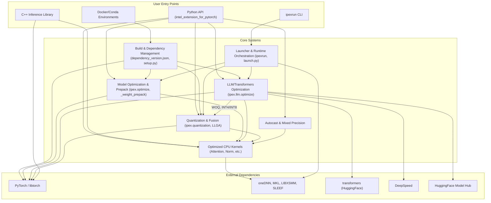
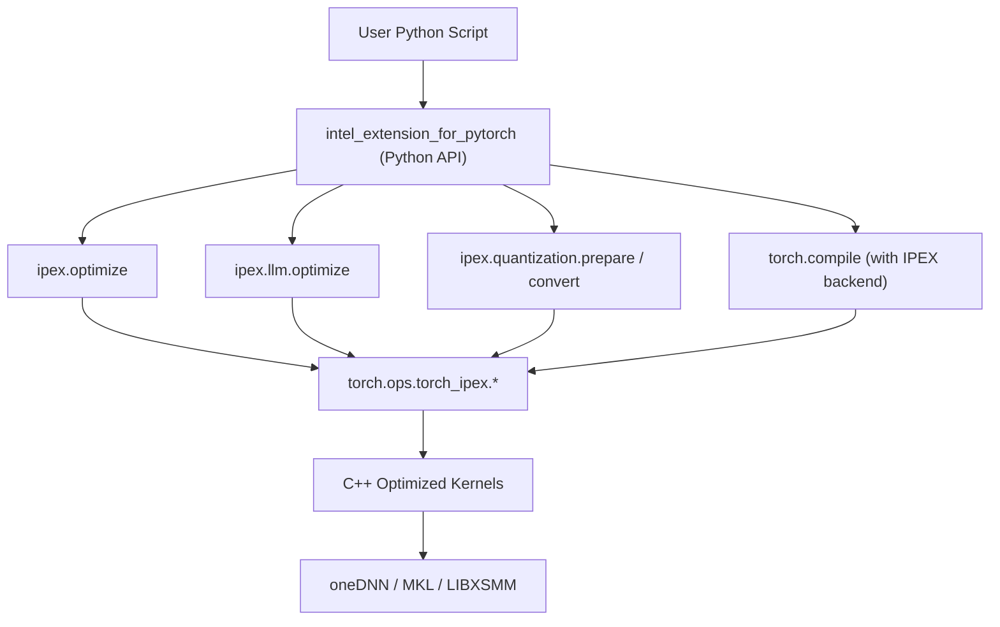
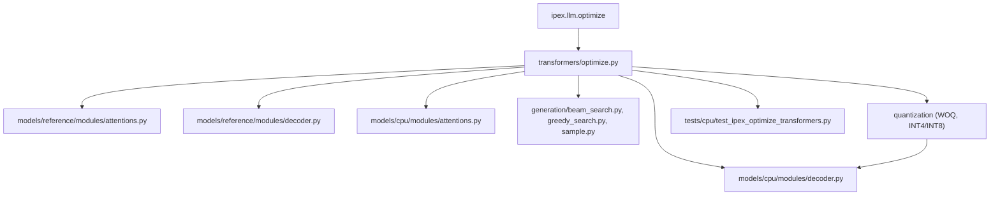

<!-- source: DeepWiki mcp.deepwiki.com · repo intel/intel-extension-for-pytorch · page 1 Overview · fetched 2026-10-21 -->

# Overview

Relevant source files

The following files were used as context for generating this wiki page:

- [README.md](README.md)
- [dependency_version.json](dependency_version.json)
- [docker/Dockerfile.compile](docker/Dockerfile.compile)
- [docker/Dockerfile.prebuilt](docker/Dockerfile.prebuilt)
- [docs/_static/htmls/tbl_deepspeed.html](docs/_static/htmls/tbl_deepspeed.html)
- [docs/_static/htmls/tbl_single.html](docs/_static/htmls/tbl_single.html)
- [docs/tutorials/blogs_publications.md](docs/tutorials/blogs_publications.md)
- [docs/tutorials/features/hypertune.md](docs/tutorials/features/hypertune.md)
- [docs/tutorials/features/sq_recipe_tuning_api.md](docs/tutorials/features/sq_recipe_tuning_api.md)
- [docs/tutorials/installation.md](docs/tutorials/installation.md)
- [docs/tutorials/introduction.rst](docs/tutorials/introduction.rst)
- [docs/tutorials/llm/llm_optimize.md](docs/tutorials/llm/llm_optimize.md)
- [docs/tutorials/releases.md](docs/tutorials/releases.md)
- [examples/cpu/inference/cpp/README.md](examples/cpu/inference/cpp/README.md)
- [examples/cpu/inference/python/python-scripts/README.md](examples/cpu/inference/python/python-scripts/README.md)
- [examples/cpu/llm/Dockerfile](examples/cpu/llm/Dockerfile)
- [examples/cpu/llm/README.md](examples/cpu/llm/README.md)
- [examples/cpu/llm/inference/README.md](examples/cpu/llm/inference/README.md)
- [examples/cpu/llm/tools/env_activate.sh](examples/cpu/llm/tools/env_activate.sh)
- [examples/cpu/llm/tools/env_setup.sh](examples/cpu/llm/tools/env_setup.sh)
- [intel_extension_for_pytorch/_inductor/codegen/cpp.py](intel_extension_for_pytorch/_inductor/codegen/cpp.py)
- [intel_extension_for_pytorch/_inductor/decomposition.py](intel_extension_for_pytorch/_inductor/decomposition.py)
- [intel_extension_for_pytorch/_inductor/ir.py](intel_extension_for_pytorch/_inductor/ir.py)
- [intel_extension_for_pytorch/_inductor/overrides.py](intel_extension_for_pytorch/_inductor/overrides.py)
- [scripts/compile_bundle.py](scripts/compile_bundle.py)
- [tests/cpu/test_inductor.py](tests/cpu/test_inductor.py)
- [tools/dep_ver_utils.py](tools/dep_ver_utils.py)
- [version.txt](version.txt)

Intel® Extension for PyTorch\* (IPEX) is an open-source library that extends PyTorch with performance optimizations and advanced features for Intel hardware. IPEX provides optimized kernels, quantization, model transformation APIs, and runtime tools to accelerate deep learning workloads—especially large language models (LLMs)—on Intel CPUs and GPUs. IPEX is designed for seamless integration with PyTorch, requiring minimal code changes for users.

This page summarizes the high-level architecture, major systems, and intended use cases of IPEX. For details on installation, usage, or specific features, see the corresponding sections in this wiki.

Sources: [README.md:11-13](README.md:11-13), [docs/tutorials/introduction.rst:4-5](docs/tutorials/introduction.rst:4-5)

## High-Level System Architecture

IPEX is organized into modular systems that interact with PyTorch, external libraries, and user entry points. The architecture is designed to support both Python and C++ APIs, model and operator-level optimizations, quantization, and runtime orchestration.

**Overall System Architecture**

This diagram shows the main user entry points and how they interact with the core systems and external dependencies. Each core system is modular and can be used independently or in combination.

Sources: [README.md:11-13](README.md:11-13), [dependency_version.json:1-23](dependency_version.json:1-23), [docker/Dockerfile.compile:1-84](docker/Dockerfile.compile:1-84), [examples/cpu/llm/tools/env_setup.sh:1-152](examples/cpu/llm/tools/env_setup.sh:1-152)

### Major Systems and Code Entities

IPEX is structured into the following major systems, each with clear code entry points and responsibilities:

| System                        | Main Code Entry Points / Files                | Description                                                                 |
|-------------------------------|----------------------------------------------|-----------------------------------------------------------------------------|
| Build & Dependency Management | `dependency_version.json`, `setup.py`, `tools/dep_ver_utils.py` | Handles build, versioning, and environment setup.                           |
| Model Optimization & Prepack  | `ipex.optimize`, `intel_extension_for_pytorch/`, `_weight_prepack.py` | Applies model-level and operator-level optimizations.                       |
| LLM/Transformers Optimization | `ipex.llm.optimize`, `examples/cpu/llm/`     | Specialized optimizations for transformer and LLM models.                   |
| Quantization & Fusion         | `ipex.quantization`, `LLGA`, `ipex.quantization.prepare`, `ipex.quantization.convert` | INT8/INT4 quantization, fusion, and integration with PyTorch quantization.  |
| Autocast & Mixed Precision    | `ipex.autocast`, `ipex.amp`                  | Automatic mixed precision for CPU (BF16/FP16).                              |
| Optimized CPU Kernels         | `torch.ops.torch_ipex.*`, C++ kernel files   | Custom operator implementations for key workloads.                          |
| Launcher & Runtime            | `ipexrun`, `launcher.py`, `cpu/launch/`      | Orchestrates optimized execution, core affinity, and distributed launch.    |

This mapping helps users and developers quickly locate the relevant code for each system.

Sources: [dependency_version.json:1-23](dependency_version.json:1-23), [tools/dep_ver_utils.py:1-51](tools/dep_ver_utils.py:1-51), [README.md:11-16](README.md:11-16)

## Optimization Flow and Code Mapping

IPEX provides a layered optimization flow, from user entry points to kernel-level execution. The following diagram maps natural language system names to code entities and files.

**Optimization Flow: User to Kernel**

This diagram shows how user code interacts with the main APIs, which then dispatch to optimized kernels and external libraries.

Sources: [README.md:11-16](README.md:11-16), [intel_extension_for_pytorch/_inductor/decomposition.py:1-22](intel_extension_for_pytorch/_inductor/decomposition.py:1-22)

## LLM and Quantization System Overview

IPEX provides dedicated systems for LLM optimization and quantization, with clear code entry points and modular APIs.

**LLM/Transformers Optimization and Quantization System**

This diagram shows how `ipex.llm.optimize` orchestrates model transformation, quantization, and integration with optimized modules and generation scripts.

Sources: [examples/cpu/llm/inference/README.md:1-4](examples/cpu/llm/inference/README.md:1-4), [README.md:13-16](README.md:13-16)

## Key Features and Supported Models

### CPU and Operator Optimizations

- **Weight Prepacking**: Optimizes memory layout for linear and convolution operators.
- **JIT Fusion**: Fuses operator graphs for improved performance.
- **Channels Last Format**: Improves memory access for convolutional workloads.
- **torch.compile Integration**: Custom lowering and codegen for IPEX kernels.
- **CPU Autocast**: Automatic mixed precision (BF16/FP16) for CPUs.

### LLM Optimizations

- **ipex.llm.optimize**: API for model transformation, quantization, and kernel replacement.
- **Optimized Attention**: Fused rotary embedding, paged attention, and indirect access KV cache.
- **Distributed Inference**: DeepSpeed integration for sharded and multi-node execution.
- **Support for Multiple Data Types**: FP32, BF16, INT8, INT4, and prototype FP8.

#### Supported LLM Model Families

| Model Family | Example Models | Supported Precisions |
|--------------|---------------|---------------------|
| LLAMA        | Llama-2, Llama-3, Llama-3.1, Llama-3.2 | FP32, BF16, INT8, INT4 |
| GPT          | GPT-J, GPT-NEOX | FP32, BF16, INT8, INT4 |
| FALCON       | Falcon-7B, Falcon-40B | FP32, BF16, INT8, INT4 |
| Phi          | Phi-2, Phi-3, Phi-4 | FP32, BF16, INT8, INT4 |
| Mistral      | Mistral-7B, Mixtral-8x7B | FP32, BF16, INT8, INT4 |
| Others       | See documentation for full list | Various |

Sources: [README.md:23-75](README.md:23-75), [examples/cpu/llm/inference/README.md:9-61](examples/cpu/llm/inference/README.md:9-61), [docs/_static/htmls/tbl_single.html:1-365](docs/_static/htmls/tbl_single.html:1-365)

### Quantization Capabilities

- **Weight-Only Quantization (WOQ)**: INT8, INT4, and NF4 support for LLMs and vision models.
- **Static Quantization**: Calibration-based quantization for both weights and activations.
- **Dynamic Quantization**: On-the-fly quantization for supported modules.
- **SmoothQuant**: INT8 quantization with recipe tuning for improved accuracy.
- **DeepSpeed Integration**: Distributed quantized inference and sharding.

Sources: [docs/tutorials/features/sq_recipe_tuning_api.md:1-21](docs/tutorials/features/sq_recipe_tuning_api.md:1-21), [examples/cpu/llm/inference/README.md:276-361](examples/cpu/llm/inference/README.md:276-361)

## Installation and Setup

IPEX supports multiple installation methods:

- **Pip**: `pip install intel-extension-for-pytorch`
- **Docker**: Prebuilt and source-based Dockerfiles are provided for reproducible environments.
- **Source Build**: Clone the repository and build with `setup.py` or provided scripts.

Dependency versions are managed in `dependency_version.json`. Environment setup scripts are available in `examples/cpu/llm/tools/env_setup.sh` and `env_activate.sh`.

For detailed instructions, see the [Installation](/2.1) and [Getting Started](/2) pages.

Sources: [docs/tutorials/installation.md:1-8](docs/tutorials/installation.md:1-8), [docker/Dockerfile.compile:1-84](docker/Dockerfile.compile:1-84), [examples/cpu/llm/tools/env_setup.sh:1-152](examples/cpu/llm/tools/env_setup.sh:1-152)

## Basic Usage

IPEX APIs are designed for minimal code changes. The main entry points are `ipex.optimize` for general models and `ipex.llm.optimize` for transformer/LLM models.

- For general models: use `ipex.optimize(model)` before inference or training.
- For LLMs: use `ipex.llm.optimize(model, dtype=...)` for model transformation and quantization.

For more usage examples, see [Getting Started](/2) and [Core Optimization Features](/3).

Sources: [README.md:11-16](README.md:11-16), [examples/cpu/inference/python/python-scripts/README.md:4-6](examples/cpu/inference/python/python-scripts/README.md:4-6)

## System Requirements

### Hardware

- Intel CPUs with AVX-512 and/or AMX for best performance.
- Sufficient memory for large models (LLMs may require >1TB RAM).
- Intel discrete GPUs (for XPU support, if enabled).

### Software

- Python 3.10 or newer.
- PyTorch (see `dependency_version.json` for compatible versions).
- Linux OS recommended.
- Optional: `transformers` for LLMs, `deepspeed` for distributed inference.

Sources: [dependency_version.json:1-23](dependency_version.json:1-23), [docs/tutorials/examples.md:14-18](docs/tutorials/examples.md:14-18)

## Conclusion

Intel® Extension for PyTorch\* enhances PyTorch with specialized optimizations for Intel hardware. It provides seamless integration with PyTorch and offers significant performance improvements, especially for LLMs and other deep learning models, through a combination of CPU optimizations, LLM-specific optimizations, and quantization capabilities.

For more information about specific features, please refer to the appropriate sections in this wiki.

Sources: [README.md:11-16](README.md:11-16), [docs/tutorials/introduction.rst:4-5](docs/tutorials/introduction.rst:4-5)

---

