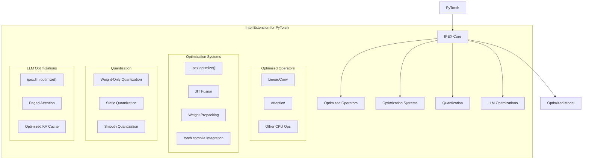
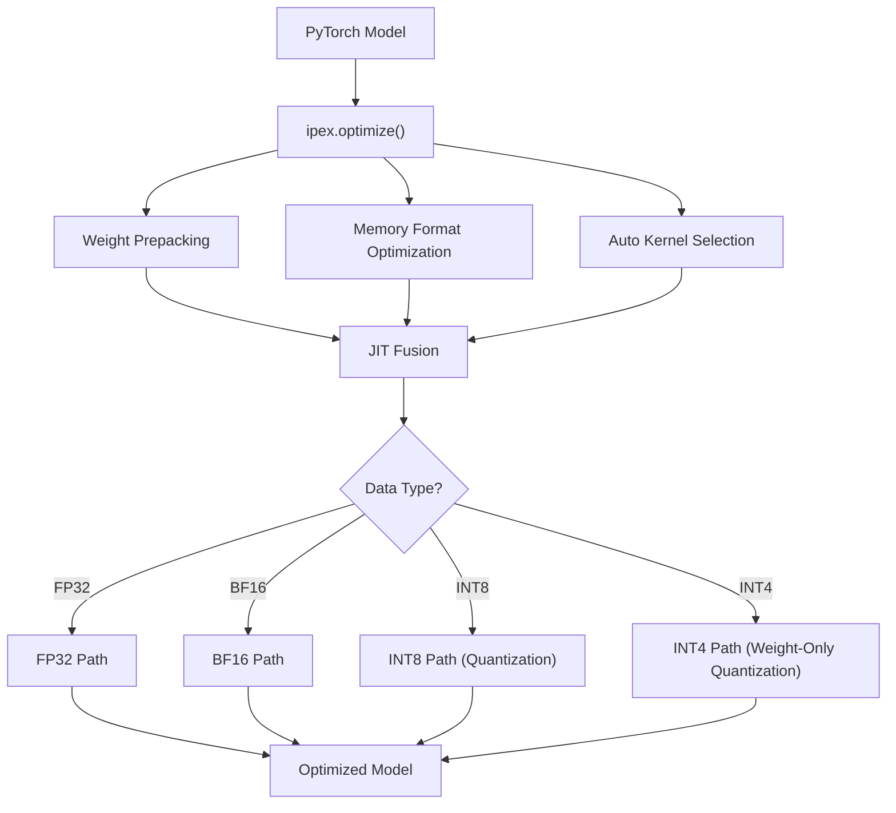

<!-- source: DeepWiki mcp.deepwiki.com · repo intel/intel-extension-for-pytorch · page 2 Getting Started · fetched 2026-10-21 -->

# Getting Started

<details>
<summary>Relevant source files</summary>

The following files were used as context for generating this wiki page:

- [README.md](README.md)
- [dependency_version.json](dependency_version.json)
- [docker/Dockerfile.compile](docker/Dockerfile.compile)
- [docker/Dockerfile.prebuilt](docker/Dockerfile.prebuilt)
- [docs/_static/htmls/tbl_deepspeed.html](docs/_static/htmls/tbl_deepspeed.html)
- [docs/_static/htmls/tbl_single.html](docs/_static/htmls/tbl_single.html)
- [docs/tutorials/blogs_publications.md](docs/tutorials/blogs_publications.md)
- [docs/tutorials/features/hypertune.md](docs/tutorials/features/hypertune.md)
- [docs/tutorials/features/sq_recipe_tuning_api.md](docs/tutorials/features/sq_recipe_tuning_api.md)
- [docs/tutorials/installation.md](docs/tutorials/installation.md)
- [docs/tutorials/introduction.rst](docs/tutorials/introduction.rst)
- [docs/tutorials/llm/llm_optimize.md](docs/tutorials/llm/llm_optimize.md)
- [docs/tutorials/releases.md](docs/tutorials/releases.md)
- [examples/cpu/inference/cpp/README.md](examples/cpu/inference/cpp/README.md)
- [examples/cpu/inference/python/python-scripts/README.md](examples/cpu/inference/python/python-scripts/README.md)
- [examples/cpu/llm/Dockerfile](examples/cpu/llm/Dockerfile)
- [examples/cpu/llm/README.md](examples/cpu/llm/README.md)
- [examples/cpu/llm/inference/README.md](examples/cpu/llm/inference/README.md)
- [examples/cpu/llm/tools/env_activate.sh](examples/cpu/llm/tools/env_activate.sh)
- [examples/cpu/llm/tools/env_setup.sh](examples/cpu/llm/tools/env_setup.sh)
- [intel_extension_for_pytorch/_inductor/codegen/cpp.py](intel_extension_for_pytorch/_inductor/codegen/cpp.py)
- [intel_extension_for_pytorch/_inductor/decomposition.py](intel_extension_for_pytorch/_inductor/decomposition.py)
- [intel_extension_for_pytorch/_inductor/ir.py](intel_extension_for_pytorch/_inductor/ir.py)
- [intel_extension_for_pytorch/_inductor/overrides.py](intel_extension_for_pytorch/_inductor/overrides.py)
- [scripts/compile_bundle.py](scripts/compile_bundle.py)
- [tests/cpu/test_inductor.py](tests/cpu/test_inductor.py)
- [tools/dep_ver_utils.py](tools/dep_ver_utils.py)
- [version.txt](version.txt)

</details>


This page provides an introduction to Intel Extension for PyTorch (IPEX), explaining how to install it and start using its basic features. IPEX extends PyTorch with optimizations specifically designed for Intel hardware, providing significant performance improvements for deep learning workloads on Intel CPUs.

If you're looking for detailed installation instructions, see [Installation](#2.1). For more advanced usage examples, see [Basic Usage](#2.2).

## What is Intel Extension for PyTorch?

Intel Extension for PyTorch (IPEX) is a library that extends PyTorch with optimizations for Intel hardware. It leverages Intel-specific technologies such as Intel® Advanced Vector Extensions 512 (Intel® AVX-512) Vector Neural Network Instructions (VNNI) and Intel® Advanced Matrix Extensions (Intel® AMX) on Intel CPUs to accelerate deep learning workloads.



Sources: [README.md:8-11](https://github.com/intel/intel-extension-for-pytorch/tree/main/README.md)

## Installation

You can install Intel Extension for PyTorch in several ways:

### Pre-built Packages

The simplest way to install IPEX is using pip:

```bash
# Install PyTorch first
pip install torch==2.8.0+cpu --index-url https://download.pytorch.org/whl/cpu

# Install Intel Extension for PyTorch
pip install intel-extension-for-pytorch==2.8.0+cpu
```

### Docker

You can also use Docker containers with IPEX pre-installed:

```bash
# Pull and run the Docker image
docker pull intel/intel-extension-for-pytorch:latest
docker run -it intel/intel-extension-for-pytorch:latest
```

### Building from Source

For advanced users who need the latest features or custom builds:

```bash
# Clone the repository
git clone https://github.com/intel/intel-extension-for-pytorch.git
cd intel-extension-for-pytorch

# Build from source
python setup.py install
```

Sources: [docker/Dockerfile.prebuilt:39-54](https://github.com/intel/intel-extension-for-pytorch/tree/main/docker/Dockerfile.prebuilt), [scripts/compile_bundle.sh:122-137](https://github.com/intel/intel-extension-for-pytorch/tree/main/scripts/compile_bundle.sh), [docs/tutorials/installation.md:1-8](https://github.com/intel/intel-extension-for-pytorch/tree/main/docs/tutorials/installation.md)

## Basic Usage

The core functionality of IPEX is provided through the `ipex.optimize()` function, which applies various optimizations to PyTorch models. Here's a basic example of how to use IPEX to optimize a model:

### FP32 Inference

```python
import torch
import intel_extension_for_pytorch as ipex

# Load your model
model = torch.load("your_model.pt")
model.eval()

# Optimize the model with IPEX
model = ipex.optimize(model)

# Run inference
with torch.no_grad():
    output = model(input_data)
```

### BFloat16 Inference

For models that can benefit from mixed precision, IPEX supports BFloat16:

```python
import torch
import intel_extension_for_pytorch as ipex

# Load your model
model = torch.load("your_model.pt")
model.eval()

# Optimize the model with IPEX and enable BF16
model = ipex.optimize(model, dtype=torch.bfloat16)

# Create an autocast context for BF16 operations
with torch.cpu.amp.autocast(dtype=torch.bfloat16), torch.no_grad():
    output = model(input_data)
```

### Optimization Flow

IPEX applies several optimization techniques to improve model performance:



Sources: [docs/tutorials/examples.md:20-77](https://github.com/intel/intel-extension-for-pytorch/tree/main/docs/tutorials/examples.md)

## Large Language Model Optimization

IPEX provides dedicated optimizations for Large Language Models (LLMs) through the `ipex.llm.optimize()` API. This offers significant performance improvements for models like Llama, Falcon, Mistral, and many others.

### Basic LLM Example

```python
import torch
import intel_extension_for_pytorch as ipex
from transformers import AutoModelForCausalLM, AutoTokenizer

# Load model and tokenizer
model_id = "meta-llama/Meta-Llama-3.1-8B-Instruct"
model = AutoModelForCausalLM.from_pretrained(model_id)
tokenizer = AutoTokenizer.from_pretrained(model_id)

# Optimize with IPEX LLM optimization
model = ipex.llm.optimize(
    model, 
    dtype=torch.bfloat16,  # Can be torch.float32, torch.bfloat16
    inplace=True
)

# Generate text
input_text = "Write a short poem about artificial intelligence."
inputs = tokenizer(input_text, return_tensors="pt")

with torch.inference_mode():
    outputs = model.generate(
        inputs.input_ids,
        max_new_tokens=100
    )

print(tokenizer.decode(outputs[0], skip_special_tokens=True))
```

### Supported LLM Models

IPEX supports a wide range of LLM models, including Llama, Qwen, Phi, Falcon, Mistral, and many others. Different precision options (FP32, BF16, INT8, INT4) are available depending on the model.

The optimization applied to LLMs includes:

1. Model conversion and optimization
2. Quantization (optional)
3. Optimized kernels for attention, rotary position embeddings, etc.
4. Paged attention with optimized KV cache

Sources: [README.md:13-75](https://github.com/intel/intel-extension-for-pytorch/tree/main/README.md), [examples/cpu/llm/README.md:1-13](https://github.com/intel/intel-extension-for-pytorch/tree/main/examples/cpu/llm/README.md), [examples/cpu/llm/inference/README.md:1-59](https://github.com/intel/intel-extension-for-pytorch/tree/main/examples/cpu/llm/inference/README.md)

## Quantization Support

IPEX provides comprehensive support for model quantization:

### Weight-Only Quantization

Suitable for LLMs, this preserves activations in higher precision while quantizing weights:

```python
import torch
import intel_extension_for_pytorch as ipex
from transformers import AutoModelForCausalLM

# Load model
model = AutoModelForCausalLM.from_pretrained("meta-llama/Meta-Llama-3.1-8B-Instruct")

# Apply Weight-Only Quantization (INT8)
model = ipex.llm.optimize(
    model,
    weight_dtype="int8",  # Use "int4" for INT4 quantization
    quant_with_amp=True   # Enable mixed precision for better performance
)
```

### Static Quantization

This requires a calibration step to quantize both weights and activations:

```python
import torch
import torch.ao.quantization as quantization
import intel_extension_for_pytorch as ipex
from intel_extension_for_pytorch.quantization import prepare, convert

# Define quantization configuration
qconfig = torch.ao.quantization.QConfig(
    activation=torch.ao.quantization.observer.MinMaxObserver.with_args(
        qscheme=torch.per_tensor_affine, dtype=torch.quint8
    ),
    weight=torch.ao.quantization.weight_observer.MinMaxObserver.with_args(
        dtype=torch.qint8, qscheme=torch.per_tensor_symmetric
    )
)

# Prepare model for calibration
prepared_model = prepare(model, qconfig, example_inputs=calibration_data[0], inplace=False)

# Run calibration
for data in calibration_data:
    prepared_model(data)

# Convert to quantized model
quantized_model = convert(prepared_model)
```

Sources: [docs/tutorials/examples.md:140-195](https://github.com/intel/intel-extension-for-pytorch/tree/main/docs/tutorials/examples.md), [docs/tutorials/features/sq_recipe_tuning_api.md:1-21](https://github.com/intel/intel-extension-for-pytorch/tree/main/docs/tutorials/features/sq_recipe_tuning_api.md)

## Performance Tuning

To maximize performance with IPEX, consider these optimization techniques:

### Channels Last Memory Format

Using channels last (NHWC) memory format can significantly improve performance for CNN models:

```python
import torch
import intel_extension_for_pytorch as ipex

# Convert model to channels last
model = model.to(memory_format=torch.channels_last)

# Optimize the model
model = ipex.optimize(model, weights_prepack=True)

# Ensure input is also in channels last format
input_data = input_data.to(memory_format=torch.channels_last)
```

### Thread and Memory Configuration

Setting the right environment variables can improve performance:

```bash
# Set number of OpenMP threads
export OMP_NUM_THREADS=<number of cores>

# Use numactl for NUMA-aware execution
numactl -m <node N> -C <core list> python your_script.py
```

### Memory Allocators

Using optimized memory allocators like TCMalloc or Jemalloc can improve performance:

```bash
# Install TCMalloc
pip install intel-openmp=2024.1.2

# Set LD_PRELOAD to use TCMalloc
export LD_PRELOAD=/path/to/libtcmalloc.so:$LD_PRELOAD
```

Sources: [docs/tutorials/performance_tuning/tuning_guide.md:89-107](https://github.com/intel/intel-extension-for-pytorch/tree/main/docs/tutorials/performance_tuning/tuning_guide.md), [examples/cpu/llm/tools/env_activate.sh:14-47](https://github.com/intel/intel-extension-for-pytorch/tree/main/examples/cpu/llm/tools/env_activate.sh)

## Examples and Resources

### Example Scripts

The IPEX repository contains numerous examples showcasing different features:

- **Basic inference examples**: `/examples/cpu/inference/`
- **LLM optimization examples**: `/examples/cpu/llm/`
- **Quantization examples**: `/examples/cpu/quantization/`

### Running LLM Examples

For running LLM examples, set up the environment first:

```bash
# Clone the repository
git clone https://github.com/intel/intel-extension-for-pytorch.git
cd intel-extension-for-pytorch/examples/cpu/llm

# Setup the environment
source ./tools/env_activate.sh inference

# Run an example with Llama 3.1
python inference/run.py --benchmark -m meta-llama/Meta-Llama-3.1-8B-Instruct --dtype bfloat16 --ipex
```

Sources: [examples/cpu/llm/README.md:110-121](https://github.com/intel/intel-extension-for-pytorch/tree/main/examples/cpu/llm/README.md), [examples/cpu/llm/inference/README.md:140-166](https://github.com/intel/intel-extension-for-pytorch/tree/main/examples/cpu/llm/inference/README.md)

## Next Steps

- Learn about [Core Optimization Features](#3) to understand details of IPEX optimizations
- Explore [Quantization System](#4) for model quantization
- Check out [LLM Optimization](#5) for specialized LLM features
- Read [Deployment and Performance Tuning](#7) for production deployment

With this introduction, you should be able to start using Intel Extension for PyTorch and benefit from its performance optimizations on Intel hardware.

---

