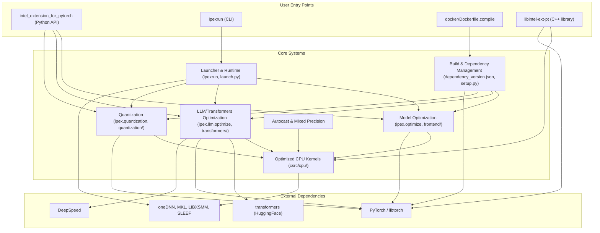
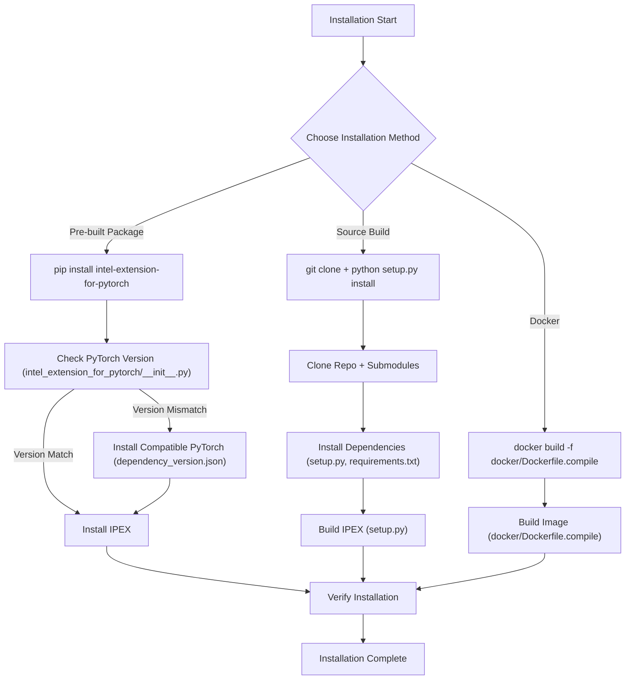
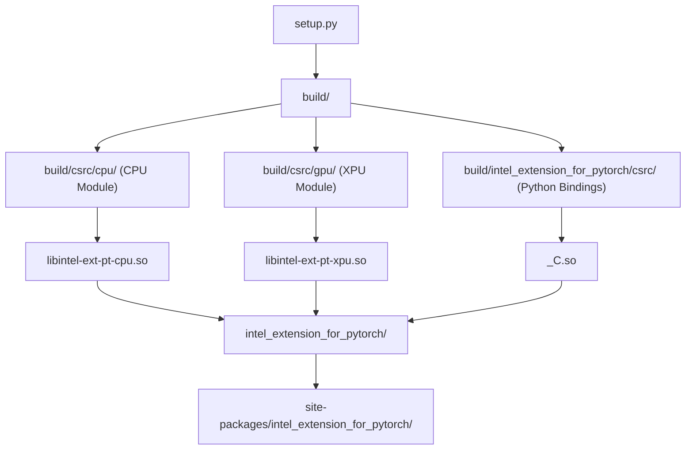

<!-- source: DeepWiki mcp.deepwiki.com · repo intel/intel-extension-for-pytorch · page 2.1 Installation · fetched 2026-10-21 -->

# Installation

<details>
<summary>Relevant source files</summary>

The following files were used as context for generating this wiki page:

- [.gitmodules](.gitmodules)
- [CMakeLists.txt](CMakeLists.txt)
- [dependency_version.json](dependency_version.json)
- [docker/Dockerfile.compile](docker/Dockerfile.compile)
- [docs/tutorials/features/sq_recipe_tuning_api.md](docs/tutorials/features/sq_recipe_tuning_api.md)
- [examples/cpu/inference/python/python-scripts/README.md](examples/cpu/inference/python/python-scripts/README.md)
- [examples/cpu/llm/Dockerfile](examples/cpu/llm/Dockerfile)
- [examples/cpu/llm/tools/env_activate.sh](examples/cpu/llm/tools/env_activate.sh)
- [examples/cpu/llm/tools/env_setup.sh](examples/cpu/llm/tools/env_setup.sh)
- [intel_extension_for_pytorch/__init__.py](intel_extension_for_pytorch/__init__.py)
- [intel_extension_for_pytorch/_inductor/codegen/cpp.py](intel_extension_for_pytorch/_inductor/codegen/cpp.py)
- [intel_extension_for_pytorch/_inductor/decomposition.py](intel_extension_for_pytorch/_inductor/decomposition.py)
- [intel_extension_for_pytorch/_inductor/ir.py](intel_extension_for_pytorch/_inductor/ir.py)
- [intel_extension_for_pytorch/_inductor/overrides.py](intel_extension_for_pytorch/_inductor/overrides.py)
- [scripts/compile_bundle.py](scripts/compile_bundle.py)
- [setup.py](setup.py)
- [tests/cpu/test_auto_channels_last.py](tests/cpu/test_auto_channels_last.py)
- [tests/cpu/test_inductor.py](tests/cpu/test_inductor.py)
- [tools/dep_ver_utils.py](tools/dep_ver_utils.py)
- [version.txt](version.txt)

</details>


This page provides detailed, up-to-date instructions for installing Intel Extension for PyTorch (IPEX), which extends PyTorch with optimizations for Intel CPUs and XPUs. For information on using IPEX after installation, see [Basic Usage](#2.2).

## Overview

IPEX can be installed using several methods:

- Pre-built pip packages (recommended for most users)
- Building from source (for development or custom builds)
- Docker containers (for reproducible, isolated environments)

The method you choose depends on your environment and requirements.

Sources: [setup.py:4-49](), [docker/Dockerfile.compile:1-84](), [examples/cpu/llm/tools/env_setup.sh:1-152]()

## System Requirements

### Hardware Requirements

- Intel CPUs with AVX2 support (AVX512 recommended for best performance)
- For XPU: Intel GPUs with supported drivers

### Software Requirements

- Linux OS (Ubuntu 22.04+ recommended)
- Python 3.8 or newer
- PyTorch (major.minor version must match IPEX)
- gcc/g++ 12.3.0 or newer (for source builds)

Version requirements are defined in `dependency_version.json` and `version.txt`.

Sources: [dependency_version.json:2-5](), [version.txt:1-3]()

## Installation Methods

### 1. Installing Pre-built Packages (Recommended)

The recommended way to install IPEX is via pip. The package will attempt to match your installed PyTorch version.

```bash
pip install intel-extension-for-pytorch
```

To install a specific version:

```bash
pip install intel-extension-for-pytorch==<version>
```

To install both PyTorch and IPEX from Intel's optimized channel:

```bash
pip install intel-extension-for-pytorch --extra-index-url https://pytorch-extension.intel.com/release-whl/stable/cpu/us/
```

**Note:** The major.minor version of PyTorch must match IPEX. If you see a version mismatch error, install the compatible PyTorch version as specified in `dependency_version.json`.

Sources: [setup.py:187](), [intel_extension_for_pytorch/__init__.py:30-36]()

### 2. Building from Source

Building from source allows for customization and development.

#### Step 1: Clone the Repository

```bash
git clone https://github.com/intel/intel-extension-for-pytorch.git
cd intel-extension-for-pytorch
git submodule sync
git submodule update --init --recursive
```

Sources: [.gitmodules:1-16]()

#### Step 2: Install Dependencies

Install required Python packages and system tools:

```bash
pip install cmake==3.28.4 ninja
pip install -r requirements.txt
```

Install the compatible PyTorch version (see `dependency_version.json` for the required version):

```bash
pip install torch==<version> --index-url https://download.pytorch.org/whl/cpu
```

Sources: [dependency_version.json:6-11](), [setup.py:202-207]()

#### Step 3: Build and Install

For a standard build:

```bash
python setup.py install
```

You can customize the build using environment variables:

| Variable         | Description                        | Example Value |
|------------------|------------------------------------|--------------|
| `DEBUG`          | Build with debug symbols           | 1            |
| `REL_WITH_DEB_INFO` | Release with debug info         | 1            |
| `MAX_JOBS`       | Number of parallel jobs            | 8            |
| `BUILD_WITH_XPU` | Enable XPU (GPU) support           | ON           |

Example:

```bash
export DEBUG=1
export MAX_JOBS=8
python setup.py install
```

Sources: [setup.py:4-49](), [setup.py:147-153]()

#### Step 4: Using the Compile Bundle Script

Alternatively, use the provided script to automate the build and installation:

```bash
python scripts/compile_bundle.py
```

This script will:

- Check and install dependencies
- Install the correct PyTorch version
- Build and install IPEX

See [scripts/compile_bundle.py] for details.

Sources: [scripts/compile_bundle.py:1-401]()

### 3. Using Docker

IPEX provides Dockerfiles for building containerized environments.

To build a Docker image from source:

```bash
docker build -f docker/Dockerfile.compile -t ipex:custom .
```

To run a container:

```bash
docker run -it --rm ipex:custom
```

The Dockerfile installs all required system and Python dependencies, builds IPEX, and sets up the environment for immediate use.

Sources: [docker/Dockerfile.compile:1-84]()

## IPEX System Architecture Overview

The following diagram shows the high-level architecture, mapping system names to code entities:

**Diagram: IPEX System Architecture and Code Entities**



Sources: [setup.py:4-49](), [intel_extension_for_pytorch/__init__.py:120-129](), [CMakeLists.txt:48-49]()

## Installation Process Flow

**Diagram: IPEX Installation Process and Code Entities**



Sources: [setup.py:136-141](), [intel_extension_for_pytorch/__init__.py:30-36](), [docker/Dockerfile.compile:1-84]()

## Build System Architecture

When building from source, IPEX uses a multi-stage build system orchestrated by `setup.py` and CMake.

**Diagram: Build System and Code Entities**



Sources: [setup.py:427-434](), [setup.py:656-935]()

## Build Options and Environment Variables

IPEX's build process can be controlled using environment variables. The most relevant options are:

| Environment Variable | Description | Default |
|---------------------|-------------|---------|
| `DEBUG` | Build with debug symbols (-O0) | Off |
| `REL_WITH_DEB_INFO` | Release with debug info (-O2, -g) | Off |
| `MAX_JOBS` | Number of parallel build jobs | Number of CPU cores |
| `VERBOSE` | Verbose build output | Off |
| `BUILD_WITH_XPU` | Enable XPU (GPU) support | Off |
| `TORCH_VERSION` | PyTorch version to depend on | From dependency_version.json |
| `IPEX_VERSION` | IPEX version literal | From version.txt |

Set these variables before running `python setup.py install` to customize the build.

Sources: [setup.py:4-49](), [setup.py:50-72]()

## Verification

To verify your IPEX installation, run the following in Python:

```python
import torch
import intel_extension_for_pytorch as ipex

ipex.version()
model = torch.nn.Linear(10, 10)
model = ipex.optimize(model)
```

This will print version information and test that the `ipex.optimize` API is available.

Sources: [intel_extension_for_pytorch/__init__.py:168-174]()

## Performance Optimization After Installation

For best performance, set recommended environment variables and use optimized memory allocators:

```bash
export KMP_BLOCKTIME=1
export KMP_AFFINITY=granularity=fine,compact,1,0
export LD_PRELOAD=/path/to/libtcmalloc.so:$LD_PRELOAD
```

- Use Intel OpenMP (`libiomp5.so`) instead of GNU OpenMP.
- Use TCMalloc or Jemalloc for memory allocation.

See [Deployment and Performance Tuning](#7) for more details.

Sources: [examples/cpu/llm/tools/env_activate.sh:15-38]()

## Troubleshooting

### Common Issues

#### PyTorch Version Mismatch

IPEX requires that the major.minor version of PyTorch matches the major.minor version of IPEX. If there's a mismatch, you'll see an error like:

```
ERROR! Intel® Extension for PyTorch* needs to work with PyTorch X.Y.*, but PyTorch A.B.C is found.
```

Solution: Install a compatible version of PyTorch or IPEX.

Sources: [intel_extension_for_pytorch/__init__.py:30-36]()

#### Missing Compiler or Incompatible Version

When building from source, IPEX requires gcc/g++ 12.3.0 or newer. The build will fail if your compiler is too old.

Solution: Install a compatible compiler or use the conda-based automatic installation in compile_bundle.sh:

```bash
conda install -y sysroot_linux-64==2.28 c-compiler cxx-compiler gcc==12.3 gxx==12.3 zstd -c conda-forge
```

Sources: [dependency_version.json:2-5](), [scripts/compile_bundle.sh:216-223]()

#### Windows-Specific Issues

On Windows, you might need Microsoft Visual C++ Redistributable:

```
Microsoft Visual C++ Redistributable is not installed, this may lead to the DLL load failure.
It can be downloaded at https://aka.ms/vs/16/release/vc_redist.x64.exe
```

Sources: [intel_extension_for_pytorch/__init__.py:91-94]()

#### Missing Libraries at Runtime

If you encounter missing libraries at runtime, check your LD_PRELOAD and LD_LIBRARY_PATH:

```bash
# For standard C++ library issues
export LD_PRELOAD=$(bash ./tools/get_libstdcpp_lib.sh):$LD_PRELOAD
```

Sources: [scripts/compile_bundle.sh:305-306](), [examples/cpu/llm/tools/env_activate.sh:22]()

---

