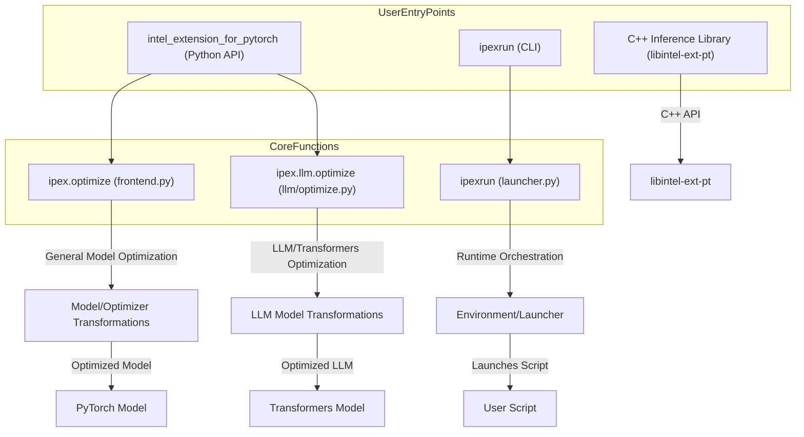
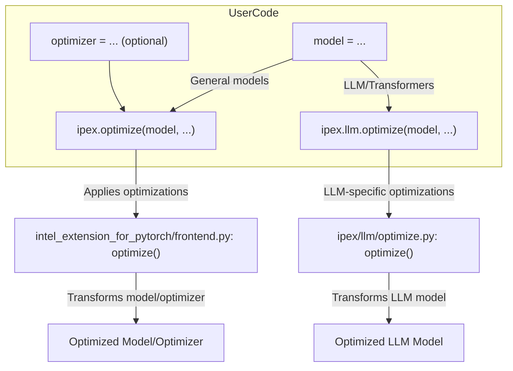
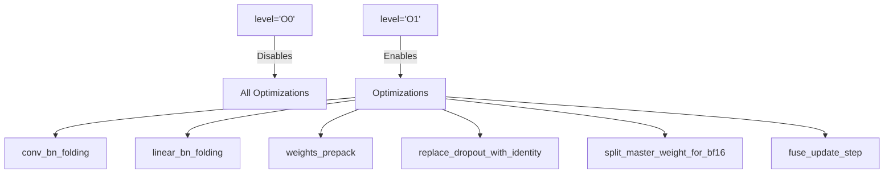
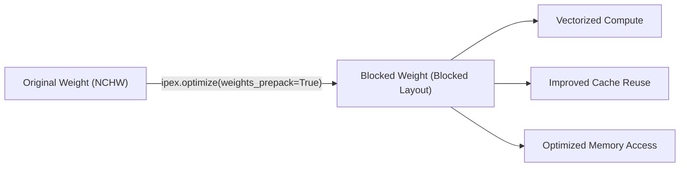

<!-- source: DeepWiki mcp.deepwiki.com · repo intel/intel-extension-for-pytorch · page 2.2 Basic Usage · fetched 2026-10-21 -->

# Basic Usage

Relevant source files

The following files were used as context for generating this wiki page:

- [README.md](README.md)
- [dependency_version.json](dependency_version.json)
- [docker/Dockerfile.compile](docker/Dockerfile.compile)
- [docker/Dockerfile.prebuilt](docker/Dockerfile.prebuilt)
- [docs/_static/htmls/tbl_deepspeed.html](docs/_static/htmls/tbl_deepspeed.html)
- [docs/_static/htmls/tbl_single.html](docs/_static/htmls/tbl_single.html)
- [docs/tutorials/blogs_publications.md](docs/tutorials/blogs_publications.md)
- [docs/tutorials/features/hypertune.md](docs/tutorials/features/hypertune.md)
- [docs/tutorials/features/sq_recipe_tuning_api.md](docs/tutorials/features/sq_recipe_tuning_api.md)
- [docs/tutorials/installation.md](docs/tutorials/installation.md)
- [docs/tutorials/introduction.rst](docs/tutorials/introduction.rst)
- [docs/tutorials/llm/llm_optimize.md](docs/tutorials/llm/llm_optimize.md)
- [docs/tutorials/releases.md](docs/tutorials/releases.md)
- [examples/cpu/inference/cpp/README.md](examples/cpu/inference/cpp/README.md)
- [examples/cpu/inference/python/python-scripts/README.md](examples/cpu/inference/python/python-scripts/README.md)
- [examples/cpu/llm/Dockerfile](examples/cpu/llm/Dockerfile)
- [examples/cpu/llm/README.md](examples/cpu/llm/README.md)
- [examples/cpu/llm/inference/README.md](examples/cpu/llm/inference/README.md)
- [examples/cpu/llm/tools/env_activate.sh](examples/cpu/llm/tools/env_activate.sh)
- [examples/cpu/llm/tools/env_setup.sh](examples/cpu/llm/tools/env_setup.sh)
- [intel_extension_for_pytorch/_inductor/codegen/cpp.py](intel_extension_for_pytorch/_inductor/codegen/cpp.py)
- [intel_extension_for_pytorch/_inductor/decomposition.py](intel_extension_for_pytorch/_inductor/decomposition.py)
- [intel_extension_for_pytorch/_inductor/ir.py](intel_extension_for_pytorch/_inductor/ir.py)
- [intel_extension_for_pytorch/_inductor/overrides.py](intel_extension_for_pytorch/_inductor/overrides.py)
- [scripts/compile_bundle.py](scripts/compile_bundle.py)
- [tests/cpu/test_inductor.py](tests/cpu/test_inductor.py)
- [tools/dep_ver_utils.py](tools/dep_ver_utils.py)
- [version.txt](version.txt)

This page describes how to run basic Intel® Extension for PyTorch\* (IPEX) optimized workloads, including simple Python and CLI examples. It covers the main entry points for model optimization, supported data types, and how to use IPEX for both general PyTorch models and Large Language Models (LLMs).

For installation instructions, see [2.1 Installation](#2.1). For advanced optimization features, see [3 Core Optimization Features](#3). For LLM-specific workflows, see [5 LLM Optimization](#5).

---

## System Entry Points and Code Entities

The IPEX system provides multiple user entry points for optimization. The following diagram shows the main entry points and their mapping to code entities:

**Diagram: "IPEX Entry Points and Code Entities"**

Sources:
- [README.md:11-12]()
- [examples/cpu/llm/README.md:14-116]()
- [examples/cpu/inference/python/python-scripts/README.md:4-121]()
- [examples/cpu/inference/cpp/README.md:1-59]()

## Basic Model Optimization Workflow

IPEX provides two main Python APIs for model optimization:

- `ipex.optimize` for general PyTorch models (vision, NLP, etc.)
- `ipex.llm.optimize` for transformer-based and LLM models

The following diagram shows the high-level workflow and code entities involved.

**Diagram: "ipex.optimize and ipex.llm.optimize Workflow"**

Sources:
- [intel_extension_for_pytorch/frontend.py:169-602]()
- [ipex/llm/optimize.py:1-]()
- [examples/cpu/inference/python/python-scripts/README.md:4-121]()
- [docs/tutorials/llm/llm_optimize.md:4-54]()

## Optimization Options and Parameters

The `ipex.optimize` and `ipex.llm.optimize` functions accept several parameters to control optimization behavior.

| Parameter                | Description                                                      | Typical Values                |
|--------------------------|------------------------------------------------------------------|-------------------------------|
| `level`                  | Optimization level                                               | `"O0"`, `"O1"`                |
| `dtype`                  | Data type for computation                                        | `torch.float32`, `torch.bfloat16`, `torch.float16` |
| `optimizer`              | PyTorch optimizer (for training)                                 | `torch.optim.*`               |
| `inplace`                | Whether to optimize the model in-place                           | `True`, `False`               |
| `weights_prepack`        | Enable weight prepacking for conv/linear layers                  | `True`, `False`               |
| `conv_bn_folding`        | Enable Conv+BatchNorm folding                                    | `True`, `False`               |
| `linear_bn_folding`      | Enable Linear+BatchNorm folding                                  | `True`, `False`               |
| `replace_dropout_with_identity` | Replace Dropout with Identity (inference)                 | `True`, `False`               |
| `split_master_weight_for_bf16`  | Use master weights for BF16 training                      | `True`, `False`               |
| `fuse_update_step`       | Fuse optimizer update step (training)                            | `True`, `False`               |
| `sample_input`           | Sample input tensor(s) for layout optimization                   | Tensor(s)                     |

**Diagram: "Optimization Level and Option Mapping"**

Sources:
- [intel_extension_for_pytorch/frontend.py:132-285]()
- [intel_extension_for_pytorch/frontend.py:459-552]()
- [tests/cpu/test_ipex_optimize.py:130-202]()

## Data Type Support

IPEX supports multiple data types for balancing performance and accuracy. The main supported types are:

| Data Type         | Description                        | Hardware Requirements                |
|-------------------|------------------------------------|--------------------------------------|
| `torch.float32`   | Full precision (FP32)              | Standard x86 CPUs                    |
| `torch.bfloat16`  | Brain Floating Point (BF16)        | Intel AVX-512 BF16 or Intel AMX      |
| `torch.float16`   | Half precision (FP16)              | Intel AVX-512 FP16                   |

For best performance on supported hardware, use `torch.bfloat16` with `torch.cpu.amp.autocast`.

Sources:
- [intel_extension_for_pytorch/frontend.py:186-194]()
- [intel_extension_for_pytorch/frontend.py:476-483]()
- [intel_extension_for_pytorch/frontend.py:539-552]()

## Weight Prepacking

Weight prepacking is a core optimization in IPEX. It converts model weights to a blocked memory layout for improved vectorization and cache reuse on Intel CPUs.

**Diagram: "Weight Prepacking Transformation"**

Sources:
- [intel_extension_for_pytorch/nn/utils/_weight_prepack.py:1-44]()
- [intel_extension_for_pytorch/frontend.py:186-209]()

## Large Language Model (LLM) Optimization

IPEX provides the `ipex.llm.optimize` API for transformer and LLM models. This function applies LLM-specific optimizations, including kernel fusion, quantization, and memory layout changes.

Supported models and data types are listed in [examples/cpu/llm/inference/README.md] and [docs/_static/htmls/tbl_single.html].

**Table: "LLM Optimization Entry Points"**

| API                        | Target Models         | Key Features                        | Code Entity                        |
|----------------------------|----------------------|-------------------------------------|-------------------------------------|
| `ipex.llm.optimize`        | Transformers/LLMs    | Fused attention, quantization, BF16 | `ipex/llm/optimize.py:optimize()`   |
| `ipex.optimize`            | General PyTorch      | Prepack, fusion, dtype conversion   | `intel_extension_for_pytorch/frontend.py:optimize()` |

Sources:
- [README.md:13-79]()
- [examples/cpu/llm/inference/README.md:1-139]()
- [docs/_static/htmls/tbl_single.html:1-365]()

## Example Workflows

### Inference Optimization

- Set model to evaluation mode.
- Call `ipex.optimize(model, dtype=...)` for general models, or `ipex.llm.optimize(model, dtype=...)` for LLMs.
- Use `torch.cpu.amp.autocast` for BF16/FP16 inference.

### Training Optimization

- Set model to training mode.
- Create optimizer.
- Call `ipex.optimize(model, optimizer=..., dtype=...)`.
- Use BF16/FP16 autocast for forward/backward.

### TorchScript Integration

- Optimize model with IPEX.
- Trace with `torch.jit.trace`.
- Optionally freeze with `torch.jit.freeze`.

Sources:
- [examples/cpu/inference/python/python-scripts/README.md:4-121]()
- [docs/tutorials/examples.md:22-138]()

## Additional Settings

IPEX provides APIs to control FP32 math mode and other backend settings. For example, `ipex.set_fp32_math_mode` can be used to enable BF32 emulation for FP32 operations.

Sources:
- [intel_extension_for_pytorch/frontend.py:631-697]()

## C++ Deployment

For deployment scenarios, IPEX also provides C++ libraries. For more information, see [examples/cpu/inference/cpp/README.md](examples/cpu/inference/cpp/README.md).

Sources:
- [docs/tutorials/examples.md:216-282](docs/tutorials/examples.md)
- [examples/cpu/inference/cpp/README.md:1-56](examples/cpu/inference/cpp/README.md)

---

