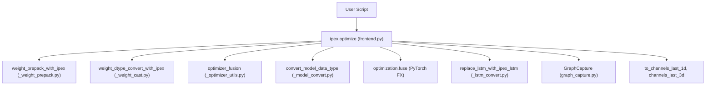
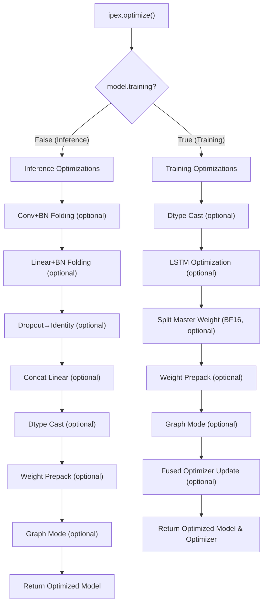
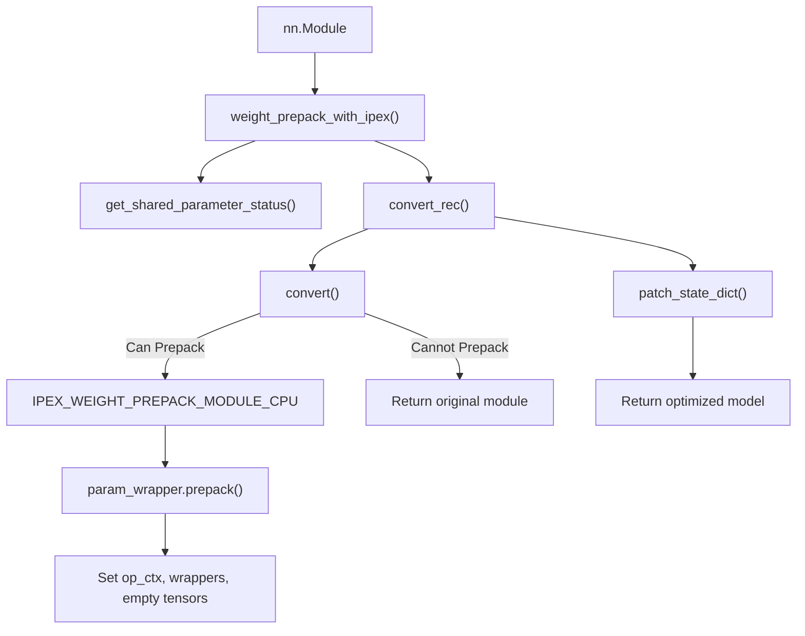
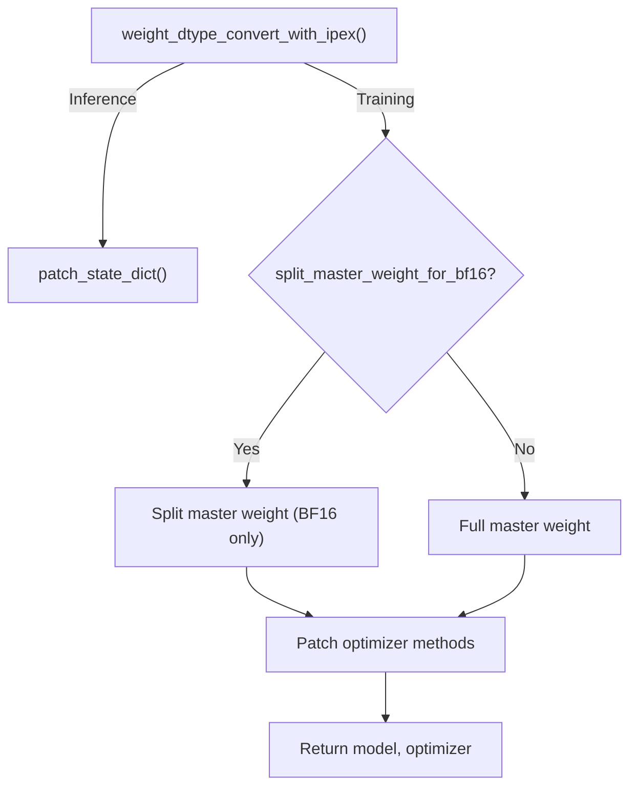
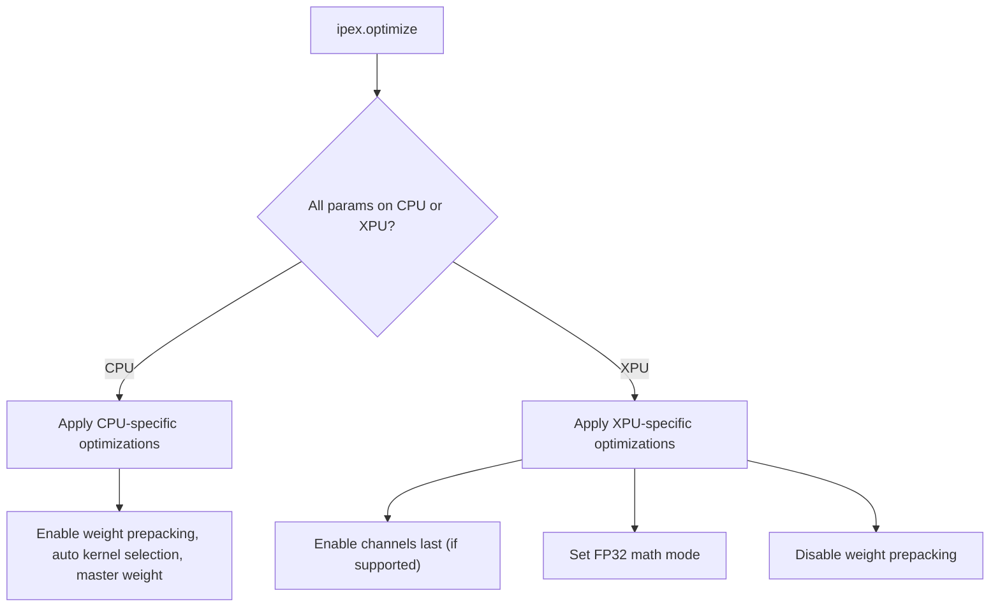
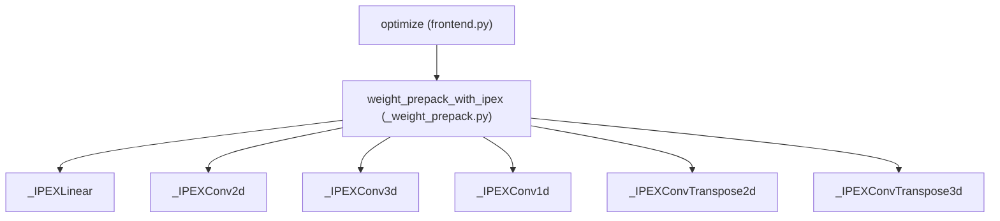

<!-- source: DeepWiki mcp.deepwiki.com · repo intel/intel-extension-for-pytorch · page 3.1 ipex.optimize Function · fetched 2026-10-21 -->

# ipex.optimize Function

<details>
<summary>Relevant source files</summary>

The following files were used as context for generating this wiki page:

- [intel_extension_for_pytorch/frontend.py](intel_extension_for_pytorch/frontend.py)
- [intel_extension_for_pytorch/nn/utils/_model_convert.py](intel_extension_for_pytorch/nn/utils/_model_convert.py)
- [intel_extension_for_pytorch/nn/utils/_parameter_wrapper.py](intel_extension_for_pytorch/nn/utils/_parameter_wrapper.py)
- [intel_extension_for_pytorch/nn/utils/_weight_cast.py](intel_extension_for_pytorch/nn/utils/_weight_cast.py)
- [intel_extension_for_pytorch/nn/utils/_weight_prepack.py](intel_extension_for_pytorch/nn/utils/_weight_prepack.py)
- [intel_extension_for_pytorch/optim/_functional.py](intel_extension_for_pytorch/optim/_functional.py)
- [intel_extension_for_pytorch/optim/_lamb.py](intel_extension_for_pytorch/optim/_lamb.py)
- [intel_extension_for_pytorch/optim/_optimizer_utils.py](intel_extension_for_pytorch/optim/_optimizer_utils.py)
- [intel_extension_for_pytorch/quantization/_quantize.py](intel_extension_for_pytorch/quantization/_quantize.py)
- [intel_extension_for_pytorch/utils/weight_only_quantization.py](intel_extension_for_pytorch/utils/weight_only_quantization.py)
- [tests/cpu/common_utils.py](tests/cpu/common_utils.py)
- [tests/cpu/test_deepspeed.py](tests/cpu/test_deepspeed.py)
- [tests/cpu/test_ipex_optimize.py](tests/cpu/test_ipex_optimize.py)
- [tests/cpu/test_optimizer.py](tests/cpu/test_optimizer.py)
- [tests/cpu/test_weight_cast.py](tests/cpu/test_weight_cast.py)

</details>


The `ipex.optimize` function is the main Python API for applying Intel Extension for PyTorch (IPEX) optimizations to PyTorch models and optimizers. It orchestrates a set of transformations and enhancements to improve performance on Intel CPUs (and, to a limited extent, XPUs). These optimizations include weight prepacking, operator fusion, mixed precision, and optimizer fusion.

For LLM/transformer-specific optimizations, see page [5.1].

## System Context and Entry Point

`ipex.optimize` is the central entry point for model and optimizer optimization in IPEX. It is typically called by users after model construction and before training or inference. The function is implemented in [intel_extension_for_pytorch/frontend.py](), and coordinates with several subsystems, including weight prepacking, parameter casting, optimizer patching, and operator fusion.

### System Integration Diagram

**Diagram: "ipex.optimize" in the IPEX System**



Sources: [intel_extension_for_pytorch/frontend.py:169-609](), [intel_extension_for_pytorch/nn/utils/_weight_prepack.py](), [intel_extension_for_pytorch/nn/utils/_weight_cast.py](), [intel_extension_for_pytorch/optim/_optimizer_utils.py](), [intel_extension_for_pytorch/nn/utils/_model_convert.py]()


## API Signature

The function signature is:

```python
def optimize(
    model,
    dtype=None,
    optimizer=None,
    level="O1",
    inplace=False,
    conv_bn_folding=None,
    linear_bn_folding=None,
    weights_prepack=None,
    replace_dropout_with_identity=None,
    optimize_lstm=None,
    split_master_weight_for_bf16=None,
    fuse_update_step=None,
    auto_kernel_selection=None,
    sample_input=None,
    graph_mode=None,
    concat_linear=None,
)
```

### Parameters

| Name | Type | Default | Description |
|------|------|---------|-------------|
| `model` | `torch.nn.Module` | required | Model to optimize. |
| `dtype` | `torch.dtype` | `None` | Target dtype (`torch.bfloat16`, `torch.float16`). |
| `optimizer` | `torch.optim.Optimizer` | `None` | Optimizer to optimize (for training). |
| `level` | `str` | `"O1"` | Optimization level: `"O0"` (none), `"O1"` (full). |
| `inplace` | `bool` | `False` | If `True`, optimize model in-place. |
| `conv_bn_folding` | `bool` | `None` | Fold Conv+BN layers (inference only). |
| `linear_bn_folding` | `bool` | `None` | Fold Linear+BN layers (inference only). |
| `weights_prepack` | `bool` | `None` | Prepack weights for supported modules. |
| `replace_dropout_with_identity` | `bool` | `None` | Replace Dropout with Identity (inference only). |
| `optimize_lstm` | `bool` | `None` | Replace LSTM with optimized version. |
| `split_master_weight_for_bf16` | `bool` | `None` | Use split master weights for BF16 training. |
| `fuse_update_step` | `bool` | `None` | Use fused optimizer update step. |
| `auto_kernel_selection` | `bool` | `None` | Enable auto kernel selection. |
| `sample_input` | `torch.Tensor` or `tuple` | `None` | Sample input for shape-aware prepacking. |
| `graph_mode` | `bool` | `None` | Enable graph mode (experimental). |
| `concat_linear` | `bool` | `None` | Enable linear layer concatenation. |

### Return Value

- In inference mode: returns the optimized model.
- In training mode: returns a tuple `(optimized_model, optimized_optimizer)`.

Sources: [intel_extension_for_pytorch/frontend.py:169-277]()

## Optimization Workflow

The optimization steps depend on whether the model is in training or inference mode. The function applies a sequence of transformations, some of which are conditional on the provided arguments and hardware.

### Diagram: "ipex.optimize" Workflow by Mode



Sources: [intel_extension_for_pytorch/frontend.py:367-609]()

## Core Optimization Techniques

### Weight Prepacking

Weight prepacking is a transformation that converts weights of supported modules (e.g., `nn.Linear`, `nn.Conv2d`) into a blocked memory layout optimized for oneDNN. This reduces runtime memory format conversions and improves performance.

**Diagram: "weight_prepack_with_ipex" Process**



- Prepacking is only applied if the module is supported and not blocked by hooks or sharing.
- The process replaces modules with IPEX-optimized versions (e.g., `_IPEXLinear`, `_IPEXConv2d`).
- The prepacked modules use blocked weights and may set up empty tensors for graph tracing.

Sources: [intel_extension_for_pytorch/nn/utils/_weight_prepack.py:489-605](), [intel_extension_for_pytorch/nn/utils/_parameter_wrapper.py:190-444]()

### Operator Fusion

Operator fusion in IPEX combines multiple operations into a single, more efficient kernel. The main fusions are:

- **Conv+BatchNorm Folding**: Fuses convolution and batch normalization into a single convolution with adjusted weights and bias.
- **Linear+BatchNorm Folding**: Fuses linear and batch normalization.
- **Dropout Replacement**: Replaces Dropout with Identity in inference for better graph fusion.
- **JIT/FX Fusion**: Additional fusions may be performed at the graph level.

These fusions are controlled by the `conv_bn_folding`, `linear_bn_folding`, and `replace_dropout_with_identity` arguments.

Sources: [intel_extension_for_pytorch/frontend.py:459-474](), [intel_extension_for_pytorch/nn/utils/_model_convert.py:27-39]()

### Mixed Precision (BF16/FP16) and Master Weight Handling

IPEX supports mixed precision via `torch.bfloat16` and `torch.float16`. When `dtype` is set:

- In inference, supported module parameters are cast to the target dtype.
- In training, parameters are cast and master weights are managed for accurate updates. For BF16, "split master weight" mode is available to save memory.

**Diagram: Mixed Precision and Master Weight Handling**



Sources: [intel_extension_for_pytorch/frontend.py:480-555](), [intel_extension_for_pytorch/nn/utils/_weight_cast.py:8-87]()

### Optimizer Fusion and Training-Specific Optimizations

For training, IPEX can patch the optimizer to use fused update steps for supported optimizers, and manage master weights for mixed precision.

- **Fused Update Step**: Replaces the optimizer's `step` method with a fused implementation for better performance.
- **Supported Optimizers**: See table below.

| Device | Supported Fused Optimizers |
|--------|---------------------------|
| CPU    | SGD, Adagrad, Adam, Lamb, Lars |
| XPU    | SGD, AdamW, Adam, Lamb        |

Sources: [intel_extension_for_pytorch/optim/_optimizer_utils.py:20-49](), [intel_extension_for_pytorch/frontend.py:603-608]()

## Example Usage

### Inference

```python
import intel_extension_for_pytorch as ipex
model.eval()
optimized_model = ipex.optimize(model, dtype=torch.bfloat16)
with torch.cpu.amp.autocast(enabled=True, dtype=torch.bfloat16):
    output = optimized_model(input_data)
```

### Training

```python
import intel_extension_for_pytorch as ipex
model.train()
optimizer = torch.optim.Adam(model.parameters(), lr=0.001)
optimized_model, optimized_optimizer = ipex.optimize(
    model, dtype=torch.bfloat16, optimizer=optimizer
)
with torch.cpu.amp.autocast(enabled=True, dtype=torch.bfloat16):
    output = optimized_model(input_data)
    loss = criterion(output, target)
optimized_optimizer.zero_grad()
loss.backward()
optimized_optimizer.step()
```

Sources: [intel_extension_for_pytorch/frontend.py:299-328]()

## Optimization Levels

IPEX supports two optimization levels, which can be further customized by explicit arguments:

| Level | Description | Optimizations Applied |
|-------|-------------|----------------------|
| `"O0"` | No optimizations | Returns original model/optimizer |
| `"O1"` | Standard optimizations | Conv+BN folding, Linear+BN folding, Weight prepacking, Dropout replacement, LSTM optimization, split master weight, fused update step |

Explicit arguments (e.g., `conv_bn_folding`, `weights_prepack`) override the defaults for the selected level.

Sources: [intel_extension_for_pytorch/frontend.py:133-166]()

## Hardware-Specific Behavior

`ipex.optimize` adapts its optimizations based on the detected device type (CPU or XPU):

**Diagram: Hardware-Specific Optimization Path**



- Weight prepacking is not supported on XPU.
- Some features (e.g., split master weight) are only available for certain optimizers or devices.
- The function checks for hardware support (e.g., AVX-512 for BF16) before enabling certain optimizations.

Sources: [intel_extension_for_pytorch/frontend.py:349-444]()

## Implementation Details

### Mapping of PyTorch Modules to IPEX Counterparts

When weight prepacking is enabled, the following module replacements occur:

| PyTorch Module | IPEX Counterpart |
|----------------|------------------|
| `nn.Linear` | `_IPEXLinear` |
| `nn.Conv1d` | `_IPEXConv1d` |
| `nn.Conv2d` | `_IPEXConv2d` |
| `nn.Conv3d` | `_IPEXConv3d` |
| `nn.ConvTranspose2d` | `_IPEXConvTranspose2d` |
| `nn.ConvTranspose3d` | `_IPEXConvTranspose3d` |

These modules are defined in [intel_extension_for_pytorch/nn/utils/_weight_prepack.py]() and use optimized kernels.

Sources: [intel_extension_for_pytorch/nn/utils/_weight_prepack.py:20-406]()

### Code Entity Relationship Diagram

**Diagram: Code Entities for Weight Prepacking**



Sources: [intel_extension_for_pytorch/nn/utils/_weight_prepack.py:20-406](), [intel_extension_for_pytorch/frontend.py:169-609]()

### Optimizer Fusion

When `fuse_update_step` is enabled, IPEX patches the optimizer's `step` method with a fused implementation for supported optimizers. See the table in the previous section for supported optimizers.

Sources: [intel_extension_for_pytorch/optim/_optimizer_utils.py:20-49](), [intel_extension_for_pytorch/optim/_functional.py:472-534](), [intel_extension_for_pytorch/optim/_functional.py:592-670]()

## Best Practices

- Provide a `sample_input` to enable shape-aware weight prepacking.
- Use `ipex.enable_auto_channels_last()` before `ipex.optimize` for convolutional models.
- Prefer `torch.bfloat16` for training on supported hardware.
- Use `level="O1"` for most workloads; use `"O0"` for debugging.
- Set math mode with `ipex.set_fp32_math_mode()` as needed.

Sources: [intel_extension_for_pytorch/frontend.py:260-271]()

## Limitations and Warnings

1. **Script Module**: The function returns the original model unchanged if it's a `torch.jit.ScriptModule`
2. **Mixed Device Models**: All model parameters must be on the same device
3. **Distributed Training**: Call `ipex.optimize()` BEFORE using Distributed Data Parallel (DDP)
4. **BF16/FP16 Support**: Requires appropriate hardware support (e.g., AVX-512 for BF16)
5. **Weight Prepacking on XPU**: Weight prepacking is not supported for XPU devices

Sources: [intel_extension_for_pytorch/frontend.py:331-444]()

---

