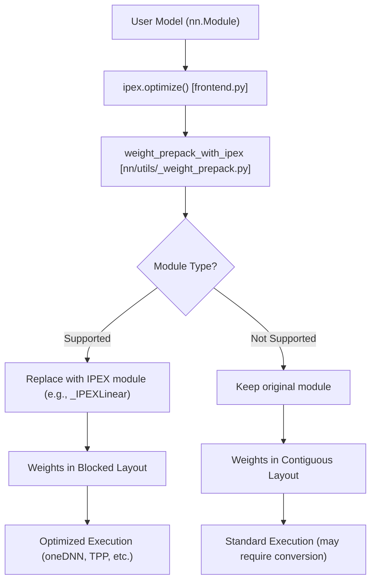
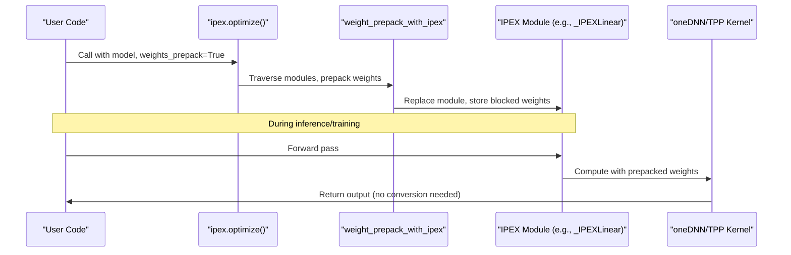
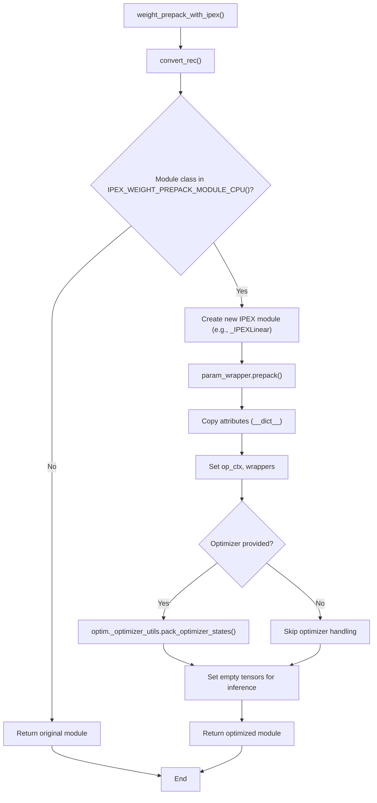
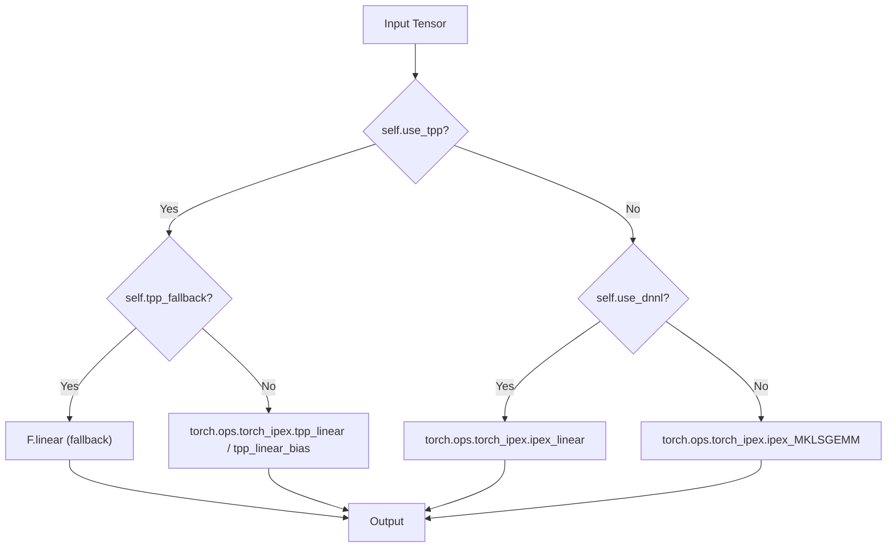

<!-- source: DeepWiki mcp.deepwiki.com · repo intel/intel-extension-for-pytorch · page 3.3 Weight Prepacking · fetched 2026-10-21 -->

# Weight Prepacking

Relevant source files

The following files were used as context for generating this wiki page:

- [intel_extension_for_pytorch/frontend.py](intel_extension_for_pytorch/frontend.py)
- [intel_extension_for_pytorch/nn/utils/_model_convert.py](intel_extension_for_pytorch/nn/utils/_model_convert.py)
- [intel_extension_for_pytorch/nn/utils/_parameter_wrapper.py](intel_extension_for_pytorch/nn/utils/_parameter_wrapper.py)
- [intel_extension_for_pytorch/nn/utils/_weight_cast.py](intel_extension_for_pytorch/nn/utils/_weight_cast.py)
- [intel_extension_for_pytorch/nn/utils/_weight_prepack.py](intel_extension_for_pytorch/nn/utils/_weight_prepack.py)
- [intel_extension_for_pytorch/optim/_functional.py](intel_extension_for_pytorch/optim/_functional.py)
- [intel_extension_for_pytorch/optim/_lamb.py](intel_extension_for_pytorch/optim/_lamb.py)
- [intel_extension_for_pytorch/optim/_optimizer_utils.py](intel_extension_for_pytorch/optim/_optimizer_utils.py)
- [intel_extension_for_pytorch/quantization/_quantize.py](intel_extension_for_pytorch/quantization/_quantize.py)
- [intel_extension_for_pytorch/utils/weight_only_quantization.py](intel_extension_for_pytorch/utils/weight_only_quantization.py)
- [tests/cpu/common_utils.py](tests/cpu/common_utils.py)
- [tests/cpu/test_deepspeed.py](tests/cpu/test_deepspeed.py)
- [tests/cpu/test_ipex_optimize.py](tests/cpu/test_ipex_optimize.py)
- [tests/cpu/test_optimizer.py](tests/cpu/test_optimizer.py)
- [tests/cpu/test_weight_cast.py](tests/cpu/test_weight_cast.py)
- [tests/cpu/test_weight_prepack.py](tests/cpu/test_weight_prepack.py)

Weight prepacking is a core optimization in Intel Extension for PyTorch (IPEX) that transforms the memory layout of neural network weights to improve execution efficiency on Intel CPUs. It is primarily used to avoid runtime memory format conversions by converting weights into a hardware-optimized "blocked" format ahead of time, which is required by oneDNN and other optimized backends.

For related systems, see [JIT Fusion System](3.2) and [Weight-Only Quantization](4.1).

## System Overview

Weight prepacking is triggered by the `ipex.optimize()` API and is implemented in the function `weight_prepack_with_ipex` ([intel_extension_for_pytorch/nn/utils/_weight_prepack.py:489-605]()). It replaces standard PyTorch modules (such as `nn.Linear`, `nn.Conv2d`) with IPEX-optimized modules (such as `_IPEXLinear`, `_IPEXConv2d`) whose weights are stored in a blocked format.

### Diagram: High-Level Data Flow and Code Entities

Sources: [intel_extension_for_pytorch/frontend.py:168-239](), [intel_extension_for_pytorch/nn/utils/_weight_prepack.py:489-605]()

### Purpose

- **Eliminate runtime memory format conversions** by pre-transforming weights.
- **Enable hardware-specific optimizations** (e.g., vectorization, cache reuse).
- **Support multiple data types** (FP32, BF16, FP16).
- **Integrate with other IPEX features** (JIT fusion, quantization, optimizer fusion).

Sources: [intel_extension_for_pytorch/frontend.py:194-209](), [intel_extension_for_pytorch/nn/utils/_weight_prepack.py:20-90]()

## How Weight Prepacking Works

### Problem: Runtime Memory Layout Conversion

oneDNN and other optimized backends require weights in a "blocked" memory layout for efficient computation. If weights are not prepacked, each forward pass may trigger a conversion from the standard contiguous format, incurring significant overhead.

### Solution: Prepack Weights Before Execution

IPEX pre-transforms weights into the blocked layout during model optimization, so runtime execution can use them directly.

#### Diagram: Sequence of Prepacking and Execution

Sources: [intel_extension_for_pytorch/frontend.py:545-580](), [intel_extension_for_pytorch/nn/utils/_weight_prepack.py:485-600]()

### Key Steps

- **Module replacement**: Replace standard modules with IPEX-optimized classes (e.g., `_IPEXLinear`, `_IPEXConv2d`).
- **Blocked layout transformation**: Convert weights to blocked format using `BlockedParameter` and related logic.
- **Context setup**: Store operator context for efficient execution.
- **Optimizer state management**: For training, ensure optimizer states are compatible with prepacked weights.

Sources: [intel_extension_for_pytorch/nn/utils/_weight_prepack.py:485-600](), [intel_extension_for_pytorch/nn/utils/_parameter_wrapper.py:256-312]()

## Supported Modules and Data Types

Weight prepacking is supported for the following module types and data types:

| PyTorch Module Type         | IPEX Optimized Class              | Supported Data Types      |
|----------------------------|-----------------------------------|--------------------------|
| `nn.Linear`                | `_IPEXLinear`                     | FP32, BF16, FP16         |
| `nn.Conv1d`                | `_IPEXConv1d`                     | FP32, BF16, FP16         |
| `nn.Conv2d`                | `_IPEXConv2d`                     | FP32, BF16, FP16         |
| `nn.Conv3d`                | `_IPEXConv3d`                     | FP32, BF16, FP16         |
| `nn.ConvTranspose2d`       | `_IPEXConvTranspose2d`            | FP32, BF16, FP16         |
| `nn.ConvTranspose3d`       | `_IPEXConvTranspose3d`            | FP32, BF16, FP16         |
| `LinearAllreduce`*         | `_IPEXLinearAllreduce`            | FP32, BF16, FP16         |
| `LmHeadLinearAllreduce`*   | `_IPEXLmHeadLinearAllreduce`      | FP32, BF16, FP16         |

\* DeepSpeed integration modules

Sources: [intel_extension_for_pytorch/nn/utils/_weight_prepack.py:159-467](), [intel_extension_for_pytorch/nn/utils/_parameter_wrapper.py:27-61](), [intel_extension_for_pytorch/frontend.py:575-580]()

## Prepacking Process: Code-Level Details

The prepacking process is implemented in `weight_prepack_with_ipex` and related helpers. The process traverses the model, checks if each module can be prepacked, and replaces it with an optimized version if possible.

### Diagram: Prepacking Logic and Code Entities

Sources: [intel_extension_for_pytorch/nn/utils/_weight_prepack.py:489-605](), [intel_extension_for_pytorch/nn/utils/_parameter_wrapper.py:256-312]()

### TPP Linear Weight Prepacking

For `nn.Linear`, the function `TPPLinear_weight_prepack` applies additional blocking logic for TPP kernels, adjusting the block size and layout based on data type and shape.

Sources: [intel_extension_for_pytorch/nn/utils/_weight_prepack.py:21-51]()

### TPP Linear Weight Prepacking

- `TPPLinear_weight_prepack` changes the module class to `_IPEXLinear`, wraps the weight as a `BlockedParameter`, and sets blocking parameters based on the data type and shape.
- Handles special cases for low-precision (BF16/FP16) and batch size.
- Bias is also wrapped if present.

Sources: [intel_extension_for_pytorch/nn/utils/_weight_prepack.py:21-51]()

## Prepacked Module Execution

Prepacked modules (e.g., `_IPEXLinear`) override the `forward` method to dispatch to the appropriate backend (TPP, oneDNN, or fallback) using the prepacked weights.

### Diagram: Forward Path in `_IPEXLinear`

- For inference, empty tensors may be used in the forward method to reduce TorchScript model size, but actual computation uses the prepacked weights via the operator context.

Sources: [intel_extension_for_pytorch/nn/utils/_weight_prepack.py:282-344]()

## Sample Input and Blocked Format Selection

The optimal blocked format for weights may depend on the input shape. If a sample input is provided to `ipex.optimize`, IPEX records the input shape using `record_input_shape_for_prepack` and uses it to select the best blocking strategy.

- Hooks are registered on relevant modules to capture input shapes during a forward pass with the sample input.
- This information is used in prepacking to optimize the weight layout.

Sources: [intel_extension_for_pytorch/nn/utils/_weight_prepack.py:607-645](), [intel_extension_for_pytorch/frontend.py:454-457]()

## Serialization and Deserialization

Prepacked modules override `_save_to_state_dict` and `_load_from_state_dict` to ensure compatibility with PyTorch's serialization:

- For TPP models, parameters are temporarily "unblocked" before saving, then restored.
- When loading, parameters are restored to the blocked format as needed.

This ensures that saved models are portable and can be loaded without requiring the blocked format at serialization time.

Sources: [intel_extension_for_pytorch/nn/utils/_weight_prepack.py:345-391]()

## Usage in IPEX

- Weight prepacking is enabled by default at optimization level `"O1"` in `ipex.optimize`.
- Can be explicitly controlled via the `weights_prepack` argument.
- Providing a `sample_input` enables more optimal blocking.

| Scenario         | How to Enable Weight Prepacking |
|------------------|--------------------------------|
| Inference        | `ipex.optimize(model, weights_prepack=True)` |
| With sample input| `ipex.optimize(model, weights_prepack=True, sample_input=sample_input)` |
| Training         | `ipex.optimize(model, optimizer=optimizer, weights_prepack=True)` |

Sources: [intel_extension_for_pytorch/frontend.py:168-239](), [intel_extension_for_pytorch/frontend.py:555-573]()

## Performance Considerations

Benefits of weight prepacking:

- **Eliminates runtime format conversion** overhead.
- **Enables vectorized and cache-friendly computation**.
- **Reduces memory footprint** for inference models (especially with TorchScript).

Performance depends on:

- Model architecture and layer shapes
- Batch size and input shape
- Hardware features (e.g., AVX-512, AMX)

Environment variables such as `BF16_OPTIMIZED_THROUGHPUT` can be used to tune prepacking for specific throughput/latency tradeoffs.

Sources: [intel_extension_for_pytorch/nn/utils/_weight_prepack.py:53-83]()

## Interactions with Other IPEX Features

| Feature                | Interaction with Weight Prepacking                                      |
|------------------------|-------------------------------------------------------------------------|
| JIT Fusion             | Prepacked modules can be further optimized by JIT fusion ([3.2])        |
| Data Type Conversion   | Supports FP32, BF16, FP16                                               |
| Channels Last Format   | Can be combined with channels-last memory format                        |
| Graph Mode             | In graph mode, prepacking may be deferred to graph optimization         |
| Distributed Training   | Special handling for DeepSpeed modules and optimizer state management   |

Sources: [intel_extension_for_pytorch/frontend.py:555-580](), [intel_extension_for_pytorch/nn/utils/_weight_prepack.py:100-147]()

## Limitations

- **CPU-only**: Not supported on XPU or other accelerators.
- **Hardware requirements**: BF16/FP16 prepacking requires specific CPU instruction sets.
- **Module support**: Only standard modules and certain DeepSpeed modules are supported.
- **Hooks**: Modules with hooks on weight or bias are not prepacked.
- **Serialization**: Requires special handling for saving/loading models.

Sources: [intel_extension_for_pytorch/frontend.py:556-566](), [intel_extension_for_pytorch/nn/utils/_weight_prepack.py:469-483]()

## Conclusion

Weight prepacking is a powerful optimization technique in Intel Extension for PyTorch that transforms the memory layout of neural network weights to achieve better performance on Intel CPUs. By eliminating runtime format conversions and leveraging hardware-optimized blocked layouts, it can significantly accelerate both inference and training workloads.

To use weight prepacking, simply enable it through the `ipex.optimize()` function, optionally providing sample inputs for even better optimization.

---

