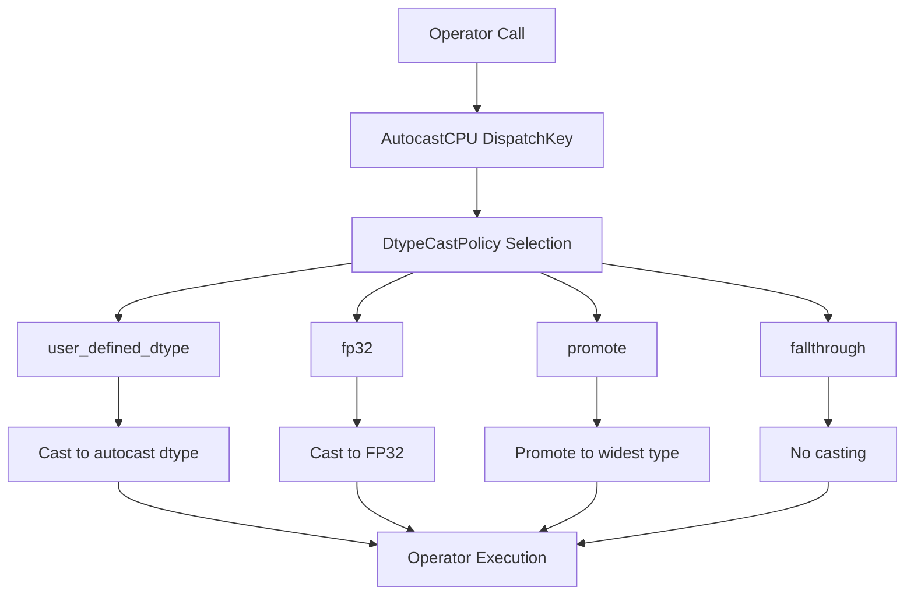
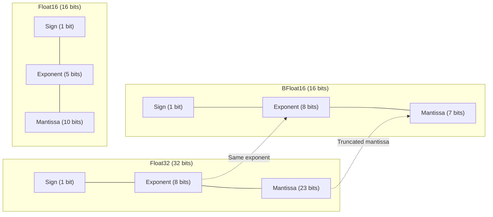
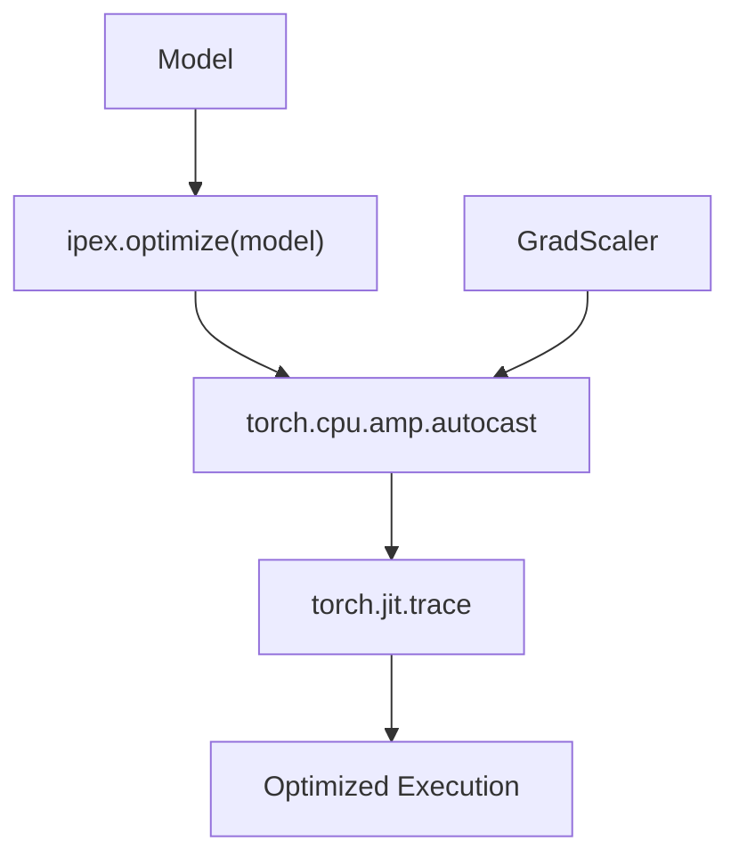

<!-- source: DeepWiki mcp.deepwiki.com · repo intel/intel-extension-for-pytorch · page 3.5 CPU Autocast · fetched 2026-10-21 -->

# CPU Autocast

<details>
<summary>Relevant source files</summary>

The following files were used as context for generating this wiki page:

- [csrc/cpu/autocast/autocast_mode.cpp](csrc/cpu/autocast/autocast_mode.cpp)
- [csrc/cpu/autocast/autocast_mode.h](csrc/cpu/autocast/autocast_mode.h)
- [intel_extension_for_pytorch/cpu/__init__.py](intel_extension_for_pytorch/cpu/__init__.py)
- [intel_extension_for_pytorch/cpu/autocast/__init__.py](intel_extension_for_pytorch/cpu/autocast/__init__.py)
- [intel_extension_for_pytorch/cpu/hypertune/README.md](intel_extension_for_pytorch/cpu/hypertune/README.md)
- [intel_extension_for_pytorch/cpu/hypertune/__init__.py](intel_extension_for_pytorch/cpu/hypertune/__init__.py)
- [intel_extension_for_pytorch/cpu/hypertune/conf/__init__.py](intel_extension_for_pytorch/cpu/hypertune/conf/__init__.py)
- [intel_extension_for_pytorch/cpu/hypertune/example/example.yaml](intel_extension_for_pytorch/cpu/hypertune/example/example.yaml)
- [intel_extension_for_pytorch/cpu/hypertune/example/record.csv](intel_extension_for_pytorch/cpu/hypertune/example/record.csv)
- [tests/cpu/autocast_test_lists.py](tests/cpu/autocast_test_lists.py)
- [tests/cpu/test_autocast.py](tests/cpu/test_autocast.py)

</details>


CPU Autocast in Intel Extension for PyTorch (IPEX) provides automatic mixed precision (AMP) for CPU devices. It enables selected operations to run in lower precision (BFloat16 or Float16) where appropriate, while keeping higher precision for numerically sensitive operations. This can improve performance and reduce memory usage with minimal impact on model accuracy.

## System Overview

CPU Autocast is implemented via the `torch.cpu.amp` module and integrates with IPEX's operator dispatch and optimization systems. It uses operator-specific casting policies to determine how each operation handles input and output data types.

**System-to-Code Mapping Diagram: CPU Autocast Core Entities**


Sources: [csrc/cpu/autocast/autocast_mode.h:20-40](), [csrc/cpu/autocast/autocast_mode.cpp:112-130](), [tests/cpu/test_autocast.py:62-103]()

## How CPU Autocast Works

CPU Autocast uses a context manager (`torch.cpu.amp.autocast`) to control the autocasting state. When enabled, it sets the `AutocastCPU` dispatch key, which triggers IPEX's custom operator implementations. Each operator is registered with a specific casting policy that determines how its inputs are cast.

### Casting Policy Mechanism

The casting policy for each operator is defined by the `DtypeCastPolicy` enum in [csrc/cpu/autocast/autocast_mode.h](). The main policies are:

| Policy                | Description                                                                 |
|-----------------------|-----------------------------------------------------------------------------|
| `user_defined_dtype`  | Cast all eligible inputs to the current autocast dtype (BF16 or FP16)       |
| `fp32`                | Cast all eligible inputs to FP32                                            |
| `promote`             | Promote all eligible inputs to the widest type among them                   |
| `fallthrough`         | No casting; use original input types                                        |

**Diagram: Operator Dispatch and Casting Policy Selection**



Sources: [csrc/cpu/autocast/autocast_mode.h:20-40](), [csrc/cpu/autocast/autocast_mode.cpp:66-83]()

## Usage Guide

### Enabling CPU Autocast

To use CPU autocast, wrap your model's forward pass in the `torch.cpu.amp.autocast` context manager. By default, BFloat16 is used if supported.

Example usage:

```python
with torch.cpu.amp.autocast(enabled=True):
    output = model(input)
```

To use Float16 (if supported by your CPU):

```python
with torch.cpu.amp.autocast(enabled=True, dtype=torch.float16):
    output = model(input)
```

Sources: [tests/cpu/test_autocast.py:62-75]()

### Nested Autocast Contexts

Autocast contexts can be nested. The innermost context determines the active autocast state and dtype.

Example:

```python
with torch.cpu.amp.autocast(enabled=True, dtype=torch.bfloat16):
    # BFloat16 autocast is active
    with torch.cpu.amp.autocast(enabled=False):
        # Autocast is disabled in this block
    with torch.cpu.amp.autocast(enabled=True, dtype=torch.float):
        # Float32 (no autocasting) is active in this block
```

Sources: [tests/cpu/test_autocast.py:105-118]()

### Training with GradScaler

When using lower precision for training, gradient underflow can occur. The `torch.cpu.amp.GradScaler` helps by scaling the loss before backward, then unscaling gradients before optimizer steps.

Typical usage:

1. Create a `GradScaler` instance.
2. Use autocast for the forward pass.
3. Scale the loss, backward, and optimizer step via the scaler.

See [tests/cpu/test_autocast.py:81-103]() for a full example.

Sources: [tests/cpu/test_autocast.py:77-103]()

### Integration with JIT

CPU Autocast is compatible with PyTorch JIT tracing and scripting. You can trace models with autocast enabled, and control JIT cache behavior using the `cache_enabled` argument.

- Tracing with autocast enabled ensures the traced model uses the correct dtype for each operation.
- Disabling cache can be useful for certain JIT workflows.

Sources: [tests/cpu/test_autocast.py:145-167](), [tests/cpu/test_autocast.py:175-184]()

## Supported Data Types

CPU Autocast supports the following lower precision data types:

| Data Type   | Description                                                                                 | Typical Use Case         |
|-------------|--------------------------------------------------------------------------------------------|-------------------------|
| BFloat16    | Default for CPU autocast. Same exponent as FP32, 7-bit mantissa. Good dynamic range.       | Inference, training     |
| Float16     | Supported if CPU has FP16 support. 5-bit exponent, 10-bit mantissa. Lower dynamic range.   | Inference (less stable) |

**Diagram: Floating Point Formats**



Sources: [tests/cpu/test_autocast.py:62-75](), [csrc/cpu/autocast/autocast_mode.cpp:112-113]()

## Operation-Specific Behavior

Each operator is registered with a specific casting policy. The behavior for common operation categories is summarized below.

### Built-in Type Promotion

Some operations use PyTorch's built-in type promotion. For example, arithmetic and comparison operations promote mixed-precision inputs to the widest type.

| Operation         | Example                                 | Result Type with Autocast |
|-------------------|-----------------------------------------|---------------------------|
| `add`             | `torch.add(fp32, bf16)`                 | FP32                      |
| `mul`             | `fp32 * bf16`                           | FP32                      |
| `eq`, `gt`, etc.  | `fp32 == bf16`                          | bool                      |

Sources: [tests/cpu/autocast_test_lists.py:79-122]()

### Lower Precision Compute

Many compute-intensive operations are cast to the autocast dtype (BF16 or FP16):

| Operation           | BF16 Policy         | FP16 Policy         |
|---------------------|---------------------|---------------------|
| `conv1d/2d/3d`      | Cast to BF16        | Cast to FP16        |
| `linear`            | Cast to BF16        | Cast to FP16        |
| `bmm`, `mm`, `matmul` | Cast to BF16      | Cast to FP16        |

Sources: [tests/cpu/autocast_test_lists.py:146-190](), [tests/cpu/autocast_test_lists.py:270-310]()

### Promotion for Mixed Types

Some operations require explicit promotion to the widest type among their inputs:

| Operation      | Behavior                        |
|----------------|---------------------------------|
| `cat`          | Promote to widest type          |
| `stack`        | Promote to widest type          |
| `index_copy`   | Promote to widest type          |

Sources: [tests/cpu/autocast_test_lists.py:131-145](), [tests/cpu/autocast_test_lists.py:255-269]()

### Forced FP32

Numerically sensitive operations are always run in FP32, regardless of autocast dtype:

| Operation                | Behavior         |
|--------------------------|------------------|
| `avg_pool3d`             | Forced to FP32   |
| `adaptive_avg_pool3d`    | Forced to FP32   |

Sources: [tests/cpu/autocast_test_lists.py:237-252](), [csrc/cpu/autocast/autocast_mode.cpp:120-123]()

## Performance Considerations

- **Inference**: BFloat16 autocast can accelerate inference with minimal accuracy loss.
- **Training**: Reduces memory usage and can improve throughput, especially for large models.
- **Hardware Support**: Best performance is achieved on Intel CPUs with AVX512-BF16 (e.g., Xeon Cooper Lake, Core Alder Lake and newer).
- **Float16**: Supported on CPUs with FP16 instructions, but less stable for training than BFloat16.
- **Memory Usage**: Lower precision reduces memory footprint for activations and parameters.

Sources: [tests/cpu/test_autocast.py:62-75](), [csrc/cpu/autocast/autocast_mode.cpp:112-113]()

## Integration with IPEX Optimizations

CPU Autocast is designed to work with other IPEX features, such as model optimization and JIT tracing.

**Diagram: IPEX Optimization and Autocast Integration**



Best practices:
- Use `ipex.optimize()` before autocast for optimal operator selection.
- Use JIT tracing for deployment.
- Use channels-last memory format for convolutional models.
- Tune batch size for your hardware.

Sources: [tests/cpu/test_autocast.py:88-94]()

## Limitations

Be aware of these limitations when using CPU Autocast:

1. Not all operations support lower precision, and some will silently run in FP32
2. Numerical accuracy may be affected, particularly for operations sensitive to rounding errors
3. Very small or large values may experience underflow or overflow in lower precision formats
4. Training with lower precision requires careful monitoring of loss values for instability

---

