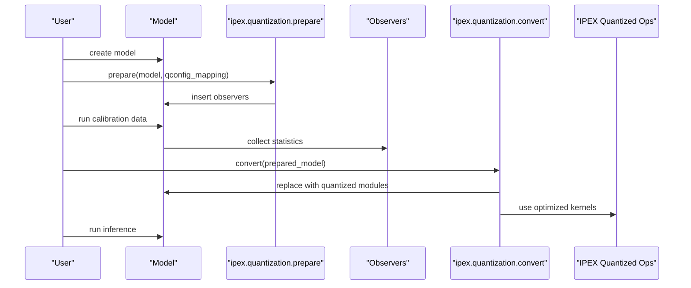

<!-- source: DeepWiki mcp.deepwiki.com · repo intel/intel-extension-for-pytorch · page 4 Quantization System · fetched 2026-10-21 -->

# Quantization System

<details>
<summary>Relevant source files</summary>

The following files were used as context for generating this wiki page:

- [csrc/cpu/aten/Linear.cpp](csrc/cpu/aten/Linear.cpp)
- [csrc/cpu/aten/Linear.h](csrc/cpu/aten/Linear.h)
- [csrc/cpu/jit/cpu/kernels/ContextLinearWoq.h](csrc/cpu/jit/cpu/kernels/ContextLinearWoq.h)
- [csrc/cpu/jit/cpu/kernels/LinearWoqPacked.cpp](csrc/cpu/jit/cpu/kernels/LinearWoqPacked.cpp)
- [csrc/cpu/jit/cpu/kernels/LinearWoqPacked.h](csrc/cpu/jit/cpu/kernels/LinearWoqPacked.h)
- [csrc/cpu/jit/cpu/kernels/OpContext.cpp](csrc/cpu/jit/cpu/kernels/OpContext.cpp)
- [csrc/cpu/jit/cpu/kernels/OpContext.h](csrc/cpu/jit/cpu/kernels/OpContext.h)
- [csrc/cpu/jit/cpu/kernels/RegisterOpContextClass.cpp](csrc/cpu/jit/cpu/kernels/RegisterOpContextClass.cpp)
- [intel_extension_for_pytorch/nn/modules/weight_only_quantization.py](intel_extension_for_pytorch/nn/modules/weight_only_quantization.py)
- [intel_extension_for_pytorch/quantization/__init__.py](intel_extension_for_pytorch/quantization/__init__.py)
- [intel_extension_for_pytorch/quantization/_qconfig.py](intel_extension_for_pytorch/quantization/_qconfig.py)
- [intel_extension_for_pytorch/quantization/_quantization_state.py](intel_extension_for_pytorch/quantization/_quantization_state.py)
- [intel_extension_for_pytorch/quantization/_quantization_state_utils.py](intel_extension_for_pytorch/quantization/_quantization_state_utils.py)
- [intel_extension_for_pytorch/quantization/_quantize_utils.py](intel_extension_for_pytorch/quantization/_quantize_utils.py)
- [intel_extension_for_pytorch/quantization/_recipe.py](intel_extension_for_pytorch/quantization/_recipe.py)
- [intel_extension_for_pytorch/quantization/_smooth_quant.py](intel_extension_for_pytorch/quantization/_smooth_quant.py)
- [intel_extension_for_pytorch/quantization/_utils.py](intel_extension_for_pytorch/quantization/_utils.py)
- [intel_extension_for_pytorch/transformers/models/cpu/fusions/linear_fusion.py](intel_extension_for_pytorch/transformers/models/cpu/fusions/linear_fusion.py)
- [tests/cpu/test_ao_jit_ipex_quantization.py](tests/cpu/test_ao_jit_ipex_quantization.py)
- [tests/cpu/test_ao_jit_llga_quantization_fuser.py](tests/cpu/test_ao_jit_llga_quantization_fuser.py)
- [tests/cpu/test_ao_jit_llga_throughput_benchmark.py](tests/cpu/test_ao_jit_llga_throughput_benchmark.py)
- [tests/cpu/test_ao_jit_llga_utils.py](tests/cpu/test_ao_jit_llga_utils.py)
- [tests/cpu/test_jit_llga_fuser.py](tests/cpu/test_jit_llga_fuser.py)
- [tests/cpu/test_quantization_default_recipe.py](tests/cpu/test_quantization_default_recipe.py)

</details>


The Quantization System in Intel Extension for PyTorch (IPEX) provides a set of APIs, configuration objects, and optimized operator implementations for quantizing PyTorch models for efficient inference on Intel CPUs. It extends PyTorch's quantization framework with Intel-specific optimizations, including support for advanced quantization types and hardware-accelerated kernels.

For LLM-specific quantization, see page [5] in this wiki.

## System Overview

IPEX supports the following quantization types:

- **Static Quantization**: Quantizes both weights and activations, typically to INT8.
- **Dynamic Quantization**: Quantizes weights to INT8, activations remain in floating point.
- **Weight-Only Quantization (WOQ)**: Quantizes only weights (to INT8, INT4, or NF4), activations remain in floating point.
- **SmoothQuant**: A technique for balancing quantization difficulty between activations and weights, especially for LLMs.

The quantization system is tightly integrated with PyTorch's quantization APIs and JIT, and provides Intel-optimized operator implementations and fusion patterns.

### Diagram: High-Level Quantization System Flow

```mermaid
flowchart TD
    subgraph "IPEX Quantization System"
        QConfig["QConfig / QConfigWoq / QConfigSmoothQuant"]
        Prepare["ipex.quantization.prepare"]
        Convert["ipex.quantization.convert"]
        Observers["Observers (Activation/Weight)"]
        QuantOps["Quantized Operators (Linear, Conv, etc.)"]
        WOQ["Weight-Only QuantizedLinear"]
        LLGA["LLGA Fusion (JIT)"]
    end

    User["User Model"] --> QConfig
    QConfig --> Prepare
    Prepare --> Observers
    Prepare --> "Calibration"
    "Calibration" --> Convert
    Convert --> QuantOps
    Convert --> WOQ
    QuantOps --> LLGA
    WOQ --> LLGA
    LLGA --> "Optimized Model"
```

**Sources:**  
[intel_extension_for_pytorch/quantization/__init__.py]()  
[intel_extension_for_pytorch/quantization/_qconfig.py]()  
[intel_extension_for_pytorch/quantization/_quantize.py]()

## Quantization Configurations and APIs

IPEX provides several quantization configuration objects and APIs, all accessible via `intel_extension_for_pytorch.quantization`:

| Name | Description | Activation | Weight |
|------|-------------|------------|--------|
| `default_static_qconfig` | Static quantization (INT8) | HistogramObserver | PerChannelMinMaxObserver |
| `default_dynamic_qconfig` | Dynamic quantization | PlaceholderObserver | PerChannelMinMaxObserver |
| `QConfigWoq` | Weight-only quantization | PlaceholderObserver | INT8/INT4/NF4 |
| `QConfigSmoothQuant` | SmoothQuant for LLMs | SmoothQuantActivationObserver | SmoothQuantWeightObserver |

Configuration objects are defined in [intel_extension_for_pytorch/quantization/_qconfig.py]().

### Key API Functions

- `ipex.quantization.prepare(model, qconfig_mapping, example_inputs)`: Inserts observers for calibration.
- `ipex.quantization.convert(model)`: Converts a prepared model to quantized modules.
- `ipex.quantization.get_weight_only_quant_qconfig_mapping(...)`: Returns a mapping for WOQ.
- `ipex.quantization.get_smooth_quant_qconfig_mapping(...)`: Returns a mapping for SmoothQuant.

### Diagram: QConfig and QConfigWoq Structure

```mermaid
classDiagram
    class "QConfig" {
        +activation
        +weight
    }
    class "QConfigWoq" {
        +activation
        +weight
        +weight_dtype: WoqWeightDtype
        +lowp_mode: WoqLowpMode
        +act_quant_mode: WoqActQuantMode
        +group_size: int
        +weight_qscheme: WoqWeightQScheme
    }
    class "WoqWeightDtype" {
        <<enum>>
        INT8
        INT4
        NF4
        FP8
    }
    class "WoqLowpMode" {
        <<enum>>
        NONE
        FP16
        BF16
        INT8
    }
    class "WoqActQuantMode" {
        <<enum>>
        PER_TENSOR
        PER_IC_BLOCK
        PER_BATCH
        PER_BATCH_IC_BLOCK
    }
    QConfig <|-- QConfigWoq
    QConfigWoq --> WoqWeightDtype
    QConfigWoq --> WoqLowpMode
    QConfigWoq --> WoqActQuantMode
```

**Sources:**  
[intel_extension_for_pytorch/quantization/_qconfig.py:22-54]()  
[intel_extension_for_pytorch/quantization/_qconfig.py:106-152]()

## Quantization Workflow

IPEX follows the standard PyTorch quantization workflow, with Intel-specific extensions:

1. **Preparation**: `ipex.quantization.prepare` inserts observers into the model.
2. **Calibration**: The model is run on representative data to collect statistics.
3. **Conversion**: `ipex.quantization.convert` replaces modules and ops with quantized versions, using Intel-optimized implementations.

### Diagram: Quantization Workflow and Code Entities



### Observer System

Observers are attached to modules and functions to collect statistics for quantization parameter calculation. The observer types are determined by the quantization configuration:

| Quantization Type | Activation Observer | Weight Observer |
|-------------------|--------------------|-----------------|
| Static | MinMaxObserver, HistogramObserver | PerChannelMinMaxObserver |
| Dynamic | PlaceholderObserver | PerChannelMinMaxObserver |
| Weight-Only | PlaceholderObserver | Specialized (WOQ) |
| SmoothQuant | SmoothQuantActivationObserver | SmoothQuantWeightObserver |

**Sources:**  
[intel_extension_for_pytorch/quantization/_quantize.py]()  
[intel_extension_for_pytorch/quantization/_quantization_state.py]()  
[intel_extension_for_pytorch/quantization/_quantization_state_utils.py]()

## Weight-Only Quantization (WOQ)

Weight-only quantization (WOQ) quantizes only the weights of linear layers to INT8, INT4, or NF4, while keeping activations in floating point. This is especially useful for large models such as LLMs.

WOQ is implemented in IPEX via the `WeightOnlyQuantizedLinear` module and associated C++ kernels.

### Diagram: WOQ Code Entities

```mermaid
classDiagram
    class "nn.Module" {
        +forward()
    }
    class "WeightOnlyQuantizedLinear" {
        +in_features: int
        +out_features: int
        +weight: Tensor
        +bias: Optional[Tensor]
        +_op_context: OpContext
        +_lowp_mode: WoqLowpMode
        +_act_quant_mode: WoqActQuantMode
        +_group_size: int
        +forward(x): Tensor
        +from_float(): static
        +from_float_and_qweight(): static
    }
    nn.Module <|-- WeightOnlyQuantizedLinear
```

### Supported WOQ Data Types

| Data Type | Description | Typical Memory Reduction |
|-----------|-------------|-------------------------|
| INT8 | 8-bit integer | 4x |
| INT4 | 4-bit integer | 8x |
| NF4 | 4-bit normalized float | 8x |

### Group-wise Quantization

For INT4 and NF4, group-wise quantization is supported, where weights are split into groups along the input channel and quantized per group.

```mermaid
flowchart LR
    subgraph "Group-wise Weight Quantization"
        "Weight(OCxIC)" --> "SplitIntoGroups"
        "SplitIntoGroups" --> "QuantizeGroup1"
        "SplitIntoGroups" --> "QuantizeGroup2"
        "SplitIntoGroups" --> "QuantizeGroupN"
        "QuantizeGroup1" --> "Merge"
        "QuantizeGroup2" --> "Merge"
        "QuantizeGroupN" --> "Merge"
        "Merge" --> "QuantizedWeight"
    end
```

### Creating WOQ Models

WOQ models can be created by:

- Using `get_weight_only_quant_qconfig_mapping` and the standard prepare/convert workflow.
- Loading from pre-quantized checkpoints (e.g., GPTQ, AWQ) using utility functions.

**Sources:**  
[intel_extension_for_pytorch/nn/modules/weight_only_quantization.py:40-478]()  
[intel_extension_for_pytorch/utils/weight_only_quantization.py:20-310]()  
[csrc/cpu/jit/cpu/kernels/LinearWoqPacked.cpp:17-270]()

## Low-Level Implementation and Operator Dispatch

IPEX quantization is implemented using a combination of Python APIs and C++ kernels. The system provides custom operator implementations and dispatches to optimized kernels based on quantization type and hardware features.

### Diagram: Quantized Operator Entities and Hardware Mapping

```mermaid
flowchart TD
    subgraph "IPEX Quantized Operators"
        "ipex::ipex_linear"
        "ipex::woq_linear_forward"
        "ipex::ipex_conv2d"
        "ipex::qembedding_bag"
        "ipex::woq_linear_gelu"
        "ipex::woq_linear_add"
    end

    subgraph "Hardware Features"
        "AVX512"
        "VNNI"
        "AMX"
        "BF16"
    end

    "ipex::ipex_linear" --> "VNNI"
    "ipex::woq_linear_forward" --> "VNNI"
    "ipex::ipex_conv2d" --> "VNNI"
    "ipex::woq_linear_gelu" --> "VNNI"
    "ipex::woq_linear_add" --> "VNNI"
    "ipex::ipex_linear" --> "AVX512"
    "ipex::ipex_conv2d" --> "AVX512"
    "ipex::qembedding_bag" --> "AVX512"
    "ipex::ipex_linear" --> "BF16"
    "ipex::woq_linear_forward" --> "BF16"
```

### Operator Contexts

IPEX uses custom context classes for efficient operator execution:

- `IPEXLinearOp` (C++): Optimized linear operator.
- `IpexWoqLinearOpContext` (C++): Context for WOQ linear operations, storing quantized weights, scales, zero points, and kernel parameters.

```mermaid
classDiagram
    class "OpContext" {
        +at_weight_: Tensor
        +at_bias_: Optional[Tensor]
    }
    class "WoqLinearOpContext" {
        +at_weight_: Tensor
        +weight_dtype_: int64_t
        +weight_shape_: vector[int64_t]
        +scales_list_: vector[Tensor]
        +zero_points_list_: vector[Tensor]
        +bias_list_: vector[Tensor]
        +group_size_: int64_t
        +lowp_mode_: int64_t
        +act_quant_mode_: int64_t
        +run(Tensor): Tensor
    }
    OpContext <|-- WoqLinearOpContext
```

**Sources:**  
[csrc/cpu/aten/Linear.cpp:16-194]()  
[csrc/cpu/aten/Linear.cpp:498-546]()  
[csrc/cpu/aten/Linear.h:16-195]()  
[csrc/cpu/jit/cpu/kernels/OpContext.h:12-194]()

## JIT and LLGA Fusion Integration

IPEX quantization integrates with PyTorch JIT and the Low-Level Graph Analyzer (LLGA) to fuse quantized operator patterns for improved performance.

### Diagram: JIT Quantization and Fusion Flow

```mermaid
flowchart TD
    "QuantizedModel" --> "JITTraceOrScript"
    "JITTraceOrScript" --> "JITGraph"
    "JITGraph" --> "PatternMatch"
    "PatternMatch" --> "LLGAFusion"
    "LLGAFusion" --> "OptimizedGraph"
    "OptimizedGraph" --> "Deploy"
```

LLGA fusion identifies and fuses patterns such as:

- Quantize → Dequantize → Conv/Linear → Activation → Quantize
- Quantize → Dequantize → Linear → Add/Mul → Quantize

These patterns are defined and tested in the codebase and are applied automatically during JIT compilation.

**Sources:**  
[tests/cpu/test_jit_llga_quantization_fuser.py:16-109]()  
[tests/cpu/test_jit_llga_fuser.py:15-210]()  
[tests/cpu/test_ao_jit_ipex_quantization.py:94-150]()

## Advanced Features: SmoothQuant and Fusion Patterns

### SmoothQuant

SmoothQuant is a quantization technique for LLMs that balances quantization difficulty between activations and weights by introducing scaling factors.

```mermaid
flowchart LR
    subgraph "SmoothQuant Process"
        "ActivationX" --> "MulS"
        "MulS" --> "ScaledActivation"
        "WeightW" --> "DivS"
        "DivS" --> "ScaledWeight"
        "ScaledActivation" --> "QuantizedComputation"
        "ScaledWeight" --> "QuantizedComputation"
    end
```

The scaling factor is determined by the distributions of activations and weights, controlled by a hyperparameter `alpha`.

- Use `get_smooth_quant_qconfig_mapping(alpha=...)` to enable SmoothQuant.

### Fusion Patterns

IPEX defines and applies fusion patterns for quantized operators to improve performance, such as:

| Pattern | Description |
|---------|-------------|
| Conv + BN + ReLU | Fuses batch normalization and ReLU into convolution |
| Linear + Activation | Fuses GELU, SiLU, ReLU with linear |
| Linear + Binary Op | Fuses Add, Mul with linear |

Fusion patterns are defined in [intel_extension_for_pytorch/quantization/_recipe.py]() and [intel_extension_for_pytorch/transformers/models/cpu/fusions/linear_fusion.py]().

**Sources:**  
[intel_extension_for_pytorch/quantization/_smooth_quant.py:10-221]()  
[intel_extension_for_pytorch/quantization/_recipe.py:7-323]()  
[intel_extension_for_pytorch/transformers/models/cpu/fusions/linear_fusion.py:21-397]()

## Performance Considerations

When using IPEX quantization, consider the following for optimal performance:

1. **Hardware Capabilities**: 
   - AVX-512 VNNI instructions provide significant acceleration for INT8 computations
   - BF16 support is beneficial for mixed-precision operations

2. **Batch Size**:
   - Different optimizations are applied based on batch size
   - Small batch sizes may use different execution paths than large batches

3. **Precision Trade-offs**:
   - INT8 offers good accuracy and performance
   - INT4/NF4 offers higher performance but may have more accuracy impact
   - Weight-only quantization often maintains better accuracy than full quantization

4. **Quantization Calibration**:
   - Using representative data for calibration is essential
   - Models with large dynamic ranges may benefit from techniques like SmoothQuant

Sources:
- [csrc/cpu/aten/Linear.cpp:497-546](csrc/cpu/aten/Linear.cpp:497-546)
- [tests/cpu/test_quantization_default_recipe.py:748-836](tests/cpu/test_quantization_default_recipe.py:748-836)

## Conclusion

The IPEX Quantization System provides comprehensive support for model quantization on Intel hardware. It offers static, dynamic, and weight-only quantization with various precision options (INT8, INT4, NF4, BF16). The system integrates with PyTorch's quantization API while providing Intel-specific optimizations for improved performance.

---

