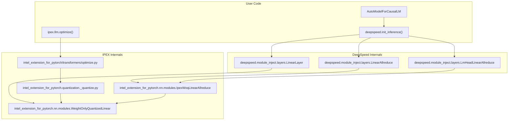
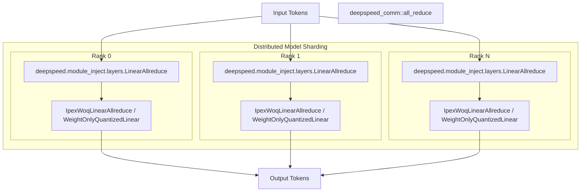
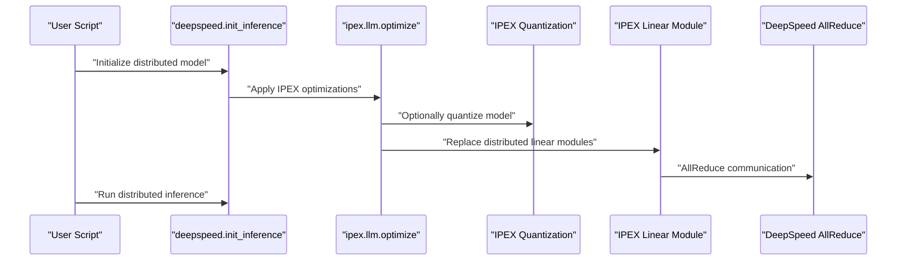

<!-- source: DeepWiki mcp.deepwiki.com · repo intel/intel-extension-for-pytorch · page 4.3 DeepSpeed Integration · fetched 2026-10-21 -->

# DeepSpeed Integration

<details>
<summary>Relevant source files</summary>

The following files were used as context for generating this wiki page:

- [README.md](README.md)
- [docker/Dockerfile.prebuilt](docker/Dockerfile.prebuilt)
- [docs/_static/htmls/tbl_deepspeed.html](docs/_static/htmls/tbl_deepspeed.html)
- [docs/_static/htmls/tbl_single.html](docs/_static/htmls/tbl_single.html)
- [docs/tutorials/blogs_publications.md](docs/tutorials/blogs_publications.md)
- [docs/tutorials/features/hypertune.md](docs/tutorials/features/hypertune.md)
- [docs/tutorials/installation.md](docs/tutorials/installation.md)
- [docs/tutorials/introduction.rst](docs/tutorials/introduction.rst)
- [docs/tutorials/llm/llm_optimize.md](docs/tutorials/llm/llm_optimize.md)
- [docs/tutorials/releases.md](docs/tutorials/releases.md)
- [examples/cpu/inference/cpp/README.md](examples/cpu/inference/cpp/README.md)
- [examples/cpu/llm/README.md](examples/cpu/llm/README.md)
- [examples/cpu/llm/inference/README.md](examples/cpu/llm/inference/README.md)
- [intel_extension_for_pytorch/transformers/generation/beam_sample.py](intel_extension_for_pytorch/transformers/generation/beam_sample.py)
- [intel_extension_for_pytorch/transformers/generation/beam_search.py](intel_extension_for_pytorch/transformers/generation/beam_search.py)
- [intel_extension_for_pytorch/transformers/generation/greedy_search.py](intel_extension_for_pytorch/transformers/generation/greedy_search.py)
- [intel_extension_for_pytorch/transformers/generation/sample.py](intel_extension_for_pytorch/transformers/generation/sample.py)
- [intel_extension_for_pytorch/transformers/models/cpu/modules/attentions.py](intel_extension_for_pytorch/transformers/models/cpu/modules/attentions.py)
- [intel_extension_for_pytorch/transformers/models/cpu/modules/decoder.py](intel_extension_for_pytorch/transformers/models/cpu/modules/decoder.py)
- [intel_extension_for_pytorch/transformers/models/reference/fusions/mha_fusion.py](intel_extension_for_pytorch/transformers/models/reference/fusions/mha_fusion.py)
- [intel_extension_for_pytorch/transformers/models/reference/models.py](intel_extension_for_pytorch/transformers/models/reference/models.py)
- [intel_extension_for_pytorch/transformers/models/reference/modules/attentions.py](intel_extension_for_pytorch/transformers/models/reference/modules/attentions.py)
- [intel_extension_for_pytorch/transformers/models/reference/modules/decoder.py](intel_extension_for_pytorch/transformers/models/reference/modules/decoder.py)
- [intel_extension_for_pytorch/transformers/optimize.py](intel_extension_for_pytorch/transformers/optimize.py)
- [tests/cpu/test_ipex_optimize_transformers.py](tests/cpu/test_ipex_optimize_transformers.py)
- [tests/cpu/test_ipex_optimize_transformers_nightly.py](tests/cpu/test_ipex_optimize_transformers_nightly.py)

</details>


This page documents how Intel Extension for PyTorch (IPEX) integrates with DeepSpeed to enable distributed and quantized inference and training for large language models (LLMs) on Intel CPUs. DeepSpeed provides tensor parallelism and distributed model sharding, while IPEX injects CPU-specific optimizations, quantization, and low-precision execution. This integration allows efficient scaling of LLMs across multiple CPU nodes with advanced quantization and performance features.

For single-node or non-distributed optimizations, see page [3] (Core Optimization Features).

---

## System Integration: DeepSpeed and IPEX

**Diagram: "DeepSpeed + IPEX Integration at Code Entity Level"**



**Sources:**
- [intel_extension_for_pytorch/transformers/optimize.py:52-64]()
- [intel_extension_for_pytorch/nn/modules.py]()
- [intel_extension_for_pytorch/quantization/_quantize.py]()
- [tests/cpu/test_ipex_optimize_transformers.py]()

## Key Features

### 1. Distributed Optimization and Quantization

- **Tensor Parallelism**: DeepSpeed shards the model across processes using tensor parallelism. IPEX optimizations are applied to each shard, preserving distributed computation.
- **Quantization Support**: IPEX supports both dynamic quantization and weight-only quantization (WOQ) in distributed settings.
- **Low-Precision Execution**: BFloat16 and INT8/INT4 execution are supported for distributed inference.
- **Module Replacement**: IPEX replaces DeepSpeed's distributed linear modules with optimized or quantized versions.

**Diagram: "Tensor Parallelism with IPEX Optimization"**



**Sources:**
- [intel_extension_for_pytorch/transformers/optimize.py:52-64]()
- [intel_extension_for_pytorch/nn/modules.py]()
- [intel_extension_for_pytorch/quantization/_quantize.py]()
- [examples/cpu/llm/inference/distributed/run_generation_with_deepspeed.py]()
- [tests/cpu/test_ipex_optimize_transformers.py]()

## Integration Workflow

### Standard Distributed Optimization

**Diagram: "Distributed Optimization Workflow (Code Entities)"**



**Sources:**
- [intel_extension_for_pytorch/transformers/optimize.py:52-64]()
- [examples/cpu/llm/inference/distributed/run_generation_with_deepspeed.py:265-286,616-720]()
- [intel_extension_for_pytorch/quantization/_quantize.py]()

## Usage Examples

### Basic DeepSpeed with IPEX Optimization

```python
import deepspeed
import intel_extension_for_pytorch as ipex

# Initialize distributed environment
deepspeed.init_distributed()

# Load model
model = AutoModelForCausalLM.from_pretrained("your_model_id")

# Initialize DeepSpeed inference
ds_engine = deepspeed.init_inference(
    model=model,
    mp_size=world_size,
    dtype=torch.bfloat16
)
model = ds_engine.module

# Apply IPEX optimization
model = ipex.optimize(model.eval(), inplace=True)

# Run inference
output = model.generate(input_ids)
```

Sources:
- [examples/cpu/llm/inference/distributed/run_generation_with_deepspeed.py:616-620]()
- [tests/cpu/test_deepspeed.py:211-221]()

### DeepSpeed with IPEX LLM Optimization

- Use `ipex.llm.optimize()` after DeepSpeed model initialization to apply LLM-specific optimizations and quantization.
- The function detects distributed modules and replaces them with IPEX-optimized or quantized versions.
- For code details, see [intel_extension_for_pytorch/transformers/optimize.py:52-64]() and [tests/cpu/test_ipex_optimize_transformers.py]().

### DeepSpeed with IPEX Weight-Only Quantization

```python
import deepspeed
import intel_extension_for_pytorch as ipex
from intel_extension_for_pytorch.quantization import WoqWeightDtype

# Initialize distributed environment
deepspeed.init_distributed()

# Load model
model = AutoModelForCausalLM.from_pretrained("your_model_id")

# Initialize DeepSpeed inference
ds_engine = deepspeed.init_inference(
    model=model,
    mp_size=world_size,
    dtype=torch.bfloat16
)
model = ds_engine.module

# Configure weight-only quantization
qconfig = ipex.quantization.get_weight_only_quant_qconfig_mapping(
    weight_dtype=WoqWeightDtype.INT8,
    lowp_mode=ipex.quantization.WoqLowpMode.BF16,
    group_size=128
)

# Apply IPEX LLM optimization with quantization
model = ipex.llm.optimize(
    model.eval(),
    dtype=torch.bfloat16,
    quantization_config=qconfig,
    inplace=True
)

# Run inference
output = model.generate(input_ids)
```

Sources:
- [examples/cpu/llm/inference/distributed/run_generation_with_deepspeed.py:643-720]()
- [examples/cpu/llm/inference/distributed/run_accuracy_with_deepspeed.py:467-555]()

## Low-Precision Checkpoint Handling

IPEX provides utilities for loading and sharding low-precision (e.g., GPTQ/AWQ) checkpoints for distributed inference. This ensures that quantized weights, scales, and zero-points are correctly partitioned across tensor parallel ranks.

- Use `load_low_precision_checkpoint()` to load and partition a quantized checkpoint for each rank.
- Use `shard_low_precision_checkpoint()` to further shard the checkpoint for multi-node deployments.

**Key code entities:**
- `intel_extension_for_pytorch.llm.utils.load_low_precision_checkpoint`
- `intel_extension_for_pytorch.llm.utils.shard_low_precision_checkpoint`

**Sources:**
- [examples/cpu/llm/inference/distributed/run_generation_with_deepspeed.py:593-613]()
- [examples/cpu/llm/inference/distributed/run_accuracy_with_deepspeed.py:447-451,537-547]()
- [tests/cpu/test_ipex_optimize_transformers.py]()

## Command-Line Examples

To run distributed inference with DeepSpeed and IPEX, use the DeepSpeed launcher:

```bash
deepspeed --num_gpus 0 --num_nodes 2 examples/cpu/llm/inference/distributed/run_generation_with_deepspeed.py \
    --model-id EleutherAI/gpt-j-6b \
    --dtype bfloat16 \
    --ipex \
    --max-new-tokens 32 \
    --batch-size 1
```

For quantized models:

```bash
deepspeed --num_gpus 0 --num_nodes 2 examples/cpu/llm/inference/distributed/run_generation_with_deepspeed.py \
    --model-id EleutherAI/gpt-j-6b \
    --dtype bfloat16 \
    --ipex-weight-only-quantization \
    --weight-dtype INT8 \
    --lowp-mode BF16 \
    --group-size 128 \
    --max-new-tokens 32 \
    --batch-size 1
```

For low-precision checkpoints:

```bash
deepspeed --num_gpus 0 --num_nodes 2 examples/cpu/llm/inference/distributed/run_generation_with_deepspeed.py \
    --model-id /path/to/model \
    --low-precision-checkpoint /path/to/checkpoint \
    --dtype bfloat16 \
    --ipex-weight-only-quantization \
    --max-new-tokens 32 \
    --batch-size 1
```

Sources:
- [examples/cpu/llm/inference/run.py:294-301]()
- [examples/cpu/llm/inference/distributed/run_generation_with_deepspeed.py:58-247]()

## Performance Considerations

- **Tensor Parallel Grain Size**: For quantized models, set the tensor parallel (TP) grain size to match the quantization group size for optimal performance. The default is 64 if not specified.
- **AllReduce Fusion**: IPEX can fuse multiple AllReduce operations into a single call, reducing communication overhead.
- **Input Slicing**: Distributed linear layers use input slicing to partition activations across ranks.

**Sources:**
- [intel_extension_for_pytorch/quantization/_quantize.py:280-355]()
- [tests/cpu/test_ipex_optimize_transformers.py]()

## Known Limitations

1. **Model Support**: Not all models are fully supported with DeepSpeed meta-device loading. The following models require special handling:
   - Falcon
   - Baichuan/Baichuan2
   - GPT BigCode
   - Git
   - MLLama
   - Qwen
   - Yuan
   - Whisper
   - Jamba
   - Phi4mm

2. **Quantization with Tensor Parallelism**: 
   - When using DESC_ACT=True with INT8 lowp_mode, tensor parallelism is not supported

3. **KV Cache**: 
   - FP8 KV cache is supported but requires careful configuration

Sources:
- [examples/cpu/llm/inference/distributed/run_generation_with_deepspeed.py:496-514]()
- [examples/cpu/llm/inference/distributed/run_accuracy_with_deepspeed.py:529-537]()
- [examples/cpu/llm/inference/distributed/run_generation_with_deepspeed.py:403-406]()

---

