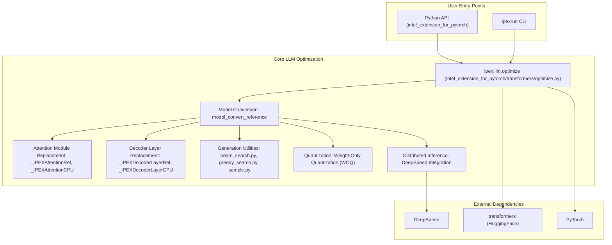
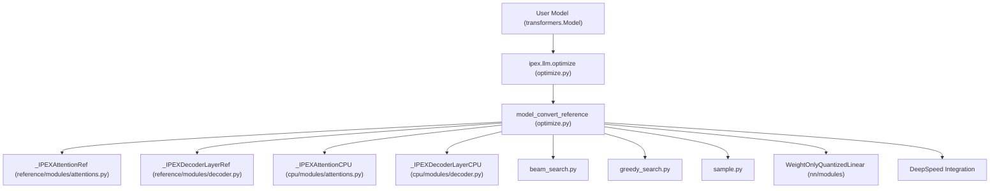
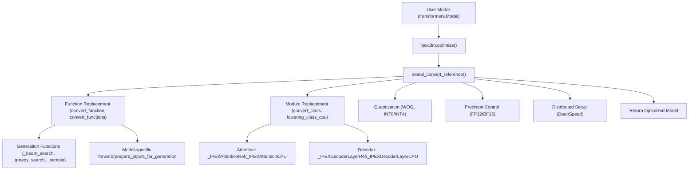
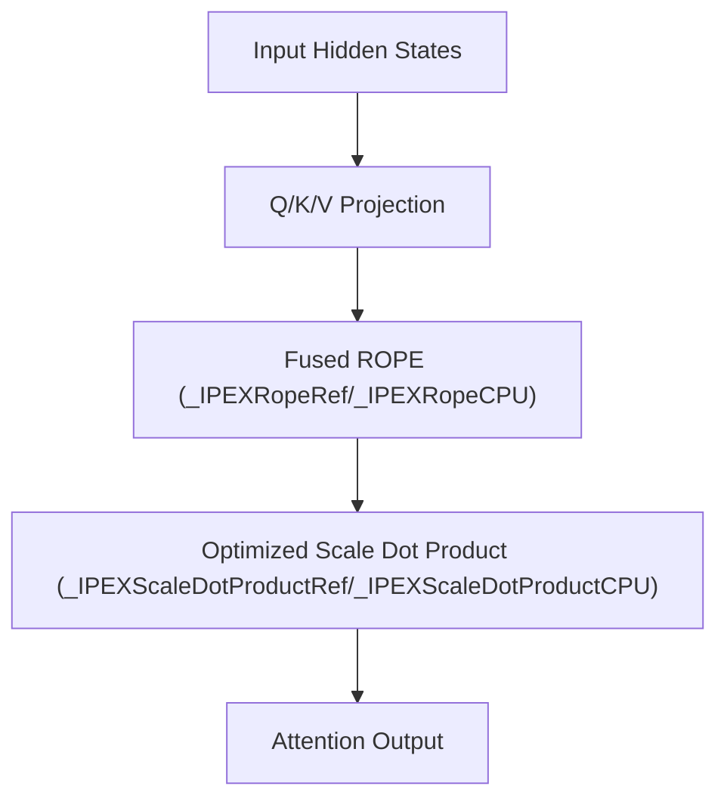
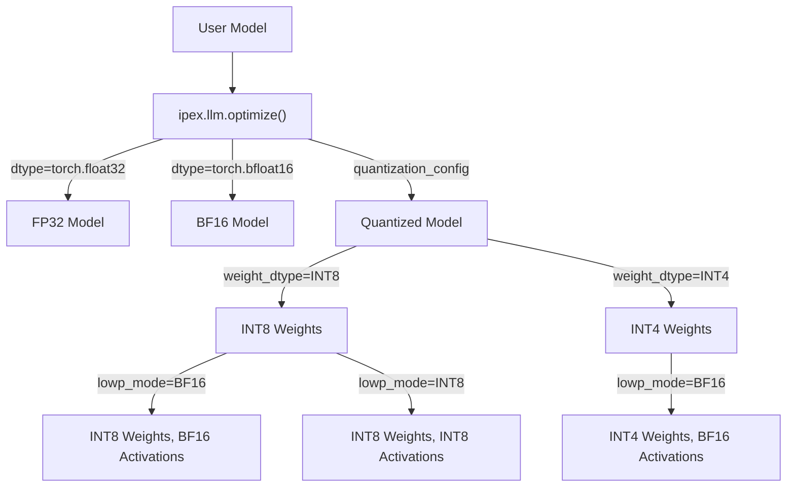
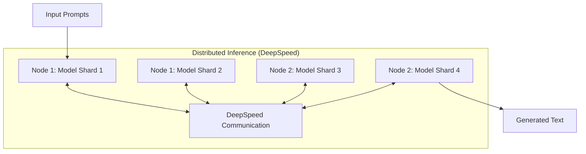

<!-- source: DeepWiki mcp.deepwiki.com · repo intel/intel-extension-for-pytorch · page 5 LLM Optimization · fetched 2026-10-21 -->

# LLM Optimization

<details>
<summary>Relevant source files</summary>

The following files were used as context for generating this wiki page:

- [README.md](README.md)
- [docker/Dockerfile.prebuilt](docker/Dockerfile.prebuilt)
- [docs/_static/htmls/tbl_deepspeed.html](docs/_static/htmls/tbl_deepspeed.html)
- [docs/_static/htmls/tbl_single.html](docs/_static/htmls/tbl_single.html)
- [docs/tutorials/blogs_publications.md](docs/tutorials/blogs_publications.md)
- [docs/tutorials/features/hypertune.md](docs/tutorials/features/hypertune.md)
- [docs/tutorials/installation.md](docs/tutorials/installation.md)
- [docs/tutorials/introduction.rst](docs/tutorials/introduction.rst)
- [docs/tutorials/llm/llm_optimize.md](docs/tutorials/llm/llm_optimize.md)
- [docs/tutorials/releases.md](docs/tutorials/releases.md)
- [examples/cpu/inference/cpp/README.md](examples/cpu/inference/cpp/README.md)
- [examples/cpu/llm/README.md](examples/cpu/llm/README.md)
- [examples/cpu/llm/inference/README.md](examples/cpu/llm/inference/README.md)
- [intel_extension_for_pytorch/transformers/generation/beam_sample.py](intel_extension_for_pytorch/transformers/generation/beam_sample.py)
- [intel_extension_for_pytorch/transformers/generation/beam_search.py](intel_extension_for_pytorch/transformers/generation/beam_search.py)
- [intel_extension_for_pytorch/transformers/generation/greedy_search.py](intel_extension_for_pytorch/transformers/generation/greedy_search.py)
- [intel_extension_for_pytorch/transformers/generation/sample.py](intel_extension_for_pytorch/transformers/generation/sample.py)
- [intel_extension_for_pytorch/transformers/models/cpu/modules/attentions.py](intel_extension_for_pytorch/transformers/models/cpu/modules/attentions.py)
- [intel_extension_for_pytorch/transformers/models/cpu/modules/decoder.py](intel_extension_for_pytorch/transformers/models/cpu/modules/decoder.py)
- [intel_extension_for_pytorch/transformers/models/reference/fusions/mha_fusion.py](intel_extension_for_pytorch/transformers/models/reference/fusions/mha_fusion.py)
- [intel_extension_for_pytorch/transformers/models/reference/models.py](intel_extension_for_pytorch/transformers/models/reference/models.py)
- [intel_extension_for_pytorch/transformers/models/reference/modules/attentions.py](intel_extension_for_pytorch/transformers/models/reference/modules/attentions.py)
- [intel_extension_for_pytorch/transformers/models/reference/modules/decoder.py](intel_extension_for_pytorch/transformers/models/reference/modules/decoder.py)
- [intel_extension_for_pytorch/transformers/optimize.py](intel_extension_for_pytorch/transformers/optimize.py)
- [tests/cpu/test_ipex_optimize_transformers.py](tests/cpu/test_ipex_optimize_transformers.py)
- [tests/cpu/test_ipex_optimize_transformers_nightly.py](tests/cpu/test_ipex_optimize_transformers_nightly.py)

</details>


This page documents the LLM (Large Language Model) optimization system in Intel Extension for PyTorch (IPEX). The system provides model-level and operator-level optimizations for transformer-based LLMs, targeting efficient inference on Intel CPUs. For general optimization features, see page [3].

## System Overview

The LLM optimization system is centered around the `ipex.llm.optimize` API, which transforms HuggingFace Transformers models for improved inference performance. Optimizations include attention kernel replacements, decoder layer fusion, quantization, and distributed inference support.

### System Architecture Diagram


Sources: [README.md](), [intel_extension_for_pytorch/transformers/optimize.py](), [intel_extension_for_pytorch/transformers/models/reference/modules/attentions.py](), [intel_extension_for_pytorch/transformers/models/reference/modules/decoder.py]()


## Supported LLM Architectures

IPEX LLM optimization supports a broad set of transformer-based LLMs, with model-specific optimizations for each architecture. The following table summarizes support for single-instance and distributed inference modes, and available precision/quantization options.

| Model Family      | Example Models                        | FP32 | BF16 | INT8 WOQ | INT4 WOQ | Distributed (BF16/INT8) |
|-------------------|--------------------------------------|------|------|----------|----------|-------------------------|
| LLAMA             | Llama-2, Meta-Llama-3, Llama-3.2     | ✅   | ✅   | ✅       | ✅       | ✅                      |
| Mistral/Mixtral   | Mistral-7B, Mixtral-8x7B             | ✅   | ✅   | ✅       | ✅       | ✅                      |
| Phi               | Phi-2, Phi-3, Phi-4                  | ✅   | ✅   | ✅       | ✅       | ✅                      |
| Falcon            | Falcon-7B, Falcon-40B                | ✅   | ✅   | ✅       | ✅       | ✅                      |
| Qwen              | Qwen-7B, Qwen2-7B, Qwen3             | ✅   | ✅   | ✅       | ✅       | ✅                      |
| DeepSeek          | DeepSeek-V2.5, DeepSeek-R1           | ✅   | ✅   | ✅       | ✅       | ✅                      |
| Others            | OPT, Bloom, T5, GPT-J, GPT-NeoX, etc.| ✅   | ✅   | ✅       | ✅       | ✅                      |

- "WOQ" = Weight-Only Quantization
- Distributed inference is enabled via DeepSpeed integration.

Sources: [README.md](), [examples/cpu/llm/inference/README.md]()


## LLM Optimization Architecture

### Code Entity Mapping Diagram

This diagram maps the main LLM optimization system components to their code entities.


Sources: [intel_extension_for_pytorch/transformers/optimize.py](), [intel_extension_for_pytorch/transformers/models/reference/modules/attentions.py](), [intel_extension_for_pytorch/transformers/models/reference/modules/decoder.py](), [intel_extension_for_pytorch/transformers/models/cpu/modules/attentions.py](), [intel_extension_for_pytorch/transformers/models/cpu/modules/decoder.py]()


### LLM Model Optimization Flow


Sources: [intel_extension_for_pytorch/transformers/optimize.py:93-700](), [intel_extension_for_pytorch/transformers/models/reference/modules/attentions.py](), [intel_extension_for_pytorch/transformers/models/reference/modules/decoder.py]()


## Key Optimization Techniques

### Model Conversion and Replacement

- The main entry point is `ipex.llm.optimize`, which calls `model_convert_reference`.
- The system detects the model architecture and applies function and module replacements.
- Attention and decoder modules are replaced with optimized reference or CPU-specific implementations.
- Generation functions (`_beam_search`, `_greedy_search`, `_sample`) are replaced for improved performance.

Sources: [intel_extension_for_pytorch/transformers/optimize.py:93-700]()

### Attention Mechanism Optimizations

- **ROPE Fusion**: Fused rotary position embedding for efficient positional encoding.
- **Optimized Scale Dot Product**: Custom kernels for attention score computation.
- **Paged Attention**: Efficient key-value cache management for long sequence inference.
- **Multi-Query/Group-Query**: Support for various attention head configurations.


Sources: [intel_extension_for_pytorch/transformers/models/reference/modules/attentions.py](), [intel_extension_for_pytorch/transformers/models/reference/fusions/mha_fusion.py]()

### Decoder Layer Optimizations

- **Fused Linear + Add**: Combines linear projection and residual addition.
- **Fused Linear + GeLU**: Combines linear projection and GeLU activation.
- **Fused Linear + SiLU + Mul**: For Llama-style MLP blocks.
- **Memory-efficient Implementation**: Reduces intermediate allocations.

Sources: [intel_extension_for_pytorch/transformers/models/reference/modules/decoder.py](), [intel_extension_for_pytorch/transformers/models/cpu/modules/decoder.py]()

### Generation Optimizations

- **Beam Search**: Optimized `_beam_search` for multi-sequence generation.
- **Greedy Search**: Optimized `_greedy_search` for fast decoding.
- **Sampling**: Improved `_sample` for stochastic generation.
- **Token Latency Tracking**: Built-in performance measurement.

Sources: [intel_extension_for_pytorch/transformers/generation/beam_search.py](), [intel_extension_for_pytorch/transformers/generation/greedy_search.py](), [intel_extension_for_pytorch/transformers/generation/sample.py]()


## Precision and Quantization

### Supported Precision Modes

- **FP32**: Standard full precision.
- **BF16**: BFloat16 for improved performance with minimal accuracy loss.
- **Weight-Only Quantization (WOQ)**: INT8 and INT4 quantization for model weights, with activations in higher precision.


Sources: [intel_extension_for_pytorch/transformers/optimize.py](), [intel_extension_for_pytorch/transformers/models/cpu/modules/decoder.py]()

### Weight-Only Quantization (WOQ) Details

- Quantizes only model weights (not activations).
- Supports INT8 and INT4 weights.
- Compatible with GPTQ and AWQ quantization formats.
- Applies to attention and MLP projection matrices.
- Supports per-channel and per-group quantization.

Sources: [intel_extension_for_pytorch/transformers/models/cpu/modules/decoder.py:19-113](), [intel_extension_for_pytorch/cpu/_auto_kernel_selection.py]()


## Distributed Inference

IPEX supports distributed LLM inference via DeepSpeed integration.

- **Tensor Parallelism**: Model weights are sharded across CPU cores or nodes.
- **Multi-node Support**: Enables scaling across multiple machines.
- **Quantization in Distributed Mode**: INT8/INT4 WOQ is supported in distributed setups.


- Use `--autotp` for automatic tensor parallelism.
- Use `--shard-model` for model sharding.
- Communication is handled by DeepSpeed.

Sources: [examples/cpu/llm/inference/README.md:184-263]()


## Usage Example

To optimize a HuggingFace LLM for inference on Intel CPUs:

```python
import torch
import intel_extension_for_pytorch as ipex
from transformers import AutoModelForCausalLM

model = AutoModelForCausalLM.from_pretrained("meta-llama/Meta-Llama-3-8B")
# For BF16
optimized_model = ipex.llm.optimize(model, dtype=torch.bfloat16)
# For INT8 weight-only quantization
from intel_extension_for_pytorch.quantization import get_weight_only_quant_qconfig_mapping
qconfig = get_weight_only_quant_qconfig_mapping()
optimized_model = ipex.llm.optimize(model, dtype=torch.bfloat16, quantization_config=qconfig)
```

- The optimized model can be used with standard PyTorch/HuggingFace APIs.
- For distributed inference, use DeepSpeed and the appropriate CLI flags.

Sources: [examples/cpu/llm/inference/README.md:138-196]()


## Running LLM Inference with ipex.llm

A unified script (`run.py`) is provided for benchmarking and running LLM inference:

Example commands:

```bash
# FP32 inference
python run.py --benchmark -m meta-llama/Meta-Llama-3-8B --dtype float32 --ipex

# BF16 inference
python run.py --benchmark -m meta-llama/Meta-Llama-3-8B --dtype bfloat16 --ipex

# INT8 weight-only quantization
python run.py --benchmark -m meta-llama/Meta-Llama-3-8B --ipex-weight-only-quantization --weight-dtype INT8 --quant-with-amp

# Distributed inference with DeepSpeed
deepspeed --bind_cores_to_rank run.py --benchmark -m meta-llama/Meta-Llama-3-8B --dtype bfloat16 --ipex --autotp --shard-model
```

Key CLI options:

| Option                        | Description                                 |
|-------------------------------|---------------------------------------------|
| `--ipex`                      | Enable IPEX optimizations                   |
| `--dtype`                     | Data type: float32, bfloat16                |
| `--ipex-weight-only-quantization` | Enable weight-only quantization           |
| `--weight-dtype`              | INT8, INT4                                  |
| `--lowp-mode`                 | BF16, INT8                                  |
| `--autotp`                    | Enable automatic tensor parallelism         |
| `--shard-model`               | Enable model sharding                       |
| `--input-tokens`              | Input sequence length                       |
| `--max-new-tokens`            | Maximum generated tokens                    |
| `--kv-cache-dtype`            | KV cache data type                          |

Sources: [examples/cpu/llm/inference/README.md:113-262]()


## Implementation Details

### Main Code Entities

| File/Module                                                      | Role                                                      |
|------------------------------------------------------------------|-----------------------------------------------------------|
| `intel_extension_for_pytorch/transformers/optimize.py`           | Main entry point, model conversion, API                   |
| `intel_extension_for_pytorch/transformers/models/reference/modules/attentions.py` | Optimized attention reference implementations             |
| `intel_extension_for_pytorch/transformers/models/reference/modules/decoder.py`    | Optimized decoder reference implementations               |
| `intel_extension_for_pytorch/transformers/models/cpu/modules/attentions.py`       | CPU-specific attention modules                            |
| `intel_extension_for_pytorch/transformers/models/cpu/modules/decoder.py`          | CPU-specific decoder modules                              |
| `intel_extension_for_pytorch/transformers/generation/beam_search.py`              | Optimized beam search generation                          |
| `intel_extension_for_pytorch/transformers/generation/greedy_search.py`            | Optimized greedy search generation                        |
| `intel_extension_for_pytorch/transformers/generation/sample.py`                   | Optimized sampling generation                             |

### Optimization Process

- Detect model architecture via `model.config.architectures[0]`
- Replace functions and modules with optimized versions
- Configure precision and quantization
- Prepare for efficient generation
- Return an optimized model compatible with standard APIs

Sources: [intel_extension_for_pytorch/transformers/optimize.py:120-700]()


## Conclusion

The LLM optimization system in Intel Extension for PyTorch offers comprehensive performance enhancements for large language models, supporting a wide range of architectures, precision options, and deployment scenarios. By leveraging specialized attention optimizations, operation fusion, memory-efficient techniques, and quantization, it enables faster and more efficient LLM inference on Intel hardware.

---

