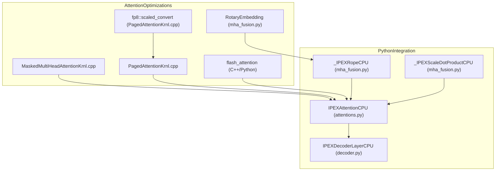
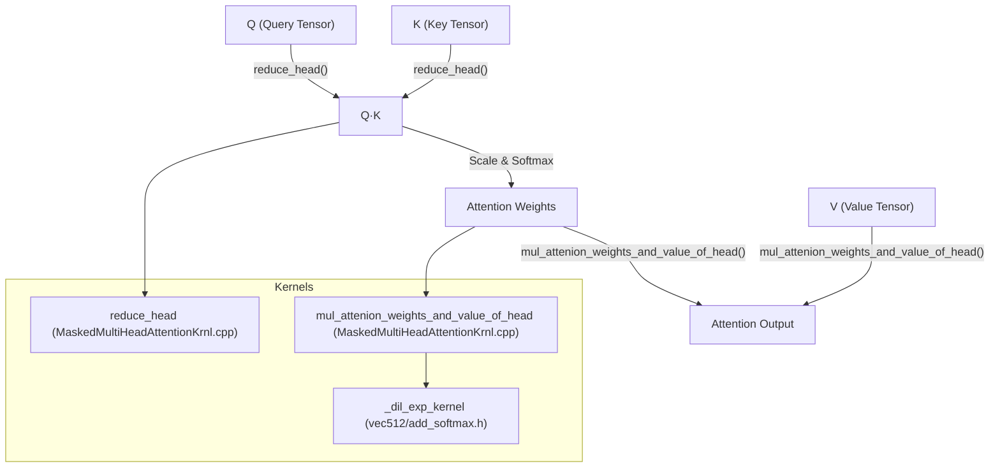

<!-- source: DeepWiki mcp.deepwiki.com · repo intel/intel-extension-for-pytorch · page 5.2 Attention Mechanism Optimizations · fetched 2026-10-21 -->

# Attention Mechanism Optimizations

<details>
<summary>Relevant source files</summary>

The following files were used as context for generating this wiki page:

- [csrc/cpu/aten/PagedAttention.cpp](csrc/cpu/aten/PagedAttention.cpp)
- [csrc/cpu/aten/PagedAttention.h](csrc/cpu/aten/PagedAttention.h)
- [csrc/cpu/aten/kernels/PagedAttentionKrnl.cpp](csrc/cpu/aten/kernels/PagedAttentionKrnl.cpp)
- [csrc/cpu/vec/vec512/vec512_fp8.h](csrc/cpu/vec/vec512/vec512_fp8.h)
- [intel_extension_for_pytorch/llm/modules/mha_fusion.py](intel_extension_for_pytorch/llm/modules/mha_fusion.py)
- [intel_extension_for_pytorch/transformers/generation/beam_sample.py](intel_extension_for_pytorch/transformers/generation/beam_sample.py)
- [intel_extension_for_pytorch/transformers/generation/beam_search.py](intel_extension_for_pytorch/transformers/generation/beam_search.py)
- [intel_extension_for_pytorch/transformers/generation/greedy_search.py](intel_extension_for_pytorch/transformers/generation/greedy_search.py)
- [intel_extension_for_pytorch/transformers/generation/sample.py](intel_extension_for_pytorch/transformers/generation/sample.py)
- [intel_extension_for_pytorch/transformers/models/cpu/fusions/mha_fusion.py](intel_extension_for_pytorch/transformers/models/cpu/fusions/mha_fusion.py)
- [intel_extension_for_pytorch/transformers/models/cpu/modules/attentions.py](intel_extension_for_pytorch/transformers/models/cpu/modules/attentions.py)
- [intel_extension_for_pytorch/transformers/models/cpu/modules/decoder.py](intel_extension_for_pytorch/transformers/models/cpu/modules/decoder.py)
- [intel_extension_for_pytorch/transformers/models/reference/fusions/mha_fusion.py](intel_extension_for_pytorch/transformers/models/reference/fusions/mha_fusion.py)
- [intel_extension_for_pytorch/transformers/models/reference/models.py](intel_extension_for_pytorch/transformers/models/reference/models.py)
- [intel_extension_for_pytorch/transformers/models/reference/modules/attentions.py](intel_extension_for_pytorch/transformers/models/reference/modules/attentions.py)
- [intel_extension_for_pytorch/transformers/models/reference/modules/decoder.py](intel_extension_for_pytorch/transformers/models/reference/modules/decoder.py)
- [intel_extension_for_pytorch/transformers/optimize.py](intel_extension_for_pytorch/transformers/optimize.py)
- [tests/cpu/test_flash_attention_varlen.py](tests/cpu/test_flash_attention_varlen.py)
- [tests/cpu/test_ipex_optimize_transformers.py](tests/cpu/test_ipex_optimize_transformers.py)
- [tests/cpu/test_ipex_optimize_transformers_nightly.py](tests/cpu/test_ipex_optimize_transformers_nightly.py)
- [tests/cpu/test_paged_attention.py](tests/cpu/test_paged_attention.py)
- [tests/cpu/test_paged_attention_fp8.py](tests/cpu/test_paged_attention_fp8.py)

</details>


This page documents the optimized attention mechanisms in Intel Extension for PyTorch (IPEX), focusing on their implementation, integration, and usage for transformer and LLM workloads on Intel CPUs. For a broader overview of LLM optimization, see page [5].

## System Overview: Attention Optimizations in IPEX

IPEX implements several attention mechanism optimizations, including:

- **Optimized Multi-Head Attention (MHA)** kernels with AVX-512 and AMX support
- **Paged Attention** for efficient key-value memory management
- **Flash Attention** for reduced memory and improved throughput
- **FP8 Key-Value Cache** for memory savings
- **Rotary Position Embedding (RoPE)** with vectorized kernels

These optimizations are modular and are integrated into the LLM optimization pipeline via the `ipex.llm.optimize` API.

**Diagram: High-Level Attention Optimization Components and Code Entities**



Sources: [intel_extension_for_pytorch/transformers/models/cpu/fusions/mha_fusion.py:1-142](), [intel_extension_for_pytorch/transformers/models/cpu/modules/attentions.py:1-100](), [csrc/cpu/aten/kernels/MaskedMultiHeadAttentionKrnl.cpp:1-782](), [csrc/cpu/aten/kernels/PagedAttentionKrnl.cpp:1-200]()

## Multi-Head Attention (MHA) Optimizations

IPEX provides optimized MHA kernels for transformer models, leveraging Intel CPU vectorization and fused math operations.

### Implementation Details

- **Core C++ Kernels**: The main logic is implemented in `MaskedMultiHeadAttentionKrnl.cpp` and exposed via custom PyTorch operators.
- **Python Integration**: The `_IPEXAttentionCPU` class in [intel_extension_for_pytorch/transformers/models/cpu/modules/attentions.py]() wraps the optimized kernels for use in transformer models.
- **Data Type Specialization**: Kernels are specialized for FP32, BF16, FP16, and FP8, with AVX-512 and AMX acceleration where available.

**Diagram: MHA Data Flow and Code Entities**



- **SIMD/Vectorization**: AVX-512 and FMA instructions are used for dot products and fused multiply-adds.
- **Softmax/Normalization**: Fused vector math for softmax and normalization.

Sources: [csrc/cpu/aten/kernels/MaskedMultiHeadAttentionKrnl.cpp:1-782](), [intel_extension_for_pytorch/transformers/models/cpu/modules/attentions.py:1-100](), [csrc/cpu/vec/vec512/perf_kernel/add_softmax.h:18-80]()

### Vectorization and SIMD Optimizations

IPEX leverages Intel-specific SIMD instructions to achieve optimal performance:

1. **AVX-512 Vectorization**: Processes multiple elements simultaneously using 512-bit vector registers
2. **Fused Multiply-Add (FMA)**: Uses `_mm512_fmadd_ps` instructions to perform `a*b+c` in a single operation
3. **Specialized Vector Math Functions**: Optimized implementations of exp, tanh and other math functions

These low-level optimizations provide significant performance improvements for attention computation.

Sources: [csrc/cpu/aten/kernels/MaskedMultiHeadAttentionKrnl.cpp:52-222](), [csrc/cpu/vec/vec512/perf_kernel/add_softmax.h:18-89]()

## Paged Attention

Paged Attention is a block-based key-value cache management system for efficient autoregressive generation in LLMs. It reduces memory fragmentation and enables scalable inference for long sequences.

### Architecture and Code Integration

- **Block-Based Caching**: Key and value tensors are stored in pre-allocated blocks. Block tables map logical sequence positions to physical memory.
- **Key Functions**:
  - `reshape_and_cache`: Stores new K/V tokens in the cache.
  - `single_query_cached_kv_attention`: Retrieves K/V for attention computation.

**Diagram: Paged Attention Data Flow and Code Entities**

```mermaid
flowchart TD
    "NewKVTensors"["New K/V Tokens"] --> "reshape_and_cache[key, value, key_cache, value_cache, slot_mapping]"
    "reshape_and_cache[key, value, key_cache, value_cache, slot_mapping]" --> "KeyCache[key_cache]"
    "reshape_and_cache[key, value, key_cache, value_cache, slot_mapping]" --> "ValueCache[value_cache]"
    "BlockTables[block_tables]" --> "single_query_cached_kv_attention"
    "KeyCache[key_cache]" --> "single_query_cached_kv_attention"
    "ValueCache[value_cache]" --> "single_query_cached_kv_attention"
    "QueryTensor"["Query Tensor"] --> "single_query_cached_kv_attention"
    "single_query_cached_kv_attention" --> "OutputAttention"
```

- **Python API**: Exposed via [intel_extension_for_pytorch/llm/modules/mha_fusion.py:349-440]() and [intel_extension_for_pytorch/transformers/models/cpu/fusions/mha_fusion.py:349-440]().
- **C++ Kernels**: Implemented in [csrc/cpu/aten/kernels/PagedAttentionKrnl.cpp](), [csrc/cpu/aten/PagedAttention.cpp](), and [csrc/cpu/aten/PagedAttention.h]().

Sources: [intel_extension_for_pytorch/llm/modules/mha_fusion.py:349-440](), [csrc/cpu/aten/PagedAttention.cpp:16-48](), [csrc/cpu/aten/PagedAttention.h:11-57](), [tests/cpu/test_paged_attention.py:1-211]()

## FP8 Key-Value Cache Support

IPEX supports storing key-value caches in FP8 (Float8_e5m2) format to reduce memory usage, with on-the-fly dequantization for computation.

### Implementation

- **Type Conversion**: AVX-512 routines convert between FP32/BF16 and FP8 ([cvt_fp32_e5m2_rne_intrinsic], [cvt_bf16_e5m2_rne_intrinsic]).
- **Dequantization**: `flexible_dequantize_cache` restores FP8 to higher precision as needed.
- **Specialized Kernels**: `reduce_head` and `_reduce_head_e5m2` handle mixed-precision dot products.

**Diagram: FP8 Cache Conversion and Usage**

```mermaid
flowchart TD
    "FP32/BF16 K/V" --> "cvt_fp32_e5m2_rne_intrinsic / cvt_bf16_e5m2_rne_intrinsic"
    "cvt_fp32_e5m2_rne_intrinsic / cvt_bf16_e5m2_rne_intrinsic" --> "FP8 K/V Cache"
    "FP8 K/V Cache" --> "flexible_dequantize_cache"
    "flexible_dequantize_cache" --> "Attention Computation"
```

- **Activation**: Enable via `kv_cache_dtype="fp8"` in paged attention config.

Sources: [csrc/cpu/aten/kernels/PagedAttentionKrnl.cpp:50-125](), [intel_extension_for_pytorch/llm/modules/mha_fusion.py:362-370](), [tests/cpu/test_paged_attention_fp8.py:1-100]()

## Rotary Position Embedding (RoPE) Optimizations

IPEX provides optimized RoPE implementations for positional encoding in transformer models.

### Features

- **Vectorized Kernel**: Uses `torch.ops.torch_ipex.rotary_position_embedding` for efficient computation.
- **Python API**: `_IPEXRopeCPU` and `RotaryEmbedding` classes ([intel_extension_for_pytorch/transformers/models/cpu/fusions/mha_fusion.py](), [intel_extension_for_pytorch/llm/modules/mha_fusion.py]()).
- **Model Adaptation**: Supports different transformer backbones (e.g., GPT-J, LLaMA).

**Diagram: RoPE API and Code Entities**

```mermaid
flowchart TD
    "RotaryEmbedding.__init__" --> "RotaryEmbedding.forward"
    "RotaryEmbedding.forward" --> "torch.ops.torch_ipex.rotary_position_embedding"
    "RotaryEmbedding.apply_function" --> "torch.ops.torch_ipex.rotary_position_embedding"
```

Sources: [intel_extension_for_pytorch/transformers/models/cpu/fusions/mha_fusion.py:7-142](), [intel_extension_for_pytorch/llm/modules/mha_fusion.py:7-159]()

## Flash Attention and Variable-Length Support

IPEX implements Flash Attention with support for variable-length sequences, enabling efficient batch processing and memory savings.

### Features

- **Batching**: Handles sequences of different lengths in a single batch.
- **Sliding Window**: Supports windowed attention for long-context models.
- **Integration**: Exposed via `flash_attn_varlen_func` in [intel_extension_for_pytorch/llm/modules/mha_fusion.py]() and [intel_extension_for_pytorch/transformers/models/cpu/fusions/mha_fusion.py]().

**Diagram: Flash Attention Variable-Length API**

```mermaid
flowchart TD
    "PagedAttention.flash_attn_varlen_func" --> "C++ Kernel (flash_attn_var_len_kernel_stub)"
    "C++ Kernel (flash_attn_var_len_kernel_stub)" --> "Output Tensor"
```

Sources: [csrc/cpu/aten/PagedAttention.cpp:72-111](), [intel_extension_for_pytorch/transformers/models/cpu/fusions/mha_fusion.py:194-228](), [tests/cpu/test_flash_attention_varlen.py:78-162]()

## Integration with LLM Optimization Pipeline

All attention optimizations are automatically applied when using the `ipex.llm.optimize` API. This replaces standard transformer attention and decoder modules with IPEX-optimized versions.

**Diagram: LLM Optimization API and Attention Integration**

```mermaid
flowchart TD
    "UserModel" --> |"ipex.llm.optimize()"| "OptimizedModel"
    "OptimizedModel" --> "IPEXAttentionCPU"
    "OptimizedModel" --> "IPEXDecoderLayerCPU"
    "IPEXAttentionCPU" --> "PagedAttention/FlashAttention Kernels"
    "IPEXAttentionCPU" --> "RotaryEmbedding"
```

- See [intel_extension_for_pytorch/transformers/optimize.py:113-1071]() for model conversion and replacement logic.

Sources: [intel_extension_for_pytorch/transformers/optimize.py:113-1071](), [intel_extension_for_pytorch/transformers/models/cpu/modules/attentions.py:1-100](), [intel_extension_for_pytorch/transformers/models/cpu/modules/decoder.py:116-292]()

## Usage and Configuration

- **Paged Attention**: Enable by passing `paged_attention=True` to `ipex.llm.optimize`.
- **FP8 Cache**: Set `paged_attention_config={"kv_cache_dtype": "fp8"}` in the optimization call.
- **Flash Attention**: Enabled automatically for supported models and sequence lengths.

For further details, see [tests/cpu/test_ipex_optimize_transformers.py](), [tests/cpu/test_paged_attention.py](), and [tests/cpu/test_paged_attention_fp8.py]().

Sources: [intel_extension_for_pytorch/llm/modules/mha_fusion.py:349-491](), [tests/cpu/test_paged_attention_fp8.py:138-178](), [tests/cpu/test_ipex_optimize_transformers.py:1-350]()

## Performance Considerations

For optimal performance with IPEX's attention optimizations:

1. **Data Types**: BF16 typically offers the best performance-accuracy tradeoff on Intel CPUs with AMX/AVX512_BF16 support
2. **Block Size**: For paged attention, a block size of 16 or 32 often works well
3. **Batch Size**: Group similar sequence lengths together to maximize efficiency
4. **CPU Features**: Performance will be best on CPUs with AVX-512 support, especially those with AMX (Advanced Matrix Extensions)

Sources: [cmake/cpu/BuildFlags.cmake:111-135](), [csrc/cpu/CMakeLists.txt:66-73]()

---

