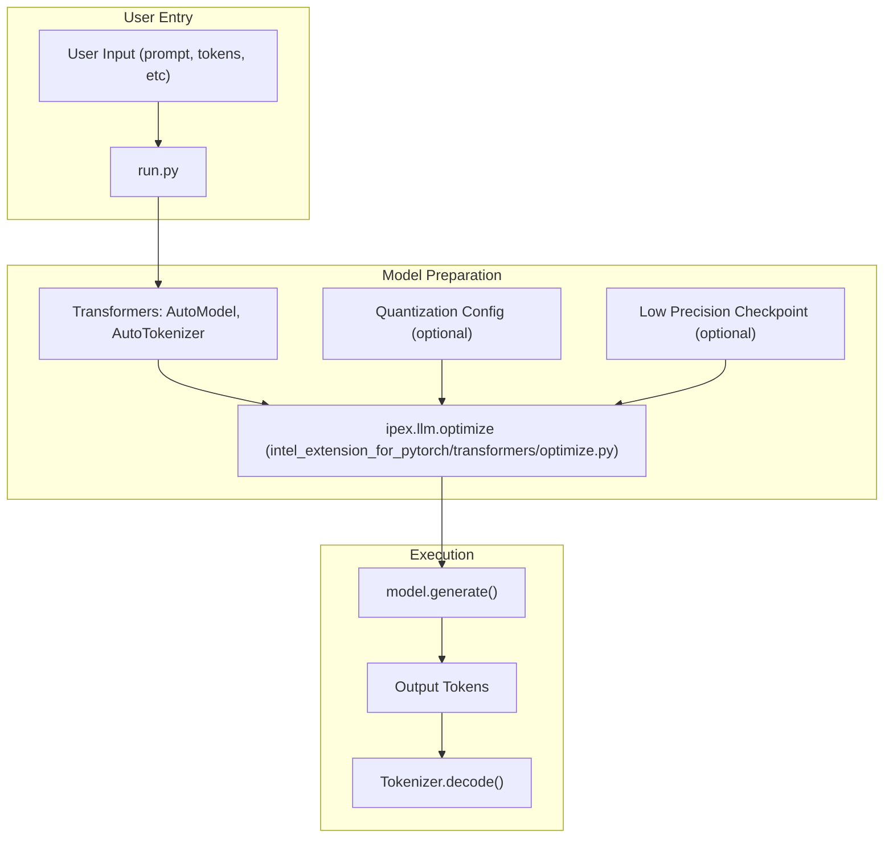
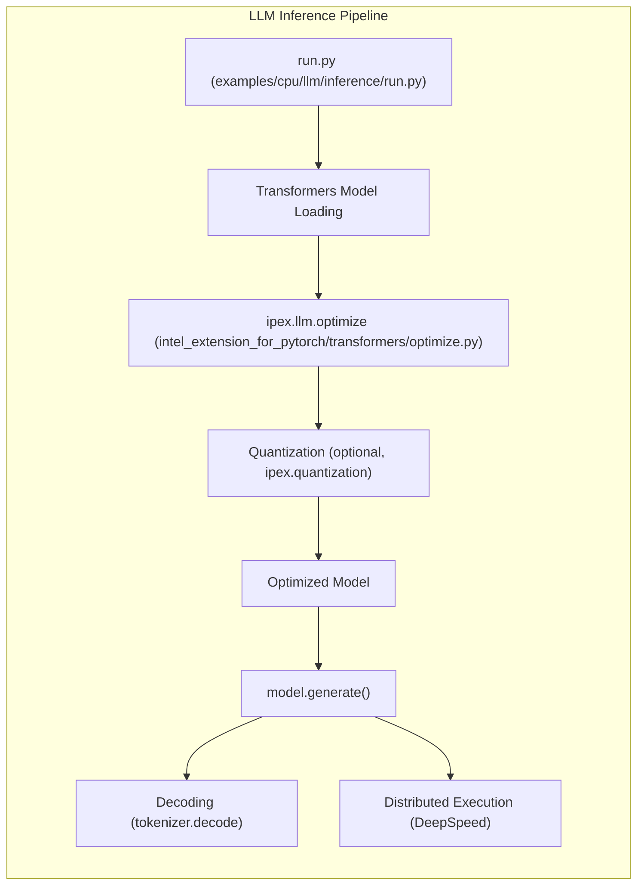
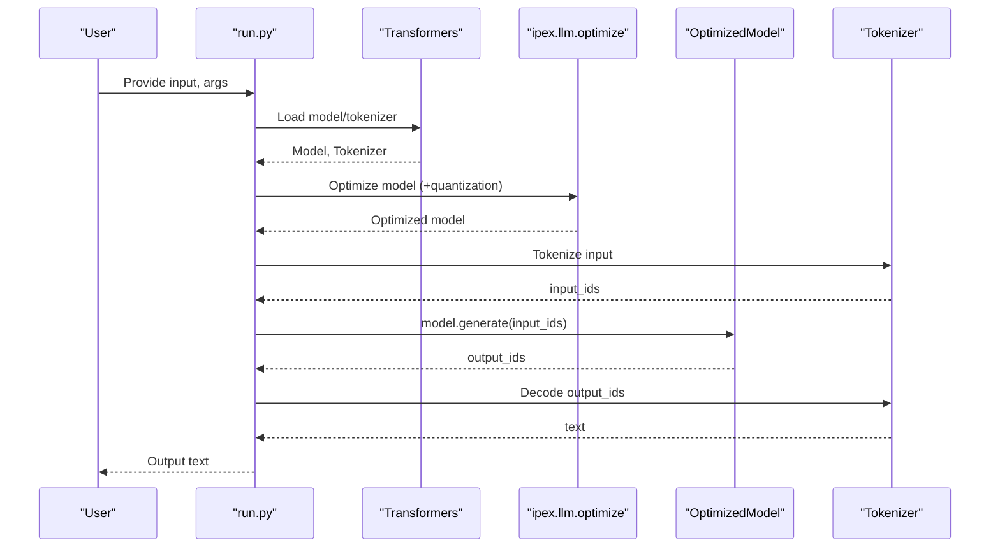
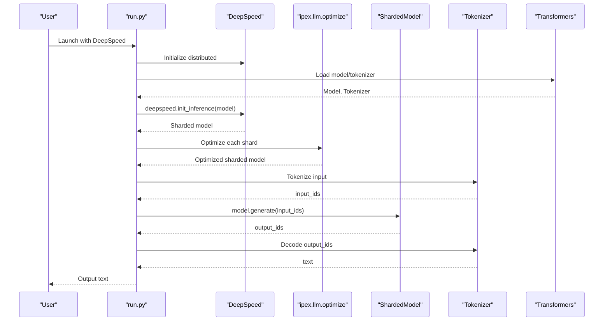

<!-- source: DeepWiki mcp.deepwiki.com · repo intel/intel-extension-for-pytorch · page 5.3 LLM Inference Pipeline · fetched 2026-10-21 -->

# LLM Inference Pipeline

<details>
<summary>Relevant source files</summary>

The following files were used as context for generating this wiki page:

- [README.md](README.md)
- [docker/Dockerfile.prebuilt](docker/Dockerfile.prebuilt)
- [docs/_static/htmls/tbl_deepspeed.html](docs/_static/htmls/tbl_deepspeed.html)
- [docs/_static/htmls/tbl_single.html](docs/_static/htmls/tbl_single.html)
- [docs/tutorials/blogs_publications.md](docs/tutorials/blogs_publications.md)
- [docs/tutorials/features/hypertune.md](docs/tutorials/features/hypertune.md)
- [docs/tutorials/installation.md](docs/tutorials/installation.md)
- [docs/tutorials/introduction.rst](docs/tutorials/introduction.rst)
- [docs/tutorials/llm/llm_optimize.md](docs/tutorials/llm/llm_optimize.md)
- [docs/tutorials/releases.md](docs/tutorials/releases.md)
- [examples/cpu/inference/cpp/README.md](examples/cpu/inference/cpp/README.md)
- [examples/cpu/llm/README.md](examples/cpu/llm/README.md)
- [examples/cpu/llm/inference/README.md](examples/cpu/llm/inference/README.md)
- [intel_extension_for_pytorch/transformers/generation/beam_sample.py](intel_extension_for_pytorch/transformers/generation/beam_sample.py)
- [intel_extension_for_pytorch/transformers/generation/beam_search.py](intel_extension_for_pytorch/transformers/generation/beam_search.py)
- [intel_extension_for_pytorch/transformers/generation/greedy_search.py](intel_extension_for_pytorch/transformers/generation/greedy_search.py)
- [intel_extension_for_pytorch/transformers/generation/sample.py](intel_extension_for_pytorch/transformers/generation/sample.py)
- [intel_extension_for_pytorch/transformers/models/cpu/modules/attentions.py](intel_extension_for_pytorch/transformers/models/cpu/modules/attentions.py)
- [intel_extension_for_pytorch/transformers/models/cpu/modules/decoder.py](intel_extension_for_pytorch/transformers/models/cpu/modules/decoder.py)
- [intel_extension_for_pytorch/transformers/models/reference/fusions/mha_fusion.py](intel_extension_for_pytorch/transformers/models/reference/fusions/mha_fusion.py)
- [intel_extension_for_pytorch/transformers/models/reference/models.py](intel_extension_for_pytorch/transformers/models/reference/models.py)
- [intel_extension_for_pytorch/transformers/models/reference/modules/attentions.py](intel_extension_for_pytorch/transformers/models/reference/modules/attentions.py)
- [intel_extension_for_pytorch/transformers/models/reference/modules/decoder.py](intel_extension_for_pytorch/transformers/models/reference/modules/decoder.py)
- [intel_extension_for_pytorch/transformers/optimize.py](intel_extension_for_pytorch/transformers/optimize.py)
- [tests/cpu/test_ipex_optimize_transformers.py](tests/cpu/test_ipex_optimize_transformers.py)
- [tests/cpu/test_ipex_optimize_transformers_nightly.py](tests/cpu/test_ipex_optimize_transformers_nightly.py)

</details>


This page documents the LLM Inference Pipeline in Intel® Extension for PyTorch* (IPEX), which provides an end-to-end system for running optimized Large Language Model (LLM) inference on Intel CPUs. The pipeline covers model loading, optimization, quantization, and distributed execution, with a focus on code-level details and system architecture.

For API-level details, see page [5.1]. For attention kernel details, see page [5.2].

---

## System Overview

The LLM Inference Pipeline orchestrates the following stages:

- Model loading (from Hugging Face or local checkpoint)
- Model optimization via `ipex.llm.optimize`
- Optional quantization (INT8/INT4/NF4)
- Inference execution (single instance or distributed)
- Output decoding

### Diagram: LLM Inference Pipeline and Code Entities



**Sources:**  
- [examples/cpu/llm/inference/README.md:1-102]()  
- [intel_extension_for_pytorch/transformers/optimize.py:1-1050]()  
- [examples/cpu/llm/inference/run.py:24-344]()

## Pipeline Architecture and Code Mapping

The pipeline is implemented as a set of Python scripts and modules, with clear mapping between system stages and code entities.

### Diagram: Pipeline Stages to Code Entities



**Sources:**  
- [examples/cpu/llm/inference/run.py:24-344]()  
- [intel_extension_for_pytorch/transformers/optimize.py:1-1050]()  
- [intel_extension_for_pytorch/transformers/models/reference/models.py:1-2000]()  
- [examples/cpu/llm/inference/distributed/run_generation_with_deepspeed.py:1-100]()

## Execution Workflows

### Single Instance Inference

The single instance workflow is as follows:

1. User provides input and parameters to `run.py`.
2. Model and tokenizer are loaded using Hugging Face Transformers.
3. `ipex.llm.optimize` is called to optimize the model.
4. (Optional) Quantization is configured and applied.
5. Input is tokenized and passed to `model.generate`.
6. Output tokens are decoded to text.

#### Diagram: Single Instance Workflow



**Sources:**  
- [examples/cpu/llm/inference/run.py:24-344]()  
- [examples/cpu/llm/inference/single_instance/run_generation.py:130-350]()

---

### Distributed Inference with DeepSpeed

For large models or high throughput, distributed inference is supported via DeepSpeed.

1. User launches `run.py` with DeepSpeed.
2. Distributed environment is initialized.
3. Model is loaded and sharded via `deepspeed.init_inference`.
4. Each shard is optimized with `ipex.llm.optimize`.
5. Inference is run in parallel across processes.
6. Output is gathered and decoded.

#### Diagram: Distributed Workflow



**Sources:**  
- [examples/cpu/llm/inference/distributed/run_generation_with_deepspeed.py:1-700]()  
- [examples/cpu/llm/inference/distributed/run_accuracy_with_deepspeed.py:200-350]()

## Key Pipeline Components and Code Entities

### Model Loading and Optimization

- **Model loading**: Uses Hugging Face Transformers (`AutoModel`, `AutoTokenizer`).
- **Optimization**: `ipex.llm.optimize` applies graph and kernel optimizations, including operator fusion, memory layout changes, and hardware-specific kernel selection.

#### Code Entities

| Stage                | Code Entity / File Path                                      |
|----------------------|-------------------------------------------------------------|
| Model loading        | `AutoModel`, `AutoTokenizer` (Transformers)                 |
| Optimization         | `ipex.llm.optimize` ([intel_extension_for_pytorch/transformers/optimize.py]()) |
| Quantization         | `ipex.quantization` ([intel_extension_for_pytorch/quantization/]()) |

**Sources:**  
- [intel_extension_for_pytorch/transformers/optimize.py:1-1050]()  
- [examples/cpu/llm/inference/run.py:24-344]()

---

### Quantization

- **Weight-Only Quantization (WOQ)**: Supported for INT8, INT4, and NF4. Reduces memory and improves speed.
- **Configuration**: Quantization config is passed to `ipex.llm.optimize`.
- **Low-precision checkpoint**: Optionally load quantized weights from a checkpoint.

#### Code Entities

| Component           | Code Entity / File Path                                      |
|---------------------|-------------------------------------------------------------|
| Quantization config | `get_weight_only_quant_qconfig_mapping` ([intel_extension_for_pytorch/quantization/]()) |
| WOQ kernels         | `WeightOnlyQuantizedLinear` ([intel_extension_for_pytorch/nn/modules/]()) |

**Sources:**  
- [examples/cpu/llm/inference/single_instance/run_quantization.py:75-290]()  
- [intel_extension_for_pytorch/transformers/optimize.py:1-1050]()

---

### Generation

- **Input processing**: Tokenization using Hugging Face tokenizer.
- **Text generation**: `model.generate()` with parameters (e.g., `do_sample`, `num_beams`, `max_new_tokens`).
- **Decoding**: Output tokens are decoded to text.

#### Code Entities

| Stage         | Code Entity / File Path                                      |
|---------------|-------------------------------------------------------------|
| Tokenization  | `AutoTokenizer` (Transformers)                              |
| Generation    | `model.generate` ([intel_extension_for_pytorch/transformers/models/reference/models.py]()) |
| Decoding      | `Tokenizer.decode` (Transformers)                           |

**Sources:**  
- [examples/cpu/llm/inference/single_instance/run_generation.py:270-460]()  
- [intel_extension_for_pytorch/transformers/models/reference/models.py:1-2000]()

---

### Distributed Inference (DeepSpeed)

- **Sharding**: Model is sharded using `deepspeed.init_inference`.
- **Optimization**: Each shard is optimized with `ipex.llm.optimize`.
- **Parallel execution**: Inference is run in parallel across processes.

#### Code Entities

| Stage         | Code Entity / File Path                                      |
|---------------|-------------------------------------------------------------|
| DeepSpeed     | `deepspeed.init_inference`                                  |
| Sharded model | `ipex.llm.optimize` (per shard)                             |

**Sources:**  
- [examples/cpu/llm/inference/distributed/run_generation_with_deepspeed.py:540-700]()  
- [intel_extension_for_pytorch/transformers/optimize.py:1-1050]()

## Command-Line Interface

The main entry point for the LLM Inference Pipeline is `run.py`. It exposes options for model selection, data type, quantization, generation parameters, and distributed execution.

| Category         | Example Parameters                                                                 |
|------------------|-----------------------------------------------------------------------------------|
| Model Selection  | `--model-id`, `--config-file`                                                     |
| Data Type        | `--dtype` (float32, bfloat16, float16)                                            |
| Quantization     | `--ipex-weight-only-quantization`, `--weight-dtype`, `--lowp-mode`                |
| Generation       | `--max-new-tokens`, `--greedy`, `--streaming`                                     |
| Input            | `--input-tokens`, `--prompt`, `--image-url`, `--audio`                            |
| Performance      | `--benchmark`, `--num-iter`, `--num-warmup`                                       |
| Distribution     | `--autotp`, `--shard-model`, `--deepspeed`                                        |

**Sources:**  
- [examples/cpu/llm/inference/run.py:24-344]()  
- [examples/cpu/llm/inference/README.md:115-133]()

## Usage Examples

### Single Instance

- BF16 inference:
  ```
  python run.py --benchmark -m meta-llama/Meta-Llama-3.1-8B-Instruct --dtype bfloat16 --ipex
  ```
- INT8 weight-only quantization:
  ```
  python run.py --benchmark -m meta-llama/Meta-Llama-3.1-8B-Instruct --ipex-weight-only-quantization --weight-dtype INT8 --quant-with-amp --output-dir "saved_results"
  ```
- INT4 weight-only quantization:
  ```
  python run.py --benchmark -m ./Llama-3.1-8B-GPTQ --ipex-weight-only-quantization --weight-dtype INT4 --lowp-mode BF16 --quant-with-amp --output-dir "saved_results"
  ```

### Distributed (DeepSpeed)

- BF16 distributed inference:
  ```
  deepspeed --bind_cores_to_rank run.py --benchmark -m meta-llama/Meta-Llama-3.1-8B-Instruct --dtype bfloat16 --ipex --autotp --shard-model
  ```
- INT8 distributed inference:
  ```
  deepspeed --bind_cores_to_rank run.py --benchmark -m meta-llama/Meta-Llama-3.1-8B-Instruct --ipex-weight-only-quantization --weight-dtype INT8 --quant-with-amp --autotp --shard-model --output-dir "saved_results"
  ```

**Sources:**  
- [examples/cpu/llm/inference/README.md:147-188]()

## Pipeline Code Structure

The LLM Inference Pipeline is implemented as a set of scripts and modules, each with a clear responsibility.

### Diagram: Code Structure and Relationships

```mermaid
classDiagram
    class "run.py (examples/cpu/llm/inference/run.py)" {
        +parse_args()
        +run_generation()
        +run_generation_with_deepspeed()
    }
    class "single_instance/run_generation.py" {
        +load_model()
        +optimize_model()
        +generate()
    }
    class "distributed/run_generation_with_deepspeed.py" {
        +init_distributed()
        +load_model()
        +init_inference()
        +optimize_model()
        +generate()
    }
    class "single_instance/run_quantization.py" {
        +load_model()
        +configure_quantization()
        +optimize_model()
        +save_quantized_model()
    }
    class "utils/supported_models.py" {
        +MODEL_CLASSES
    }
    class "ipex.llm.optimize (intel_extension_for_pytorch/transformers/optimize.py)" {
        +optimize()
    }

    "run.py (examples/cpu/llm/inference/run.py)" --> "single_instance/run_generation.py"
    "run.py (examples/cpu/llm/inference/run.py)" --> "distributed/run_generation_with_deepspeed.py"
    "run.py (examples/cpu/llm/inference/run.py)" --> "single_instance/run_quantization.py"
    "single_instance/run_generation.py" --> "utils/supported_models.py"
    "distributed/run_generation_with_deepspeed.py" --> "utils/supported_models.py"
    "single_instance/run_quantization.py" --> "utils/supported_models.py"
    "single_instance/run_generation.py" --> "ipex.llm.optimize (intel_extension_for_pytorch/transformers/optimize.py)"
    "distributed/run_generation_with_deepspeed.py" --> "ipex.llm.optimize (intel_extension_for_pytorch/transformers/optimize.py)"
    "single_instance/run_quantization.py" --> "ipex.llm.optimize (intel_extension_for_pytorch/transformers/optimize.py)"
```

**Sources:**  
- [examples/cpu/llm/inference/run.py:24-344]()  
- [examples/cpu/llm/inference/single_instance/run_generation.py:1-127]()  
- [examples/cpu/llm/inference/distributed/run_generation_with_deepspeed.py:1-100]()  
- [examples/cpu/llm/inference/utils/supported_models.py:1-55]()  
- [intel_extension_for_pytorch/transformers/optimize.py:1-1050]()

### Optimizations Applied

The following optimizations are applied by `ipex.llm.optimize`:

| Optimization                | Description                                                                 |
|-----------------------------|-----------------------------------------------------------------------------|
| Memory Layout Optimization  | Reorders weights for efficient memory access                                |
| Operation Fusion            | Fuses multiple operations into a single kernel                              |
| Custom Kernels              | Uses specialized CPU kernels for attention, linear, and normalization ops   |
| KV Cache Optimization       | Optimizes key-value cache for generation                                    |
| Weight-Only Quantization    | Reduces model size and improves speed with minimal accuracy loss            |

**Sources:**  
- [intel_extension_for_pytorch/transformers/optimize.py:1-1050]()  
- [intel_extension_for_pytorch/transformers/models/reference/modules/attentions.py:1-900]()  
- [examples/cpu/llm/inference/README.md:104-107]()

## Supported Models and Data Types

The pipeline supports a broad set of LLMs and data types:

| Model Family | Example Models | FP32 | BF16 | INT8 | INT4 |
|--------------|----------------|------|------|------|------|
| LLAMA        | Llama-2-7b-hf, Meta-Llama-3-8B | ✅ | ✅ | ✅ | ✅ |
| GPT-J        | EleutherAI/gpt-j-6b             | ✅ | ✅ | ✅ | ✅ |
| GPT-NEOX     | EleutherAI/gpt-neox-20b         | ✅ | ✅ | ✅ | ✅ |
| FALCON       | tiiuae/falcon-7b                | ✅ | ✅ | ✅ | ✅ |
| Mistral      | mistralai/Mistral-7B-v0.1       | ✅ | ✅ | ✅ | ✅ |
| Mixtral      | mistralai/Mixtral-8x7B-v0.1     | ✅ | ✅ | ✅ | ✅ |
| Phi          | microsoft/phi-2, Phi-3          | ✅ | ✅ | ✅ | ✅ |
| DeepSeek     | deepseek-ai/DeepSeek-V2.5-1210  | ✅ | ✅ | ✅ | ✅ |
| Multimodal   | LLaVA, Whisper, Phi-4-multimodal| ✅ | ✅ | ✅ | ✅ |

Distributed inference (DeepSpeed) supports most of these models in BF16 and INT8.

**Sources:**  
- [examples/cpu/llm/inference/README.md:1-102]()  
- [examples/cpu/llm/inference/utils/supported_models.py:1-55]()  
- [README.md:13-75]()

## Performance Considerations

- **Data Type**: BF16 is recommended for best performance/accuracy tradeoff. INT8/INT4 quantization further improves speed and reduces memory.
- **Batch Size**: Larger batches improve throughput; single-token batches are best for latency.
- **Distributed Inference**: Use DeepSpeed for models exceeding single-node memory.
- **NUMA/Threads**: Use `numactl` and set `OMP_NUM_THREADS` to match hardware.

**Sources:**  
- [examples/cpu/llm/inference/README.md:271-289]()  
- [examples/cpu/llm/inference/README.md:384-389]()

## DeepSpeed Integration

The pipeline supports distributed inference via DeepSpeed:

- **Model sharding**: `deepspeed.init_inference` splits the model across processes.
- **IPEX optimization**: Each shard is optimized with `ipex.llm.optimize`.
- **Quantization**: Supported in distributed mode.

### Diagram: DeepSpeed Integration and Code Entities

```mermaid
flowchart TD
    "ModelID" --> "Transformers: Load Model"
    "Transformers: Load Model" --> "deepspeed.init_inference"
    "deepspeed.init_inference" --> "IPEX: ipex.llm.optimize"
    "IPEX: ipex.llm.optimize" --> "Sharded Optimized Model"
    "Sharded Optimized Model" --> "model.generate"
    "model.generate" --> "Output IDs"
    "Output IDs" --> "Tokenizer.decode"
    "Tokenizer.decode" --> "Output Text"
```

**Sources:**  
- [examples/cpu/llm/inference/distributed/run_generation_with_deepspeed.py:400-700]()  
- [examples/cpu/llm/inference/README.md:392-475]()  
- [examples/cpu/llm/inference/distributed/run_accuracy_with_deepspeed.py:300-500]()

## Conclusion

The LLM Inference Pipeline in Intel® Extension for PyTorch* provides a comprehensive solution for running inference on large language models with optimizations specific to Intel hardware. It supports various precision formats and quantization techniques to balance between performance and accuracy, and offers both single-instance and distributed inference modes to accommodate different deployment scenarios.

By leveraging this pipeline, users can achieve significant performance improvements when running LLM inference on Intel CPUs, making it possible to deploy state-of-the-art language models efficiently in production environments.

---

