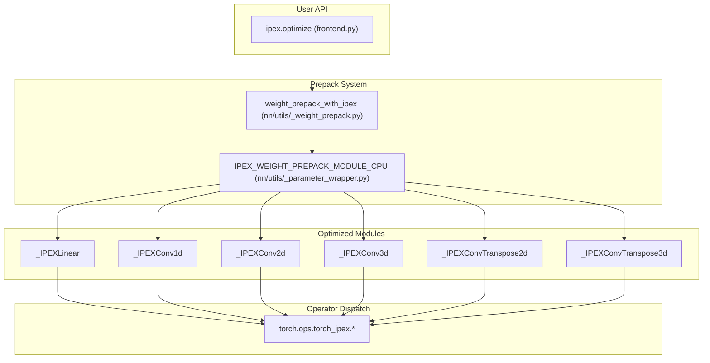
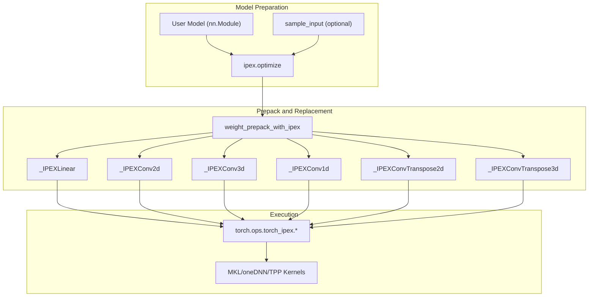
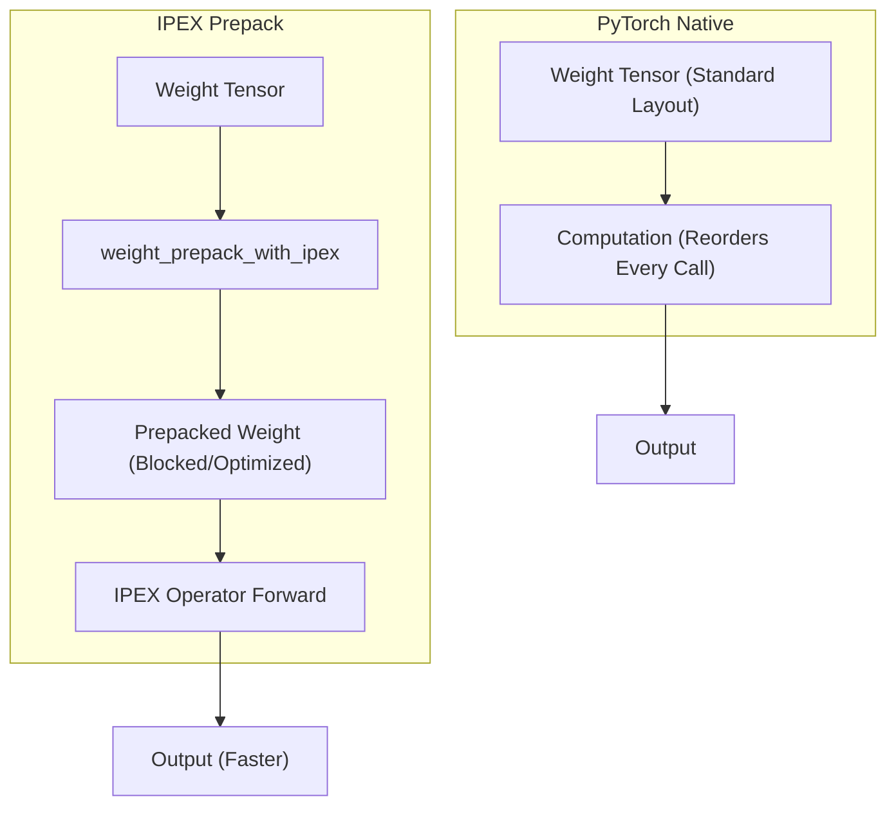
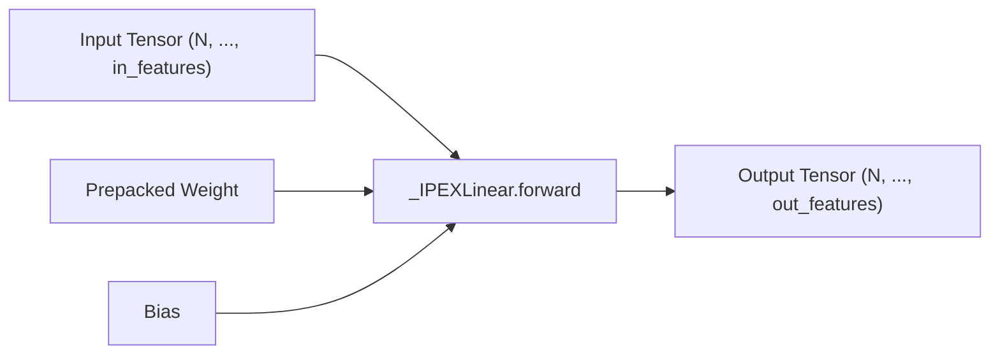
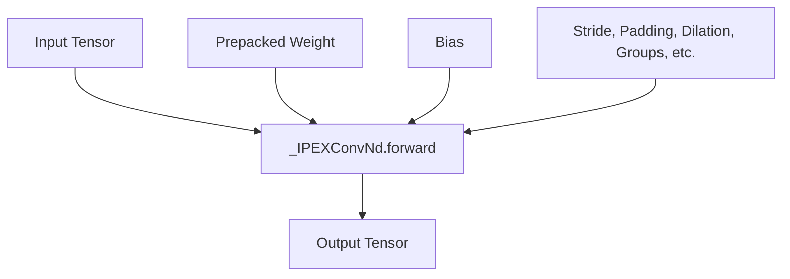
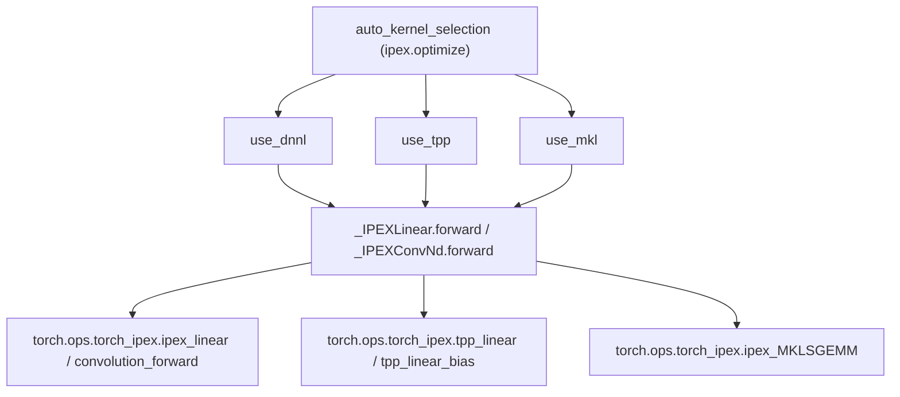
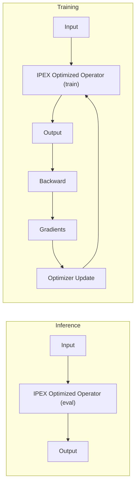

<!-- source: DeepWiki mcp.deepwiki.com · repo intel/intel-extension-for-pytorch · page 6.1 Linear and Convolution Operators · fetched 2026-10-21 -->

# Linear and Convolution Operators

<details>
<summary>Relevant source files</summary>

The following files were used as context for generating this wiki page:

- [intel_extension_for_pytorch/frontend.py](intel_extension_for_pytorch/frontend.py)
- [intel_extension_for_pytorch/nn/utils/_model_convert.py](intel_extension_for_pytorch/nn/utils/_model_convert.py)
- [intel_extension_for_pytorch/nn/utils/_parameter_wrapper.py](intel_extension_for_pytorch/nn/utils/_parameter_wrapper.py)
- [intel_extension_for_pytorch/nn/utils/_weight_cast.py](intel_extension_for_pytorch/nn/utils/_weight_cast.py)
- [intel_extension_for_pytorch/nn/utils/_weight_prepack.py](intel_extension_for_pytorch/nn/utils/_weight_prepack.py)
- [intel_extension_for_pytorch/optim/_functional.py](intel_extension_for_pytorch/optim/_functional.py)
- [intel_extension_for_pytorch/optim/_lamb.py](intel_extension_for_pytorch/optim/_lamb.py)
- [intel_extension_for_pytorch/optim/_optimizer_utils.py](intel_extension_for_pytorch/optim/_optimizer_utils.py)
- [intel_extension_for_pytorch/quantization/_quantize.py](intel_extension_for_pytorch/quantization/_quantize.py)
- [intel_extension_for_pytorch/utils/weight_only_quantization.py](intel_extension_for_pytorch/utils/weight_only_quantization.py)
- [tests/cpu/common_utils.py](tests/cpu/common_utils.py)
- [tests/cpu/test_deepspeed.py](tests/cpu/test_deepspeed.py)
- [tests/cpu/test_ipex_optimize.py](tests/cpu/test_ipex_optimize.py)
- [tests/cpu/test_optimizer.py](tests/cpu/test_optimizer.py)
- [tests/cpu/test_weight_cast.py](tests/cpu/test_weight_cast.py)
- [tests/cpu/test_weight_prepack.py](tests/cpu/test_weight_prepack.py)

</details>


This page documents the operator-level optimizations for linear and convolution layers in Intel Extension for PyTorch (IPEX). These optimizations are central to IPEX's performance improvements for both training and inference on Intel CPUs. For attention and normalization operator details, see page 6.2.

## System Context and Code Entities

Linear and convolution operator optimizations are implemented as custom module subclasses and operator dispatch logic, and are orchestrated by the IPEX frontend and weight prepacking utilities.

**Key code entities:**
- `intel_extension_for_pytorch.nn.utils._weight_prepack.py`:
  - Classes: `_IPEXLinear`, `_IPEXConv1d`, `_IPEXConv2d`, `_IPEXConv3d`, `_IPEXConvTranspose2d`, `_IPEXConvTranspose3d`
  - Functions: `weight_prepack_with_ipex`, `TPPLinear_weight_prepack`, `Apply_TPPLinear_weight_prepack`
- `intel_extension_for_pytorch/frontend.py`:
  - Function: `ipex.optimize`
- `intel_extension_for_pytorch/nn/utils/_parameter_wrapper.py`:
  - Function: `IPEX_WEIGHT_PREPACK_MODULE_CPU`

### Diagram: System-to-Code Mapping for Linear/Conv Optimization


Sources: [intel_extension_for_pytorch/frontend.py:169-609](), [intel_extension_for_pytorch/nn/utils/_weight_prepack.py:489-605](), [intel_extension_for_pytorch/nn/utils/_parameter_wrapper.py:26-61]()

## Overview of Optimizations

IPEX provides the following optimizations for linear and convolution operators:
- **Weight prepacking**: Converts weights to blocked or backend-specific layouts ahead of execution.
- **Memory format selection**: Supports and optimizes for `channels_last`, `channels_last_3d`, and custom 1D layouts.
- **Auto kernel selection**: Chooses between MKL, oneDNN, and TPP (Tensor Processing Primitives) backends based on data type, shape, and environment.
- **Precision support**: Enables FP32, BF16, and FP16 execution, with automatic casting and optimizer state management.
- **Operator replacement**: Replaces standard PyTorch modules with optimized IPEX subclasses for both inference and training.

### Diagram: Data and Control Flow in Linear/Conv Optimization


Sources: [intel_extension_for_pytorch/frontend.py:169-609](), [intel_extension_for_pytorch/nn/utils/_weight_prepack.py:489-605]()


## Weight Prepacking

Weight prepacking is the process of converting weight tensors into a backend-optimized memory layout before computation. This reduces or eliminates runtime reordering overhead and enables direct use of blocked or packed formats by the underlying kernel.

- For linear and convolution layers, prepacking is performed by the `weight_prepack_with_ipex` function, which replaces standard modules with IPEX subclasses and stores prepacked weights in the module context.
- Prepacking is controlled by the `weights_prepack` argument to `ipex.optimize` (enabled by default at "O1" level).
- Prepacking can use sample input shapes (via `sample_input`) to select optimal block sizes and layouts.

### Diagram: Weight Prepacking Workflow


Sources: [intel_extension_for_pytorch/nn/utils/_weight_prepack.py:489-605](), [intel_extension_for_pytorch/frontend.py:169-609]()


## Supported Operators and Module Replacement

IPEX replaces standard PyTorch modules with optimized subclasses for linear and convolution operations. These subclasses implement prepacked weight handling and dispatch to the appropriate backend.

### Table: IPEX Optimized Module Classes

| PyTorch Module                | IPEX Replacement Class         | File/Code Entity                |
|-------------------------------|-------------------------------|---------------------------------|
| `torch.nn.Linear`             | `_IPEXLinear`                 | _weight_prepack.py              |
| `torch.nn.Conv1d`             | `_IPEXConv1d`                 | _weight_prepack.py              |
| `torch.nn.Conv2d`             | `_IPEXConv2d`                 | _weight_prepack.py              |
| `torch.nn.Conv3d`             | `_IPEXConv3d`                 | _weight_prepack.py              |
| `torch.nn.ConvTranspose2d`    | `_IPEXConvTranspose2d`        | _weight_prepack.py              |
| `torch.nn.ConvTranspose3d`    | `_IPEXConvTranspose3d`        | _weight_prepack.py              |

Sources: [intel_extension_for_pytorch/nn/utils/_weight_prepack.py:286-471](), [intel_extension_for_pytorch/nn/utils/_parameter_wrapper.py:26-61]()

### Linear Operators

- Supports 2D, 3D, and 4D input tensors.
- Handles optional bias, various input/output feature sizes.
- Precision: FP32, BF16, FP16.
- Backend: MKL (FP32), oneDNN (mixed precision), TPP (for certain shapes).

#### Diagram: Linear Operator Data Flow


Sources: [intel_extension_for_pytorch/nn/utils/_weight_prepack.py:286-344]()

### Convolution Operators

- Supports Conv1d, Conv2d, Conv3d, and their transposed variants.
- Handles kernel size, stride, padding, dilation, groups, bias, and padding mode.
- Supports standard and channels last memory formats.
- Fallback to native PyTorch if unsupported parameter combinations are detected.

#### Diagram: Convolution Operator Data Flow


Sources: [intel_extension_for_pytorch/nn/utils/_weight_prepack.py:179-250](), [intel_extension_for_pytorch/nn/utils/_weight_prepack.py:412-461]()

### Transposed Convolution

- Optimized for ConvTranspose2d and ConvTranspose3d.
- Supports output padding.
- Falls back to PyTorch if `padding - output_padding + stride <= 0`.

Sources: [intel_extension_for_pytorch/nn/utils/_weight_prepack.py:412-471](), [intel_extension_for_pytorch/nn/utils/_parameter_wrapper.py:164-175]()


## Memory Format Optimizations

IPEX supports and optimizes for multiple memory formats to maximize cache efficiency and vectorization:

- **Channels Last (2D):** Use `memory_format=torch.channels_last` for Conv2d.
- **Channels Last 3D:** Use `memory_format=torch.channels_last_3d` for Conv3d.
- **Channels Last 1D:** Use `to_channels_last_1d` utility for Conv1d.

### Diagram: Memory Format Conversion Utilities

```mermaid
flowchart LR
    NCHW["NCHW (2D)"] -->|to(memory_format=torch.channels_last)| NHWC["NHWC (2D)"]
    NCL["NCL (1D)"] -->|to_channels_last_1d| NLC["NLC (1D)"]
    NCDHW["NCDHW (3D)"] -->|to(memory_format=torch.channels_last_3d)| NDHWC["NDHWC (3D)"]
```
Sources: [intel_extension_for_pytorch/frontend.py:611-635](), [tests/cpu/test_weight_prepack.py:60-118]()


## Backend and Kernel Selection

IPEX supports multiple computational backends for linear and convolution operators:

- **MKL (Math Kernel Library):** Default for FP32.
- **oneDNN:** Used for mixed precision (BF16/FP16) and when `auto_kernel_selection=True`.
- **TPP (Tensor Processing Primitives):** Used for certain large-batch or LLM shapes.

Backend selection is controlled by the `auto_kernel_selection` argument to `ipex.optimize`. The operator class dispatches to the appropriate backend in its `forward` method.

### Diagram: Backend Selection Logic


Sources: [intel_extension_for_pytorch/nn/utils/_weight_prepack.py:302-344](), [intel_extension_for_pytorch/frontend.py:169-609]()


## Data Type and Precision Support

IPEX linear and convolution operators support the following data types:

| Data Type           | Description                    | CPU Requirements                  |
|---------------------|-------------------------------|-----------------------------------|
| `torch.float32`     | Full precision                | All CPUs                          |
| `torch.bfloat16`    | Brain Floating Point           | CPUs with AVX512-BF16             |
| `torch.float16`     | Half precision                | CPUs with AVX512-FP16             |

- Data type is set via the `dtype` argument to `ipex.optimize`.
- For BF16/FP16, use `torch.cpu.amp.autocast` for automatic mixed precision.
- Optimizer state and parameter casting are handled by IPEX utilities.

Sources: [intel_extension_for_pytorch/frontend.py:169-609](), [intel_extension_for_pytorch/nn/utils/_weight_cast.py:8-88]()


## Inference and Training Modes

IPEX optimizes linear and convolution operators for both inference and training:

- **Inference:** Prepacked weights, memory format optimization, backend selection, and operator fusion.
- **Training:** Gradient computation, optimizer state management, and support for mixed precision (including master weight and split master weight for BF16).

### Diagram: Operator Lifecycle in Inference and Training


Sources: [intel_extension_for_pytorch/nn/utils/_weight_prepack.py:286-344](), [intel_extension_for_pytorch/nn/utils/_weight_cast.py:8-88](), [intel_extension_for_pytorch/optim/_optimizer_utils.py:52-151]()


## Performance Considerations

To maximize performance with IPEX's linear and convolution operators:

- Use `channels_last` or `channels_last_3d` memory format for 2D/3D convolutions.
- Use `to_channels_last_1d` for 1D convolutions.
- Enable mixed precision (BF16/FP16) on supported hardware and wrap forward passes with `torch.cpu.amp.autocast`.
- Provide representative `sample_input` to `ipex.optimize` for optimal prepacking.
- Consider operator fusion opportunities (see page 3.2).

Sources: [intel_extension_for_pytorch/frontend.py:169-609](), [tests/cpu/test_weight_prepack.py:60-118]()


## Integration with Other IPEX Features

Linear and convolution operations are fundamental building blocks that integrate with other IPEX features:

- [Weight Prepacking](#3.3): Reorganizes weights for efficient memory access
- [JIT Fusion System](#3.2): Fuses operations to reduce memory traffic
- [torch.compile Integration](#3.4): Works with PyTorch's compilation pipeline
- [CPU Autocast](#3.5): Enables automatic mixed precision on CPUs
- [Deployment and Performance Tuning](#7): Further optimizations for production deployment

---

