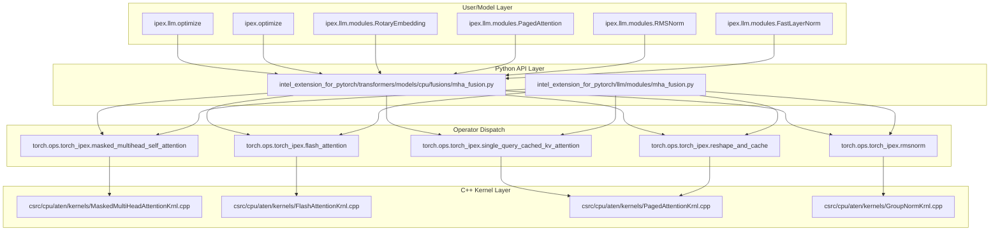

<!-- source: DeepWiki mcp.deepwiki.com · repo intel/intel-extension-for-pytorch · page 6.2 Attention and Normalization Operators · fetched 2026-10-21 -->

# Attention and Normalization Operators

<details>
<summary>Relevant source files</summary>

The following files were used as context for generating this wiki page:

- [csrc/cpu/aten/FlashAttention.cpp](csrc/cpu/aten/FlashAttention.cpp)
- [csrc/cpu/aten/FlashAttention.h](csrc/cpu/aten/FlashAttention.h)
- [csrc/cpu/aten/GroupNorm.cpp](csrc/cpu/aten/GroupNorm.cpp)
- [csrc/cpu/aten/MaskedMultiHeadAttention.cpp](csrc/cpu/aten/MaskedMultiHeadAttention.cpp)
- [csrc/cpu/aten/MaskedMultiHeadAttention.h](csrc/cpu/aten/MaskedMultiHeadAttention.h)
- [csrc/cpu/aten/PagedAttention.cpp](csrc/cpu/aten/PagedAttention.cpp)
- [csrc/cpu/aten/PagedAttention.h](csrc/cpu/aten/PagedAttention.h)
- [csrc/cpu/aten/kernels/FlashAttentionKrnl.cpp](csrc/cpu/aten/kernels/FlashAttentionKrnl.cpp)
- [csrc/cpu/aten/kernels/GroupNormKrnl.cpp](csrc/cpu/aten/kernels/GroupNormKrnl.cpp)
- [csrc/cpu/aten/kernels/MaskedMultiHeadAttentionKrnl.cpp](csrc/cpu/aten/kernels/MaskedMultiHeadAttentionKrnl.cpp)
- [csrc/cpu/aten/kernels/PagedAttentionKrnl.cpp](csrc/cpu/aten/kernels/PagedAttentionKrnl.cpp)
- [csrc/cpu/aten/utils/mkl_gemm.h](csrc/cpu/aten/utils/mkl_gemm.h)
- [csrc/cpu/vec/general/fill_ker.h](csrc/cpu/vec/general/fill_ker.h)
- [csrc/cpu/vec/vec.h](csrc/cpu/vec/vec.h)
- [csrc/cpu/vec/vec512/vec512_fp8.h](csrc/cpu/vec/vec512/vec512_fp8.h)
- [intel_extension_for_pytorch/llm/modules/mha_fusion.py](intel_extension_for_pytorch/llm/modules/mha_fusion.py)
- [intel_extension_for_pytorch/transformers/models/cpu/fusions/mha_fusion.py](intel_extension_for_pytorch/transformers/models/cpu/fusions/mha_fusion.py)
- [tests/cpu/test_cpu_ops.py](tests/cpu/test_cpu_ops.py)
- [tests/cpu/test_flash_attention_varlen.py](tests/cpu/test_flash_attention_varlen.py)
- [tests/cpu/test_masked_mha.py](tests/cpu/test_masked_mha.py)
- [tests/cpu/test_masked_mha_fp8.py](tests/cpu/test_masked_mha_fp8.py)
- [tests/cpu/test_paged_attention.py](tests/cpu/test_paged_attention.py)
- [tests/cpu/test_paged_attention_fp8.py](tests/cpu/test_paged_attention_fp8.py)

</details>


## Purpose and Scope

This page documents the optimized attention and normalization operators in Intel Extension for PyTorch (IPEX), focusing on their implementation, integration, and hardware-specific optimizations for Intel CPUs. These operators are foundational for transformer-based models and LLMs, and are used both directly and as part of higher-level systems such as LLM optimization and quantization. For LLM-specific usage and APIs, see page [5](#5).

Sources: [intel_extension_for_pytorch/transformers/models/cpu/fusions/mha_fusion.py:1-693](), [csrc/cpu/aten/kernels/MaskedMultiHeadAttentionKrnl.cpp:1-1030](), [csrc/cpu/aten/kernels/GroupNormKrnl.cpp:1-690](), [csrc/cpu/aten/kernels/FlashAttentionKrnl.cpp:1-1000](), [csrc/cpu/aten/kernels/PagedAttentionKrnl.cpp:1-1000](), [intel_extension_for_pytorch/llm/modules/mha_fusion.py:1-400]()

## System Integration and Architecture

IPEX's attention and normalization operators are implemented as custom C++/CUDA kernels and exposed to Python via `torch.ops.torch_ipex.*`. These operators are invoked by both high-level APIs (such as `ipex.llm.optimize`) and directly by model modules.

### System-to-Code Mapping Diagram


Sources: [intel_extension_for_pytorch/transformers/models/cpu/fusions/mha_fusion.py:1-693](), [intel_extension_for_pytorch/llm/modules/mha_fusion.py:1-400](), [csrc/cpu/aten/kernels/MaskedMultiHeadAttentionKrnl.cpp:1-1030](), [csrc/cpu/aten/kernels/FlashAttentionKrnl.cpp:1-1000](), [csrc/cpu/aten/kernels/PagedAttentionKrnl.cpp:1-1000](), [csrc/cpu/aten/kernels/GroupNormKrnl.cpp:1-690]()

IPEX supports multiple data types (FP32, BF16, FP16, FP8) and adapts to available CPU features (AVX-512, AMX) at runtime.

Sources: [csrc/cpu/aten/kernels/MaskedMultiHeadAttentionKrnl.cpp:1-1030](), [csrc/cpu/aten/kernels/FlashAttentionKrnl.cpp:1-1000](), [csrc/cpu/aten/kernels/PagedAttentionKrnl.cpp:1-1000](), [csrc/cpu/aten/kernels/GroupNormKrnl.cpp:1-690]()

## Optimized Attention Operator Implementations

IPEX provides several optimized attention operator variants, including Masked Multi-Head Attention (MHA), Flash Attention, and Paged Attention, each with hardware-specific and data type-specific optimizations.

### Data Flow: Masked Multi-Head Attention

```mermaid
flowchart TD
    "Query[Tensor]" --> "reduce_head[Q·K dot product]"
    "Key[Tensor]" --> "reduce_head[Q·K dot product]"
    "reduce_head[Q·K dot product]" --> "Scale[1/sqrt(head_dim)]"
    "Scale[1/sqrt(head_dim)]" --> "Mask[+ Mask (optional)]"
    "Mask[+ Mask (optional)]" --> "Softmax"
    "Softmax" --> "mul_attenion_weights_and_value_of_head[Apply to Value]"
    "Value[Tensor]" --> "mul_attenion_weights_and_value_of_head[Apply to Value]"
    "mul_attenion_weights_and_value_of_head[Apply to Value]" --> "Output[Attention Output]"
```
Sources: [csrc/cpu/aten/kernels/MaskedMultiHeadAttentionKrnl.cpp:23-447]()

#### Key Functions and Templates

- `reduce_head`: Computes the dot product between query and key vectors, with specializations for FP32, BF16, FP16, and FP8.
- `mul_attenion_weights_and_value_of_head`: Multiplies attention weights by value vectors, with support for accumulation and caching.
- `masked_multihead_self_attention_forward_cpu`: Main entry for the masked MHA kernel.

Sources: [csrc/cpu/aten/kernels/MaskedMultiHeadAttentionKrnl.cpp:23-447](), [csrc/cpu/aten/MaskedMultiHeadAttention.cpp:1-100]()

### Flash Attention and Paged Attention

IPEX implements Flash Attention and Paged Attention for efficient long-sequence and LLM inference. These are exposed via `torch.ops.torch_ipex.flash_attention` and `torch.ops.torch_ipex.single_query_cached_kv_attention`.

- **Flash Attention**: Blocked, memory-efficient attention with support for masks and causal inference.
- **Paged Attention**: Supports key-value caching and block tables for efficient decoding in LLMs.

Sources: [csrc/cpu/aten/kernels/FlashAttentionKrnl.cpp:1-1000](), [csrc/cpu/aten/kernels/PagedAttentionKrnl.cpp:1-1000](), [intel_extension_for_pytorch/transformers/models/cpu/fusions/mha_fusion.py:145-492]()

#### Example: Paged Attention Data Flow

```mermaid
flowchart TD
    "Query[Tensor]" --> "single_query_cached_kv_attention"
    "KeyCache[Tensor]" --> "single_query_cached_kv_attention"
    "ValueCache[Tensor]" --> "single_query_cached_kv_attention"
    "BlockTables[Tensor]" --> "single_query_cached_kv_attention"
    "single_query_cached_kv_attention" --> "Output[Tensor]"
```
Sources: [csrc/cpu/aten/PagedAttention.cpp:13-52](), [csrc/cpu/aten/kernels/PagedAttentionKrnl.cpp:655-1000]()

### Implementation Highlights

| Component | Description | Code Reference |
|-----------|-------------|---------------|
| `reduce_head` | Optimized Q·K dot product, with AVX-512 and data type specializations | [csrc/cpu/aten/kernels/MaskedMultiHeadAttentionKrnl.cpp:23-222]() |
| `mul_attenion_weights_and_value_of_head` | Applies attention weights to value vectors, supports accumulation and caching | [csrc/cpu/aten/kernels/MaskedMultiHeadAttentionKrnl.cpp:452-528]() |
| Key/Value Caching | Efficient storage and update of key/value tensors for decoding | [csrc/cpu/aten/kernels/PagedAttentionKrnl.cpp:655-1000]() |
| Data Type Specialization | Template specializations for FP32, BF16, FP16, FP8 | [csrc/cpu/aten/kernels/MaskedMultiHeadAttentionKrnl.cpp:53-402]() |

Sources: [csrc/cpu/aten/kernels/MaskedMultiHeadAttentionKrnl.cpp:23-528](), [csrc/cpu/aten/kernels/PagedAttentionKrnl.cpp:655-1000]()

## Data Type and Hardware-Specific Optimizations

IPEX attention and normalization operators are optimized for multiple data types and CPU instruction sets.

### Data Type Specialization Table

| Data Type | Optimization Approach | Example Code |
|-----------|----------------------|-------------|
| FP32      | Native AVX-512 vectorization | [csrc/cpu/aten/kernels/MaskedMultiHeadAttentionKrnl.cpp:53-168]() |
| BF16      | Convert to FP32 for compute, AVX-512 vectorization | [csrc/cpu/aten/kernels/MaskedMultiHeadAttentionKrnl.cpp:83-195, 297-364]() |
| FP16      | Convert to FP32 or use AVX-512_FP16 if available | [csrc/cpu/aten/kernels/MaskedMultiHeadAttentionKrnl.cpp:116-147, 224-294]() |
| FP8 (E5M2)| Specialized conversion and compute kernels | [csrc/cpu/aten/kernels/MaskedMultiHeadAttentionKrnl.cpp:297-402]() |

Hardware detection is performed at runtime to select the optimal code path.

Sources: [csrc/cpu/aten/kernels/MaskedMultiHeadAttentionKrnl.cpp:53-402](), [csrc/cpu/aten/kernels/FlashAttentionKrnl.cpp:1-1000](), [csrc/cpu/aten/kernels/PagedAttentionKrnl.cpp:1-1000]()

### Hardware Feature Detection

IPEX dynamically detects available CPU features (e.g., AVX-512, AVX-512_FP16) and selects the best implementation for the current hardware.

```mermaid
flowchart TD
    "is_first_token_optimizable" --> "AVX-512 Path"
    "is_first_token_optimizable" --> "AVX-512_FP16 Path"
    "is_first_token_optimizable" --> "Fallback Path"
```
Sources: [csrc/cpu/aten/kernels/MaskedMultiHeadAttentionKrnl.cpp:17-21](), [csrc/cpu/utils/isa_utils.h:1-100]()

## Softmax and Normalization Operators

Softmax and normalization are essential for attention mechanisms. IPEX provides optimized implementations for both.

### Softmax and Exponential Kernels

- Fast exponential and softmax are implemented using AVX-512 vectorization and fused kernels.
- Fused kernels combine multiple steps (e.g., exponentiation, reduction, normalization) for efficiency.

| Function | Description | Code Reference |
|----------|-------------|---------------|
| `_exp_reduce_sum_fusion_kernel` | Fused exponentiation and sum | [csrc/cpu/aten/kernels/FlashAttentionKrnl.cpp:250-279]() |
| `_mul_reduce_max_fusion_kernel` | Fused multiplication and max reduction | [csrc/cpu/aten/kernels/FlashAttentionKrnl.cpp:284-314]() |

Sources: [csrc/cpu/aten/kernels/FlashAttentionKrnl.cpp:250-314](), [csrc/cpu/aten/kernels/MaskedMultiHeadAttentionKrnl.cpp:452-528]()

### Normalization Operators

IPEX provides optimized normalization operators, including GroupNorm, LayerNorm, and RMSNorm.

- **GroupNorm**: Implemented in [csrc/cpu/aten/kernels/GroupNormKrnl.cpp:1-690]().
- **RMSNorm**: Exposed via `torch.ops.torch_ipex.rmsnorm` and used in LLM modules ([intel_extension_for_pytorch/transformers/models/cpu/fusions/mha_fusion.py:311-330]()).
- **LayerNorm**: Used in `FastLayerNorm` modules ([intel_extension_for_pytorch/transformers/models/cpu/fusions/mha_fusion.py:332-347]()).

Sources: [csrc/cpu/aten/kernels/GroupNormKrnl.cpp:1-690](), [intel_extension_for_pytorch/transformers/models/cpu/fusions/mha_fusion.py:311-347]()

### Example: GroupNorm Data Flow

```mermaid
flowchart TD
    "Input[Tensor]" --> "GroupNormKernelImplInternal"
    "GroupNormKernelImplInternal" --> "Mean/Variance"
    "GroupNormKernelImplInternal" --> "Output[Tensor]"
```
Sources: [csrc/cpu/aten/kernels/GroupNormKrnl.cpp:32-92]()

### Example: RMSNorm and FastLayerNorm Usage

- `RMSNorm` and `FastLayerNorm` are implemented as Python modules that call into `torch.ops.torch_ipex.rmsnorm` and `torch.nn.functional.layer_norm` respectively, with hardware-optimized kernels underneath.

Sources: [intel_extension_for_pytorch/transformers/models/cpu/fusions/mha_fusion.py:311-347](), [intel_extension_for_pytorch/llm/modules/mha_fusion.py:237-297]()

## Operator Test Coverage

IPEX provides extensive unit tests for attention and normalization operators, covering:

- Data type correctness (FP32, BF16, FP16, FP8)
- Memory format (contiguous, channels_last)
- Mixed precision and autocast
- Key-value caching and paged attention
- GroupNorm, RMSNorm, and LayerNorm correctness

See:
- [tests/cpu/test_cpu_ops.py:624-813]() for GroupNorm
- [tests/cpu/test_masked_mha.py:1-224]() for Masked MHA
- [tests/cpu/test_paged_attention.py:1-286]() for Paged Attention
- [tests/cpu/test_flash_attention_varlen.py:1-200]() for Flash Attention

Sources: [tests/cpu/test_cpu_ops.py:624-813](), [tests/cpu/test_masked_mha.py:1-224](), [tests/cpu/test_paged_attention.py:1-286](), [tests/cpu/test_flash_attention_varlen.py:1-200]()

## Summary

IPEX's attention and normalization operators are implemented as custom, hardware-optimized kernels with Python bindings. They support a wide range of data types and memory formats, adapt to available CPU features, and are integrated into both high-level LLM optimization APIs and low-level model modules. The implementation is validated by comprehensive unit tests and is designed for maximum performance on Intel CPUs.

Sources: [intel_extension_for_pytorch/transformers/models/cpu/fusions/mha_fusion.py:1-693](), [csrc/cpu/aten/kernels/MaskedMultiHeadAttentionKrnl.cpp:1-1030](), [csrc/cpu/aten/kernels/GroupNormKrnl.cpp:1-690](), [csrc/cpu/aten/kernels/FlashAttentionKrnl.cpp:1-1000](), [csrc/cpu/aten/kernels/PagedAttentionKrnl.cpp:1-1000](), [intel_extension_for_pytorch/llm/modules/mha_fusion.py:1-400]()

## Conclusion

Intel Extension for PyTorch's attention and normalization operators provide highly optimized implementations tailored for Intel CPUs. By leveraging AVX-512 instructions and supporting multiple precision formats (FP32, BF16, FP16, FP8), these operators enable efficient execution of transformer-based models, particularly Large Language Models. The implementation includes careful optimizations for each operation in the attention mechanism and provides specialized code paths for different hardware capabilities and data types.

---

