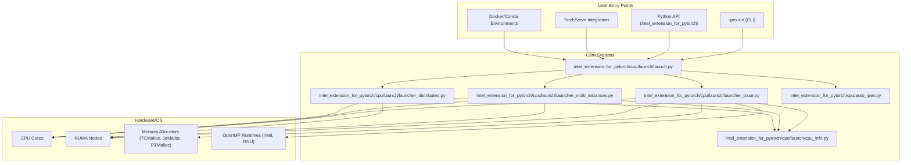
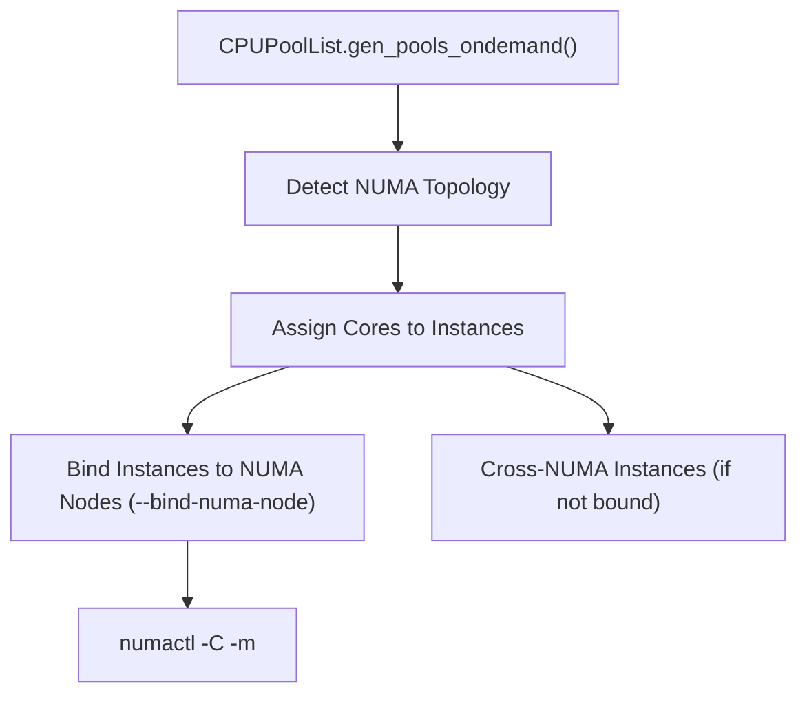
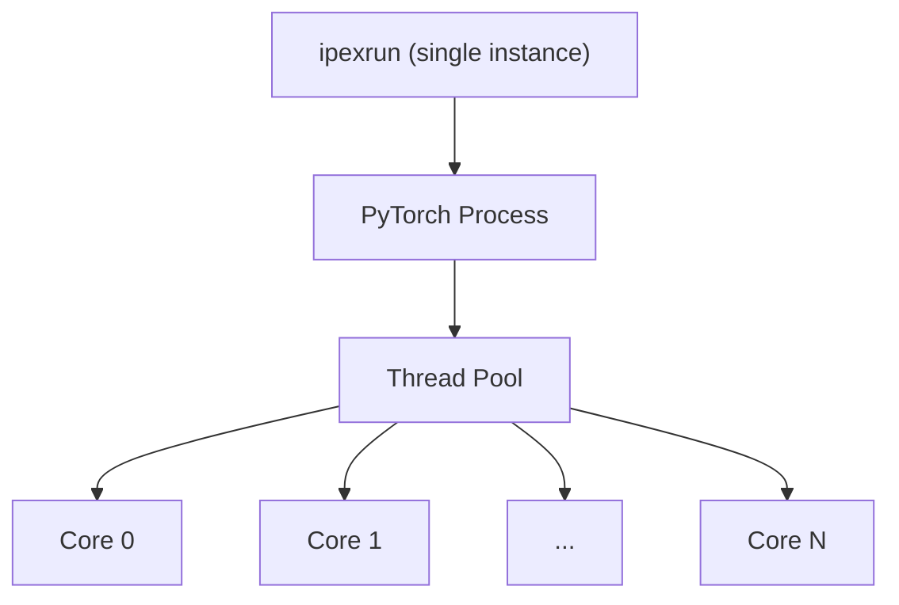
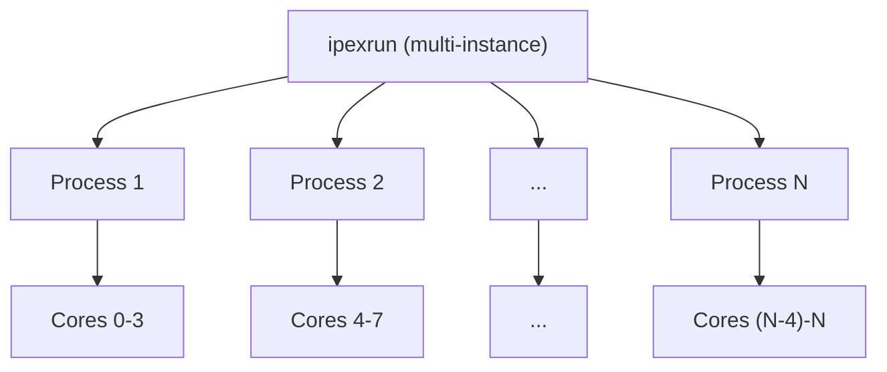
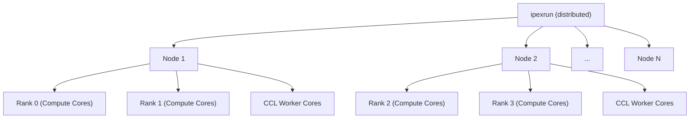
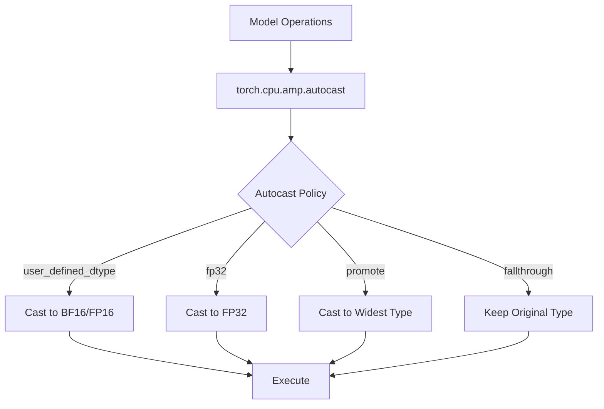
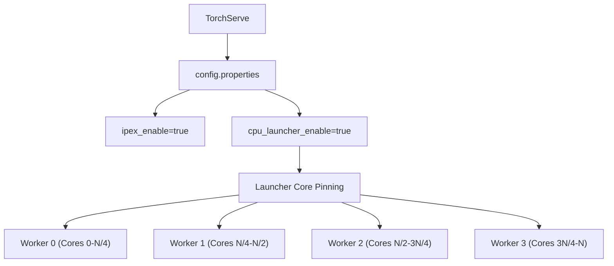
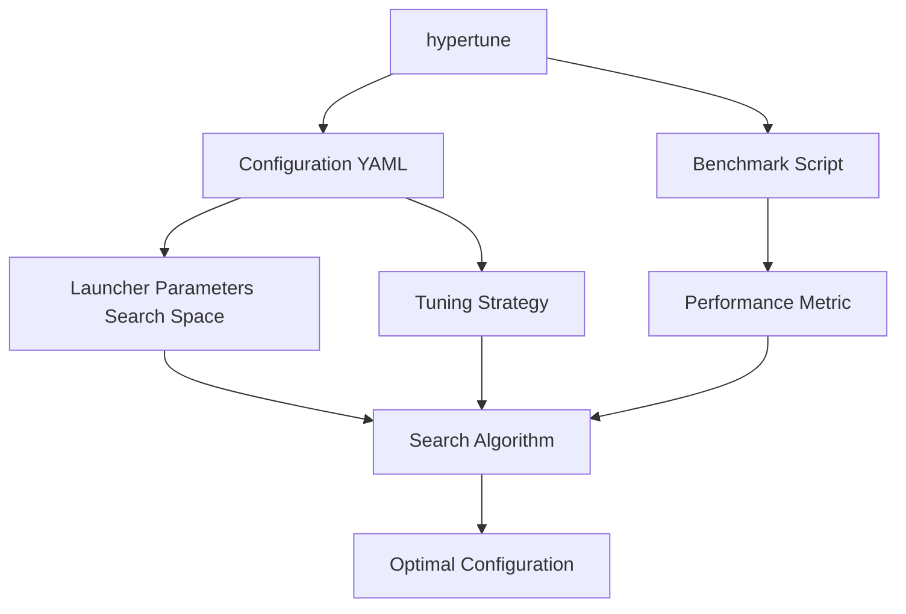

<!-- source: DeepWiki mcp.deepwiki.com · repo intel/intel-extension-for-pytorch · page 7 Deployment and Performance Tuning · fetched 2026-10-21 -->

# Deployment and Performance Tuning

<details>
<summary>Relevant source files</summary>

The following files were used as context for generating this wiki page:

- [dependency_version.json](dependency_version.json)
- [docker/Dockerfile.compile](docker/Dockerfile.compile)
- [docs/tutorials/features/sq_recipe_tuning_api.md](docs/tutorials/features/sq_recipe_tuning_api.md)
- [docs/tutorials/performance_tuning/launch_script.md](docs/tutorials/performance_tuning/launch_script.md)
- [docs/tutorials/performance_tuning/torchserve.md](docs/tutorials/performance_tuning/torchserve.md)
- [examples/cpu/inference/python/python-scripts/README.md](examples/cpu/inference/python/python-scripts/README.md)
- [examples/cpu/llm/Dockerfile](examples/cpu/llm/Dockerfile)
- [examples/cpu/llm/tools/env_activate.sh](examples/cpu/llm/tools/env_activate.sh)
- [examples/cpu/llm/tools/env_setup.sh](examples/cpu/llm/tools/env_setup.sh)
- [intel_extension_for_pytorch/_inductor/codegen/cpp.py](intel_extension_for_pytorch/_inductor/codegen/cpp.py)
- [intel_extension_for_pytorch/_inductor/decomposition.py](intel_extension_for_pytorch/_inductor/decomposition.py)
- [intel_extension_for_pytorch/_inductor/ir.py](intel_extension_for_pytorch/_inductor/ir.py)
- [intel_extension_for_pytorch/_inductor/overrides.py](intel_extension_for_pytorch/_inductor/overrides.py)
- [intel_extension_for_pytorch/cpu/auto_ipex.py](intel_extension_for_pytorch/cpu/auto_ipex.py)
- [intel_extension_for_pytorch/cpu/launch/__init__.py](intel_extension_for_pytorch/cpu/launch/__init__.py)
- [intel_extension_for_pytorch/cpu/launch/__main__.py](intel_extension_for_pytorch/cpu/launch/__main__.py)
- [intel_extension_for_pytorch/cpu/launch/cpu_info.py](intel_extension_for_pytorch/cpu/launch/cpu_info.py)
- [intel_extension_for_pytorch/cpu/launch/launch.py](intel_extension_for_pytorch/cpu/launch/launch.py)
- [intel_extension_for_pytorch/cpu/launch/launcher_base.py](intel_extension_for_pytorch/cpu/launch/launcher_base.py)
- [intel_extension_for_pytorch/cpu/launch/launcher_distributed.py](intel_extension_for_pytorch/cpu/launch/launcher_distributed.py)
- [intel_extension_for_pytorch/cpu/launch/launcher_multi_instances.py](intel_extension_for_pytorch/cpu/launch/launcher_multi_instances.py)
- [intel_extension_for_pytorch/launcher.py](intel_extension_for_pytorch/launcher.py)
- [intel_extension_for_pytorch/xpu/launch.py](intel_extension_for_pytorch/xpu/launch.py)
- [scripts/compile_bundle.py](scripts/compile_bundle.py)
- [tests/cpu/code_free_optimization.py](tests/cpu/code_free_optimization.py)
- [tests/cpu/test_code_free_optimization.py](tests/cpu/test_code_free_optimization.py)
- [tests/cpu/test_inductor.py](tests/cpu/test_inductor.py)
- [tests/cpu/test_launcher.py](tests/cpu/test_launcher.py)
- [tools/dep_ver_utils.py](tools/dep_ver_utils.py)
- [version.txt](version.txt)

</details>


This page describes how to deploy Intel Extension for PyTorch (IPEX)-optimized models and tune performance for inference and training on Intel CPUs. It focuses on the launcher system (`ipexrun`), environment and hardware configuration, and practical deployment scenarios. For details on model-level optimizations, see page [3] (Core Optimization Features).

## System Overview: Deployment and Tuning in IPEX

IPEX performance tuning is achieved by configuring the runtime environment, hardware resource allocation, and memory management. The launcher system automates these steps.

**System-to-Code Mapping Diagram: Deployment and Tuning**


Sources: [intel_extension_for_pytorch/cpu/launch/launch.py](), [intel_extension_for_pytorch/cpu/launch/launcher_base.py](), [intel_extension_for_pytorch/cpu/launch/launcher_multi_instances.py](), [intel_extension_for_pytorch/cpu/launch/launcher_distributed.py](), [intel_extension_for_pytorch/cpu/launch/cpu_info.py](), [intel_extension_for_pytorch/cpu/auto_ipex.py](), [docs/tutorials/performance_tuning/launch_script.md]()

## CPU Launcher System

The `ipexrun` launcher automates environment and resource configuration for optimal performance. It supports single-instance, multi-instance, and distributed deployments.

### Launcher Class Structure and Code Mapping

```mermaid
classDiagram
    class "Launcher (intel_extension_for_pytorch/cpu/launch/launcher_base.py)" {
        +library_paths
        +cpuinfo
        +environ_set
        +ld_preload
        +set_memory_allocator()
        +set_omp_runtime()
        +launch()
    }
    class "MultiInstancesLauncher (intel_extension_for_pytorch/cpu/launch/launcher_multi_instances.py)" {
        +set_multi_task_manager()
        +execution_command_builder()
        +launch()
    }
    class "DistributedTrainingLauncher (intel_extension_for_pytorch/cpu/launch/launcher_distributed.py)" {
        +get_pin_domain_affinity()
        +launch()
    }
    class "CPUPoolList (intel_extension_for_pytorch/cpu/launch/cpu_info.py)" {
        +pool_all
        +pools_ondemand
        +gen_pools_ondemand()
    }
    "Launcher (intel_extension_for_pytorch/cpu/launch/launcher_base.py)" <|-- "MultiInstancesLauncher (intel_extension_for_pytorch/cpu/launch/launcher_multi_instances.py)"
    "Launcher (intel_extension_for_pytorch/cpu/launch/launcher_base.py)" <|-- "DistributedTrainingLauncher (intel_extension_for_pytorch/cpu/launch/launcher_distributed.py)"
    "Launcher (intel_extension_for_pytorch/cpu/launch/launcher_base.py)" *-- "CPUPoolList (intel_extension_for_pytorch/cpu/launch/cpu_info.py)"
```
Sources: [intel_extension_for_pytorch/cpu/launch/launcher_base.py](), [intel_extension_for_pytorch/cpu/launch/launcher_multi_instances.py](), [intel_extension_for_pytorch/cpu/launch/launcher_distributed.py](), [intel_extension_for_pytorch/cpu/launch/cpu_info.py]()

### Key Launcher Parameters

| Parameter                | Description                                              | Default Value |
|--------------------------|----------------------------------------------------------|---------------|
| `--ninstances`           | Number of instances to run                               | 0 (auto)      |
| `--ncores-per-instance`  | Number of cores per instance                             | 0 (auto)      |
| `--use-logical-cores`    | Use logical (hyperthreaded) cores                        | False         |
| `--memory-allocator`     | Memory allocator: auto, tcmalloc, jemalloc, default      | auto          |
| `--omp-runtime`          | OpenMP runtime: auto, intel, default                     | auto          |
| `--nodes-list`           | NUMA nodes to use                                        | "" (all)      |
| `--bind-numa-node`       | Bind instances to NUMA nodes                             | False         |
| `--throughput-mode`      | One instance per NUMA node                               | False         |
| `--latency-mode`         | Use 4 cores per instance                                 | False         |

Sources: [intel_extension_for_pytorch/cpu/launch/launcher_base.py:38-76](), [intel_extension_for_pytorch/cpu/launch/launcher_multi_instances.py:19-87](), [docs/tutorials/performance_tuning/launch_script.md]()

## Memory Management and NUMA Awareness

IPEX supports multiple memory allocators and NUMA-aware execution to optimize memory locality and reduce contention.

### Memory Allocator Selection

| Allocator      | Description                                      | Typical Use Case                        |
|----------------|--------------------------------------------------|-----------------------------------------|
| TCMalloc       | Multi-threaded, low lock contention              | Default, most workloads                 |
| JeMalloc       | Handles fragmentation, large dynamic allocations | Large models, long-running services     |
| PTMalloc       | Standard Python allocator                        | Fallback if others unavailable          |

Set via `--memory-allocator` in `ipexrun`.

### NUMA Binding and Core Pooling

NUMA (Non-Uniform Memory Access) binding ensures that memory allocations are local to the CPU cores running the workload.

**NUMA Pooling and Binding Diagram**


Sources: [intel_extension_for_pytorch/cpu/launch/launcher_base.py:233-317](), [intel_extension_for_pytorch/cpu/launch/cpu_info.py:223-261](), [docs/tutorials/performance_tuning/launch_script.md:77-114](), [tests/cpu/test_launcher.py:199-317]()

## Thread Management and OpenMP Configuration

Thread management in IPEX is handled by setting thread affinity and OpenMP runtime parameters.

### Thread Affinity and Task Managers

- Thread affinity is set using `numactl` or `taskset` (see `MultiInstancesLauncher.execution_command_builder()`).
- Environment variables such as `KMP_AFFINITY` (Intel OpenMP) or `GOMP_CPU_AFFINITY` (GNU OpenMP) are set to control thread placement.

### OpenMP Runtime Selection

| Runtime         | Parameter         | Environment Variable         | Default Setting                        |
|-----------------|------------------|-----------------------------|----------------------------------------|
| Intel OpenMP    | `--omp-runtime`   | `KMP_AFFINITY`, `KMP_BLOCKTIME` | "granularity=fine,compact,1,0", 1ms   |
| GNU OpenMP      | `--omp-runtime`   | `GOMP_CPU_AFFINITY`         | Core list                              |

Intel OpenMP is generally recommended for best performance.

Sources: [intel_extension_for_pytorch/cpu/launch/launcher_base.py:319-399](), [docs/tutorials/performance_tuning/launch_script.md:80-81]()

## Deployment Scenarios

IPEX supports several deployment modes, each with specific performance tuning options.

### Single Instance Deployment

All available (or specified) cores are used for a single process.



Example commands:
- `ipexrun resnet50.py`
- `ipexrun --use-logical-cores resnet50.py`
- `ipexrun --nodes-list 1 resnet50.py`
- `ipexrun --ncores-per-instance 10 resnet50.py`

Sources: [docs/tutorials/performance_tuning/launch_script.md:98-262]()

### Multi-Instance Deployment

Multiple processes are launched, each pinned to a subset of cores.



Example commands:
- `ipexrun --throughput-mode resnet50.py`
- `ipexrun --latency-mode resnet50.py`
- `ipexrun --ninstances 4 --ncores-per-instance 6 resnet50.py`

Sources: [docs/tutorials/performance_tuning/launch_script.md:286-394]()

### Distributed Training Deployment

MPI with oneCCL backend is used for multi-node, multi-process training.



Example command:
- `ipexrun --nnodes 2 --nprocs-per-node 2 --ccl-worker-count 4 --hostfile hostfile python_script.py args`

Sources: [intel_extension_for_pytorch/cpu/launch/launcher_distributed.py:82-145]()

## Automatic Mixed Precision (Autocast)

IPEX supports CPU autocast for mixed precision inference and training (BFloat16, Float16).

**Autocast Policy Diagram**



To enable autocast, use:

```python
with torch.cpu.amp.autocast(enabled=True, dtype=torch.bfloat16):
    output = model(input)
```

Sources: [docs/tutorials/performance_tuning/launch_script.md](), [csrc/cpu/autocast/autocast_mode.cpp:11-130]()

## TorchServe Integration

IPEX can be integrated with TorchServe for optimized model serving. The launcher can be enabled via `config.properties`:



Example configuration:
```
ipex_enable=true
cpu_launcher_enable=true
cpu_launcher_args=--use_logical_core --disable_numactl
```

The launcher automatically redistributes cores when scaling workers.

Sources: [docs/tutorials/performance_tuning/torchserve.md:17-91]()

## Performance Tuning Guidelines

### General Recommendations

- Start with default launcher settings: `ipexrun your_script.py`
- For throughput, use `--throughput-mode`
- For latency, use `--latency-mode` or set `--ncores-per-instance`
- Test both TCMalloc and JeMalloc: `--memory-allocator tcmalloc` or `--memory-allocator jemalloc`
- Enable NUMA binding for multi-socket systems: `--bind-numa-node`
- Test with and without logical cores: `--use-logical-cores`

### Common Pitfalls

- Avoid cross-NUMA traffic (do not span instances across NUMA nodes)
- Do not oversubscribe cores
- Ensure OMP environment variables do not conflict with launcher
- For long-running services, consider JeMalloc to reduce fragmentation
- Let the launcher auto-detect hardware topology

Sources: [docs/tutorials/performance_tuning/tuning_guide.md](), [docs/tutorials/performance_tuning/launch_script.md]()

## Code-Free Optimization (Auto-IPEX)

IPEX supports code-free optimization using the `--auto-ipex` flag in the launcher.

- Automatically injects IPEX imports and applies `ipex.optimize()` to all modules.
- Configures autocast with the specified dtype.

Example:
```
ipexrun --auto-ipex --dtype bfloat16 your_script.py
```

This enables IPEX optimizations without modifying your code.

Sources: [intel_extension_for_pytorch/cpu/auto_ipex.py:12-116](), [tests/cpu/test_code_free_optimization.py:12-54]()

## Hyperparameter Tuning for Deployment

IPEX includes a prototype `hypertune` feature for automatically searching optimal deployment configurations:



Typical use:
```
python -m intel_extension_for_pytorch.cpu.hypertune --conf-file conf.yaml your_script.py
```

Where the configuration file specifies launcher parameters to tune:
```yaml
hyperparams: 
  launcher:
    hp: ['ncores_per_instance', 'ninstances']  
    ncores_per_instance: all_physical_cores
    ninstances: [1]
```

This feature helps identify the optimal deployment configuration through systematic search.

Sources: [intel_extension_for_pytorch/cpu/hypertune/README.md](intel_extension_for_pytorch/cpu/hypertune/README.md), [intel_extension_for_pytorch/cpu/hypertune/example/example.yaml](intel_extension_for_pytorch/cpu/hypertune/example/example.yaml)

---

