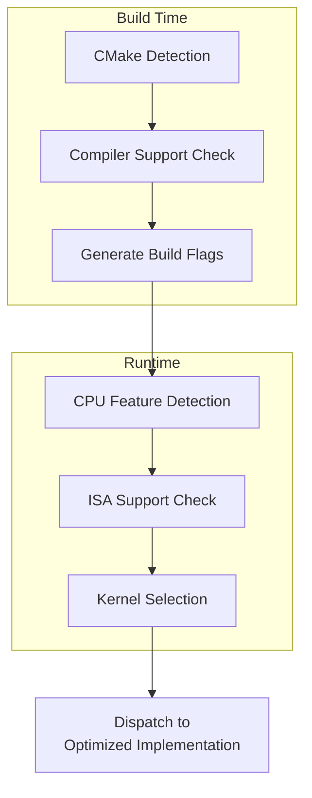
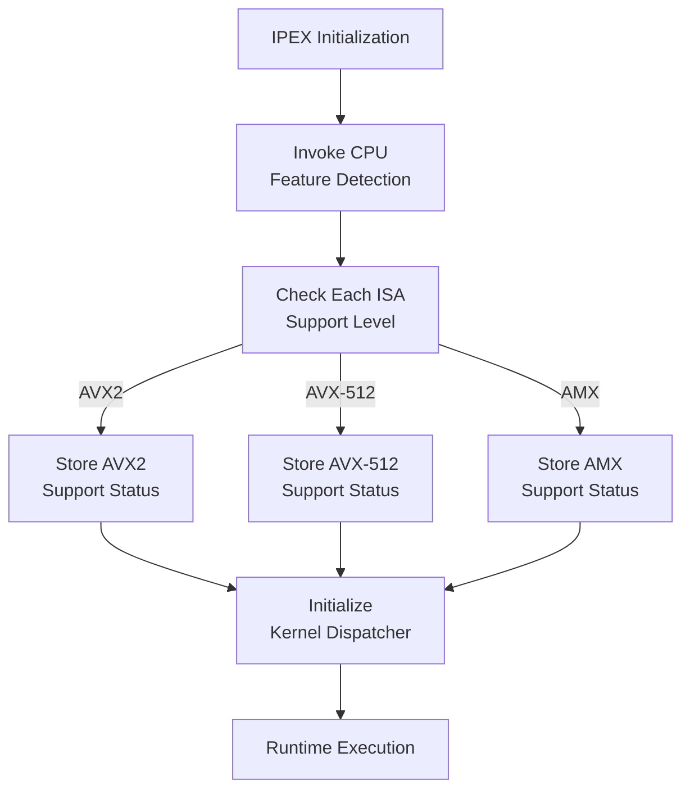
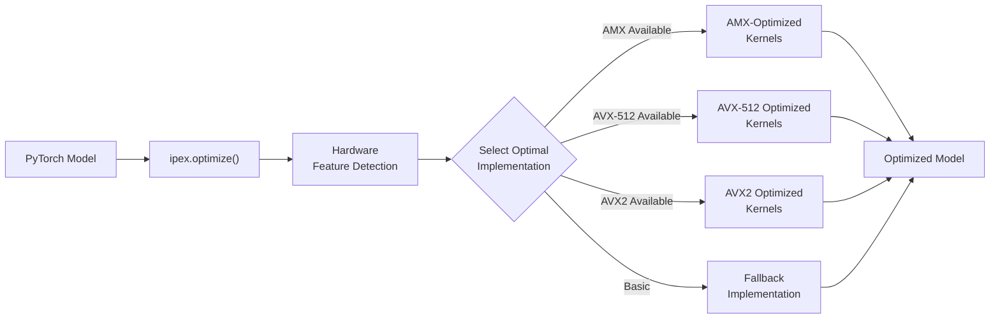

<!-- source: DeepWiki mcp.deepwiki.com · repo intel/intel-extension-for-pytorch · page 7.2 Hardware Feature Detection · fetched 2026-10-21 -->

# Hardware Feature Detection

<details>
<summary>Relevant source files</summary>

The following files were used as context for generating this wiki page:

- [.gitmodules](.gitmodules)
- [CMakeLists.txt](CMakeLists.txt)
- [dependency_version.json](dependency_version.json)
- [docker/Dockerfile.compile](docker/Dockerfile.compile)
- [docs/tutorials/features/sq_recipe_tuning_api.md](docs/tutorials/features/sq_recipe_tuning_api.md)
- [examples/cpu/inference/python/python-scripts/README.md](examples/cpu/inference/python/python-scripts/README.md)
- [examples/cpu/llm/Dockerfile](examples/cpu/llm/Dockerfile)
- [examples/cpu/llm/tools/env_activate.sh](examples/cpu/llm/tools/env_activate.sh)
- [examples/cpu/llm/tools/env_setup.sh](examples/cpu/llm/tools/env_setup.sh)
- [intel_extension_for_pytorch/__init__.py](intel_extension_for_pytorch/__init__.py)
- [intel_extension_for_pytorch/_inductor/codegen/cpp.py](intel_extension_for_pytorch/_inductor/codegen/cpp.py)
- [intel_extension_for_pytorch/_inductor/decomposition.py](intel_extension_for_pytorch/_inductor/decomposition.py)
- [intel_extension_for_pytorch/_inductor/ir.py](intel_extension_for_pytorch/_inductor/ir.py)
- [intel_extension_for_pytorch/_inductor/overrides.py](intel_extension_for_pytorch/_inductor/overrides.py)
- [scripts/compile_bundle.py](scripts/compile_bundle.py)
- [setup.py](setup.py)
- [tests/cpu/test_auto_channels_last.py](tests/cpu/test_auto_channels_last.py)
- [tests/cpu/test_inductor.py](tests/cpu/test_inductor.py)
- [tools/dep_ver_utils.py](tools/dep_ver_utils.py)
- [version.txt](version.txt)

</details>


## Purpose and Scope

This document explains how Intel Extension for PyTorch (IPEX) detects and utilizes CPU hardware features to optimize performance. The hardware feature detection system identifies specific instruction sets available on the target CPU during both build time and runtime, enabling IPEX to select the most efficient implementation paths for various operations.

For information about utilizing these detected features for deployment, see [CPU Launcher System](#7.1).

## Overview of CPU Feature Detection

IPEX's hardware feature detection enables optimized code paths that leverage specialized CPU instructions such as AVX2, AVX-512, and Intel AMX. This detection happens at two critical stages:

1. **Build-time detection**: Determines which instruction sets can be supported by the compiler
2. **Runtime detection**: Identifies available hardware capabilities on the execution platform



Sources: [cmake/Modules/FindAVX.cmake:1-199]()

## Supported CPU Features

IPEX detects and utilizes several CPU instruction set architectures (ISAs) to optimize performance:

| CPU Feature | Description | Key Benefits for IPEX |
|-------------|-------------|------------------------|
| AVX2 | Advanced Vector Extensions 2 | Improved vectorized floating-point operations |
| AVX2 VNNI | Vector Neural Network Instructions for AVX2 | Accelerated INT8 operations on newer CPUs |
| AVX-512 | 512-bit Advanced Vector Extensions | Wide vector operations for high throughput |
| AVX-512 VNNI | Vector Neural Network Instructions for AVX-512 | Accelerated INT8 matrix multiply operations |
| AVX-512 BF16 | BFloat16 support for AVX-512 | Efficient BFloat16 computation for deep learning |
| AMX | Advanced Matrix Extensions | Significant speedup for matrix multiplication operations |
| AVX-512 FP16 | Half-precision support for AVX-512 | Improved performance for FP16 operations |

Sources: [cmake/Modules/FindAVX.cmake:4-136]()

## Build-Time Detection Mechanism

During the build process, IPEX uses CMake to detect available CPU features by attempting to compile test code snippets with specific instruction sets.

```mermaid
flowchart TD
    start["Start CMake Configuration"]
    -->
    defineTests["Define Test Code\nfor Each Feature"]
    -->
    compileTest["Try to Compile with\nVarious Compiler Flags"]
    -->
    decision{"Compilation\nSuccessful?"}
    
    decision -->|"Yes"| setFeatureFound["Set Feature as Available\nStore Required Flags"]
    decision -->|"No"| nextFlag["Try Next Flag\nor Feature"]
    
    nextFlag --> decision
    
    setFeatureFound --> buildWith["Build IPEX with\nOptimized Code Paths"]
    
    buildWith --> end["End Configuration"]
```

For each CPU feature, IPEX performs these steps:
1. Define small test programs that use instructions from the target feature set
2. Attempt to compile with various compiler flags
3. Record which features are available and which flags are required

Sources: [cmake/Modules/FindAVX.cmake:138-164](), [cmake/Modules/FindAVX.cmake:166-199]()

### Feature-Specific Test Code

Each CPU feature is tested with a specific code snippet that utilizes instructions unique to that feature. For example:

- **AVX2** test code checks for basic AVX2 functionality:
  ```cpp
  __m256i a = {0};
  a = _mm256_abs_epi16(a);
  __m256i x;
  _mm256_extract_epi64(x, 0);
  ```

- **AMX** test code checks for AMX tile instructions:
  ```cpp
  _tile_dpbusd(1, 2, 3);
  ```

Sources: [cmake/Modules/FindAVX.cmake:4-14](), [cmake/Modules/FindAVX.cmake:102-110]()

## Runtime Detection

IPEX includes a runtime detection mechanism that checks CPU capabilities when the library is loaded:



At runtime, IPEX:
1. Detects available CPU features
2. Initializes the appropriate dispatcher for operator implementations
3. Selects optimized kernels based on the detected features

Sources: [tests/cpu/isa/CMakeLists.txt:1-16]()

## Integration with IPEX Optimization System

The hardware feature detection integrates with IPEX's optimization pipeline to select the most efficient implementation paths:



When `ipex.optimize()` is applied to a model, the hardware feature detection system:
1. Determines the highest level of instruction set support available
2. Selects operator implementations optimized for those instructions
3. Provides fallback paths for systems with limited instruction set support

Sources: [cmake/Modules/FindAVX.cmake:1-199]()

## Compiler Support Considerations

IPEX's hardware feature detection is aware of compiler support limitations for different CPU features:

| CPU Feature | Minimum GCC Version | Notes |
|-------------|---------------------|-------|
| AVX2        | Widely supported    | Basic vector operations |
| AVX2 VNNI   | GCC 11.2+           | Limited to newer CPUs and compilers |
| AVX-512     | Widely supported    | Supported by most modern compilers |
| AVX-512 VNNI| GCC 9.2+            | Requires newer compiler versions |
| AVX-512 BF16| GCC 10.3+           | BFloat16 support for deep learning |
| AMX         | GCC 11.2+           | Advanced matrix operations |
| AVX-512 FP16| GCC 12.1+           | Half-precision floating point |

Sources: [cmake/Modules/FindAVX.cmake:169-171](), [cmake/Modules/FindAVX.cmake:177-179](), [cmake/Modules/FindAVX.cmake:182-184](), [cmake/Modules/FindAVX.cmake:187-192](), [cmake/Modules/FindAVX.cmake:194-199]()

## Usage in IPEX Codebase

The hardware feature detection system influences multiple aspects of IPEX:

1. **Compilation flags**: Determines which instruction sets to enable during compilation
2. **Code path selection**: Selects the most efficient implementation based on available features
3. **Fallback mechanisms**: Provides graceful degradation when specific features aren't available

This allows IPEX to deliver optimized performance across a wide range of Intel CPUs while maintaining compatibility with different hardware generations.

Sources: [cmake/Modules/FindAVX.cmake:1-199](), [tests/cpu/isa/CMakeLists.txt:1-16]()

## Summary

Hardware feature detection is a critical component of IPEX that enables:
- Utilization of specialized CPU instructions like AVX-512 and AMX
- Automatic selection of the most efficient implementation paths
- Optimized performance across different Intel CPU generations
- Graceful fallback for systems without advanced features

This system operates both at build time and runtime to ensure IPEX can deliver maximum performance for Intel PyTorch users on any supported hardware.

---

