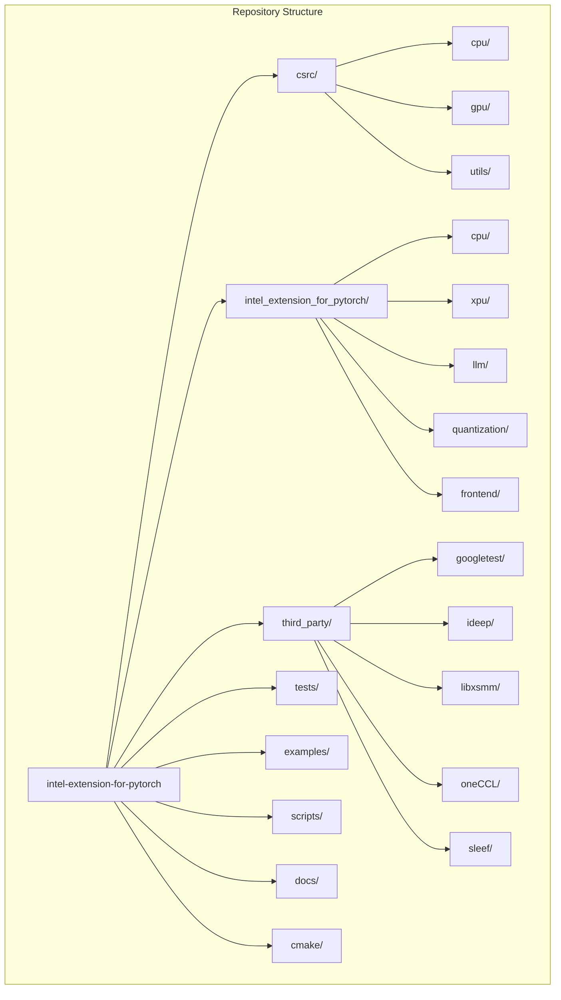
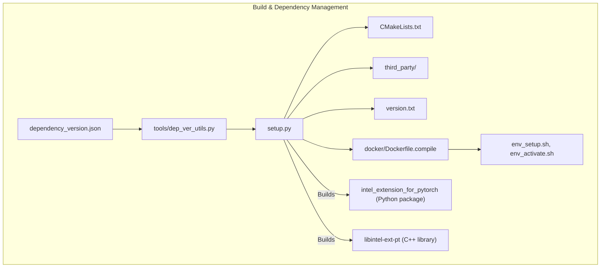
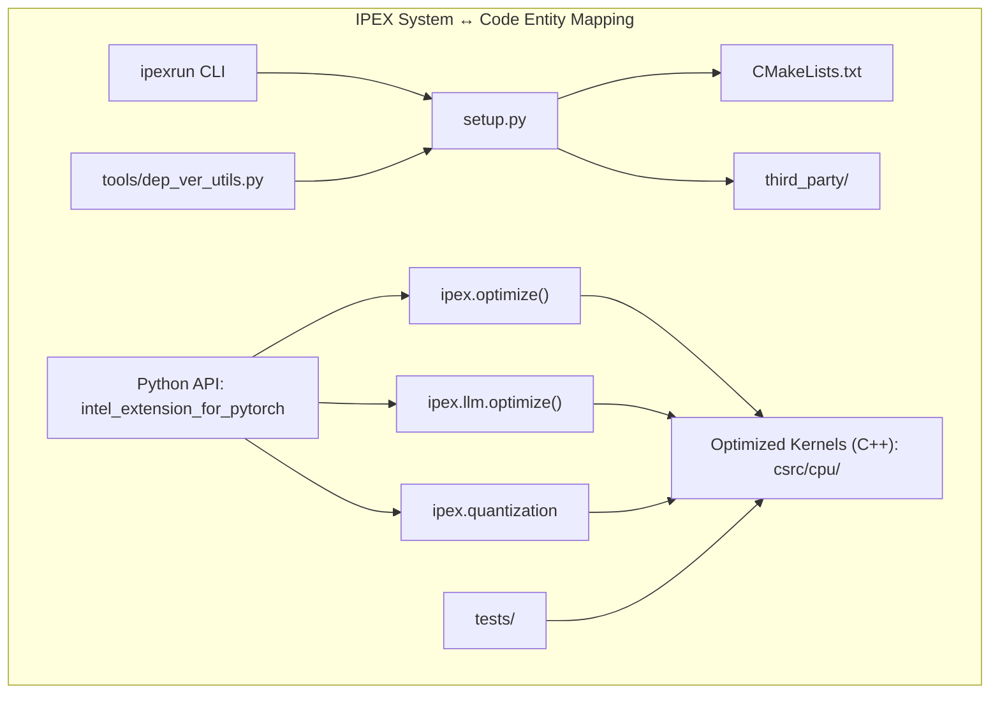
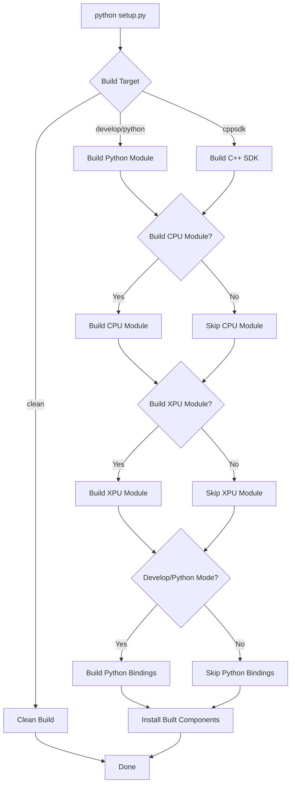
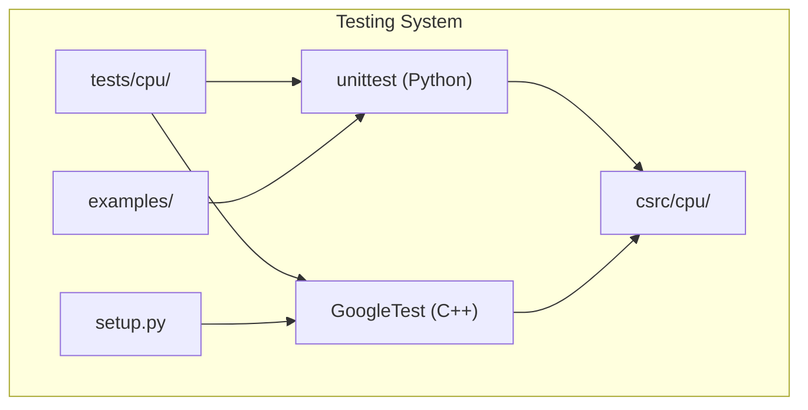

<!-- source: DeepWiki mcp.deepwiki.com · repo intel/intel-extension-for-pytorch · page 8 Developer Guide · fetched 2026-10-21 -->

# Developer Guide

<details>
<summary>Relevant source files</summary>

The following files were used as context for generating this wiki page:

- [.gitmodules](.gitmodules)
- [CMakeLists.txt](CMakeLists.txt)
- [dependency_version.json](dependency_version.json)
- [docker/Dockerfile.compile](docker/Dockerfile.compile)
- [docs/tutorials/features/sq_recipe_tuning_api.md](docs/tutorials/features/sq_recipe_tuning_api.md)
- [examples/cpu/inference/python/python-scripts/README.md](examples/cpu/inference/python/python-scripts/README.md)
- [examples/cpu/llm/Dockerfile](examples/cpu/llm/Dockerfile)
- [examples/cpu/llm/tools/env_activate.sh](examples/cpu/llm/tools/env_activate.sh)
- [examples/cpu/llm/tools/env_setup.sh](examples/cpu/llm/tools/env_setup.sh)
- [intel_extension_for_pytorch/__init__.py](intel_extension_for_pytorch/__init__.py)
- [intel_extension_for_pytorch/_inductor/codegen/cpp.py](intel_extension_for_pytorch/_inductor/codegen/cpp.py)
- [intel_extension_for_pytorch/_inductor/decomposition.py](intel_extension_for_pytorch/_inductor/decomposition.py)
- [intel_extension_for_pytorch/_inductor/ir.py](intel_extension_for_pytorch/_inductor/ir.py)
- [intel_extension_for_pytorch/_inductor/overrides.py](intel_extension_for_pytorch/_inductor/overrides.py)
- [scripts/compile_bundle.py](scripts/compile_bundle.py)
- [setup.py](setup.py)
- [tests/cpu/test_auto_channels_last.py](tests/cpu/test_auto_channels_last.py)
- [tests/cpu/test_inductor.py](tests/cpu/test_inductor.py)
- [tools/dep_ver_utils.py](tools/dep_ver_utils.py)
- [version.txt](version.txt)

</details>


This guide is for developers who want to contribute to or understand the internal systems of Intel Extension for PyTorch (IPEX). It covers repository structure, build and dependency management, development workflows, and testing. For user-facing usage, see [Getting Started](/2).

## Repository Structure

IPEX is organized into modular systems for CPU and XPU (GPU) optimizations, Python and C++ integration, and external dependencies.

**Repository Structure Diagram**



| Directory | Description |
|-----------|-------------|
| `csrc/` | C++ source code (CPU, GPU, utils) |
| `intel_extension_for_pytorch/` | Python modules and interfaces |
| `third_party/` | External dependencies (submodules) |
| `tests/` | Unit and integration tests |
| `examples/` | Example applications |
| `scripts/` | Build and utility scripts |
| `docs/` | Documentation |
| `cmake/` | CMake modules and configuration |

Sources: [CMakeLists.txt:17-23](), [.gitmodules:1-17]()

## Development Environment Setup

### Prerequisites

IPEX requires the following tools and libraries for development:

| Dependency | Minimum Version | Purpose |
|------------|----------------|---------|
| GCC        | 12.3.0         | C/C++ compiler |
| CMake      | 3.13           | Build system |
| PyTorch    | See `dependency_version.json` | Base framework |
| Python     | 3.x            | Development language |

Sources: [dependency_version.json:1-32](), [CMakeLists.txt:1-49]()

### Setting Up the Development Environment

1. **Clone the repository with submodules:**
   ```bash
   git clone --recursive https://github.com/intel/intel-extension-for-pytorch.git
   cd intel-extension-for-pytorch
   ```

2. **Install Python dependencies:**
   ```bash
   pip install -r requirements.txt
   ```

3. **Build in development mode:**
   ```bash
   python setup.py develop
   ```

Sources: [setup.py:124-127](), [examples/cpu/llm/tools/env_setup.sh:34-45]()

## Build, Dependency, and Environment Management

IPEX uses a hybrid build system based on Python setuptools and CMake, with explicit dependency versioning and support for both CPU and XPU targets.

**Build and Dependency Management Diagram**



Sources: [dependency_version.json:1-23](), [setup.py:1-1057](), [CMakeLists.txt:1-50](), [docker/Dockerfile.compile:1-84](), [tools/dep_ver_utils.py:1-51](), [version.txt:1-4]()

### Key Build Environment Variables

| Variable           | Purpose                                 | Default      |
|--------------------|-----------------------------------------|--------------|
| DEBUG              | Build with debug symbols                | OFF          |
| RELEASE            | Build with optimization                 | OFF          |
| REL_WITH_DEB_INFO  | Optimization + debug info               | OFF          |
| CFLAGS             | Compiler flags                          |              |
| CC                 | C compiler                              |              |
| MAX_JOBS           | Parallel compile jobs                   | CPU count    |
| VERBOSE            | Verbose build output                    | OFF          |
| BUILD_WITH_XPU     | Build with XPU support                  | OFF          |
| BUILD_WITH_CPU     | Build with CPU support                  | ON           |

Sources: [setup.py:8-49](), [setup.py:715-745]()

### XPU Build Options

| Option                | Purpose                                 |
|-----------------------|-----------------------------------------|
| USE_ONEMKL            | Use oneMKL in operators                 |
| USE_CHANNELS_LAST_1D  | Enable channels last 1D feature         |
| USE_PERSIST_STREAM    | Enable persistent oneDNN stream         |
| USE_PRIMITIVE_CACHE   | Cache oneDNN primitives                 |
| USE_QUEUE_BARRIER     | Use queue submit_barrier API            |
| USE_SCRATCHPAD_MODE   | Enable oneDNN scratchpad user mode      |

Sources: [setup.py:51-72]()

### Build Types

- **Debug** (`DEBUG=1`): Debug symbols, no optimization
- **Release** (`RELEASE=1`): Optimization, no debug symbols
- **RelWithDebInfo** (`REL_WITH_DEB_INFO=1`): Optimization with debug symbols

Sources: [setup.py:148-153]()

## Development Workflow and Code Organization

IPEX is structured around modular systems that map directly to code entities and APIs. Understanding these relationships is key for effective development and debugging.

**System-to-Code Mapping Diagram**



Sources: [intel_extension_for_pytorch/__init__.py:1-175](), [setup.py:1-1057](), [CMakeLists.txt:1-50](), [third_party/ideep](), [tests/cpu/test_auto_channels_last.py:1-282](), [tools/dep_ver_utils.py:1-51]()

### Version Management

IPEX versioning is managed in `version.txt` and injected into the build artifacts. The build process also records the git SHA for IPEX and PyTorch, build type, and submodule SHAs.

Example `version.txt`:
```
VERSION_MAJOR 2
VERSION_MINOR 10
VERSION_PATCH 0
```

Sources: [version.txt:1-4](), [setup.py:166-183](), [setup.py:358-419](), [intel_extension_for_pytorch/__init__.py:13-20]()

### Development vs. Install Mode

- **Development Mode** (`python setup.py develop`): In-place build, Python changes are immediate, C++ changes require rebuild.
- **Install Mode** (`python setup.py install` or `pip install`): Installs to environment, all changes require reinstall.

Sources: [setup.py:1031-1043]()

## Build and Compilation

The build process consists of several stages:

1. **Environment Detection**: Detect platform, compilers, and dependencies.
2. **CMake Configuration**: Generate build files for C++ components.
3. **Compilation**: Build CPU, XPU, and Python modules.
4. **Installation**: Install built components.

**Build Process Flow Diagram**



Sources: [setup.py:654-935]()

### Building CPU and XPU Modules

- **CPU Build**: Default, requires GCC and CMake.
- **XPU Build**: Set `BUILD_WITH_XPU=ON`, requires Intel compilers (`icx`, `icpx`).

Example:
```bash
export BUILD_WITH_XPU=ON
python setup.py develop
```

Sources: [setup.py:758-821]()

### Docker Development Environment

A reproducible development environment is provided via Docker:

```bash
docker build -f docker/Dockerfile.compile -t ipex-dev .
docker run -it ipex-dev bash
```

Sources: [docker/Dockerfile.compile:1-84]()

## Testing Framework

IPEX uses both Python and C++ tests to ensure correctness and performance.

**Testing System Diagram**



Sources: [tests/cpu/test_auto_channels_last.py:1-282](), [setup.py:823-840]()

### Python Tests

- Located in `tests/cpu/`
- Use `unittest` framework
- Example:
  ```python
  import unittest
  import torch
  import intel_extension_for_pytorch as ipex

  class TestFeature(unittest.TestCase):
      def test_functionality(self):
          self.assertTrue(True)
  ```
- Run with:
  ```bash
  python -m unittest discover tests/cpu
  ```

Sources: [tests/cpu/test_auto_channels_last.py:1-17]()

### C++ Tests

- Use Google Test
- Built via `python setup.py develop`
- Located in `tests/cpu/cpp/`

Sources: [setup.py:823-840]()

## Dependency Management

IPEX manages dependencies through git submodules and explicit version files.

### Submodules

| Submodule   | Purpose                                 |
|-------------|-----------------------------------------|
| googletest  | C++ testing framework                   |
| ideep       | Intel Deep Learning Boost               |
| libxsmm     | Small matrix multiplication             |
| oneCCL      | Collective communications               |
| sleef       | SIMD math library                       |

Sources: [.gitmodules:1-17]()

### Version Management

- All dependency versions are specified in `dependency_version.json`.
- To update a dependency version:
  ```bash
  python tools/dep_ver_utils.py -w -f dependency_version.json -k dependency:key -v value
  ```

Sources: [dependency_version.json:1-23](), [tools/dep_ver_utils.py:1-51]()

## Performance Optimization for Developers

When developing new features or operators, consider performance implications:

1. **Memory Layout**: Use channels-last format for tensors when possible
2. **Threading**: Be aware of OpenMP thread management
3. **Primitive Cache**: Configure OneDNN primitive cache appropriately
4. **Memory Allocators**: Consider using Jemalloc or TCMalloc for better performance

Sources: [docs/tutorials/performance_tuning/tuning_guide.md:211-240]()

## Custom Operators

When developing custom operators, follow the benchmarking practices in the examples:

```bash
# Example of benchmarking a custom operator
python -m intel_extension_for_pytorch.cpu.launch --node-id 0 custom_op.py
```

Sources: [tests/cpu/bench/custom_op_bench/README.md:1-46]()

## Debugging and Development Tools

### Runtime Debugging

For debugging runtime issues:

1. Set environment variables for verbose output:
```bash
export IPEX_VERBOSE=1
```

2. Enable traces for specific components:
```bash
# Example for enabling oneDNN verbose output
export ONEDNN_VERBOSE=1
```

Sources: [docs/tutorials/performance_tuning/tuning_guide.md:252-266]()

### Profiling

For performance profiling:

1. Use Intel VTune Profiler for detailed CPU analysis
2. Use built-in PyTorch profilers for operator-level profiling

This concludes the developer guide for Intel Extension for PyTorch. By following these guidelines, you'll be well-equipped to contribute to the project and understand its internal workings.

---

