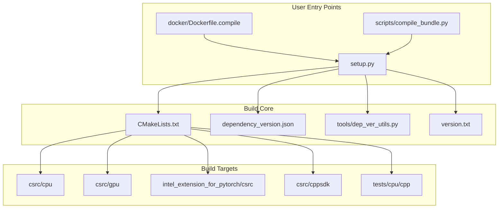

<!-- source: DeepWiki mcp.deepwiki.com · repo intel/intel-extension-for-pytorch · page 8.1 Build System · fetched 2026-10-21 -->

# Build System

<details>
<summary>Relevant source files</summary>

The following files were used as context for generating this wiki page:

- [.gitmodules](.gitmodules)
- [CMakeLists.txt](CMakeLists.txt)
- [dependency_version.json](dependency_version.json)
- [docker/Dockerfile.compile](docker/Dockerfile.compile)
- [docs/tutorials/features/sq_recipe_tuning_api.md](docs/tutorials/features/sq_recipe_tuning_api.md)
- [examples/cpu/inference/python/python-scripts/README.md](examples/cpu/inference/python/python-scripts/README.md)
- [examples/cpu/llm/Dockerfile](examples/cpu/llm/Dockerfile)
- [examples/cpu/llm/tools/env_activate.sh](examples/cpu/llm/tools/env_activate.sh)
- [examples/cpu/llm/tools/env_setup.sh](examples/cpu/llm/tools/env_setup.sh)
- [intel_extension_for_pytorch/__init__.py](intel_extension_for_pytorch/__init__.py)
- [intel_extension_for_pytorch/_inductor/codegen/cpp.py](intel_extension_for_pytorch/_inductor/codegen/cpp.py)
- [intel_extension_for_pytorch/_inductor/decomposition.py](intel_extension_for_pytorch/_inductor/decomposition.py)
- [intel_extension_for_pytorch/_inductor/ir.py](intel_extension_for_pytorch/_inductor/ir.py)
- [intel_extension_for_pytorch/_inductor/overrides.py](intel_extension_for_pytorch/_inductor/overrides.py)
- [scripts/compile_bundle.py](scripts/compile_bundle.py)
- [setup.py](setup.py)
- [tests/cpu/test_auto_channels_last.py](tests/cpu/test_auto_channels_last.py)
- [tests/cpu/test_inductor.py](tests/cpu/test_inductor.py)
- [tools/dep_ver_utils.py](tools/dep_ver_utils.py)
- [version.txt](version.txt)

</details>


## Purpose and Scope

This page documents the build system for Intel Extension for PyTorch (IPEX). It covers the architecture, configuration, dependency management, and the process for building IPEX from source. The build system is responsible for compiling and packaging all IPEX components, supporting multiple platforms (Linux, Windows, macOS), build targets (CPU, XPU/GPU, Python extension, C++ SDK), and build types (Debug, Release, RelWithDebInfo).

Sources: [setup.py:1-50]()

---

## High-Level Build System Architecture

The IPEX build system is centered around `setup.py`, which orchestrates the build process using Python's setuptools and CMake. The system supports multiple build targets and configurations, and manages dependencies and versioning.

**Diagram: Build System Entry Points and Code Entities**



**Key Code Entities:**
- `setup.py`: Main build entry point, parses environment, configures and invokes CMake, manages build targets.
- `CMakeLists.txt`: Root CMake configuration, defines subdirectories and build logic.
- `dependency_version.json`: Central source of dependency versions.
- `tools/dep_ver_utils.py`: Utility for reading/writing dependency versions.
- `version.txt`: Source of IPEX version numbers.

Sources: [setup.py:1-50](), [CMakeLists.txt:1-50](), [dependency_version.json:1-23](), [tools/dep_ver_utils.py:1-51](), [version.txt:1-4](), [docker/Dockerfile.compile:1-84](), [scripts/compile_bundle.py:1-401]()

## Build Workflow

The build process is orchestrated by `setup.py`, which determines the build target, configures the environment, generates version information, and invokes CMake to build the appropriate modules.

**Diagram: Build Workflow and Key Functions**

```mermaid
flowchart TD
    Start["Start Build"] --> DetectTarget["_get_build_target()"]
    DetectTarget --> GetPyTorch["get_pytorch_install_dir()"]
    GetPyTorch --> GetVersion["create_version_files()"]
    GetVersion --> BuildTarget{"Build Target?"}
    BuildTarget -->|\"python\"/\"develop\"| BuildPython["IPEXCPPLibBuild.run()"]
    BuildTarget -->|\"cppsdk\"| BuildCPPSDK["IPEXCPPLibBuild.run() (CPPSDK)"]
    BuildTarget -->|\"clean\"| CleanBuild["IPEXClean.run()"]

    BuildPython --> ConfigureCPU["Configure CPU: _gen_build_cfg_from_cmake()"]
    ConfigureCPU --> BuildCPU["Build CPU: _build_project()"]
    BuildCPU --> ConfigureXPU["Configure XPU: _gen_build_cfg_from_cmake()"]
    ConfigureXPU --> BuildXPU["Build XPU: _build_project()"]
    BuildXPU --> ConfigurePython["Configure Python: _gen_build_cfg_from_cmake()"]
    ConfigurePython --> BuildPythonExt["Build Python Ext: _build_project()"]
    BuildPythonExt --> CopyFiles["Copy Files: get_src_lib_and_dst()"]

    BuildCPPSDK --> ConfigureSDK["Configure SDK: _gen_build_cfg_from_cmake()"]
    ConfigureSDK --> BuildSDKLibs["Build SDK: _build_project()"]
    BuildSDKLibs --> PackageSDK["Package SDK: CPack"]

    CopyFiles --> End["End Build"]
    PackageSDK --> End
    CleanBuild --> End
```

**Key Functions:**
- `_get_build_target()`: Determines build mode (python, develop, cppsdk, clean).
- `IPEXCPPLibBuild.run()`: Main build logic for all targets.
- `_gen_build_cfg_from_cmake()`: Generates CMake configuration.
- `_build_project()`: Invokes build tool (Ninja/Make).
- `get_src_lib_and_dst()`: Copies built libraries to package directory.

Sources: [setup.py:115-128](), [setup.py:644-921]()

## Build Targets

IPEX supports several build targets, each corresponding to a different build artifact or workflow. The build target is determined by the command-line argument to `setup.py`.

| Target      | Description                        | Command                        |
|-------------|------------------------------------|--------------------------------|
| python      | Python extension (default)         | `python setup.py install`      |
| develop     | Development mode (editable)        | `python setup.py develop`      |
| cppsdk      | C++ SDK library                    | `python setup.py bdist_cppsdk` |
| clean       | Clean build artifacts              | `python setup.py clean`        |

Sources: [setup.py:115-128]()

## Build Types

The build system supports multiple build types, controlled by environment variables:

| Build Type      | Description                        | Environment Variable      |
|-----------------|------------------------------------|--------------------------|
| Debug           | Build with `-O0` and debug symbols | `DEBUG=1`                |
| Release         | Optimized build with `-O2`         | `RELEASE=1`              |
| RelWithDebInfo  | Optimized build with debug symbols | `REL_WITH_DEB_INFO=1`    |

The build type is selected in `get_build_type()`.

Sources: [setup.py:8-15](), [setup.py:149-153]()

## Environment Variables

The build system is highly configurable via environment variables. These variables control build type, parallelism, compiler selection, dependency versions, and feature toggles.

### Core Build Variables

| Variable              | Purpose                                 | Example                        |
|-----------------------|-----------------------------------------|--------------------------------|
| `DEBUG`               | Enable debug build                      | `DEBUG=1`                      |
| `RELEASE`             | Enable release build                    | `RELEASE=1`                    |
| `REL_WITH_DEB_INFO`   | Release build with debug info           | `REL_WITH_DEB_INFO=1`          |
| `MAX_JOBS`            | Number of parallel build jobs           | `MAX_JOBS=8`                   |
| `VERBOSE`             | Verbose build output                    | `VERBOSE=1`                    |
| `CC` / `CXX`          | Specify C/C++ compiler                  | `CC=icx CXX=icpx`              |
| `TORCH_VERSION`       | PyTorch version to use                  | `TORCH_VERSION=2.10.0`         |
| `IPEX_VERSION`        | Override IPEX version                   | `IPEX_VERSION=2.10.0+cpu`      |
| `MKLROOT`             | Path to MKL                             | `MKLROOT=/opt/intel/mkl`       |
| `IPEX_VERSIONED_BUILD`| Add git commit to version string        | `IPEX_VERSIONED_BUILD=1`       |

Sources: [setup.py:6-48]()

### XPU/GPU-Specific Build Variables

| Variable                | Purpose                                 |
|-------------------------|-----------------------------------------|
| `USE_ONEMKL`            | Use oneMKL in operators                 |
| `USE_CHANNELS_LAST_1D`  | Enable channels last 1D feature         |
| `USE_PERSIST_STREAM`    | Use persistent oneDNN stream            |
| `USE_PRIMITIVE_CACHE`   | Cache oneDNN primitives                 |
| `USE_QUEUE_BARRIER`     | Use queue submit_barrier API            |
| `USE_SCRATCHPAD_MODE`   | oneDNN scratchpad user mode             |
| `USE_MULTI_CONTEXT`     | Create DPC++ runtime context per device |
| `USE_AOT_DEVLIST`       | Set device list for AOT build           |
| `USE_SYCL_ASSERT`       | Enable assert in SYCL kernel            |
| `USE_ITT_ANNOTATION`    | Enable ITT annotation in SYCL kernel    |

Sources: [setup.py:52-72]()

### Additional Build Flags

| Variable                | Purpose                                 |
|-------------------------|-----------------------------------------|
| `BUILD_STATIC_ONEMKL`   | Link static oneMKL libraries            |
| `BUILD_STATS`           | Count statistics during build           |
| `BUILD_BY_PER_KERNEL`   | Build by DPC++ per_kernel option        |
| `BUILD_STRIPPED_BIN`    | Strip all symbols after build           |
| `BUILD_SEPARATE_OPS`    | Build each operator in separate library |
| `BUILD_SIMPLE_TRACE`    | Build simple trace for operators        |
| `BUILD_OPT_LEVEL`       | Add build option -Ox (0/1)              |
| `BUILD_NO_CLANGFORMAT`  | Build without force clang-format        |
| `BUILD_INTERNAL_DEBUG`  | Build internal debug code path          |

Sources: [setup.py:63-72]()

## Directory Structure

The build system creates a structured output in the `build/` directory, organized by build type and target.

```
build/
  ├── <BuildType>/                # Debug, Release, or RelWithDebInfo
  │   ├── csrc/
  │   │   ├── cpu/                # CPU module build
  │   │   ├── gpu/                # XPU module build
  │   │   └── cppsdk/             # C++ SDK build
  │   ├── intel_extension_for_pytorch/
  │   │   └── csrc/               # Python extension build
  │   ├── tests/
  │   │   └── cpu/
  │   │       └── cpp/            # C++ test build
  │   └── packages/
  │       └── intel_extension_for_pytorch/ # Installation directory
  └── ...
```

Sources: [setup.py:425-471]()

## Dependency Management

IPEX manages dependencies through a combination of JSON configuration, submodules, and Python requirements.

### Centralized Dependency Versioning

- `dependency_version.json` is the single source of truth for required versions of compilers, PyTorch, and other key dependencies.
- The utility script `tools/dep_ver_utils.py` is used to read and update this file.

**Example: dependency_version.json**
```json
{
  "gcc": { "min-version": "12.3.0" },
  "pytorch": { "version": "2.10.0.dev20251029+cpu" },
  ...
}
```

Sources: [dependency_version.json:1-23](), [tools/dep_ver_utils.py:1-51]()

### Core Build Dependencies

| Dependency | Minimum Version | Source |
|------------|----------------|--------|
| PyTorch    | See JSON       | [dependency_version.json:6-9]() |
| CMake      | 3.13.0         | [setup.py:240-247]() |
| Python     | 3.7+           | [setup.py:187-188]() |
| GCC        | 12.3.0         | [dependency_version.json:2-5]() |

Sources: [setup.py:188-207](), [dependency_version.json:2-5]()

### C++ Submodule Dependencies

IPEX uses Git submodules for C++ dependencies:

| Submodule   | Purpose                        | Path                      |
|-------------|-------------------------------|---------------------------|
| googletest  | C++ testing framework         | `third_party/googletest`  |
| ideep       | Intel Deep Learning Extension | `third_party/ideep`       |
| libxsmm     | Small matrix multiplication   | `third_party/libxsmm`     |
| oneCCL      | Communication library         | `third_party/oneCCL`      |
| sleef       | SIMD math library             | `third_party/sleef`       |

Sources: [.gitmodules:1-14]()

### Python Package Dependencies

Python dependencies are specified in `requirements.txt` and in `setup.py`:

- `psutil`
- `numpy`
- `packaging`
- `cmake>=3.13.0`
- `ninja`
- `wheel>=0.36`
- `setuptools>=50.0`
- `expecttest`
- `hypothesis`

Sources: [setup.py:202-207]()

## Build Process Details

### Version Generation

The build system generates version information for both C++ and Python components:

1. Reads version numbers from `version.txt`
2. Retrieves git commit hashes for IPEX and PyTorch
3. Writes version files:
   - Python: `intel_extension_for_pytorch/_version.py`
   - C++: `csrc/utils/version.h`

Sources: [setup.py:166-184](), [setup.py:358-419](), [version.txt:1-4]()

### CMake Configuration and Build

For each build target, the system:

1. Generates CMake arguments based on environment variables and build options.
2. Invokes CMake to configure the build directory.
3. Builds using Ninja or Make, with parallel jobs controlled by `MAX_JOBS`.
4. Installs built files to the package directory.

Sources: [setup.py:574-648]()

## Building IPEX

### Basic Build from Source

1. Clone the repository and submodules:
   ```bash
   git clone https://github.com/intel/intel-extension-for-pytorch.git
   cd intel-extension-for-pytorch
   git submodule update --init --recursive
   ```

2. Install build dependencies:
   ```bash
   pip install -r requirements.txt
   ```

3. Build and install:
   ```bash
   python setup.py install
   ```

Sources: [setup.py:75-94]()

### Development Build

For development (editable) installs:
```bash
python setup.py develop
```
This allows you to modify the source code without reinstalling.

Sources: [setup.py:124-124]()

### C++ SDK Build

To build the C++ SDK:
```bash
LIBTORCH_PATH=/path/to/libtorch python setup.py bdist_cppsdk
```
This creates a distributable C++ SDK package.

Sources: [setup.py:130-136](), [setup.py:862-915]()

### Using the Compilation Script

For a streamlined build and install, use:
```bash
python scripts/compile_bundle.py
```
This script:
- Checks for required system commands and dependencies
- Installs PyTorch and other dependencies as specified in `dependency_version.json`
- Builds IPEX with the correct settings
- Installs the built wheel

Sources: [scripts/compile_bundle.py:1-401]()

### Docker Build

IPEX provides a Dockerfile for containerized builds:
```bash
docker build -f docker/Dockerfile.compile -t ipex_build .
```

Sources: [docker/Dockerfile.compile:1-84]()

## Troubleshooting

Common build issues and solutions:

1. **PyTorch version mismatch**: IPEX requires the PyTorch version to match its own major.minor version.
   ```bash
   python -c "import torch; print(torch.__version__)"
   ```
   If the versions do not match, IPEX will exit with an error during import.
   See: [intel_extension_for_pytorch/__init__.py:22-36]()

2. **CMake version too old**: Upgrade CMake to 3.13 or newer.
   ```bash
   pip install cmake>=3.13.0
   ```

3. **Compiler issues**: Ensure you have a compatible compiler (GCC >= 12.3.0).
   ```bash
   gcc --version
   ```

4. **Missing dependencies**: Install required Python packages.
   ```bash
   pip install -r requirements.txt
   ```

5. **Submodule issues**: Update submodules.
   ```bash
   git submodule update --init --recursive
   ```

Sources: [intel_extension_for_pytorch/__init__.py:22-36](), [CMakeLists.txt:1-1]()

## Related Pages

- For information about using IPEX after building, see [Getting Started](#2)
- For information about the testing framework, see [Testing Framework](#8.2)

---

