# Page: Overview

# Overview

<details>
<summary>Relevant source files</summary>

The following files were used as context for generating this wiki page:

- [README.md](README.md)
- [dependency_version.json](dependency_version.json)
- [docker/Dockerfile.compile](docker/Dockerfile.compile)
- [docker/Dockerfile.prebuilt](docker/Dockerfile.prebuilt)
- [docs/_static/htmls/tbl_deepspeed.html](docs/_static/htmls/tbl_deepspeed.html)
- [docs/_static/htmls/tbl_single.html](docs/_static/htmls/tbl_single.html)
- [docs/tutorials/blogs_publications.md](docs/tutorials/blogs_publications.md)
- [docs/tutorials/features/hypertune.md](docs/tutorials/features/hypertune.md)
- [docs/tutorials/features/sq_recipe_tuning_api.md](docs/tutorials/features/sq_recipe_tuning_api.md)
- [docs/tutorials/installation.md](docs/tutorials/installation.md)
- [docs/tutorials/introduction.rst](docs/tutorials/introduction.rst)
- [docs/tutorials/llm/llm_optimize.md](docs/tutorials/llm/llm_optimize.md)
- [docs/tutorials/releases.md](docs/tutorials/releases.md)
- [examples/cpu/inference/cpp/README.md](examples/cpu/inference/cpp/README.md)
- [examples/cpu/inference/python/python-scripts/README.md](examples/cpu/inference/python/python-scripts/README.md)
- [examples/cpu/llm/Dockerfile](examples/cpu/llm/Dockerfile)
- [examples/cpu/llm/README.md](examples/cpu/llm/README.md)
- [examples/cpu/llm/inference/README.md](examples/cpu/llm/inference/README.md)
- [examples/cpu/llm/tools/env_activate.sh](examples/cpu/llm/tools/env_activate.sh)
- [examples/cpu/llm/tools/env_setup.sh](examples/cpu/llm/tools/env_setup.sh)
- [intel_extension_for_pytorch/_inductor/codegen/cpp.py](intel_extension_for_pytorch/_inductor/codegen/cpp.py)
- [intel_extension_for_pytorch/_inductor/decomposition.py](intel_extension_for_pytorch/_inductor/decomposition.py)
- [intel_extension_for_pytorch/_inductor/ir.py](intel_extension_for_pytorch/_inductor/ir.py)
- [intel_extension_for_pytorch/_inductor/overrides.py](intel_extension_for_pytorch/_inductor/overrides.py)
- [scripts/compile_bundle.py](scripts/compile_bundle.py)
- [tests/cpu/test_inductor.py](tests/cpu/test_inductor.py)
- [tools/dep_ver_utils.py](tools/dep_ver_utils.py)
- [version.txt](version.txt)

</details>


Intel® Extension for PyTorch\* (IPEX) is an open-source library that extends PyTorch with performance optimizations and advanced features for Intel hardware. IPEX provides optimized kernels, quantization, model transformation APIs, and runtime tools to accelerate deep learning workloads—especially large language models (LLMs)—on Intel CPUs and GPUs. IPEX is designed for seamless integration with PyTorch, requiring minimal code changes for users.

This page summarizes the high-level architecture, major systems, and intended use cases of IPEX. For details on installation, usage, or specific features, see the corresponding sections in this wiki.

Sources: [README.md:11-13](README.md:11-13), [docs/tutorials/introduction.rst:4-5](docs/tutorials/introduction.rst:4-5)

## High-Level System Architecture

IPEX is organized into modular systems that interact with PyTorch, external libraries, and user entry points. The architecture is designed to support both Python and C++ APIs, model and operator-level optimizations, quantization, and runtime orchestration.

**Overall System Architecture**

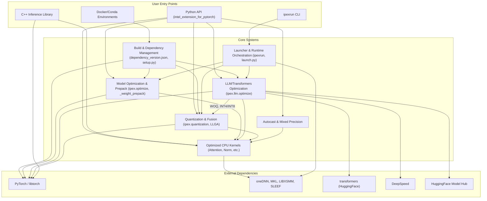

This diagram shows the main user entry points and how they interact with the core systems and external dependencies. Each core system is modular and can be used independently or in combination.

Sources: [README.md:11-13](README.md:11-13), [dependency_version.json:1-23](dependency_version.json:1-23), [docker/Dockerfile.compile:1-84](docker/Dockerfile.compile:1-84), [examples/cpu/llm/tools/env_setup.sh:1-152](examples/cpu/llm/tools/env_setup.sh:1-152)

### Major Systems and Code Entities

IPEX is structured into the following major systems, each with clear code entry points and responsibilities:

| System                        | Main Code Entry Points / Files                | Description                                                                 |
|-------------------------------|----------------------------------------------|-----------------------------------------------------------------------------|
| Build & Dependency Management | `dependency_version.json`, `setup.py`, `tools/dep_ver_utils.py` | Handles build, versioning, and environment setup.                           |
| Model Optimization & Prepack  | `ipex.optimize`, `intel_extension_for_pytorch/`, `_weight_prepack.py` | Applies model-level and operator-level optimizations.                       |
| LLM/Transformers Optimization | `ipex.llm.optimize`, `examples/cpu/llm/`     | Specialized optimizations for transformer and LLM models.                   |
| Quantization & Fusion         | `ipex.quantization`, `LLGA`, `ipex.quantization.prepare`, `ipex.quantization.convert` | INT8/INT4 quantization, fusion, and integration with PyTorch quantization.  |
| Autocast & Mixed Precision    | `ipex.autocast`, `ipex.amp`                  | Automatic mixed precision for CPU (BF16/FP16).                              |
| Optimized CPU Kernels         | `torch.ops.torch_ipex.*`, C++ kernel files   | Custom operator implementations for key workloads.                          |
| Launcher & Runtime            | `ipexrun`, `launcher.py`, `cpu/launch/`      | Orchestrates optimized execution, core affinity, and distributed launch.    |

This mapping helps users and developers quickly locate the relevant code for each system.

Sources: [dependency_version.json:1-23](dependency_version.json:1-23), [tools/dep_ver_utils.py:1-51](tools/dep_ver_utils.py:1-51), [README.md:11-16](README.md:11-16)

## Optimization Flow and Code Mapping

IPEX provides a layered optimization flow, from user entry points to kernel-level execution. The following diagram maps natural language system names to code entities and files.

**Optimization Flow: User to Kernel**

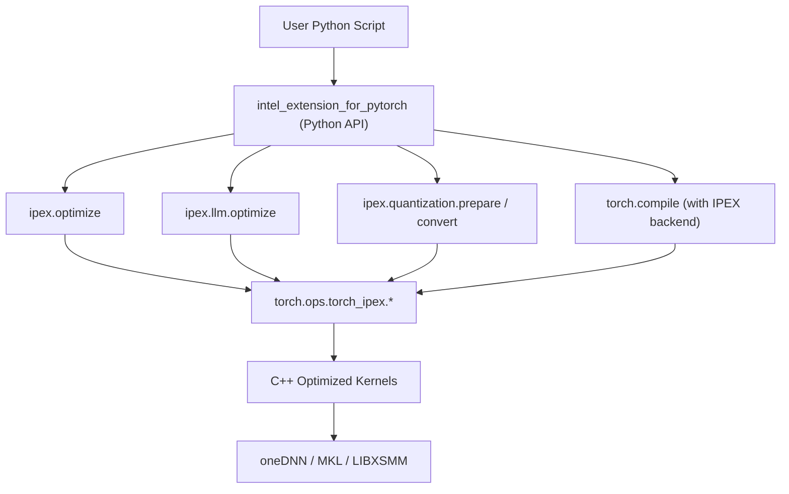

This diagram shows how user code interacts with the main APIs, which then dispatch to optimized kernels and external libraries.

Sources: [README.md:11-16](README.md:11-16), [intel_extension_for_pytorch/_inductor/decomposition.py:1-22](intel_extension_for_pytorch/_inductor/decomposition.py:1-22)

## LLM and Quantization System Overview

IPEX provides dedicated systems for LLM optimization and quantization, with clear code entry points and modular APIs.

**LLM/Transformers Optimization and Quantization System**

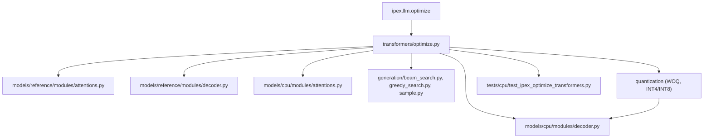

This diagram shows how `ipex.llm.optimize` orchestrates model transformation, quantization, and integration with optimized modules and generation scripts.

Sources: [examples/cpu/llm/inference/README.md:1-4](examples/cpu/llm/inference/README.md:1-4), [README.md:13-16](README.md:13-16)

## Key Features and Supported Models

### CPU and Operator Optimizations

- **Weight Prepacking**: Optimizes memory layout for linear and convolution operators.
- **JIT Fusion**: Fuses operator graphs for improved performance.
- **Channels Last Format**: Improves memory access for convolutional workloads.
- **torch.compile Integration**: Custom lowering and codegen for IPEX kernels.
- **CPU Autocast**: Automatic mixed precision (BF16/FP16) for CPUs.

### LLM Optimizations

- **ipex.llm.optimize**: API for model transformation, quantization, and kernel replacement.
- **Optimized Attention**: Fused rotary embedding, paged attention, and indirect access KV cache.
- **Distributed Inference**: DeepSpeed integration for sharded and multi-node execution.
- **Support for Multiple Data Types**: FP32, BF16, INT8, INT4, and prototype FP8.

#### Supported LLM Model Families

| Model Family | Example Models | Supported Precisions |
|--------------|---------------|---------------------|
| LLAMA        | Llama-2, Llama-3, Llama-3.1, Llama-3.2 | FP32, BF16, INT8, INT4 |
| GPT          | GPT-J, GPT-NEOX | FP32, BF16, INT8, INT4 |
| FALCON       | Falcon-7B, Falcon-40B | FP32, BF16, INT8, INT4 |
| Phi          | Phi-2, Phi-3, Phi-4 | FP32, BF16, INT8, INT4 |
| Mistral      | Mistral-7B, Mixtral-8x7B | FP32, BF16, INT8, INT4 |
| Others       | See documentation for full list | Various |

Sources: [README.md:23-75](README.md:23-75), [examples/cpu/llm/inference/README.md:9-61](examples/cpu/llm/inference/README.md:9-61), [docs/_static/htmls/tbl_single.html:1-365](docs/_static/htmls/tbl_single.html:1-365)

### Quantization Capabilities

- **Weight-Only Quantization (WOQ)**: INT8, INT4, and NF4 support for LLMs and vision models.
- **Static Quantization**: Calibration-based quantization for both weights and activations.
- **Dynamic Quantization**: On-the-fly quantization for supported modules.
- **SmoothQuant**: INT8 quantization with recipe tuning for improved accuracy.
- **DeepSpeed Integration**: Distributed quantized inference and sharding.

Sources: [docs/tutorials/features/sq_recipe_tuning_api.md:1-21](docs/tutorials/features/sq_recipe_tuning_api.md:1-21), [examples/cpu/llm/inference/README.md:276-361](examples/cpu/llm/inference/README.md:276-361)

## Installation and Setup

IPEX supports multiple installation methods:

- **Pip**: `pip install intel-extension-for-pytorch`
- **Docker**: Prebuilt and source-based Dockerfiles are provided for reproducible environments.
- **Source Build**: Clone the repository and build with `setup.py` or provided scripts.

Dependency versions are managed in `dependency_version.json`. Environment setup scripts are available in `examples/cpu/llm/tools/env_setup.sh` and `env_activate.sh`.

For detailed instructions, see the [Installation](/2.1) and [Getting Started](/2) pages.

Sources: [docs/tutorials/installation.md:1-8](docs/tutorials/installation.md:1-8), [docker/Dockerfile.compile:1-84](docker/Dockerfile.compile:1-84), [examples/cpu/llm/tools/env_setup.sh:1-152](examples/cpu/llm/tools/env_setup.sh:1-152)

## Basic Usage

IPEX APIs are designed for minimal code changes. The main entry points are `ipex.optimize` for general models and `ipex.llm.optimize` for transformer/LLM models.

- For general models: use `ipex.optimize(model)` before inference or training.
- For LLMs: use `ipex.llm.optimize(model, dtype=...)` for model transformation and quantization.

For more usage examples, see [Getting Started](/2) and [Core Optimization Features](/3).

Sources: [README.md:11-16](README.md:11-16), [examples/cpu/inference/python/python-scripts/README.md:4-6](examples/cpu/inference/python/python-scripts/README.md:4-6)

## System Requirements

### Hardware

- Intel CPUs with AVX-512 and/or AMX for best performance.
- Sufficient memory for large models (LLMs may require >1TB RAM).
- Intel discrete GPUs (for XPU support, if enabled).

### Software

- Python 3.10 or newer.
- PyTorch (see `dependency_version.json` for compatible versions).
- Linux OS recommended.
- Optional: `transformers` for LLMs, `deepspeed` for distributed inference.

Sources: [dependency_version.json:1-23](dependency_version.json:1-23), [docs/tutorials/examples.md:14-18](docs/tutorials/examples.md:14-18)

## Conclusion

Intel® Extension for PyTorch\* enhances PyTorch with specialized optimizations for Intel hardware. It provides seamless integration with PyTorch and offers significant performance improvements, especially for LLMs and other deep learning models, through a combination of CPU optimizations, LLM-specific optimizations, and quantization capabilities.

For more information about specific features, please refer to the appropriate sections in this wiki.

Sources: [README.md:11-16](README.md:11-16), [docs/tutorials/introduction.rst:4-5](docs/tutorials/introduction.rst:4-5)

---

# Page: Getting Started

# Getting Started

<details>
<summary>Relevant source files</summary>

The following files were used as context for generating this wiki page:

- [README.md](README.md)
- [dependency_version.json](dependency_version.json)
- [docker/Dockerfile.compile](docker/Dockerfile.compile)
- [docker/Dockerfile.prebuilt](docker/Dockerfile.prebuilt)
- [docs/_static/htmls/tbl_deepspeed.html](docs/_static/htmls/tbl_deepspeed.html)
- [docs/_static/htmls/tbl_single.html](docs/_static/htmls/tbl_single.html)
- [docs/tutorials/blogs_publications.md](docs/tutorials/blogs_publications.md)
- [docs/tutorials/features/hypertune.md](docs/tutorials/features/hypertune.md)
- [docs/tutorials/features/sq_recipe_tuning_api.md](docs/tutorials/features/sq_recipe_tuning_api.md)
- [docs/tutorials/installation.md](docs/tutorials/installation.md)
- [docs/tutorials/introduction.rst](docs/tutorials/introduction.rst)
- [docs/tutorials/llm/llm_optimize.md](docs/tutorials/llm/llm_optimize.md)
- [docs/tutorials/releases.md](docs/tutorials/releases.md)
- [examples/cpu/inference/cpp/README.md](examples/cpu/inference/cpp/README.md)
- [examples/cpu/inference/python/python-scripts/README.md](examples/cpu/inference/python/python-scripts/README.md)
- [examples/cpu/llm/Dockerfile](examples/cpu/llm/Dockerfile)
- [examples/cpu/llm/README.md](examples/cpu/llm/README.md)
- [examples/cpu/llm/inference/README.md](examples/cpu/llm/inference/README.md)
- [examples/cpu/llm/tools/env_activate.sh](examples/cpu/llm/tools/env_activate.sh)
- [examples/cpu/llm/tools/env_setup.sh](examples/cpu/llm/tools/env_setup.sh)
- [intel_extension_for_pytorch/_inductor/codegen/cpp.py](intel_extension_for_pytorch/_inductor/codegen/cpp.py)
- [intel_extension_for_pytorch/_inductor/decomposition.py](intel_extension_for_pytorch/_inductor/decomposition.py)
- [intel_extension_for_pytorch/_inductor/ir.py](intel_extension_for_pytorch/_inductor/ir.py)
- [intel_extension_for_pytorch/_inductor/overrides.py](intel_extension_for_pytorch/_inductor/overrides.py)
- [scripts/compile_bundle.py](scripts/compile_bundle.py)
- [tests/cpu/test_inductor.py](tests/cpu/test_inductor.py)
- [tools/dep_ver_utils.py](tools/dep_ver_utils.py)
- [version.txt](version.txt)

</details>


This page provides an introduction to Intel Extension for PyTorch (IPEX), explaining how to install it and start using its basic features. IPEX extends PyTorch with optimizations specifically designed for Intel hardware, providing significant performance improvements for deep learning workloads on Intel CPUs.

If you're looking for detailed installation instructions, see [Installation](#2.1). For more advanced usage examples, see [Basic Usage](#2.2).

## What is Intel Extension for PyTorch?

Intel Extension for PyTorch (IPEX) is a library that extends PyTorch with optimizations for Intel hardware. It leverages Intel-specific technologies such as Intel® Advanced Vector Extensions 512 (Intel® AVX-512) Vector Neural Network Instructions (VNNI) and Intel® Advanced Matrix Extensions (Intel® AMX) on Intel CPUs to accelerate deep learning workloads.

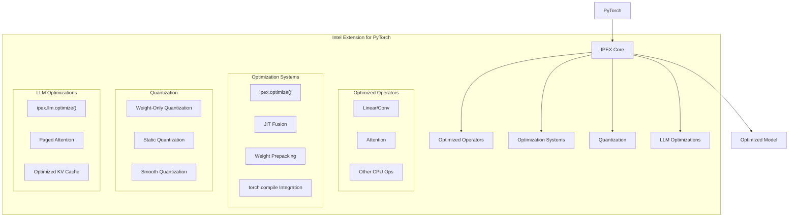

Sources: [README.md:8-11](https://github.com/intel/intel-extension-for-pytorch/tree/main/README.md)

## Installation

You can install Intel Extension for PyTorch in several ways:

### Pre-built Packages

The simplest way to install IPEX is using pip:

```bash
# Install PyTorch first
pip install torch==2.8.0+cpu --index-url https://download.pytorch.org/whl/cpu

# Install Intel Extension for PyTorch
pip install intel-extension-for-pytorch==2.8.0+cpu
```

### Docker

You can also use Docker containers with IPEX pre-installed:

```bash
# Pull and run the Docker image
docker pull intel/intel-extension-for-pytorch:latest
docker run -it intel/intel-extension-for-pytorch:latest
```

### Building from Source

For advanced users who need the latest features or custom builds:

```bash
# Clone the repository
git clone https://github.com/intel/intel-extension-for-pytorch.git
cd intel-extension-for-pytorch

# Build from source
python setup.py install
```

Sources: [docker/Dockerfile.prebuilt:39-54](https://github.com/intel/intel-extension-for-pytorch/tree/main/docker/Dockerfile.prebuilt), [scripts/compile_bundle.sh:122-137](https://github.com/intel/intel-extension-for-pytorch/tree/main/scripts/compile_bundle.sh), [docs/tutorials/installation.md:1-8](https://github.com/intel/intel-extension-for-pytorch/tree/main/docs/tutorials/installation.md)

## Basic Usage

The core functionality of IPEX is provided through the `ipex.optimize()` function, which applies various optimizations to PyTorch models. Here's a basic example of how to use IPEX to optimize a model:

### FP32 Inference

```python
import torch
import intel_extension_for_pytorch as ipex

# Load your model
model = torch.load("your_model.pt")
model.eval()

# Optimize the model with IPEX
model = ipex.optimize(model)

# Run inference
with torch.no_grad():
    output = model(input_data)
```

### BFloat16 Inference

For models that can benefit from mixed precision, IPEX supports BFloat16:

```python
import torch
import intel_extension_for_pytorch as ipex

# Load your model
model = torch.load("your_model.pt")
model.eval()

# Optimize the model with IPEX and enable BF16
model = ipex.optimize(model, dtype=torch.bfloat16)

# Create an autocast context for BF16 operations
with torch.cpu.amp.autocast(dtype=torch.bfloat16), torch.no_grad():
    output = model(input_data)
```

### Optimization Flow

IPEX applies several optimization techniques to improve model performance:

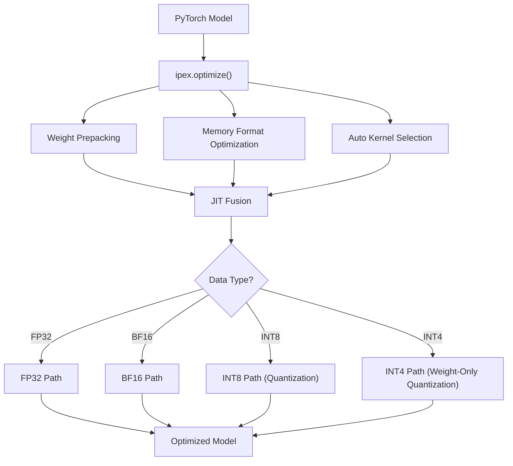

Sources: [docs/tutorials/examples.md:20-77](https://github.com/intel/intel-extension-for-pytorch/tree/main/docs/tutorials/examples.md)

## Large Language Model Optimization

IPEX provides dedicated optimizations for Large Language Models (LLMs) through the `ipex.llm.optimize()` API. This offers significant performance improvements for models like Llama, Falcon, Mistral, and many others.

### Basic LLM Example

```python
import torch
import intel_extension_for_pytorch as ipex
from transformers import AutoModelForCausalLM, AutoTokenizer

# Load model and tokenizer
model_id = "meta-llama/Meta-Llama-3.1-8B-Instruct"
model = AutoModelForCausalLM.from_pretrained(model_id)
tokenizer = AutoTokenizer.from_pretrained(model_id)

# Optimize with IPEX LLM optimization
model = ipex.llm.optimize(
    model, 
    dtype=torch.bfloat16,  # Can be torch.float32, torch.bfloat16
    inplace=True
)

# Generate text
input_text = "Write a short poem about artificial intelligence."
inputs = tokenizer(input_text, return_tensors="pt")

with torch.inference_mode():
    outputs = model.generate(
        inputs.input_ids,
        max_new_tokens=100
    )

print(tokenizer.decode(outputs[0], skip_special_tokens=True))
```

### Supported LLM Models

IPEX supports a wide range of LLM models, including Llama, Qwen, Phi, Falcon, Mistral, and many others. Different precision options (FP32, BF16, INT8, INT4) are available depending on the model.

The optimization applied to LLMs includes:

1. Model conversion and optimization
2. Quantization (optional)
3. Optimized kernels for attention, rotary position embeddings, etc.
4. Paged attention with optimized KV cache

Sources: [README.md:13-75](https://github.com/intel/intel-extension-for-pytorch/tree/main/README.md), [examples/cpu/llm/README.md:1-13](https://github.com/intel/intel-extension-for-pytorch/tree/main/examples/cpu/llm/README.md), [examples/cpu/llm/inference/README.md:1-59](https://github.com/intel/intel-extension-for-pytorch/tree/main/examples/cpu/llm/inference/README.md)

## Quantization Support

IPEX provides comprehensive support for model quantization:

### Weight-Only Quantization

Suitable for LLMs, this preserves activations in higher precision while quantizing weights:

```python
import torch
import intel_extension_for_pytorch as ipex
from transformers import AutoModelForCausalLM

# Load model
model = AutoModelForCausalLM.from_pretrained("meta-llama/Meta-Llama-3.1-8B-Instruct")

# Apply Weight-Only Quantization (INT8)
model = ipex.llm.optimize(
    model,
    weight_dtype="int8",  # Use "int4" for INT4 quantization
    quant_with_amp=True   # Enable mixed precision for better performance
)
```

### Static Quantization

This requires a calibration step to quantize both weights and activations:

```python
import torch
import torch.ao.quantization as quantization
import intel_extension_for_pytorch as ipex
from intel_extension_for_pytorch.quantization import prepare, convert

# Define quantization configuration
qconfig = torch.ao.quantization.QConfig(
    activation=torch.ao.quantization.observer.MinMaxObserver.with_args(
        qscheme=torch.per_tensor_affine, dtype=torch.quint8
    ),
    weight=torch.ao.quantization.weight_observer.MinMaxObserver.with_args(
        dtype=torch.qint8, qscheme=torch.per_tensor_symmetric
    )
)

# Prepare model for calibration
prepared_model = prepare(model, qconfig, example_inputs=calibration_data[0], inplace=False)

# Run calibration
for data in calibration_data:
    prepared_model(data)

# Convert to quantized model
quantized_model = convert(prepared_model)
```

Sources: [docs/tutorials/examples.md:140-195](https://github.com/intel/intel-extension-for-pytorch/tree/main/docs/tutorials/examples.md), [docs/tutorials/features/sq_recipe_tuning_api.md:1-21](https://github.com/intel/intel-extension-for-pytorch/tree/main/docs/tutorials/features/sq_recipe_tuning_api.md)

## Performance Tuning

To maximize performance with IPEX, consider these optimization techniques:

### Channels Last Memory Format

Using channels last (NHWC) memory format can significantly improve performance for CNN models:

```python
import torch
import intel_extension_for_pytorch as ipex

# Convert model to channels last
model = model.to(memory_format=torch.channels_last)

# Optimize the model
model = ipex.optimize(model, weights_prepack=True)

# Ensure input is also in channels last format
input_data = input_data.to(memory_format=torch.channels_last)
```

### Thread and Memory Configuration

Setting the right environment variables can improve performance:

```bash
# Set number of OpenMP threads
export OMP_NUM_THREADS=<number of cores>

# Use numactl for NUMA-aware execution
numactl -m <node N> -C <core list> python your_script.py
```

### Memory Allocators

Using optimized memory allocators like TCMalloc or Jemalloc can improve performance:

```bash
# Install TCMalloc
pip install intel-openmp=2024.1.2

# Set LD_PRELOAD to use TCMalloc
export LD_PRELOAD=/path/to/libtcmalloc.so:$LD_PRELOAD
```

Sources: [docs/tutorials/performance_tuning/tuning_guide.md:89-107](https://github.com/intel/intel-extension-for-pytorch/tree/main/docs/tutorials/performance_tuning/tuning_guide.md), [examples/cpu/llm/tools/env_activate.sh:14-47](https://github.com/intel/intel-extension-for-pytorch/tree/main/examples/cpu/llm/tools/env_activate.sh)

## Examples and Resources

### Example Scripts

The IPEX repository contains numerous examples showcasing different features:

- **Basic inference examples**: `/examples/cpu/inference/`
- **LLM optimization examples**: `/examples/cpu/llm/`
- **Quantization examples**: `/examples/cpu/quantization/`

### Running LLM Examples

For running LLM examples, set up the environment first:

```bash
# Clone the repository
git clone https://github.com/intel/intel-extension-for-pytorch.git
cd intel-extension-for-pytorch/examples/cpu/llm

# Setup the environment
source ./tools/env_activate.sh inference

# Run an example with Llama 3.1
python inference/run.py --benchmark -m meta-llama/Meta-Llama-3.1-8B-Instruct --dtype bfloat16 --ipex
```

Sources: [examples/cpu/llm/README.md:110-121](https://github.com/intel/intel-extension-for-pytorch/tree/main/examples/cpu/llm/README.md), [examples/cpu/llm/inference/README.md:140-166](https://github.com/intel/intel-extension-for-pytorch/tree/main/examples/cpu/llm/inference/README.md)

## Next Steps

- Learn about [Core Optimization Features](#3) to understand details of IPEX optimizations
- Explore [Quantization System](#4) for model quantization
- Check out [LLM Optimization](#5) for specialized LLM features
- Read [Deployment and Performance Tuning](#7) for production deployment

With this introduction, you should be able to start using Intel Extension for PyTorch and benefit from its performance optimizations on Intel hardware.

---

# Page: Installation

# Installation

<details>
<summary>Relevant source files</summary>

The following files were used as context for generating this wiki page:

- [.gitmodules](.gitmodules)
- [CMakeLists.txt](CMakeLists.txt)
- [dependency_version.json](dependency_version.json)
- [docker/Dockerfile.compile](docker/Dockerfile.compile)
- [docs/tutorials/features/sq_recipe_tuning_api.md](docs/tutorials/features/sq_recipe_tuning_api.md)
- [examples/cpu/inference/python/python-scripts/README.md](examples/cpu/inference/python/python-scripts/README.md)
- [examples/cpu/llm/Dockerfile](examples/cpu/llm/Dockerfile)
- [examples/cpu/llm/tools/env_activate.sh](examples/cpu/llm/tools/env_activate.sh)
- [examples/cpu/llm/tools/env_setup.sh](examples/cpu/llm/tools/env_setup.sh)
- [intel_extension_for_pytorch/__init__.py](intel_extension_for_pytorch/__init__.py)
- [intel_extension_for_pytorch/_inductor/codegen/cpp.py](intel_extension_for_pytorch/_inductor/codegen/cpp.py)
- [intel_extension_for_pytorch/_inductor/decomposition.py](intel_extension_for_pytorch/_inductor/decomposition.py)
- [intel_extension_for_pytorch/_inductor/ir.py](intel_extension_for_pytorch/_inductor/ir.py)
- [intel_extension_for_pytorch/_inductor/overrides.py](intel_extension_for_pytorch/_inductor/overrides.py)
- [scripts/compile_bundle.py](scripts/compile_bundle.py)
- [setup.py](setup.py)
- [tests/cpu/test_auto_channels_last.py](tests/cpu/test_auto_channels_last.py)
- [tests/cpu/test_inductor.py](tests/cpu/test_inductor.py)
- [tools/dep_ver_utils.py](tools/dep_ver_utils.py)
- [version.txt](version.txt)

</details>


This page provides detailed, up-to-date instructions for installing Intel Extension for PyTorch (IPEX), which extends PyTorch with optimizations for Intel CPUs and XPUs. For information on using IPEX after installation, see [Basic Usage](#2.2).

## Overview

IPEX can be installed using several methods:

- Pre-built pip packages (recommended for most users)
- Building from source (for development or custom builds)
- Docker containers (for reproducible, isolated environments)

The method you choose depends on your environment and requirements.

Sources: [setup.py:4-49](), [docker/Dockerfile.compile:1-84](), [examples/cpu/llm/tools/env_setup.sh:1-152]()

## System Requirements

### Hardware Requirements

- Intel CPUs with AVX2 support (AVX512 recommended for best performance)
- For XPU: Intel GPUs with supported drivers

### Software Requirements

- Linux OS (Ubuntu 22.04+ recommended)
- Python 3.8 or newer
- PyTorch (major.minor version must match IPEX)
- gcc/g++ 12.3.0 or newer (for source builds)

Version requirements are defined in `dependency_version.json` and `version.txt`.

Sources: [dependency_version.json:2-5](), [version.txt:1-3]()

## Installation Methods

### 1. Installing Pre-built Packages (Recommended)

The recommended way to install IPEX is via pip. The package will attempt to match your installed PyTorch version.

```bash
pip install intel-extension-for-pytorch
```

To install a specific version:

```bash
pip install intel-extension-for-pytorch==<version>
```

To install both PyTorch and IPEX from Intel's optimized channel:

```bash
pip install intel-extension-for-pytorch --extra-index-url https://pytorch-extension.intel.com/release-whl/stable/cpu/us/
```

**Note:** The major.minor version of PyTorch must match IPEX. If you see a version mismatch error, install the compatible PyTorch version as specified in `dependency_version.json`.

Sources: [setup.py:187](), [intel_extension_for_pytorch/__init__.py:30-36]()

### 2. Building from Source

Building from source allows for customization and development.

#### Step 1: Clone the Repository

```bash
git clone https://github.com/intel/intel-extension-for-pytorch.git
cd intel-extension-for-pytorch
git submodule sync
git submodule update --init --recursive
```

Sources: [.gitmodules:1-16]()

#### Step 2: Install Dependencies

Install required Python packages and system tools:

```bash
pip install cmake==3.28.4 ninja
pip install -r requirements.txt
```

Install the compatible PyTorch version (see `dependency_version.json` for the required version):

```bash
pip install torch==<version> --index-url https://download.pytorch.org/whl/cpu
```

Sources: [dependency_version.json:6-11](), [setup.py:202-207]()

#### Step 3: Build and Install

For a standard build:

```bash
python setup.py install
```

You can customize the build using environment variables:

| Variable         | Description                        | Example Value |
|------------------|------------------------------------|--------------|
| `DEBUG`          | Build with debug symbols           | 1            |
| `REL_WITH_DEB_INFO` | Release with debug info         | 1            |
| `MAX_JOBS`       | Number of parallel jobs            | 8            |
| `BUILD_WITH_XPU` | Enable XPU (GPU) support           | ON           |

Example:

```bash
export DEBUG=1
export MAX_JOBS=8
python setup.py install
```

Sources: [setup.py:4-49](), [setup.py:147-153]()

#### Step 4: Using the Compile Bundle Script

Alternatively, use the provided script to automate the build and installation:

```bash
python scripts/compile_bundle.py
```

This script will:

- Check and install dependencies
- Install the correct PyTorch version
- Build and install IPEX

See [scripts/compile_bundle.py] for details.

Sources: [scripts/compile_bundle.py:1-401]()

### 3. Using Docker

IPEX provides Dockerfiles for building containerized environments.

To build a Docker image from source:

```bash
docker build -f docker/Dockerfile.compile -t ipex:custom .
```

To run a container:

```bash
docker run -it --rm ipex:custom
```

The Dockerfile installs all required system and Python dependencies, builds IPEX, and sets up the environment for immediate use.

Sources: [docker/Dockerfile.compile:1-84]()

## IPEX System Architecture Overview

The following diagram shows the high-level architecture, mapping system names to code entities:

**Diagram: IPEX System Architecture and Code Entities**

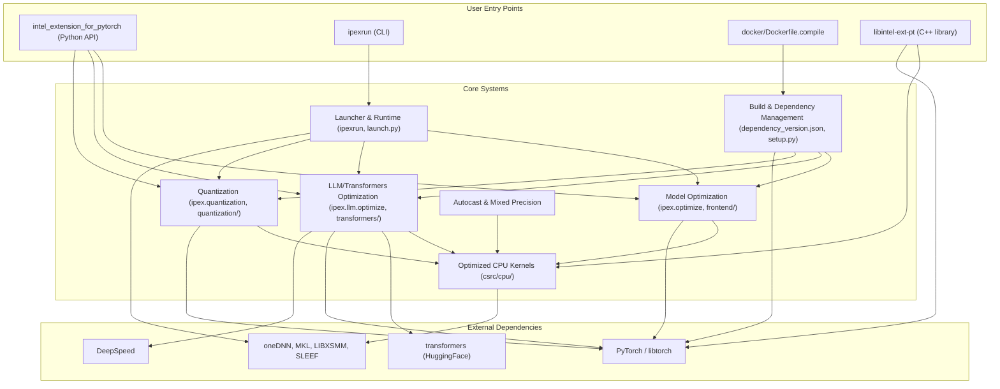

Sources: [setup.py:4-49](), [intel_extension_for_pytorch/__init__.py:120-129](), [CMakeLists.txt:48-49]()

## Installation Process Flow

**Diagram: IPEX Installation Process and Code Entities**

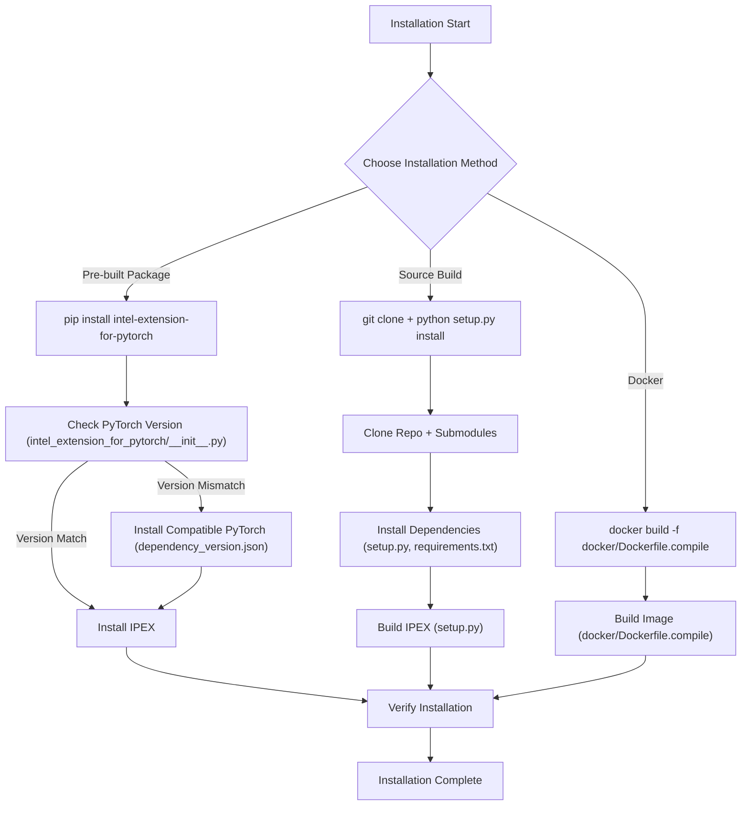

Sources: [setup.py:136-141](), [intel_extension_for_pytorch/__init__.py:30-36](), [docker/Dockerfile.compile:1-84]()

## Build System Architecture

When building from source, IPEX uses a multi-stage build system orchestrated by `setup.py` and CMake.

**Diagram: Build System and Code Entities**

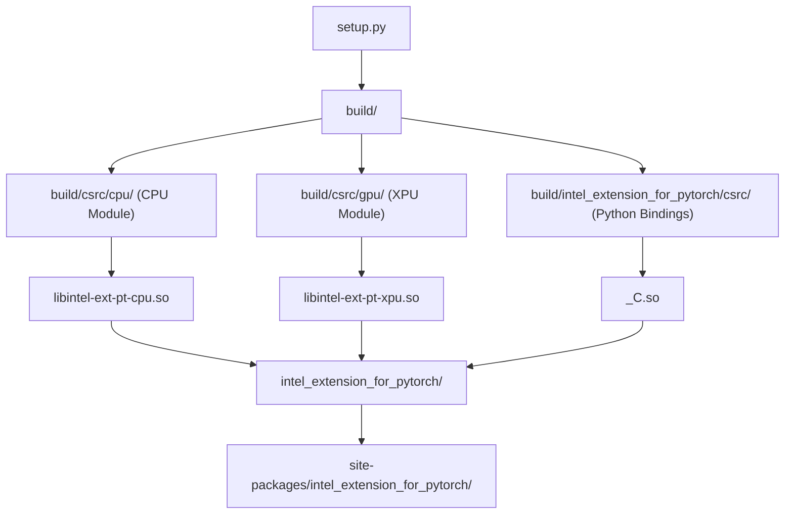

Sources: [setup.py:427-434](), [setup.py:656-935]()

## Build Options and Environment Variables

IPEX's build process can be controlled using environment variables. The most relevant options are:

| Environment Variable | Description | Default |
|---------------------|-------------|---------|
| `DEBUG` | Build with debug symbols (-O0) | Off |
| `REL_WITH_DEB_INFO` | Release with debug info (-O2, -g) | Off |
| `MAX_JOBS` | Number of parallel build jobs | Number of CPU cores |
| `VERBOSE` | Verbose build output | Off |
| `BUILD_WITH_XPU` | Enable XPU (GPU) support | Off |
| `TORCH_VERSION` | PyTorch version to depend on | From dependency_version.json |
| `IPEX_VERSION` | IPEX version literal | From version.txt |

Set these variables before running `python setup.py install` to customize the build.

Sources: [setup.py:4-49](), [setup.py:50-72]()

## Verification

To verify your IPEX installation, run the following in Python:

```python
import torch
import intel_extension_for_pytorch as ipex

ipex.version()
model = torch.nn.Linear(10, 10)
model = ipex.optimize(model)
```

This will print version information and test that the `ipex.optimize` API is available.

Sources: [intel_extension_for_pytorch/__init__.py:168-174]()

## Performance Optimization After Installation

For best performance, set recommended environment variables and use optimized memory allocators:

```bash
export KMP_BLOCKTIME=1
export KMP_AFFINITY=granularity=fine,compact,1,0
export LD_PRELOAD=/path/to/libtcmalloc.so:$LD_PRELOAD
```

- Use Intel OpenMP (`libiomp5.so`) instead of GNU OpenMP.
- Use TCMalloc or Jemalloc for memory allocation.

See [Deployment and Performance Tuning](#7) for more details.

Sources: [examples/cpu/llm/tools/env_activate.sh:15-38]()

## Troubleshooting

### Common Issues

#### PyTorch Version Mismatch

IPEX requires that the major.minor version of PyTorch matches the major.minor version of IPEX. If there's a mismatch, you'll see an error like:

```
ERROR! Intel® Extension for PyTorch* needs to work with PyTorch X.Y.*, but PyTorch A.B.C is found.
```

Solution: Install a compatible version of PyTorch or IPEX.

Sources: [intel_extension_for_pytorch/__init__.py:30-36]()

#### Missing Compiler or Incompatible Version

When building from source, IPEX requires gcc/g++ 12.3.0 or newer. The build will fail if your compiler is too old.

Solution: Install a compatible compiler or use the conda-based automatic installation in compile_bundle.sh:

```bash
conda install -y sysroot_linux-64==2.28 c-compiler cxx-compiler gcc==12.3 gxx==12.3 zstd -c conda-forge
```

Sources: [dependency_version.json:2-5](), [scripts/compile_bundle.sh:216-223]()

#### Windows-Specific Issues

On Windows, you might need Microsoft Visual C++ Redistributable:

```
Microsoft Visual C++ Redistributable is not installed, this may lead to the DLL load failure.
It can be downloaded at https://aka.ms/vs/16/release/vc_redist.x64.exe
```

Sources: [intel_extension_for_pytorch/__init__.py:91-94]()

#### Missing Libraries at Runtime

If you encounter missing libraries at runtime, check your LD_PRELOAD and LD_LIBRARY_PATH:

```bash
# For standard C++ library issues
export LD_PRELOAD=$(bash ./tools/get_libstdcpp_lib.sh):$LD_PRELOAD
```

Sources: [scripts/compile_bundle.sh:305-306](), [examples/cpu/llm/tools/env_activate.sh:22]()

---

# Page: Basic Usage

# Basic Usage

<details>
<summary>Relevant source files</summary>

The following files were used as context for generating this wiki page:

- [README.md](README.md)
- [dependency_version.json](dependency_version.json)
- [docker/Dockerfile.compile](docker/Dockerfile.compile)
- [docker/Dockerfile.prebuilt](docker/Dockerfile.prebuilt)
- [docs/_static/htmls/tbl_deepspeed.html](docs/_static/htmls/tbl_deepspeed.html)
- [docs/_static/htmls/tbl_single.html](docs/_static/htmls/tbl_single.html)
- [docs/tutorials/blogs_publications.md](docs/tutorials/blogs_publications.md)
- [docs/tutorials/features/hypertune.md](docs/tutorials/features/hypertune.md)
- [docs/tutorials/features/sq_recipe_tuning_api.md](docs/tutorials/features/sq_recipe_tuning_api.md)
- [docs/tutorials/installation.md](docs/tutorials/installation.md)
- [docs/tutorials/introduction.rst](docs/tutorials/introduction.rst)
- [docs/tutorials/llm/llm_optimize.md](docs/tutorials/llm/llm_optimize.md)
- [docs/tutorials/releases.md](docs/tutorials/releases.md)
- [examples/cpu/inference/cpp/README.md](examples/cpu/inference/cpp/README.md)
- [examples/cpu/inference/python/python-scripts/README.md](examples/cpu/inference/python/python-scripts/README.md)
- [examples/cpu/llm/Dockerfile](examples/cpu/llm/Dockerfile)
- [examples/cpu/llm/README.md](examples/cpu/llm/README.md)
- [examples/cpu/llm/inference/README.md](examples/cpu/llm/inference/README.md)
- [examples/cpu/llm/tools/env_activate.sh](examples/cpu/llm/tools/env_activate.sh)
- [examples/cpu/llm/tools/env_setup.sh](examples/cpu/llm/tools/env_setup.sh)
- [intel_extension_for_pytorch/_inductor/codegen/cpp.py](intel_extension_for_pytorch/_inductor/codegen/cpp.py)
- [intel_extension_for_pytorch/_inductor/decomposition.py](intel_extension_for_pytorch/_inductor/decomposition.py)
- [intel_extension_for_pytorch/_inductor/ir.py](intel_extension_for_pytorch/_inductor/ir.py)
- [intel_extension_for_pytorch/_inductor/overrides.py](intel_extension_for_pytorch/_inductor/overrides.py)
- [scripts/compile_bundle.py](scripts/compile_bundle.py)
- [tests/cpu/test_inductor.py](tests/cpu/test_inductor.py)
- [tools/dep_ver_utils.py](tools/dep_ver_utils.py)
- [version.txt](version.txt)

</details>


This page describes how to run basic Intel® Extension for PyTorch\* (IPEX) optimized workloads, including simple Python and CLI examples. It covers the main entry points for model optimization, supported data types, and how to use IPEX for both general PyTorch models and Large Language Models (LLMs).

For installation instructions, see [2.1 Installation](#2.1). For advanced optimization features, see [3 Core Optimization Features](#3). For LLM-specific workflows, see [5 LLM Optimization](#5).

---

## System Entry Points and Code Entities

The IPEX system provides multiple user entry points for optimization. The following diagram shows the main entry points and their mapping to code entities:

**Diagram: "IPEX Entry Points and Code Entities"**

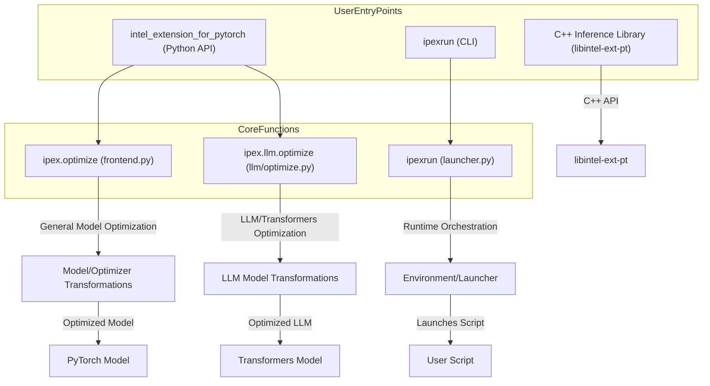

Sources:
- [README.md:11-12]()
- [examples/cpu/llm/README.md:14-116]()
- [examples/cpu/inference/python/python-scripts/README.md:4-121]()
- [examples/cpu/inference/cpp/README.md:1-59]()

## Basic Model Optimization Workflow

IPEX provides two main Python APIs for model optimization:

- `ipex.optimize` for general PyTorch models (vision, NLP, etc.)
- `ipex.llm.optimize` for transformer-based and LLM models

The following diagram shows the high-level workflow and code entities involved.

**Diagram: "ipex.optimize and ipex.llm.optimize Workflow"**

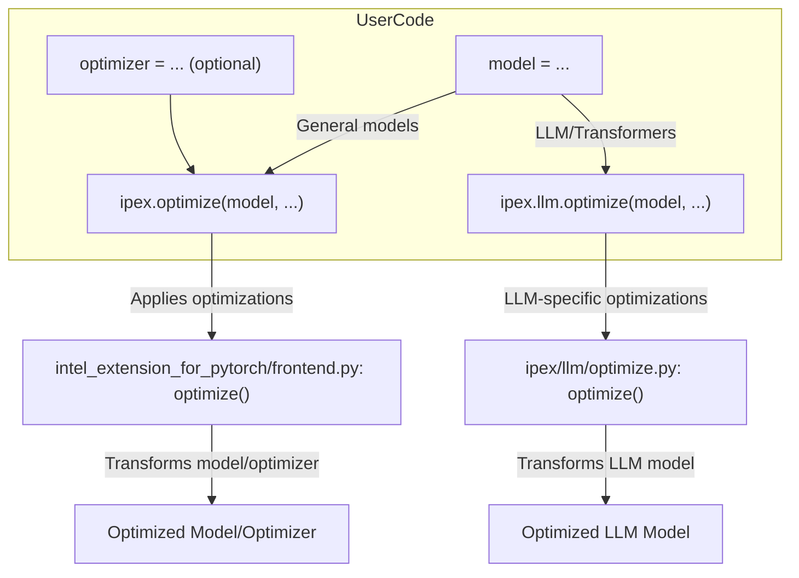

Sources:
- [intel_extension_for_pytorch/frontend.py:169-602]()
- [ipex/llm/optimize.py:1-]()
- [examples/cpu/inference/python/python-scripts/README.md:4-121]()
- [docs/tutorials/llm/llm_optimize.md:4-54]()

## Optimization Options and Parameters

The `ipex.optimize` and `ipex.llm.optimize` functions accept several parameters to control optimization behavior.

| Parameter                | Description                                                      | Typical Values                |
|--------------------------|------------------------------------------------------------------|-------------------------------|
| `level`                  | Optimization level                                               | `"O0"`, `"O1"`                |
| `dtype`                  | Data type for computation                                        | `torch.float32`, `torch.bfloat16`, `torch.float16` |
| `optimizer`              | PyTorch optimizer (for training)                                 | `torch.optim.*`               |
| `inplace`                | Whether to optimize the model in-place                           | `True`, `False`               |
| `weights_prepack`        | Enable weight prepacking for conv/linear layers                  | `True`, `False`               |
| `conv_bn_folding`        | Enable Conv+BatchNorm folding                                    | `True`, `False`               |
| `linear_bn_folding`      | Enable Linear+BatchNorm folding                                  | `True`, `False`               |
| `replace_dropout_with_identity` | Replace Dropout with Identity (inference)                 | `True`, `False`               |
| `split_master_weight_for_bf16`  | Use master weights for BF16 training                      | `True`, `False`               |
| `fuse_update_step`       | Fuse optimizer update step (training)                            | `True`, `False`               |
| `sample_input`           | Sample input tensor(s) for layout optimization                   | Tensor(s)                     |

**Diagram: "Optimization Level and Option Mapping"**

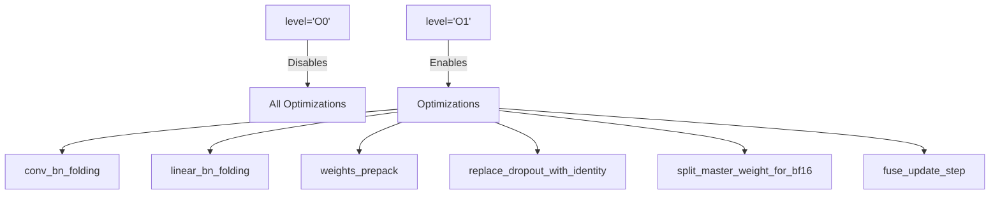

Sources:
- [intel_extension_for_pytorch/frontend.py:132-285]()
- [intel_extension_for_pytorch/frontend.py:459-552]()
- [tests/cpu/test_ipex_optimize.py:130-202]()

## Data Type Support

IPEX supports multiple data types for balancing performance and accuracy. The main supported types are:

| Data Type         | Description                        | Hardware Requirements                |
|-------------------|------------------------------------|--------------------------------------|
| `torch.float32`   | Full precision (FP32)              | Standard x86 CPUs                    |
| `torch.bfloat16`  | Brain Floating Point (BF16)        | Intel AVX-512 BF16 or Intel AMX      |
| `torch.float16`   | Half precision (FP16)              | Intel AVX-512 FP16                   |

For best performance on supported hardware, use `torch.bfloat16` with `torch.cpu.amp.autocast`.

Sources:
- [intel_extension_for_pytorch/frontend.py:186-194]()
- [intel_extension_for_pytorch/frontend.py:476-483]()
- [intel_extension_for_pytorch/frontend.py:539-552]()

## Weight Prepacking

Weight prepacking is a core optimization in IPEX. It converts model weights to a blocked memory layout for improved vectorization and cache reuse on Intel CPUs.

**Diagram: "Weight Prepacking Transformation"**

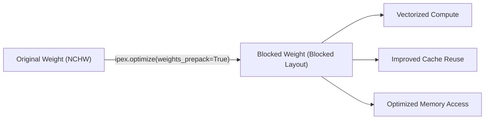

Sources:
- [intel_extension_for_pytorch/nn/utils/_weight_prepack.py:1-44]()
- [intel_extension_for_pytorch/frontend.py:186-209]()

## Large Language Model (LLM) Optimization

IPEX provides the `ipex.llm.optimize` API for transformer and LLM models. This function applies LLM-specific optimizations, including kernel fusion, quantization, and memory layout changes.

Supported models and data types are listed in [examples/cpu/llm/inference/README.md] and [docs/_static/htmls/tbl_single.html].

**Table: "LLM Optimization Entry Points"**

| API                        | Target Models         | Key Features                        | Code Entity                        |
|----------------------------|----------------------|-------------------------------------|-------------------------------------|
| `ipex.llm.optimize`        | Transformers/LLMs    | Fused attention, quantization, BF16 | `ipex/llm/optimize.py:optimize()`   |
| `ipex.optimize`            | General PyTorch      | Prepack, fusion, dtype conversion   | `intel_extension_for_pytorch/frontend.py:optimize()` |

Sources:
- [README.md:13-79]()
- [examples/cpu/llm/inference/README.md:1-139]()
- [docs/_static/htmls/tbl_single.html:1-365]()

## Example Workflows

### Inference Optimization

- Set model to evaluation mode.
- Call `ipex.optimize(model, dtype=...)` for general models, or `ipex.llm.optimize(model, dtype=...)` for LLMs.
- Use `torch.cpu.amp.autocast` for BF16/FP16 inference.

### Training Optimization

- Set model to training mode.
- Create optimizer.
- Call `ipex.optimize(model, optimizer=..., dtype=...)`.
- Use BF16/FP16 autocast for forward/backward.

### TorchScript Integration

- Optimize model with IPEX.
- Trace with `torch.jit.trace`.
- Optionally freeze with `torch.jit.freeze`.

Sources:
- [examples/cpu/inference/python/python-scripts/README.md:4-121]()
- [docs/tutorials/examples.md:22-138]()

## Additional Settings

IPEX provides APIs to control FP32 math mode and other backend settings. For example, `ipex.set_fp32_math_mode` can be used to enable BF32 emulation for FP32 operations.

Sources:
- [intel_extension_for_pytorch/frontend.py:631-697]()

## C++ Deployment

For deployment scenarios, IPEX also provides C++ libraries. For more information, see [examples/cpu/inference/cpp/README.md](examples/cpu/inference/cpp/README.md).

Sources:
- [docs/tutorials/examples.md:216-282](docs/tutorials/examples.md)
- [examples/cpu/inference/cpp/README.md:1-56](examples/cpu/inference/cpp/README.md)

---

# Page: Core Optimization Features

# Core Optimization Features

<details>
<summary>Relevant source files</summary>

The following files were used as context for generating this wiki page:

- [.gitmodules](.gitmodules)
- [CMakeLists.txt](CMakeLists.txt)
- [intel_extension_for_pytorch/__init__.py](intel_extension_for_pytorch/__init__.py)
- [intel_extension_for_pytorch/frontend.py](intel_extension_for_pytorch/frontend.py)
- [intel_extension_for_pytorch/nn/utils/_model_convert.py](intel_extension_for_pytorch/nn/utils/_model_convert.py)
- [intel_extension_for_pytorch/nn/utils/_parameter_wrapper.py](intel_extension_for_pytorch/nn/utils/_parameter_wrapper.py)
- [intel_extension_for_pytorch/nn/utils/_weight_cast.py](intel_extension_for_pytorch/nn/utils/_weight_cast.py)
- [intel_extension_for_pytorch/nn/utils/_weight_prepack.py](intel_extension_for_pytorch/nn/utils/_weight_prepack.py)
- [intel_extension_for_pytorch/optim/_functional.py](intel_extension_for_pytorch/optim/_functional.py)
- [intel_extension_for_pytorch/optim/_lamb.py](intel_extension_for_pytorch/optim/_lamb.py)
- [intel_extension_for_pytorch/optim/_optimizer_utils.py](intel_extension_for_pytorch/optim/_optimizer_utils.py)
- [intel_extension_for_pytorch/quantization/_quantize.py](intel_extension_for_pytorch/quantization/_quantize.py)
- [intel_extension_for_pytorch/utils/weight_only_quantization.py](intel_extension_for_pytorch/utils/weight_only_quantization.py)
- [setup.py](setup.py)
- [tests/cpu/common_utils.py](tests/cpu/common_utils.py)
- [tests/cpu/test_auto_channels_last.py](tests/cpu/test_auto_channels_last.py)
- [tests/cpu/test_deepspeed.py](tests/cpu/test_deepspeed.py)
- [tests/cpu/test_ipex_optimize.py](tests/cpu/test_ipex_optimize.py)
- [tests/cpu/test_optimizer.py](tests/cpu/test_optimizer.py)
- [tests/cpu/test_weight_cast.py](tests/cpu/test_weight_cast.py)

</details>


This page describes the main performance optimization mechanisms provided by Intel Extension for PyTorch (IPEX). These features are designed to accelerate PyTorch models on Intel CPUs by applying model- and operator-level enhancements, including memory layout changes, operator fusion, mixed precision, and kernel selection. For LLM-specific optimizations, see page [5]. For quantization, see page [4].

## System Overview and Code Mapping

The following diagram shows how the main optimization systems in IPEX are orchestrated by the `ipex.optimize` function, and how these map to code entities:

```mermaid
flowchart TD
    "UserModel[\"torch.nn.Module\"]" --> "ipex.optimize[\"intel_extension_for_pytorch.frontend.optimize\"]"
    "ipex.optimize" --> "WeightPrepack[\"nn.utils._weight_prepack.weight_prepack_with_ipex\"]"
    "ipex.optimize" --> "JITFusion[\"JIT Fusion System\"]"
    "ipex.optimize" --> "DtypeCast[\"nn.utils._weight_cast.weight_dtype_convert_with_ipex\"]"
    "ipex.optimize" --> "OptimizerFusion[\"optim._optimizer_utils.optimizer_fusion\"]"
    "ipex.optimize" --> "ChannelsLast[\"frontend._convert_convNd_deconvNd_weight_memory_format\"]"
    "ipex.optimize" --> "BNFolding[\"torch.fx.experimental.optimization.fuse\"]"
    "ipex.optimize" --> "AutoKernel[\"cpu._auto_kernel_selection._enable_dnnl\"]"
    "ipex.optimize" --> "TorchCompile[\"torch._dynamo.allow_in_graph\"]"
    "WeightPrepack" --> "OptimizedModel[\"IPEX-optimized nn.Module\"]"
    "JITFusion" --> "OptimizedModel"
    "DtypeCast" --> "OptimizedModel"
    "OptimizerFusion" --> "OptimizedOptimizer[\"IPEX-optimized Optimizer\"]"
    "ChannelsLast" --> "OptimizedModel"
    "BNFolding" --> "OptimizedModel"
    "AutoKernel" --> "OptimizedModel"
    "TorchCompile" --> "OptimizedModel"
    "OptimizedModel" -.-> "Training[\"Training Workloads\"]"
    "OptimizedOptimizer" -.-> "Training"
    "OptimizedModel" -.-> "Inference[\"Inference Workloads\"]"
```

Sources:
- [intel_extension_for_pytorch/frontend.py:169-609]()
- [intel_extension_for_pytorch/nn/utils/_weight_prepack.py:20-641]()

## The `ipex.optimize` Function

The `ipex.optimize` function is the main entry point for applying IPEX's core optimizations. It orchestrates model and optimizer transformations for both inference and training, based on user-specified parameters.

### Decision Flow and Code Mapping

```mermaid
flowchart TD
    "Start[\"ipex.optimize(model, dtype, optimizer, ...)\"]" --> "CheckMode[\"model.training?\"]"
    "CheckMode" -->|"True"| "TrainingPath[\"Training Optimizations\"]"
    "CheckMode" -->|"False"| "InferencePath[\"Inference Optimizations\"]"

    "InferencePath" --> "ConvBNFolding[\"conv_bn_folding\"]"
    "InferencePath" --> "LinearBNFolding[\"linear_bn_folding\"]"
    "InferencePath" --> "DropoutReplace[\"replace_dropout_with_identity\"]"
    "InferencePath" --> "DtypeCast[\"_model_convert.convert_model_data_type\"]"
    "InferencePath" --> "WeightPrepack[\"weight_prepack_with_ipex\"]"
    "InferencePath" --> "ChannelsLast[\"_convert_convNd_deconvNd_weight_memory_format\"]"
    "InferencePath" --> "GraphMode[\"graph_mode\"]"

    "TrainingPath" --> "DtypeCastTrain[\"_weight_cast.weight_dtype_convert_with_ipex\"]"
    "TrainingPath" --> "SplitMasterWeight[\"split_master_weight_for_bf16\"]"
    "TrainingPath" --> "FusedOptimizer[\"optimizer_fusion\"]"

    "BothPaths[\"Common Steps\"]" --> "AutoKernel[\"auto_kernel_selection\"]"
    "BothPaths" --> "TorchCompile[\"torch._dynamo.allow_in_graph\"]"
    "BothPaths" --> "Return[\"Return optimized model/optimizer\"]"
    "InferencePath" --> "BothPaths"
    "TrainingPath" --> "BothPaths"
```

#### Key Parameters

| Parameter                      | Description                                                                 |
|---------------------------------|-----------------------------------------------------------------------------|
| `model`                        | PyTorch model to optimize (`torch.nn.Module`)                               |
| `dtype`                        | Target dtype for model parameters (e.g., `torch.bfloat16`, `torch.float16`) |
| `optimizer`                    | PyTorch optimizer for training                                              |
| `level`                        | Optimization level: `"O0"` (none), `"O1"` (all)                             |
| `inplace`                      | Whether to optimize in-place                                                |
| `conv_bn_folding`              | Fold Conv+BatchNorm (inference only)                                        |
| `linear_bn_folding`            | Fold Linear+BatchNorm (inference only)                                      |
| `weights_prepack`              | Enable weight prepacking                                                    |
| `replace_dropout_with_identity`| Replace Dropout with Identity (inference only)                              |
| `optimize_lstm`                | Replace LSTM with IPEX LSTM                                                 |
| `split_master_weight_for_bf16` | Use split master weights for BF16 training                                  |
| `fuse_update_step`             | Use fused parameter update for training                                     |
| `auto_kernel_selection`        | Enable auto kernel selection                                                |
| `sample_input`                 | Sample input for block format selection                                     |
| `graph_mode`                   | Enable graph capture                                                        |
| `concat_linear`                | Enable concatenated linear optimization                                     |

For a full API reference, see [intel_extension_for_pytorch/frontend.py:169-609]().

Sources:
- [intel_extension_for_pytorch/frontend.py:169-609]()
- [tests/cpu/test_ipex_optimize.py:130-588]()

## Weight Prepacking

Weight prepacking is a core optimization that converts model weights to a blocked or channels-last memory layout before execution. This reduces runtime memory format conversions and enables direct use of optimized compute kernels.

### Code Entity Mapping

```mermaid
flowchart TD
    "ipex.optimize" --> "weight_prepack_with_ipex[\"nn.utils._weight_prepack.weight_prepack_with_ipex\"]"
    "weight_prepack_with_ipex" --> "ModuleTypeCheck[\"Check module type\"]"
    "ModuleTypeCheck" -->|"torch.nn.Linear"| "_IPEXLinear[\"_IPEXLinear\"]"
    "ModuleTypeCheck" -->|"torch.nn.Conv2d"| "_IPEXConv2d[\"_IPEXConv2d\"]"
    "ModuleTypeCheck" -->|"torch.nn.Conv3d"| "_IPEXConv3d[\"_IPEXConv3d\"]"
    "ModuleTypeCheck" -->|"torch.nn.Conv1d"| "_IPEXConv1d[\"_IPEXConv1d\"]"
    "ModuleTypeCheck" -->|"torch.nn.ConvTranspose2d"| "_IPEXConvTranspose2d[\"_IPEXConvTranspose2d\"]"
    "ModuleTypeCheck" -->|"torch.nn.ConvTranspose3d"| "_IPEXConvTranspose3d[\"_IPEXConvTranspose3d\"]"
    "_IPEXLinear" --> "BlockedWeights[\"BlockedParameter\"]"
    "_IPEXConv2d" --> "BlockedWeights"
    "_IPEXConv3d" --> "BlockedWeights"
    "_IPEXConv1d" --> "BlockedWeights"
    "_IPEXConvTranspose2d" --> "BlockedWeights"
    "_IPEXConvTranspose3d" --> "BlockedWeights"
    "BlockedWeights" --> "OptimizedLayout[\"Optimized memory layout for kernel\"]"
```

#### Example: Linear Weight Blocking

- Original: `[out_features, in_features]`
- Blocked: `[out_features/16, in_features/64, 16, 64]` (for BF16, on supported CPUs)

This enables efficient vectorization and cache usage.

Sources:
- [intel_extension_for_pytorch/nn/utils/_weight_prepack.py:20-91]()
- [intel_extension_for_pytorch/nn/utils/_weight_prepack.py:469-600]()
- [tests/cpu/test_ipex_optimize.py:368-404]()

## JIT Fusion System

The JIT Fusion system in IPEX identifies and fuses common operator patterns (such as Conv+BN+ReLU) into single, more efficient kernels. This reduces memory bandwidth and kernel launch overhead.

### Fusion Patterns and Code Mapping

```mermaid
flowchart TD
    "JITFusionSystem[\"JIT Fusion System\"]" --> "PatternRecognition[\"Pattern Recognition\"]"
    "PatternRecognition" --> "ConvBNReLU[\"Conv+BatchNorm+ReLU\"]"
    "PatternRecognition" --> "LinearReLU[\"Linear+ReLU\"]"
    "PatternRecognition" --> "ConvEltwise[\"Conv+Eltwise\"]"
    "PatternRecognition" --> "LinearEltwise[\"Linear+Eltwise\"]"
    "PatternRecognition" --> "ConvSum[\"Conv+Sum\"]"
    "PatternRecognition" --> "LinearBN[\"Linear+BatchNorm\"]"
    "PatternRecognition" --> "ConvReshape[\"Conv+Reshape\"]"
    "PatternRecognition" --> "ConvSwish[\"Conv+Swish\"]"
    "ConvBNReLU" --> "FusedKernel[\"Fused Implementation\"]"
    "LinearReLU" --> "FusedKernel"
    "ConvEltwise" --> "FusedKernel"
    "LinearEltwise" --> "FusedKernel"
    "ConvSum" --> "FusedKernel"
    "LinearBN" --> "FusedKernel"
    "ConvReshape" --> "FusedKernel"
    "ConvSwish" --> "FusedKernel"
    "FusedKernel" --> "Benefits[\"Reduced memory, better vectorization, fewer launches\"]"
```

#### Supported Elementwise Fusions

| Operation     | Description         | BF16 Support |
|---------------|---------------------|--------------|
| relu          | ReLU activation     | Yes          |
| sigmoid       | Sigmoid activation  | Yes          |
| tanh          | Tanh activation     | Yes          |
| swish         | Swish/SiLU          | Yes          |
| gelu          | GELU activation     | Yes          |
| hardtanh      | HardTanh            | Yes          |
| hardswish     | HardSwish           | Yes          |
| hardsigmoid   | HardSigmoid         | Yes          |
| leaky_relu    | LeakyReLU           | Yes          |
| elu           | ELU                 | Yes          |
| abs           | Absolute value      | Yes          |
| square        | Square              | Yes          |
| pow           | Power               | Yes          |
| log           | Logarithm           | Yes          |
| sqrt          | Square root         | Yes          |
| exp           | Exponential         | Yes          |

Sources:
- [tests/cpu/test_jit.py:116-191]()

## Mixed Precision Support (BF16/FP16)

IPEX supports mixed precision (BF16/FP16) for both inference and training. This is achieved by casting model weights and, for training, using master weight strategies to maintain numerical stability.

### Mixed Precision Strategies

```mermaid
flowchart TD
    "MixedPrecision" --> "TrainingMode[\"model.training?\"]"
    "TrainingMode" -->|"True"| "MasterWeight[\"Master Weight Strategies\"]"
    "TrainingMode" -->|"False"| "LowPrecisionCast[\"Convert to BF16/FP16\"]"
    "MasterWeight" --> "RegularMaster[\"FP32 master weights\"]"
    "MasterWeight" --> "SplitMaster[\"Split master weight (BF16)\"]"
    "RegularMaster" --> "Flow1[\"Cast model weights to BF16/FP16, keep FP32 master, update in FP32, sync back\"]"
    "SplitMaster" --> "Flow2[\"Split across two BF16 tensors, maintain FP32 precision, less memory\"]"
    "LowPrecisionCast" --> "Modules[\"Convert Linear, Conv, LSTM (inference), Embedding (inference)\"]"
    "Modules" --> "BNRemain[\"BatchNorm stays FP32\"]"
```

- For training, the `split_master_weight_for_bf16` parameter selects between regular and split master weight strategies.
- For inference, supported modules are cast to the target dtype.

Sources:
- [intel_extension_for_pytorch/nn/utils/_weight_cast.py:8-87]()
- [tests/cpu/test_weight_cast.py:56-81]()
- [tests/cpu/test_ipex_optimize.py:203-231]()

## Optimizer Fusion

IPEX provides fused implementations of common optimizers, reducing memory traffic and improving update speed, especially for large models.

### Supported Optimizers and Code Mapping

```mermaid
flowchart TD
    "optimizer_fusion[\"optim._optimizer_utils.optimizer_fusion\"]" --> "SGD[\"torch.optim.SGD\"]"
    "optimizer_fusion" --> "Adagrad[\"torch.optim.Adagrad\"]"
    "optimizer_fusion" --> "Adam[\"torch.optim.Adam\"]"
    "optimizer_fusion" --> "Lamb[\"ipex.optim.Lamb\"]"
    "optimizer_fusion" --> "Lars[\"ipex.optim.Lars\"]"
    "optimizer_fusion" --> "AdamW[\"torch.optim.AdamW\"]"
    "optimizer_fusion" --> "FusedStep[\"Patch .step() to fused kernel\"]"
    "FusedStep" --> "Benefits[\"Reduced memory, vectorized update, cache efficiency\"]"
    "FusedStep" --> "MixedPrecision[\"BF16/FP16: convert grad to FP32, update, sync back\"]"
```

- Fused optimizers are selected and patched in `optim._optimizer_utils.optimizer_fusion`.
- Mixed precision is supported by converting gradients to FP32 for the update step.

Sources:
- [intel_extension_for_pytorch/optim/_optimizer_utils.py:20-49]()
- [intel_extension_for_pytorch/optim/_optimizer_utils.py:360-391]()
- [intel_extension_for_pytorch/optim/_functional.py:473-534]()
- [tests/cpu/test_optimizer.py:84-124]()

## Channels Last Memory Format

IPEX can automatically convert convolution weights to channels last memory format (NHWC for 2D) for improved cache and vectorization efficiency.

```mermaid
flowchart TD
    "AutoChannelsLast[\"frontend._convert_convNd_deconvNd_weight_memory_format\"]" --> "Conv1d[\"Conv1d → channels_last_1d\"]"
    "AutoChannelsLast" --> "Conv2d[\"Conv2d → channels_last\"]"
    "AutoChannelsLast" --> "Conv3d[\"Conv3d → channels_last_3d\"]"
    "AutoChannelsLast" --> "ConvTranspose1d[\"ConvTranspose1d → channels_last_1d\"]"
    "AutoChannelsLast" --> "ConvTranspose2d[\"ConvTranspose2d → channels_last\"]"
    "AutoChannelsLast" --> "ConvTranspose3d[\"ConvTranspose3d → channels_last_3d\"]"
    "Conv1d" --> "Benefits[\"Improved cache, vectorization, reduced memory traffic\"]"
    "Conv2d" --> "Benefits"
    "Conv3d" --> "Benefits"
    "ConvTranspose1d" --> "Benefits"
    "ConvTranspose2d" --> "Benefits"
    "ConvTranspose3d" --> "Benefits"
```

Sources:
- [intel_extension_for_pytorch/frontend.py:95-112]()
- [intel_extension_for_pytorch/frontend.py:605-612]()

## BatchNorm Folding

IPEX can fold BatchNorm layers into preceding Conv or Linear layers during inference, reducing computation and memory accesses.

```mermaid
flowchart TD
    "BatchNormFolding[\"BatchNorm Folding\"]" --> "ConvBN[\"Conv+BatchNorm\"]"
    "BatchNormFolding" --> "LinearBN[\"Linear+BatchNorm\"]"
    "ConvBN" --> "FoldedConv[\"Folded Conv (adjusted weights/bias)\"]"
    "LinearBN" --> "FoldedLinear[\"Folded Linear (adjusted weights/bias)\"]"
    "FoldedConv" --> "Benefits[\"Reduced compute, fewer accesses, smaller model\"]"
    "FoldedLinear" --> "Benefits"
```

Sources:
- [tests/cpu/test_ipex_optimize.py:130-202]()

## Auto Kernel Selection

Auto Kernel Selection dynamically chooses the optimal kernel implementation (oneDNN, TPP, MKL) for operations like Linear and Conv, based on input shape, dtype, and hardware.

```mermaid
flowchart TD
    "AutoKernelSelection[\"auto_kernel_selection\"]" --> "InputFactors[\"Batch size, shape, dtype\"]"
    "InputFactors" --> "KernelLogic[\"Selection logic\"]"
    "KernelLogic" --> "oneDNN[\"oneDNN kernel\"]"
    "KernelLogic" --> "TPP[\"TPP kernel\"]"
    "KernelLogic" --> "MKL[\"MKL GEMM\"]"
    "oneDNN" --> "OptimalKernel[\"Select optimal kernel\"]"
    "TPP" --> "OptimalKernel"
    "MKL" --> "OptimalKernel"
```

Sources:
- [intel_extension_for_pytorch/nn/utils/_weight_prepack.py:53-89]()
- [intel_extension_for_pytorch/frontend.py:401-407]()
- [tests/cpu/test_ipex_optimize.py:486-516]()

## torch.compile Integration

IPEX integrates with PyTorch's `torch.compile` and `torch._dynamo` to enable graph-level optimizations and allow IPEX-optimized modules to participate in graph capture and compilation.

```mermaid
flowchart TD
    "torch.compile" --> "torch._dynamo.allow_in_graph"
    "torch._dynamo.allow_in_graph" --> "_IPEXConv1d"
    "torch._dynamo.allow_in_graph" --> "_IPEXConv2d"
    "torch._dynamo.allow_in_graph" --> "_IPEXConv3d"
    "torch._dynamo.allow_in_graph" --> "_IPEXConvTranspose2d"
    "torch._dynamo.allow_in_graph" --> "_IPEXConvTranspose3d"
    "torch._dynamo.allow_in_graph" --> "_IPEXLinear"
    "torch._dynamo.allow_in_graph" --> "_LSTM"
    "_IPEXConv1d" --> "CompileFlow[\"torch.compile workflow\"]"
    "_IPEXConv2d" --> "CompileFlow"
    "_IPEXConv3d" --> "CompileFlow"
    "_IPEXConvTranspose2d" --> "CompileFlow"
    "_IPEXConvTranspose3d" --> "CompileFlow"
    "_IPEXLinear" --> "CompileFlow"
    "_LSTM" --> "CompileFlow"
    "CompileFlow" --> "GraphCapture[\"Graph capture, fusion, codegen\"]"
```

Sources:
- [intel_extension_for_pytorch/frontend.py:575-590]()

## Summary

IPEX's core optimization features work together to deliver significant performance improvements for both training and inference on Intel hardware. The optimizations focus on:

1. **Memory Layout Optimization**: Weight prepacking and channels last format
2. **Operation Fusion**: JIT fusion and BatchNorm folding
3. **Mixed Precision**: BF16/FP16 support with efficient master weight strategies
4. **Compute Optimization**: Optimized kernels and fusion patterns
5. **Training Efficiency**: Optimizer fusion and split master weight

These optimizations can be easily applied to PyTorch models using the `ipex.optimize()` function, with different configurations available to balance performance and compatibility.

Sources:
- [intel_extension_for_pytorch/frontend.py:169-602]()

---

# Page: ipex.optimize Function

# ipex.optimize Function

<details>
<summary>Relevant source files</summary>

The following files were used as context for generating this wiki page:

- [intel_extension_for_pytorch/frontend.py](intel_extension_for_pytorch/frontend.py)
- [intel_extension_for_pytorch/nn/utils/_model_convert.py](intel_extension_for_pytorch/nn/utils/_model_convert.py)
- [intel_extension_for_pytorch/nn/utils/_parameter_wrapper.py](intel_extension_for_pytorch/nn/utils/_parameter_wrapper.py)
- [intel_extension_for_pytorch/nn/utils/_weight_cast.py](intel_extension_for_pytorch/nn/utils/_weight_cast.py)
- [intel_extension_for_pytorch/nn/utils/_weight_prepack.py](intel_extension_for_pytorch/nn/utils/_weight_prepack.py)
- [intel_extension_for_pytorch/optim/_functional.py](intel_extension_for_pytorch/optim/_functional.py)
- [intel_extension_for_pytorch/optim/_lamb.py](intel_extension_for_pytorch/optim/_lamb.py)
- [intel_extension_for_pytorch/optim/_optimizer_utils.py](intel_extension_for_pytorch/optim/_optimizer_utils.py)
- [intel_extension_for_pytorch/quantization/_quantize.py](intel_extension_for_pytorch/quantization/_quantize.py)
- [intel_extension_for_pytorch/utils/weight_only_quantization.py](intel_extension_for_pytorch/utils/weight_only_quantization.py)
- [tests/cpu/common_utils.py](tests/cpu/common_utils.py)
- [tests/cpu/test_deepspeed.py](tests/cpu/test_deepspeed.py)
- [tests/cpu/test_ipex_optimize.py](tests/cpu/test_ipex_optimize.py)
- [tests/cpu/test_optimizer.py](tests/cpu/test_optimizer.py)
- [tests/cpu/test_weight_cast.py](tests/cpu/test_weight_cast.py)

</details>


The `ipex.optimize` function is the main Python API for applying Intel Extension for PyTorch (IPEX) optimizations to PyTorch models and optimizers. It orchestrates a set of transformations and enhancements to improve performance on Intel CPUs (and, to a limited extent, XPUs). These optimizations include weight prepacking, operator fusion, mixed precision, and optimizer fusion.

For LLM/transformer-specific optimizations, see page [5.1].

## System Context and Entry Point

`ipex.optimize` is the central entry point for model and optimizer optimization in IPEX. It is typically called by users after model construction and before training or inference. The function is implemented in [intel_extension_for_pytorch/frontend.py](), and coordinates with several subsystems, including weight prepacking, parameter casting, optimizer patching, and operator fusion.

### System Integration Diagram

**Diagram: "ipex.optimize" in the IPEX System**

```mermaid
flowchart TD
    UserScript["User Script"] --> IPEXOptimize["ipex.optimize (frontend.py)"]
    IPEXOptimize --> WeightPrepack["weight_prepack_with_ipex (_weight_prepack.py)"]
    IPEXOptimize --> ParamCast["weight_dtype_convert_with_ipex (_weight_cast.py)"]
    IPEXOptimize --> OptFusion["optimizer_fusion (_optimizer_utils.py)"]
    IPEXOptimize --> ModelConvert["convert_model_data_type (_model_convert.py)"]
    IPEXOptimize --> BNConvFuse["optimization.fuse (PyTorch FX)"]
    IPEXOptimize --> LSTMOpt["replace_lstm_with_ipex_lstm (_lstm_convert.py)"]
    IPEXOptimize --> GraphCapture["GraphCapture (graph_capture.py)"]
    IPEXOptimize --> ChannelsLast["to_channels_last_1d, channels_last_3d"]
```

Sources: [intel_extension_for_pytorch/frontend.py:169-609](), [intel_extension_for_pytorch/nn/utils/_weight_prepack.py](), [intel_extension_for_pytorch/nn/utils/_weight_cast.py](), [intel_extension_for_pytorch/optim/_optimizer_utils.py](), [intel_extension_for_pytorch/nn/utils/_model_convert.py]()


## API Signature

The function signature is:

```python
def optimize(
    model,
    dtype=None,
    optimizer=None,
    level="O1",
    inplace=False,
    conv_bn_folding=None,
    linear_bn_folding=None,
    weights_prepack=None,
    replace_dropout_with_identity=None,
    optimize_lstm=None,
    split_master_weight_for_bf16=None,
    fuse_update_step=None,
    auto_kernel_selection=None,
    sample_input=None,
    graph_mode=None,
    concat_linear=None,
)
```

### Parameters

| Name | Type | Default | Description |
|------|------|---------|-------------|
| `model` | `torch.nn.Module` | required | Model to optimize. |
| `dtype` | `torch.dtype` | `None` | Target dtype (`torch.bfloat16`, `torch.float16`). |
| `optimizer` | `torch.optim.Optimizer` | `None` | Optimizer to optimize (for training). |
| `level` | `str` | `"O1"` | Optimization level: `"O0"` (none), `"O1"` (full). |
| `inplace` | `bool` | `False` | If `True`, optimize model in-place. |
| `conv_bn_folding` | `bool` | `None` | Fold Conv+BN layers (inference only). |
| `linear_bn_folding` | `bool` | `None` | Fold Linear+BN layers (inference only). |
| `weights_prepack` | `bool` | `None` | Prepack weights for supported modules. |
| `replace_dropout_with_identity` | `bool` | `None` | Replace Dropout with Identity (inference only). |
| `optimize_lstm` | `bool` | `None` | Replace LSTM with optimized version. |
| `split_master_weight_for_bf16` | `bool` | `None` | Use split master weights for BF16 training. |
| `fuse_update_step` | `bool` | `None` | Use fused optimizer update step. |
| `auto_kernel_selection` | `bool` | `None` | Enable auto kernel selection. |
| `sample_input` | `torch.Tensor` or `tuple` | `None` | Sample input for shape-aware prepacking. |
| `graph_mode` | `bool` | `None` | Enable graph mode (experimental). |
| `concat_linear` | `bool` | `None` | Enable linear layer concatenation. |

### Return Value

- In inference mode: returns the optimized model.
- In training mode: returns a tuple `(optimized_model, optimized_optimizer)`.

Sources: [intel_extension_for_pytorch/frontend.py:169-277]()

## Optimization Workflow

The optimization steps depend on whether the model is in training or inference mode. The function applies a sequence of transformations, some of which are conditional on the provided arguments and hardware.

### Diagram: "ipex.optimize" Workflow by Mode

```mermaid
flowchart TD
    Start["ipex.optimize()"] --> ModeCheck{"model.training?"}
    ModeCheck -->|"False (Inference)"| InfOpt["Inference Optimizations"]
    ModeCheck -->|"True (Training)"| TrainOpt["Training Optimizations"]

    InfOpt --> ConvBN["Conv+BN Folding (optional)"]
    ConvBN --> LinearBN["Linear+BN Folding (optional)"]
    LinearBN --> Dropout["Dropout→Identity (optional)"]
    Dropout --> ConcatLinear["Concat Linear (optional)"]
    ConcatLinear --> DtypeCast["Dtype Cast (optional)"]
    DtypeCast --> WeightPrepack["Weight Prepack (optional)"]
    WeightPrepack --> GraphMode["Graph Mode (optional)"]
    GraphMode --> ReturnInf["Return Optimized Model"]

    TrainOpt --> DtypeCastTrain["Dtype Cast (optional)"]
    DtypeCastTrain --> LSTMOpt["LSTM Optimization (optional)"]
    LSTMOpt --> MasterWeight["Split Master Weight (BF16, optional)"]
    MasterWeight --> WeightPrepackTrain["Weight Prepack (optional)"]
    WeightPrepackTrain --> GraphModeTrain["Graph Mode (optional)"]
    GraphModeTrain --> FusedUpdate["Fused Optimizer Update (optional)"]
    FusedUpdate --> ReturnTrain["Return Optimized Model & Optimizer"]
```

Sources: [intel_extension_for_pytorch/frontend.py:367-609]()

## Core Optimization Techniques

### Weight Prepacking

Weight prepacking is a transformation that converts weights of supported modules (e.g., `nn.Linear`, `nn.Conv2d`) into a blocked memory layout optimized for oneDNN. This reduces runtime memory format conversions and improves performance.

**Diagram: "weight_prepack_with_ipex" Process**

```mermaid
flowchart TD
    Model["nn.Module"] --> PrepackEntry["weight_prepack_with_ipex()"]
    PrepackEntry --> ParamWrap["get_shared_parameter_status()"]
    PrepackEntry --> ConvertRec["convert_rec()"]
    ConvertRec --> Convert["convert()"]
    Convert -->|Can Prepack| IPEXModule["IPEX_WEIGHT_PREPACK_MODULE_CPU"]
    IPEXModule --> PrepackImpl["param_wrapper.prepack()"]
    PrepackImpl --> SetContext["Set op_ctx, wrappers, empty tensors"]
    Convert -->|Cannot Prepack| NoChange["Return original module"]
    ConvertRec --> PatchState["patch_state_dict()"]
    PatchState --> ReturnPrepacked["Return optimized model"]
```

- Prepacking is only applied if the module is supported and not blocked by hooks or sharing.
- The process replaces modules with IPEX-optimized versions (e.g., `_IPEXLinear`, `_IPEXConv2d`).
- The prepacked modules use blocked weights and may set up empty tensors for graph tracing.

Sources: [intel_extension_for_pytorch/nn/utils/_weight_prepack.py:489-605](), [intel_extension_for_pytorch/nn/utils/_parameter_wrapper.py:190-444]()

### Operator Fusion

Operator fusion in IPEX combines multiple operations into a single, more efficient kernel. The main fusions are:

- **Conv+BatchNorm Folding**: Fuses convolution and batch normalization into a single convolution with adjusted weights and bias.
- **Linear+BatchNorm Folding**: Fuses linear and batch normalization.
- **Dropout Replacement**: Replaces Dropout with Identity in inference for better graph fusion.
- **JIT/FX Fusion**: Additional fusions may be performed at the graph level.

These fusions are controlled by the `conv_bn_folding`, `linear_bn_folding`, and `replace_dropout_with_identity` arguments.

Sources: [intel_extension_for_pytorch/frontend.py:459-474](), [intel_extension_for_pytorch/nn/utils/_model_convert.py:27-39]()

### Mixed Precision (BF16/FP16) and Master Weight Handling

IPEX supports mixed precision via `torch.bfloat16` and `torch.float16`. When `dtype` is set:

- In inference, supported module parameters are cast to the target dtype.
- In training, parameters are cast and master weights are managed for accurate updates. For BF16, "split master weight" mode is available to save memory.

**Diagram: Mixed Precision and Master Weight Handling**

```mermaid
flowchart TD
    DtypeCast["weight_dtype_convert_with_ipex()"] -->|Inference| PatchState["patch_state_dict()"]
    DtypeCast -->|Training| MasterWeightCheck{"split_master_weight_for_bf16?"}
    MasterWeightCheck -->|Yes| SplitMaster["Split master weight (BF16 only)"]
    MasterWeightCheck -->|No| FullMaster["Full master weight"]
    SplitMaster --> PatchOpt["Patch optimizer methods"]
    FullMaster --> PatchOpt
    PatchOpt --> ReturnTrain["Return model, optimizer"]
```

Sources: [intel_extension_for_pytorch/frontend.py:480-555](), [intel_extension_for_pytorch/nn/utils/_weight_cast.py:8-87]()

### Optimizer Fusion and Training-Specific Optimizations

For training, IPEX can patch the optimizer to use fused update steps for supported optimizers, and manage master weights for mixed precision.

- **Fused Update Step**: Replaces the optimizer's `step` method with a fused implementation for better performance.
- **Supported Optimizers**: See table below.

| Device | Supported Fused Optimizers |
|--------|---------------------------|
| CPU    | SGD, Adagrad, Adam, Lamb, Lars |
| XPU    | SGD, AdamW, Adam, Lamb        |

Sources: [intel_extension_for_pytorch/optim/_optimizer_utils.py:20-49](), [intel_extension_for_pytorch/frontend.py:603-608]()

## Example Usage

### Inference

```python
import intel_extension_for_pytorch as ipex
model.eval()
optimized_model = ipex.optimize(model, dtype=torch.bfloat16)
with torch.cpu.amp.autocast(enabled=True, dtype=torch.bfloat16):
    output = optimized_model(input_data)
```

### Training

```python
import intel_extension_for_pytorch as ipex
model.train()
optimizer = torch.optim.Adam(model.parameters(), lr=0.001)
optimized_model, optimized_optimizer = ipex.optimize(
    model, dtype=torch.bfloat16, optimizer=optimizer
)
with torch.cpu.amp.autocast(enabled=True, dtype=torch.bfloat16):
    output = optimized_model(input_data)
    loss = criterion(output, target)
optimized_optimizer.zero_grad()
loss.backward()
optimized_optimizer.step()
```

Sources: [intel_extension_for_pytorch/frontend.py:299-328]()

## Optimization Levels

IPEX supports two optimization levels, which can be further customized by explicit arguments:

| Level | Description | Optimizations Applied |
|-------|-------------|----------------------|
| `"O0"` | No optimizations | Returns original model/optimizer |
| `"O1"` | Standard optimizations | Conv+BN folding, Linear+BN folding, Weight prepacking, Dropout replacement, LSTM optimization, split master weight, fused update step |

Explicit arguments (e.g., `conv_bn_folding`, `weights_prepack`) override the defaults for the selected level.

Sources: [intel_extension_for_pytorch/frontend.py:133-166]()

## Hardware-Specific Behavior

`ipex.optimize` adapts its optimizations based on the detected device type (CPU or XPU):

**Diagram: Hardware-Specific Optimization Path**

```mermaid
flowchart TD
    Entry["ipex.optimize"] --> DeviceCheck{"All params on CPU or XPU?"}
    DeviceCheck -->|"CPU"| CPUPath["Apply CPU-specific optimizations"]
    DeviceCheck -->|"XPU"| XPUPath["Apply XPU-specific optimizations"]
    CPUPath --> CPUPrepack["Enable weight prepacking, auto kernel selection, master weight"]
    XPUPath --> XPUChannelsLast["Enable channels last (if supported)"]
    XPUPath --> XPUFP32Math["Set FP32 math mode"]
    XPUPath --> XPUNoPrepack["Disable weight prepacking"]
```

- Weight prepacking is not supported on XPU.
- Some features (e.g., split master weight) are only available for certain optimizers or devices.
- The function checks for hardware support (e.g., AVX-512 for BF16) before enabling certain optimizations.

Sources: [intel_extension_for_pytorch/frontend.py:349-444]()

## Implementation Details

### Mapping of PyTorch Modules to IPEX Counterparts

When weight prepacking is enabled, the following module replacements occur:

| PyTorch Module | IPEX Counterpart |
|----------------|------------------|
| `nn.Linear` | `_IPEXLinear` |
| `nn.Conv1d` | `_IPEXConv1d` |
| `nn.Conv2d` | `_IPEXConv2d` |
| `nn.Conv3d` | `_IPEXConv3d` |
| `nn.ConvTranspose2d` | `_IPEXConvTranspose2d` |
| `nn.ConvTranspose3d` | `_IPEXConvTranspose3d` |

These modules are defined in [intel_extension_for_pytorch/nn/utils/_weight_prepack.py]() and use optimized kernels.

Sources: [intel_extension_for_pytorch/nn/utils/_weight_prepack.py:20-406]()

### Code Entity Relationship Diagram

**Diagram: Code Entities for Weight Prepacking**

```mermaid
flowchart TD
    optimize["optimize (frontend.py)"] --> weight_prepack_with_ipex["weight_prepack_with_ipex (_weight_prepack.py)"]
    weight_prepack_with_ipex --> IPEXLinear["_IPEXLinear"]
    weight_prepack_with_ipex --> IPEXConv2d["_IPEXConv2d"]
    weight_prepack_with_ipex --> IPEXConv3d["_IPEXConv3d"]
    weight_prepack_with_ipex --> IPEXConv1d["_IPEXConv1d"]
    weight_prepack_with_ipex --> IPEXConvTranspose2d["_IPEXConvTranspose2d"]
    weight_prepack_with_ipex --> IPEXConvTranspose3d["_IPEXConvTranspose3d"]
```

Sources: [intel_extension_for_pytorch/nn/utils/_weight_prepack.py:20-406](), [intel_extension_for_pytorch/frontend.py:169-609]()

### Optimizer Fusion

When `fuse_update_step` is enabled, IPEX patches the optimizer's `step` method with a fused implementation for supported optimizers. See the table in the previous section for supported optimizers.

Sources: [intel_extension_for_pytorch/optim/_optimizer_utils.py:20-49](), [intel_extension_for_pytorch/optim/_functional.py:472-534](), [intel_extension_for_pytorch/optim/_functional.py:592-670]()

## Best Practices

- Provide a `sample_input` to enable shape-aware weight prepacking.
- Use `ipex.enable_auto_channels_last()` before `ipex.optimize` for convolutional models.
- Prefer `torch.bfloat16` for training on supported hardware.
- Use `level="O1"` for most workloads; use `"O0"` for debugging.
- Set math mode with `ipex.set_fp32_math_mode()` as needed.

Sources: [intel_extension_for_pytorch/frontend.py:260-271]()

## Limitations and Warnings

1. **Script Module**: The function returns the original model unchanged if it's a `torch.jit.ScriptModule`
2. **Mixed Device Models**: All model parameters must be on the same device
3. **Distributed Training**: Call `ipex.optimize()` BEFORE using Distributed Data Parallel (DDP)
4. **BF16/FP16 Support**: Requires appropriate hardware support (e.g., AVX-512 for BF16)
5. **Weight Prepacking on XPU**: Weight prepacking is not supported for XPU devices

Sources: [intel_extension_for_pytorch/frontend.py:331-444]()

---

# Page: JIT Fusion System

# JIT Fusion System

<details>
<summary>Relevant source files</summary>

The following files were used as context for generating this wiki page:

- [tests/cpu/test_jit.py](tests/cpu/test_jit.py)

</details>


The JIT Fusion System in Intel Extension for PyTorch (IPEX) is a core optimization subsystem that identifies and fuses operation patterns in PyTorch models at runtime using Just-In-Time (JIT) compilation. By fusing multiple operations into a single, hardware-optimized kernel, the system reduces memory traffic and computational overhead, improving inference performance on Intel CPUs.

This page documents the architecture, supported fusion patterns, integration points, and technical details of the JIT Fusion System. For details on related optimizations, see [3.3] (Weight Prepacking).

Sources: [tests/cpu/test_jit.py:51-4999]()

## Architecture Overview

The JIT Fusion System extends PyTorch's JIT compiler by introducing Intel-specific fusion passes and pattern matchers. It is invoked as part of the `ipex.optimize()` workflow and operates on TorchScript graphs produced by tracing or scripting.

### System Integration Diagram

```mermaid
flowchart TD
    "intel_extension_for_pytorch.ipex.optimize()"["\"ipex.optimize()\""]
    "torch.jit.trace/script"["\"torch.jit.trace/script\""]
    "JITFusionSystem"["\"JIT Fusion System\""]
    "LLGA_FUSION_GROUP"["\"LLGA_FUSION_GROUP\""]
    "ipex.quantization"["\"ipex.quantization\""]
    "ipex_prepack::*"["\"ipex_prepack::*\""]
    "OptimizedModel"["\"Optimized Model\""]

    "UserModel"["\"User Model\""] --> "ipex.optimize()"
    "ipex.optimize()" --> "torch.jit.trace/script"
    "torch.jit.trace/script" --> "JIT Fusion System"
    "JIT Fusion System" --> "LLGA_FUSION_GROUP"
    "JIT Fusion System" --> "ipex_prepack::*"
    "JIT Fusion System" --> "ipex.quantization"
    "LLGA_FUSION_GROUP" --> "OptimizedModel"
    "ipex_prepack::*" --> "OptimizedModel"
    "ipex.quantization" --> "OptimizedModel"
```

Sources: [tests/cpu/test_jit.py:51-193](), [tests/cpu/test_jit_llga_fuser.py:17-21]()

### Fusion Process Flow

#### JIT Fusion System: Data and Control Flow

```mermaid
sequenceDiagram
    participant "User" as "User"
    participant "ipex.optimize()" as "ipex.optimize()"
    participant "torch.jit.trace/script" as "torch.jit.trace/script"
    participant "JITFusionSystem" as "JIT Fusion System"
    participant "LLGA_FUSION_GROUP" as "LLGA_FUSION_GROUP"
    participant "ipex_prepack::*" as "ipex_prepack::*"
    participant "OptimizedModel" as "Optimized Model"

    "User"->>"ipex.optimize()": "model = ipex.optimize(model)"
    "ipex.optimize()"->>"torch.jit.trace/script": "Trace/Script model"
    "torch.jit.trace/script"->>"JITFusionSystem": "JIT model graph"
    "JITFusionSystem"->>"LLGA_FUSION_GROUP": "Pattern matching, create fusion groups"
    "JITFusionSystem"->>"ipex_prepack::*": "Replace with prepacked ops"
    "LLGA_FUSION_GROUP"->>"OptimizedModel": "Return fused model"
    "ipex_prepack::*"->>"OptimizedModel": "Return optimized model"
```

Sources: [tests/cpu/test_jit.py:93-193](), [tests/cpu/test_jit_llga_fuser.py:21-98]()

## Key Components

### LLGA Fusion Group and Pattern Matching

The JIT Fusion System is implemented as a set of pattern matchers and fusion passes that operate on TorchScript graphs. The main components are:

- **LLGA Fusion Group**: Identifies subgraphs that match supported fusion patterns and replaces them with a single fused node (e.g., `ipex::LlgaFusionGroup`).
- **Pattern Matchers**: Define and detect operation sequences eligible for fusion (e.g., Conv+ReLU, Linear+Add).

#### Code Entity Mapping Diagram

```mermaid
flowchart TD
    "tests/cpu/test_jit.py"["\"tests/cpu/test_jit.py\""]
    "LLGA_FUSION_GROUP"["\"LLGA_FUSION_GROUP\""]
    "ipex_prepack::convolution_run"["\"ipex_prepack::convolution_run\""]
    "ipex_prepack::linear_relu_run"["\"ipex_prepack::linear_relu_run\""]
    "ipex::add_layernorm"["\"ipex::add_layernorm\""]
    "PatternMatcher"["\"Pattern Matcher\""]

    "tests/cpu/test_jit.py" --> "PatternMatcher"
    "PatternMatcher" --> "LLGA_FUSION_GROUP"
    "PatternMatcher" --> "ipex_prepack::convolution_run"
    "PatternMatcher" --> "ipex_prepack::linear_relu_run"
    "PatternMatcher" --> "ipex::add_layernorm"
```

Sources: [tests/cpu/test_jit.py:51-390](), [tests/cpu/test_jit_llga_fuser.py:600-789]()

#### Example: Fusion Before and After

```mermaid
flowchart LR
    subgraph "Before Fusion"
        A["aten::conv2d"] --> B["aten::batch_norm"] --> C["aten::relu"]
    end
    subgraph "After Fusion"
        F["ipex::LlgaFusionGroup (conv_bn_relu)"]
    end
    "Before Fusion" --> "After Fusion"
```

Sources: [tests/cpu/test_jit_llga_fuser.py:97-110]()

## Supported Fusion Patterns

The JIT Fusion System supports a broad set of operation fusion patterns, targeting common neural network subgraphs.

### Convolution-Based Fusions

| Pattern                        | Fused Node Kind                              | Example Node(s) in Graph                |
|--------------------------------|----------------------------------------------|-----------------------------------------|
| Conv + BatchNorm               | `ipex_prepack::convolution_run`              | Conv2d + BatchNorm2d                    |
| Conv + ReLU                    | `ipex_prepack::convolution_relu_run`         | Conv2d + ReLU                           |
| Conv + BatchNorm + ReLU        | `ipex_prepack::convolution_relu_run`         | Conv2d + BatchNorm2d + ReLU             |
| Conv + Add                     | `ipex_prepack::convolution_add_run`          | Conv2d + Add                            |
| Conv + Add + ReLU              | `ipex_prepack::convolution_add_relu_run`     | Conv2d + Add + ReLU                     |
| ConvTranspose + ReLU           | `ipex_prepack::conv_transpose_relu_run`      | ConvTranspose2d + ReLU                  |

Sources: [tests/cpu/test_jit.py:382-474](), [tests/cpu/test_jit_llga_fuser.py:756-788]()

### Linear-Based Fusions

| Pattern                        | Fused Node Kind                              | Example Node(s) in Graph                |
|--------------------------------|----------------------------------------------|-----------------------------------------|
| Linear + ReLU                  | `ipex_prepack::linear_relu_run`              | Linear + ReLU                           |
| Linear + Sigmoid + Mul (Swish) | `ipex_prepack::linear_swish_run`             | Linear + Sigmoid + Mul                  |
| Linear + Add                   | `ipex_prepack::linear_add_run`               | Linear + Add                            |
| Linear + Add + ReLU            | `ipex_prepack::linear_add_relu_run`          | Linear + Add + ReLU                     |
| Linear + Mul + Add             | `ipex_prepack::linear_mul_add_run`           | Linear + Mul + Add                      |

Sources: [tests/cpu/test_jit.py:738-914](), [tests/cpu/test_jit_llga_fuser.py:355-365]()

### Element-wise and Other Fusions

| Pattern                        | Fused Node Kind                              | Example Node(s) in Graph                |
|--------------------------------|----------------------------------------------|-----------------------------------------|
| Add + ReLU                     | `ipex::add_relu`                             | Add + ReLU                              |
| MatMul + Div                   | `ipex::matmul_div`                           | MatMul + Div                            |
| MatMul + Mul                   | `ipex::matmul_mul`                           | MatMul + Mul                            |
| Add + LayerNorm                | `ipex::add_layernorm`                        | Add + LayerNorm                         |
| ChannelShuffle                 | `ipex::shuffle_2d`                           | ChannelShuffle pattern                  |

Sources: [tests/cpu/test_jit.py:970-1004](), [tests/cpu/test_jit_llga_fuser.py:433-448]()

## Integration with PyTorch JIT

The JIT Fusion System is tightly integrated with PyTorch's JIT tracing and scripting mechanisms. It operates on TorchScript graphs produced by either method.

### JIT Compilation Methods and IPEX Fusion

```mermaid
flowchart TD
    "UserModel"["\"User Model\""]
    "ipex.optimize()"["\"ipex.optimize()\""]
    "torch.jit.trace"["\"torch.jit.trace\""]
    "torch.jit.script"["\"torch.jit.script\""]
    "JITFusionSystem"["\"JIT Fusion System\""]
    "LLGA_FUSION_GROUP"["\"LLGA_FUSION_GROUP\""]

    "UserModel" --> "ipex.optimize()"
    "ipex.optimize()" --> "torch.jit.trace"
    "ipex.optimize()" --> "torch.jit.script"
    "torch.jit.trace" --> "JIT Fusion System"
    "torch.jit.script" --> "JIT Fusion System"
    "JIT Fusion System" --> "LLGA_FUSION_GROUP"
```

- **Tracing**: Records operations on sample inputs, producing a static graph. Fast, but does not capture dynamic control flow.
- **Scripting**: Converts Python code to TorchScript, capturing dynamic control flow, but with more restrictions.

Sources: [tests/cpu/test_jit_llga_fuser.py:44-76](), [tests/cpu/test_ao_jit_llga_utils.py:111-140]()

## Integration with Quantization

The JIT Fusion System is designed to work with IPEX and PyTorch quantization flows, enabling fusion of quantized operations for INT8 and lower-precision inference.

### Quantization-Aware Fusion Flow

```mermaid
flowchart TD
    "ipex.quantization.prepare"["\"ipex.quantization.prepare\""]
    "ipex.quantization.convert"["\"ipex.quantization.convert\""]
    "JITFusionSystem"["\"JIT Fusion System\""]
    "LLGA_FUSION_GROUP"["\"LLGA_FUSION_GROUP\""]
    "INT8Kernels"["\"INT8 Optimized Kernels\""]

    "QuantizedModel"["\"Quantized Model\""] --> "ipex.quantization.prepare"
    "ipex.quantization.prepare" --> "ipex.quantization.convert"
    "ipex.quantization.convert" --> "JIT Fusion System"
    "JIT Fusion System" --> "LLGA_FUSION_GROUP"
    "LLGA_FUSION_GROUP" --> "INT8Kernels"
```

Supported quantized fusion patterns include:

| Pattern                        | Fused Node Kind                              |
|--------------------------------|----------------------------------------------|
| Dequant + Conv + Quant         | Quantized convolution                        |
| Dequant + Linear + Quant       | Quantized linear                             |
| Dequant + Conv + ReLU + Quant  | Quantized convolution with fused ReLU        |
| Dequant + BatchNorm + Quant    | Quantized batch normalization                |
| Dequant + Pooling + Quant      | Quantized pooling                            |

Sources: [tests/cpu/test_ao_jit_llga_quantization_fuser.py:57-405](), [intel_extension_for_pytorch/quantization/_quantization_state.py:42-100]()

## Usage Example

To use the JIT Fusion System:

1. Apply `ipex.optimize()` to your model.
2. Use `torch.jit.trace()` or `torch.jit.script()` to produce a TorchScript model.
3. (Optional) Use `torch.jit.freeze()` for further optimization.
4. Run inference as usual.

This workflow enables the JIT Fusion System to identify and fuse eligible operation patterns in the model graph.

Sources: [tests/cpu/test_jit_llga_fuser.py:111-145](), [tests/cpu/test_ao_jit_llga_utils.py:111-140]()

## Performance Considerations

### When to Use JIT Fusion

JIT Fusion is most effective for:

- Models with common fused patterns (e.g., Conv+BN+ReLU, Linear+ReLU)
- Inference workloads on Intel CPUs (especially with AVX-512)
- Models with many element-wise or reduction operations

### Limitations

- Dynamic input shapes may limit fusion opportunities.
- Fusion is applied based on observed input shapes during tracing.
- Not all PyTorch operations are supported for fusion.
- Custom or user-defined operations are not automatically fused.

Sources: [tests/cpu/test_jit_llga_fuser.py:520-536](), [tests/cpu/test_ao_jit_llga_throughput_benchmark.py:30-55]()

## Technical Details

### LLGA Backend and Kernel Generation

The JIT Fusion System relies on the LLGA (Low Level Graph Analysis) backend to generate optimized fused kernels, leveraging the oneDNN library for hardware-specific performance.

#### Backend Integration Diagram

```mermaid
flowchart TD
    "PyTorchJIT"["\"PyTorch JIT\""] --> "LLGA_FUSION_GROUP"["\"LLGA_FUSION_GROUP\""]
    "LLGA_FUSION_GROUP" --> "oneDNN"["\"oneDNN Library\""]
    "oneDNN" --> "IntelCPU"["\"Intel CPU\""]

    subgraph "LLGA Processing"
        "GraphAnalysis"["\"Graph Analysis\""] --> "PatternMatching"["\"Pattern Matching\""] --> "SubgraphCreation"["\"Subgraph Creation\""] --> "KernelGeneration"["\"Kernel Generation\""]
    end
```

Sources: [tests/cpu/test_jit_llga_fuser.py:17-21](), [tests/cpu/test_ao_jit_llga_utils.py:93-102]()

### Data Type Support

The JIT Fusion System supports:

| Data Type | Description                        | Use Case                        |
|-----------|------------------------------------|---------------------------------|
| FP32      | 32-bit floating point              | High precision                  |
| BF16      | 16-bit brain floating point        | Mixed precision                 |
| INT8      | 8-bit integer                      | Quantized inference             |
| INT4      | 4-bit integer                      | Extreme quantization            |

Sources: [tests/cpu/test_jit_llga_fuser.py:204-222](), [tests/cpu/test_ao_jit_llga_quantization_fuser.py:323-351]()

## Advanced Features

### Smooth Quantization Support

The JIT Fusion System supports Smooth Quantization, which balances quantization between weights and activations for improved accuracy in quantized models.

```mermaid
flowchart TD
    "ActivationTensor"["\"Activation Tensor\""] --> "SmoothQuantActivationObserver"["\"SmoothQuantActivationObserver\""]
    "WeightTensor"["\"Weight Tensor\""] --> "SmoothQuantWeightObserver"["\"SmoothQuantWeightObserver\""]
    "SmoothQuantActivationObserver" -- "Exchange info" --> "SmoothQuantWeightObserver"
    "SmoothQuantActivationObserver" --> "ScalingFactors"["\"Scaling Factors\""]
    "SmoothQuantWeightObserver" --> "ScalingFactors"
    "ScalingFactors" --> "QuantizedModel"["\"Quantized Model\""]
```

Sources: [intel_extension_for_pytorch/quantization/_smooth_quant.py:10-267]()

### Custom Pattern Registration

Advanced users can register custom fusion patterns using the IPEX recipe system.

```mermaid
flowchart LR
    "UserCode"["\"User Code\""] -- "Define custom pattern" --> "FusionRecipe"["\"Fusion Recipe\""]
    "FusionRecipe" -- "Register" --> "PatternRegistry"["\"Pattern Registry\""]
    "PatternRegistry" -- "Used by" --> "JITFusionSystem"["\"JIT Fusion System\""]
```

Sources: [intel_extension_for_pytorch/quantization/_recipe.py:92-343]()

## Conclusion

The JIT Fusion System in Intel Extension for PyTorch provides significant performance improvements for neural network inference on Intel CPUs. By identifying and fusing operation patterns at runtime, it reduces memory transfers and computational overhead. The system integrates with PyTorch's JIT compilation framework and supports various data types and quantization schemes. With proper usage, it can deliver substantial speedups for inference workloads across a wide range of models.

---

# Page: Weight Prepacking

# Weight Prepacking

<details>
<summary>Relevant source files</summary>

The following files were used as context for generating this wiki page:

- [intel_extension_for_pytorch/frontend.py](intel_extension_for_pytorch/frontend.py)
- [intel_extension_for_pytorch/nn/utils/_model_convert.py](intel_extension_for_pytorch/nn/utils/_model_convert.py)
- [intel_extension_for_pytorch/nn/utils/_parameter_wrapper.py](intel_extension_for_pytorch/nn/utils/_parameter_wrapper.py)
- [intel_extension_for_pytorch/nn/utils/_weight_cast.py](intel_extension_for_pytorch/nn/utils/_weight_cast.py)
- [intel_extension_for_pytorch/nn/utils/_weight_prepack.py](intel_extension_for_pytorch/nn/utils/_weight_prepack.py)
- [intel_extension_for_pytorch/optim/_functional.py](intel_extension_for_pytorch/optim/_functional.py)
- [intel_extension_for_pytorch/optim/_lamb.py](intel_extension_for_pytorch/optim/_lamb.py)
- [intel_extension_for_pytorch/optim/_optimizer_utils.py](intel_extension_for_pytorch/optim/_optimizer_utils.py)
- [intel_extension_for_pytorch/quantization/_quantize.py](intel_extension_for_pytorch/quantization/_quantize.py)
- [intel_extension_for_pytorch/utils/weight_only_quantization.py](intel_extension_for_pytorch/utils/weight_only_quantization.py)
- [tests/cpu/common_utils.py](tests/cpu/common_utils.py)
- [tests/cpu/test_deepspeed.py](tests/cpu/test_deepspeed.py)
- [tests/cpu/test_ipex_optimize.py](tests/cpu/test_ipex_optimize.py)
- [tests/cpu/test_optimizer.py](tests/cpu/test_optimizer.py)
- [tests/cpu/test_weight_cast.py](tests/cpu/test_weight_cast.py)
- [tests/cpu/test_weight_prepack.py](tests/cpu/test_weight_prepack.py)

</details>


Weight prepacking is a core optimization in Intel Extension for PyTorch (IPEX) that transforms the memory layout of neural network weights to improve execution efficiency on Intel CPUs. It is primarily used to avoid runtime memory format conversions by converting weights into a hardware-optimized "blocked" format ahead of time, which is required by oneDNN and other optimized backends.

For related systems, see [JIT Fusion System](3.2) and [Weight-Only Quantization](4.1).

## System Overview

Weight prepacking is triggered by the `ipex.optimize()` API and is implemented in the function `weight_prepack_with_ipex` ([intel_extension_for_pytorch/nn/utils/_weight_prepack.py:489-605]()). It replaces standard PyTorch modules (such as `nn.Linear`, `nn.Conv2d`) with IPEX-optimized modules (such as `_IPEXLinear`, `_IPEXConv2d`) whose weights are stored in a blocked format.

### Diagram: High-Level Data Flow and Code Entities

```mermaid
flowchart TD
    A["User Model (nn.Module)"] --> B["ipex.optimize() [frontend.py]"]
    B --> C["weight_prepack_with_ipex [nn/utils/_weight_prepack.py]"]
    C --> D{"Module Type?"}
    D -- "Supported" --> E["Replace with IPEX module (e.g., _IPEXLinear)"]
    D -- "Not Supported" --> F["Keep original module"]
    E --> G["Weights in Blocked Layout"]
    F --> H["Weights in Contiguous Layout"]
    G --> I["Optimized Execution (oneDNN, TPP, etc.)"]
    H --> J["Standard Execution (may require conversion)"]
```
Sources: [intel_extension_for_pytorch/frontend.py:168-239](), [intel_extension_for_pytorch/nn/utils/_weight_prepack.py:489-605]()

### Purpose

- **Eliminate runtime memory format conversions** by pre-transforming weights.
- **Enable hardware-specific optimizations** (e.g., vectorization, cache reuse).
- **Support multiple data types** (FP32, BF16, FP16).
- **Integrate with other IPEX features** (JIT fusion, quantization, optimizer fusion).

Sources: [intel_extension_for_pytorch/frontend.py:194-209](), [intel_extension_for_pytorch/nn/utils/_weight_prepack.py:20-90]()

## How Weight Prepacking Works

### Problem: Runtime Memory Layout Conversion

oneDNN and other optimized backends require weights in a "blocked" memory layout for efficient computation. If weights are not prepacked, each forward pass may trigger a conversion from the standard contiguous format, incurring significant overhead.

### Solution: Prepack Weights Before Execution

IPEX pre-transforms weights into the blocked layout during model optimization, so runtime execution can use them directly.

#### Diagram: Sequence of Prepacking and Execution

```mermaid
sequenceDiagram
    participant "User" as "User Code"
    participant "ipex.optimize" as "ipex.optimize()"
    participant "weight_prepack_with_ipex" as "weight_prepack_with_ipex"
    participant "IPEXModule" as "IPEX Module (e.g., _IPEXLinear)"
    participant "oneDNN" as "oneDNN/TPP Kernel"

    "User"->>"ipex.optimize": Call with model, weights_prepack=True
    "ipex.optimize"->>"weight_prepack_with_ipex": Traverse modules, prepack weights
    "weight_prepack_with_ipex"->>"IPEXModule": Replace module, store blocked weights

    Note over "User","IPEXModule": During inference/training

    "User"->>"IPEXModule": Forward pass
    "IPEXModule"->>"oneDNN": Compute with prepacked weights
    "oneDNN"->>"User": Return output (no conversion needed)
```
Sources: [intel_extension_for_pytorch/frontend.py:545-580](), [intel_extension_for_pytorch/nn/utils/_weight_prepack.py:485-600]()

### Key Steps

- **Module replacement**: Replace standard modules with IPEX-optimized classes (e.g., `_IPEXLinear`, `_IPEXConv2d`).
- **Blocked layout transformation**: Convert weights to blocked format using `BlockedParameter` and related logic.
- **Context setup**: Store operator context for efficient execution.
- **Optimizer state management**: For training, ensure optimizer states are compatible with prepacked weights.

Sources: [intel_extension_for_pytorch/nn/utils/_weight_prepack.py:485-600](), [intel_extension_for_pytorch/nn/utils/_parameter_wrapper.py:256-312]()

## Supported Modules and Data Types

Weight prepacking is supported for the following module types and data types:

| PyTorch Module Type         | IPEX Optimized Class              | Supported Data Types      |
|----------------------------|-----------------------------------|--------------------------|
| `nn.Linear`                | `_IPEXLinear`                     | FP32, BF16, FP16         |
| `nn.Conv1d`                | `_IPEXConv1d`                     | FP32, BF16, FP16         |
| `nn.Conv2d`                | `_IPEXConv2d`                     | FP32, BF16, FP16         |
| `nn.Conv3d`                | `_IPEXConv3d`                     | FP32, BF16, FP16         |
| `nn.ConvTranspose2d`       | `_IPEXConvTranspose2d`            | FP32, BF16, FP16         |
| `nn.ConvTranspose3d`       | `_IPEXConvTranspose3d`            | FP32, BF16, FP16         |
| `LinearAllreduce`*         | `_IPEXLinearAllreduce`            | FP32, BF16, FP16         |
| `LmHeadLinearAllreduce`*   | `_IPEXLmHeadLinearAllreduce`      | FP32, BF16, FP16         |

\* DeepSpeed integration modules

Sources: [intel_extension_for_pytorch/nn/utils/_weight_prepack.py:159-467](), [intel_extension_for_pytorch/nn/utils/_parameter_wrapper.py:27-61](), [intel_extension_for_pytorch/frontend.py:575-580]()

## Prepacking Process: Code-Level Details

The prepacking process is implemented in `weight_prepack_with_ipex` and related helpers. The process traverses the model, checks if each module can be prepacked, and replaces it with an optimized version if possible.

### Diagram: Prepacking Logic and Code Entities

```mermaid
flowchart TD
    A["weight_prepack_with_ipex()"] --> B["convert_rec()"]
    B --> C{"Module class in IPEX_WEIGHT_PREPACK_MODULE_CPU()?"}
    C -- "Yes" --> D["Create new IPEX module (e.g., _IPEXLinear)"]
    C -- "No" --> E["Return original module"]
    D --> F["param_wrapper.prepack()"]
    F --> G["Copy attributes (__dict__)"]
    G --> H["Set op_ctx, wrappers"]
    H --> I{"Optimizer provided?"}
    I -- "Yes" --> J["optim._optimizer_utils.pack_optimizer_states()"]
    I -- "No" --> K["Skip optimizer handling"]
    J --> L["Set empty tensors for inference"]
    K --> L
    L --> M["Return optimized module"]
    E --> N["End"]
    M --> N
```
Sources: [intel_extension_for_pytorch/nn/utils/_weight_prepack.py:489-605](), [intel_extension_for_pytorch/nn/utils/_parameter_wrapper.py:256-312]()

### TPP Linear Weight Prepacking

For `nn.Linear`, the function `TPPLinear_weight_prepack` applies additional blocking logic for TPP kernels, adjusting the block size and layout based on data type and shape.

Sources: [intel_extension_for_pytorch/nn/utils/_weight_prepack.py:21-51]()

### TPP Linear Weight Prepacking

- `TPPLinear_weight_prepack` changes the module class to `_IPEXLinear`, wraps the weight as a `BlockedParameter`, and sets blocking parameters based on the data type and shape.
- Handles special cases for low-precision (BF16/FP16) and batch size.
- Bias is also wrapped if present.

Sources: [intel_extension_for_pytorch/nn/utils/_weight_prepack.py:21-51]()

## Prepacked Module Execution

Prepacked modules (e.g., `_IPEXLinear`) override the `forward` method to dispatch to the appropriate backend (TPP, oneDNN, or fallback) using the prepacked weights.

### Diagram: Forward Path in `_IPEXLinear`

```mermaid
flowchart TD
    A["Input Tensor"] --> B{"self.use_tpp?"}
    B -- "Yes" --> C{"self.tpp_fallback?"}
    C -- "Yes" --> D["F.linear (fallback)"]
    C -- "No" --> E["torch.ops.torch_ipex.tpp_linear / tpp_linear_bias"]
    B -- "No" --> F{"self.use_dnnl?"}
    F -- "Yes" --> G["torch.ops.torch_ipex.ipex_linear"]
    F -- "No" --> H["torch.ops.torch_ipex.ipex_MKLSGEMM"]
    D --> I["Output"]
    E --> I
    G --> I
    H --> I
```
- For inference, empty tensors may be used in the forward method to reduce TorchScript model size, but actual computation uses the prepacked weights via the operator context.

Sources: [intel_extension_for_pytorch/nn/utils/_weight_prepack.py:282-344]()

## Sample Input and Blocked Format Selection

The optimal blocked format for weights may depend on the input shape. If a sample input is provided to `ipex.optimize`, IPEX records the input shape using `record_input_shape_for_prepack` and uses it to select the best blocking strategy.

- Hooks are registered on relevant modules to capture input shapes during a forward pass with the sample input.
- This information is used in prepacking to optimize the weight layout.

Sources: [intel_extension_for_pytorch/nn/utils/_weight_prepack.py:607-645](), [intel_extension_for_pytorch/frontend.py:454-457]()

## Serialization and Deserialization

Prepacked modules override `_save_to_state_dict` and `_load_from_state_dict` to ensure compatibility with PyTorch's serialization:

- For TPP models, parameters are temporarily "unblocked" before saving, then restored.
- When loading, parameters are restored to the blocked format as needed.

This ensures that saved models are portable and can be loaded without requiring the blocked format at serialization time.

Sources: [intel_extension_for_pytorch/nn/utils/_weight_prepack.py:345-391]()

## Usage in IPEX

- Weight prepacking is enabled by default at optimization level `"O1"` in `ipex.optimize`.
- Can be explicitly controlled via the `weights_prepack` argument.
- Providing a `sample_input` enables more optimal blocking.

| Scenario         | How to Enable Weight Prepacking |
|------------------|--------------------------------|
| Inference        | `ipex.optimize(model, weights_prepack=True)` |
| With sample input| `ipex.optimize(model, weights_prepack=True, sample_input=sample_input)` |
| Training         | `ipex.optimize(model, optimizer=optimizer, weights_prepack=True)` |

Sources: [intel_extension_for_pytorch/frontend.py:168-239](), [intel_extension_for_pytorch/frontend.py:555-573]()

## Performance Considerations

Benefits of weight prepacking:

- **Eliminates runtime format conversion** overhead.
- **Enables vectorized and cache-friendly computation**.
- **Reduces memory footprint** for inference models (especially with TorchScript).

Performance depends on:

- Model architecture and layer shapes
- Batch size and input shape
- Hardware features (e.g., AVX-512, AMX)

Environment variables such as `BF16_OPTIMIZED_THROUGHPUT` can be used to tune prepacking for specific throughput/latency tradeoffs.

Sources: [intel_extension_for_pytorch/nn/utils/_weight_prepack.py:53-83]()

## Interactions with Other IPEX Features

| Feature                | Interaction with Weight Prepacking                                      |
|------------------------|-------------------------------------------------------------------------|
| JIT Fusion             | Prepacked modules can be further optimized by JIT fusion ([3.2])        |
| Data Type Conversion   | Supports FP32, BF16, FP16                                               |
| Channels Last Format   | Can be combined with channels-last memory format                        |
| Graph Mode             | In graph mode, prepacking may be deferred to graph optimization         |
| Distributed Training   | Special handling for DeepSpeed modules and optimizer state management   |

Sources: [intel_extension_for_pytorch/frontend.py:555-580](), [intel_extension_for_pytorch/nn/utils/_weight_prepack.py:100-147]()

## Limitations

- **CPU-only**: Not supported on XPU or other accelerators.
- **Hardware requirements**: BF16/FP16 prepacking requires specific CPU instruction sets.
- **Module support**: Only standard modules and certain DeepSpeed modules are supported.
- **Hooks**: Modules with hooks on weight or bias are not prepacked.
- **Serialization**: Requires special handling for saving/loading models.

Sources: [intel_extension_for_pytorch/frontend.py:556-566](), [intel_extension_for_pytorch/nn/utils/_weight_prepack.py:469-483]()

## Conclusion

Weight prepacking is a powerful optimization technique in Intel Extension for PyTorch that transforms the memory layout of neural network weights to achieve better performance on Intel CPUs. By eliminating runtime format conversions and leveraging hardware-optimized blocked layouts, it can significantly accelerate both inference and training workloads.

To use weight prepacking, simply enable it through the `ipex.optimize()` function, optionally providing sample inputs for even better optimization.

---

# Page: torch.compile Integration

# torch.compile Integration

<details>
<summary>Relevant source files</summary>

The following files were used as context for generating this wiki page:

- [dependency_version.json](dependency_version.json)
- [docker/Dockerfile.compile](docker/Dockerfile.compile)
- [docs/tutorials/features/sq_recipe_tuning_api.md](docs/tutorials/features/sq_recipe_tuning_api.md)
- [examples/cpu/inference/python/python-scripts/README.md](examples/cpu/inference/python/python-scripts/README.md)
- [examples/cpu/llm/Dockerfile](examples/cpu/llm/Dockerfile)
- [examples/cpu/llm/tools/env_activate.sh](examples/cpu/llm/tools/env_activate.sh)
- [examples/cpu/llm/tools/env_setup.sh](examples/cpu/llm/tools/env_setup.sh)
- [intel_extension_for_pytorch/_inductor/codegen/cpp.py](intel_extension_for_pytorch/_inductor/codegen/cpp.py)
- [intel_extension_for_pytorch/_inductor/decomposition.py](intel_extension_for_pytorch/_inductor/decomposition.py)
- [intel_extension_for_pytorch/_inductor/ir.py](intel_extension_for_pytorch/_inductor/ir.py)
- [intel_extension_for_pytorch/_inductor/overrides.py](intel_extension_for_pytorch/_inductor/overrides.py)
- [scripts/compile_bundle.py](scripts/compile_bundle.py)
- [tests/cpu/test_inductor.py](tests/cpu/test_inductor.py)
- [tools/dep_ver_utils.py](tools/dep_ver_utils.py)
- [version.txt](version.txt)

</details>


This page documents how Intel Extension for PyTorch (IPEX) integrates with PyTorch's `torch.compile` system, enabling Intel-specific optimizations through a custom backend. The integration is designed to work with both inference and training, and supports IPEX features such as weight prepacking, quantization, and mixed precision.

## System Overview

IPEX provides a backend for `torch.compile` that extends the PyTorch compilation pipeline with Intel-specific operator lowerings, meta registrations, and code generation. The backend can be selected as either "inductor" (default) or "torchscript".

### Diagram: IPEX torch.compile Integration Flow

```mermaid
flowchart TD
    "PyTorchModel"["PyTorch Model"] --> "torch.compile(backend='ipex')"["torch.compile(model, backend='ipex')"]
    "torch.compile(backend='ipex')" --> "IPEXCompilerBackend"["IPEX Compiler Backend"]

    subgraph "IPEXCompilerBackend"
        "BackendSelection"["Backend Selection (_set_compiler_backend)"]
        "Decomposition"["Custom Decompositions (decomposition.py)"]
        "Lowering"["Custom Lowerings (lowering.py)"]
        "MetaRegistration"["Meta Registrations (_meta_registrations.py)"]
        "CodeGen"["Code Generation (codegen/cpp.py)"]
    end

    "IPEXCompilerBackend" --> "BackendSelection"
    "BackendSelection" --> "Decomposition"
    "Decomposition" --> "Lowering"
    "Lowering" --> "MetaRegistration"
    "MetaRegistration" --> "CodeGen"
    "CodeGen" --> "CompiledModel"["Compiled Model"]
```

**Sources:**  
[intel_extension_for_pytorch/_inductor/compiler.py](),  
[intel_extension_for_pytorch/_inductor/decomposition.py](),  
[intel_extension_for_pytorch/_inductor/lowering.py](),  
[intel_extension_for_pytorch/_meta_registrations.py](),  
[intel_extension_for_pytorch/_inductor/codegen/cpp.py]()

## Compiler Backend Selection

IPEX supports two compiler backends for `torch.compile`:

| Backend      | Description                                                      |
|--------------|------------------------------------------------------------------|
| `"inductor"` | Default. Uses PyTorch Inductor with IPEX-specific extensions.    |
| `"torchscript"` | Legacy. Uses TorchScript for compilation.                     |

The backend is set using `ipex._set_compiler_backend("inductor")` or `ipex._set_compiler_backend("torchscript")`.

**Sources:**  
[intel_extension_for_pytorch/_inductor/compiler.py:8-17]()

### Integration Architecture

The following diagram maps the high-level system flow to code entities in the IPEX codebase:

#### Diagram: System-to-Code Mapping for torch.compile Integration

```mermaid
flowchart TD
    "PyTorchModel"["PyTorch Model"] --> "ipex.optimize"["ipex.optimize (optional)"]
    "ipex.optimize" --> "torch.compile(backend='ipex')"["torch.compile(backend='ipex')"]

    subgraph "IPEXBackendPipeline"
        "CompilerSelection"["_set_compiler_backend (compiler.py)"]
        "Decomposition"["register_decomposition (decomposition.py)"]
        "Lowering"["register_lowering (lowering.py)"]
        "MetaReg"["register_meta (_meta_registrations.py)"]
        "CodeGen"["IpexCppScheduling (codegen/cpp.py)"]
    end

    "torch.compile(backend='ipex')" --> "CompilerSelection"
    "CompilerSelection" --> "Decomposition"
    "Decomposition" --> "Lowering"
    "Lowering" --> "MetaReg"
    "MetaReg" --> "CodeGen"
    "CodeGen" --> "CompiledModel"["Compiled Model"]
```

**Sources:**  
[intel_extension_for_pytorch/_inductor/compile_fx.py:76-90](),  
[intel_extension_for_pytorch/_inductor/compiler.py:20-81](),  
[intel_extension_for_pytorch/_inductor/decomposition.py](),  
[intel_extension_for_pytorch/_inductor/lowering.py](),  
[intel_extension_for_pytorch/_meta_registrations.py](),  
[intel_extension_for_pytorch/_inductor/codegen/cpp.py]()

## Usage

To use IPEX with `torch.compile`, set the backend to `"ipex"`. You may optionally optimize the model with `ipex.optimize` before compilation. The backend can be set to `"inductor"` or `"torchscript"`.

| Option   | Description                        | Values         |
|----------|------------------------------------|---------------|
| backend  | Selects the IPEX backend           | `"ipex"`      |
| dynamic  | Enables dynamic shape support      | `True`, `False` |

**Sources:**  
[tests/cpu/test_inductor.py](),  
[intel_extension_for_pytorch/_inductor/compiler.py](),  
[intel_extension_for_pytorch/_inductor/compile_fx.py]()

## Advanced Features

### Integration with ipex.optimize

`torch.compile` integration is compatible with `ipex.optimize`. You can apply IPEX optimizations (such as weight prepacking, quantization, or mixed precision) before compiling the model.

### Mixed Precision and Autocast

IPEX supports mixed precision (e.g., BF16) with `torch.compile`. Use `ipex.optimize(model, dtype=torch.bfloat16)` and `torch.cpu.amp.autocast` for inference.

### Training Support

The IPEX backend for `torch.compile` supports both inference and training. Optimizer fusion and other training-specific optimizations are available when using `ipex.optimize` before compilation.

**Sources:**  
[tests/cpu/test_inductor.py](),  
[intel_extension_for_pytorch/_inductor/compiler.py](),  
[intel_extension_for_pytorch/_inductor/compile_fx.py]()

## How It Works

IPEX extends the PyTorch compilation pipeline at several points:

- **Decomposition**: Custom decompositions for operators are registered in `decomposition.py`.
- **Lowering**: Operator lowerings are registered in `lowering.py` using `register_lowering`.
- **Meta Registrations**: Meta functions for shape inference are registered in `_meta_registrations.py`.
- **Code Generation**: Custom code generation logic is implemented in `codegen/cpp.py` via `IpexCppScheduling`.

### Diagram: Code Entity Extension Points

```mermaid
flowchart TD
    "FXGraph"["FX Graph"] --> "Decomposition"["register_decomposition (decomposition.py)"]
    "Decomposition" --> "Lowering"["register_lowering (lowering.py)"]
    "Lowering" --> "MetaReg"["register_meta (_meta_registrations.py)"]
    "MetaReg" --> "CodeGen"["IpexCppScheduling (codegen/cpp.py)"]
    "CodeGen" --> "Execution"["Execution"]
```

**Sources:**  
[intel_extension_for_pytorch/_inductor/decomposition.py](),  
[intel_extension_for_pytorch/_inductor/lowering.py](),  
[intel_extension_for_pytorch/_meta_registrations.py](),  
[intel_extension_for_pytorch/_inductor/codegen/cpp.py]()

### Operator Lowerings

IPEX registers custom lowerings for IPEX-specific operators (e.g., `torch_ipex.convolution_forward`, `torch_ipex.ipex_linear`, etc.) to enable efficient compilation and execution on Intel hardware.

**Sources:**  
[intel_extension_for_pytorch/_inductor/lowering.py]()

### Meta Registrations

Meta registrations provide shape inference for IPEX operators during tracing and compilation.

**Sources:**  
[intel_extension_for_pytorch/_meta_registrations.py]()

## Performance Considerations

- **Verbose Mode**: Use `ipex.verbose(level=1)` for debugging and performance analysis.
- **Backend Selection**: Inductor is recommended for most models, especially those with dynamic shapes. TorchScript may be used for static models or legacy compatibility.

**Sources:**  
[intel_extension_for_pytorch/_inductor/compiler.py:59-81](),  
[tests/cpu/verbose.py:16-21]()

## Supported Operators

IPEX provides optimized lowerings for a range of operators, including:

| Operator Type         | Example Symbol(s)                        |
|----------------------|------------------------------------------|
| Convolution          | `torch_ipex.convolution_forward`         |
| Linear               | `torch_ipex.ipex_linear`                 |
| LSTM                 | `torch_ipex.lstm`                        |
| BatchNorm            | `torch_ipex.batch_norm`                  |
| Attention            | `torch_ipex.masked_multihead_self_attention` |
| Elementwise          | Various                                  |

**Sources:**  
[intel_extension_for_pytorch/_inductor/lowering.py](),  
[intel_extension_for_pytorch/_meta_registrations.py]()

## Limitations and Troubleshooting

- If JIT trace fails, a warning is displayed and the model is returned uncompiled.
- Some dynamic control flow operations may not be supported by the TorchScript backend.
- For models with complex dynamic shapes, use the Inductor backend with `dynamic=True`.

**Sources:**  
[intel_extension_for_pytorch/_inductor/compiler.py:72-77]()

## Related Pages

For more information on related topics, see:
- [ipex.optimize Function](#3.1) for details on IPEX optimizations that can be applied before compilation
- [JIT Fusion System](#3.2) for information about IPEX's fusion capabilities 
- [Weight Prepacking](#3.3) for details on weight prepacking optimization
- [CPU Autocast](#3.5) for more details on mixed precision support

---

# Page: CPU Autocast

# CPU Autocast

<details>
<summary>Relevant source files</summary>

The following files were used as context for generating this wiki page:

- [csrc/cpu/autocast/autocast_mode.cpp](csrc/cpu/autocast/autocast_mode.cpp)
- [csrc/cpu/autocast/autocast_mode.h](csrc/cpu/autocast/autocast_mode.h)
- [intel_extension_for_pytorch/cpu/__init__.py](intel_extension_for_pytorch/cpu/__init__.py)
- [intel_extension_for_pytorch/cpu/autocast/__init__.py](intel_extension_for_pytorch/cpu/autocast/__init__.py)
- [intel_extension_for_pytorch/cpu/hypertune/README.md](intel_extension_for_pytorch/cpu/hypertune/README.md)
- [intel_extension_for_pytorch/cpu/hypertune/__init__.py](intel_extension_for_pytorch/cpu/hypertune/__init__.py)
- [intel_extension_for_pytorch/cpu/hypertune/conf/__init__.py](intel_extension_for_pytorch/cpu/hypertune/conf/__init__.py)
- [intel_extension_for_pytorch/cpu/hypertune/example/example.yaml](intel_extension_for_pytorch/cpu/hypertune/example/example.yaml)
- [intel_extension_for_pytorch/cpu/hypertune/example/record.csv](intel_extension_for_pytorch/cpu/hypertune/example/record.csv)
- [tests/cpu/autocast_test_lists.py](tests/cpu/autocast_test_lists.py)
- [tests/cpu/test_autocast.py](tests/cpu/test_autocast.py)

</details>


CPU Autocast in Intel Extension for PyTorch (IPEX) provides automatic mixed precision (AMP) for CPU devices. It enables selected operations to run in lower precision (BFloat16 or Float16) where appropriate, while keeping higher precision for numerically sensitive operations. This can improve performance and reduce memory usage with minimal impact on model accuracy.

## System Overview

CPU Autocast is implemented via the `torch.cpu.amp` module and integrates with IPEX's operator dispatch and optimization systems. It uses operator-specific casting policies to determine how each operation handles input and output data types.

**System-to-Code Mapping Diagram: CPU Autocast Core Entities**

```mermaid
flowchart TD
    subgraph "CPUAutocastSystem"
        A["torch.cpu.amp.autocast (Python API)"] --> B["AutocastCPU DispatchKey"]
        B --> C["DtypeCastPolicy (csrc/cpu/autocast/autocast_mode.h)"]
        C --> D["Operator Registration (csrc/cpu/autocast/autocast_mode.cpp)"]
        D --> E["Operator Execution"]
    end
    subgraph "GradScaler"
        F["torch.cpu.amp.GradScaler"] --> G["Loss Scaling"]
        G --> H["Gradient Unscaling"]
        H --> I["Step Skipping"]
    end
```

Sources: [csrc/cpu/autocast/autocast_mode.h:20-40](), [csrc/cpu/autocast/autocast_mode.cpp:112-130](), [tests/cpu/test_autocast.py:62-103]()

## How CPU Autocast Works

CPU Autocast uses a context manager (`torch.cpu.amp.autocast`) to control the autocasting state. When enabled, it sets the `AutocastCPU` dispatch key, which triggers IPEX's custom operator implementations. Each operator is registered with a specific casting policy that determines how its inputs are cast.

### Casting Policy Mechanism

The casting policy for each operator is defined by the `DtypeCastPolicy` enum in [csrc/cpu/autocast/autocast_mode.h](). The main policies are:

| Policy                | Description                                                                 |
|-----------------------|-----------------------------------------------------------------------------|
| `user_defined_dtype`  | Cast all eligible inputs to the current autocast dtype (BF16 or FP16)       |
| `fp32`                | Cast all eligible inputs to FP32                                            |
| `promote`             | Promote all eligible inputs to the widest type among them                   |
| `fallthrough`         | No casting; use original input types                                        |

**Diagram: Operator Dispatch and Casting Policy Selection**

```mermaid
flowchart TD
    A["Operator Call"] --> B["AutocastCPU DispatchKey"]
    B --> C["DtypeCastPolicy Selection"]
    C --> D1["user_defined_dtype"] --> E1["Cast to autocast dtype"]
    C --> D2["fp32"] --> E2["Cast to FP32"]
    C --> D3["promote"] --> E3["Promote to widest type"]
    C --> D4["fallthrough"] --> E4["No casting"]
    E1 --> F["Operator Execution"]
    E2 --> F
    E3 --> F
    E4 --> F
```

Sources: [csrc/cpu/autocast/autocast_mode.h:20-40](), [csrc/cpu/autocast/autocast_mode.cpp:66-83]()

## Usage Guide

### Enabling CPU Autocast

To use CPU autocast, wrap your model's forward pass in the `torch.cpu.amp.autocast` context manager. By default, BFloat16 is used if supported.

Example usage:

```python
with torch.cpu.amp.autocast(enabled=True):
    output = model(input)
```

To use Float16 (if supported by your CPU):

```python
with torch.cpu.amp.autocast(enabled=True, dtype=torch.float16):
    output = model(input)
```

Sources: [tests/cpu/test_autocast.py:62-75]()

### Nested Autocast Contexts

Autocast contexts can be nested. The innermost context determines the active autocast state and dtype.

Example:

```python
with torch.cpu.amp.autocast(enabled=True, dtype=torch.bfloat16):
    # BFloat16 autocast is active
    with torch.cpu.amp.autocast(enabled=False):
        # Autocast is disabled in this block
    with torch.cpu.amp.autocast(enabled=True, dtype=torch.float):
        # Float32 (no autocasting) is active in this block
```

Sources: [tests/cpu/test_autocast.py:105-118]()

### Training with GradScaler

When using lower precision for training, gradient underflow can occur. The `torch.cpu.amp.GradScaler` helps by scaling the loss before backward, then unscaling gradients before optimizer steps.

Typical usage:

1. Create a `GradScaler` instance.
2. Use autocast for the forward pass.
3. Scale the loss, backward, and optimizer step via the scaler.

See [tests/cpu/test_autocast.py:81-103]() for a full example.

Sources: [tests/cpu/test_autocast.py:77-103]()

### Integration with JIT

CPU Autocast is compatible with PyTorch JIT tracing and scripting. You can trace models with autocast enabled, and control JIT cache behavior using the `cache_enabled` argument.

- Tracing with autocast enabled ensures the traced model uses the correct dtype for each operation.
- Disabling cache can be useful for certain JIT workflows.

Sources: [tests/cpu/test_autocast.py:145-167](), [tests/cpu/test_autocast.py:175-184]()

## Supported Data Types

CPU Autocast supports the following lower precision data types:

| Data Type   | Description                                                                                 | Typical Use Case         |
|-------------|--------------------------------------------------------------------------------------------|-------------------------|
| BFloat16    | Default for CPU autocast. Same exponent as FP32, 7-bit mantissa. Good dynamic range.       | Inference, training     |
| Float16     | Supported if CPU has FP16 support. 5-bit exponent, 10-bit mantissa. Lower dynamic range.   | Inference (less stable) |

**Diagram: Floating Point Formats**

```mermaid
flowchart LR
    subgraph "Float32 (32 bits)"
        F32S["Sign (1 bit)"] --- F32E["Exponent (8 bits)"] --- F32M["Mantissa (23 bits)"]
    end
    subgraph "BFloat16 (16 bits)"
        BF16S["Sign (1 bit)"] --- BF16E["Exponent (8 bits)"] --- BF16M["Mantissa (7 bits)"]
    end
    subgraph "Float16 (16 bits)"
        F16S["Sign (1 bit)"] --- F16E["Exponent (5 bits)"] --- F16M["Mantissa (10 bits)"]
    end
    F32E -.->|"Same exponent"| BF16E
    F32M -.->|"Truncated mantissa"| BF16M
```

Sources: [tests/cpu/test_autocast.py:62-75](), [csrc/cpu/autocast/autocast_mode.cpp:112-113]()

## Operation-Specific Behavior

Each operator is registered with a specific casting policy. The behavior for common operation categories is summarized below.

### Built-in Type Promotion

Some operations use PyTorch's built-in type promotion. For example, arithmetic and comparison operations promote mixed-precision inputs to the widest type.

| Operation         | Example                                 | Result Type with Autocast |
|-------------------|-----------------------------------------|---------------------------|
| `add`             | `torch.add(fp32, bf16)`                 | FP32                      |
| `mul`             | `fp32 * bf16`                           | FP32                      |
| `eq`, `gt`, etc.  | `fp32 == bf16`                          | bool                      |

Sources: [tests/cpu/autocast_test_lists.py:79-122]()

### Lower Precision Compute

Many compute-intensive operations are cast to the autocast dtype (BF16 or FP16):

| Operation           | BF16 Policy         | FP16 Policy         |
|---------------------|---------------------|---------------------|
| `conv1d/2d/3d`      | Cast to BF16        | Cast to FP16        |
| `linear`            | Cast to BF16        | Cast to FP16        |
| `bmm`, `mm`, `matmul` | Cast to BF16      | Cast to FP16        |

Sources: [tests/cpu/autocast_test_lists.py:146-190](), [tests/cpu/autocast_test_lists.py:270-310]()

### Promotion for Mixed Types

Some operations require explicit promotion to the widest type among their inputs:

| Operation      | Behavior                        |
|----------------|---------------------------------|
| `cat`          | Promote to widest type          |
| `stack`        | Promote to widest type          |
| `index_copy`   | Promote to widest type          |

Sources: [tests/cpu/autocast_test_lists.py:131-145](), [tests/cpu/autocast_test_lists.py:255-269]()

### Forced FP32

Numerically sensitive operations are always run in FP32, regardless of autocast dtype:

| Operation                | Behavior         |
|--------------------------|------------------|
| `avg_pool3d`             | Forced to FP32   |
| `adaptive_avg_pool3d`    | Forced to FP32   |

Sources: [tests/cpu/autocast_test_lists.py:237-252](), [csrc/cpu/autocast/autocast_mode.cpp:120-123]()

## Performance Considerations

- **Inference**: BFloat16 autocast can accelerate inference with minimal accuracy loss.
- **Training**: Reduces memory usage and can improve throughput, especially for large models.
- **Hardware Support**: Best performance is achieved on Intel CPUs with AVX512-BF16 (e.g., Xeon Cooper Lake, Core Alder Lake and newer).
- **Float16**: Supported on CPUs with FP16 instructions, but less stable for training than BFloat16.
- **Memory Usage**: Lower precision reduces memory footprint for activations and parameters.

Sources: [tests/cpu/test_autocast.py:62-75](), [csrc/cpu/autocast/autocast_mode.cpp:112-113]()

## Integration with IPEX Optimizations

CPU Autocast is designed to work with other IPEX features, such as model optimization and JIT tracing.

**Diagram: IPEX Optimization and Autocast Integration**

```mermaid
flowchart TD
    A["Model"] --> B["ipex.optimize(model)"]
    B --> C["torch.cpu.amp.autocast"]
    C --> D["torch.jit.trace"]
    D --> E["Optimized Execution"]
    F["GradScaler"] --> C
```

Best practices:
- Use `ipex.optimize()` before autocast for optimal operator selection.
- Use JIT tracing for deployment.
- Use channels-last memory format for convolutional models.
- Tune batch size for your hardware.

Sources: [tests/cpu/test_autocast.py:88-94]()

## Limitations

Be aware of these limitations when using CPU Autocast:

1. Not all operations support lower precision, and some will silently run in FP32
2. Numerical accuracy may be affected, particularly for operations sensitive to rounding errors
3. Very small or large values may experience underflow or overflow in lower precision formats
4. Training with lower precision requires careful monitoring of loss values for instability

---

# Page: Quantization System

# Quantization System

<details>
<summary>Relevant source files</summary>

The following files were used as context for generating this wiki page:

- [csrc/cpu/aten/Linear.cpp](csrc/cpu/aten/Linear.cpp)
- [csrc/cpu/aten/Linear.h](csrc/cpu/aten/Linear.h)
- [csrc/cpu/jit/cpu/kernels/ContextLinearWoq.h](csrc/cpu/jit/cpu/kernels/ContextLinearWoq.h)
- [csrc/cpu/jit/cpu/kernels/LinearWoqPacked.cpp](csrc/cpu/jit/cpu/kernels/LinearWoqPacked.cpp)
- [csrc/cpu/jit/cpu/kernels/LinearWoqPacked.h](csrc/cpu/jit/cpu/kernels/LinearWoqPacked.h)
- [csrc/cpu/jit/cpu/kernels/OpContext.cpp](csrc/cpu/jit/cpu/kernels/OpContext.cpp)
- [csrc/cpu/jit/cpu/kernels/OpContext.h](csrc/cpu/jit/cpu/kernels/OpContext.h)
- [csrc/cpu/jit/cpu/kernels/RegisterOpContextClass.cpp](csrc/cpu/jit/cpu/kernels/RegisterOpContextClass.cpp)
- [intel_extension_for_pytorch/nn/modules/weight_only_quantization.py](intel_extension_for_pytorch/nn/modules/weight_only_quantization.py)
- [intel_extension_for_pytorch/quantization/__init__.py](intel_extension_for_pytorch/quantization/__init__.py)
- [intel_extension_for_pytorch/quantization/_qconfig.py](intel_extension_for_pytorch/quantization/_qconfig.py)
- [intel_extension_for_pytorch/quantization/_quantization_state.py](intel_extension_for_pytorch/quantization/_quantization_state.py)
- [intel_extension_for_pytorch/quantization/_quantization_state_utils.py](intel_extension_for_pytorch/quantization/_quantization_state_utils.py)
- [intel_extension_for_pytorch/quantization/_quantize_utils.py](intel_extension_for_pytorch/quantization/_quantize_utils.py)
- [intel_extension_for_pytorch/quantization/_recipe.py](intel_extension_for_pytorch/quantization/_recipe.py)
- [intel_extension_for_pytorch/quantization/_smooth_quant.py](intel_extension_for_pytorch/quantization/_smooth_quant.py)
- [intel_extension_for_pytorch/quantization/_utils.py](intel_extension_for_pytorch/quantization/_utils.py)
- [intel_extension_for_pytorch/transformers/models/cpu/fusions/linear_fusion.py](intel_extension_for_pytorch/transformers/models/cpu/fusions/linear_fusion.py)
- [tests/cpu/test_ao_jit_ipex_quantization.py](tests/cpu/test_ao_jit_ipex_quantization.py)
- [tests/cpu/test_ao_jit_llga_quantization_fuser.py](tests/cpu/test_ao_jit_llga_quantization_fuser.py)
- [tests/cpu/test_ao_jit_llga_throughput_benchmark.py](tests/cpu/test_ao_jit_llga_throughput_benchmark.py)
- [tests/cpu/test_ao_jit_llga_utils.py](tests/cpu/test_ao_jit_llga_utils.py)
- [tests/cpu/test_jit_llga_fuser.py](tests/cpu/test_jit_llga_fuser.py)
- [tests/cpu/test_quantization_default_recipe.py](tests/cpu/test_quantization_default_recipe.py)

</details>


The Quantization System in Intel Extension for PyTorch (IPEX) provides a set of APIs, configuration objects, and optimized operator implementations for quantizing PyTorch models for efficient inference on Intel CPUs. It extends PyTorch's quantization framework with Intel-specific optimizations, including support for advanced quantization types and hardware-accelerated kernels.

For LLM-specific quantization, see page [5] in this wiki.

## System Overview

IPEX supports the following quantization types:

- **Static Quantization**: Quantizes both weights and activations, typically to INT8.
- **Dynamic Quantization**: Quantizes weights to INT8, activations remain in floating point.
- **Weight-Only Quantization (WOQ)**: Quantizes only weights (to INT8, INT4, or NF4), activations remain in floating point.
- **SmoothQuant**: A technique for balancing quantization difficulty between activations and weights, especially for LLMs.

The quantization system is tightly integrated with PyTorch's quantization APIs and JIT, and provides Intel-optimized operator implementations and fusion patterns.

### Diagram: High-Level Quantization System Flow

```mermaid
flowchart TD
    subgraph "IPEX Quantization System"
        QConfig["QConfig / QConfigWoq / QConfigSmoothQuant"]
        Prepare["ipex.quantization.prepare"]
        Convert["ipex.quantization.convert"]
        Observers["Observers (Activation/Weight)"]
        QuantOps["Quantized Operators (Linear, Conv, etc.)"]
        WOQ["Weight-Only QuantizedLinear"]
        LLGA["LLGA Fusion (JIT)"]
    end

    User["User Model"] --> QConfig
    QConfig --> Prepare
    Prepare --> Observers
    Prepare --> "Calibration"
    "Calibration" --> Convert
    Convert --> QuantOps
    Convert --> WOQ
    QuantOps --> LLGA
    WOQ --> LLGA
    LLGA --> "Optimized Model"
```

**Sources:**  
[intel_extension_for_pytorch/quantization/__init__.py]()  
[intel_extension_for_pytorch/quantization/_qconfig.py]()  
[intel_extension_for_pytorch/quantization/_quantize.py]()

## Quantization Configurations and APIs

IPEX provides several quantization configuration objects and APIs, all accessible via `intel_extension_for_pytorch.quantization`:

| Name | Description | Activation | Weight |
|------|-------------|------------|--------|
| `default_static_qconfig` | Static quantization (INT8) | HistogramObserver | PerChannelMinMaxObserver |
| `default_dynamic_qconfig` | Dynamic quantization | PlaceholderObserver | PerChannelMinMaxObserver |
| `QConfigWoq` | Weight-only quantization | PlaceholderObserver | INT8/INT4/NF4 |
| `QConfigSmoothQuant` | SmoothQuant for LLMs | SmoothQuantActivationObserver | SmoothQuantWeightObserver |

Configuration objects are defined in [intel_extension_for_pytorch/quantization/_qconfig.py]().

### Key API Functions

- `ipex.quantization.prepare(model, qconfig_mapping, example_inputs)`: Inserts observers for calibration.
- `ipex.quantization.convert(model)`: Converts a prepared model to quantized modules.
- `ipex.quantization.get_weight_only_quant_qconfig_mapping(...)`: Returns a mapping for WOQ.
- `ipex.quantization.get_smooth_quant_qconfig_mapping(...)`: Returns a mapping for SmoothQuant.

### Diagram: QConfig and QConfigWoq Structure

```mermaid
classDiagram
    class "QConfig" {
        +activation
        +weight
    }
    class "QConfigWoq" {
        +activation
        +weight
        +weight_dtype: WoqWeightDtype
        +lowp_mode: WoqLowpMode
        +act_quant_mode: WoqActQuantMode
        +group_size: int
        +weight_qscheme: WoqWeightQScheme
    }
    class "WoqWeightDtype" {
        <<enum>>
        INT8
        INT4
        NF4
        FP8
    }
    class "WoqLowpMode" {
        <<enum>>
        NONE
        FP16
        BF16
        INT8
    }
    class "WoqActQuantMode" {
        <<enum>>
        PER_TENSOR
        PER_IC_BLOCK
        PER_BATCH
        PER_BATCH_IC_BLOCK
    }
    QConfig <|-- QConfigWoq
    QConfigWoq --> WoqWeightDtype
    QConfigWoq --> WoqLowpMode
    QConfigWoq --> WoqActQuantMode
```

**Sources:**  
[intel_extension_for_pytorch/quantization/_qconfig.py:22-54]()  
[intel_extension_for_pytorch/quantization/_qconfig.py:106-152]()

## Quantization Workflow

IPEX follows the standard PyTorch quantization workflow, with Intel-specific extensions:

1. **Preparation**: `ipex.quantization.prepare` inserts observers into the model.
2. **Calibration**: The model is run on representative data to collect statistics.
3. **Conversion**: `ipex.quantization.convert` replaces modules and ops with quantized versions, using Intel-optimized implementations.

### Diagram: Quantization Workflow and Code Entities

```mermaid
sequenceDiagram
    participant "User"
    participant "Model"
    participant "ipex.quantization.prepare"
    participant "Observers"
    participant "ipex.quantization.convert"
    participant "IPEX Quantized Ops"

    "User"->>"Model": create model
    "User"->>"ipex.quantization.prepare": prepare(model, qconfig_mapping)
    "ipex.quantization.prepare"->>"Model": insert observers
    "User"->>"Model": run calibration data
    "Model"->>"Observers": collect statistics
    "User"->>"ipex.quantization.convert": convert(prepared_model)
    "ipex.quantization.convert"->>"Model": replace with quantized modules
    "ipex.quantization.convert"->>"IPEX Quantized Ops": use optimized kernels
    "User"->>"Model": run inference
```

### Observer System

Observers are attached to modules and functions to collect statistics for quantization parameter calculation. The observer types are determined by the quantization configuration:

| Quantization Type | Activation Observer | Weight Observer |
|-------------------|--------------------|-----------------|
| Static | MinMaxObserver, HistogramObserver | PerChannelMinMaxObserver |
| Dynamic | PlaceholderObserver | PerChannelMinMaxObserver |
| Weight-Only | PlaceholderObserver | Specialized (WOQ) |
| SmoothQuant | SmoothQuantActivationObserver | SmoothQuantWeightObserver |

**Sources:**  
[intel_extension_for_pytorch/quantization/_quantize.py]()  
[intel_extension_for_pytorch/quantization/_quantization_state.py]()  
[intel_extension_for_pytorch/quantization/_quantization_state_utils.py]()

## Weight-Only Quantization (WOQ)

Weight-only quantization (WOQ) quantizes only the weights of linear layers to INT8, INT4, or NF4, while keeping activations in floating point. This is especially useful for large models such as LLMs.

WOQ is implemented in IPEX via the `WeightOnlyQuantizedLinear` module and associated C++ kernels.

### Diagram: WOQ Code Entities

```mermaid
classDiagram
    class "nn.Module" {
        +forward()
    }
    class "WeightOnlyQuantizedLinear" {
        +in_features: int
        +out_features: int
        +weight: Tensor
        +bias: Optional[Tensor]
        +_op_context: OpContext
        +_lowp_mode: WoqLowpMode
        +_act_quant_mode: WoqActQuantMode
        +_group_size: int
        +forward(x): Tensor
        +from_float(): static
        +from_float_and_qweight(): static
    }
    nn.Module <|-- WeightOnlyQuantizedLinear
```

### Supported WOQ Data Types

| Data Type | Description | Typical Memory Reduction |
|-----------|-------------|-------------------------|
| INT8 | 8-bit integer | 4x |
| INT4 | 4-bit integer | 8x |
| NF4 | 4-bit normalized float | 8x |

### Group-wise Quantization

For INT4 and NF4, group-wise quantization is supported, where weights are split into groups along the input channel and quantized per group.

```mermaid
flowchart LR
    subgraph "Group-wise Weight Quantization"
        "Weight(OCxIC)" --> "SplitIntoGroups"
        "SplitIntoGroups" --> "QuantizeGroup1"
        "SplitIntoGroups" --> "QuantizeGroup2"
        "SplitIntoGroups" --> "QuantizeGroupN"
        "QuantizeGroup1" --> "Merge"
        "QuantizeGroup2" --> "Merge"
        "QuantizeGroupN" --> "Merge"
        "Merge" --> "QuantizedWeight"
    end
```

### Creating WOQ Models

WOQ models can be created by:

- Using `get_weight_only_quant_qconfig_mapping` and the standard prepare/convert workflow.
- Loading from pre-quantized checkpoints (e.g., GPTQ, AWQ) using utility functions.

**Sources:**  
[intel_extension_for_pytorch/nn/modules/weight_only_quantization.py:40-478]()  
[intel_extension_for_pytorch/utils/weight_only_quantization.py:20-310]()  
[csrc/cpu/jit/cpu/kernels/LinearWoqPacked.cpp:17-270]()

## Low-Level Implementation and Operator Dispatch

IPEX quantization is implemented using a combination of Python APIs and C++ kernels. The system provides custom operator implementations and dispatches to optimized kernels based on quantization type and hardware features.

### Diagram: Quantized Operator Entities and Hardware Mapping

```mermaid
flowchart TD
    subgraph "IPEX Quantized Operators"
        "ipex::ipex_linear"
        "ipex::woq_linear_forward"
        "ipex::ipex_conv2d"
        "ipex::qembedding_bag"
        "ipex::woq_linear_gelu"
        "ipex::woq_linear_add"
    end

    subgraph "Hardware Features"
        "AVX512"
        "VNNI"
        "AMX"
        "BF16"
    end

    "ipex::ipex_linear" --> "VNNI"
    "ipex::woq_linear_forward" --> "VNNI"
    "ipex::ipex_conv2d" --> "VNNI"
    "ipex::woq_linear_gelu" --> "VNNI"
    "ipex::woq_linear_add" --> "VNNI"
    "ipex::ipex_linear" --> "AVX512"
    "ipex::ipex_conv2d" --> "AVX512"
    "ipex::qembedding_bag" --> "AVX512"
    "ipex::ipex_linear" --> "BF16"
    "ipex::woq_linear_forward" --> "BF16"
```

### Operator Contexts

IPEX uses custom context classes for efficient operator execution:

- `IPEXLinearOp` (C++): Optimized linear operator.
- `IpexWoqLinearOpContext` (C++): Context for WOQ linear operations, storing quantized weights, scales, zero points, and kernel parameters.

```mermaid
classDiagram
    class "OpContext" {
        +at_weight_: Tensor
        +at_bias_: Optional[Tensor]
    }
    class "WoqLinearOpContext" {
        +at_weight_: Tensor
        +weight_dtype_: int64_t
        +weight_shape_: vector[int64_t]
        +scales_list_: vector[Tensor]
        +zero_points_list_: vector[Tensor]
        +bias_list_: vector[Tensor]
        +group_size_: int64_t
        +lowp_mode_: int64_t
        +act_quant_mode_: int64_t
        +run(Tensor): Tensor
    }
    OpContext <|-- WoqLinearOpContext
```

**Sources:**  
[csrc/cpu/aten/Linear.cpp:16-194]()  
[csrc/cpu/aten/Linear.cpp:498-546]()  
[csrc/cpu/aten/Linear.h:16-195]()  
[csrc/cpu/jit/cpu/kernels/OpContext.h:12-194]()

## JIT and LLGA Fusion Integration

IPEX quantization integrates with PyTorch JIT and the Low-Level Graph Analyzer (LLGA) to fuse quantized operator patterns for improved performance.

### Diagram: JIT Quantization and Fusion Flow

```mermaid
flowchart TD
    "QuantizedModel" --> "JITTraceOrScript"
    "JITTraceOrScript" --> "JITGraph"
    "JITGraph" --> "PatternMatch"
    "PatternMatch" --> "LLGAFusion"
    "LLGAFusion" --> "OptimizedGraph"
    "OptimizedGraph" --> "Deploy"
```

LLGA fusion identifies and fuses patterns such as:

- Quantize → Dequantize → Conv/Linear → Activation → Quantize
- Quantize → Dequantize → Linear → Add/Mul → Quantize

These patterns are defined and tested in the codebase and are applied automatically during JIT compilation.

**Sources:**  
[tests/cpu/test_jit_llga_quantization_fuser.py:16-109]()  
[tests/cpu/test_jit_llga_fuser.py:15-210]()  
[tests/cpu/test_ao_jit_ipex_quantization.py:94-150]()

## Advanced Features: SmoothQuant and Fusion Patterns

### SmoothQuant

SmoothQuant is a quantization technique for LLMs that balances quantization difficulty between activations and weights by introducing scaling factors.

```mermaid
flowchart LR
    subgraph "SmoothQuant Process"
        "ActivationX" --> "MulS"
        "MulS" --> "ScaledActivation"
        "WeightW" --> "DivS"
        "DivS" --> "ScaledWeight"
        "ScaledActivation" --> "QuantizedComputation"
        "ScaledWeight" --> "QuantizedComputation"
    end
```

The scaling factor is determined by the distributions of activations and weights, controlled by a hyperparameter `alpha`.

- Use `get_smooth_quant_qconfig_mapping(alpha=...)` to enable SmoothQuant.

### Fusion Patterns

IPEX defines and applies fusion patterns for quantized operators to improve performance, such as:

| Pattern | Description |
|---------|-------------|
| Conv + BN + ReLU | Fuses batch normalization and ReLU into convolution |
| Linear + Activation | Fuses GELU, SiLU, ReLU with linear |
| Linear + Binary Op | Fuses Add, Mul with linear |

Fusion patterns are defined in [intel_extension_for_pytorch/quantization/_recipe.py]() and [intel_extension_for_pytorch/transformers/models/cpu/fusions/linear_fusion.py]().

**Sources:**  
[intel_extension_for_pytorch/quantization/_smooth_quant.py:10-221]()  
[intel_extension_for_pytorch/quantization/_recipe.py:7-323]()  
[intel_extension_for_pytorch/transformers/models/cpu/fusions/linear_fusion.py:21-397]()

## Performance Considerations

When using IPEX quantization, consider the following for optimal performance:

1. **Hardware Capabilities**: 
   - AVX-512 VNNI instructions provide significant acceleration for INT8 computations
   - BF16 support is beneficial for mixed-precision operations

2. **Batch Size**:
   - Different optimizations are applied based on batch size
   - Small batch sizes may use different execution paths than large batches

3. **Precision Trade-offs**:
   - INT8 offers good accuracy and performance
   - INT4/NF4 offers higher performance but may have more accuracy impact
   - Weight-only quantization often maintains better accuracy than full quantization

4. **Quantization Calibration**:
   - Using representative data for calibration is essential
   - Models with large dynamic ranges may benefit from techniques like SmoothQuant

Sources:
- [csrc/cpu/aten/Linear.cpp:497-546](csrc/cpu/aten/Linear.cpp:497-546)
- [tests/cpu/test_quantization_default_recipe.py:748-836](tests/cpu/test_quantization_default_recipe.py:748-836)

## Conclusion

The IPEX Quantization System provides comprehensive support for model quantization on Intel hardware. It offers static, dynamic, and weight-only quantization with various precision options (INT8, INT4, NF4, BF16). The system integrates with PyTorch's quantization API while providing Intel-specific optimizations for improved performance.

---

# Page: Weight-Only Quantization

# Weight-Only Quantization

<details>
<summary>Relevant source files</summary>

The following files were used as context for generating this wiki page:

- [csrc/cpu/aten/Linear.cpp](csrc/cpu/aten/Linear.cpp)
- [csrc/cpu/aten/Linear.h](csrc/cpu/aten/Linear.h)
- [csrc/cpu/jit/cpu/kernels/ContextLinearWoq.h](csrc/cpu/jit/cpu/kernels/ContextLinearWoq.h)
- [csrc/cpu/jit/cpu/kernels/LinearWoqPacked.cpp](csrc/cpu/jit/cpu/kernels/LinearWoqPacked.cpp)
- [csrc/cpu/jit/cpu/kernels/LinearWoqPacked.h](csrc/cpu/jit/cpu/kernels/LinearWoqPacked.h)
- [csrc/cpu/jit/cpu/kernels/OpContext.cpp](csrc/cpu/jit/cpu/kernels/OpContext.cpp)
- [csrc/cpu/jit/cpu/kernels/OpContext.h](csrc/cpu/jit/cpu/kernels/OpContext.h)
- [csrc/cpu/jit/cpu/kernels/RegisterOpContextClass.cpp](csrc/cpu/jit/cpu/kernels/RegisterOpContextClass.cpp)
- [intel_extension_for_pytorch/frontend.py](intel_extension_for_pytorch/frontend.py)
- [intel_extension_for_pytorch/nn/modules/weight_only_quantization.py](intel_extension_for_pytorch/nn/modules/weight_only_quantization.py)
- [intel_extension_for_pytorch/nn/utils/_model_convert.py](intel_extension_for_pytorch/nn/utils/_model_convert.py)
- [intel_extension_for_pytorch/nn/utils/_parameter_wrapper.py](intel_extension_for_pytorch/nn/utils/_parameter_wrapper.py)
- [intel_extension_for_pytorch/nn/utils/_weight_cast.py](intel_extension_for_pytorch/nn/utils/_weight_cast.py)
- [intel_extension_for_pytorch/nn/utils/_weight_prepack.py](intel_extension_for_pytorch/nn/utils/_weight_prepack.py)
- [intel_extension_for_pytorch/optim/_functional.py](intel_extension_for_pytorch/optim/_functional.py)
- [intel_extension_for_pytorch/optim/_lamb.py](intel_extension_for_pytorch/optim/_lamb.py)
- [intel_extension_for_pytorch/optim/_optimizer_utils.py](intel_extension_for_pytorch/optim/_optimizer_utils.py)
- [intel_extension_for_pytorch/quantization/_quantize.py](intel_extension_for_pytorch/quantization/_quantize.py)
- [intel_extension_for_pytorch/transformers/models/cpu/fusions/linear_fusion.py](intel_extension_for_pytorch/transformers/models/cpu/fusions/linear_fusion.py)
- [intel_extension_for_pytorch/utils/weight_only_quantization.py](intel_extension_for_pytorch/utils/weight_only_quantization.py)
- [tests/cpu/common_utils.py](tests/cpu/common_utils.py)
- [tests/cpu/test_deepspeed.py](tests/cpu/test_deepspeed.py)
- [tests/cpu/test_ipex_optimize.py](tests/cpu/test_ipex_optimize.py)
- [tests/cpu/test_optimizer.py](tests/cpu/test_optimizer.py)
- [tests/cpu/test_quantization_default_recipe.py](tests/cpu/test_quantization_default_recipe.py)
- [tests/cpu/test_weight_cast.py](tests/cpu/test_weight_cast.py)

</details>


Weight-Only Quantization (WOQ) in Intel Extension for PyTorch (IPEX) is a quantization technique that reduces model memory usage and accelerates inference by quantizing only the model weights to lower-precision formats (such as INT8, INT4, or NF4), while keeping activations in floating-point. This approach is especially effective for large language models (LLMs) and transformer-based architectures.

WOQ is distinct from full quantization (see [4.2]), as it does not quantize activations, which helps maintain accuracy and simplifies integration with existing models.

---

## System Overview

WOQ in IPEX provides:

- Memory reduction (up to 8x for FP32→INT4)
- Inference acceleration on Intel CPUs via optimized kernels
- Support for INT8, INT4, and NF4 weight formats
- Integration with pre-quantized weights (e.g., GPTQ, AWQ)
- Compatibility with other IPEX optimizations (e.g., operator fusion)

### WOQ Workflow and Code Entities

```mermaid
%% "WOQ Workflow and Code Entities"
flowchart TD
    "PyTorchModel[\"torch.nn.Module (FP32/BF16)\"]"
    "get_weight_only_quant_qconfig_mapping[\"ipex.quantization.get_weight_only_quant_qconfig_mapping\"]"
    "prepare[\"ipex.quantization.prepare\"]"
    "convert[\"ipex.quantization.convert\"]"
    "WOQModel[\"WeightOnlyQuantizedLinear\"]"
    "from_float_and_qweight[\"WeightOnlyQuantizedLinear.from_float_and_qweight\"]"
    "PreQuantWeights[\"Pre-quantized Weights (GPTQ/AWQ)\"]"

    "PyTorchModel" --> "get_weight_only_quant_qconfig_mapping"
    "get_weight_only_quant_qconfig_mapping" --> "prepare"
    "prepare" --> "convert"
    "convert" --> "WOQModel"
    "PreQuantWeights" --> "from_float_and_qweight"
    "from_float_and_qweight" --> "WOQModel"

    subgraph "Forward Pass"
        "Input[\"Input (FP32/BF16)\"]" --> "WOQModel"
        "WOQModel" --> "WOQOperator[\"torch.ops.torch_ipex.ipex_woq_linear\"]"
        "WOQOperator" --> "Output[\"Output (FP32/BF16)\"]"
    end
```
Sources:
- [intel_extension_for_pytorch/quantization/_quantize.py:24-118]()
- [intel_extension_for_pytorch/nn/modules/weight_only_quantization.py:40-272]()
- [intel_extension_for_pytorch/utils/weight_only_quantization.py:119-221]()

## WOQ Data Types, Modes, and Granularity

### Supported Weight Data Types

| Data Type | Description                | Memory Reduction | Notes           |
|-----------|----------------------------|------------------|-----------------|
| INT8      | 8-bit integer              | 4x               | Standard        |
| INT4      | 4-bit integer              | 8x               | Standard        |
| NF4       | 4-bit normalized float     | 8x               | For LLMs        |
| FP8       | 8-bit floating point       | 4x               | Experimental    |

Sources:
- [intel_extension_for_pytorch/quantization/_qconfig.py:146-159]()
- [intel_extension_for_pytorch/nn/modules/weight_only_quantization.py:47-54]()

### Low Precision (LowP) Computation Modes

| LowP Mode | Value | Description                                 | Performance | Accuracy |
|-----------|-------|---------------------------------------------|-------------|----------|
| NONE      | 0     | Use input's dtype (FP32/BF16)               | Baseline    | Best     |
| FP16      | 1     | Use FP16 for computation                    | Higher      | Good     |
| BF16      | 2     | Use BF16 for computation                    | Higher      | Good     |
| INT8      | 3     | Use INT8 for both weights and activations   | Highest     | Lower    |

Sources:
- [intel_extension_for_pytorch/quantization/_qconfig.py:106-110]()
- [intel_extension_for_pytorch/quantization/_qconfig.py:189-256]()

### Quantization Granularity

WOQ supports both per-channel and per-block quantization:

```mermaid
%% "WOQ Quantization Granularity"
flowchart TD
    "Weight[\"Weight Tensor (2D)\"]"
    "PerChannel[\"quantize_per_channel\"]"
    "PerBlock[\"quantize_per_block\"]"
    "ScalesZP[\"Scales/Zero-Points\"]"
    "QuantizedWeight[\"Quantized Weight\"]"

    "Weight" --> "PerChannel"
    "Weight" --> "PerBlock"
    "PerChannel" --> "ScalesZP"
    "PerBlock" --> "ScalesZP"
    "ScalesZP" --> "QuantizedWeight"
```
Sources:
- [intel_extension_for_pytorch/nn/modules/weight_only_quantization.py:143-149]()
- [intel_extension_for_pytorch/quantization/_qconfig.py:229-254]()

## Core Module: `WeightOnlyQuantizedLinear`

The main code entity for WOQ is the `WeightOnlyQuantizedLinear` module, which replaces `torch.nn.Linear` in quantized models. It manages quantized weights, quantization parameters, and dispatches to optimized kernels.

### Class Structure and Relationships

```mermaid
%% "WOQ Core Classes and Data Flow"
classDiagram
    class "WeightOnlyQuantizedLinear" {
        +int in_features
        +int out_features
        +bool bias
        +WoqWeightDtype dtype
        +Tensor weight
        +_op_context
        +WoqLowpMode _lowp_mode
        +WoqActQuantMode _act_quant_mode
        +int _group_size
        +bool _cache_weight_for_large_batch
        +WoqWeightQScheme _weight_qscheme
        +forward(Tensor x)
        +from_float(Module mod, scales?, zero_points?)
        +from_float_and_qweight(Module mod, qweight, ...)
    }
    class "IpexWoqLinearOpContext" {
        +get_weight()
        +get_scales()
        +get_zero_points()
        +get_bias()
        +get_g_idx()
        +run(input)
    }
    "WeightOnlyQuantizedLinear" --> "IpexWoqLinearOpContext" : uses
```
Sources:
- [intel_extension_for_pytorch/nn/modules/weight_only_quantization.py:40-97]()
- [csrc/cpu/jit/cpu/kernels/OpContext.h:447-480]()

## Usage: Applying Weight-Only Quantization

### Standard Workflow

1. **Create a WOQ QConfig mapping** using `ipex.quantization.get_weight_only_quant_qconfig_mapping`.
2. **Prepare the model** for quantization with `ipex.quantization.prepare`.
3. **Convert the model** to a quantized version with `ipex.quantization.convert`.
4. **Run inference** using the quantized model.

Sources:
- [intel_extension_for_pytorch/quantization/_quantize.py:24-118]()
- [tests/cpu/test_quantization_default_recipe.py:530-543]()

### Loading Pre-Quantized Weights (GPTQ, AWQ, etc.)

IPEX can load pre-quantized weights using the `WeightOnlyQuantizedLinear.from_float_and_qweight` method or via utility functions for low-precision checkpoints.

Sources:
- [intel_extension_for_pytorch/nn/modules/weight_only_quantization.py:176-272]()
- [intel_extension_for_pytorch/utils/weight_only_quantization.py:119-221]()

## Implementation Details

### Quantization and Inference Flow

```mermaid
%% "WOQ Quantization and Inference Flow"
flowchart TD
    "FP32Weight[\"FP32 Weight\"]" --> "GroupSizeCheck{\"group_size > 0?\"}"
    "GroupSizeCheck" -- "No" --> "quantize_per_channel[\"quantize_per_channel\"]"
    "GroupSizeCheck" -- "Yes" --> "quantize_per_block[\"quantize_per_block\"]"
    "quantize_per_channel" --> "ScalesZP[\"Scales/Zero-Points\"]"
    "quantize_per_block" --> "ScalesZP"
    "ScalesZP" --> "QWeight[\"Quantized Weight (INT8/INT4/NF4)\"]"
    "QWeight" --> "Pack[\"Pack for Efficient Computation\"]"
    "Pack" --> "OpContext[\"_op_context\"]"

    subgraph "Forward Pass"
        "Input[\"Input Tensor\"]" --> "LowpCheck{\"lowp_mode?\"}"
        "LowpCheck" -- "NONE/FP16/BF16" --> "DequantW[\"Dequantize Weight\"]"
        "LowpCheck" -- "INT8" --> "QuantA[\"Quantize Activation\"]"
        "DequantW" --> "MatMul[\"Matrix Multiplication\"]"
        "QuantA" --> "Int8MatMul[\"INT8 MatMul\"]"
        "MatMul" --> "Output[\"Output Tensor\"]"
        "Int8MatMul" --> "DequantO[\"Dequantize Output\"]"
        "DequantO" --> "Output"
    end
```
Sources:
- [intel_extension_for_pytorch/nn/modules/weight_only_quantization.py:143-149]()
- [csrc/cpu/aten/Linear.cpp:499-545]()
- [csrc/cpu/jit/cpu/kernels/LinearWoqPacked.cpp:424-508]()

### Optimized Kernel and Operator Fusion

IPEX provides optimized C++ kernels for WOQ, including support for operator fusion (e.g., Linear+GELU, Linear+ReLU, Linear+Add, etc.) for improved performance.

| Fused Operation      | Kernel Symbol                | Python API Symbol                       |
|----------------------|-----------------------------|-----------------------------------------|
| Linear+GELU          | `woq_linear_gelu`           | `torch.ops.torch_ipex.woq_linear_gelu`  |
| Linear+NewGELU       | `woq_linear_new_gelu`       | `torch.ops.torch_ipex.woq_linear_new_gelu` |
| Linear+ReLU          | `woq_linear_relu`           | `torch.ops.torch_ipex.woq_linear_relu`  |
| Linear+SiLU          | `woq_linear_silu`           | `torch.ops.torch_ipex.woq_linear_silu`  |
| Linear+Add           | `woq_linear_add`            | `torch.ops.torch_ipex.woq_linear_add`   |
| Linear+Mul           | `woq_linear_mul`            | `torch.ops.torch_ipex.woq_linear_mul`   |

Sources:
- [csrc/cpu/aten/Linear.cpp:682-774]()
- [intel_extension_for_pytorch/transformers/models/cpu/fusions/linear_fusion.py:33-213]()

## Integration with LLM Optimization

WOQ is a core component of the IPEX LLM optimization pipeline and is used in conjunction with `ipex.llm.optimize()` for transformer and LLM models.

```mermaid
%% "LLM Optimization and WOQ Integration"
flowchart TD
    "LLMModel[\"LLM Model\"]" --> "ipex.llm.optimize[\"ipex.llm.optimize\"]"
    subgraph "ipex.llm.optimize"
        "ipex.llm.optimize" --> "ModelConversion[\"Model Conversion\"]"
        "ipex.llm.optimize" --> "WOQConfig[\"WOQ Configuration\"]"
        "ipex.llm.optimize" --> "SetupGeneration[\"Setup for Generation\"]"
        "WOQConfig" --> "WOQSettings[\"WOQ Settings (weight_dtype, lowp_mode, group_size)\"]"
        "WOQSettings" --> "ApplyWOQ[\"Apply WOQ to Linear Layers\"]"
        "ModelConversion" --> "ReplaceFuncs[\"Replace Functions\"]"
        "ModelConversion" --> "ReplaceModules[\"Replace Modules\"]"
        "SetupGeneration" --> "MHAFusion[\"MHA Fusion\"]"
        "SetupGeneration" --> "PagedAttention[\"Paged Attention\"]"
        "SetupGeneration" --> "OptKernels[\"Optimized Kernels\"]"
    end
    "ApplyWOQ" --> "OptimizedLLM[\"Optimized LLM Model\"]"
```
Sources:
- [intel_extension_for_pytorch/utils/weight_only_quantization.py:224-265]()
- [intel_extension_for_pytorch/nn/modules/weight_only_quantization.py:345-358]()

## Performance and Configuration Considerations

- **Data Type**: INT8 offers a good balance of accuracy and performance; INT4 maximizes memory savings but may reduce accuracy; NF4 can improve accuracy for LLMs.
- **LowP Mode**: BF16 (2) is recommended for most CPUs; INT8 (3) gives maximum speed but may reduce accuracy.
- **Group Size**: Smaller group size (e.g., 32) improves accuracy; larger group size (e.g., 128) improves performance.
- **Weight Caching**: Enable for large batch sizes (≥64) to improve throughput.

Sources:
- [intel_extension_for_pytorch/quantization/_qconfig.py:189-293]()
- [intel_extension_for_pytorch/nn/modules/weight_only_quantization.py:154-170]()
- [csrc/cpu/jit/cpu/kernels/LinearWoqPacked.cpp:17-18]()

## Advanced Features

### Support for GPTQ, AWQ, and Other Pre-Quantized Formats

IPEX can load and run models quantized with GPTQ, AWQ, and similar methods using the `WeightOnlyQuantizedLinear.from_float_and_qweight` interface. This enables direct inference with pre-quantized weights.

Sources:
- [intel_extension_for_pytorch/nn/modules/weight_only_quantization.py:176-272]()
- [intel_extension_for_pytorch/utils/weight_only_quantization.py:111-221]()

### Symmetric vs. Asymmetric Quantization

- **Asymmetric**: Uses both scale and zero-point (better accuracy).
- **Symmetric**: Uses only scale (zero-point = 0, better performance).
- NF4 and INT8 with lowp-mode INT8 require symmetric quantization.

Sources:
- [intel_extension_for_pytorch/quantization/_qconfig.py:162-172]()
- [intel_extension_for_pytorch/nn/modules/weight_only_quantization.py:135-140]()

## Conclusion

Weight-Only Quantization in IPEX is a powerful optimization technique that significantly reduces memory usage and improves inference performance while maintaining model accuracy. It's particularly effective for large language models and can be easily integrated with other IPEX optimizations.

To extend your optimizations beyond WOQ, consider exploring other IPEX features like operator fusion, BF16 autocast, and LLM-specific optimizations.

---

# Page: Static Quantization

# Static Quantization

<details>
<summary>Relevant source files</summary>

The following files were used as context for generating this wiki page:

- [intel_extension_for_pytorch/quantization/__init__.py](intel_extension_for_pytorch/quantization/__init__.py)
- [intel_extension_for_pytorch/quantization/_qconfig.py](intel_extension_for_pytorch/quantization/_qconfig.py)
- [intel_extension_for_pytorch/quantization/_quantization_state.py](intel_extension_for_pytorch/quantization/_quantization_state.py)
- [intel_extension_for_pytorch/quantization/_quantization_state_utils.py](intel_extension_for_pytorch/quantization/_quantization_state_utils.py)
- [intel_extension_for_pytorch/quantization/_quantize_utils.py](intel_extension_for_pytorch/quantization/_quantize_utils.py)
- [intel_extension_for_pytorch/quantization/_recipe.py](intel_extension_for_pytorch/quantization/_recipe.py)
- [intel_extension_for_pytorch/quantization/_smooth_quant.py](intel_extension_for_pytorch/quantization/_smooth_quant.py)
- [intel_extension_for_pytorch/quantization/_utils.py](intel_extension_for_pytorch/quantization/_utils.py)
- [tests/cpu/test_ao_jit_ipex_quantization.py](tests/cpu/test_ao_jit_ipex_quantization.py)
- [tests/cpu/test_ao_jit_llga_quantization_fuser.py](tests/cpu/test_ao_jit_llga_quantization_fuser.py)
- [tests/cpu/test_ao_jit_llga_throughput_benchmark.py](tests/cpu/test_ao_jit_llga_throughput_benchmark.py)
- [tests/cpu/test_ao_jit_llga_utils.py](tests/cpu/test_ao_jit_llga_utils.py)
- [tests/cpu/test_jit_llga_fuser.py](tests/cpu/test_jit_llga_fuser.py)

</details>


Static quantization is a model transformation technique that converts both weights and activations from floating-point (FP32) to lower-precision integer types (typically INT8) using calibration data. In Intel Extension for PyTorch (IPEX), static quantization is performed offline, before deployment, by running representative data through the model to collect statistics. This enables quantization parameters (scales and zero points) to be pre-computed, allowing for efficient inference and enabling further optimizations such as operator fusion.

For weight-only quantization, see page [4.1].

---

## Static Quantization Workflow in IPEX

The static quantization workflow in IPEX consists of the following main steps:

```mermaid
%% "Static Quantization Workflow: High-Level"
flowchart TD
    "FP32Model"["FP32 Model"] --> "ipex.quantization.prepare()"["ipex.quantization.prepare()"]
    "ipex.quantization.prepare()" --> "Calibration"["Calibration (run data)"]
    "Calibration" --> "ipex.quantization.convert()"["ipex.quantization.convert()"]
    "ipex.quantization.convert()" --> "JITTrace"["JIT Tracing (optional)"]
    "JITTrace" --> "INT8Model"["INT8 Quantized Model"]
    classDef default stroke:#333,stroke-width:1px;
```

- `ipex.quantization.prepare()` inserts observers and sets up quantization state.
- Calibration runs collect statistics for quantization.
- `ipex.quantization.convert()` replaces observers with quantize/dequantize nodes and quantized ops.
- JIT tracing and LLGA fusion can be applied for further optimization.

**Sources:**  
[intel_extension_for_pytorch/quantization/_utils.py](),  
[tests/cpu/test_ao_jit_llga_quantization_fuser.py]()


## Quantization Configuration (`QConfig`)

Static quantization requires a quantization configuration (`QConfig`) that specifies the observer types and quantization schemes for activations and weights. IPEX provides default configurations and supports custom `QConfig` objects.

| Configuration Symbol | Description |
|----------------------|-------------|
| `ipex.quantization.default_static_qconfig` | Default static quantization config (HistogramObserver for activations, PerChannelMinMaxObserver for weights) |
| `QConfig` | Custom configuration with user-specified observers and quantization schemes |

**Example QConfig usage:**

- Default: `ipex.quantization.default_static_qconfig`
- Custom: Use `MinMaxObserver` or `HistogramObserver` for activations, and `PerChannelMinMaxObserver` for weights.

**Sources:**  
[tests/cpu/test_ao_jit_ipex_quantization.py:30-54]()

## Detailed Static Quantization Workflow

The static quantization process in IPEX is divided into four main phases:

```mermaid
%% "Static Quantization: Detailed Workflow"
flowchart TD
    subgraph "1. Prepare Phase"
        "FP32Model"["FP32 Model"] --> "InsertObservers"["Insert Observers (prepare)"]
        "InsertObservers" --> "ObservedModel"["Observed Model"]
    end
    subgraph "2. Calibration Phase"
        "ObservedModel" --> "RunCalibration"["Run Calibration Data"]
        "RunCalibration" --> "CollectStats"["Collect Statistics (min/max, histograms)"]
        "CollectStats" --> "ComputeQParams"["Compute Scale & Zero Point"]
    end
    subgraph "3. Convert Phase"
        "ComputeQParams" --> "InsertQDQ"["Insert Quant/Dequant Nodes"]
        "InsertQDQ" --> "FuseOps"["Fuse Operations"]
        "FuseOps" --> "INT8Model"["INT8 Model"]
    end
    subgraph "4. Optimization Phase (Optional)"
        "INT8Model" --> "JITTrace"["JIT Trace"]
        "JITTrace" --> "LLGA"["LLGA Fusion"]
        "LLGA" --> "FinalModel"["Optimized INT8 Model"]
    end
    classDef default stroke:#333,stroke-width:1px;
```

- **Prepare:** Observers are inserted, quantization state is initialized.
- **Calibration:** Model is run with representative data to collect statistics.
- **Convert:** Observers are replaced with quantize/dequantize nodes, quantized ops are inserted, and fusion is applied.
- **Optimization:** JIT tracing and LLGA fusion are applied for further performance.

**Sources:**  
[intel_extension_for_pytorch/quantization/_quantization_state.py](),  
[tests/cpu/test_ao_jit_llga_utils.py:164-204]()

### 1. Prepare Phase

- Observers are inserted into the model to track activation and weight statistics.
- An `AutoQuantizationState` object is attached to modules to manage quantization state.
- Dropout layers are replaced with identity modules to improve fusion opportunities.

Key code entities:
- `ipex.quantization.prepare()` (function)
- `AutoQuantizationState` (class) [intel_extension_for_pytorch/quantization/_quantization_state.py]()
- Observer classes: `MinMaxObserver`, `HistogramObserver`, `PerChannelMinMaxObserver`

**Sources:**  
[tests/cpu/test_ao_jit_ipex_quantization.py:616-642]()

### 2. Calibration Phase

- The model is run with representative calibration data.
- Observers collect statistics (min/max, histograms) for each tensor.
- Quantization parameters (scale, zero point) are computed for each observer.

Key code entities:
- Observer classes: `MinMaxObserver`, `HistogramObserver`, `PerChannelMinMaxObserver`
- Calibration logic in `AutoQuantizationState` and observer classes.

**Sources:**  
[intel_extension_for_pytorch/quantization/_quantization_state_utils.py:232-269]()

### 3. Convert Phase

- Observers are removed and replaced with quantize/dequantize nodes.
- Operations are converted to their quantized equivalents.
- Quantization parameters are attached to the model.
- Quantization "recipes" are applied to determine how each operation is quantized.

Key code entities:
- `ipex.quantization.convert()` (function)
- Quantization recipe logic: [intel_extension_for_pytorch/quantization/_recipe.py]()

**Sources:**  
[tests/cpu/test_ao_jit_ipex_quantization.py:643-662]()

### 4. Optimization Phase (Optional)

- JIT tracing is used to capture the model's computation graph.
- LLGA (Low-Level Graph API) fusion is applied to combine supported operations into fused kernels.
- Model freezing can be used to enable further optimizations.

Key code entities:
- JIT tracing: `torch.jit.trace`
- LLGA fusion: "ipex::LlgaFusionGroup" in JIT graphs
- Model freezing: `torch.jit.freeze`

**Sources:**  
[tests/cpu/test_ao_jit_llga_utils.py:229-248]()

## Supported Operations

IPEX static quantization supports a broad set of operations, including:

| Category      | Supported Operations                                                                 |
|---------------|-------------------------------------------------------------------------------------|
| Convolutions  | `Conv2d`, `Conv3d`, `ConvTranspose2d`, `ConvTranspose3d`                            |
| Linear        | `Linear`                                                                            |
| Pooling       | `MaxPool2d`, `MaxPool3d`, `AvgPool2d`, `AvgPool3d`, `AdaptiveAvgPool2d`, `AdaptiveAvgPool3d` |
| Element-wise  | `ReLU`, `Add`                                                                       |
| Recurrent     | `LSTM`                                                                              |
| Embedding     | `EmbeddingBag`, `MergedEmbeddingBagWithCat`                                         |
| IPEX-specific | `interaction`, `interaction_forward`, `merged_embeddingbag_cat_forward`             |
| Matrix Math   | `matmul`, `bmm`                                                                     |

**Sources:**  
[intel_extension_for_pytorch/quantization/_quantization_state_utils.py:10-80]()

## Operator Fusion Patterns

IPEX static quantization leverages operator fusion to improve inference performance. Common fusion patterns include:

```mermaid
%% "Operator Fusion Patterns in Static Quantization"
graph TD
    subgraph "Common Fusion Patterns"
        "Conv2d"["Conv2d"] --> "BatchNorm2d"["BatchNorm2d"]
        "BatchNorm2d" --> "ReLU"["ReLU"]
        "Conv2d2"["Conv2d"] --> "ReLU2"["ReLU"]
        "Linear"["Linear"] --> "Eltwise"["ReLU/GELU/Sigmoid"]
        subgraph "MultiHeadAttention"
            "MatMul1"["MatMul"] --> "Div"["Div"]
            "Div" --> "Add"["Add"]
            "Add" --> "Softmax"["Softmax"]
            "Softmax" --> "MatMul2"["MatMul"]
        end
    end
    classDef default stroke:#333,stroke-width:1px;
```

These patterns are detected and fused by the LLGA backend during JIT tracing and conversion.

**Sources:**  
[tests/cpu/test_jit_llga_fuser.py:599-644](),  
[tests/cpu/test_ao_jit_llga_quantization_fuser.py:567-642]()

## Tensor Flow in Static Quantization

The following diagram shows the data flow through a statically quantized operation:

```mermaid
%% "Tensor Flow in Quantized Operation"
flowchart LR
    subgraph "QuantizedOperationFlow"
        "FP32Input"["FP32 Input"] --> "Quantize"["Quantize (scale, zero_point)"]
        "Quantize" --> "INT8Tensor"["INT8 Tensor"]
        "INT8Tensor" --> "QOp"["INT8 Operation"]
        "QOp" --> "INT8Output"["INT8 Output"]
        "INT8Output" --> "Dequantize"["Dequantize (scale, zero_point)"]
        "Dequantize" --> "FP32Output"["FP32 Output"]
    end
    classDef default stroke:#333,stroke-width:1px;
```

In fused patterns, intermediate tensors remain in INT8 format, reducing quantize/dequantize overhead.

**Sources:**  
[intel_extension_for_pytorch/quantization/_quantization_state_utils.py:470-530]()

## Special Quantization Types: SmoothQuant

IPEX implements SmoothQuant, which balances the quantization difficulty between activations and weights by applying learned scaling factors.

```mermaid
%% "SmoothQuant Data Flow"
flowchart TD
    subgraph "SmoothQuantApproach"
        "ActivationX"["Activation X"] --> "CalcS"["Calculate Scaling Factors"]
        "WeightW"["Weight W"] --> "CalcS"
        "CalcS" --> "ScalingFactors"["Scaling Factors s_j"]
        "ActivationX" --> "ScaleA"["X * s_j"]
        "WeightW" --> "ScaleW"["W / s_j"]
        "ScaleA" --> "QuantA"["Quantize Activation"]
        "ScaleW" --> "QuantW"["Quantize Weight"]
    end
    classDef default stroke:#333,stroke-width:1px;
```

SmoothQuant uses the distribution of activations and weights to compute scaling factors, which are then applied to both, improving quantization accuracy.

**Sources:**  
[intel_extension_for_pytorch/quantization/_smooth_quant.py:10-85]()

## API Reference

| Function / Symbol | Description |
|-------------------|-------------|
| `ipex.quantization.prepare()` | Inserts observers and prepares the model for quantization |
| `ipex.quantization.convert()` | Converts a calibrated model to a quantized model |
| `ipex.quantization.default_static_qconfig` | Default static quantization configuration |
| `QConfig` | Custom quantization configuration |
| `MinMaxObserver` | Observer for min/max statistics (per-tensor) |
| `PerChannelMinMaxObserver` | Observer for min/max statistics (per-channel) |
| `HistogramObserver` | Observer using histograms for scale selection |
| `SmoothQuantActivationObserver` | Observer for SmoothQuant activations |
| `SmoothQuantWeightObserver` | Observer for SmoothQuant weights |

**Sources:**  
[intel_extension_for_pytorch/quantization/_smooth_quant.py:142-267]()

## Best Practices

- Use calibration data that is representative of the expected inference workload.
- Prefer model architectures with quantization-friendly operations (e.g., Conv, Linear).
- Structure models to enable supported fusion patterns (e.g., Conv+BN+ReLU).
- If accuracy degrades:
  - Try different observer types (e.g., `HistogramObserver`).
  - Use SmoothQuant for models with large activation/weight dynamic ranges.
  - Apply quantization selectively to sensitive layers.
  - Use per-channel quantization for weights when possible.

**Sources:**  
[tests/cpu/test_ao_jit_ipex_quantization.py](),  
[intel_extension_for_pytorch/quantization/_qconfig.py]()

## Static Quantization: Internal Architecture

The following diagram maps the main code entities and their relationships in the IPEX static quantization system:

```mermaid
%% "Static Quantization System Architecture (Code Entity Mapping)"
flowchart TD
    "ipex.quantization"["ipex.quantization (package)"]
    "ipex.quantization" --> "prepare()"["prepare()"]
    "ipex.quantization" --> "convert()"["convert()"]
    "prepare()" --> "AutoQuantizationState"["AutoQuantizationState (class)"]
    "AutoQuantizationState" --> "Observers"["Observers"]
    "AutoQuantizationState" --> "QTensorInfo"["QTensorInfo"]
    "AutoQuantizationState" --> "SeenQOpInfo"["SeenQOpInfo"]
    "convert()" --> "QuantizationRecipe"["Quantization Recipe"]
    "QuantizationRecipe" --> "FusionPatterns"["Fusion Patterns"]
    "QuantizationRecipe" --> "OpConvertInfo"["Op Convert Info"]
    "Observers" --> "ActivationObservers"["Activation Observers"]
    "Observers" --> "WeightObservers"["Weight Observers"]
    classDef default stroke:#333,stroke-width:1px;
```

- `AutoQuantizationState`: Tracks quantization state, observed ops, and tensor info.
- `QTensorInfo`: Stores tensor dtype and quantization info.
- `SeenQOpInfo`: Records observed operations during calibration.
- `Quantization Recipe`: Encodes how to quantize and fuse specific operation patterns.

**Sources:**  
[intel_extension_for_pytorch/quantization/_quantization_state.py:41-86](),  
[intel_extension_for_pytorch/quantization/_recipe.py:92-168]()

## Conclusion

Static quantization in IPEX provides significant performance improvements for inference while maintaining good accuracy. By pre-computing quantization parameters through calibration, it enables efficient INT8 execution of supported operations and patterns. The integration with LLGA fusion further enhances performance by optimizing the execution of quantized operations.

For models where static quantization leads to unacceptable accuracy loss, consider alternatives such as [Weight-Only Quantization](#4.1) or mixed-precision execution with [CPU Autocast](#3.5).

---

# Page: DeepSpeed Integration

# DeepSpeed Integration

<details>
<summary>Relevant source files</summary>

The following files were used as context for generating this wiki page:

- [README.md](README.md)
- [docker/Dockerfile.prebuilt](docker/Dockerfile.prebuilt)
- [docs/_static/htmls/tbl_deepspeed.html](docs/_static/htmls/tbl_deepspeed.html)
- [docs/_static/htmls/tbl_single.html](docs/_static/htmls/tbl_single.html)
- [docs/tutorials/blogs_publications.md](docs/tutorials/blogs_publications.md)
- [docs/tutorials/features/hypertune.md](docs/tutorials/features/hypertune.md)
- [docs/tutorials/installation.md](docs/tutorials/installation.md)
- [docs/tutorials/introduction.rst](docs/tutorials/introduction.rst)
- [docs/tutorials/llm/llm_optimize.md](docs/tutorials/llm/llm_optimize.md)
- [docs/tutorials/releases.md](docs/tutorials/releases.md)
- [examples/cpu/inference/cpp/README.md](examples/cpu/inference/cpp/README.md)
- [examples/cpu/llm/README.md](examples/cpu/llm/README.md)
- [examples/cpu/llm/inference/README.md](examples/cpu/llm/inference/README.md)
- [intel_extension_for_pytorch/transformers/generation/beam_sample.py](intel_extension_for_pytorch/transformers/generation/beam_sample.py)
- [intel_extension_for_pytorch/transformers/generation/beam_search.py](intel_extension_for_pytorch/transformers/generation/beam_search.py)
- [intel_extension_for_pytorch/transformers/generation/greedy_search.py](intel_extension_for_pytorch/transformers/generation/greedy_search.py)
- [intel_extension_for_pytorch/transformers/generation/sample.py](intel_extension_for_pytorch/transformers/generation/sample.py)
- [intel_extension_for_pytorch/transformers/models/cpu/modules/attentions.py](intel_extension_for_pytorch/transformers/models/cpu/modules/attentions.py)
- [intel_extension_for_pytorch/transformers/models/cpu/modules/decoder.py](intel_extension_for_pytorch/transformers/models/cpu/modules/decoder.py)
- [intel_extension_for_pytorch/transformers/models/reference/fusions/mha_fusion.py](intel_extension_for_pytorch/transformers/models/reference/fusions/mha_fusion.py)
- [intel_extension_for_pytorch/transformers/models/reference/models.py](intel_extension_for_pytorch/transformers/models/reference/models.py)
- [intel_extension_for_pytorch/transformers/models/reference/modules/attentions.py](intel_extension_for_pytorch/transformers/models/reference/modules/attentions.py)
- [intel_extension_for_pytorch/transformers/models/reference/modules/decoder.py](intel_extension_for_pytorch/transformers/models/reference/modules/decoder.py)
- [intel_extension_for_pytorch/transformers/optimize.py](intel_extension_for_pytorch/transformers/optimize.py)
- [tests/cpu/test_ipex_optimize_transformers.py](tests/cpu/test_ipex_optimize_transformers.py)
- [tests/cpu/test_ipex_optimize_transformers_nightly.py](tests/cpu/test_ipex_optimize_transformers_nightly.py)

</details>


This page documents how Intel Extension for PyTorch (IPEX) integrates with DeepSpeed to enable distributed and quantized inference and training for large language models (LLMs) on Intel CPUs. DeepSpeed provides tensor parallelism and distributed model sharding, while IPEX injects CPU-specific optimizations, quantization, and low-precision execution. This integration allows efficient scaling of LLMs across multiple CPU nodes with advanced quantization and performance features.

For single-node or non-distributed optimizations, see page [3] (Core Optimization Features).

---

## System Integration: DeepSpeed and IPEX

**Diagram: "DeepSpeed + IPEX Integration at Code Entity Level"**

```mermaid
flowchart TD
    subgraph "User Code"
        A["AutoModelForCausalLM"]
        B["deepspeed.init_inference()"]
        C["ipex.llm.optimize()"]
    end

    subgraph "DeepSpeed Internals"
        D["deepspeed.module_inject.layers.LinearAllreduce"]
        E["deepspeed.module_inject.layers.LinearLayer"]
        F["deepspeed.module_inject.layers.LmHeadLinearAllreduce"]
    end

    subgraph "IPEX Internals"
        G["intel_extension_for_pytorch.nn.modules.IpexWoqLinearAllreduce"]
        H["intel_extension_for_pytorch.nn.modules.WeightOnlyQuantizedLinear"]
        I["intel_extension_for_pytorch.quantization._quantize.py"]
        J["intel_extension_for_pytorch/transformers/optimize.py"]
    end

    A --> B
    B --> D
    B --> E
    B --> F
    D --> G
    E --> H
    F --> G
    C --> J
    J --> I
    I --> H
    G --> H
```

**Sources:**
- [intel_extension_for_pytorch/transformers/optimize.py:52-64]()
- [intel_extension_for_pytorch/nn/modules.py]()
- [intel_extension_for_pytorch/quantization/_quantize.py]()
- [tests/cpu/test_ipex_optimize_transformers.py]()

## Key Features

### 1. Distributed Optimization and Quantization

- **Tensor Parallelism**: DeepSpeed shards the model across processes using tensor parallelism. IPEX optimizations are applied to each shard, preserving distributed computation.
- **Quantization Support**: IPEX supports both dynamic quantization and weight-only quantization (WOQ) in distributed settings.
- **Low-Precision Execution**: BFloat16 and INT8/INT4 execution are supported for distributed inference.
- **Module Replacement**: IPEX replaces DeepSpeed's distributed linear modules with optimized or quantized versions.

**Diagram: "Tensor Parallelism with IPEX Optimization"**

```mermaid
flowchart TB
    subgraph "Distributed Model Sharding"
        direction LR
        subgraph "Rank 0"
            DS0["deepspeed.module_inject.layers.LinearAllreduce"]
            IPEX0["IpexWoqLinearAllreduce / WeightOnlyQuantizedLinear"]
            DS0 --> IPEX0
        end
        subgraph "Rank 1"
            DS1["deepspeed.module_inject.layers.LinearAllreduce"]
            IPEX1["IpexWoqLinearAllreduce / WeightOnlyQuantizedLinear"]
            DS1 --> IPEX1
        end
        subgraph "Rank N"
            DSN["deepspeed.module_inject.layers.LinearAllreduce"]
            IPEXN["IpexWoqLinearAllreduce / WeightOnlyQuantizedLinear"]
            DSN --> IPEXN
        end
    end
    Input["Input Tokens"] --> DS0 & DS1 & DSN
    IPEX0 & IPEX1 & IPEXN --> Output["Output Tokens"]
    AllReduce["deepspeed_comm::all_reduce"]
```

**Sources:**
- [intel_extension_for_pytorch/transformers/optimize.py:52-64]()
- [intel_extension_for_pytorch/nn/modules.py]()
- [intel_extension_for_pytorch/quantization/_quantize.py]()
- [examples/cpu/llm/inference/distributed/run_generation_with_deepspeed.py]()
- [tests/cpu/test_ipex_optimize_transformers.py]()

## Integration Workflow

### Standard Distributed Optimization

**Diagram: "Distributed Optimization Workflow (Code Entities)"**

```mermaid
sequenceDiagram
    participant "User Script"
    participant "deepspeed.init_inference"
    participant "ipex.llm.optimize"
    participant "IPEX Quantization"
    participant "IPEX Linear Module"
    participant "DeepSpeed AllReduce"

    "User Script"->>"deepspeed.init_inference": "Initialize distributed model"
    "deepspeed.init_inference"->>"ipex.llm.optimize": "Apply IPEX optimizations"
    "ipex.llm.optimize"->>"IPEX Quantization": "Optionally quantize model"
    "ipex.llm.optimize"->>"IPEX Linear Module": "Replace distributed linear modules"
    "IPEX Linear Module"->>"DeepSpeed AllReduce": "AllReduce communication"
    "User Script"->>"deepspeed.init_inference": "Run distributed inference"
```

**Sources:**
- [intel_extension_for_pytorch/transformers/optimize.py:52-64]()
- [examples/cpu/llm/inference/distributed/run_generation_with_deepspeed.py:265-286,616-720]()
- [intel_extension_for_pytorch/quantization/_quantize.py]()

## Usage Examples

### Basic DeepSpeed with IPEX Optimization

```python
import deepspeed
import intel_extension_for_pytorch as ipex

# Initialize distributed environment
deepspeed.init_distributed()

# Load model
model = AutoModelForCausalLM.from_pretrained("your_model_id")

# Initialize DeepSpeed inference
ds_engine = deepspeed.init_inference(
    model=model,
    mp_size=world_size,
    dtype=torch.bfloat16
)
model = ds_engine.module

# Apply IPEX optimization
model = ipex.optimize(model.eval(), inplace=True)

# Run inference
output = model.generate(input_ids)
```

Sources:
- [examples/cpu/llm/inference/distributed/run_generation_with_deepspeed.py:616-620]()
- [tests/cpu/test_deepspeed.py:211-221]()

### DeepSpeed with IPEX LLM Optimization

- Use `ipex.llm.optimize()` after DeepSpeed model initialization to apply LLM-specific optimizations and quantization.
- The function detects distributed modules and replaces them with IPEX-optimized or quantized versions.
- For code details, see [intel_extension_for_pytorch/transformers/optimize.py:52-64]() and [tests/cpu/test_ipex_optimize_transformers.py]().

### DeepSpeed with IPEX Weight-Only Quantization

```python
import deepspeed
import intel_extension_for_pytorch as ipex
from intel_extension_for_pytorch.quantization import WoqWeightDtype

# Initialize distributed environment
deepspeed.init_distributed()

# Load model
model = AutoModelForCausalLM.from_pretrained("your_model_id")

# Initialize DeepSpeed inference
ds_engine = deepspeed.init_inference(
    model=model,
    mp_size=world_size,
    dtype=torch.bfloat16
)
model = ds_engine.module

# Configure weight-only quantization
qconfig = ipex.quantization.get_weight_only_quant_qconfig_mapping(
    weight_dtype=WoqWeightDtype.INT8,
    lowp_mode=ipex.quantization.WoqLowpMode.BF16,
    group_size=128
)

# Apply IPEX LLM optimization with quantization
model = ipex.llm.optimize(
    model.eval(),
    dtype=torch.bfloat16,
    quantization_config=qconfig,
    inplace=True
)

# Run inference
output = model.generate(input_ids)
```

Sources:
- [examples/cpu/llm/inference/distributed/run_generation_with_deepspeed.py:643-720]()
- [examples/cpu/llm/inference/distributed/run_accuracy_with_deepspeed.py:467-555]()

## Low-Precision Checkpoint Handling

IPEX provides utilities for loading and sharding low-precision (e.g., GPTQ/AWQ) checkpoints for distributed inference. This ensures that quantized weights, scales, and zero-points are correctly partitioned across tensor parallel ranks.

- Use `load_low_precision_checkpoint()` to load and partition a quantized checkpoint for each rank.
- Use `shard_low_precision_checkpoint()` to further shard the checkpoint for multi-node deployments.

**Key code entities:**
- `intel_extension_for_pytorch.llm.utils.load_low_precision_checkpoint`
- `intel_extension_for_pytorch.llm.utils.shard_low_precision_checkpoint`

**Sources:**
- [examples/cpu/llm/inference/distributed/run_generation_with_deepspeed.py:593-613]()
- [examples/cpu/llm/inference/distributed/run_accuracy_with_deepspeed.py:447-451,537-547]()
- [tests/cpu/test_ipex_optimize_transformers.py]()

## Command-Line Examples

To run distributed inference with DeepSpeed and IPEX, use the DeepSpeed launcher:

```bash
deepspeed --num_gpus 0 --num_nodes 2 examples/cpu/llm/inference/distributed/run_generation_with_deepspeed.py \
    --model-id EleutherAI/gpt-j-6b \
    --dtype bfloat16 \
    --ipex \
    --max-new-tokens 32 \
    --batch-size 1
```

For quantized models:

```bash
deepspeed --num_gpus 0 --num_nodes 2 examples/cpu/llm/inference/distributed/run_generation_with_deepspeed.py \
    --model-id EleutherAI/gpt-j-6b \
    --dtype bfloat16 \
    --ipex-weight-only-quantization \
    --weight-dtype INT8 \
    --lowp-mode BF16 \
    --group-size 128 \
    --max-new-tokens 32 \
    --batch-size 1
```

For low-precision checkpoints:

```bash
deepspeed --num_gpus 0 --num_nodes 2 examples/cpu/llm/inference/distributed/run_generation_with_deepspeed.py \
    --model-id /path/to/model \
    --low-precision-checkpoint /path/to/checkpoint \
    --dtype bfloat16 \
    --ipex-weight-only-quantization \
    --max-new-tokens 32 \
    --batch-size 1
```

Sources:
- [examples/cpu/llm/inference/run.py:294-301]()
- [examples/cpu/llm/inference/distributed/run_generation_with_deepspeed.py:58-247]()

## Performance Considerations

- **Tensor Parallel Grain Size**: For quantized models, set the tensor parallel (TP) grain size to match the quantization group size for optimal performance. The default is 64 if not specified.
- **AllReduce Fusion**: IPEX can fuse multiple AllReduce operations into a single call, reducing communication overhead.
- **Input Slicing**: Distributed linear layers use input slicing to partition activations across ranks.

**Sources:**
- [intel_extension_for_pytorch/quantization/_quantize.py:280-355]()
- [tests/cpu/test_ipex_optimize_transformers.py]()

## Known Limitations

1. **Model Support**: Not all models are fully supported with DeepSpeed meta-device loading. The following models require special handling:
   - Falcon
   - Baichuan/Baichuan2
   - GPT BigCode
   - Git
   - MLLama
   - Qwen
   - Yuan
   - Whisper
   - Jamba
   - Phi4mm

2. **Quantization with Tensor Parallelism**: 
   - When using DESC_ACT=True with INT8 lowp_mode, tensor parallelism is not supported

3. **KV Cache**: 
   - FP8 KV cache is supported but requires careful configuration

Sources:
- [examples/cpu/llm/inference/distributed/run_generation_with_deepspeed.py:496-514]()
- [examples/cpu/llm/inference/distributed/run_accuracy_with_deepspeed.py:529-537]()
- [examples/cpu/llm/inference/distributed/run_generation_with_deepspeed.py:403-406]()

---

# Page: LLM Optimization

# LLM Optimization

<details>
<summary>Relevant source files</summary>

The following files were used as context for generating this wiki page:

- [README.md](README.md)
- [docker/Dockerfile.prebuilt](docker/Dockerfile.prebuilt)
- [docs/_static/htmls/tbl_deepspeed.html](docs/_static/htmls/tbl_deepspeed.html)
- [docs/_static/htmls/tbl_single.html](docs/_static/htmls/tbl_single.html)
- [docs/tutorials/blogs_publications.md](docs/tutorials/blogs_publications.md)
- [docs/tutorials/features/hypertune.md](docs/tutorials/features/hypertune.md)
- [docs/tutorials/installation.md](docs/tutorials/installation.md)
- [docs/tutorials/introduction.rst](docs/tutorials/introduction.rst)
- [docs/tutorials/llm/llm_optimize.md](docs/tutorials/llm/llm_optimize.md)
- [docs/tutorials/releases.md](docs/tutorials/releases.md)
- [examples/cpu/inference/cpp/README.md](examples/cpu/inference/cpp/README.md)
- [examples/cpu/llm/README.md](examples/cpu/llm/README.md)
- [examples/cpu/llm/inference/README.md](examples/cpu/llm/inference/README.md)
- [intel_extension_for_pytorch/transformers/generation/beam_sample.py](intel_extension_for_pytorch/transformers/generation/beam_sample.py)
- [intel_extension_for_pytorch/transformers/generation/beam_search.py](intel_extension_for_pytorch/transformers/generation/beam_search.py)
- [intel_extension_for_pytorch/transformers/generation/greedy_search.py](intel_extension_for_pytorch/transformers/generation/greedy_search.py)
- [intel_extension_for_pytorch/transformers/generation/sample.py](intel_extension_for_pytorch/transformers/generation/sample.py)
- [intel_extension_for_pytorch/transformers/models/cpu/modules/attentions.py](intel_extension_for_pytorch/transformers/models/cpu/modules/attentions.py)
- [intel_extension_for_pytorch/transformers/models/cpu/modules/decoder.py](intel_extension_for_pytorch/transformers/models/cpu/modules/decoder.py)
- [intel_extension_for_pytorch/transformers/models/reference/fusions/mha_fusion.py](intel_extension_for_pytorch/transformers/models/reference/fusions/mha_fusion.py)
- [intel_extension_for_pytorch/transformers/models/reference/models.py](intel_extension_for_pytorch/transformers/models/reference/models.py)
- [intel_extension_for_pytorch/transformers/models/reference/modules/attentions.py](intel_extension_for_pytorch/transformers/models/reference/modules/attentions.py)
- [intel_extension_for_pytorch/transformers/models/reference/modules/decoder.py](intel_extension_for_pytorch/transformers/models/reference/modules/decoder.py)
- [intel_extension_for_pytorch/transformers/optimize.py](intel_extension_for_pytorch/transformers/optimize.py)
- [tests/cpu/test_ipex_optimize_transformers.py](tests/cpu/test_ipex_optimize_transformers.py)
- [tests/cpu/test_ipex_optimize_transformers_nightly.py](tests/cpu/test_ipex_optimize_transformers_nightly.py)

</details>


This page documents the LLM (Large Language Model) optimization system in Intel Extension for PyTorch (IPEX). The system provides model-level and operator-level optimizations for transformer-based LLMs, targeting efficient inference on Intel CPUs. For general optimization features, see page [3].

## System Overview

The LLM optimization system is centered around the `ipex.llm.optimize` API, which transforms HuggingFace Transformers models for improved inference performance. Optimizations include attention kernel replacements, decoder layer fusion, quantization, and distributed inference support.

### System Architecture Diagram

```mermaid
flowchart TD
    subgraph "User Entry Points"
        A1["Python API (intel_extension_for_pytorch)"]
        A2["ipexrun CLI"]
    end

    subgraph "Core LLM Optimization"
        B1["ipex.llm.optimize (intel_extension_for_pytorch/transformers/optimize.py)"]
        B2["Model Conversion: model_convert_reference"]
        B3["Attention Module Replacement: _IPEXAttentionRef, _IPEXAttentionCPU"]
        B4["Decoder Layer Replacement: _IPEXDecoderLayerRef, _IPEXDecoderLayerCPU"]
        B5["Generation Utilities: beam_search.py, greedy_search.py, sample.py"]
        B6["Quantization: Weight-Only Quantization (WOQ)"]
        B7["Distributed Inference: DeepSpeed Integration"]
    end

    subgraph "External Dependencies"
        C1["transformers (HuggingFace)"]
        C2["PyTorch"]
        C3["DeepSpeed"]
    end

    A1 --> B1
    A2 --> B1
    B1 --> B2
    B2 --> B3
    B2 --> B4
    B2 --> B5
    B2 --> B6
    B2 --> B7
    B1 --> C1
    B1 --> C2
    B7 --> C3
```
Sources: [README.md](), [intel_extension_for_pytorch/transformers/optimize.py](), [intel_extension_for_pytorch/transformers/models/reference/modules/attentions.py](), [intel_extension_for_pytorch/transformers/models/reference/modules/decoder.py]()


## Supported LLM Architectures

IPEX LLM optimization supports a broad set of transformer-based LLMs, with model-specific optimizations for each architecture. The following table summarizes support for single-instance and distributed inference modes, and available precision/quantization options.

| Model Family      | Example Models                        | FP32 | BF16 | INT8 WOQ | INT4 WOQ | Distributed (BF16/INT8) |
|-------------------|--------------------------------------|------|------|----------|----------|-------------------------|
| LLAMA             | Llama-2, Meta-Llama-3, Llama-3.2     | ✅   | ✅   | ✅       | ✅       | ✅                      |
| Mistral/Mixtral   | Mistral-7B, Mixtral-8x7B             | ✅   | ✅   | ✅       | ✅       | ✅                      |
| Phi               | Phi-2, Phi-3, Phi-4                  | ✅   | ✅   | ✅       | ✅       | ✅                      |
| Falcon            | Falcon-7B, Falcon-40B                | ✅   | ✅   | ✅       | ✅       | ✅                      |
| Qwen              | Qwen-7B, Qwen2-7B, Qwen3             | ✅   | ✅   | ✅       | ✅       | ✅                      |
| DeepSeek          | DeepSeek-V2.5, DeepSeek-R1           | ✅   | ✅   | ✅       | ✅       | ✅                      |
| Others            | OPT, Bloom, T5, GPT-J, GPT-NeoX, etc.| ✅   | ✅   | ✅       | ✅       | ✅                      |

- "WOQ" = Weight-Only Quantization
- Distributed inference is enabled via DeepSpeed integration.

Sources: [README.md](), [examples/cpu/llm/inference/README.md]()


## LLM Optimization Architecture

### Code Entity Mapping Diagram

This diagram maps the main LLM optimization system components to their code entities.

```mermaid
flowchart TD
    UserModel["User Model (transformers.Model)"]
    OptimizeAPI["ipex.llm.optimize (optimize.py)"]
    ModelConvert["model_convert_reference (optimize.py)"]
    AttentionRef["_IPEXAttentionRef (reference/modules/attentions.py)"]
    DecoderRef["_IPEXDecoderLayerRef (reference/modules/decoder.py)"]
    AttentionCPU["_IPEXAttentionCPU (cpu/modules/attentions.py)"]
    DecoderCPU["_IPEXDecoderLayerCPU (cpu/modules/decoder.py)"]
    GenBeam["beam_search.py"]
    GenGreedy["greedy_search.py"]
    GenSample["sample.py"]
    QuantWOQ["WeightOnlyQuantizedLinear (nn/modules)"]
    DeepSpeed["DeepSpeed Integration"]

    UserModel --> OptimizeAPI
    OptimizeAPI --> ModelConvert
    ModelConvert --> AttentionRef
    ModelConvert --> DecoderRef
    ModelConvert --> AttentionCPU
    ModelConvert --> DecoderCPU
    ModelConvert --> GenBeam
    ModelConvert --> GenGreedy
    ModelConvert --> GenSample
    ModelConvert --> QuantWOQ
    ModelConvert --> DeepSpeed
```
Sources: [intel_extension_for_pytorch/transformers/optimize.py](), [intel_extension_for_pytorch/transformers/models/reference/modules/attentions.py](), [intel_extension_for_pytorch/transformers/models/reference/modules/decoder.py](), [intel_extension_for_pytorch/transformers/models/cpu/modules/attentions.py](), [intel_extension_for_pytorch/transformers/models/cpu/modules/decoder.py]()


### LLM Model Optimization Flow

```mermaid
flowchart TD
    A["User Model (transformers.Model)"] --> B["ipex.llm.optimize()"]
    B --> C["model_convert_reference()"]
    C --> D1["Function Replacement (convert_function, convert_functions)"]
    C --> D2["Module Replacement (convert_class, lowering_class_cpu)"]
    D1 --> E1["Generation Functions (_beam_search, _greedy_search, _sample)"]
    D1 --> E2["Model-specific forward/prepare_inputs_for_generation"]
    D2 --> F1["Attention: _IPEXAttentionRef/_IPEXAttentionCPU"]
    D2 --> F2["Decoder: _IPEXDecoderLayerRef/_IPEXDecoderLayerCPU"]
    C --> G["Quantization (WOQ, INT8/INT4)"]
    C --> H["Precision Control (FP32/BF16)"]
    C --> I["Distributed Setup (DeepSpeed)"]
    C --> J["Return Optimized Model"]
```
Sources: [intel_extension_for_pytorch/transformers/optimize.py:93-700](), [intel_extension_for_pytorch/transformers/models/reference/modules/attentions.py](), [intel_extension_for_pytorch/transformers/models/reference/modules/decoder.py]()


## Key Optimization Techniques

### Model Conversion and Replacement

- The main entry point is `ipex.llm.optimize`, which calls `model_convert_reference`.
- The system detects the model architecture and applies function and module replacements.
- Attention and decoder modules are replaced with optimized reference or CPU-specific implementations.
- Generation functions (`_beam_search`, `_greedy_search`, `_sample`) are replaced for improved performance.

Sources: [intel_extension_for_pytorch/transformers/optimize.py:93-700]()

### Attention Mechanism Optimizations

- **ROPE Fusion**: Fused rotary position embedding for efficient positional encoding.
- **Optimized Scale Dot Product**: Custom kernels for attention score computation.
- **Paged Attention**: Efficient key-value cache management for long sequence inference.
- **Multi-Query/Group-Query**: Support for various attention head configurations.

```mermaid
flowchart TD
    A["Input Hidden States"] --> B["Q/K/V Projection"]
    B --> C["Fused ROPE (_IPEXRopeRef/_IPEXRopeCPU)"]
    C --> D["Optimized Scale Dot Product (_IPEXScaleDotProductRef/_IPEXScaleDotProductCPU)"]
    D --> E["Attention Output"]
```
Sources: [intel_extension_for_pytorch/transformers/models/reference/modules/attentions.py](), [intel_extension_for_pytorch/transformers/models/reference/fusions/mha_fusion.py]()

### Decoder Layer Optimizations

- **Fused Linear + Add**: Combines linear projection and residual addition.
- **Fused Linear + GeLU**: Combines linear projection and GeLU activation.
- **Fused Linear + SiLU + Mul**: For Llama-style MLP blocks.
- **Memory-efficient Implementation**: Reduces intermediate allocations.

Sources: [intel_extension_for_pytorch/transformers/models/reference/modules/decoder.py](), [intel_extension_for_pytorch/transformers/models/cpu/modules/decoder.py]()

### Generation Optimizations

- **Beam Search**: Optimized `_beam_search` for multi-sequence generation.
- **Greedy Search**: Optimized `_greedy_search` for fast decoding.
- **Sampling**: Improved `_sample` for stochastic generation.
- **Token Latency Tracking**: Built-in performance measurement.

Sources: [intel_extension_for_pytorch/transformers/generation/beam_search.py](), [intel_extension_for_pytorch/transformers/generation/greedy_search.py](), [intel_extension_for_pytorch/transformers/generation/sample.py]()


## Precision and Quantization

### Supported Precision Modes

- **FP32**: Standard full precision.
- **BF16**: BFloat16 for improved performance with minimal accuracy loss.
- **Weight-Only Quantization (WOQ)**: INT8 and INT4 quantization for model weights, with activations in higher precision.

```mermaid
flowchart TD
    A["User Model"] --> B["ipex.llm.optimize()"]
    B -->|"dtype=torch.float32"| C["FP32 Model"]
    B -->|"dtype=torch.bfloat16"| D["BF16 Model"]
    B -->|"quantization_config"| E["Quantized Model"]
    E -->|"weight_dtype=INT8"| F["INT8 Weights"]
    E -->|"weight_dtype=INT4"| G["INT4 Weights"]
    F -->|"lowp_mode=BF16"| H["INT8 Weights, BF16 Activations"]
    F -->|"lowp_mode=INT8"| I["INT8 Weights, INT8 Activations"]
    G -->|"lowp_mode=BF16"| J["INT4 Weights, BF16 Activations"]
```
Sources: [intel_extension_for_pytorch/transformers/optimize.py](), [intel_extension_for_pytorch/transformers/models/cpu/modules/decoder.py]()

### Weight-Only Quantization (WOQ) Details

- Quantizes only model weights (not activations).
- Supports INT8 and INT4 weights.
- Compatible with GPTQ and AWQ quantization formats.
- Applies to attention and MLP projection matrices.
- Supports per-channel and per-group quantization.

Sources: [intel_extension_for_pytorch/transformers/models/cpu/modules/decoder.py:19-113](), [intel_extension_for_pytorch/cpu/_auto_kernel_selection.py]()


## Distributed Inference

IPEX supports distributed LLM inference via DeepSpeed integration.

- **Tensor Parallelism**: Model weights are sharded across CPU cores or nodes.
- **Multi-node Support**: Enables scaling across multiple machines.
- **Quantization in Distributed Mode**: INT8/INT4 WOQ is supported in distributed setups.

```mermaid
flowchart TD
    subgraph "Distributed Inference (DeepSpeed)"
        A1["Node 1: Model Shard 1"]
        A2["Node 1: Model Shard 2"]
        B1["Node 2: Model Shard 3"]
        B2["Node 2: Model Shard 4"]
        Comm["DeepSpeed Communication"]
        A1 <--> Comm
        A2 <--> Comm
        B1 <--> Comm
        B2 <--> Comm
    end
    Input["Input Prompts"] --> A1
    B2 --> Output["Generated Text"]
```
- Use `--autotp` for automatic tensor parallelism.
- Use `--shard-model` for model sharding.
- Communication is handled by DeepSpeed.

Sources: [examples/cpu/llm/inference/README.md:184-263]()


## Usage Example

To optimize a HuggingFace LLM for inference on Intel CPUs:

```python
import torch
import intel_extension_for_pytorch as ipex
from transformers import AutoModelForCausalLM

model = AutoModelForCausalLM.from_pretrained("meta-llama/Meta-Llama-3-8B")
# For BF16
optimized_model = ipex.llm.optimize(model, dtype=torch.bfloat16)
# For INT8 weight-only quantization
from intel_extension_for_pytorch.quantization import get_weight_only_quant_qconfig_mapping
qconfig = get_weight_only_quant_qconfig_mapping()
optimized_model = ipex.llm.optimize(model, dtype=torch.bfloat16, quantization_config=qconfig)
```

- The optimized model can be used with standard PyTorch/HuggingFace APIs.
- For distributed inference, use DeepSpeed and the appropriate CLI flags.

Sources: [examples/cpu/llm/inference/README.md:138-196]()


## Running LLM Inference with ipex.llm

A unified script (`run.py`) is provided for benchmarking and running LLM inference:

Example commands:

```bash
# FP32 inference
python run.py --benchmark -m meta-llama/Meta-Llama-3-8B --dtype float32 --ipex

# BF16 inference
python run.py --benchmark -m meta-llama/Meta-Llama-3-8B --dtype bfloat16 --ipex

# INT8 weight-only quantization
python run.py --benchmark -m meta-llama/Meta-Llama-3-8B --ipex-weight-only-quantization --weight-dtype INT8 --quant-with-amp

# Distributed inference with DeepSpeed
deepspeed --bind_cores_to_rank run.py --benchmark -m meta-llama/Meta-Llama-3-8B --dtype bfloat16 --ipex --autotp --shard-model
```

Key CLI options:

| Option                        | Description                                 |
|-------------------------------|---------------------------------------------|
| `--ipex`                      | Enable IPEX optimizations                   |
| `--dtype`                     | Data type: float32, bfloat16                |
| `--ipex-weight-only-quantization` | Enable weight-only quantization           |
| `--weight-dtype`              | INT8, INT4                                  |
| `--lowp-mode`                 | BF16, INT8                                  |
| `--autotp`                    | Enable automatic tensor parallelism         |
| `--shard-model`               | Enable model sharding                       |
| `--input-tokens`              | Input sequence length                       |
| `--max-new-tokens`            | Maximum generated tokens                    |
| `--kv-cache-dtype`            | KV cache data type                          |

Sources: [examples/cpu/llm/inference/README.md:113-262]()


## Implementation Details

### Main Code Entities

| File/Module                                                      | Role                                                      |
|------------------------------------------------------------------|-----------------------------------------------------------|
| `intel_extension_for_pytorch/transformers/optimize.py`           | Main entry point, model conversion, API                   |
| `intel_extension_for_pytorch/transformers/models/reference/modules/attentions.py` | Optimized attention reference implementations             |
| `intel_extension_for_pytorch/transformers/models/reference/modules/decoder.py`    | Optimized decoder reference implementations               |
| `intel_extension_for_pytorch/transformers/models/cpu/modules/attentions.py`       | CPU-specific attention modules                            |
| `intel_extension_for_pytorch/transformers/models/cpu/modules/decoder.py`          | CPU-specific decoder modules                              |
| `intel_extension_for_pytorch/transformers/generation/beam_search.py`              | Optimized beam search generation                          |
| `intel_extension_for_pytorch/transformers/generation/greedy_search.py`            | Optimized greedy search generation                        |
| `intel_extension_for_pytorch/transformers/generation/sample.py`                   | Optimized sampling generation                             |

### Optimization Process

- Detect model architecture via `model.config.architectures[0]`
- Replace functions and modules with optimized versions
- Configure precision and quantization
- Prepare for efficient generation
- Return an optimized model compatible with standard APIs

Sources: [intel_extension_for_pytorch/transformers/optimize.py:120-700]()


## Conclusion

The LLM optimization system in Intel Extension for PyTorch offers comprehensive performance enhancements for large language models, supporting a wide range of architectures, precision options, and deployment scenarios. By leveraging specialized attention optimizations, operation fusion, memory-efficient techniques, and quantization, it enables faster and more efficient LLM inference on Intel hardware.

---

# Page: LLM Optimization API

# LLM Optimization API

<details>
<summary>Relevant source files</summary>

The following files were used as context for generating this wiki page:

- [intel_extension_for_pytorch/transformers/generation/beam_sample.py](intel_extension_for_pytorch/transformers/generation/beam_sample.py)
- [intel_extension_for_pytorch/transformers/generation/beam_search.py](intel_extension_for_pytorch/transformers/generation/beam_search.py)
- [intel_extension_for_pytorch/transformers/generation/greedy_search.py](intel_extension_for_pytorch/transformers/generation/greedy_search.py)
- [intel_extension_for_pytorch/transformers/generation/sample.py](intel_extension_for_pytorch/transformers/generation/sample.py)
- [intel_extension_for_pytorch/transformers/models/cpu/modules/attentions.py](intel_extension_for_pytorch/transformers/models/cpu/modules/attentions.py)
- [intel_extension_for_pytorch/transformers/models/cpu/modules/decoder.py](intel_extension_for_pytorch/transformers/models/cpu/modules/decoder.py)
- [intel_extension_for_pytorch/transformers/models/reference/fusions/mha_fusion.py](intel_extension_for_pytorch/transformers/models/reference/fusions/mha_fusion.py)
- [intel_extension_for_pytorch/transformers/models/reference/models.py](intel_extension_for_pytorch/transformers/models/reference/models.py)
- [intel_extension_for_pytorch/transformers/models/reference/modules/attentions.py](intel_extension_for_pytorch/transformers/models/reference/modules/attentions.py)
- [intel_extension_for_pytorch/transformers/models/reference/modules/decoder.py](intel_extension_for_pytorch/transformers/models/reference/modules/decoder.py)
- [intel_extension_for_pytorch/transformers/optimize.py](intel_extension_for_pytorch/transformers/optimize.py)
- [tests/cpu/test_ipex_optimize_transformers.py](tests/cpu/test_ipex_optimize_transformers.py)
- [tests/cpu/test_ipex_optimize_transformers_nightly.py](tests/cpu/test_ipex_optimize_transformers_nightly.py)

</details>


## Overview

The LLM Optimization API in Intel Extension for PyTorch (IPEX) provides a programmatic interface for transforming HuggingFace transformer models for optimized inference on Intel CPUs. The main entry point is `ipex.llm.optimize`, which rewrites model internals to use IPEX-optimized modules, fuses operations, and optionally applies quantization. The API is designed for deployment scenarios, focusing on throughput and latency improvements.

This page documents the `ipex.llm.optimize` API, its parameters, and the internal transformation flow. For general model optimization, see page [3]. For the end-to-end LLM inference pipeline, see page [5.3].

Sources: [intel_extension_for_pytorch/transformers/optimize.py:1-113]()

## API Reference: `ipex.llm.optimize`

The `ipex.llm.optimize` function is the main entry point for LLM model optimization.

| Parameter | Type | Description |
|-----------|------|-------------|
| `model` | `torch.nn.Module` | The HuggingFace transformer model to optimize. |
| `dtype` | `torch.dtype` | Target compute dtype (e.g., `torch.bfloat16`, `torch.float`). |
| `quantization_config` | `QConfig` or `dict` | Optional quantization configuration (see [4.1] for WOQ). |
| `qconfig_summary_file` | `str` | Path to a quantization summary file (for static quantization). |
| `low_precision_checkpoint` | `dict` | Pre-quantized weights (e.g., GPTQ/AWQ format). |
| `deployment_mode` | `bool` | If `True`, applies all inference optimizations. |
| `inplace` | `bool` | If `True`, modifies the model in-place. |
| `cache_weight_for_large_batch` | `bool` | If `True`, enables weight caching for large batch inference (WOQ only). |

The function returns an optimized `torch.nn.Module` ready for inference.

Sources: [intel_extension_for_pytorch/transformers/optimize.py:1-113](), [tests/cpu/test_ipex_optimize_transformers.py:113-121]()

## LLM Optimization Flow

**Diagram: High-Level LLM Optimization Flow**

```mermaid
flowchart TD
    "OriginalModel[Original HuggingFace Model]" --> "ipex.llm.optimize[Function: ipex.llm.optimize()]"
    "ipex.llm.optimize" --> "model_convert_reference[Function: model_convert_reference()]"
    "model_convert_reference" --> "ReplaceGeneration[Patch Generation Methods (_beam_search, _greedy_search, _sample)]"
    "ReplaceGeneration" --> "ReplaceAttention[Replace Attention Modules with _IPEXAttentionCPU]"
    "ReplaceAttention" --> "ReplaceDecoder[Replace Decoder Layers with _IPEXDecoderLayerCPU]"
    "ReplaceDecoder" --> "FuseLinear[Fuse Linear Operations (MHA Linear Add, GeLU/SiLU, Prepacking)]"
    "FuseLinear" --> "ApplyTPP[Apply TPP Optimization (if available)]"
    "ApplyTPP" --> "ApplyWOQ[Apply Weight-Only Quantization (if specified)]"
    "ApplyWOQ" --> "SetTrace[Set optimized model for .generate()]"
    "SetTrace" --> "OptimizedModel[Optimized Model]"
```

Sources: [intel_extension_for_pytorch/transformers/optimize.py:19-113](), [intel_extension_for_pytorch/transformers/optimize.py:113-631]()

## Internal Optimization Process

The optimization process applies a series of code-level transformations to the model. The following diagram maps the natural language steps to code entities.

**Diagram: Model Architecture Conversion and Module Replacement**

```mermaid
flowchart TD
    "CheckArch[Check model.config.architectures[0]]" --> "ReplaceGenerationFuncs[Patch generation functions: beam_search, greedy_search, sample]"
    "ReplaceGenerationFuncs" --> "ReplaceModules[Replace modules: Attention → _IPEXAttentionCPU, Decoder → _IPEXDecoderLayerCPU]"
    "ReplaceModules" --> "AddFusions[Add fusion patterns: Linear+Activation, MHA fusion]"
    "AddFusions" --> "HandleTP[Handle distributed/tensor parallel (is_distributed)]"
```

Sources: [intel_extension_for_pytorch/transformers/optimize.py:113-631]()

### Module Replacement and Fused Kernels

The optimizer replaces standard HuggingFace modules with IPEX-optimized modules. The mapping is as follows:

| Original Module | Reference Implementation | IPEX CPU Module | Fused Submodules |
|-----------------|-------------------------|-----------------|------------------|
| Attention (e.g., LlamaAttention) | `_IPEXAttentionRef` | `_IPEXAttentionCPU` | `_IPEXRopeCPU`, `_IPEXScaleDotProductCPU`, `_IPEXConcatLinearCPU` |
| Decoder Layer (e.g., LlamaDecoderLayer) | `_IPEXDecoderLayerRef` | `_IPEXDecoderLayerCPU` | `_IPEXlinearGeluCPU`, `_IPEXlinearSiluMulCPU`, `_IPEXlinearAddCPU` |

**Diagram: Code Entity Mapping for Module Replacement**

```mermaid
flowchart TD
    "orig_attn[HuggingFace Attention (e.g., LlamaAttention)]" --> "ref_attn[_IPEXAttentionRef]"
    "ref_attn" --> "cpu_attn[_IPEXAttentionCPU]"
    "cpu_attn" --> "rope[_IPEXRopeCPU]"
    "cpu_attn" --> "sdp[_IPEXScaleDotProductCPU]"
    "cpu_attn" --> "concat[_IPEXConcatLinearCPU]"
    "orig_decoder[HuggingFace Decoder Layer (e.g., LlamaDecoderLayer)]" --> "ref_decoder[_IPEXDecoderLayerRef]"
    "ref_decoder" --> "cpu_decoder[_IPEXDecoderLayerCPU]"
    "cpu_decoder" --> "gelu[_IPEXlinearGeluCPU]"
    "cpu_decoder" --> "silu[_IPEXlinearSiluMulCPU]"
    "cpu_decoder" --> "add[_IPEXlinearAddCPU]"
```

Sources: [intel_extension_for_pytorch/transformers/models/cpu/modules/attentions.py:1-117](), [intel_extension_for_pytorch/transformers/models/cpu/modules/decoder.py:1-116](), [intel_extension_for_pytorch/transformers/models/reference/modules/attentions.py:1-247]()

## Supported Model Architectures

The LLM Optimization API supports a broad set of transformer architectures. The following table summarizes the main supported models and their key features:

| Model Family | Architecture Class | Key Optimizations |
|--------------|-------------------|-------------------|
| LLaMA | `LlamaForCausalLM` | RoPE, SiLU, MHA, Fused Linear |
| GPT-J | `GPTJForCausalLM` | RoPE, GeLU, MHA, Fused Linear |
| Mistral | `MistralForCausalLM` | RoPE, SiLU, MHA |
| Mixtral | `MixtralForCausalLM` | RoPE, SiLU, MHA, MoE |
| Falcon | `FalconForCausalLM` | RoPE, GeLU, MHA |
| Phi | `PhiForCausalLM`, `Phi3ForCausalLM` | RoPE, GeLU, MHA |
| Baichuan | `BaichuanForCausalLM` | RoPE, SiLU, MHA |
| QWen | `QWenLMHeadModel`, `Qwen2ForCausalLM` | RoPE, SiLU, MHA |
| GPT-NeoX | `GPTNeoXForCausalLM` | RoPE, GeLU, MHA |
| OPT | `OPTForCausalLM` | MHA, ReLU |
| Bloom | `BloomForCausalLM` | Alibi, GeLU, MHA |
| T5 | `T5ForConditionalGeneration` | Relative Position, MHA |
| ChatGLM | `ChatGLMModel` | RoPE, GeLU, MHA |
| Multimodal (Vision) | `LlavaLlamaForCausalLM`, `GitForCausalLM` | Vision-Language, MHA |
| Multimodal (Audio) | `WhisperForConditionalGeneration` | Audio-Language, MHA |

Sources: [intel_extension_for_pytorch/transformers/optimize.py:113-1130](), [tests/cpu/test_ipex_optimize_transformers_nightly.py:55-266]()

## Model-Specific Optimizations

The optimizer applies architecture-specific rewrites and fusions. The following diagram shows the mapping from model family to code-level optimizations.

**Diagram: Model Family to Code Entity Mapping**

```mermaid
flowchart TD
    "DetectArch[Detect model.config.architectures[0]]" --> "LLaMA[LLaMA/Mistral/Mixtral]"
    "DetectArch" --> "GPTJ[GPT-J/NeoX]"
    "DetectArch" --> "T5[T5/Whisper]"
    "DetectArch" --> "MM[LLaVA/Git]"

    "LLaMA" --> "LlamaRope[RoPE Optimization (_IPEXRopeCPU)]"
    "LLaMA" --> "LlamaMHA[MHA Fusion (_IPEXAttentionCPU)]"
    "LLaMA" --> "LlamaMLP[SiLU+MUL Fusion (_IPEXlinearSiluMulCPU)]"

    "GPTJ" --> "GptjRope[RoPE Optimization (_IPEXRopeCPU)]"
    "GPTJ" --> "GptjMHA[MHA Fusion (_IPEXAttentionCPU)]"
    "GPTJ" --> "GptjMLP[GeLU Fusion (_IPEXlinearGeluCPU)]"

    "T5" --> "T5Rel[Relative Position Optimization]"
    "T5" --> "T5XAttn[Cross-Attention Fusion]"

    "MM" --> "MMVision[Vision Encoder Optimization]"
    "MM" --> "MMCross[Cross-Modal Attention Fusion]"
```

Sources: [intel_extension_for_pytorch/transformers/optimize.py:495-1015]()

## Quantization Support

The LLM Optimization API supports several quantization workflows:

### Weight-Only Quantization (WOQ)

- Reduces memory and improves inference throughput.
- Supports INT8, INT4, and NF4 weight dtypes.
- Supports BF16 and INT8 activation dtypes.
- Uses `WeightOnlyQuantizedLinear` modules.

**Diagram: WOQ Workflow and Code Entities**

```mermaid
flowchart TD
    "GetQConfig[ipex.quantization.get_weight_only_quant_qconfig_mapping()]" --> "Prepare[prepare(model, qconfig)]"
    "Prepare" --> "Convert[convert(model)]"
    "Convert" --> "ReplaceWOQ[Replace Linear with WeightOnlyQuantizedLinear]"
    "ReplaceWOQ" --> "OptimizedWOQ[WOQ-Optimized Model]"
```

### Pre-Quantized Model Support

- Supports loading pre-quantized weights in GPTQ and AWQ formats.
- Supports static INT8 quantization with calibration and summary file.

Sources: [intel_extension_for_pytorch/transformers/optimize.py:12-16](), [tests/cpu/test_ipex_optimize_transformers.py:180-250](), [tests/cpu/test_ipex_optimize_transformers.py:313-415]()

## Key Optimizations

### Fused Self-Attention

IPEX fuses Q/K/V projections, RoPE, and attention computation into a single optimized path.

**Diagram: Standard vs. IPEX-Optimized Attention**

```mermaid
flowchart TD
    subgraph "Standard"
        "q_proj[q_proj (Linear)]" --> "rope[RoPE]"
        "k_proj[k_proj (Linear)]" --> "rope"
        "v_proj[v_proj (Linear)]" --> "attn[Attention]"
        "rope" --> "attn"
        "attn" --> "out_proj[out_proj (Linear)]"
    end
    subgraph "IPEX-Optimized"
        "concat_qkv[concat_qkv (Single Linear)]" --> "fused_rope[_IPEXRopeCPU]"
        "fused_rope" --> "fused_attn[_IPEXScaleDotProductCPU]"
        "fused_attn" --> "mha_add[mha_linear_add (Fused)]"
    end
```

Sources: [intel_extension_for_pytorch/transformers/models/reference/modules/attentions.py:125-193](), [intel_extension_for_pytorch/transformers/models/reference/fusions/mha_fusion.py:1-117]()

### Fused MLP Layer

MLP blocks are fused to reduce memory bandwidth and improve throughput.

**Diagram: Standard vs. IPEX-Optimized MLP**

```mermaid
flowchart TD
    subgraph "Standard"
        "gate_proj[gate_proj (Linear)]" --> "activation[SiLU/GeLU]"
        "up_proj[up_proj (Linear)]" --> "mul[Elementwise Multiply]"
        "activation" --> "mul"
        "mul" --> "down_proj[down_proj (Linear)]"
        "down_proj" --> "residual_add[Residual Add]"
    end
    subgraph "IPEX-Optimized"
        "linear_silu_mul[_IPEXlinearSiluMulCPU (Fused)]" --> "mlp_linear_add[mlp_linear_add (Fused)]"
    end
```

Sources: [intel_extension_for_pytorch/transformers/models/reference/modules/decoder.py:1-66](), [intel_extension_for_pytorch/transformers/models/cpu/modules/decoder.py:210-217]()

## Generation Integration

The optimized model is compatible with HuggingFace `.generate()` and related methods. The optimizer patches the model to use IPEX-optimized generation routines.

**Diagram: Generation Method Integration**

```mermaid
flowchart TD
    "ipex.llm.optimize[Function: ipex.llm.optimize()]" --> "set_optimized_model[_set_optimized_model_for_generation()]"
    "set_optimized_model" --> "trace_graph[model.trace_graph (Optimized)]"
    "model.generate()" --> "ipex_greedy[_greedy_search()]"
    "model.generate()" --> "ipex_beam[_beam_search()]"
    "model.generate()" --> "ipex_sample[_sample()]"
    "ipex_greedy" --> "kv_cache[Optimized KV-Cache]"
    "ipex_beam" --> "kv_cache"
    "ipex_sample" --> "kv_cache"
```

Sources: [intel_extension_for_pytorch/transformers/optimize.py:73-89](), [intel_extension_for_pytorch/transformers/generation/greedy_search.py:23-124](), [intel_extension_for_pytorch/transformers/generation/beam_search.py:22-118](), [intel_extension_for_pytorch/transformers/generation/sample.py:21-119]()

## Usage Notes

- The optimized model is not suitable for training when `deployment_mode=True`.
- For quantization, see [4.1] for details on configuration and supported dtypes.
- For distributed and DeepSpeed integration, see [4.3].

Sources: [intel_extension_for_pytorch/transformers/optimize.py:1-113]()

## Limitations and Considerations

1. **Hardware Compatibility**: Optimizations are specific to Intel hardware and require compatible instructions (e.g., AVX-512, AMX if available).

2. **Model Support**: While many models are supported, some custom or very new architectures might not be fully optimized.

3. **Quantization Accuracy**: Weight-only quantization may introduce accuracy degradation, especially with INT4 precision, so validation is recommended.

4. **Memory Usage**: Weight caching for large batch inference (`cache_weight_for_large_batch=True`) increases memory usage but improves performance for batched inference.

5. **Deployment Mode**: When `deployment_mode=True` (default), the model is fully optimized for inference but cannot be used for training.

Sources: [tests/cpu/test_ipex_optimize_transformers.py:250-312](), [intel_extension_for_pytorch/transformers/optimize.py:381-392]()

---

# Page: Attention Mechanism Optimizations

# Attention Mechanism Optimizations

<details>
<summary>Relevant source files</summary>

The following files were used as context for generating this wiki page:

- [csrc/cpu/aten/PagedAttention.cpp](csrc/cpu/aten/PagedAttention.cpp)
- [csrc/cpu/aten/PagedAttention.h](csrc/cpu/aten/PagedAttention.h)
- [csrc/cpu/aten/kernels/PagedAttentionKrnl.cpp](csrc/cpu/aten/kernels/PagedAttentionKrnl.cpp)
- [csrc/cpu/vec/vec512/vec512_fp8.h](csrc/cpu/vec/vec512/vec512_fp8.h)
- [intel_extension_for_pytorch/llm/modules/mha_fusion.py](intel_extension_for_pytorch/llm/modules/mha_fusion.py)
- [intel_extension_for_pytorch/transformers/generation/beam_sample.py](intel_extension_for_pytorch/transformers/generation/beam_sample.py)
- [intel_extension_for_pytorch/transformers/generation/beam_search.py](intel_extension_for_pytorch/transformers/generation/beam_search.py)
- [intel_extension_for_pytorch/transformers/generation/greedy_search.py](intel_extension_for_pytorch/transformers/generation/greedy_search.py)
- [intel_extension_for_pytorch/transformers/generation/sample.py](intel_extension_for_pytorch/transformers/generation/sample.py)
- [intel_extension_for_pytorch/transformers/models/cpu/fusions/mha_fusion.py](intel_extension_for_pytorch/transformers/models/cpu/fusions/mha_fusion.py)
- [intel_extension_for_pytorch/transformers/models/cpu/modules/attentions.py](intel_extension_for_pytorch/transformers/models/cpu/modules/attentions.py)
- [intel_extension_for_pytorch/transformers/models/cpu/modules/decoder.py](intel_extension_for_pytorch/transformers/models/cpu/modules/decoder.py)
- [intel_extension_for_pytorch/transformers/models/reference/fusions/mha_fusion.py](intel_extension_for_pytorch/transformers/models/reference/fusions/mha_fusion.py)
- [intel_extension_for_pytorch/transformers/models/reference/models.py](intel_extension_for_pytorch/transformers/models/reference/models.py)
- [intel_extension_for_pytorch/transformers/models/reference/modules/attentions.py](intel_extension_for_pytorch/transformers/models/reference/modules/attentions.py)
- [intel_extension_for_pytorch/transformers/models/reference/modules/decoder.py](intel_extension_for_pytorch/transformers/models/reference/modules/decoder.py)
- [intel_extension_for_pytorch/transformers/optimize.py](intel_extension_for_pytorch/transformers/optimize.py)
- [tests/cpu/test_flash_attention_varlen.py](tests/cpu/test_flash_attention_varlen.py)
- [tests/cpu/test_ipex_optimize_transformers.py](tests/cpu/test_ipex_optimize_transformers.py)
- [tests/cpu/test_ipex_optimize_transformers_nightly.py](tests/cpu/test_ipex_optimize_transformers_nightly.py)
- [tests/cpu/test_paged_attention.py](tests/cpu/test_paged_attention.py)
- [tests/cpu/test_paged_attention_fp8.py](tests/cpu/test_paged_attention_fp8.py)

</details>


This page documents the optimized attention mechanisms in Intel Extension for PyTorch (IPEX), focusing on their implementation, integration, and usage for transformer and LLM workloads on Intel CPUs. For a broader overview of LLM optimization, see page [5].

## System Overview: Attention Optimizations in IPEX

IPEX implements several attention mechanism optimizations, including:

- **Optimized Multi-Head Attention (MHA)** kernels with AVX-512 and AMX support
- **Paged Attention** for efficient key-value memory management
- **Flash Attention** for reduced memory and improved throughput
- **FP8 Key-Value Cache** for memory savings
- **Rotary Position Embedding (RoPE)** with vectorized kernels

These optimizations are modular and are integrated into the LLM optimization pipeline via the `ipex.llm.optimize` API.

**Diagram: High-Level Attention Optimization Components and Code Entities**

```mermaid
flowchart TD
    subgraph "AttentionOptimizations"
        MHA["MaskedMultiHeadAttentionKrnl.cpp"]
        Paged["PagedAttentionKrnl.cpp"]
        Flash["flash_attention (C++/Python)"]
        RoPE["RotaryEmbedding (mha_fusion.py)"]
        FP8["fp8::scaled_convert (PagedAttentionKrnl.cpp)"]
    end

    subgraph "PythonIntegration"
        IPEXAttn["IPEXAttentionCPU (attentions.py)"]
        IPEXDec["IPEXDecoderLayerCPU (decoder.py)"]
        RopeCPU["_IPEXRopeCPU (mha_fusion.py)"]
        ScaleDotCPU["_IPEXScaleDotProductCPU (mha_fusion.py)"]
    end

    MHA --> IPEXAttn
    Paged --> IPEXAttn
    Flash --> IPEXAttn
    RoPE --> RopeCPU
    FP8 --> Paged
    IPEXAttn --> IPEXDec
    RopeCPU --> IPEXAttn
    ScaleDotCPU --> IPEXAttn
```

Sources: [intel_extension_for_pytorch/transformers/models/cpu/fusions/mha_fusion.py:1-142](), [intel_extension_for_pytorch/transformers/models/cpu/modules/attentions.py:1-100](), [csrc/cpu/aten/kernels/MaskedMultiHeadAttentionKrnl.cpp:1-782](), [csrc/cpu/aten/kernels/PagedAttentionKrnl.cpp:1-200]()

## Multi-Head Attention (MHA) Optimizations

IPEX provides optimized MHA kernels for transformer models, leveraging Intel CPU vectorization and fused math operations.

### Implementation Details

- **Core C++ Kernels**: The main logic is implemented in `MaskedMultiHeadAttentionKrnl.cpp` and exposed via custom PyTorch operators.
- **Python Integration**: The `_IPEXAttentionCPU` class in [intel_extension_for_pytorch/transformers/models/cpu/modules/attentions.py]() wraps the optimized kernels for use in transformer models.
- **Data Type Specialization**: Kernels are specialized for FP32, BF16, FP16, and FP8, with AVX-512 and AMX acceleration where available.

**Diagram: MHA Data Flow and Code Entities**

```mermaid
graph TD
    Q["Q (Query Tensor)"] --> |"reduce_head()"| QK["Q·K"]
    K["K (Key Tensor)"] --> |"reduce_head()"| QK
    QK --> |"Scale & Softmax"| AW["Attention Weights"]
    AW --> |"mul_attenion_weights_and_value_of_head()"| Out["Attention Output"]
    V["V (Value Tensor)"] --> |"mul_attenion_weights_and_value_of_head()"| Out

    subgraph "Kernels"
        ReduceHead["reduce_head (MaskedMultiHeadAttentionKrnl.cpp)"]
        MulAttn["mul_attenion_weights_and_value_of_head (MaskedMultiHeadAttentionKrnl.cpp)"]
        Exp["_dil_exp_kernel (vec512/add_softmax.h)"]
    end

    QK --> ReduceHead
    AW --> MulAttn
    MulAttn --> Exp
```

- **SIMD/Vectorization**: AVX-512 and FMA instructions are used for dot products and fused multiply-adds.
- **Softmax/Normalization**: Fused vector math for softmax and normalization.

Sources: [csrc/cpu/aten/kernels/MaskedMultiHeadAttentionKrnl.cpp:1-782](), [intel_extension_for_pytorch/transformers/models/cpu/modules/attentions.py:1-100](), [csrc/cpu/vec/vec512/perf_kernel/add_softmax.h:18-80]()

### Vectorization and SIMD Optimizations

IPEX leverages Intel-specific SIMD instructions to achieve optimal performance:

1. **AVX-512 Vectorization**: Processes multiple elements simultaneously using 512-bit vector registers
2. **Fused Multiply-Add (FMA)**: Uses `_mm512_fmadd_ps` instructions to perform `a*b+c` in a single operation
3. **Specialized Vector Math Functions**: Optimized implementations of exp, tanh and other math functions

These low-level optimizations provide significant performance improvements for attention computation.

Sources: [csrc/cpu/aten/kernels/MaskedMultiHeadAttentionKrnl.cpp:52-222](), [csrc/cpu/vec/vec512/perf_kernel/add_softmax.h:18-89]()

## Paged Attention

Paged Attention is a block-based key-value cache management system for efficient autoregressive generation in LLMs. It reduces memory fragmentation and enables scalable inference for long sequences.

### Architecture and Code Integration

- **Block-Based Caching**: Key and value tensors are stored in pre-allocated blocks. Block tables map logical sequence positions to physical memory.
- **Key Functions**:
  - `reshape_and_cache`: Stores new K/V tokens in the cache.
  - `single_query_cached_kv_attention`: Retrieves K/V for attention computation.

**Diagram: Paged Attention Data Flow and Code Entities**

```mermaid
flowchart TD
    "NewKVTensors"["New K/V Tokens"] --> "reshape_and_cache[key, value, key_cache, value_cache, slot_mapping]"
    "reshape_and_cache[key, value, key_cache, value_cache, slot_mapping]" --> "KeyCache[key_cache]"
    "reshape_and_cache[key, value, key_cache, value_cache, slot_mapping]" --> "ValueCache[value_cache]"
    "BlockTables[block_tables]" --> "single_query_cached_kv_attention"
    "KeyCache[key_cache]" --> "single_query_cached_kv_attention"
    "ValueCache[value_cache]" --> "single_query_cached_kv_attention"
    "QueryTensor"["Query Tensor"] --> "single_query_cached_kv_attention"
    "single_query_cached_kv_attention" --> "OutputAttention"
```

- **Python API**: Exposed via [intel_extension_for_pytorch/llm/modules/mha_fusion.py:349-440]() and [intel_extension_for_pytorch/transformers/models/cpu/fusions/mha_fusion.py:349-440]().
- **C++ Kernels**: Implemented in [csrc/cpu/aten/kernels/PagedAttentionKrnl.cpp](), [csrc/cpu/aten/PagedAttention.cpp](), and [csrc/cpu/aten/PagedAttention.h]().

Sources: [intel_extension_for_pytorch/llm/modules/mha_fusion.py:349-440](), [csrc/cpu/aten/PagedAttention.cpp:16-48](), [csrc/cpu/aten/PagedAttention.h:11-57](), [tests/cpu/test_paged_attention.py:1-211]()

## FP8 Key-Value Cache Support

IPEX supports storing key-value caches in FP8 (Float8_e5m2) format to reduce memory usage, with on-the-fly dequantization for computation.

### Implementation

- **Type Conversion**: AVX-512 routines convert between FP32/BF16 and FP8 ([cvt_fp32_e5m2_rne_intrinsic], [cvt_bf16_e5m2_rne_intrinsic]).
- **Dequantization**: `flexible_dequantize_cache` restores FP8 to higher precision as needed.
- **Specialized Kernels**: `reduce_head` and `_reduce_head_e5m2` handle mixed-precision dot products.

**Diagram: FP8 Cache Conversion and Usage**

```mermaid
flowchart TD
    "FP32/BF16 K/V" --> "cvt_fp32_e5m2_rne_intrinsic / cvt_bf16_e5m2_rne_intrinsic"
    "cvt_fp32_e5m2_rne_intrinsic / cvt_bf16_e5m2_rne_intrinsic" --> "FP8 K/V Cache"
    "FP8 K/V Cache" --> "flexible_dequantize_cache"
    "flexible_dequantize_cache" --> "Attention Computation"
```

- **Activation**: Enable via `kv_cache_dtype="fp8"` in paged attention config.

Sources: [csrc/cpu/aten/kernels/PagedAttentionKrnl.cpp:50-125](), [intel_extension_for_pytorch/llm/modules/mha_fusion.py:362-370](), [tests/cpu/test_paged_attention_fp8.py:1-100]()

## Rotary Position Embedding (RoPE) Optimizations

IPEX provides optimized RoPE implementations for positional encoding in transformer models.

### Features

- **Vectorized Kernel**: Uses `torch.ops.torch_ipex.rotary_position_embedding` for efficient computation.
- **Python API**: `_IPEXRopeCPU` and `RotaryEmbedding` classes ([intel_extension_for_pytorch/transformers/models/cpu/fusions/mha_fusion.py](), [intel_extension_for_pytorch/llm/modules/mha_fusion.py]()).
- **Model Adaptation**: Supports different transformer backbones (e.g., GPT-J, LLaMA).

**Diagram: RoPE API and Code Entities**

```mermaid
flowchart TD
    "RotaryEmbedding.__init__" --> "RotaryEmbedding.forward"
    "RotaryEmbedding.forward" --> "torch.ops.torch_ipex.rotary_position_embedding"
    "RotaryEmbedding.apply_function" --> "torch.ops.torch_ipex.rotary_position_embedding"
```

Sources: [intel_extension_for_pytorch/transformers/models/cpu/fusions/mha_fusion.py:7-142](), [intel_extension_for_pytorch/llm/modules/mha_fusion.py:7-159]()

## Flash Attention and Variable-Length Support

IPEX implements Flash Attention with support for variable-length sequences, enabling efficient batch processing and memory savings.

### Features

- **Batching**: Handles sequences of different lengths in a single batch.
- **Sliding Window**: Supports windowed attention for long-context models.
- **Integration**: Exposed via `flash_attn_varlen_func` in [intel_extension_for_pytorch/llm/modules/mha_fusion.py]() and [intel_extension_for_pytorch/transformers/models/cpu/fusions/mha_fusion.py]().

**Diagram: Flash Attention Variable-Length API**

```mermaid
flowchart TD
    "PagedAttention.flash_attn_varlen_func" --> "C++ Kernel (flash_attn_var_len_kernel_stub)"
    "C++ Kernel (flash_attn_var_len_kernel_stub)" --> "Output Tensor"
```

Sources: [csrc/cpu/aten/PagedAttention.cpp:72-111](), [intel_extension_for_pytorch/transformers/models/cpu/fusions/mha_fusion.py:194-228](), [tests/cpu/test_flash_attention_varlen.py:78-162]()

## Integration with LLM Optimization Pipeline

All attention optimizations are automatically applied when using the `ipex.llm.optimize` API. This replaces standard transformer attention and decoder modules with IPEX-optimized versions.

**Diagram: LLM Optimization API and Attention Integration**

```mermaid
flowchart TD
    "UserModel" --> |"ipex.llm.optimize()"| "OptimizedModel"
    "OptimizedModel" --> "IPEXAttentionCPU"
    "OptimizedModel" --> "IPEXDecoderLayerCPU"
    "IPEXAttentionCPU" --> "PagedAttention/FlashAttention Kernels"
    "IPEXAttentionCPU" --> "RotaryEmbedding"
```

- See [intel_extension_for_pytorch/transformers/optimize.py:113-1071]() for model conversion and replacement logic.

Sources: [intel_extension_for_pytorch/transformers/optimize.py:113-1071](), [intel_extension_for_pytorch/transformers/models/cpu/modules/attentions.py:1-100](), [intel_extension_for_pytorch/transformers/models/cpu/modules/decoder.py:116-292]()

## Usage and Configuration

- **Paged Attention**: Enable by passing `paged_attention=True` to `ipex.llm.optimize`.
- **FP8 Cache**: Set `paged_attention_config={"kv_cache_dtype": "fp8"}` in the optimization call.
- **Flash Attention**: Enabled automatically for supported models and sequence lengths.

For further details, see [tests/cpu/test_ipex_optimize_transformers.py](), [tests/cpu/test_paged_attention.py](), and [tests/cpu/test_paged_attention_fp8.py]().

Sources: [intel_extension_for_pytorch/llm/modules/mha_fusion.py:349-491](), [tests/cpu/test_paged_attention_fp8.py:138-178](), [tests/cpu/test_ipex_optimize_transformers.py:1-350]()

## Performance Considerations

For optimal performance with IPEX's attention optimizations:

1. **Data Types**: BF16 typically offers the best performance-accuracy tradeoff on Intel CPUs with AMX/AVX512_BF16 support
2. **Block Size**: For paged attention, a block size of 16 or 32 often works well
3. **Batch Size**: Group similar sequence lengths together to maximize efficiency
4. **CPU Features**: Performance will be best on CPUs with AVX-512 support, especially those with AMX (Advanced Matrix Extensions)

Sources: [cmake/cpu/BuildFlags.cmake:111-135](), [csrc/cpu/CMakeLists.txt:66-73]()

---

# Page: LLM Inference Pipeline

# LLM Inference Pipeline

<details>
<summary>Relevant source files</summary>

The following files were used as context for generating this wiki page:

- [README.md](README.md)
- [docker/Dockerfile.prebuilt](docker/Dockerfile.prebuilt)
- [docs/_static/htmls/tbl_deepspeed.html](docs/_static/htmls/tbl_deepspeed.html)
- [docs/_static/htmls/tbl_single.html](docs/_static/htmls/tbl_single.html)
- [docs/tutorials/blogs_publications.md](docs/tutorials/blogs_publications.md)
- [docs/tutorials/features/hypertune.md](docs/tutorials/features/hypertune.md)
- [docs/tutorials/installation.md](docs/tutorials/installation.md)
- [docs/tutorials/introduction.rst](docs/tutorials/introduction.rst)
- [docs/tutorials/llm/llm_optimize.md](docs/tutorials/llm/llm_optimize.md)
- [docs/tutorials/releases.md](docs/tutorials/releases.md)
- [examples/cpu/inference/cpp/README.md](examples/cpu/inference/cpp/README.md)
- [examples/cpu/llm/README.md](examples/cpu/llm/README.md)
- [examples/cpu/llm/inference/README.md](examples/cpu/llm/inference/README.md)
- [intel_extension_for_pytorch/transformers/generation/beam_sample.py](intel_extension_for_pytorch/transformers/generation/beam_sample.py)
- [intel_extension_for_pytorch/transformers/generation/beam_search.py](intel_extension_for_pytorch/transformers/generation/beam_search.py)
- [intel_extension_for_pytorch/transformers/generation/greedy_search.py](intel_extension_for_pytorch/transformers/generation/greedy_search.py)
- [intel_extension_for_pytorch/transformers/generation/sample.py](intel_extension_for_pytorch/transformers/generation/sample.py)
- [intel_extension_for_pytorch/transformers/models/cpu/modules/attentions.py](intel_extension_for_pytorch/transformers/models/cpu/modules/attentions.py)
- [intel_extension_for_pytorch/transformers/models/cpu/modules/decoder.py](intel_extension_for_pytorch/transformers/models/cpu/modules/decoder.py)
- [intel_extension_for_pytorch/transformers/models/reference/fusions/mha_fusion.py](intel_extension_for_pytorch/transformers/models/reference/fusions/mha_fusion.py)
- [intel_extension_for_pytorch/transformers/models/reference/models.py](intel_extension_for_pytorch/transformers/models/reference/models.py)
- [intel_extension_for_pytorch/transformers/models/reference/modules/attentions.py](intel_extension_for_pytorch/transformers/models/reference/modules/attentions.py)
- [intel_extension_for_pytorch/transformers/models/reference/modules/decoder.py](intel_extension_for_pytorch/transformers/models/reference/modules/decoder.py)
- [intel_extension_for_pytorch/transformers/optimize.py](intel_extension_for_pytorch/transformers/optimize.py)
- [tests/cpu/test_ipex_optimize_transformers.py](tests/cpu/test_ipex_optimize_transformers.py)
- [tests/cpu/test_ipex_optimize_transformers_nightly.py](tests/cpu/test_ipex_optimize_transformers_nightly.py)

</details>


This page documents the LLM Inference Pipeline in Intel® Extension for PyTorch* (IPEX), which provides an end-to-end system for running optimized Large Language Model (LLM) inference on Intel CPUs. The pipeline covers model loading, optimization, quantization, and distributed execution, with a focus on code-level details and system architecture.

For API-level details, see page [5.1]. For attention kernel details, see page [5.2].

---

## System Overview

The LLM Inference Pipeline orchestrates the following stages:

- Model loading (from Hugging Face or local checkpoint)
- Model optimization via `ipex.llm.optimize`
- Optional quantization (INT8/INT4/NF4)
- Inference execution (single instance or distributed)
- Output decoding

### Diagram: LLM Inference Pipeline and Code Entities

```mermaid
flowchart TD
    subgraph "User Entry"
        UserInput["User Input (prompt, tokens, etc)"]
        CLI["run.py"]
    end

    subgraph "Model Preparation"
        LoadModel["Transformers: AutoModel, AutoTokenizer"]
        IPEXOptimize["ipex.llm.optimize (intel_extension_for_pytorch/transformers/optimize.py)"]
        QuantConfig["Quantization Config (optional)"]
        LowPrecisionCkpt["Low Precision Checkpoint (optional)"]
    end

    subgraph "Execution"
        Inference["model.generate()"]
        Output["Output Tokens"]
        Decode["Tokenizer.decode()"]
    end

    UserInput --> CLI
    CLI --> LoadModel
    LoadModel --> IPEXOptimize
    QuantConfig --> IPEXOptimize
    LowPrecisionCkpt --> IPEXOptimize
    IPEXOptimize --> Inference
    Inference --> Output
    Output --> Decode
```

**Sources:**  
- [examples/cpu/llm/inference/README.md:1-102]()  
- [intel_extension_for_pytorch/transformers/optimize.py:1-1050]()  
- [examples/cpu/llm/inference/run.py:24-344]()

## Pipeline Architecture and Code Mapping

The pipeline is implemented as a set of Python scripts and modules, with clear mapping between system stages and code entities.

### Diagram: Pipeline Stages to Code Entities

```mermaid
flowchart TD
    subgraph "LLM Inference Pipeline"
        direction TB

        A["run.py (examples/cpu/llm/inference/run.py)"] --> B["Transformers Model Loading"]
        B --> C["ipex.llm.optimize (intel_extension_for_pytorch/transformers/optimize.py)"]
        C --> D["Quantization (optional, ipex.quantization)"]
        D --> E["Optimized Model"]
        E --> F["model.generate()"]
        F --> G["Decoding (tokenizer.decode)"]
        F --> H["Distributed Execution (DeepSpeed)"]
    end
```

**Sources:**  
- [examples/cpu/llm/inference/run.py:24-344]()  
- [intel_extension_for_pytorch/transformers/optimize.py:1-1050]()  
- [intel_extension_for_pytorch/transformers/models/reference/models.py:1-2000]()  
- [examples/cpu/llm/inference/distributed/run_generation_with_deepspeed.py:1-100]()

## Execution Workflows

### Single Instance Inference

The single instance workflow is as follows:

1. User provides input and parameters to `run.py`.
2. Model and tokenizer are loaded using Hugging Face Transformers.
3. `ipex.llm.optimize` is called to optimize the model.
4. (Optional) Quantization is configured and applied.
5. Input is tokenized and passed to `model.generate`.
6. Output tokens are decoded to text.

#### Diagram: Single Instance Workflow

```mermaid
sequenceDiagram
    participant "User"
    participant "run.py"
    participant "Transformers"
    participant "ipex.llm.optimize"
    participant "OptimizedModel"
    participant "Tokenizer"

    "User"->>"run.py": Provide input, args
    "run.py"->>"Transformers": Load model/tokenizer
    "Transformers"-->>"run.py": Model, Tokenizer
    "run.py"->>"ipex.llm.optimize": Optimize model (+quantization)
    "ipex.llm.optimize"-->>"run.py": Optimized model
    "run.py"->>"Tokenizer": Tokenize input
    "Tokenizer"-->>"run.py": input_ids
    "run.py"->>"OptimizedModel": model.generate(input_ids)
    "OptimizedModel"-->>"run.py": output_ids
    "run.py"->>"Tokenizer": Decode output_ids
    "Tokenizer"-->>"run.py": text
    "run.py"-->>"User": Output text
```

**Sources:**  
- [examples/cpu/llm/inference/run.py:24-344]()  
- [examples/cpu/llm/inference/single_instance/run_generation.py:130-350]()

---

### Distributed Inference with DeepSpeed

For large models or high throughput, distributed inference is supported via DeepSpeed.

1. User launches `run.py` with DeepSpeed.
2. Distributed environment is initialized.
3. Model is loaded and sharded via `deepspeed.init_inference`.
4. Each shard is optimized with `ipex.llm.optimize`.
5. Inference is run in parallel across processes.
6. Output is gathered and decoded.

#### Diagram: Distributed Workflow

```mermaid
sequenceDiagram
    participant "User"
    participant "run.py"
    participant "DeepSpeed"
    participant "ipex.llm.optimize"
    participant "ShardedModel"
    participant "Tokenizer"

    "User"->>"run.py": Launch with DeepSpeed
    "run.py"->>"DeepSpeed": Initialize distributed
    "run.py"->>"Transformers": Load model/tokenizer
    "Transformers"-->>"run.py": Model, Tokenizer
    "run.py"->>"DeepSpeed": deepspeed.init_inference(model)
    "DeepSpeed"-->>"run.py": Sharded model
    "run.py"->>"ipex.llm.optimize": Optimize each shard
    "ipex.llm.optimize"-->>"run.py": Optimized sharded model
    "run.py"->>"Tokenizer": Tokenize input
    "Tokenizer"-->>"run.py": input_ids
    "run.py"->>"ShardedModel": model.generate(input_ids)
    "ShardedModel"-->>"run.py": output_ids
    "run.py"->>"Tokenizer": Decode output_ids
    "Tokenizer"-->>"run.py": text
    "run.py"-->>"User": Output text
```

**Sources:**  
- [examples/cpu/llm/inference/distributed/run_generation_with_deepspeed.py:1-700]()  
- [examples/cpu/llm/inference/distributed/run_accuracy_with_deepspeed.py:200-350]()

## Key Pipeline Components and Code Entities

### Model Loading and Optimization

- **Model loading**: Uses Hugging Face Transformers (`AutoModel`, `AutoTokenizer`).
- **Optimization**: `ipex.llm.optimize` applies graph and kernel optimizations, including operator fusion, memory layout changes, and hardware-specific kernel selection.

#### Code Entities

| Stage                | Code Entity / File Path                                      |
|----------------------|-------------------------------------------------------------|
| Model loading        | `AutoModel`, `AutoTokenizer` (Transformers)                 |
| Optimization         | `ipex.llm.optimize` ([intel_extension_for_pytorch/transformers/optimize.py]()) |
| Quantization         | `ipex.quantization` ([intel_extension_for_pytorch/quantization/]()) |

**Sources:**  
- [intel_extension_for_pytorch/transformers/optimize.py:1-1050]()  
- [examples/cpu/llm/inference/run.py:24-344]()

---

### Quantization

- **Weight-Only Quantization (WOQ)**: Supported for INT8, INT4, and NF4. Reduces memory and improves speed.
- **Configuration**: Quantization config is passed to `ipex.llm.optimize`.
- **Low-precision checkpoint**: Optionally load quantized weights from a checkpoint.

#### Code Entities

| Component           | Code Entity / File Path                                      |
|---------------------|-------------------------------------------------------------|
| Quantization config | `get_weight_only_quant_qconfig_mapping` ([intel_extension_for_pytorch/quantization/]()) |
| WOQ kernels         | `WeightOnlyQuantizedLinear` ([intel_extension_for_pytorch/nn/modules/]()) |

**Sources:**  
- [examples/cpu/llm/inference/single_instance/run_quantization.py:75-290]()  
- [intel_extension_for_pytorch/transformers/optimize.py:1-1050]()

---

### Generation

- **Input processing**: Tokenization using Hugging Face tokenizer.
- **Text generation**: `model.generate()` with parameters (e.g., `do_sample`, `num_beams`, `max_new_tokens`).
- **Decoding**: Output tokens are decoded to text.

#### Code Entities

| Stage         | Code Entity / File Path                                      |
|---------------|-------------------------------------------------------------|
| Tokenization  | `AutoTokenizer` (Transformers)                              |
| Generation    | `model.generate` ([intel_extension_for_pytorch/transformers/models/reference/models.py]()) |
| Decoding      | `Tokenizer.decode` (Transformers)                           |

**Sources:**  
- [examples/cpu/llm/inference/single_instance/run_generation.py:270-460]()  
- [intel_extension_for_pytorch/transformers/models/reference/models.py:1-2000]()

---

### Distributed Inference (DeepSpeed)

- **Sharding**: Model is sharded using `deepspeed.init_inference`.
- **Optimization**: Each shard is optimized with `ipex.llm.optimize`.
- **Parallel execution**: Inference is run in parallel across processes.

#### Code Entities

| Stage         | Code Entity / File Path                                      |
|---------------|-------------------------------------------------------------|
| DeepSpeed     | `deepspeed.init_inference`                                  |
| Sharded model | `ipex.llm.optimize` (per shard)                             |

**Sources:**  
- [examples/cpu/llm/inference/distributed/run_generation_with_deepspeed.py:540-700]()  
- [intel_extension_for_pytorch/transformers/optimize.py:1-1050]()

## Command-Line Interface

The main entry point for the LLM Inference Pipeline is `run.py`. It exposes options for model selection, data type, quantization, generation parameters, and distributed execution.

| Category         | Example Parameters                                                                 |
|------------------|-----------------------------------------------------------------------------------|
| Model Selection  | `--model-id`, `--config-file`                                                     |
| Data Type        | `--dtype` (float32, bfloat16, float16)                                            |
| Quantization     | `--ipex-weight-only-quantization`, `--weight-dtype`, `--lowp-mode`                |
| Generation       | `--max-new-tokens`, `--greedy`, `--streaming`                                     |
| Input            | `--input-tokens`, `--prompt`, `--image-url`, `--audio`                            |
| Performance      | `--benchmark`, `--num-iter`, `--num-warmup`                                       |
| Distribution     | `--autotp`, `--shard-model`, `--deepspeed`                                        |

**Sources:**  
- [examples/cpu/llm/inference/run.py:24-344]()  
- [examples/cpu/llm/inference/README.md:115-133]()

## Usage Examples

### Single Instance

- BF16 inference:
  ```
  python run.py --benchmark -m meta-llama/Meta-Llama-3.1-8B-Instruct --dtype bfloat16 --ipex
  ```
- INT8 weight-only quantization:
  ```
  python run.py --benchmark -m meta-llama/Meta-Llama-3.1-8B-Instruct --ipex-weight-only-quantization --weight-dtype INT8 --quant-with-amp --output-dir "saved_results"
  ```
- INT4 weight-only quantization:
  ```
  python run.py --benchmark -m ./Llama-3.1-8B-GPTQ --ipex-weight-only-quantization --weight-dtype INT4 --lowp-mode BF16 --quant-with-amp --output-dir "saved_results"
  ```

### Distributed (DeepSpeed)

- BF16 distributed inference:
  ```
  deepspeed --bind_cores_to_rank run.py --benchmark -m meta-llama/Meta-Llama-3.1-8B-Instruct --dtype bfloat16 --ipex --autotp --shard-model
  ```
- INT8 distributed inference:
  ```
  deepspeed --bind_cores_to_rank run.py --benchmark -m meta-llama/Meta-Llama-3.1-8B-Instruct --ipex-weight-only-quantization --weight-dtype INT8 --quant-with-amp --autotp --shard-model --output-dir "saved_results"
  ```

**Sources:**  
- [examples/cpu/llm/inference/README.md:147-188]()

## Pipeline Code Structure

The LLM Inference Pipeline is implemented as a set of scripts and modules, each with a clear responsibility.

### Diagram: Code Structure and Relationships

```mermaid
classDiagram
    class "run.py (examples/cpu/llm/inference/run.py)" {
        +parse_args()
        +run_generation()
        +run_generation_with_deepspeed()
    }
    class "single_instance/run_generation.py" {
        +load_model()
        +optimize_model()
        +generate()
    }
    class "distributed/run_generation_with_deepspeed.py" {
        +init_distributed()
        +load_model()
        +init_inference()
        +optimize_model()
        +generate()
    }
    class "single_instance/run_quantization.py" {
        +load_model()
        +configure_quantization()
        +optimize_model()
        +save_quantized_model()
    }
    class "utils/supported_models.py" {
        +MODEL_CLASSES
    }
    class "ipex.llm.optimize (intel_extension_for_pytorch/transformers/optimize.py)" {
        +optimize()
    }

    "run.py (examples/cpu/llm/inference/run.py)" --> "single_instance/run_generation.py"
    "run.py (examples/cpu/llm/inference/run.py)" --> "distributed/run_generation_with_deepspeed.py"
    "run.py (examples/cpu/llm/inference/run.py)" --> "single_instance/run_quantization.py"
    "single_instance/run_generation.py" --> "utils/supported_models.py"
    "distributed/run_generation_with_deepspeed.py" --> "utils/supported_models.py"
    "single_instance/run_quantization.py" --> "utils/supported_models.py"
    "single_instance/run_generation.py" --> "ipex.llm.optimize (intel_extension_for_pytorch/transformers/optimize.py)"
    "distributed/run_generation_with_deepspeed.py" --> "ipex.llm.optimize (intel_extension_for_pytorch/transformers/optimize.py)"
    "single_instance/run_quantization.py" --> "ipex.llm.optimize (intel_extension_for_pytorch/transformers/optimize.py)"
```

**Sources:**  
- [examples/cpu/llm/inference/run.py:24-344]()  
- [examples/cpu/llm/inference/single_instance/run_generation.py:1-127]()  
- [examples/cpu/llm/inference/distributed/run_generation_with_deepspeed.py:1-100]()  
- [examples/cpu/llm/inference/utils/supported_models.py:1-55]()  
- [intel_extension_for_pytorch/transformers/optimize.py:1-1050]()

### Optimizations Applied

The following optimizations are applied by `ipex.llm.optimize`:

| Optimization                | Description                                                                 |
|-----------------------------|-----------------------------------------------------------------------------|
| Memory Layout Optimization  | Reorders weights for efficient memory access                                |
| Operation Fusion            | Fuses multiple operations into a single kernel                              |
| Custom Kernels              | Uses specialized CPU kernels for attention, linear, and normalization ops   |
| KV Cache Optimization       | Optimizes key-value cache for generation                                    |
| Weight-Only Quantization    | Reduces model size and improves speed with minimal accuracy loss            |

**Sources:**  
- [intel_extension_for_pytorch/transformers/optimize.py:1-1050]()  
- [intel_extension_for_pytorch/transformers/models/reference/modules/attentions.py:1-900]()  
- [examples/cpu/llm/inference/README.md:104-107]()

## Supported Models and Data Types

The pipeline supports a broad set of LLMs and data types:

| Model Family | Example Models | FP32 | BF16 | INT8 | INT4 |
|--------------|----------------|------|------|------|------|
| LLAMA        | Llama-2-7b-hf, Meta-Llama-3-8B | ✅ | ✅ | ✅ | ✅ |
| GPT-J        | EleutherAI/gpt-j-6b             | ✅ | ✅ | ✅ | ✅ |
| GPT-NEOX     | EleutherAI/gpt-neox-20b         | ✅ | ✅ | ✅ | ✅ |
| FALCON       | tiiuae/falcon-7b                | ✅ | ✅ | ✅ | ✅ |
| Mistral      | mistralai/Mistral-7B-v0.1       | ✅ | ✅ | ✅ | ✅ |
| Mixtral      | mistralai/Mixtral-8x7B-v0.1     | ✅ | ✅ | ✅ | ✅ |
| Phi          | microsoft/phi-2, Phi-3          | ✅ | ✅ | ✅ | ✅ |
| DeepSeek     | deepseek-ai/DeepSeek-V2.5-1210  | ✅ | ✅ | ✅ | ✅ |
| Multimodal   | LLaVA, Whisper, Phi-4-multimodal| ✅ | ✅ | ✅ | ✅ |

Distributed inference (DeepSpeed) supports most of these models in BF16 and INT8.

**Sources:**  
- [examples/cpu/llm/inference/README.md:1-102]()  
- [examples/cpu/llm/inference/utils/supported_models.py:1-55]()  
- [README.md:13-75]()

## Performance Considerations

- **Data Type**: BF16 is recommended for best performance/accuracy tradeoff. INT8/INT4 quantization further improves speed and reduces memory.
- **Batch Size**: Larger batches improve throughput; single-token batches are best for latency.
- **Distributed Inference**: Use DeepSpeed for models exceeding single-node memory.
- **NUMA/Threads**: Use `numactl` and set `OMP_NUM_THREADS` to match hardware.

**Sources:**  
- [examples/cpu/llm/inference/README.md:271-289]()  
- [examples/cpu/llm/inference/README.md:384-389]()

## DeepSpeed Integration

The pipeline supports distributed inference via DeepSpeed:

- **Model sharding**: `deepspeed.init_inference` splits the model across processes.
- **IPEX optimization**: Each shard is optimized with `ipex.llm.optimize`.
- **Quantization**: Supported in distributed mode.

### Diagram: DeepSpeed Integration and Code Entities

```mermaid
flowchart TD
    "ModelID" --> "Transformers: Load Model"
    "Transformers: Load Model" --> "deepspeed.init_inference"
    "deepspeed.init_inference" --> "IPEX: ipex.llm.optimize"
    "IPEX: ipex.llm.optimize" --> "Sharded Optimized Model"
    "Sharded Optimized Model" --> "model.generate"
    "model.generate" --> "Output IDs"
    "Output IDs" --> "Tokenizer.decode"
    "Tokenizer.decode" --> "Output Text"
```

**Sources:**  
- [examples/cpu/llm/inference/distributed/run_generation_with_deepspeed.py:400-700]()  
- [examples/cpu/llm/inference/README.md:392-475]()  
- [examples/cpu/llm/inference/distributed/run_accuracy_with_deepspeed.py:300-500]()

## Conclusion

The LLM Inference Pipeline in Intel® Extension for PyTorch* provides a comprehensive solution for running inference on large language models with optimizations specific to Intel hardware. It supports various precision formats and quantization techniques to balance between performance and accuracy, and offers both single-instance and distributed inference modes to accommodate different deployment scenarios.

By leveraging this pipeline, users can achieve significant performance improvements when running LLM inference on Intel CPUs, making it possible to deploy state-of-the-art language models efficiently in production environments.

---

# Page: CPU Operator Optimizations

# CPU Operator Optimizations

<details>
<summary>Relevant source files</summary>

The following files were used as context for generating this wiki page:

- [csrc/cpu/aten/FlashAttention.cpp](csrc/cpu/aten/FlashAttention.cpp)
- [csrc/cpu/aten/FlashAttention.h](csrc/cpu/aten/FlashAttention.h)
- [csrc/cpu/aten/GroupNorm.cpp](csrc/cpu/aten/GroupNorm.cpp)
- [csrc/cpu/aten/MaskedMultiHeadAttention.cpp](csrc/cpu/aten/MaskedMultiHeadAttention.cpp)
- [csrc/cpu/aten/MaskedMultiHeadAttention.h](csrc/cpu/aten/MaskedMultiHeadAttention.h)
- [csrc/cpu/aten/PagedAttention.cpp](csrc/cpu/aten/PagedAttention.cpp)
- [csrc/cpu/aten/PagedAttention.h](csrc/cpu/aten/PagedAttention.h)
- [csrc/cpu/aten/kernels/FlashAttentionKrnl.cpp](csrc/cpu/aten/kernels/FlashAttentionKrnl.cpp)
- [csrc/cpu/aten/kernels/GroupNormKrnl.cpp](csrc/cpu/aten/kernels/GroupNormKrnl.cpp)
- [csrc/cpu/aten/kernels/MaskedMultiHeadAttentionKrnl.cpp](csrc/cpu/aten/kernels/MaskedMultiHeadAttentionKrnl.cpp)
- [csrc/cpu/aten/kernels/PagedAttentionKrnl.cpp](csrc/cpu/aten/kernels/PagedAttentionKrnl.cpp)
- [csrc/cpu/aten/utils/mkl_gemm.h](csrc/cpu/aten/utils/mkl_gemm.h)
- [csrc/cpu/vec/general/fill_ker.h](csrc/cpu/vec/general/fill_ker.h)
- [csrc/cpu/vec/vec.h](csrc/cpu/vec/vec.h)
- [csrc/cpu/vec/vec512/vec512_fp8.h](csrc/cpu/vec/vec512/vec512_fp8.h)
- [intel_extension_for_pytorch/llm/modules/mha_fusion.py](intel_extension_for_pytorch/llm/modules/mha_fusion.py)
- [intel_extension_for_pytorch/transformers/models/cpu/fusions/mha_fusion.py](intel_extension_for_pytorch/transformers/models/cpu/fusions/mha_fusion.py)
- [tests/cpu/test_cpu_ops.py](tests/cpu/test_cpu_ops.py)
- [tests/cpu/test_flash_attention_varlen.py](tests/cpu/test_flash_attention_varlen.py)
- [tests/cpu/test_masked_mha.py](tests/cpu/test_masked_mha.py)
- [tests/cpu/test_masked_mha_fp8.py](tests/cpu/test_masked_mha_fp8.py)
- [tests/cpu/test_paged_attention.py](tests/cpu/test_paged_attention.py)
- [tests/cpu/test_paged_attention_fp8.py](tests/cpu/test_paged_attention_fp8.py)

</details>


Intel Extension for PyTorch (IPEX) provides a set of CPU operator optimizations that accelerate PyTorch workloads on Intel CPUs. These optimizations include custom kernels, instruction set-specific code paths, and integration with Intel math libraries. The system is designed to transparently override and accelerate PyTorch operators, especially for deep learning models.

For model-level and workflow optimizations, see [Core Optimization Features](#3). For quantization, see [Quantization System](#4). For LLM-specific optimizations, see [LLM Optimization](#5).

## System Architecture: Operator Optimization Flow

The CPU operator optimization system in IPEX is structured to maximize performance by dispatching to the best available implementation for the current hardware and data type.

**Operator Optimization System Overview**

```mermaid
flowchart TD
    "PyTorch API" --> "intel_extension_for_pytorch (Python)"
    "intel_extension_for_pytorch (Python)" --> "ipex.optimize"
    "ipex.optimize" --> "Operator Replacement/Override"
    "Operator Replacement/Override" --> "TORCH_LIBRARY_IMPL (C++)"
    "TORCH_LIBRARY_IMPL (C++)" --> "DispatchStub (IPEX_DEFINE_DISPATCH)"
    "DispatchStub (IPEX_DEFINE_DISPATCH)" --> "ISA Feature Check (isa_utils.h)"
    "ISA Feature Check (isa_utils.h)" --> "AVX512/AVX2/Base Implementation"
    "AVX512/AVX2/Base Implementation" --> "Optimized Kernel (kernels/*.cpp)"
    "Optimized Kernel (kernels/*.cpp)" --> "Math Libraries (oneDNN, MKL, LIBXSMM)"
```

- Operator overrides are registered using `TORCH_LIBRARY_IMPL` macros.
- Dispatch stubs (`IPEX_DEFINE_DISPATCH`) select the best implementation at runtime.
- ISA feature checks (e.g., AVX-512, AVX2) determine which kernel to use.
- Optimized kernels call into Intel math libraries as needed.

Sources: [csrc/cpu/aten/FlashAttention.cpp](), [csrc/cpu/aten/PagedAttention.cpp](), [csrc/cpu/dyndisp/DispatchStub.h](), [csrc/cpu/utils/isa_utils.h](), [csrc/cpu/aten/kernels/MaskedMultiHeadAttentionKrnl.cpp](), [csrc/cpu/aten/kernels/FlashAttentionKrnl.cpp](), [csrc/cpu/aten/kernels/GroupNormKrnl.cpp](), [csrc/cpu/aten/utils/mkl_gemm.h]()

## Dispatch and ISA Selection

IPEX uses a dynamic dispatch system to select the most optimized implementation for each operator, based on the detected CPU instruction set architecture (ISA) and data type.

**Dispatch and ISA Selection Flow**

```mermaid
flowchart TD
    "PyTorch Operator Call" --> "TORCH_LIBRARY_IMPL (C++)"
    "TORCH_LIBRARY_IMPL (C++)" --> "IPEX_DEFINE_DISPATCH (DispatchStub)"
    "IPEX_DEFINE_DISPATCH (DispatchStub)" --> "isa_utils.h:getCPUCapabilities()"
    "isa_utils.h:getCPUCapabilities()" -->|"AVX-512"| "kernels/*_avx512_impl"
    "isa_utils.h:getCPUCapabilities()" -->|"AVX2"| "kernels/*_avx2_impl"
    "isa_utils.h:getCPUCapabilities()" -->|"Base x86"| "kernels/*_base_impl"
    "kernels/*_avx512_impl" --> "Data Type Specialization"
    "kernels/*_avx2_impl" --> "Data Type Specialization"
    "kernels/*_base_impl" --> "Data Type Specialization"
    "Data Type Specialization" --> "Memory Format Check"
    "Memory Format Check" -->|"channels_last"| "NHWC Kernel Path"
    "Memory Format Check" -->|"contiguous"| "NCHW Kernel Path"
    "NHWC Kernel Path" --> "Optimized Kernel"
    "NCHW Kernel Path" --> "Optimized Kernel"
    "Optimized Kernel" --> "Return Result"
```

- The dispatch stub checks CPU features at runtime.
- The best available implementation is selected (AVX-512, AVX2, or base).
- Data type and memory format are checked to select the correct kernel variant.

Sources: [csrc/cpu/utils/isa_utils.h](), [csrc/cpu/aten/FlashAttention.cpp](), [csrc/cpu/aten/FlashAttention.h](), [csrc/cpu/aten/kernels/MaskedMultiHeadAttentionKrnl.cpp](), [csrc/cpu/aten/kernels/FlashAttentionKrnl.cpp](), [csrc/cpu/aten/kernels/GroupNormKrnl.cpp]()

## ISA-Specific Implementations

IPEX provides multiple implementations for each optimized operator, targeting different instruction set architectures (ISAs):

| ISA Level | Features | Example File Patterns |
|-----------|----------|----------------------|
| AVX-512   | 512-bit SIMD, mask registers, FMA, BF16/FP16/AMX | `*_avx512_impl.*` |
| AVX2      | 256-bit SIMD, FMA | `*_avx2_impl.*` |
| Base x86  | SSE, generic x86 | `*_base_impl.*` |

ISA detection is performed at runtime using utility functions, enabling the most efficient code path for the current hardware.

Sources: [csrc/cpu/utils/isa_utils.h](), [csrc/cpu/vec/vec.h](), [cmake/cpu/BuildFlags.cmake]()

## SIMD Vectorization and Kernel Patterns

Optimized CPU operators in IPEX use SIMD vectorization to accelerate computation. The code follows a consistent pattern for vectorized processing.

**SIMD Vectorization Pattern in Operator Kernels**

```mermaid
flowchart TD
    "Operator Kernel (kernels/*.cpp)" --> "Include vec/vec.h"
    "Include vec/vec.h" --> "Define Vector Types (at::vec::Vectorized<T>)"
    "Define Vector Types (at::vec::Vectorized<T>)" --> "Vector Load/Store (loadu/storeu)"
    "Define Vector Types (at::vec::Vectorized<T>)" --> "Vector Arithmetic (add/mul/fmadd)"
    "Define Vector Types (at::vec::Vectorized<T>)" --> "Vector Reduction (vec_reduce_all)"
    "Vector Load/Store (loadu/storeu)" --> "Main Vectorized Loop"
    "Vector Arithmetic (add/mul/fmadd)" --> "Main Vectorized Loop"
    "Main Vectorized Loop" --> "Remainder Loop (Scalar)"
    "Remainder Loop (Scalar)" --> "Return Result"
    "AVX-512 Block (#if defined(CPU_CAPABILITY_AVX512))" --> "AVX-512 Intrinsics (_mm512_*)"
    "AVX-512 Block (#if defined(CPU_CAPABILITY_AVX512))" --> "FP16/BF16/AMX Support"
```

- Main computation is performed in vectorized loops.
- Remainder elements are handled with scalar code.
- AVX-512 and other ISA-specific intrinsics are used where available.

Sources: [csrc/cpu/aten/kernels/MaskedMultiHeadAttentionKrnl.cpp:54-147](), [csrc/cpu/aten/kernels/FlashAttentionKrnl.cpp:124-192](), [csrc/cpu/vec/vec512/perf_kernel/add_softmax.h:131-192]()

## Data Type Specialization

IPEX operator kernels are specialized for multiple data types, with custom code paths for each:

| Data Type | Features | Optimization |
|-----------|----------|--------------|
| float32 (FP32) | Full precision | Native SIMD, MKL |
| bfloat16 (BF16) | Reduced precision, wide range | AVX-512 BF16, vectorized math |
| float16 (FP16) | Reduced precision | AVX-512-FP16, vectorized math |
| int8 | Quantized | Used in quantized kernels |
| float8 (FP8) | Experimental, for LLMs | Used in paged attention, see [csrc/cpu/aten/kernels/PagedAttentionKrnl.cpp]() |

Specialized kernels for BF16 and FP16 are enabled only if the hardware supports the required instructions.

Sources: [csrc/cpu/aten/kernels/MaskedMultiHeadAttentionKrnl.cpp:84-114](), [csrc/cpu/aten/kernels/FlashAttentionKrnl.cpp](), [csrc/cpu/aten/kernels/PagedAttentionKrnl.cpp](), [csrc/cpu/tpp/xsmm_functors.h:44-79]()

## Memory Format Optimizations

IPEX operator kernels are optimized for different memory layouts, especially for channels-last (NHWC) and channels-last-3d (NDHWC) formats.

| Memory Format | Description | Optimization Path |
|---------------|-------------|------------------|
| Contiguous (NCHW) | Default PyTorch format | Standard kernel |
| Channels Last (NHWC) | Channel innermost | Specialized kernel for better cache locality |
| Channels Last 3D (NDHWC) | 3D variant | Specialized kernel for 3D ops |

Kernels detect the memory format at runtime and dispatch to the appropriate implementation.

Sources: [tests/cpu/test_cpu_ops.py:277-286](), [tests/cpu/test_cpu_ops.py:349-356](), [csrc/cpu/aten/kernels/GroupNormKrnl.cpp]()

## Math Library Integration

IPEX operator kernels call into Intel math libraries for high-performance primitives:

| Library | Purpose | Example Integration |
|---------|---------|--------------------|
| oneMKL  | BLAS/LAPACK | Matrix multiplication via `mkl_gemm.h` |
| oneDNN  | Deep learning ops | Used for convolutions, activations |
| LIBXSMM | Small matrix multiplications | Used in TPP (Tensor Processing Primitives) |

These libraries are invoked from within the optimized kernels as needed.

Sources: [csrc/cpu/aten/utils/mkl_gemm.h](), [csrc/cpu/CMakeLists.txt](), [cmake/Modules/FindoneMKL.cmake]()

## Key Optimized Operators

IPEX provides optimized implementations for a wide range of PyTorch operators. The most significant optimizations are in attention, normalization, and memory layout-sensitive operators.

### Attention Mechanisms

IPEX provides custom, SIMD-optimized kernels for attention mechanisms, including FlashAttention, Masked Multi-Head Attention, and Paged Attention.

**Attention Operator Code Entity Map**

```mermaid
flowchart TD
    "ipex.llm.modules.MaskedMultiHeadAttention" --> "torch.ops.torch_ipex.masked_multihead_self_attention"
    "ipex.llm.modules.FlashAttention" --> "torch.ops.torch_ipex.flash_attention"
    "ipex.llm.modules.PagedAttention" --> "torch.ops.torch_ipex.single_query_cached_kv_attention"
    "torch.ops.torch_ipex.masked_multihead_self_attention" --> "MaskedMultiHeadAttentionKrnl.cpp"
    "torch.ops.torch_ipex.flash_attention" --> "FlashAttentionKrnl.cpp"
    "torch.ops.torch_ipex.single_query_cached_kv_attention" --> "PagedAttentionKrnl.cpp"
```

- SIMD vectorization (AVX-512) is used for all major attention kernels.
- Specialized support for BF16, FP16, and FP8 (for LLMs).
- Integration with MKL for matrix multiplications.

Sources: [intel_extension_for_pytorch/transformers/models/cpu/fusions/mha_fusion.py](), [csrc/cpu/aten/kernels/MaskedMultiHeadAttentionKrnl.cpp](), [csrc/cpu/aten/kernels/FlashAttentionKrnl.cpp](), [csrc/cpu/aten/kernels/PagedAttentionKrnl.cpp]()

### Normalization Operators

GroupNorm, RMSNorm, and LayerNorm are optimized with:

- Vectorized moment and normalization calculations.
- Mixed precision (BF16, FP16) support.
- Channels-last memory format support.

**Normalization Operator Code Entity Map**

```mermaid
flowchart TD
    "ipex.llm.modules.GroupNorm" --> "torch.ops.torch_ipex.group_norm"
    "ipex.llm.modules.RMSNorm" --> "torch.ops.torch_ipex.rmsnorm"
    "torch.ops.torch_ipex.group_norm" --> "GroupNormKrnl.cpp"
    "torch.ops.torch_ipex.rmsnorm" --> "kernels/*.cpp"
```

Sources: [intel_extension_for_pytorch/transformers/models/cpu/fusions/mha_fusion.py](), [csrc/cpu/aten/kernels/GroupNormKrnl.cpp](), [tests/cpu/test_cpu_ops.py:644-862]()

### Other Optimized Operators

Additional operator optimizations include:

- Pooling: MaxPool2d, AdaptiveAvgPool2d, AvgPool2d
- Upsampling: Interpolate (nearest, linear, bilinear, trilinear)
- Tensor manipulation: ChannelShuffle, PixelShuffle, PixelUnshuffle
- Memory format-sensitive math ops

Sources: [tests/cpu/test_cpu_ops.py](), [csrc/cpu/aten/kernels/GroupNormKrnl.cpp]()

## Performance Considerations

To maximize performance with IPEX CPU operator optimizations:

- Use recent Intel CPUs with AVX-512, BF16, and FP16 support.
- Prefer BF16 or FP16 data types for training and inference when possible.
- Use channels_last memory format for convolutional and normalization-heavy models.
- Enable CPU autocast for mixed precision ([see page 3.5](#3.5)).
- Use `ipex.optimize()` to enable operator and memory layout optimizations.
- Set thread configuration (e.g., `OMP_NUM_THREADS`) appropriately for your workload.

The test suite covers a wide range of configurations and can be used to validate expected behavior.

Sources: [tests/cpu/test_cpu_ops.py](), [tests/cpu/cpp/CMakeLists.txt]()

## Integration with PyTorch

The CPU operator optimizations are integrated with PyTorch through PyTorch's operator registration mechanism. IPEX overrides PyTorch's CPU implementations with optimized versions using the TORCH_LIBRARY_IMPL and IPEX_TORCH_LIBRARY_IMPL macros.

This integration ensures that PyTorch models automatically benefit from the optimized implementations without requiring code changes, beyond initially enabling IPEX with `import intel_extension_for_pytorch as ipex` and applying `ipex.optimize()` to the model.

Sources: [csrc/cpu/utils/library.h:36-37](https://github.com/intel/intel-extension-for-pytorch/blob/main/csrc/cpu/utils/library.h), [csrc/cpu/aten/FlashAttention.cpp:46-50](https://github.com/intel/intel-extension-for-pytorch/blob/main/csrc/cpu/aten/FlashAttention.cpp), [tests/cpu/test_import.py](https://github.com/intel/intel-extension-for-pytorch/blob/main/tests/cpu/test_import.py)

---

# Page: Linear and Convolution Operators

# Linear and Convolution Operators

<details>
<summary>Relevant source files</summary>

The following files were used as context for generating this wiki page:

- [intel_extension_for_pytorch/frontend.py](intel_extension_for_pytorch/frontend.py)
- [intel_extension_for_pytorch/nn/utils/_model_convert.py](intel_extension_for_pytorch/nn/utils/_model_convert.py)
- [intel_extension_for_pytorch/nn/utils/_parameter_wrapper.py](intel_extension_for_pytorch/nn/utils/_parameter_wrapper.py)
- [intel_extension_for_pytorch/nn/utils/_weight_cast.py](intel_extension_for_pytorch/nn/utils/_weight_cast.py)
- [intel_extension_for_pytorch/nn/utils/_weight_prepack.py](intel_extension_for_pytorch/nn/utils/_weight_prepack.py)
- [intel_extension_for_pytorch/optim/_functional.py](intel_extension_for_pytorch/optim/_functional.py)
- [intel_extension_for_pytorch/optim/_lamb.py](intel_extension_for_pytorch/optim/_lamb.py)
- [intel_extension_for_pytorch/optim/_optimizer_utils.py](intel_extension_for_pytorch/optim/_optimizer_utils.py)
- [intel_extension_for_pytorch/quantization/_quantize.py](intel_extension_for_pytorch/quantization/_quantize.py)
- [intel_extension_for_pytorch/utils/weight_only_quantization.py](intel_extension_for_pytorch/utils/weight_only_quantization.py)
- [tests/cpu/common_utils.py](tests/cpu/common_utils.py)
- [tests/cpu/test_deepspeed.py](tests/cpu/test_deepspeed.py)
- [tests/cpu/test_ipex_optimize.py](tests/cpu/test_ipex_optimize.py)
- [tests/cpu/test_optimizer.py](tests/cpu/test_optimizer.py)
- [tests/cpu/test_weight_cast.py](tests/cpu/test_weight_cast.py)
- [tests/cpu/test_weight_prepack.py](tests/cpu/test_weight_prepack.py)

</details>


This page documents the operator-level optimizations for linear and convolution layers in Intel Extension for PyTorch (IPEX). These optimizations are central to IPEX's performance improvements for both training and inference on Intel CPUs. For attention and normalization operator details, see page 6.2.

## System Context and Code Entities

Linear and convolution operator optimizations are implemented as custom module subclasses and operator dispatch logic, and are orchestrated by the IPEX frontend and weight prepacking utilities.

**Key code entities:**
- `intel_extension_for_pytorch.nn.utils._weight_prepack.py`:
  - Classes: `_IPEXLinear`, `_IPEXConv1d`, `_IPEXConv2d`, `_IPEXConv3d`, `_IPEXConvTranspose2d`, `_IPEXConvTranspose3d`
  - Functions: `weight_prepack_with_ipex`, `TPPLinear_weight_prepack`, `Apply_TPPLinear_weight_prepack`
- `intel_extension_for_pytorch/frontend.py`:
  - Function: `ipex.optimize`
- `intel_extension_for_pytorch/nn/utils/_parameter_wrapper.py`:
  - Function: `IPEX_WEIGHT_PREPACK_MODULE_CPU`

### Diagram: System-to-Code Mapping for Linear/Conv Optimization

```mermaid
flowchart TD
    subgraph "User API"
        A["ipex.optimize (frontend.py)"]
    end
    subgraph "Prepack System"
        B["weight_prepack_with_ipex (nn/utils/_weight_prepack.py)"]
        C["IPEX_WEIGHT_PREPACK_MODULE_CPU (nn/utils/_parameter_wrapper.py)"]
    end
    subgraph "Optimized Modules"
        D1["_IPEXLinear"]
        D2["_IPEXConv1d"]
        D3["_IPEXConv2d"]
        D4["_IPEXConv3d"]
        D5["_IPEXConvTranspose2d"]
        D6["_IPEXConvTranspose3d"]
    end
    subgraph "Operator Dispatch"
        E["torch.ops.torch_ipex.*"]
    end

    A --> B
    B --> C
    C --> D1 & D2 & D3 & D4 & D5 & D6
    D1 & D2 & D3 & D4 & D5 & D6 --> E
```
Sources: [intel_extension_for_pytorch/frontend.py:169-609](), [intel_extension_for_pytorch/nn/utils/_weight_prepack.py:489-605](), [intel_extension_for_pytorch/nn/utils/_parameter_wrapper.py:26-61]()

## Overview of Optimizations

IPEX provides the following optimizations for linear and convolution operators:
- **Weight prepacking**: Converts weights to blocked or backend-specific layouts ahead of execution.
- **Memory format selection**: Supports and optimizes for `channels_last`, `channels_last_3d`, and custom 1D layouts.
- **Auto kernel selection**: Chooses between MKL, oneDNN, and TPP (Tensor Processing Primitives) backends based on data type, shape, and environment.
- **Precision support**: Enables FP32, BF16, and FP16 execution, with automatic casting and optimizer state management.
- **Operator replacement**: Replaces standard PyTorch modules with optimized IPEX subclasses for both inference and training.

### Diagram: Data and Control Flow in Linear/Conv Optimization

```mermaid
flowchart TD
    subgraph "Model Preparation"
        M["User Model (nn.Module)"]
        O["ipex.optimize"]
        S["sample_input (optional)"]
    end
    subgraph "Prepack and Replacement"
        P["weight_prepack_with_ipex"]
        R1["_IPEXLinear"]
        R2["_IPEXConv2d"]
        R3["_IPEXConv3d"]
        R4["_IPEXConv1d"]
        R5["_IPEXConvTranspose2d"]
        R6["_IPEXConvTranspose3d"]
    end
    subgraph "Execution"
        D["torch.ops.torch_ipex.*"]
        K["MKL/oneDNN/TPP Kernels"]
    end

    M --> O
    S --> O
    O --> P
    P --> R1 & R2 & R3 & R4 & R5 & R6
    R1 & R2 & R3 & R4 & R5 & R6 --> D
    D --> K
```
Sources: [intel_extension_for_pytorch/frontend.py:169-609](), [intel_extension_for_pytorch/nn/utils/_weight_prepack.py:489-605]()


## Weight Prepacking

Weight prepacking is the process of converting weight tensors into a backend-optimized memory layout before computation. This reduces or eliminates runtime reordering overhead and enables direct use of blocked or packed formats by the underlying kernel.

- For linear and convolution layers, prepacking is performed by the `weight_prepack_with_ipex` function, which replaces standard modules with IPEX subclasses and stores prepacked weights in the module context.
- Prepacking is controlled by the `weights_prepack` argument to `ipex.optimize` (enabled by default at "O1" level).
- Prepacking can use sample input shapes (via `sample_input`) to select optimal block sizes and layouts.

### Diagram: Weight Prepacking Workflow

```mermaid
flowchart TB
    subgraph "PyTorch Native"
        W["Weight Tensor (Standard Layout)"]
        C["Computation (Reorders Every Call)"]
        W --> C
    end
    subgraph "IPEX Prepack"
        W2["Weight Tensor"]
        P["weight_prepack_with_ipex"]
        PW["Prepacked Weight (Blocked/Optimized)"]
        F["IPEX Operator Forward"]
        W2 --> P
        P --> PW
        PW --> F
    end
    C --> O1["Output"]
    F --> O2["Output (Faster)"]
```
Sources: [intel_extension_for_pytorch/nn/utils/_weight_prepack.py:489-605](), [intel_extension_for_pytorch/frontend.py:169-609]()


## Supported Operators and Module Replacement

IPEX replaces standard PyTorch modules with optimized subclasses for linear and convolution operations. These subclasses implement prepacked weight handling and dispatch to the appropriate backend.

### Table: IPEX Optimized Module Classes

| PyTorch Module                | IPEX Replacement Class         | File/Code Entity                |
|-------------------------------|-------------------------------|---------------------------------|
| `torch.nn.Linear`             | `_IPEXLinear`                 | _weight_prepack.py              |
| `torch.nn.Conv1d`             | `_IPEXConv1d`                 | _weight_prepack.py              |
| `torch.nn.Conv2d`             | `_IPEXConv2d`                 | _weight_prepack.py              |
| `torch.nn.Conv3d`             | `_IPEXConv3d`                 | _weight_prepack.py              |
| `torch.nn.ConvTranspose2d`    | `_IPEXConvTranspose2d`        | _weight_prepack.py              |
| `torch.nn.ConvTranspose3d`    | `_IPEXConvTranspose3d`        | _weight_prepack.py              |

Sources: [intel_extension_for_pytorch/nn/utils/_weight_prepack.py:286-471](), [intel_extension_for_pytorch/nn/utils/_parameter_wrapper.py:26-61]()

### Linear Operators

- Supports 2D, 3D, and 4D input tensors.
- Handles optional bias, various input/output feature sizes.
- Precision: FP32, BF16, FP16.
- Backend: MKL (FP32), oneDNN (mixed precision), TPP (for certain shapes).

#### Diagram: Linear Operator Data Flow

```mermaid
flowchart LR
    X["Input Tensor (N, ..., in_features)"] --> L["_IPEXLinear.forward"]
    W["Prepacked Weight"] --> L
    B["Bias"] --> L
    L --> Y["Output Tensor (N, ..., out_features)"]
```
Sources: [intel_extension_for_pytorch/nn/utils/_weight_prepack.py:286-344]()

### Convolution Operators

- Supports Conv1d, Conv2d, Conv3d, and their transposed variants.
- Handles kernel size, stride, padding, dilation, groups, bias, and padding mode.
- Supports standard and channels last memory formats.
- Fallback to native PyTorch if unsupported parameter combinations are detected.

#### Diagram: Convolution Operator Data Flow

```mermaid
flowchart TD
    X["Input Tensor"] --> C["_IPEXConvNd.forward"]
    W["Prepacked Weight"] --> C
    B["Bias"] --> C
    Params["Stride, Padding, Dilation, Groups, etc."] --> C
    C --> Y["Output Tensor"]
```
Sources: [intel_extension_for_pytorch/nn/utils/_weight_prepack.py:179-250](), [intel_extension_for_pytorch/nn/utils/_weight_prepack.py:412-461]()

### Transposed Convolution

- Optimized for ConvTranspose2d and ConvTranspose3d.
- Supports output padding.
- Falls back to PyTorch if `padding - output_padding + stride <= 0`.

Sources: [intel_extension_for_pytorch/nn/utils/_weight_prepack.py:412-471](), [intel_extension_for_pytorch/nn/utils/_parameter_wrapper.py:164-175]()


## Memory Format Optimizations

IPEX supports and optimizes for multiple memory formats to maximize cache efficiency and vectorization:

- **Channels Last (2D):** Use `memory_format=torch.channels_last` for Conv2d.
- **Channels Last 3D:** Use `memory_format=torch.channels_last_3d` for Conv3d.
- **Channels Last 1D:** Use `to_channels_last_1d` utility for Conv1d.

### Diagram: Memory Format Conversion Utilities

```mermaid
flowchart LR
    NCHW["NCHW (2D)"] -->|to(memory_format=torch.channels_last)| NHWC["NHWC (2D)"]
    NCL["NCL (1D)"] -->|to_channels_last_1d| NLC["NLC (1D)"]
    NCDHW["NCDHW (3D)"] -->|to(memory_format=torch.channels_last_3d)| NDHWC["NDHWC (3D)"]
```
Sources: [intel_extension_for_pytorch/frontend.py:611-635](), [tests/cpu/test_weight_prepack.py:60-118]()


## Backend and Kernel Selection

IPEX supports multiple computational backends for linear and convolution operators:

- **MKL (Math Kernel Library):** Default for FP32.
- **oneDNN:** Used for mixed precision (BF16/FP16) and when `auto_kernel_selection=True`.
- **TPP (Tensor Processing Primitives):** Used for certain large-batch or LLM shapes.

Backend selection is controlled by the `auto_kernel_selection` argument to `ipex.optimize`. The operator class dispatches to the appropriate backend in its `forward` method.

### Diagram: Backend Selection Logic

```mermaid
flowchart TD
    S["auto_kernel_selection (ipex.optimize)"]
    D1["use_dnnl"]
    D2["use_tpp"]
    D3["use_mkl"]
    F["_IPEXLinear.forward / _IPEXConvNd.forward"]
    K1["torch.ops.torch_ipex.ipex_linear / convolution_forward"]
    K2["torch.ops.torch_ipex.tpp_linear / tpp_linear_bias"]
    K3["torch.ops.torch_ipex.ipex_MKLSGEMM"]

    S --> D1
    S --> D2
    S --> D3
    D1 --> F
    D2 --> F
    D3 --> F
    F --> K1
    F --> K2
    F --> K3
```
Sources: [intel_extension_for_pytorch/nn/utils/_weight_prepack.py:302-344](), [intel_extension_for_pytorch/frontend.py:169-609]()


## Data Type and Precision Support

IPEX linear and convolution operators support the following data types:

| Data Type           | Description                    | CPU Requirements                  |
|---------------------|-------------------------------|-----------------------------------|
| `torch.float32`     | Full precision                | All CPUs                          |
| `torch.bfloat16`    | Brain Floating Point           | CPUs with AVX512-BF16             |
| `torch.float16`     | Half precision                | CPUs with AVX512-FP16             |

- Data type is set via the `dtype` argument to `ipex.optimize`.
- For BF16/FP16, use `torch.cpu.amp.autocast` for automatic mixed precision.
- Optimizer state and parameter casting are handled by IPEX utilities.

Sources: [intel_extension_for_pytorch/frontend.py:169-609](), [intel_extension_for_pytorch/nn/utils/_weight_cast.py:8-88]()


## Inference and Training Modes

IPEX optimizes linear and convolution operators for both inference and training:

- **Inference:** Prepacked weights, memory format optimization, backend selection, and operator fusion.
- **Training:** Gradient computation, optimizer state management, and support for mixed precision (including master weight and split master weight for BF16).

### Diagram: Operator Lifecycle in Inference and Training

```mermaid
flowchart LR
    subgraph "Inference"
        I1["Input"] --> O1["IPEX Optimized Operator (eval)"]
        O1 --> O2["Output"]
    end
    subgraph "Training"
        T1["Input"] --> O3["IPEX Optimized Operator (train)"]
        O3 --> O4["Output"]
        O4 --> B["Backward"]
        B --> G["Gradients"]
        G --> U["Optimizer Update"]
        U --> O3
    end
```
Sources: [intel_extension_for_pytorch/nn/utils/_weight_prepack.py:286-344](), [intel_extension_for_pytorch/nn/utils/_weight_cast.py:8-88](), [intel_extension_for_pytorch/optim/_optimizer_utils.py:52-151]()


## Performance Considerations

To maximize performance with IPEX's linear and convolution operators:

- Use `channels_last` or `channels_last_3d` memory format for 2D/3D convolutions.
- Use `to_channels_last_1d` for 1D convolutions.
- Enable mixed precision (BF16/FP16) on supported hardware and wrap forward passes with `torch.cpu.amp.autocast`.
- Provide representative `sample_input` to `ipex.optimize` for optimal prepacking.
- Consider operator fusion opportunities (see page 3.2).

Sources: [intel_extension_for_pytorch/frontend.py:169-609](), [tests/cpu/test_weight_prepack.py:60-118]()


## Integration with Other IPEX Features

Linear and convolution operations are fundamental building blocks that integrate with other IPEX features:

- [Weight Prepacking](#3.3): Reorganizes weights for efficient memory access
- [JIT Fusion System](#3.2): Fuses operations to reduce memory traffic
- [torch.compile Integration](#3.4): Works with PyTorch's compilation pipeline
- [CPU Autocast](#3.5): Enables automatic mixed precision on CPUs
- [Deployment and Performance Tuning](#7): Further optimizations for production deployment

---

# Page: Attention and Normalization Operators

# Attention and Normalization Operators

<details>
<summary>Relevant source files</summary>

The following files were used as context for generating this wiki page:

- [csrc/cpu/aten/FlashAttention.cpp](csrc/cpu/aten/FlashAttention.cpp)
- [csrc/cpu/aten/FlashAttention.h](csrc/cpu/aten/FlashAttention.h)
- [csrc/cpu/aten/GroupNorm.cpp](csrc/cpu/aten/GroupNorm.cpp)
- [csrc/cpu/aten/MaskedMultiHeadAttention.cpp](csrc/cpu/aten/MaskedMultiHeadAttention.cpp)
- [csrc/cpu/aten/MaskedMultiHeadAttention.h](csrc/cpu/aten/MaskedMultiHeadAttention.h)
- [csrc/cpu/aten/PagedAttention.cpp](csrc/cpu/aten/PagedAttention.cpp)
- [csrc/cpu/aten/PagedAttention.h](csrc/cpu/aten/PagedAttention.h)
- [csrc/cpu/aten/kernels/FlashAttentionKrnl.cpp](csrc/cpu/aten/kernels/FlashAttentionKrnl.cpp)
- [csrc/cpu/aten/kernels/GroupNormKrnl.cpp](csrc/cpu/aten/kernels/GroupNormKrnl.cpp)
- [csrc/cpu/aten/kernels/MaskedMultiHeadAttentionKrnl.cpp](csrc/cpu/aten/kernels/MaskedMultiHeadAttentionKrnl.cpp)
- [csrc/cpu/aten/kernels/PagedAttentionKrnl.cpp](csrc/cpu/aten/kernels/PagedAttentionKrnl.cpp)
- [csrc/cpu/aten/utils/mkl_gemm.h](csrc/cpu/aten/utils/mkl_gemm.h)
- [csrc/cpu/vec/general/fill_ker.h](csrc/cpu/vec/general/fill_ker.h)
- [csrc/cpu/vec/vec.h](csrc/cpu/vec/vec.h)
- [csrc/cpu/vec/vec512/vec512_fp8.h](csrc/cpu/vec/vec512/vec512_fp8.h)
- [intel_extension_for_pytorch/llm/modules/mha_fusion.py](intel_extension_for_pytorch/llm/modules/mha_fusion.py)
- [intel_extension_for_pytorch/transformers/models/cpu/fusions/mha_fusion.py](intel_extension_for_pytorch/transformers/models/cpu/fusions/mha_fusion.py)
- [tests/cpu/test_cpu_ops.py](tests/cpu/test_cpu_ops.py)
- [tests/cpu/test_flash_attention_varlen.py](tests/cpu/test_flash_attention_varlen.py)
- [tests/cpu/test_masked_mha.py](tests/cpu/test_masked_mha.py)
- [tests/cpu/test_masked_mha_fp8.py](tests/cpu/test_masked_mha_fp8.py)
- [tests/cpu/test_paged_attention.py](tests/cpu/test_paged_attention.py)
- [tests/cpu/test_paged_attention_fp8.py](tests/cpu/test_paged_attention_fp8.py)

</details>


## Purpose and Scope

This page documents the optimized attention and normalization operators in Intel Extension for PyTorch (IPEX), focusing on their implementation, integration, and hardware-specific optimizations for Intel CPUs. These operators are foundational for transformer-based models and LLMs, and are used both directly and as part of higher-level systems such as LLM optimization and quantization. For LLM-specific usage and APIs, see page [5](#5).

Sources: [intel_extension_for_pytorch/transformers/models/cpu/fusions/mha_fusion.py:1-693](), [csrc/cpu/aten/kernels/MaskedMultiHeadAttentionKrnl.cpp:1-1030](), [csrc/cpu/aten/kernels/GroupNormKrnl.cpp:1-690](), [csrc/cpu/aten/kernels/FlashAttentionKrnl.cpp:1-1000](), [csrc/cpu/aten/kernels/PagedAttentionKrnl.cpp:1-1000](), [intel_extension_for_pytorch/llm/modules/mha_fusion.py:1-400]()

## System Integration and Architecture

IPEX's attention and normalization operators are implemented as custom C++/CUDA kernels and exposed to Python via `torch.ops.torch_ipex.*`. These operators are invoked by both high-level APIs (such as `ipex.llm.optimize`) and directly by model modules.

### System-to-Code Mapping Diagram

```mermaid
flowchart TD
    subgraph "User/Model Layer"
        A["ipex.llm.optimize"]
        B["ipex.optimize"]
        C["ipex.llm.modules.RotaryEmbedding"]
        D["ipex.llm.modules.PagedAttention"]
        E["ipex.llm.modules.RMSNorm"]
        F["ipex.llm.modules.FastLayerNorm"]
    end

    subgraph "Python API Layer"
        G["intel_extension_for_pytorch/transformers/models/cpu/fusions/mha_fusion.py"]
        H["intel_extension_for_pytorch/llm/modules/mha_fusion.py"]
    end

    subgraph "Operator Dispatch"
        I["torch.ops.torch_ipex.flash_attention"]
        J["torch.ops.torch_ipex.masked_multihead_self_attention"]
        K["torch.ops.torch_ipex.single_query_cached_kv_attention"]
        L["torch.ops.torch_ipex.rmsnorm"]
        M["torch.ops.torch_ipex.reshape_and_cache"]
    end

    subgraph "C++ Kernel Layer"
        N["csrc/cpu/aten/kernels/MaskedMultiHeadAttentionKrnl.cpp"]
        O["csrc/cpu/aten/kernels/FlashAttentionKrnl.cpp"]
        P["csrc/cpu/aten/kernels/PagedAttentionKrnl.cpp"]
        Q["csrc/cpu/aten/kernels/GroupNormKrnl.cpp"]
    end

    A --> G
    B --> G
    C --> G
    D --> G
    E --> G
    F --> G
    G --> I
    G --> J
    G --> K
    G --> L
    G --> M
    H --> I
    H --> J
    H --> K
    H --> L
    H --> M
    I --> O
    J --> N
    K --> P
    L --> Q
    M --> P
```
Sources: [intel_extension_for_pytorch/transformers/models/cpu/fusions/mha_fusion.py:1-693](), [intel_extension_for_pytorch/llm/modules/mha_fusion.py:1-400](), [csrc/cpu/aten/kernels/MaskedMultiHeadAttentionKrnl.cpp:1-1030](), [csrc/cpu/aten/kernels/FlashAttentionKrnl.cpp:1-1000](), [csrc/cpu/aten/kernels/PagedAttentionKrnl.cpp:1-1000](), [csrc/cpu/aten/kernels/GroupNormKrnl.cpp:1-690]()

IPEX supports multiple data types (FP32, BF16, FP16, FP8) and adapts to available CPU features (AVX-512, AMX) at runtime.

Sources: [csrc/cpu/aten/kernels/MaskedMultiHeadAttentionKrnl.cpp:1-1030](), [csrc/cpu/aten/kernels/FlashAttentionKrnl.cpp:1-1000](), [csrc/cpu/aten/kernels/PagedAttentionKrnl.cpp:1-1000](), [csrc/cpu/aten/kernels/GroupNormKrnl.cpp:1-690]()

## Optimized Attention Operator Implementations

IPEX provides several optimized attention operator variants, including Masked Multi-Head Attention (MHA), Flash Attention, and Paged Attention, each with hardware-specific and data type-specific optimizations.

### Data Flow: Masked Multi-Head Attention

```mermaid
flowchart TD
    "Query[Tensor]" --> "reduce_head[Q·K dot product]"
    "Key[Tensor]" --> "reduce_head[Q·K dot product]"
    "reduce_head[Q·K dot product]" --> "Scale[1/sqrt(head_dim)]"
    "Scale[1/sqrt(head_dim)]" --> "Mask[+ Mask (optional)]"
    "Mask[+ Mask (optional)]" --> "Softmax"
    "Softmax" --> "mul_attenion_weights_and_value_of_head[Apply to Value]"
    "Value[Tensor]" --> "mul_attenion_weights_and_value_of_head[Apply to Value]"
    "mul_attenion_weights_and_value_of_head[Apply to Value]" --> "Output[Attention Output]"
```
Sources: [csrc/cpu/aten/kernels/MaskedMultiHeadAttentionKrnl.cpp:23-447]()

#### Key Functions and Templates

- `reduce_head`: Computes the dot product between query and key vectors, with specializations for FP32, BF16, FP16, and FP8.
- `mul_attenion_weights_and_value_of_head`: Multiplies attention weights by value vectors, with support for accumulation and caching.
- `masked_multihead_self_attention_forward_cpu`: Main entry for the masked MHA kernel.

Sources: [csrc/cpu/aten/kernels/MaskedMultiHeadAttentionKrnl.cpp:23-447](), [csrc/cpu/aten/MaskedMultiHeadAttention.cpp:1-100]()

### Flash Attention and Paged Attention

IPEX implements Flash Attention and Paged Attention for efficient long-sequence and LLM inference. These are exposed via `torch.ops.torch_ipex.flash_attention` and `torch.ops.torch_ipex.single_query_cached_kv_attention`.

- **Flash Attention**: Blocked, memory-efficient attention with support for masks and causal inference.
- **Paged Attention**: Supports key-value caching and block tables for efficient decoding in LLMs.

Sources: [csrc/cpu/aten/kernels/FlashAttentionKrnl.cpp:1-1000](), [csrc/cpu/aten/kernels/PagedAttentionKrnl.cpp:1-1000](), [intel_extension_for_pytorch/transformers/models/cpu/fusions/mha_fusion.py:145-492]()

#### Example: Paged Attention Data Flow

```mermaid
flowchart TD
    "Query[Tensor]" --> "single_query_cached_kv_attention"
    "KeyCache[Tensor]" --> "single_query_cached_kv_attention"
    "ValueCache[Tensor]" --> "single_query_cached_kv_attention"
    "BlockTables[Tensor]" --> "single_query_cached_kv_attention"
    "single_query_cached_kv_attention" --> "Output[Tensor]"
```
Sources: [csrc/cpu/aten/PagedAttention.cpp:13-52](), [csrc/cpu/aten/kernels/PagedAttentionKrnl.cpp:655-1000]()

### Implementation Highlights

| Component | Description | Code Reference |
|-----------|-------------|---------------|
| `reduce_head` | Optimized Q·K dot product, with AVX-512 and data type specializations | [csrc/cpu/aten/kernels/MaskedMultiHeadAttentionKrnl.cpp:23-222]() |
| `mul_attenion_weights_and_value_of_head` | Applies attention weights to value vectors, supports accumulation and caching | [csrc/cpu/aten/kernels/MaskedMultiHeadAttentionKrnl.cpp:452-528]() |
| Key/Value Caching | Efficient storage and update of key/value tensors for decoding | [csrc/cpu/aten/kernels/PagedAttentionKrnl.cpp:655-1000]() |
| Data Type Specialization | Template specializations for FP32, BF16, FP16, FP8 | [csrc/cpu/aten/kernels/MaskedMultiHeadAttentionKrnl.cpp:53-402]() |

Sources: [csrc/cpu/aten/kernels/MaskedMultiHeadAttentionKrnl.cpp:23-528](), [csrc/cpu/aten/kernels/PagedAttentionKrnl.cpp:655-1000]()

## Data Type and Hardware-Specific Optimizations

IPEX attention and normalization operators are optimized for multiple data types and CPU instruction sets.

### Data Type Specialization Table

| Data Type | Optimization Approach | Example Code |
|-----------|----------------------|-------------|
| FP32      | Native AVX-512 vectorization | [csrc/cpu/aten/kernels/MaskedMultiHeadAttentionKrnl.cpp:53-168]() |
| BF16      | Convert to FP32 for compute, AVX-512 vectorization | [csrc/cpu/aten/kernels/MaskedMultiHeadAttentionKrnl.cpp:83-195, 297-364]() |
| FP16      | Convert to FP32 or use AVX-512_FP16 if available | [csrc/cpu/aten/kernels/MaskedMultiHeadAttentionKrnl.cpp:116-147, 224-294]() |
| FP8 (E5M2)| Specialized conversion and compute kernels | [csrc/cpu/aten/kernels/MaskedMultiHeadAttentionKrnl.cpp:297-402]() |

Hardware detection is performed at runtime to select the optimal code path.

Sources: [csrc/cpu/aten/kernels/MaskedMultiHeadAttentionKrnl.cpp:53-402](), [csrc/cpu/aten/kernels/FlashAttentionKrnl.cpp:1-1000](), [csrc/cpu/aten/kernels/PagedAttentionKrnl.cpp:1-1000]()

### Hardware Feature Detection

IPEX dynamically detects available CPU features (e.g., AVX-512, AVX-512_FP16) and selects the best implementation for the current hardware.

```mermaid
flowchart TD
    "is_first_token_optimizable" --> "AVX-512 Path"
    "is_first_token_optimizable" --> "AVX-512_FP16 Path"
    "is_first_token_optimizable" --> "Fallback Path"
```
Sources: [csrc/cpu/aten/kernels/MaskedMultiHeadAttentionKrnl.cpp:17-21](), [csrc/cpu/utils/isa_utils.h:1-100]()

## Softmax and Normalization Operators

Softmax and normalization are essential for attention mechanisms. IPEX provides optimized implementations for both.

### Softmax and Exponential Kernels

- Fast exponential and softmax are implemented using AVX-512 vectorization and fused kernels.
- Fused kernels combine multiple steps (e.g., exponentiation, reduction, normalization) for efficiency.

| Function | Description | Code Reference |
|----------|-------------|---------------|
| `_exp_reduce_sum_fusion_kernel` | Fused exponentiation and sum | [csrc/cpu/aten/kernels/FlashAttentionKrnl.cpp:250-279]() |
| `_mul_reduce_max_fusion_kernel` | Fused multiplication and max reduction | [csrc/cpu/aten/kernels/FlashAttentionKrnl.cpp:284-314]() |

Sources: [csrc/cpu/aten/kernels/FlashAttentionKrnl.cpp:250-314](), [csrc/cpu/aten/kernels/MaskedMultiHeadAttentionKrnl.cpp:452-528]()

### Normalization Operators

IPEX provides optimized normalization operators, including GroupNorm, LayerNorm, and RMSNorm.

- **GroupNorm**: Implemented in [csrc/cpu/aten/kernels/GroupNormKrnl.cpp:1-690]().
- **RMSNorm**: Exposed via `torch.ops.torch_ipex.rmsnorm` and used in LLM modules ([intel_extension_for_pytorch/transformers/models/cpu/fusions/mha_fusion.py:311-330]()).
- **LayerNorm**: Used in `FastLayerNorm` modules ([intel_extension_for_pytorch/transformers/models/cpu/fusions/mha_fusion.py:332-347]()).

Sources: [csrc/cpu/aten/kernels/GroupNormKrnl.cpp:1-690](), [intel_extension_for_pytorch/transformers/models/cpu/fusions/mha_fusion.py:311-347]()

### Example: GroupNorm Data Flow

```mermaid
flowchart TD
    "Input[Tensor]" --> "GroupNormKernelImplInternal"
    "GroupNormKernelImplInternal" --> "Mean/Variance"
    "GroupNormKernelImplInternal" --> "Output[Tensor]"
```
Sources: [csrc/cpu/aten/kernels/GroupNormKrnl.cpp:32-92]()

### Example: RMSNorm and FastLayerNorm Usage

- `RMSNorm` and `FastLayerNorm` are implemented as Python modules that call into `torch.ops.torch_ipex.rmsnorm` and `torch.nn.functional.layer_norm` respectively, with hardware-optimized kernels underneath.

Sources: [intel_extension_for_pytorch/transformers/models/cpu/fusions/mha_fusion.py:311-347](), [intel_extension_for_pytorch/llm/modules/mha_fusion.py:237-297]()

## Operator Test Coverage

IPEX provides extensive unit tests for attention and normalization operators, covering:

- Data type correctness (FP32, BF16, FP16, FP8)
- Memory format (contiguous, channels_last)
- Mixed precision and autocast
- Key-value caching and paged attention
- GroupNorm, RMSNorm, and LayerNorm correctness

See:
- [tests/cpu/test_cpu_ops.py:624-813]() for GroupNorm
- [tests/cpu/test_masked_mha.py:1-224]() for Masked MHA
- [tests/cpu/test_paged_attention.py:1-286]() for Paged Attention
- [tests/cpu/test_flash_attention_varlen.py:1-200]() for Flash Attention

Sources: [tests/cpu/test_cpu_ops.py:624-813](), [tests/cpu/test_masked_mha.py:1-224](), [tests/cpu/test_paged_attention.py:1-286](), [tests/cpu/test_flash_attention_varlen.py:1-200]()

## Summary

IPEX's attention and normalization operators are implemented as custom, hardware-optimized kernels with Python bindings. They support a wide range of data types and memory formats, adapt to available CPU features, and are integrated into both high-level LLM optimization APIs and low-level model modules. The implementation is validated by comprehensive unit tests and is designed for maximum performance on Intel CPUs.

Sources: [intel_extension_for_pytorch/transformers/models/cpu/fusions/mha_fusion.py:1-693](), [csrc/cpu/aten/kernels/MaskedMultiHeadAttentionKrnl.cpp:1-1030](), [csrc/cpu/aten/kernels/GroupNormKrnl.cpp:1-690](), [csrc/cpu/aten/kernels/FlashAttentionKrnl.cpp:1-1000](), [csrc/cpu/aten/kernels/PagedAttentionKrnl.cpp:1-1000](), [intel_extension_for_pytorch/llm/modules/mha_fusion.py:1-400]()

## Conclusion

Intel Extension for PyTorch's attention and normalization operators provide highly optimized implementations tailored for Intel CPUs. By leveraging AVX-512 instructions and supporting multiple precision formats (FP32, BF16, FP16, FP8), these operators enable efficient execution of transformer-based models, particularly Large Language Models. The implementation includes careful optimizations for each operation in the attention mechanism and provides specialized code paths for different hardware capabilities and data types.

---

# Page: Deployment and Performance Tuning

# Deployment and Performance Tuning

<details>
<summary>Relevant source files</summary>

The following files were used as context for generating this wiki page:

- [dependency_version.json](dependency_version.json)
- [docker/Dockerfile.compile](docker/Dockerfile.compile)
- [docs/tutorials/features/sq_recipe_tuning_api.md](docs/tutorials/features/sq_recipe_tuning_api.md)
- [docs/tutorials/performance_tuning/launch_script.md](docs/tutorials/performance_tuning/launch_script.md)
- [docs/tutorials/performance_tuning/torchserve.md](docs/tutorials/performance_tuning/torchserve.md)
- [examples/cpu/inference/python/python-scripts/README.md](examples/cpu/inference/python/python-scripts/README.md)
- [examples/cpu/llm/Dockerfile](examples/cpu/llm/Dockerfile)
- [examples/cpu/llm/tools/env_activate.sh](examples/cpu/llm/tools/env_activate.sh)
- [examples/cpu/llm/tools/env_setup.sh](examples/cpu/llm/tools/env_setup.sh)
- [intel_extension_for_pytorch/_inductor/codegen/cpp.py](intel_extension_for_pytorch/_inductor/codegen/cpp.py)
- [intel_extension_for_pytorch/_inductor/decomposition.py](intel_extension_for_pytorch/_inductor/decomposition.py)
- [intel_extension_for_pytorch/_inductor/ir.py](intel_extension_for_pytorch/_inductor/ir.py)
- [intel_extension_for_pytorch/_inductor/overrides.py](intel_extension_for_pytorch/_inductor/overrides.py)
- [intel_extension_for_pytorch/cpu/auto_ipex.py](intel_extension_for_pytorch/cpu/auto_ipex.py)
- [intel_extension_for_pytorch/cpu/launch/__init__.py](intel_extension_for_pytorch/cpu/launch/__init__.py)
- [intel_extension_for_pytorch/cpu/launch/__main__.py](intel_extension_for_pytorch/cpu/launch/__main__.py)
- [intel_extension_for_pytorch/cpu/launch/cpu_info.py](intel_extension_for_pytorch/cpu/launch/cpu_info.py)
- [intel_extension_for_pytorch/cpu/launch/launch.py](intel_extension_for_pytorch/cpu/launch/launch.py)
- [intel_extension_for_pytorch/cpu/launch/launcher_base.py](intel_extension_for_pytorch/cpu/launch/launcher_base.py)
- [intel_extension_for_pytorch/cpu/launch/launcher_distributed.py](intel_extension_for_pytorch/cpu/launch/launcher_distributed.py)
- [intel_extension_for_pytorch/cpu/launch/launcher_multi_instances.py](intel_extension_for_pytorch/cpu/launch/launcher_multi_instances.py)
- [intel_extension_for_pytorch/launcher.py](intel_extension_for_pytorch/launcher.py)
- [intel_extension_for_pytorch/xpu/launch.py](intel_extension_for_pytorch/xpu/launch.py)
- [scripts/compile_bundle.py](scripts/compile_bundle.py)
- [tests/cpu/code_free_optimization.py](tests/cpu/code_free_optimization.py)
- [tests/cpu/test_code_free_optimization.py](tests/cpu/test_code_free_optimization.py)
- [tests/cpu/test_inductor.py](tests/cpu/test_inductor.py)
- [tests/cpu/test_launcher.py](tests/cpu/test_launcher.py)
- [tools/dep_ver_utils.py](tools/dep_ver_utils.py)
- [version.txt](version.txt)

</details>


This page describes how to deploy Intel Extension for PyTorch (IPEX)-optimized models and tune performance for inference and training on Intel CPUs. It focuses on the launcher system (`ipexrun`), environment and hardware configuration, and practical deployment scenarios. For details on model-level optimizations, see page [3] (Core Optimization Features).

## System Overview: Deployment and Tuning in IPEX

IPEX performance tuning is achieved by configuring the runtime environment, hardware resource allocation, and memory management. The launcher system automates these steps.

**System-to-Code Mapping Diagram: Deployment and Tuning**

```mermaid
flowchart TD
    subgraph "User Entry Points"
        A1["ipexrun (CLI)"]
        A2["Python API (intel_extension_for_pytorch)"]
        A3["TorchServe Integration"]
        A4["Docker/Conda Environments"]
    end

    subgraph "Core Systems"
        B1["intel_extension_for_pytorch/cpu/launch/launch.py"]
        B2["intel_extension_for_pytorch/cpu/launch/launcher_base.py"]
        B3["intel_extension_for_pytorch/cpu/launch/launcher_multi_instances.py"]
        B4["intel_extension_for_pytorch/cpu/launch/launcher_distributed.py"]
        B5["intel_extension_for_pytorch/cpu/launch/cpu_info.py"]
        B6["intel_extension_for_pytorch/cpu/auto_ipex.py"]
    end

    subgraph "Hardware/OS"
        C1["CPU Cores"]
        C2["NUMA Nodes"]
        C3["Memory Allocators (TCMalloc, JeMalloc, PTMalloc)"]
        C4["OpenMP Runtimes (Intel, GNU)"]
    end

    A1 --> B1
    A2 --> B1
    A3 --> B1
    A4 --> B1

    B1 --> B2
    B1 --> B3
    B1 --> B4
    B2 --> B5
    B3 --> B5
    B4 --> B5
    B1 --> B6

    B2 --> C1
    B2 --> C2
    B2 --> C3
    B2 --> C4
    B3 --> C1
    B3 --> C2
    B4 --> C1
    B4 --> C2
```
Sources: [intel_extension_for_pytorch/cpu/launch/launch.py](), [intel_extension_for_pytorch/cpu/launch/launcher_base.py](), [intel_extension_for_pytorch/cpu/launch/launcher_multi_instances.py](), [intel_extension_for_pytorch/cpu/launch/launcher_distributed.py](), [intel_extension_for_pytorch/cpu/launch/cpu_info.py](), [intel_extension_for_pytorch/cpu/auto_ipex.py](), [docs/tutorials/performance_tuning/launch_script.md]()

## CPU Launcher System

The `ipexrun` launcher automates environment and resource configuration for optimal performance. It supports single-instance, multi-instance, and distributed deployments.

### Launcher Class Structure and Code Mapping

```mermaid
classDiagram
    class "Launcher (intel_extension_for_pytorch/cpu/launch/launcher_base.py)" {
        +library_paths
        +cpuinfo
        +environ_set
        +ld_preload
        +set_memory_allocator()
        +set_omp_runtime()
        +launch()
    }
    class "MultiInstancesLauncher (intel_extension_for_pytorch/cpu/launch/launcher_multi_instances.py)" {
        +set_multi_task_manager()
        +execution_command_builder()
        +launch()
    }
    class "DistributedTrainingLauncher (intel_extension_for_pytorch/cpu/launch/launcher_distributed.py)" {
        +get_pin_domain_affinity()
        +launch()
    }
    class "CPUPoolList (intel_extension_for_pytorch/cpu/launch/cpu_info.py)" {
        +pool_all
        +pools_ondemand
        +gen_pools_ondemand()
    }
    "Launcher (intel_extension_for_pytorch/cpu/launch/launcher_base.py)" <|-- "MultiInstancesLauncher (intel_extension_for_pytorch/cpu/launch/launcher_multi_instances.py)"
    "Launcher (intel_extension_for_pytorch/cpu/launch/launcher_base.py)" <|-- "DistributedTrainingLauncher (intel_extension_for_pytorch/cpu/launch/launcher_distributed.py)"
    "Launcher (intel_extension_for_pytorch/cpu/launch/launcher_base.py)" *-- "CPUPoolList (intel_extension_for_pytorch/cpu/launch/cpu_info.py)"
```
Sources: [intel_extension_for_pytorch/cpu/launch/launcher_base.py](), [intel_extension_for_pytorch/cpu/launch/launcher_multi_instances.py](), [intel_extension_for_pytorch/cpu/launch/launcher_distributed.py](), [intel_extension_for_pytorch/cpu/launch/cpu_info.py]()

### Key Launcher Parameters

| Parameter                | Description                                              | Default Value |
|--------------------------|----------------------------------------------------------|---------------|
| `--ninstances`           | Number of instances to run                               | 0 (auto)      |
| `--ncores-per-instance`  | Number of cores per instance                             | 0 (auto)      |
| `--use-logical-cores`    | Use logical (hyperthreaded) cores                        | False         |
| `--memory-allocator`     | Memory allocator: auto, tcmalloc, jemalloc, default      | auto          |
| `--omp-runtime`          | OpenMP runtime: auto, intel, default                     | auto          |
| `--nodes-list`           | NUMA nodes to use                                        | "" (all)      |
| `--bind-numa-node`       | Bind instances to NUMA nodes                             | False         |
| `--throughput-mode`      | One instance per NUMA node                               | False         |
| `--latency-mode`         | Use 4 cores per instance                                 | False         |

Sources: [intel_extension_for_pytorch/cpu/launch/launcher_base.py:38-76](), [intel_extension_for_pytorch/cpu/launch/launcher_multi_instances.py:19-87](), [docs/tutorials/performance_tuning/launch_script.md]()

## Memory Management and NUMA Awareness

IPEX supports multiple memory allocators and NUMA-aware execution to optimize memory locality and reduce contention.

### Memory Allocator Selection

| Allocator      | Description                                      | Typical Use Case                        |
|----------------|--------------------------------------------------|-----------------------------------------|
| TCMalloc       | Multi-threaded, low lock contention              | Default, most workloads                 |
| JeMalloc       | Handles fragmentation, large dynamic allocations | Large models, long-running services     |
| PTMalloc       | Standard Python allocator                        | Fallback if others unavailable          |

Set via `--memory-allocator` in `ipexrun`.

### NUMA Binding and Core Pooling

NUMA (Non-Uniform Memory Access) binding ensures that memory allocations are local to the CPU cores running the workload.

**NUMA Pooling and Binding Diagram**

```mermaid
flowchart TD
    A["CPUPoolList.gen_pools_ondemand()"] --> B["Detect NUMA Topology"]
    B --> C["Assign Cores to Instances"]
    C --> D["Bind Instances to NUMA Nodes (--bind-numa-node)"]
    D --> E["numactl -C <cores> -m <node>"]
    C --> F["Cross-NUMA Instances (if not bound)"]
```
Sources: [intel_extension_for_pytorch/cpu/launch/launcher_base.py:233-317](), [intel_extension_for_pytorch/cpu/launch/cpu_info.py:223-261](), [docs/tutorials/performance_tuning/launch_script.md:77-114](), [tests/cpu/test_launcher.py:199-317]()

## Thread Management and OpenMP Configuration

Thread management in IPEX is handled by setting thread affinity and OpenMP runtime parameters.

### Thread Affinity and Task Managers

- Thread affinity is set using `numactl` or `taskset` (see `MultiInstancesLauncher.execution_command_builder()`).
- Environment variables such as `KMP_AFFINITY` (Intel OpenMP) or `GOMP_CPU_AFFINITY` (GNU OpenMP) are set to control thread placement.

### OpenMP Runtime Selection

| Runtime         | Parameter         | Environment Variable         | Default Setting                        |
|-----------------|------------------|-----------------------------|----------------------------------------|
| Intel OpenMP    | `--omp-runtime`   | `KMP_AFFINITY`, `KMP_BLOCKTIME` | "granularity=fine,compact,1,0", 1ms   |
| GNU OpenMP      | `--omp-runtime`   | `GOMP_CPU_AFFINITY`         | Core list                              |

Intel OpenMP is generally recommended for best performance.

Sources: [intel_extension_for_pytorch/cpu/launch/launcher_base.py:319-399](), [docs/tutorials/performance_tuning/launch_script.md:80-81]()

## Deployment Scenarios

IPEX supports several deployment modes, each with specific performance tuning options.

### Single Instance Deployment

All available (or specified) cores are used for a single process.

```mermaid
flowchart TD
    A["ipexrun (single instance)"] --> B["PyTorch Process"]
    B --> C["Thread Pool"]
    C --> D["Core 0"]
    C --> E["Core 1"]
    C --> F["..."]
    C --> G["Core N"]
```

Example commands:
- `ipexrun resnet50.py`
- `ipexrun --use-logical-cores resnet50.py`
- `ipexrun --nodes-list 1 resnet50.py`
- `ipexrun --ncores-per-instance 10 resnet50.py`

Sources: [docs/tutorials/performance_tuning/launch_script.md:98-262]()

### Multi-Instance Deployment

Multiple processes are launched, each pinned to a subset of cores.

```mermaid
flowchart TD
    A["ipexrun (multi-instance)"] --> B["Process 1"] & C["Process 2"] & D["..."] & E["Process N"]
    B --> F["Cores 0-3"]
    C --> G["Cores 4-7"]
    D --> H["..."]
    E --> I["Cores (N-4)-N"]
```

Example commands:
- `ipexrun --throughput-mode resnet50.py`
- `ipexrun --latency-mode resnet50.py`
- `ipexrun --ninstances 4 --ncores-per-instance 6 resnet50.py`

Sources: [docs/tutorials/performance_tuning/launch_script.md:286-394]()

### Distributed Training Deployment

MPI with oneCCL backend is used for multi-node, multi-process training.

```mermaid
flowchart TD
    A["ipexrun (distributed)"] --> B["Node 1"] & C["Node 2"] & D["..."] & E["Node N"]
    B --> F["Rank 0 (Compute Cores)"] & G["Rank 1 (Compute Cores)"] & H["CCL Worker Cores"]
    C --> I["Rank 2 (Compute Cores)"] & J["Rank 3 (Compute Cores)"] & K["CCL Worker Cores"]
```

Example command:
- `ipexrun --nnodes 2 --nprocs-per-node 2 --ccl-worker-count 4 --hostfile hostfile python_script.py args`

Sources: [intel_extension_for_pytorch/cpu/launch/launcher_distributed.py:82-145]()

## Automatic Mixed Precision (Autocast)

IPEX supports CPU autocast for mixed precision inference and training (BFloat16, Float16).

**Autocast Policy Diagram**

```mermaid
flowchart TD
    A["Model Operations"] --> B["torch.cpu.amp.autocast"]
    B --> C{"Autocast Policy"}
    C -->|"user_defined_dtype"| D["Cast to BF16/FP16"]
    C -->|"fp32"| E["Cast to FP32"]
    C -->|"promote"| F["Cast to Widest Type"]
    C -->|"fallthrough"| G["Keep Original Type"]
    D --> H["Execute"]
    E --> H
    F --> H
    G --> H
```

To enable autocast, use:

```python
with torch.cpu.amp.autocast(enabled=True, dtype=torch.bfloat16):
    output = model(input)
```

Sources: [docs/tutorials/performance_tuning/launch_script.md](), [csrc/cpu/autocast/autocast_mode.cpp:11-130]()

## TorchServe Integration

IPEX can be integrated with TorchServe for optimized model serving. The launcher can be enabled via `config.properties`:

```mermaid
flowchart TD
    A["TorchServe"] --> B["config.properties"]
    B --> C["ipex_enable=true"]
    B --> D["cpu_launcher_enable=true"]
    D --> E["Launcher Core Pinning"]
    E --> F["Worker 0 (Cores 0-N/4)"]
    E --> G["Worker 1 (Cores N/4-N/2)"]
    E --> H["Worker 2 (Cores N/2-3N/4)"]
    E --> I["Worker 3 (Cores 3N/4-N)"]
```

Example configuration:
```
ipex_enable=true
cpu_launcher_enable=true
cpu_launcher_args=--use_logical_core --disable_numactl
```

The launcher automatically redistributes cores when scaling workers.

Sources: [docs/tutorials/performance_tuning/torchserve.md:17-91]()

## Performance Tuning Guidelines

### General Recommendations

- Start with default launcher settings: `ipexrun your_script.py`
- For throughput, use `--throughput-mode`
- For latency, use `--latency-mode` or set `--ncores-per-instance`
- Test both TCMalloc and JeMalloc: `--memory-allocator tcmalloc` or `--memory-allocator jemalloc`
- Enable NUMA binding for multi-socket systems: `--bind-numa-node`
- Test with and without logical cores: `--use-logical-cores`

### Common Pitfalls

- Avoid cross-NUMA traffic (do not span instances across NUMA nodes)
- Do not oversubscribe cores
- Ensure OMP environment variables do not conflict with launcher
- For long-running services, consider JeMalloc to reduce fragmentation
- Let the launcher auto-detect hardware topology

Sources: [docs/tutorials/performance_tuning/tuning_guide.md](), [docs/tutorials/performance_tuning/launch_script.md]()

## Code-Free Optimization (Auto-IPEX)

IPEX supports code-free optimization using the `--auto-ipex` flag in the launcher.

- Automatically injects IPEX imports and applies `ipex.optimize()` to all modules.
- Configures autocast with the specified dtype.

Example:
```
ipexrun --auto-ipex --dtype bfloat16 your_script.py
```

This enables IPEX optimizations without modifying your code.

Sources: [intel_extension_for_pytorch/cpu/auto_ipex.py:12-116](), [tests/cpu/test_code_free_optimization.py:12-54]()

## Hyperparameter Tuning for Deployment

IPEX includes a prototype `hypertune` feature for automatically searching optimal deployment configurations:

```mermaid
flowchart TD
    A["hypertune"] --> B["Configuration YAML"]
    A --> C["Benchmark Script"]
    
    B --> D["Launcher Parameters Search Space"]
    B --> E["Tuning Strategy"]
    
    C --> F["Performance Metric"]
    
    D --> G["Search Algorithm"]
    E --> G
    F --> G
    
    G --> H["Optimal Configuration"]
```

Typical use:
```
python -m intel_extension_for_pytorch.cpu.hypertune --conf-file conf.yaml your_script.py
```

Where the configuration file specifies launcher parameters to tune:
```yaml
hyperparams: 
  launcher:
    hp: ['ncores_per_instance', 'ninstances']  
    ncores_per_instance: all_physical_cores
    ninstances: [1]
```

This feature helps identify the optimal deployment configuration through systematic search.

Sources: [intel_extension_for_pytorch/cpu/hypertune/README.md](intel_extension_for_pytorch/cpu/hypertune/README.md), [intel_extension_for_pytorch/cpu/hypertune/example/example.yaml](intel_extension_for_pytorch/cpu/hypertune/example/example.yaml)

---

# Page: CPU Launcher System

# CPU Launcher System

<details>
<summary>Relevant source files</summary>

The following files were used as context for generating this wiki page:

- [docs/tutorials/performance_tuning/launch_script.md](docs/tutorials/performance_tuning/launch_script.md)
- [docs/tutorials/performance_tuning/torchserve.md](docs/tutorials/performance_tuning/torchserve.md)
- [intel_extension_for_pytorch/cpu/auto_ipex.py](intel_extension_for_pytorch/cpu/auto_ipex.py)
- [intel_extension_for_pytorch/cpu/launch/__init__.py](intel_extension_for_pytorch/cpu/launch/__init__.py)
- [intel_extension_for_pytorch/cpu/launch/__main__.py](intel_extension_for_pytorch/cpu/launch/__main__.py)
- [intel_extension_for_pytorch/cpu/launch/cpu_info.py](intel_extension_for_pytorch/cpu/launch/cpu_info.py)
- [intel_extension_for_pytorch/cpu/launch/launch.py](intel_extension_for_pytorch/cpu/launch/launch.py)
- [intel_extension_for_pytorch/cpu/launch/launcher_base.py](intel_extension_for_pytorch/cpu/launch/launcher_base.py)
- [intel_extension_for_pytorch/cpu/launch/launcher_distributed.py](intel_extension_for_pytorch/cpu/launch/launcher_distributed.py)
- [intel_extension_for_pytorch/cpu/launch/launcher_multi_instances.py](intel_extension_for_pytorch/cpu/launch/launcher_multi_instances.py)
- [intel_extension_for_pytorch/launcher.py](intel_extension_for_pytorch/launcher.py)
- [intel_extension_for_pytorch/xpu/launch.py](intel_extension_for_pytorch/xpu/launch.py)
- [tests/cpu/code_free_optimization.py](tests/cpu/code_free_optimization.py)
- [tests/cpu/test_code_free_optimization.py](tests/cpu/test_code_free_optimization.py)
- [tests/cpu/test_launcher.py](tests/cpu/test_launcher.py)

</details>


## Purpose

The CPU Launcher System in Intel Extension for PyTorch (IPEX) automates the process of launching PyTorch workloads on Intel CPUs with optimal hardware-aware settings. It configures CPU affinity, NUMA binding, memory allocators, OpenMP runtime, and supports both multi-instance and distributed execution. The system is designed to maximize performance and reproducibility for inference and training workloads.

This page documents the architecture, main code entities, configuration options, and usage patterns for the CPU Launcher System.

For XPU (Intel GPU) launching, see the relevant documentation for the XPU backend.

Sources: [intel_extension_for_pytorch/cpu/launch/launch.py:1-290](), [docs/tutorials/performance_tuning/launch_script.md:1-526]()

## System Architecture

The CPU Launcher System is organized into several key components:

- **Entry Points**: The `ipexrun` CLI and the `intel_extension_for_pytorch.cpu.launch` Python module.
- **Launcher Classes**: The core logic is implemented in the `Launcher` base class and its two main subclasses: `MultiInstancesLauncher` (for single/multi-instance runs) and `DistributedTrainingLauncher` (for distributed training).
- **CPU Topology Management**: The `CPUPoolList`, `CPUPool`, and `CoreInfo` classes manage CPU core enumeration, NUMA topology, and core grouping.
- **Execution Environment**: The system configures memory allocators, OpenMP runtime, CPU affinity, and NUMA binding.

### Architecture Diagram: Code Entities and System Flow

```mermaid
flowchart TD
    "ipexrun(CLI)" --> "intel_extension_for_pytorch.cpu.launch.launch.py"
    "launch.py" --> "Launcher"
    "Launcher" --> "MultiInstancesLauncher"
    "Launcher" --> "DistributedTrainingLauncher"
    "MultiInstancesLauncher" --> "CPUPoolList"
    "DistributedTrainingLauncher" --> "CPUPoolList"
    "CPUPoolList" --> "CPUPool"
    "CPUPool" --> "CoreInfo"
    "MultiInstancesLauncher" --> "set_memory_allocator()"
    "MultiInstancesLauncher" --> "set_omp_runtime()"
    "MultiInstancesLauncher" --> "set_multi_task_manager()"
    "DistributedTrainingLauncher" --> "get_pin_domain_affinity()"
    "DistributedTrainingLauncher" --> "set_memory_allocator()"
    "DistributedTrainingLauncher" --> "set_omp_runtime()"
```

Sources: [intel_extension_for_pytorch/cpu/launch/launch.py:1-290](), [intel_extension_for_pytorch/cpu/launch/launcher_base.py:8-344](), [intel_extension_for_pytorch/cpu/launch/launcher_multi_instances.py:9-332](), [intel_extension_for_pytorch/cpu/launch/launcher_distributed.py:10-316](), [intel_extension_for_pytorch/cpu/launch/cpu_info.py:56-476]()

## CPU Topology and Core Pool Management

The CPU Launcher System uses a set of classes to detect and manage CPU topology, including physical/logical cores, NUMA nodes, and hybrid architectures (P-cores/E-cores).

### Main Code Entities

```mermaid
classDiagram
    class "CoreInfo" {
        +int cpu
        +int core
        +int socket
        +int node
        +bool is_physical_core
        +float maxmhz
        +bool is_p_core
        +parse_raw()
    }
    class "CPUPool" {
        +get_pool_txt()
        +get_ranges()
    }
    class "CPUPoolList" {
        +CPUPool pool_all
        +List~CPUPool~ pools_ondemand
        +gen_pools_ondemand()
        +verbose()
    }
    "CPUPoolList" --> "CPUPool" : contains pool_all
    "CPUPoolList" --> "CPUPool" : contains pools_ondemand
    "CPUPool" --> "CoreInfo" : contains
```

#### How Core Information is Collected

- The system runs `lscpu --all --extended` to enumerate all CPU cores and their properties.
- Each core is represented as a `CoreInfo` object.
- Physical and logical cores are distinguished.
- On hybrid CPUs, P-cores and E-cores are identified by frequency.
- Cores are grouped by NUMA node for memory locality.

#### Core Pool Generation Logic

The `CPUPoolList.gen_pools_ondemand()` method creates pools of CPU cores for process assignment, based on user configuration:

```mermaid
flowchart TD
    "gen_pools_ondemand()" --> "Filter cores (physical/logical, P/E, NUMA)"
    "Filter cores (physical/logical, P/E, NUMA)" --> "Determine ninstances/ncores_per_instance"
    "Determine ninstances/ncores_per_instance" -->|"ninstances>0, ncores_per_instance=0"| "Divide cores among instances"
    "Determine ninstances/ncores_per_instance" -->|"ninstances=0, ncores_per_instance>0"| "Create as many instances as possible"
    "Determine ninstances/ncores_per_instance" -->|"ninstances>0, ncores_per_instance>0"| "Create fixed number of instances"
    "Divide cores among instances" --> "NUMA binding?"
    "Create as many instances as possible" --> "NUMA binding?"
    "Create fixed number of instances" --> "NUMA binding?"
    "NUMA binding?" -->|"True"| "Assign pools within NUMA nodes"
    "NUMA binding?" -->|"False"| "Allow pools to span NUMA nodes"
    "Assign pools within NUMA nodes" --> "Return pools_ondemand"
    "Allow pools to span NUMA nodes" --> "Return pools_ondemand"
```

Sources: [intel_extension_for_pytorch/cpu/launch/cpu_info.py:56-476]()

## Launcher Types and Main Classes

The CPU Launcher System provides three main launcher classes, each targeting a specific execution scenario.

### Launcher Class Hierarchy and Responsibilities

```mermaid
flowchart TD
    "Launcher (launcher_base.py)" --> "MultiInstancesLauncher (launcher_multi_instances.py)"
    "Launcher (launcher_base.py)" --> "DistributedTrainingLauncher (launcher_distributed.py)"
    "MultiInstancesLauncher" --> "launch()"
    "MultiInstancesLauncher" --> "execution_command_builder()"
    "MultiInstancesLauncher" --> "set_multi_task_manager()"
    "DistributedTrainingLauncher" --> "launch()"
    "DistributedTrainingLauncher" --> "get_pin_domain_affinity()"
    "Launcher" --> "set_memory_allocator()"
    "Launcher" --> "set_omp_runtime()"
    "Launcher" --> "add_env()"
    "Launcher" --> "parse_list_argument()"
    "Launcher" --> "verbose()"
```

- **Launcher (Base Class)**: Provides common logic for memory allocator selection, OpenMP runtime selection, environment variable management, and logging.
- **MultiInstancesLauncher**: Adds support for multi-instance execution, core/NUMA binding, latency/throughput modes, and multi-task manager selection (`numactl`, `taskset`).
- **DistributedTrainingLauncher**: Adds support for distributed (multi-node) training, CCL worker core assignment, MPI environment setup, and I_MPI_PIN_DOMAIN configuration.

Sources: [intel_extension_for_pytorch/cpu/launch/launcher_base.py:8-344](), [intel_extension_for_pytorch/cpu/launch/launcher_multi_instances.py:9-332](), [intel_extension_for_pytorch/cpu/launch/launcher_distributed.py:10-316]()

## Memory Allocator and Threading Optimizations

The launcher system configures memory allocation and threading for optimal performance.

### Memory Allocator Selection

The system supports the following memory allocators:

| Allocator      | Description                        | Typical Use Case / Benefit                |
|----------------|------------------------------------|-------------------------------------------|
| PTMalloc       | PyTorch default allocator          | Baseline                                 |
| TCMalloc       | Google's thread-caching malloc     | Good thread scaling, low lock contention  |
| JeMalloc       | Facebook's memory allocator        | Tunable decay, good for fragmentation     |

- The `set_memory_allocator()` method in `Launcher` selects and configures the allocator, sets `LD_PRELOAD`, and, for JeMalloc, sets `MALLOC_CONF` for tuning.
- The `--benchmark` flag enables a low-latency JeMalloc configuration.

### OpenMP Runtime Selection

| Runtime        | Description                        | Key Environment Variables                 |
|----------------|------------------------------------|-------------------------------------------|
| Intel OpenMP   | Intel's optimized OpenMP           | `KMP_AFFINITY`, `KMP_BLOCKTIME`           |
| GNU OpenMP     | Default on most Linux systems      | `OMP_SCHEDULE`, `OMP_PROC_BIND`           |

- The `set_omp_runtime()` method in `Launcher` configures the runtime and sets the appropriate environment variables.

Sources: [intel_extension_for_pytorch/cpu/launch/launcher_base.py:266-321](), [docs/tutorials/performance_tuning/launch_script.md:21-76]()

## CPU Affinity and NUMA Binding

The launcher system provides fine-grained control over CPU affinity and NUMA node binding.

### Affinity and NUMA Control Mechanisms

- **Direct affinity**: Uses `numactl -C` or `taskset -c` to pin processes to specific cores.
- **OpenMP affinity**: Sets `KMP_AFFINITY` (Intel) or `GOMP_CPU_AFFINITY` (GNU) for thread placement.
- **MPI domain**: Sets `I_MPI_PIN_DOMAIN` for distributed workloads (oneCCL/MPI).

### NUMA Node Binding

- Detects NUMA topology and groups cores accordingly.
- Can bind each instance to a single NUMA node (`--bind-numa-node`).
- Supports "scatter" (spread across nodes) and "close" (pack into nodes) strategies.

#### Affinity and NUMA Configuration Diagram

```mermaid
flowchart TD
    "numactl -C <cores> -m <node>" --> "Process"
    "taskset -c <cores>" --> "Process"
    "KMP_AFFINITY" --> "Intel OpenMP"
    "GOMP_CPU_AFFINITY" --> "GNU OpenMP"
    "I_MPI_PIN_DOMAIN" --> "MPI/oneCCL"
    "Affinity Type" --> "compact: 0,1,2,3,..."
    "Affinity Type" --> "scatter: 0,2,4,..."
    "Affinity Type" --> "explicit: list"
    "compact: 0,1,2,3,..." --> "KMP_AFFINITY"
    "scatter: 0,2,4,..." --> "KMP_AFFINITY"
    "explicit: list" --> "KMP_AFFINITY"
    "compact: 0,1,2,3,..." --> "GOMP_CPU_AFFINITY"
    "scatter: 0,2,4,..." --> "GOMP_CPU_AFFINITY"
    "explicit: list" --> "GOMP_CPU_AFFINITY"
    "explicit: list" --> "I_MPI_PIN_DOMAIN"
```

Sources: [intel_extension_for_pytorch/cpu/launch/launcher_multi_instances.py:125-182](), [intel_extension_for_pytorch/cpu/launch/launcher_distributed.py:82-141](), [docs/tutorials/performance_tuning/launch_script.md:21-76]()

## Command-line Interface and Usage Patterns

The CPU Launcher System is accessed via the `ipexrun` CLI or as a Python module. It supports a wide range of configuration options for process and core management.

### Common Usage Patterns

```text
# Single instance using all physical cores
ipexrun script.py [args]

# Multi-instance, 4 instances, 10 cores each
ipexrun --ninstances 4 --ncores-per-instance 10 script.py [args]

# Throughput mode (one instance per NUMA node)
ipexrun --throughput-mode script.py [args]

# Latency mode (4 cores per instance)
ipexrun --latency-mode script.py [args]

# Distributed training (multi-node)
ipexrun --nnodes 2 --hostfile hostfile script.py [args]
```

### Key Command-line Options

| Option | Description |
|--------|-------------|
| `--ninstances` | Number of instances to launch |
| `--ncores-per-instance` | Number of cores per instance |
| `--instance-idx` | Run only the specified instance(s) |
| `--latency-mode` | Use 4 cores per instance (low latency) |
| `--throughput-mode` | One instance per NUMA node (high throughput) |
| `--use-logical-cores` | Use logical (hyperthreaded) cores |
| `--use-e-cores` | Use efficiency (E) cores (hybrid CPUs) |
| `--cores-list` | Specify exact cores to use |
| `--nodes-list` | Specify NUMA nodes to use |
| `--bind-numa-node` | Bind each instance to a single NUMA node |
| `--memory-allocator` | Select memory allocator (`default`, `tcmalloc`, `jemalloc`) |
| `--omp-runtime` | Select OpenMP runtime (`default`, `intel`) |
| `--benchmark` | Enable JeMalloc low-latency config |
| `--nnodes` | Number of nodes for distributed training |
| `--nprocs-per-node` | Processes per node (distributed) |
| `--ccl-worker-count` | Cores for communication (distributed) |
| `--master-addr` | Master node address (distributed) |
| `--hostfile` | File with node addresses (distributed) |

For a full list of options, run `ipexrun --help`.

Sources: [intel_extension_for_pytorch/cpu/launch/launch.py:120-207](), [docs/tutorials/performance_tuning/launch_script.md:21-76]()

## Integration with Other Systems

### Auto IPEX (Codeless Optimization)

The launcher supports automatic, code-free optimization of PyTorch models via the `--auto-ipex` flag. This feature:

- Automatically applies `ipex.optimize()` to all models in the script.
- Optionally converts data types (e.g., float32 to bfloat16).
- Enables or disables IPEX graph mode.

#### Auto IPEX Flow

```mermaid
flowchart TD
    "ipexrun --auto-ipex script.py" --> "apply_monkey_patch()"
    "apply_monkey_patch()" --> "Create temp script with IPEX code"
    "Create temp script with IPEX code" --> "Execute patched script"
    "Execute patched script" --> "Clean up temp file"
    subgraph "Monkey Patching"
        "Add IPEX imports"
        "Wrap torch.nn.Module.__call__"
        "Insert ipex.optimize()"
        "Add autocast context"
    end
```

Sources: [intel_extension_for_pytorch/cpu/auto_ipex.py:12-111](), [docs/tutorials/performance_tuning/launch_script.md:69-77]()

### TorchServe Integration

The launcher can be used with TorchServe for optimized model serving:

- Enables IPEX optimizations in TorchServe via `config.properties`.
- Provides performance tuning and core pinning for multi-worker inference.
- Automatically redistributes cores when scaling workers.

Sources: [docs/tutorials/performance_tuning/torchserve.md:27-87]()

## Performance Considerations

Key factors affecting performance when using the CPU Launcher System:

- **Memory allocator**: TCMalloc and JeMalloc often outperform the default allocator for multi-threaded workloads.
- **OpenMP runtime**: Intel OpenMP is generally optimal for Intel CPUs; affinity settings can be tuned.
- **NUMA binding**: For multi-socket systems, binding processes to NUMA nodes avoids cross-node memory access.
- **Hyperthreading**: By default, only physical cores are used. Logical cores (`--use-logical-cores`) can increase throughput but may reduce per-core performance.
- **Core allocation**: Use `--latency-mode` for low-latency inference (4 cores per instance), `--throughput-mode` for high throughput (one instance per NUMA node), or custom settings for specific workloads.

Sources: [docs/tutorials/performance_tuning/launch_script.md:76-114](), [intel_extension_for_pytorch/cpu/launch/launcher_base.py:266-321]()

## Conclusion

The CPU Launcher System in Intel Extension for PyTorch provides comprehensive tools for optimizing PyTorch workloads on Intel CPUs. By configuring thread affinity, memory allocation, NUMA binding, and other parameters, it helps users achieve optimal performance without the need for manual tuning. The system supports various execution patterns including single-instance, multi-instance, and distributed training, making it versatile across a range of deep learning workloads.

---

# Page: Hardware Feature Detection

# Hardware Feature Detection

<details>
<summary>Relevant source files</summary>

The following files were used as context for generating this wiki page:

- [.gitmodules](.gitmodules)
- [CMakeLists.txt](CMakeLists.txt)
- [dependency_version.json](dependency_version.json)
- [docker/Dockerfile.compile](docker/Dockerfile.compile)
- [docs/tutorials/features/sq_recipe_tuning_api.md](docs/tutorials/features/sq_recipe_tuning_api.md)
- [examples/cpu/inference/python/python-scripts/README.md](examples/cpu/inference/python/python-scripts/README.md)
- [examples/cpu/llm/Dockerfile](examples/cpu/llm/Dockerfile)
- [examples/cpu/llm/tools/env_activate.sh](examples/cpu/llm/tools/env_activate.sh)
- [examples/cpu/llm/tools/env_setup.sh](examples/cpu/llm/tools/env_setup.sh)
- [intel_extension_for_pytorch/__init__.py](intel_extension_for_pytorch/__init__.py)
- [intel_extension_for_pytorch/_inductor/codegen/cpp.py](intel_extension_for_pytorch/_inductor/codegen/cpp.py)
- [intel_extension_for_pytorch/_inductor/decomposition.py](intel_extension_for_pytorch/_inductor/decomposition.py)
- [intel_extension_for_pytorch/_inductor/ir.py](intel_extension_for_pytorch/_inductor/ir.py)
- [intel_extension_for_pytorch/_inductor/overrides.py](intel_extension_for_pytorch/_inductor/overrides.py)
- [scripts/compile_bundle.py](scripts/compile_bundle.py)
- [setup.py](setup.py)
- [tests/cpu/test_auto_channels_last.py](tests/cpu/test_auto_channels_last.py)
- [tests/cpu/test_inductor.py](tests/cpu/test_inductor.py)
- [tools/dep_ver_utils.py](tools/dep_ver_utils.py)
- [version.txt](version.txt)

</details>


## Purpose and Scope

This document explains how Intel Extension for PyTorch (IPEX) detects and utilizes CPU hardware features to optimize performance. The hardware feature detection system identifies specific instruction sets available on the target CPU during both build time and runtime, enabling IPEX to select the most efficient implementation paths for various operations.

For information about utilizing these detected features for deployment, see [CPU Launcher System](#7.1).

## Overview of CPU Feature Detection

IPEX's hardware feature detection enables optimized code paths that leverage specialized CPU instructions such as AVX2, AVX-512, and Intel AMX. This detection happens at two critical stages:

1. **Build-time detection**: Determines which instruction sets can be supported by the compiler
2. **Runtime detection**: Identifies available hardware capabilities on the execution platform

```mermaid
flowchart TD
    subgraph "Build Time"
        cmake["CMake Detection"]
        compiler["Compiler Support Check"]
        flags["Generate Build Flags"]
    end
    
    subgraph "Runtime"
        cpuDetect["CPU Feature Detection"]
        isaCheck["ISA Support Check"]
        kernelSelect["Kernel Selection"]
    end
    
    cmake --> compiler
    compiler --> flags
    
    flags --> cpuDetect
    cpuDetect --> isaCheck
    isaCheck --> kernelSelect
    
    kernelSelect --> dispatch["Dispatch to\nOptimized Implementation"]
```

Sources: [cmake/Modules/FindAVX.cmake:1-199]()

## Supported CPU Features

IPEX detects and utilizes several CPU instruction set architectures (ISAs) to optimize performance:

| CPU Feature | Description | Key Benefits for IPEX |
|-------------|-------------|------------------------|
| AVX2 | Advanced Vector Extensions 2 | Improved vectorized floating-point operations |
| AVX2 VNNI | Vector Neural Network Instructions for AVX2 | Accelerated INT8 operations on newer CPUs |
| AVX-512 | 512-bit Advanced Vector Extensions | Wide vector operations for high throughput |
| AVX-512 VNNI | Vector Neural Network Instructions for AVX-512 | Accelerated INT8 matrix multiply operations |
| AVX-512 BF16 | BFloat16 support for AVX-512 | Efficient BFloat16 computation for deep learning |
| AMX | Advanced Matrix Extensions | Significant speedup for matrix multiplication operations |
| AVX-512 FP16 | Half-precision support for AVX-512 | Improved performance for FP16 operations |

Sources: [cmake/Modules/FindAVX.cmake:4-136]()

## Build-Time Detection Mechanism

During the build process, IPEX uses CMake to detect available CPU features by attempting to compile test code snippets with specific instruction sets.

```mermaid
flowchart TD
    start["Start CMake Configuration"]
    -->
    defineTests["Define Test Code\nfor Each Feature"]
    -->
    compileTest["Try to Compile with\nVarious Compiler Flags"]
    -->
    decision{"Compilation\nSuccessful?"}
    
    decision -->|"Yes"| setFeatureFound["Set Feature as Available\nStore Required Flags"]
    decision -->|"No"| nextFlag["Try Next Flag\nor Feature"]
    
    nextFlag --> decision
    
    setFeatureFound --> buildWith["Build IPEX with\nOptimized Code Paths"]
    
    buildWith --> end["End Configuration"]
```

For each CPU feature, IPEX performs these steps:
1. Define small test programs that use instructions from the target feature set
2. Attempt to compile with various compiler flags
3. Record which features are available and which flags are required

Sources: [cmake/Modules/FindAVX.cmake:138-164](), [cmake/Modules/FindAVX.cmake:166-199]()

### Feature-Specific Test Code

Each CPU feature is tested with a specific code snippet that utilizes instructions unique to that feature. For example:

- **AVX2** test code checks for basic AVX2 functionality:
  ```cpp
  __m256i a = {0};
  a = _mm256_abs_epi16(a);
  __m256i x;
  _mm256_extract_epi64(x, 0);
  ```

- **AMX** test code checks for AMX tile instructions:
  ```cpp
  _tile_dpbusd(1, 2, 3);
  ```

Sources: [cmake/Modules/FindAVX.cmake:4-14](), [cmake/Modules/FindAVX.cmake:102-110]()

## Runtime Detection

IPEX includes a runtime detection mechanism that checks CPU capabilities when the library is loaded:

```mermaid
flowchart TD
    init["IPEX Initialization"]
    -->
    cpuFeature["Invoke CPU\nFeature Detection"]
    -->
    checkISA["Check Each ISA\nSupport Level"]
    
    checkISA -->|"AVX2"| avx2["Store AVX2\nSupport Status"]
    checkISA -->|"AVX-512"| avx512["Store AVX-512\nSupport Status"]
    checkISA -->|"AMX"| amx["Store AMX\nSupport Status"]
    
    avx2 --> dispatcher["Initialize\nKernel Dispatcher"]
    avx512 --> dispatcher
    amx --> dispatcher
    
    dispatcher --> runtime["Runtime Execution"]
```

At runtime, IPEX:
1. Detects available CPU features
2. Initializes the appropriate dispatcher for operator implementations
3. Selects optimized kernels based on the detected features

Sources: [tests/cpu/isa/CMakeLists.txt:1-16]()

## Integration with IPEX Optimization System

The hardware feature detection integrates with IPEX's optimization pipeline to select the most efficient implementation paths:

```mermaid
flowchart LR
    model["PyTorch Model"]
    -->
    optimize["ipex.optimize()"]
    -->
    detect["Hardware\nFeature Detection"]
    -->
    select{"Select Optimal\nImplementation"}
    
    select -->|"AMX Available"| amxPath["AMX-Optimized\nKernels"]
    select -->|"AVX-512 Available"| avx512Path["AVX-512 Optimized\nKernels"]
    select -->|"AVX2 Available"| avx2Path["AVX2 Optimized\nKernels"]
    select -->|"Basic"| fallback["Fallback\nImplementation"]
    
    amxPath --> optimized["Optimized Model"]
    avx512Path --> optimized
    avx2Path --> optimized
    fallback --> optimized
```

When `ipex.optimize()` is applied to a model, the hardware feature detection system:
1. Determines the highest level of instruction set support available
2. Selects operator implementations optimized for those instructions
3. Provides fallback paths for systems with limited instruction set support

Sources: [cmake/Modules/FindAVX.cmake:1-199]()

## Compiler Support Considerations

IPEX's hardware feature detection is aware of compiler support limitations for different CPU features:

| CPU Feature | Minimum GCC Version | Notes |
|-------------|---------------------|-------|
| AVX2        | Widely supported    | Basic vector operations |
| AVX2 VNNI   | GCC 11.2+           | Limited to newer CPUs and compilers |
| AVX-512     | Widely supported    | Supported by most modern compilers |
| AVX-512 VNNI| GCC 9.2+            | Requires newer compiler versions |
| AVX-512 BF16| GCC 10.3+           | BFloat16 support for deep learning |
| AMX         | GCC 11.2+           | Advanced matrix operations |
| AVX-512 FP16| GCC 12.1+           | Half-precision floating point |

Sources: [cmake/Modules/FindAVX.cmake:169-171](), [cmake/Modules/FindAVX.cmake:177-179](), [cmake/Modules/FindAVX.cmake:182-184](), [cmake/Modules/FindAVX.cmake:187-192](), [cmake/Modules/FindAVX.cmake:194-199]()

## Usage in IPEX Codebase

The hardware feature detection system influences multiple aspects of IPEX:

1. **Compilation flags**: Determines which instruction sets to enable during compilation
2. **Code path selection**: Selects the most efficient implementation based on available features
3. **Fallback mechanisms**: Provides graceful degradation when specific features aren't available

This allows IPEX to deliver optimized performance across a wide range of Intel CPUs while maintaining compatibility with different hardware generations.

Sources: [cmake/Modules/FindAVX.cmake:1-199](), [tests/cpu/isa/CMakeLists.txt:1-16]()

## Summary

Hardware feature detection is a critical component of IPEX that enables:
- Utilization of specialized CPU instructions like AVX-512 and AMX
- Automatic selection of the most efficient implementation paths
- Optimized performance across different Intel CPU generations
- Graceful fallback for systems without advanced features

This system operates both at build time and runtime to ensure IPEX can deliver maximum performance for Intel PyTorch users on any supported hardware.

---

# Page: Developer Guide

# Developer Guide

<details>
<summary>Relevant source files</summary>

The following files were used as context for generating this wiki page:

- [.gitmodules](.gitmodules)
- [CMakeLists.txt](CMakeLists.txt)
- [dependency_version.json](dependency_version.json)
- [docker/Dockerfile.compile](docker/Dockerfile.compile)
- [docs/tutorials/features/sq_recipe_tuning_api.md](docs/tutorials/features/sq_recipe_tuning_api.md)
- [examples/cpu/inference/python/python-scripts/README.md](examples/cpu/inference/python/python-scripts/README.md)
- [examples/cpu/llm/Dockerfile](examples/cpu/llm/Dockerfile)
- [examples/cpu/llm/tools/env_activate.sh](examples/cpu/llm/tools/env_activate.sh)
- [examples/cpu/llm/tools/env_setup.sh](examples/cpu/llm/tools/env_setup.sh)
- [intel_extension_for_pytorch/__init__.py](intel_extension_for_pytorch/__init__.py)
- [intel_extension_for_pytorch/_inductor/codegen/cpp.py](intel_extension_for_pytorch/_inductor/codegen/cpp.py)
- [intel_extension_for_pytorch/_inductor/decomposition.py](intel_extension_for_pytorch/_inductor/decomposition.py)
- [intel_extension_for_pytorch/_inductor/ir.py](intel_extension_for_pytorch/_inductor/ir.py)
- [intel_extension_for_pytorch/_inductor/overrides.py](intel_extension_for_pytorch/_inductor/overrides.py)
- [scripts/compile_bundle.py](scripts/compile_bundle.py)
- [setup.py](setup.py)
- [tests/cpu/test_auto_channels_last.py](tests/cpu/test_auto_channels_last.py)
- [tests/cpu/test_inductor.py](tests/cpu/test_inductor.py)
- [tools/dep_ver_utils.py](tools/dep_ver_utils.py)
- [version.txt](version.txt)

</details>


This guide is for developers who want to contribute to or understand the internal systems of Intel Extension for PyTorch (IPEX). It covers repository structure, build and dependency management, development workflows, and testing. For user-facing usage, see [Getting Started](/2).

## Repository Structure

IPEX is organized into modular systems for CPU and XPU (GPU) optimizations, Python and C++ integration, and external dependencies.

**Repository Structure Diagram**

```mermaid
flowchart TD
    subgraph "Repository Structure"
        ROOT["intel-extension-for-pytorch"]
        ROOT --> CSRC["csrc/"]
        ROOT --> IPEX["intel_extension_for_pytorch/"]
        ROOT --> THIRD_PARTY["third_party/"]
        ROOT --> TESTS["tests/"]
        ROOT --> EXAMPLES["examples/"]
        ROOT --> SCRIPTS["scripts/"]
        ROOT --> DOCS["docs/"]
        ROOT --> CMAKE["cmake/"]
        
        CSRC --> CPU["cpu/"]
        CSRC --> GPU["gpu/"]
        CSRC --> UTILS["utils/"]
        
        IPEX --> PY_CPU["cpu/"]
        IPEX --> PY_XPU["xpu/"]
        IPEX --> PY_LLM["llm/"]
        IPEX --> PY_QUANT["quantization/"]
        IPEX --> FRONTEND["frontend/"]
        
        THIRD_PARTY --> GOOGLETEST["googletest/"]
        THIRD_PARTY --> IDEEP["ideep/"]
        THIRD_PARTY --> LIBXSMM["libxsmm/"]
        THIRD_PARTY --> ONECCL["oneCCL/"]
        THIRD_PARTY --> SLEEF["sleef/"]
    end
```

| Directory | Description |
|-----------|-------------|
| `csrc/` | C++ source code (CPU, GPU, utils) |
| `intel_extension_for_pytorch/` | Python modules and interfaces |
| `third_party/` | External dependencies (submodules) |
| `tests/` | Unit and integration tests |
| `examples/` | Example applications |
| `scripts/` | Build and utility scripts |
| `docs/` | Documentation |
| `cmake/` | CMake modules and configuration |

Sources: [CMakeLists.txt:17-23](), [.gitmodules:1-17]()

## Development Environment Setup

### Prerequisites

IPEX requires the following tools and libraries for development:

| Dependency | Minimum Version | Purpose |
|------------|----------------|---------|
| GCC        | 12.3.0         | C/C++ compiler |
| CMake      | 3.13           | Build system |
| PyTorch    | See `dependency_version.json` | Base framework |
| Python     | 3.x            | Development language |

Sources: [dependency_version.json:1-32](), [CMakeLists.txt:1-49]()

### Setting Up the Development Environment

1. **Clone the repository with submodules:**
   ```bash
   git clone --recursive https://github.com/intel/intel-extension-for-pytorch.git
   cd intel-extension-for-pytorch
   ```

2. **Install Python dependencies:**
   ```bash
   pip install -r requirements.txt
   ```

3. **Build in development mode:**
   ```bash
   python setup.py develop
   ```

Sources: [setup.py:124-127](), [examples/cpu/llm/tools/env_setup.sh:34-45]()

## Build, Dependency, and Environment Management

IPEX uses a hybrid build system based on Python setuptools and CMake, with explicit dependency versioning and support for both CPU and XPU targets.

**Build and Dependency Management Diagram**

```mermaid
flowchart TD
    subgraph "Build & Dependency Management"
        D1["dependency_version.json"]
        D2["setup.py"]
        D3["CMakeLists.txt"]
        D4["docker/Dockerfile.compile"]
        D5["env_setup.sh, env_activate.sh"]
        D6["tools/dep_ver_utils.py"]
        D7["third_party/"]
        D8["version.txt"]

        D1 --> D6
        D6 --> D2
        D2 --> D3
        D2 --> D7
        D2 --> D8
        D2 --> D4
        D4 --> D5
        D2 -->|"Builds"| E1["intel_extension_for_pytorch (Python package)"]
        D2 -->|"Builds"| E2["libintel-ext-pt (C++ library)"]
    end
```

Sources: [dependency_version.json:1-23](), [setup.py:1-1057](), [CMakeLists.txt:1-50](), [docker/Dockerfile.compile:1-84](), [tools/dep_ver_utils.py:1-51](), [version.txt:1-4]()

### Key Build Environment Variables

| Variable           | Purpose                                 | Default      |
|--------------------|-----------------------------------------|--------------|
| DEBUG              | Build with debug symbols                | OFF          |
| RELEASE            | Build with optimization                 | OFF          |
| REL_WITH_DEB_INFO  | Optimization + debug info               | OFF          |
| CFLAGS             | Compiler flags                          |              |
| CC                 | C compiler                              |              |
| MAX_JOBS           | Parallel compile jobs                   | CPU count    |
| VERBOSE            | Verbose build output                    | OFF          |
| BUILD_WITH_XPU     | Build with XPU support                  | OFF          |
| BUILD_WITH_CPU     | Build with CPU support                  | ON           |

Sources: [setup.py:8-49](), [setup.py:715-745]()

### XPU Build Options

| Option                | Purpose                                 |
|-----------------------|-----------------------------------------|
| USE_ONEMKL            | Use oneMKL in operators                 |
| USE_CHANNELS_LAST_1D  | Enable channels last 1D feature         |
| USE_PERSIST_STREAM    | Enable persistent oneDNN stream         |
| USE_PRIMITIVE_CACHE   | Cache oneDNN primitives                 |
| USE_QUEUE_BARRIER     | Use queue submit_barrier API            |
| USE_SCRATCHPAD_MODE   | Enable oneDNN scratchpad user mode      |

Sources: [setup.py:51-72]()

### Build Types

- **Debug** (`DEBUG=1`): Debug symbols, no optimization
- **Release** (`RELEASE=1`): Optimization, no debug symbols
- **RelWithDebInfo** (`REL_WITH_DEB_INFO=1`): Optimization with debug symbols

Sources: [setup.py:148-153]()

## Development Workflow and Code Organization

IPEX is structured around modular systems that map directly to code entities and APIs. Understanding these relationships is key for effective development and debugging.

**System-to-Code Mapping Diagram**

```mermaid
flowchart TD
    subgraph "IPEX System ↔ Code Entity Mapping"
        A["Python API: intel_extension_for_pytorch"]
        B["ipex.optimize()"]
        C["ipex.llm.optimize()"]
        D["ipex.quantization"]
        E["ipexrun CLI"]
        F["Optimized Kernels (C++): csrc/cpu/"]
        G["setup.py"]
        H["CMakeLists.txt"]
        I["third_party/"]
        J["tests/"]
        K["tools/dep_ver_utils.py"]

        A --> B
        A --> C
        A --> D
        E --> G
        G --> H
        G --> I
        B --> F
        C --> F
        D --> F
        J --> F
        K --> G
    end
```

Sources: [intel_extension_for_pytorch/__init__.py:1-175](), [setup.py:1-1057](), [CMakeLists.txt:1-50](), [third_party/ideep](), [tests/cpu/test_auto_channels_last.py:1-282](), [tools/dep_ver_utils.py:1-51]()

### Version Management

IPEX versioning is managed in `version.txt` and injected into the build artifacts. The build process also records the git SHA for IPEX and PyTorch, build type, and submodule SHAs.

Example `version.txt`:
```
VERSION_MAJOR 2
VERSION_MINOR 10
VERSION_PATCH 0
```

Sources: [version.txt:1-4](), [setup.py:166-183](), [setup.py:358-419](), [intel_extension_for_pytorch/__init__.py:13-20]()

### Development vs. Install Mode

- **Development Mode** (`python setup.py develop`): In-place build, Python changes are immediate, C++ changes require rebuild.
- **Install Mode** (`python setup.py install` or `pip install`): Installs to environment, all changes require reinstall.

Sources: [setup.py:1031-1043]()

## Build and Compilation

The build process consists of several stages:

1. **Environment Detection**: Detect platform, compilers, and dependencies.
2. **CMake Configuration**: Generate build files for C++ components.
3. **Compilation**: Build CPU, XPU, and Python modules.
4. **Installation**: Install built components.

**Build Process Flow Diagram**

```mermaid
flowchart TD
    start["python setup.py <command>"]
    target{"Build Target"}
    start --> target
    target -->|"develop/python"| py_mod["Build Python Module"]
    target -->|"cppsdk"| cpp_mod["Build C++ SDK"]
    target -->|"clean"| clean["Clean Build"]

    py_mod --> cpu_mod{"Build CPU Module?"}
    cpp_mod --> cpu_mod

    cpu_mod -->|"Yes"| build_cpu["Build CPU Module"]
    cpu_mod -->|"No"| skip_cpu["Skip CPU Module"]

    build_cpu --> xpu_mod{"Build XPU Module?"}
    skip_cpu --> xpu_mod

    xpu_mod -->|"Yes"| build_xpu["Build XPU Module"]
    xpu_mod -->|"No"| skip_xpu["Skip XPU Module"]

    build_xpu --> py_bind{"Develop/Python Mode?"}
    skip_xpu --> py_bind

    py_bind -->|"Yes"| build_py["Build Python Bindings"]
    py_bind -->|"No"| skip_py["Skip Python Bindings"]

    build_py --> install["Install Built Components"]
    skip_py --> install

    clean --> done["Done"]
    install --> done
```

Sources: [setup.py:654-935]()

### Building CPU and XPU Modules

- **CPU Build**: Default, requires GCC and CMake.
- **XPU Build**: Set `BUILD_WITH_XPU=ON`, requires Intel compilers (`icx`, `icpx`).

Example:
```bash
export BUILD_WITH_XPU=ON
python setup.py develop
```

Sources: [setup.py:758-821]()

### Docker Development Environment

A reproducible development environment is provided via Docker:

```bash
docker build -f docker/Dockerfile.compile -t ipex-dev .
docker run -it ipex-dev bash
```

Sources: [docker/Dockerfile.compile:1-84]()

## Testing Framework

IPEX uses both Python and C++ tests to ensure correctness and performance.

**Testing System Diagram**

```mermaid
flowchart TD
    subgraph "Testing System"
        T1["tests/cpu/"]
        T2["unittest (Python)"]
        T3["GoogleTest (C++)"]
        T4["setup.py"]
        T5["csrc/cpu/"]
        T6["examples/"]

        T1 --> T2
        T1 --> T3
        T2 --> T5
        T3 --> T5
        T4 --> T3
        T6 --> T2
    end
```

Sources: [tests/cpu/test_auto_channels_last.py:1-282](), [setup.py:823-840]()

### Python Tests

- Located in `tests/cpu/`
- Use `unittest` framework
- Example:
  ```python
  import unittest
  import torch
  import intel_extension_for_pytorch as ipex

  class TestFeature(unittest.TestCase):
      def test_functionality(self):
          self.assertTrue(True)
  ```
- Run with:
  ```bash
  python -m unittest discover tests/cpu
  ```

Sources: [tests/cpu/test_auto_channels_last.py:1-17]()

### C++ Tests

- Use Google Test
- Built via `python setup.py develop`
- Located in `tests/cpu/cpp/`

Sources: [setup.py:823-840]()

## Dependency Management

IPEX manages dependencies through git submodules and explicit version files.

### Submodules

| Submodule   | Purpose                                 |
|-------------|-----------------------------------------|
| googletest  | C++ testing framework                   |
| ideep       | Intel Deep Learning Boost               |
| libxsmm     | Small matrix multiplication             |
| oneCCL      | Collective communications               |
| sleef       | SIMD math library                       |

Sources: [.gitmodules:1-17]()

### Version Management

- All dependency versions are specified in `dependency_version.json`.
- To update a dependency version:
  ```bash
  python tools/dep_ver_utils.py -w -f dependency_version.json -k dependency:key -v value
  ```

Sources: [dependency_version.json:1-23](), [tools/dep_ver_utils.py:1-51]()

## Performance Optimization for Developers

When developing new features or operators, consider performance implications:

1. **Memory Layout**: Use channels-last format for tensors when possible
2. **Threading**: Be aware of OpenMP thread management
3. **Primitive Cache**: Configure OneDNN primitive cache appropriately
4. **Memory Allocators**: Consider using Jemalloc or TCMalloc for better performance

Sources: [docs/tutorials/performance_tuning/tuning_guide.md:211-240]()

## Custom Operators

When developing custom operators, follow the benchmarking practices in the examples:

```bash
# Example of benchmarking a custom operator
python -m intel_extension_for_pytorch.cpu.launch --node-id 0 custom_op.py
```

Sources: [tests/cpu/bench/custom_op_bench/README.md:1-46]()

## Debugging and Development Tools

### Runtime Debugging

For debugging runtime issues:

1. Set environment variables for verbose output:
```bash
export IPEX_VERBOSE=1
```

2. Enable traces for specific components:
```bash
# Example for enabling oneDNN verbose output
export ONEDNN_VERBOSE=1
```

Sources: [docs/tutorials/performance_tuning/tuning_guide.md:252-266]()

### Profiling

For performance profiling:

1. Use Intel VTune Profiler for detailed CPU analysis
2. Use built-in PyTorch profilers for operator-level profiling

This concludes the developer guide for Intel Extension for PyTorch. By following these guidelines, you'll be well-equipped to contribute to the project and understand its internal workings.

---

# Page: Build System

# Build System

<details>
<summary>Relevant source files</summary>

The following files were used as context for generating this wiki page:

- [.gitmodules](.gitmodules)
- [CMakeLists.txt](CMakeLists.txt)
- [dependency_version.json](dependency_version.json)
- [docker/Dockerfile.compile](docker/Dockerfile.compile)
- [docs/tutorials/features/sq_recipe_tuning_api.md](docs/tutorials/features/sq_recipe_tuning_api.md)
- [examples/cpu/inference/python/python-scripts/README.md](examples/cpu/inference/python/python-scripts/README.md)
- [examples/cpu/llm/Dockerfile](examples/cpu/llm/Dockerfile)
- [examples/cpu/llm/tools/env_activate.sh](examples/cpu/llm/tools/env_activate.sh)
- [examples/cpu/llm/tools/env_setup.sh](examples/cpu/llm/tools/env_setup.sh)
- [intel_extension_for_pytorch/__init__.py](intel_extension_for_pytorch/__init__.py)
- [intel_extension_for_pytorch/_inductor/codegen/cpp.py](intel_extension_for_pytorch/_inductor/codegen/cpp.py)
- [intel_extension_for_pytorch/_inductor/decomposition.py](intel_extension_for_pytorch/_inductor/decomposition.py)
- [intel_extension_for_pytorch/_inductor/ir.py](intel_extension_for_pytorch/_inductor/ir.py)
- [intel_extension_for_pytorch/_inductor/overrides.py](intel_extension_for_pytorch/_inductor/overrides.py)
- [scripts/compile_bundle.py](scripts/compile_bundle.py)
- [setup.py](setup.py)
- [tests/cpu/test_auto_channels_last.py](tests/cpu/test_auto_channels_last.py)
- [tests/cpu/test_inductor.py](tests/cpu/test_inductor.py)
- [tools/dep_ver_utils.py](tools/dep_ver_utils.py)
- [version.txt](version.txt)

</details>


## Purpose and Scope

This page documents the build system for Intel Extension for PyTorch (IPEX). It covers the architecture, configuration, dependency management, and the process for building IPEX from source. The build system is responsible for compiling and packaging all IPEX components, supporting multiple platforms (Linux, Windows, macOS), build targets (CPU, XPU/GPU, Python extension, C++ SDK), and build types (Debug, Release, RelWithDebInfo).

Sources: [setup.py:1-50]()

---

## High-Level Build System Architecture

The IPEX build system is centered around `setup.py`, which orchestrates the build process using Python's setuptools and CMake. The system supports multiple build targets and configurations, and manages dependencies and versioning.

**Diagram: Build System Entry Points and Code Entities**

```mermaid
flowchart TD
    subgraph "User Entry Points"
        A["setup.py"]
        B["docker/Dockerfile.compile"]
        C["scripts/compile_bundle.py"]
    end

    subgraph "Build Core"
        D["CMakeLists.txt"]
        E["dependency_version.json"]
        F["tools/dep_ver_utils.py"]
        G["version.txt"]
    end

    subgraph "Build Targets"
        H["csrc/cpu"]
        I["csrc/gpu"]
        J["intel_extension_for_pytorch/csrc"]
        K["csrc/cppsdk"]
        L["tests/cpu/cpp"]
    end

    A --> D
    A --> E
    A --> F
    A --> G
    D --> H
    D --> I
    D --> J
    D --> K
    D --> L
    B --> A
    C --> A
```

**Key Code Entities:**
- `setup.py`: Main build entry point, parses environment, configures and invokes CMake, manages build targets.
- `CMakeLists.txt`: Root CMake configuration, defines subdirectories and build logic.
- `dependency_version.json`: Central source of dependency versions.
- `tools/dep_ver_utils.py`: Utility for reading/writing dependency versions.
- `version.txt`: Source of IPEX version numbers.

Sources: [setup.py:1-50](), [CMakeLists.txt:1-50](), [dependency_version.json:1-23](), [tools/dep_ver_utils.py:1-51](), [version.txt:1-4](), [docker/Dockerfile.compile:1-84](), [scripts/compile_bundle.py:1-401]()

## Build Workflow

The build process is orchestrated by `setup.py`, which determines the build target, configures the environment, generates version information, and invokes CMake to build the appropriate modules.

**Diagram: Build Workflow and Key Functions**

```mermaid
flowchart TD
    Start["Start Build"] --> DetectTarget["_get_build_target()"]
    DetectTarget --> GetPyTorch["get_pytorch_install_dir()"]
    GetPyTorch --> GetVersion["create_version_files()"]
    GetVersion --> BuildTarget{"Build Target?"}
    BuildTarget -->|\"python\"/\"develop\"| BuildPython["IPEXCPPLibBuild.run()"]
    BuildTarget -->|\"cppsdk\"| BuildCPPSDK["IPEXCPPLibBuild.run() (CPPSDK)"]
    BuildTarget -->|\"clean\"| CleanBuild["IPEXClean.run()"]

    BuildPython --> ConfigureCPU["Configure CPU: _gen_build_cfg_from_cmake()"]
    ConfigureCPU --> BuildCPU["Build CPU: _build_project()"]
    BuildCPU --> ConfigureXPU["Configure XPU: _gen_build_cfg_from_cmake()"]
    ConfigureXPU --> BuildXPU["Build XPU: _build_project()"]
    BuildXPU --> ConfigurePython["Configure Python: _gen_build_cfg_from_cmake()"]
    ConfigurePython --> BuildPythonExt["Build Python Ext: _build_project()"]
    BuildPythonExt --> CopyFiles["Copy Files: get_src_lib_and_dst()"]

    BuildCPPSDK --> ConfigureSDK["Configure SDK: _gen_build_cfg_from_cmake()"]
    ConfigureSDK --> BuildSDKLibs["Build SDK: _build_project()"]
    BuildSDKLibs --> PackageSDK["Package SDK: CPack"]

    CopyFiles --> End["End Build"]
    PackageSDK --> End
    CleanBuild --> End
```

**Key Functions:**
- `_get_build_target()`: Determines build mode (python, develop, cppsdk, clean).
- `IPEXCPPLibBuild.run()`: Main build logic for all targets.
- `_gen_build_cfg_from_cmake()`: Generates CMake configuration.
- `_build_project()`: Invokes build tool (Ninja/Make).
- `get_src_lib_and_dst()`: Copies built libraries to package directory.

Sources: [setup.py:115-128](), [setup.py:644-921]()

## Build Targets

IPEX supports several build targets, each corresponding to a different build artifact or workflow. The build target is determined by the command-line argument to `setup.py`.

| Target      | Description                        | Command                        |
|-------------|------------------------------------|--------------------------------|
| python      | Python extension (default)         | `python setup.py install`      |
| develop     | Development mode (editable)        | `python setup.py develop`      |
| cppsdk      | C++ SDK library                    | `python setup.py bdist_cppsdk` |
| clean       | Clean build artifacts              | `python setup.py clean`        |

Sources: [setup.py:115-128]()

## Build Types

The build system supports multiple build types, controlled by environment variables:

| Build Type      | Description                        | Environment Variable      |
|-----------------|------------------------------------|--------------------------|
| Debug           | Build with `-O0` and debug symbols | `DEBUG=1`                |
| Release         | Optimized build with `-O2`         | `RELEASE=1`              |
| RelWithDebInfo  | Optimized build with debug symbols | `REL_WITH_DEB_INFO=1`    |

The build type is selected in `get_build_type()`.

Sources: [setup.py:8-15](), [setup.py:149-153]()

## Environment Variables

The build system is highly configurable via environment variables. These variables control build type, parallelism, compiler selection, dependency versions, and feature toggles.

### Core Build Variables

| Variable              | Purpose                                 | Example                        |
|-----------------------|-----------------------------------------|--------------------------------|
| `DEBUG`               | Enable debug build                      | `DEBUG=1`                      |
| `RELEASE`             | Enable release build                    | `RELEASE=1`                    |
| `REL_WITH_DEB_INFO`   | Release build with debug info           | `REL_WITH_DEB_INFO=1`          |
| `MAX_JOBS`            | Number of parallel build jobs           | `MAX_JOBS=8`                   |
| `VERBOSE`             | Verbose build output                    | `VERBOSE=1`                    |
| `CC` / `CXX`          | Specify C/C++ compiler                  | `CC=icx CXX=icpx`              |
| `TORCH_VERSION`       | PyTorch version to use                  | `TORCH_VERSION=2.10.0`         |
| `IPEX_VERSION`        | Override IPEX version                   | `IPEX_VERSION=2.10.0+cpu`      |
| `MKLROOT`             | Path to MKL                             | `MKLROOT=/opt/intel/mkl`       |
| `IPEX_VERSIONED_BUILD`| Add git commit to version string        | `IPEX_VERSIONED_BUILD=1`       |

Sources: [setup.py:6-48]()

### XPU/GPU-Specific Build Variables

| Variable                | Purpose                                 |
|-------------------------|-----------------------------------------|
| `USE_ONEMKL`            | Use oneMKL in operators                 |
| `USE_CHANNELS_LAST_1D`  | Enable channels last 1D feature         |
| `USE_PERSIST_STREAM`    | Use persistent oneDNN stream            |
| `USE_PRIMITIVE_CACHE`   | Cache oneDNN primitives                 |
| `USE_QUEUE_BARRIER`     | Use queue submit_barrier API            |
| `USE_SCRATCHPAD_MODE`   | oneDNN scratchpad user mode             |
| `USE_MULTI_CONTEXT`     | Create DPC++ runtime context per device |
| `USE_AOT_DEVLIST`       | Set device list for AOT build           |
| `USE_SYCL_ASSERT`       | Enable assert in SYCL kernel            |
| `USE_ITT_ANNOTATION`    | Enable ITT annotation in SYCL kernel    |

Sources: [setup.py:52-72]()

### Additional Build Flags

| Variable                | Purpose                                 |
|-------------------------|-----------------------------------------|
| `BUILD_STATIC_ONEMKL`   | Link static oneMKL libraries            |
| `BUILD_STATS`           | Count statistics during build           |
| `BUILD_BY_PER_KERNEL`   | Build by DPC++ per_kernel option        |
| `BUILD_STRIPPED_BIN`    | Strip all symbols after build           |
| `BUILD_SEPARATE_OPS`    | Build each operator in separate library |
| `BUILD_SIMPLE_TRACE`    | Build simple trace for operators        |
| `BUILD_OPT_LEVEL`       | Add build option -Ox (0/1)              |
| `BUILD_NO_CLANGFORMAT`  | Build without force clang-format        |
| `BUILD_INTERNAL_DEBUG`  | Build internal debug code path          |

Sources: [setup.py:63-72]()

## Directory Structure

The build system creates a structured output in the `build/` directory, organized by build type and target.

```
build/
  ├── <BuildType>/                # Debug, Release, or RelWithDebInfo
  │   ├── csrc/
  │   │   ├── cpu/                # CPU module build
  │   │   ├── gpu/                # XPU module build
  │   │   └── cppsdk/             # C++ SDK build
  │   ├── intel_extension_for_pytorch/
  │   │   └── csrc/               # Python extension build
  │   ├── tests/
  │   │   └── cpu/
  │   │       └── cpp/            # C++ test build
  │   └── packages/
  │       └── intel_extension_for_pytorch/ # Installation directory
  └── ...
```

Sources: [setup.py:425-471]()

## Dependency Management

IPEX manages dependencies through a combination of JSON configuration, submodules, and Python requirements.

### Centralized Dependency Versioning

- `dependency_version.json` is the single source of truth for required versions of compilers, PyTorch, and other key dependencies.
- The utility script `tools/dep_ver_utils.py` is used to read and update this file.

**Example: dependency_version.json**
```json
{
  "gcc": { "min-version": "12.3.0" },
  "pytorch": { "version": "2.10.0.dev20251029+cpu" },
  ...
}
```

Sources: [dependency_version.json:1-23](), [tools/dep_ver_utils.py:1-51]()

### Core Build Dependencies

| Dependency | Minimum Version | Source |
|------------|----------------|--------|
| PyTorch    | See JSON       | [dependency_version.json:6-9]() |
| CMake      | 3.13.0         | [setup.py:240-247]() |
| Python     | 3.7+           | [setup.py:187-188]() |
| GCC        | 12.3.0         | [dependency_version.json:2-5]() |

Sources: [setup.py:188-207](), [dependency_version.json:2-5]()

### C++ Submodule Dependencies

IPEX uses Git submodules for C++ dependencies:

| Submodule   | Purpose                        | Path                      |
|-------------|-------------------------------|---------------------------|
| googletest  | C++ testing framework         | `third_party/googletest`  |
| ideep       | Intel Deep Learning Extension | `third_party/ideep`       |
| libxsmm     | Small matrix multiplication   | `third_party/libxsmm`     |
| oneCCL      | Communication library         | `third_party/oneCCL`      |
| sleef       | SIMD math library             | `third_party/sleef`       |

Sources: [.gitmodules:1-14]()

### Python Package Dependencies

Python dependencies are specified in `requirements.txt` and in `setup.py`:

- `psutil`
- `numpy`
- `packaging`
- `cmake>=3.13.0`
- `ninja`
- `wheel>=0.36`
- `setuptools>=50.0`
- `expecttest`
- `hypothesis`

Sources: [setup.py:202-207]()

## Build Process Details

### Version Generation

The build system generates version information for both C++ and Python components:

1. Reads version numbers from `version.txt`
2. Retrieves git commit hashes for IPEX and PyTorch
3. Writes version files:
   - Python: `intel_extension_for_pytorch/_version.py`
   - C++: `csrc/utils/version.h`

Sources: [setup.py:166-184](), [setup.py:358-419](), [version.txt:1-4]()

### CMake Configuration and Build

For each build target, the system:

1. Generates CMake arguments based on environment variables and build options.
2. Invokes CMake to configure the build directory.
3. Builds using Ninja or Make, with parallel jobs controlled by `MAX_JOBS`.
4. Installs built files to the package directory.

Sources: [setup.py:574-648]()

## Building IPEX

### Basic Build from Source

1. Clone the repository and submodules:
   ```bash
   git clone https://github.com/intel/intel-extension-for-pytorch.git
   cd intel-extension-for-pytorch
   git submodule update --init --recursive
   ```

2. Install build dependencies:
   ```bash
   pip install -r requirements.txt
   ```

3. Build and install:
   ```bash
   python setup.py install
   ```

Sources: [setup.py:75-94]()

### Development Build

For development (editable) installs:
```bash
python setup.py develop
```
This allows you to modify the source code without reinstalling.

Sources: [setup.py:124-124]()

### C++ SDK Build

To build the C++ SDK:
```bash
LIBTORCH_PATH=/path/to/libtorch python setup.py bdist_cppsdk
```
This creates a distributable C++ SDK package.

Sources: [setup.py:130-136](), [setup.py:862-915]()

### Using the Compilation Script

For a streamlined build and install, use:
```bash
python scripts/compile_bundle.py
```
This script:
- Checks for required system commands and dependencies
- Installs PyTorch and other dependencies as specified in `dependency_version.json`
- Builds IPEX with the correct settings
- Installs the built wheel

Sources: [scripts/compile_bundle.py:1-401]()

### Docker Build

IPEX provides a Dockerfile for containerized builds:
```bash
docker build -f docker/Dockerfile.compile -t ipex_build .
```

Sources: [docker/Dockerfile.compile:1-84]()

## Troubleshooting

Common build issues and solutions:

1. **PyTorch version mismatch**: IPEX requires the PyTorch version to match its own major.minor version.
   ```bash
   python -c "import torch; print(torch.__version__)"
   ```
   If the versions do not match, IPEX will exit with an error during import.
   See: [intel_extension_for_pytorch/__init__.py:22-36]()

2. **CMake version too old**: Upgrade CMake to 3.13 or newer.
   ```bash
   pip install cmake>=3.13.0
   ```

3. **Compiler issues**: Ensure you have a compatible compiler (GCC >= 12.3.0).
   ```bash
   gcc --version
   ```

4. **Missing dependencies**: Install required Python packages.
   ```bash
   pip install -r requirements.txt
   ```

5. **Submodule issues**: Update submodules.
   ```bash
   git submodule update --init --recursive
   ```

Sources: [intel_extension_for_pytorch/__init__.py:22-36](), [CMakeLists.txt:1-1]()

## Related Pages

- For information about using IPEX after building, see [Getting Started](#2)
- For information about the testing framework, see [Testing Framework](#8.2)

---

# Page: Testing Framework

# Testing Framework

<details>
<summary>Relevant source files</summary>

The following files were used as context for generating this wiki page:

- [csrc/cpu/aten/FlashAttention.cpp](csrc/cpu/aten/FlashAttention.cpp)
- [csrc/cpu/aten/FlashAttention.h](csrc/cpu/aten/FlashAttention.h)
- [csrc/cpu/aten/GroupNorm.cpp](csrc/cpu/aten/GroupNorm.cpp)
- [csrc/cpu/aten/MaskedMultiHeadAttention.cpp](csrc/cpu/aten/MaskedMultiHeadAttention.cpp)
- [csrc/cpu/aten/MaskedMultiHeadAttention.h](csrc/cpu/aten/MaskedMultiHeadAttention.h)
- [csrc/cpu/aten/kernels/FlashAttentionKrnl.cpp](csrc/cpu/aten/kernels/FlashAttentionKrnl.cpp)
- [csrc/cpu/aten/kernels/GroupNormKrnl.cpp](csrc/cpu/aten/kernels/GroupNormKrnl.cpp)
- [csrc/cpu/aten/kernels/MaskedMultiHeadAttentionKrnl.cpp](csrc/cpu/aten/kernels/MaskedMultiHeadAttentionKrnl.cpp)
- [csrc/cpu/aten/utils/mkl_gemm.h](csrc/cpu/aten/utils/mkl_gemm.h)
- [csrc/cpu/vec/general/fill_ker.h](csrc/cpu/vec/general/fill_ker.h)
- [csrc/cpu/vec/vec.h](csrc/cpu/vec/vec.h)
- [intel_extension_for_pytorch/quantization/__init__.py](intel_extension_for_pytorch/quantization/__init__.py)
- [intel_extension_for_pytorch/quantization/_qconfig.py](intel_extension_for_pytorch/quantization/_qconfig.py)
- [intel_extension_for_pytorch/quantization/_quantization_state.py](intel_extension_for_pytorch/quantization/_quantization_state.py)
- [intel_extension_for_pytorch/quantization/_quantization_state_utils.py](intel_extension_for_pytorch/quantization/_quantization_state_utils.py)
- [intel_extension_for_pytorch/quantization/_quantize_utils.py](intel_extension_for_pytorch/quantization/_quantize_utils.py)
- [intel_extension_for_pytorch/quantization/_recipe.py](intel_extension_for_pytorch/quantization/_recipe.py)
- [intel_extension_for_pytorch/quantization/_smooth_quant.py](intel_extension_for_pytorch/quantization/_smooth_quant.py)
- [intel_extension_for_pytorch/quantization/_utils.py](intel_extension_for_pytorch/quantization/_utils.py)
- [tests/cpu/test_ao_jit_ipex_quantization.py](tests/cpu/test_ao_jit_ipex_quantization.py)
- [tests/cpu/test_ao_jit_llga_quantization_fuser.py](tests/cpu/test_ao_jit_llga_quantization_fuser.py)
- [tests/cpu/test_ao_jit_llga_throughput_benchmark.py](tests/cpu/test_ao_jit_llga_throughput_benchmark.py)
- [tests/cpu/test_ao_jit_llga_utils.py](tests/cpu/test_ao_jit_llga_utils.py)
- [tests/cpu/test_cpu_ops.py](tests/cpu/test_cpu_ops.py)
- [tests/cpu/test_jit.py](tests/cpu/test_jit.py)
- [tests/cpu/test_jit_llga_fuser.py](tests/cpu/test_jit_llga_fuser.py)
- [tests/cpu/test_masked_mha.py](tests/cpu/test_masked_mha.py)
- [tests/cpu/test_masked_mha_fp8.py](tests/cpu/test_masked_mha_fp8.py)
- [tests/cpu/test_weight_prepack.py](tests/cpu/test_weight_prepack.py)

</details>


The Intel Extension for PyTorch (IPEX) Testing Framework is designed to validate the correctness, performance, and robustness of IPEX optimizations. It ensures that IPEX-optimized code produces results consistent with native PyTorch, and that all supported features are exercised across a range of models, operators, and data types.

## Testing Architecture

IPEX tests are built on Python's `unittest` framework, with custom extensions in `common_utils.TestCase` to support tensor comparison, graph validation, and operator fusion checks. All test classes inherit from this base.

### Test Class Hierarchy and Key Utilities

```mermaid
classDiagram
    class "unittest.TestCase" {
        +assertEqual(actual, expected)
        +assertTrue(expr)
        +assertFalse(expr)
    }

    class "common_utils.TestCase" {
        +assertGraphContainsExactly(graph, op, count)
        +assertEqual(x, y, prec)
    }

    class "TestPrepackCases"
    class "CPUOPsTester"
    class "TestOp"
    class "JitLlgaTestCase"

    unittest.TestCase <|-- "common_utils.TestCase"
    "common_utils.TestCase" <|-- "TestPrepackCases"
    "common_utils.TestCase" <|-- "CPUOPsTester"
    "common_utils.TestCase" <|-- "TestOp"
    "common_utils.TestCase" <|-- "JitLlgaTestCase"
```

- `assertGraphContainsExactly`: Checks that a JIT graph contains exactly N instances of a given operator.
- `assertEqual`: Compares tensors with tolerance for floating point and quantized types.

Sources: [tests/cpu/test_jit.py:73-74](), [tests/cpu/test_weight_prepack.py:24-59](), [tests/cpu/test_cpu_ops.py:9-25](), [tests/cpu/test_ao_jit_llga_quantization_fuser.py:10-58](), [tests/cpu/test_ao_jit_llga_utils.py:1-72]()

### Test File Organization

Tests are organized by feature area, with each file targeting a specific system or optimization in IPEX. The following diagram maps natural language test categories to concrete test files:

#### Diagram: Test Category to File Mapping

```mermaid
flowchart TD
    "TestingFramework"["Testing Framework"] --> "OperatorTests"["Operator Tests"]
    "TestingFramework" --> "JITFusionTests"["JIT Fusion & Graph Tests"]
    "TestingFramework" --> "QuantizationTests"["Quantization & Fusion Tests"]
    "TestingFramework" --> "ModelTests"["Model-level & End-to-End Tests"]
    "TestingFramework" --> "InfraTests"["Infrastructure & Utility Tests"]

    "OperatorTests" --> "test_cpu_ops.py"["tests/cpu/test_cpu_ops.py"]
    "OperatorTests" --> "test_weight_prepack.py"["tests/cpu/test_weight_prepack.py"]

    "JITFusionTests" --> "test_jit.py"["tests/cpu/test_jit.py"]
    "JITFusionTests" --> "test_jit_llga_fuser.py"["tests/cpu/test_jit_llga_fuser.py"]

    "QuantizationTests" --> "test_ao_jit_llga_quantization_fuser.py"["tests/cpu/test_ao_jit_llga_quantization_fuser.py"]
    "QuantizationTests" --> "test_ao_jit_ipex_quantization.py"["tests/cpu/test_ao_jit_ipex_quantization.py"]

    "ModelTests" --> "test_masked_mha.py"["tests/cpu/test_masked_mha.py"]
    "ModelTests" --> "test_masked_mha_fp8.py"["tests/cpu/test_masked_mha_fp8.py"]

    "InfraTests" --> "test_ao_jit_llga_utils.py"["tests/cpu/test_ao_jit_llga_utils.py"]
```

Sources: [tests/cpu/test_jit.py](), [tests/cpu/test_cpu_ops.py](), [tests/cpu/test_weight_prepack.py](), [tests/cpu/test_jit_llga_fuser.py](), [tests/cpu/test_ao_jit_llga_quantization_fuser.py](), [tests/cpu/test_ao_jit_ipex_quantization.py](), [tests/cpu/test_masked_mha.py](), [tests/cpu/test_masked_mha_fp8.py](), [tests/cpu/test_ao_jit_llga_utils.py]()

## Test Categories and Coverage

IPEX's test suite covers the following major categories:

### Operator Tests

Operator tests verify that IPEX-optimized operators (e.g., convolution, linear, normalization, pooling) produce numerically correct results and support all relevant data types and memory formats.

| Test File | Focus |
|-----------|-------|
| tests/cpu/test_cpu_ops.py | Core PyTorch operator correctness (e.g., pooling, normalization, upsampling) |
| tests/cpu/test_weight_prepack.py | Weight prepacking and memory format correctness for Conv/Linear |

Tests typically:
- Create input tensors in various formats and dtypes
- Run both reference (PyTorch) and IPEX-optimized implementations
- Compare outputs and gradients with appropriate tolerances

Sources: [tests/cpu/test_cpu_ops.py:25-712](), [tests/cpu/test_weight_prepack.py:59-397]()

### JIT Fusion and Graph Tests

These tests validate the correctness of operator fusion, graph transformations, and JIT integration. They check that fused graphs contain the expected patterns and that outputs match reference implementations.

| Test File | Focus |
|-----------|-------|
| tests/cpu/test_jit.py | Fusion of Conv/Linear/BatchNorm/Eltwise patterns |
| tests/cpu/test_jit_llga_fuser.py | LLGA (oneDNN Graph) fusion and quantization patterns |

Tests use `assertGraphContainsExactly` and related utilities to check graph structure.

Sources: [tests/cpu/test_jit.py:116-192](), [tests/cpu/test_jit_llga_fuser.py:21-746]()

### Quantization and Fusion Tests

These tests cover static and dynamic quantization, weight-only quantization, and fusion with quantized operators.

| Test File | Focus |
|-----------|-------|
| tests/cpu/test_ao_jit_llga_quantization_fuser.py | LLGA quantization fusion, QConfig coverage |
| tests/cpu/test_ao_jit_ipex_quantization.py | IPEX quantization, embedding, and merged embedding tests |

Sources: [tests/cpu/test_ao_jit_llga_quantization_fuser.py:58-351](), [tests/cpu/test_ao_jit_ipex_quantization.py:68-265]()

### Model-level and End-to-End Tests

These tests validate IPEX optimizations on full models or model components, including attention mechanisms and LLM kernels.

| Test File | Focus |
|-----------|-------|
| tests/cpu/test_masked_mha.py | Masked multi-head attention kernel correctness |
| tests/cpu/test_masked_mha_fp8.py | FP8 attention kernel correctness |

Sources: [tests/cpu/test_masked_mha.py:10-32817](), [tests/cpu/test_masked_mha_fp8.py:10-28851]()

### Infrastructure and Utility Tests

These tests validate test utilities, verbose/debugging features, and test infrastructure.

| Test File | Focus |
|-----------|-------|
| tests/cpu/test_ao_jit_llga_utils.py | Test utilities for LLGA and quantization tests |

Sources: [tests/cpu/test_ao_jit_llga_utils.py:1-72]()

#### Example: JIT Fusion Pattern Mapping

The JIT fusion tests in `test_jit.py` define mappings between PyTorch operations and their IPEX-optimized fusion patterns. This ensures that all supported fusion scenarios are exercised.

```mermaid
flowchart TD
    "test_jit.py"["tests/cpu/test_jit.py"] --> "unary_PyTorch_op_to_IPEX_op_map"
    "unary_PyTorch_op_to_IPEX_op_map" --> "EltwiseFusionOp"
    "EltwiseFusionOp" --> "relu"
    "EltwiseFusionOp" --> "sigmoid"
    "EltwiseFusionOp" --> "swish"
    "EltwiseFusionOp" --> "tanh"
    "EltwiseFusionOp" --> "mish"
```

This mapping is used to generate test cases for Conv+Eltwise, Linear+Eltwise, and other fusion patterns.

Sources: [tests/cpu/test_jit.py:116-192]()

<!-- Model-level test section merged into previous section for clarity and to avoid redundancy. -->

<!-- Infrastructure test section merged into previous section for clarity and to avoid redundancy. -->

## Test Execution Flow

### Standard Test Flow

The typical IPEX test follows this sequence:

```mermaid
flowchart TD
    "Setup"["Test Setup"] --> "InputData"["Create Input Data"]
    "InputData" --> "ModelCreate"["Create Model"]
    "ModelCreate" --> "Reference"["Run Reference Implementation"]
    "Reference" --> "Optimize"["Apply ipex.optimize()"]
    "Optimize" --> "Execute"["Run Optimized Model"]
    "Execute" --> "Compare"["Compare Results (assertEqual)"]
    "Compare" --> "Validate"["Graph/Pattern Checks (assertGraphContainsExactly)"]
```

Sources: [tests/cpu/test_jit.py:73-74](), [tests/cpu/test_weight_prepack.py:59-397](), [tests/cpu/test_cpu_ops.py:25-712]()

## Writing and Extending Tests

### Test Structure

IPEX tests are structured as Python classes inheriting from `common_utils.TestCase`. Each test method typically:

- Creates input tensors (with different shapes, dtypes, and memory formats)
- Instantiates and configures the model
- Runs the reference (PyTorch) implementation
- Applies IPEX optimization (e.g., `ipex.optimize`)
- Runs the optimized implementation
- Compares outputs and gradients using `assertEqual` or similar utilities
- Optionally, validates JIT graph structure or fusion patterns

Sources: [tests/cpu/test_jit.py:73-74](), [tests/cpu/test_weight_prepack.py:59-397](), [tests/cpu/test_cpu_ops.py:25-712]()

### Data Type and Feature Coverage

Tests should cover all supported data types (FP32, BF16, FP16, INT8, etc.) and memory formats (contiguous, channels_last, etc.). Use feature detection and skip decorators to ensure tests only run when supported.

Example:

```python
dtypes = [torch.float32]
if torch.ops.mkldnn._is_mkldnn_bf16_supported():
    dtypes.append(torch.bfloat16)
if torch.ops.mkldnn._is_mkldnn_fp16_supported():
    dtypes.append(torch.float16)
```

Sources: [tests/cpu/test_jit.py:75-79](), [tests/cpu/test_cpu_ops.py:226-230]()

### Conditional Skipping

Use skip decorators to conditionally skip tests based on hardware or dependency availability:

- `@skipIfNoTorchVision`
- `@skipIfNoBF16Supported`
- `@skipIfNoVNNI`

Sources: [tests/cpu/test_jit.py:92-96](), [tests/cpu/test_ao_jit_llga_utils.py:37-42]()

### Skip Decorators

Use skip decorators to conditionally skip tests based on environment:

```python
@skipIfNoTorchVision
def test_feature_needing_torchvision(self):
    # Test code using torchvision

@skipIfNoBF16Supported
def test_feature_needing_bf16(self):
    # Test code requiring BF16 support
```

Sources: [tests/cpu/test_jit.py:92-96]()

## Running Tests

IPEX tests are compatible with standard Python unittest and pytest runners.

- To run all tests:
  ```
  python -m unittest discover tests/cpu
  ```
- To run a specific test file:
  ```
  python -m unittest tests/cpu/test_jit.py
  ```
- To run a specific test case:
  ```
  python -m unittest tests.cpu.test_jit.TestJitFusion
  ```

Tests can also be executed with `pytest` for advanced features.

Sources: Standard unittest conventions

## Test Utilities and Patterns

### TestCase Extensions

The `common_utils.TestCase` class provides IPEX-specific utilities:

- `assertGraphContainsExactly(graph, op, count)`: Checks that a JIT graph contains exactly `count` instances of `op`.
- `assertEqual(x, y, prec)`: Compares tensors with specified precision, supporting quantized and floating-point types.

Sources: [tests/cpu/test_jit.py:73-74](), [tests/cpu/test_softmax.py:198-199]()

### Verbose and Debugging Utilities

IPEX supports a verbose mode for debugging operator dispatch and kernel selection, controlled via the `ipex.verbose` context manager.

Sources: [tests/cpu/verbose.py:16-22](), [tests/cpu/test_verbose.py:8-36]()

### Model Pattern Utilities

Test files define reusable model classes to exercise specific fusion and optimization patterns, such as:

| Model Class | Pattern Tested |
|-------------|---------------|
| ConvEltwise | Conv + Eltwise fusion |
| LinearEltwise | Linear + Eltwise fusion |
| ConvBatchNorm_Fixed | Conv + BatchNorm fusion |
| Linear_Reshape_Relu | Linear + Reshape + ReLU fusion |

These are used to systematically test all supported fusion and optimization scenarios.

Sources: [tests/cpu/test_jit.py:194-967]()

## Conclusion

The IPEX testing framework provides a comprehensive system for validating Intel Extension for PyTorch optimizations. By following established patterns and using the provided utilities, you can create thorough tests that ensure correctness and performance across different data types, models, and execution modes.

When writing new tests, ensure they validate against reference PyTorch implementations, cover different data types, and verify both functional correctness and optimization effectiveness.