<!-- source: DeepWiki mcp.deepwiki.com · repo ivy-llc/ivy · page 1 Overview · fetched 2026-10-21 -->

# Overview

Relevant source files

The following files were used as context for generating this wiki page:

- [.github/ISSUE_TEMPLATE/docs_bug_report.yml](.github/ISSUE_TEMPLATE/docs_bug_report.yml)
- [.github/pull_request_template.md](.github/pull_request_template.md)
- [.github/workflows/checklist_actions.yml](.github/workflows/checklist_actions.yml)
- [CONTRIBUTING.md](CONTRIBUTING.md)
- [README.md](README.md)
- [automation_tools/checklists/frontend_checklist.md](automation_tools/checklists/frontend_checklist.md)
- [automation_tools/checklists/reformat_checklist.md](automation_tools/checklists/reformat_checklist.md)
- [docs/overview/contributing.rst](docs/overview/contributing.rst)
- [ivy/__init__.py](ivy/__init__.py)
- [ivy/func_wrapper.py](ivy/func_wrapper.py)
- [ivy/functional/backends/jax/__init__.py](ivy/functional/backends/jax/__init__.py)
- [ivy/functional/backends/mxnet/__init__.py](ivy/functional/backends/mxnet/__init__.py)
- [ivy/functional/backends/numpy/__init__.py](ivy/functional/backends/numpy/__init__.py)
- [ivy/functional/backends/tensorflow/__init__.py](ivy/functional/backends/tensorflow/__init__.py)
- [ivy/functional/backends/torch/__init__.py](ivy/functional/backends/torch/__init__.py)
- [ivy/functional/ivy/__init__.py](ivy/functional/ivy/__init__.py)
- [scripts/backend_generation/tree_generation.py](scripts/backend_generation/tree_generation.py)

Ivy is a unified framework for machine learning that enables code conversion between different ML frameworks. This document provides a comprehensive overview of the Ivy codebase, its architecture, and how its various components interact. It serves as an entry point for understanding the system design and implementation details.

## Purpose and Scope

The primary purpose of Ivy is to provide a unified abstraction layer that allows developers to write code once and run it on any supported ML framework. Ivy achieves this through:

1. Framework transpilation - converting code between frameworks like PyTorch, TensorFlow, JAX, and NumPy
2. Graph tracing - creating optimized computational graphs
3. A unified API that works across frameworks

This overview covers the high-level architecture, core systems, and how they interact to provide Ivy's capabilities.

## High-Level Architecture

Ivy's architecture consists of several interconnected systems that work together to provide its unified functionality.

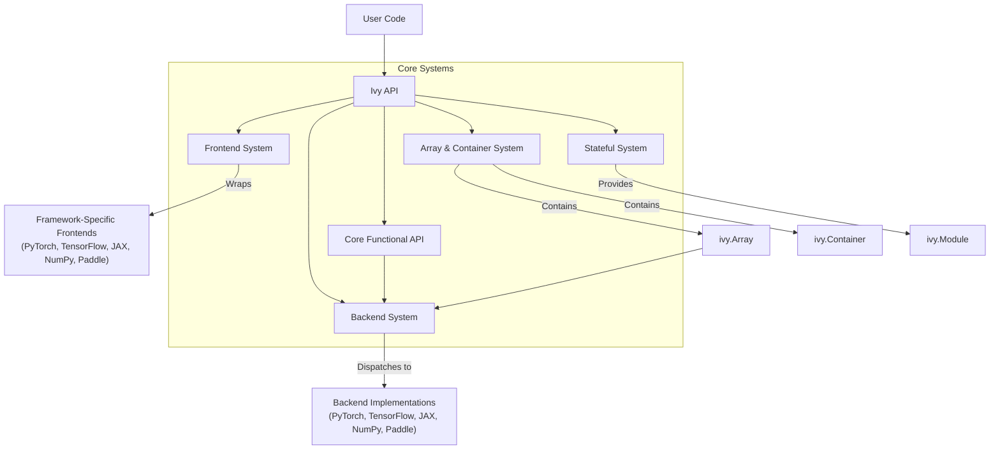

Sources: 
- [ivy/__init__.py:751-753](ivy/__init__.py:751-753)
- [ivy/func_wrapper.py:17-39](ivy/func_wrapper.py:17-39)
- [ivy/functional/ivy/__init__.py:1-45](ivy/functional/ivy/__init__.py:1-45)

### Frontend System

The Frontend System allows Ivy to mimic the API of various ML frameworks, enabling users to write code using familiar interfaces while leveraging Ivy's unified backend.

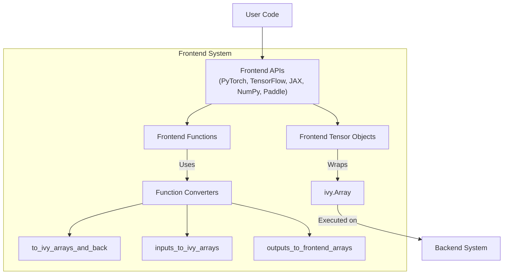

The Frontend System contains implementations that mimic various ML frameworks' APIs. When a user calls a function through a frontend, the inputs are converted to Ivy arrays, processed through the Ivy backend, and then converted back to the appropriate frontend format.

Sources:
- [ivy/func_wrapper.py:418-457](ivy/func_wrapper.py:418-457)
- [ivy/func_wrapper.py:573-590](ivy/func_wrapper.py:573-590)

### Backend System

The Backend System is responsible for dispatching function calls to the appropriate framework implementation. This allows Ivy to leverage different ML frameworks' capabilities while providing a consistent API.

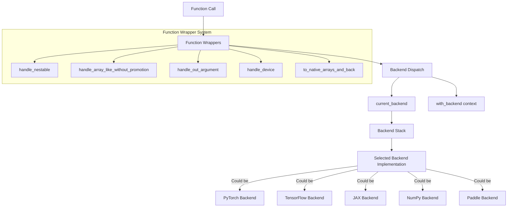

Each backend implementation provides native versions of Ivy's core functions. The system keeps track of the active backend and routes function calls accordingly. Backend switching is possible through context managers or explicit calls.

Sources:
- [ivy/func_wrapper.py:15-39](ivy/func_wrapper.py:15-39)
- [ivy/functional/backends/jax/__init__.py:55-68](ivy/functional/backends/jax/__init__.py:55-68)
- [ivy/functional/backends/torch/__init__.py:21-31](ivy/functional/backends/torch/__init__.py:21-31)
- [ivy/functional/backends/tensorflow/__init__.py:31-95](ivy/functional/backends/tensorflow/__init__.py:31-95)
- [ivy/functional/backends/numpy/__init__.py:17-25](ivy/functional/backends/numpy/__init__.py:17-25)

### Core Functional API

The Core Functional API is the heart of Ivy, providing a unified set of functions that work across all supported backends.

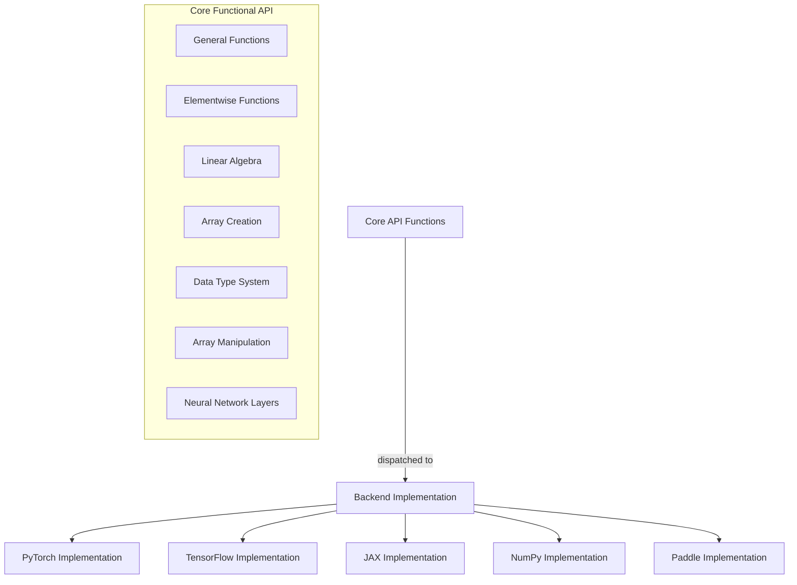

This API provides functions for common operations like array creation, manipulation, mathematical operations, and neural network layers. Each function has implementations across different backends, allowing seamless operation regardless of the active backend.

Sources:
- [ivy/functional/ivy/__init__.py:1-45](ivy/functional/ivy/__init__.py:1-45)
- [ivy/__init__.py:842-891](ivy/__init__.py:842-891)

### Array and Container System

Ivy provides two primary data structures: `ivy.Array` and `ivy.Container`. `ivy.Array` wraps native arrays from various backends, while `ivy.Container` enables working with nested collections of arrays.

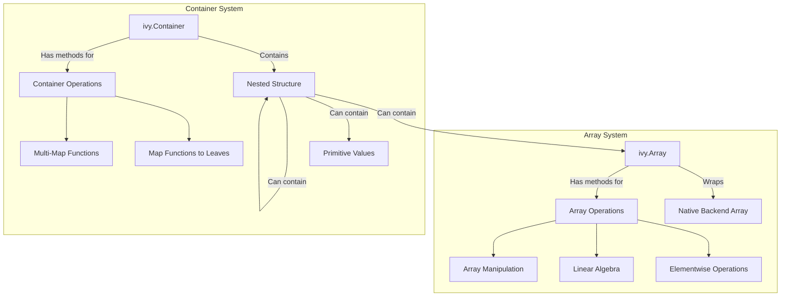

`ivy.Array` provides a consistent interface across different backends, while `ivy.Container` enables operations on nested structures of arrays, facilitating complex transformations and operations on hierarchical data.

Sources:
- [ivy/__init__.py:76-111](ivy/__init__.py:76-111)
- [ivy/__init__.py:228-510](ivy/__init__.py:228-510)
- [ivy/__init__.py:753-755](ivy/__init__.py:753-755)

### Stateful System

The Stateful System provides classes and utilities for building and managing stateful components like neural networks.

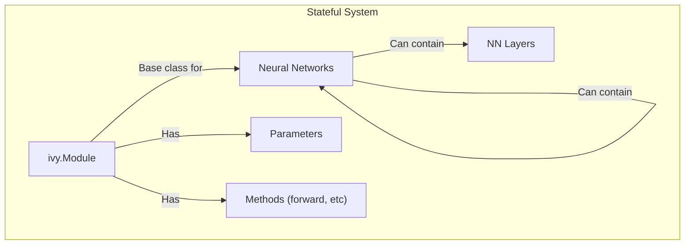

`ivy.Module` provides a framework-agnostic way to define neural network models. It manages parameters and provides methods for forward passes, training, and more.

Sources:
- [ivy/__init__.py:792-793](ivy/__init__.py:792-793)

## Function Wrapper System

One of the key components of Ivy is its function wrapper system, which transforms functions to handle various aspects like device placement, type conversion, array conversion, etc.

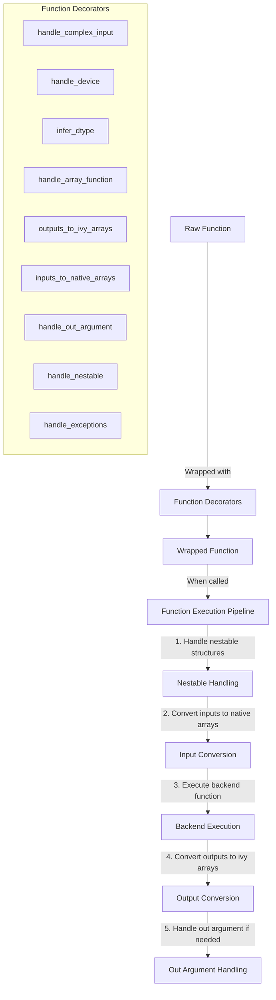

Function wrappers modify function behavior in a layered approach, with each wrapper handling a specific aspect like input conversion, nestable operations, or device placement. This layered approach allows for extensible and modular function behavior.

Sources:
- [ivy/func_wrapper.py:16-39](ivy/func_wrapper.py:16-39)
- [ivy/func_wrapper.py:871-914](ivy/func_wrapper.py:871-914)
- [ivy/func_wrapper.py:381-416](ivy/func_wrapper.py:381-416)
- [ivy/func_wrapper.py:496-524](ivy/func_wrapper.py:496-524)

## Key Features

### Framework Transpilation

One of Ivy's main features is its ability to transpile code between different ML frameworks. This allows developers to write code in one framework and execute it in another.

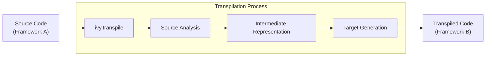

The transpilation process analyzes source code, converts it to an intermediate representation, and then generates equivalent code in the target framework. This allows for seamless conversion between frameworks like PyTorch, TensorFlow, JAX, and NumPy.

Sources:
- [README.md:78-82](README.md:78-82)
- [README.md:180-196](README.md:180-196)

### Graph Tracing

Ivy can trace computational graphs from functions, optimizing them for execution in any supported framework.

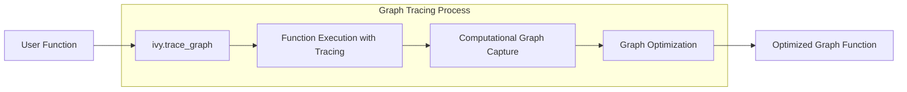

Graph tracing captures the computational structure of functions, allowing for optimizations like fusion of operations, elimination of redundant computations, and efficient execution on various hardware.

Sources:
- [README.md:78-82](README.md:78-82)
- [README.md:213-217](README.md:213-217)

## Unified Type System

Ivy provides a unified type system that abstracts away differences between framework-specific types.

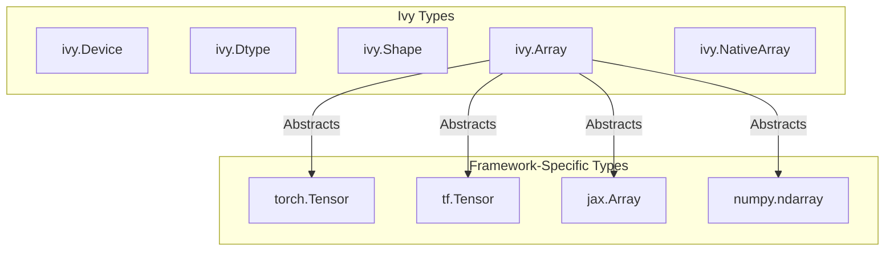

Ivy's type system provides consistent handling of arrays, devices, and data types across different frameworks, enabling framework-agnostic code.

Sources:
- [ivy/__init__.py:44-111](ivy/__init__.py:44-111)
- [ivy/__init__.py:116-223](ivy/__init__.py:116-223)
- [ivy/__init__.py:228-510](ivy/__init__.py:228-510)

## How Systems Interact

The interaction between Ivy's different systems creates a powerful unified framework for machine learning.

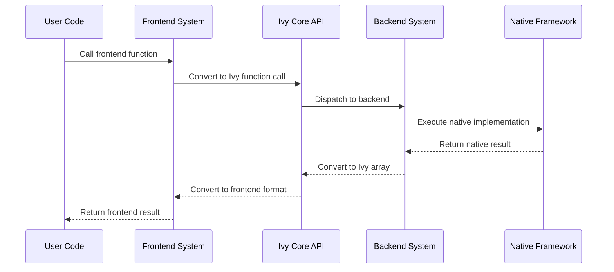

This sequence shows how a typical function call flows through Ivy's systems:
1. User code calls a frontend function
2. The frontend converts inputs to Ivy format
3. The Ivy API dispatches to the appropriate backend
4. The backend executes the function using the native framework
5. Results flow back through the system with appropriate conversions

Sources:
- [ivy/func_wrapper.py:418-457](ivy/func_wrapper.py:418-457)
- [ivy/func_wrapper.py:381-416](ivy/func_wrapper.py:381-416)
- [ivy/func_wrapper.py:496-524](ivy/func_wrapper.py:496-524)

## Backend Implementation Details

Each backend in Ivy implements the same functional API, allowing for consistent behavior across frameworks.

| Backend    | Native Array Type         | Native Module Type  | Supports Gradients | Native Inplace Support |
|------------|---------------------------|---------------------|--------------------|-----------------------|
| JAX        | jax.Array                 | Model/hk.Module     | Yes                | No                    |
| PyTorch    | torch.Tensor              | torch.nn.Module     | Yes                | Yes                   |
| TensorFlow | tf.Tensor                 | Model               | Yes                | No                    |
| NumPy      | numpy.ndarray             | None                | No                 | Yes                   |
| MXNet      | mxnet.ndarray.NDArray     | mx.gluon.nn.Block   | Yes                | Yes                   |

Each backend implementation provides the mapping between Ivy's unified API and the framework-specific operations, handling differences in functionality, type conversions, and execution models.

Sources:
- [ivy/functional/backends/jax/__init__.py:58-68](ivy/functional/backends/jax/__init__.py:58-68)
- [ivy/functional/backends/torch/__init__.py:22-31](ivy/functional/backends/torch/__init__.py:22-31)
- [ivy/functional/backends/tensorflow/__init__.py:96-102](ivy/functional/backends/tensorflow/__init__.py:96-102)
- [ivy/functional/backends/numpy/__init__.py:19-25](ivy/functional/backends/numpy/__init__.py:19-25)
- [ivy/functional/backends/mxnet/__init__.py:74-79](ivy/functional/backends/mxnet/__init__.py:74-79)

## Contributing to Ivy

Ivy welcomes contributions from developers of all skill levels. The contribution process involves:

1. Setting up the development environment
2. Understanding the codebase's structure
3. Finding an issue to work on
4. Creating a pull request with your contribution

For detailed information on contributing, see [Contributing Guide](#7).

Sources:
- [docs/overview/contributing.rst:1-47](docs/overview/contributing.rst:1-47)
- [CONTRIBUTING.md:1-41](CONTRIBUTING.md:1-41)

## Summary

Ivy provides a unified framework for machine learning that enables code to run on multiple backends and to be transpiled between frameworks. Its architecture consists of interconnected systems that handle frontend interfaces, backend implementations, core functionality, data structures, and stateful components. By abstracting away framework-specific details, Ivy allows developers to write framework-agnostic code while still leveraging the strengths of specific frameworks.

---

